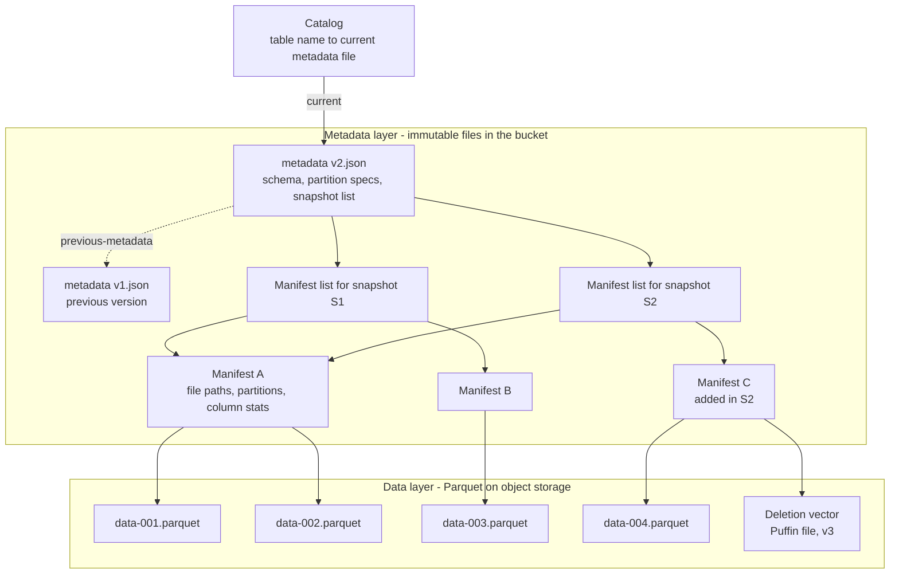
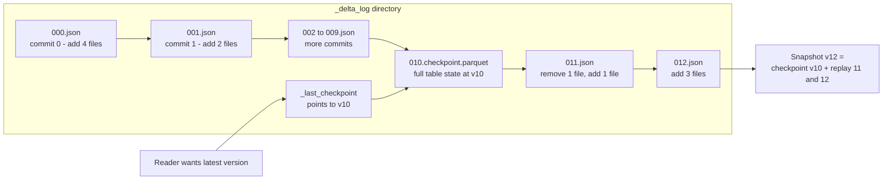
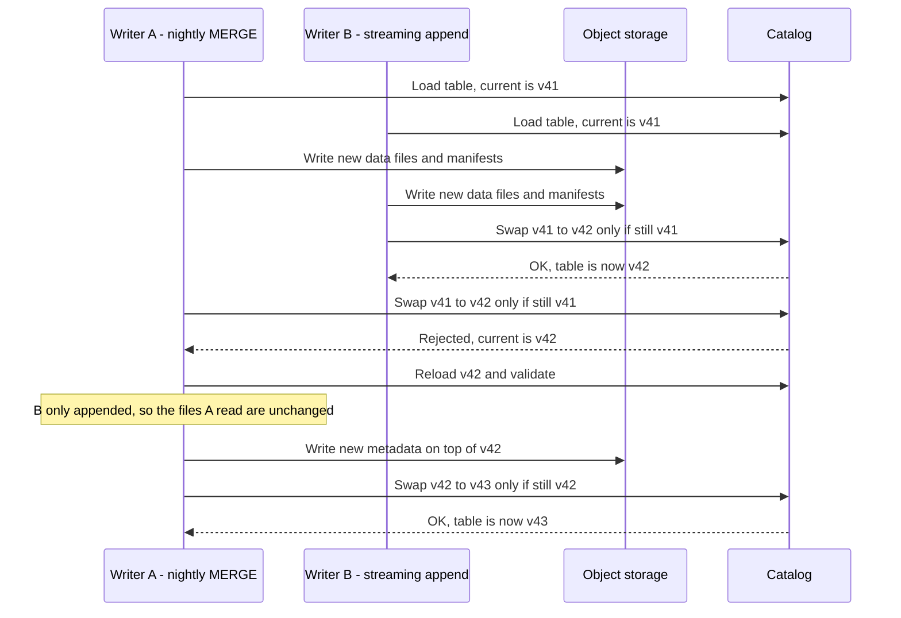
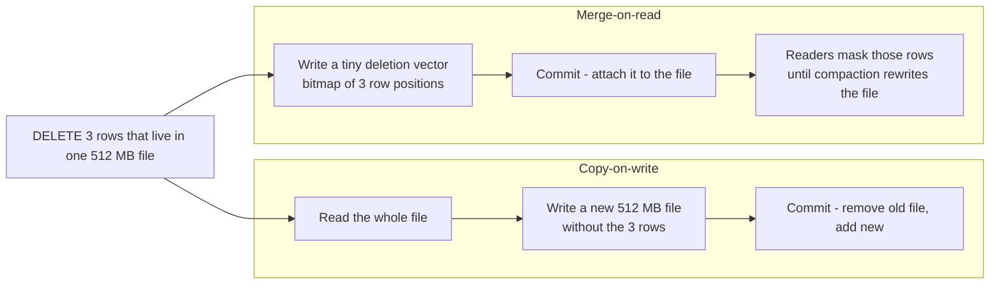
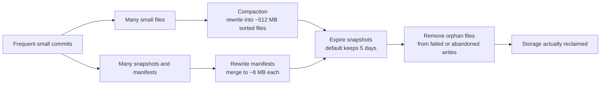
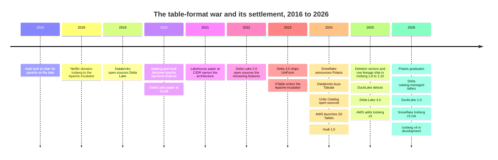

# 7. Open Table Formats: Iceberg, Delta Lake and Hudi
> **Depth:** L2 · **Reading time:** ~16 min · **Last verified:** 2026-11-01 · **Prerequisites:** [Ch 6 — File formats](ch06-file-formats.md), [Ch 5 — Analytical engines](ch05-analytical-engines.md)

## TL;DR

- A folder of [Parquet](../glossary.md#parquet) files on [object storage](../glossary.md#object-storage) is not a table. It has no atomic multi-file commit, no consistent view while a job is writing, and no safe way to change the schema. An [open table format](../glossary.md#open-table-format) adds a metadata layer that fixes all three.
- The core mechanism is the same in every format. Data files are immutable. A commit writes new files plus new metadata, and the table moves forward only when one small pointer or log entry is swapped atomically. That swap is a [compare-and-swap](../glossary.md#compare-and-swap), so concurrent writers use [optimistic concurrency control](../glossary.md#optimistic-concurrency-control): the loser re-reads and retries.
- Apache Iceberg (from Netflix) stores a tree of metadata files and relies on a catalog for the swap. Delta Lake (from Databricks) stores an ordered log of JSON commits with periodic checkpoints. Apache Hudi (from Uber) keeps a timeline tuned for upserts and streaming. Paimon and DuckLake are newer variations.
- The "format war" of 2020–2024 ended in convergence, not a winner. Databricks paid a press-reported ~$2B for Tabular (June 2024).[^tabular] Snowflake, AWS and Google now write Iceberg natively, Microsoft's OneLake exposes its Delta tables as Iceberg through metadata translation, and Delta can expose Iceberg metadata through UniForm. Leverage has moved up one layer, to the catalog ([Ch 8](ch08-catalogs-and-metastores.md)).
- Table formats are not free. Streaming writers create small files and piles of snapshots, so every table needs compaction, snapshot expiry and orphan-file cleanup. Most of the remaining product differentiation, and most of the operating cost, sits in that maintenance work.

## Why this matters (business + Everpure lens)

Table formats are the reason the [lakehouse](../glossary.md#lakehouse) exists. Before them, a company had two options. It could keep data in a warehouse's proprietary storage, which was fast and safe but owned by the vendor. Or it could keep data in an open data lake, which was cheap and open but unreliable. A table format provides database-grade guarantees ([ACID](../glossary.md#acid) commits, [snapshot isolation](../glossary.md#snapshot-isolation), [time travel](../glossary.md#time-travel)) on top of open files in a customer-owned bucket. Once that works, the data no longer has to live inside the engine, and engines compete to query data the customer already holds. Databricks built its business on this argument ([Ch 25](../04-company-deep-dives/ch25-databricks.md)). Snowflake had to accommodate it ([Ch 26](../04-company-deep-dives/ch26-snowflake.md)).

The commercial stakes follow from that. Whoever defines the format sets the cost of switching engines. That explains why a company with $37M of venture funding sold for a press-reported ~$2B,[^tabular] and why every hyperscaler now ships a managed Iceberg service.

For Everpure, the implication is direct. With a table format in place, object storage stops being a passive archive and becomes the durable layer of the analytical database. The storage system then holds the table's metadata files as well as its data, and its consistency semantics are what make commits safe. Two storage-layer moves show where this is heading. AWS launched S3 Tables, a managed Iceberg service built into S3 itself, in December 2024.[^s3tables] MinIO's AIStor now builds an Iceberg REST catalog into its object store.[^ice-vendors] The question for any on-prem S3 platform, FlashBlade included, is whether it is the place tables live or only the place their bytes sit. The Storage bridge below covers this.

## How it works

### A folder of Parquet files is not a table

Suppose a nightly job writes 400 new Parquet files into `s3://lake/orders/date=2026-10-31/`. Three things can go wrong.

1. **No atomic commit.** If the job fails after writing 250 files, readers see a partial day. Object stores have no multi-object transaction and no atomic directory rename, so "all 400 files or none" cannot be expressed.
2. **Listing is slow and is not a snapshot.** To find the files, the engine lists the prefix. S3 returns at most 1,000 keys per LIST call,[^s3-list] so a table with 2 million files needs at least 2,000 sequential calls before it reads any data. The dollar cost is trivial: LIST requests cost $0.005 per 1,000 on S3 Standard, so this is about one cent.[^s3-pricing] The time is not. At an assumed 30 ms per call (estimate), planning takes about a minute. Worse, a listing taken while another job is writing is a mix of old and new state.
3. **No schema contract.** Each Parquet file carries its own schema ([Ch 6](ch06-file-formats.md)). Renaming a column means rewriting every file or teaching every reader a convention. The Hive-era fix, where a table was a directory and a metastore recorded its partitions, inherited all three problems.[^hudi-otf]

The design insight in all the table formats is to **stop asking the storage system what the table contains, and record it explicitly in metadata.** The table is whatever files the metadata lists, and nothing else is visible.

### The core trick: immutable files and one atomic pointer

Every format follows the same two-phase pattern. First, a writer writes new data files and new metadata files, and nobody can see them yet. Second, it publishes them by atomically advancing a single reference to the table's latest state. In Iceberg the catalog does this by swapping a pointer to a new metadata file.[^ice-spec] In Delta Lake the writer creates the next numbered log file, which must fail if that number already exists.[^delta-protocol] Because files are never modified in place, a reader that loaded version 41 keeps a consistent view of version 41 even while version 42 is being written. That is snapshot isolation without locks.

> **Bridge: semiconductors.** The commit is a hardware **compare-and-swap** on a single word. Writers do as much work as they like off to the side, then publish with one instruction that says "set the head pointer to X only if it still equals Y". Lock-free data structures work the same way, and they share the same failure mode: contention causes retries, not deadlocks.

### Iceberg: a tree of metadata

Iceberg models a table as a tree, with the catalog holding the root pointer.[^ice-spec]

*Figure 7.1 — An Iceberg commit adds a few new leaves and a new root, then swaps the catalog pointer. Unchanged manifests (A) are shared between snapshots, which keeps commits cheap and makes time travel almost free.*

From the top down:

- The **catalog** maps a table name to the location of the current [table metadata file](../glossary.md#table-metadata-file). The pointer swap happens here.
- The **metadata file** (JSON) holds the schema history, partition specs, properties and the list of snapshots.
- Each **snapshot** points to a [manifest list](../glossary.md#manifest-list). That list records each [manifest](../glossary.md#manifest) together with partition-range summaries, so a planner can skip most manifests without opening them.
- Each **manifest** (Avro) lists data files with their partition values and per-column min/max statistics. The engine prunes at file level from these statistics before it reads any Parquet.

Planning a query for one day out of three years therefore takes a handful of small reads: one metadata file, one manifest list and the few manifests whose ranges overlap. It does not need thousands of LIST calls. The spec states the goal plainly: a constant number of remote calls to plan a scan, regardless of table size.[^ice-spec]

> **Bridge: memory hierarchy.** The metadata tree works like a **page table** for files. A virtual address (the table name plus a predicate) is resolved through a few levels of indirection to physical locations (Parquet objects). The manifest-list summaries play the role of a TLB that lets the engine skip whole subtrees. Copying a root page table entry, rather than the pages, is also how a copy-on-write filesystem takes an instant snapshot.

Two Iceberg features matter most to users. [Hidden partitioning](../glossary.md#hidden-partitioning) means the table stores a transform such as `day(order_ts)` or `bucket(16, customer_id)`. Queries filter on `order_ts`, and Iceberg derives the partition filter itself, so analysts never have to know the physical layout. [Partition evolution](../glossary.md#partition-evolution) means the transform can change, for example from monthly to daily partitions as volume grows, without rewriting old data. Old files keep their old spec and new files use the new one.[^ice-spec] [Schema evolution](../glossary.md#schema-evolution) is safe because columns are tracked by numeric field ID rather than by name. A rename is a metadata edit, and a dropped column's ID is never reused.

### Delta Lake: a log of commits

Delta Lake uses a log rather than a tree. Each table has a `_delta_log/` directory of JSON files numbered 0, 1, 2 and so on. Each file is one atomic commit listing "add file" and "remove file" actions. To keep readers from replaying thousands of JSON files, writers periodically write a Parquet [checkpoint](../glossary.md#delta-checkpoint) that summarises the whole table state at that version.[^delta-protocol] The reference implementation checkpoints every 10 commits by default.[^delta-config]

*Figure 7.2 — Delta reconstructs a table by loading the latest checkpoint and replaying the few JSON commits after it. The atomic step is creating the next numbered file, so the object store must support "create only if absent".*

The design choice reflects Delta's origin. The 2020 VLDB paper argued that the log should live in the object store next to the data, with no separate metastore needed to read a table.[^delta-vldb] The cost was that the storage system had to provide mutual exclusion on file creation. For years S3 did not, and Delta's S3 multi-writer mode needed DynamoDB as an external lock.[^delta-storage] S3 added conditional writes in August 2024, which closed much of that gap.[^s3-cond]

The more important change came in 2026. Delta Lake 4.1 introduced **[catalog-managed tables](../glossary.md#catalog-managed-table)**, in which the catalog (first Unity Catalog) ratifies each commit and becomes the source of truth.[^delta-cmt] The Delta project describes this as aligning with the model Iceberg pioneered. On the commit path the two designs have converged: in both, the catalog decides.

### Hudi and Paimon: built for upserts and streams

Apache Hudi was built at Uber in 2016 for near-real-time ingestion with updates and deletes. That predates both of the others.[^hudi-otf] Its [timeline](../glossary.md#hudi-timeline) records every action (commits, compactions, clustering, cleaning, rollbacks) as an instant that moves from requested to inflight to completed.[^hudi-timeline] Hudi 1.0 (December 2024) rebuilt the timeline and added non-blocking concurrency control for streaming writers.[^hudi-10] Hudi differs from Iceberg in scope. It ships a storage engine as well as a format: record-level indexes that make upserts cheap, and built-in table services that compact and clean without a separate scheduler. Apache Paimon grew out of Flink's table store and applies an [LSM-tree](../glossary.md#lsm-tree) (the write-optimised structure from [Ch 3](ch03-database-internals.md)) to lake storage. It suits high-frequency changelog tables fed by Flink, and it can emit Iceberg-compatible metadata for batch readers.[^paimon]

### Two writers, one retry

*Figure 7.3 — Optimistic concurrency. Both writers do their expensive work in parallel. Only the final pointer swap is serialized, and the loser retries cheaply if its inputs were not touched.*

The retry is cheap because the data files Writer A already wrote stay valid. Only the metadata on top is rewritten.[^ice-spec] A retry turns into a real failure only when the two writers touched the same files, for example two MERGE jobs updating the same partition. Iceberg's Java library retries 4 times by default before giving up.[^ice-config] The operational lesson is to separate writers by partition, or route them through one service. Many streaming writers committing every few seconds to one hot table will spend their time retrying.

### Row-level changes: copy-on-write vs merge-on-read

Files are immutable, so a three-row `DELETE` has to be expressed somehow. There are two strategies, and the names come from Hudi's table types.[^hudi-otf]

*Figure 7.4 — Copy-on-write makes writes expensive and reads clean. Merge-on-read makes writes cheap and shifts the cost onto every reader until compaction runs.*

[Copy-on-write](../glossary.md#copy-on-write) is still Iceberg's default for DELETE, UPDATE and MERGE.[^ice-config] [Merge-on-read](../glossary.md#merge-on-read) has evolved in stages. Iceberg v2 added [delete files](../glossary.md#delete-file) of two kinds: position deletes (file plus row number) and [equality deletes](../glossary.md#equality-delete) ("every row where id = 5"). Equality deletes are cheap for streaming writers but costly for readers. Iceberg v3 replaced position delete files with binary [deletion vectors](../glossary.md#deletion-vector): Roaring bitmaps stored in Puffin files, at most one per data file.[^ice-spec] This is the same idea Delta shipped in 2023.[^delta-dv] The draft v4 spec goes further and forbids writing new equality deletes.[^ice-spec] Iceberg 1.12 (September 2026) added a Flink maintenance task that converts streaming equality deletes into deletion vectors.[^ice-112]

### Maintenance: the operating cost nobody puts on the slide

A table format specifies what a valid table looks like. It does not keep the table healthy. Take a worked example (estimate): a streaming job with 8 writer tasks that commits every minute produces 8 files per commit, or 11,520 files and 1,440 snapshots a day. If each file is about 5 MB, against Iceberg's 512 MB target file size,[^ice-config] the table has roughly 100 times more files than it should, and planning and scanning slow down accordingly. This is the [small-files problem](../glossary.md#small-files-problem).

*Figure 7.5 — Deleting a row does not free a byte until compaction and snapshot expiry run. Retention policy, not the DELETE statement, decides when storage is reclaimed. That matters for both storage bills and GDPR erasure.*

[Compaction](../glossary.md#compaction) rewrites small files into large, sorted ones. Iceberg 1.12 added Hilbert-curve clustering for multi-column sorting.[^ice-112] [Snapshot expiration](../glossary.md#snapshot-expiration) drops history older than a retention window, 5 days by default in Iceberg, and only then can unreferenced files be deleted.[^ice-config] Delta's equivalents are OPTIMIZE and VACUUM, with a 7-day default before deleted files are physically removed.[^delta-batch] The commercial point is that this work has to run somewhere: in the engine vendor, in a managed service such as S3 Tables, or in the customer's own scheduler. Whoever runs it controls cost and performance, and that has become the main battleground among managed-table products.

> **Going deeper (L3).** Iceberg assigns every commit a *sequence number*. A delete file applies only to data files with an equal or lower sequence number, so a retried commit only needs a new manifest list, and existing manifests can be reused. The v4 draft replaces the manifest list with a single "root manifest" and an adaptive tree, so small streaming commits stop rewriting large metadata.[^ice-spec] Delta's equivalent research front is V2 checkpoints with sidecar files and log compaction.[^delta-protocol]

## Design choices and trade-offs

| Dimension | Apache Iceberg | Delta Lake | Apache Hudi | Apache Paimon | DuckLake |
|---|---|---|---|---|---|
| Origin / steward | Netflix → ASF | Databricks → Linux Foundation | Uber → ASF; Onehouse is the main vendor | Flink Table Store → ASF | DuckDB team (open spec) |
| Metadata shape | Tree: metadata.json → manifest list → manifests | Ordered JSON log + Parquet checkpoints | Timeline + internal metadata table | LSM levels + snapshot/manifest files | Tables in a SQL database |
| Atomic commit via | Catalog pointer swap | Put-if-absent on next log file, or catalog (4.1+) | Timeline instant files on storage | Publish snapshot N+1 atomically, retry on conflict | One SQL transaction |
| Row-level deletes | v2 delete files; v3 deletion vectors | Deletion vectors (2023) | Merge-on-read log files + record index | LSM merge on read/compaction | Delete records in catalog; small changes inlined |
| Partitioning | Hidden, evolvable transforms | Columns or liquid clustering | Columns + clustering | Buckets + partitions | Partition keys incl. Iceberg-compatible bucket |
| Streaming / upserts | Good; equality deletes being phased out | Good (Spark Structured Streaming) | Strongest design centre | Strongest for Flink changelogs | Inlining absorbs tiny writes |
| Maintenance | Left to engines and vendors | OPTIMIZE / VACUUM, auto on Databricks | Built-in table services | Built-in compaction | Built-in, plus CHECKPOINT |
| Ecosystem breadth (Nov 2026) | Broadest; REST catalog spec is the common API | Broad; Spark-centric, Delta Kernel for others | Narrower; Spark/Flink focus | Flink-centric, growing | Young; DuckDB plus Spark/Trino/DataFusion clients |
| Current version | Spec v1–v3 adopted, v4 not yet adopted; Java 1.12.0 (its default `format-version` for new tables is still 2) | Delta 4.4.x | Hudi 1.2.x (table version 9) | Paimon 2.1 | DuckLake 1.1 spec |

*Figure 7.6 — The five designs differ mainly in where the "truth" lives (files, log, timeline, LSM or database) and in how much table maintenance the project takes on itself. Sources: project specs and release notes.*[^ice-spec][^delta-protocol][^hudi-timeline][^paimon][^ducklake-10][^ducklake-11]

**Steelman for each.** *Iceberg:* it has the most precise spec and the most vendor-neutral governance, and nearly every engine and cloud now writes it. Its weakness is that it leaves maintenance to someone else, which is a feature for vendors and a chore for self-hosters. *Delta:* it is the most battle-tested at scale, through Databricks, and is the simplest model to reason about. A log is easy to tail for streaming and change data feed. Its weakness is a historical perception of Databricks control. *Hudi:* it is the best answer for heavy change-data-capture upserts, because its index avoids scanning to find the row being updated. Its weakness is complexity and a smaller ecosystem. *Paimon:* it is the natural fit if Flink is the centre of the stack. *DuckLake:* it argues that once a catalog database is required anyway, keeping all metadata in it is faster and simpler, especially for small, frequent commits.[^ducklake-manifesto] The counter-argument is that it reintroduces a database as a dependency on the read path, which is a scaling and availability question at the largest sizes.

## Who's who

| Player | Role in this layer | Positioning (Nov 2026) |
|---|---|---|
| Apache Iceberg community | Spec + reference libraries (Java, Python, Rust, Go, C++) | De facto interchange format; 1.12.0 had 777 commits from 142 contributors[^ice-112] |
| Databricks | Created Delta; bought Tabular (Iceberg's founders) | Delta native; Unity Catalog governs Delta and Iceberg; UniForm writes Iceberg metadata[^ice-vendors][^delta-uniform] |
| Snowflake | Iceberg tables (managed and external); created Polaris | Horizon Catalog exposes an Iceberg REST endpoint; Polaris graduated to an ASF top-level project in early 2026 (ASF announced 2026-03-05) and was at release 1.8.0 by 2026-09-28[^ice-vendors][^polaris-tlp] |
| AWS | S3 Tables, Glue, Athena, EMR, Redshift | Managed Iceberg built into storage; v3 support from Dec 2025[^s3tables][^aws-v3] |
| Google Cloud | BigLake metastore, BigLake tables for Apache Iceberg | Iceberg REST catalog across BigQuery and Spark[^ice-vendors] |
| Microsoft | OneLake in Fabric | Delta-native storage, Iceberg via REST catalog and XTable[^ice-vendors][^hudi-otf] |
| Onehouse | Commercial Hudi; XTable co-founder | Multi-format "write once, read as any" story[^hudi-otf] |
| DuckDB Labs / MotherDuck | DuckLake; DuckDB reads/writes Iceberg and Delta | Small-to-mid data, SQL-catalog counter-design. AWS signed a definitive agreement (~2026-08-25) to acquire DuckDB Labs, terms undisclosed; DuckDB and DuckLake stay MIT-licensed under the DuckDB Foundation[^ducklake-10][^duckdb-delta][^aws-ducklabs] |
| Dremio (SAP since 2026), Starburst, Cloudera | Iceberg-first engines and catalogs | Dremio's SAP acquisition (announced 2026-05-04, closed about July 2026, terms undisclosed) put a leading Iceberg engine inside an application vendor[^sap-dremio] |
| ClickHouse, StarRocks, Doris | Real-time engines reading lake tables | ClickHouse integrated the Rust Delta Kernel in 2026[^delta-clickhouse] |

*Figure 7.7 — Every major platform now reads Iceberg, and most write it natively. What separates them is the catalog and maintenance service each one wraps around it.*

Engine support has largely become a checklist item. Spark and Flink read and write all four Apache/LF formats. Trino ships connectors for Iceberg, Delta and Hudi, and Hudi's Trino connector moved into the Hudi repository in 2026.[^hudi-rel12] DuckDB writes Iceberg (since late 2025) and Delta (since May 2026).[^duckdb-iceberg][^duckdb-delta] The interesting differences are now in feature depth: which engines support v3 deletion vectors, row lineage and variant types, and which can write through a given catalog.

## History and trajectory

*Figure 7.8 — Four years of competition (2020–2024) were followed by two years of convergence. The settlement came through acquisition and translation layers, not through one format beating the others.*

**Phase 1: three origins (2016–2021).** Uber needed upserts, Netflix needed correct metadata for huge Hive tables, and Databricks needed reliable tables for Spark customers. Each built its own answer.[^hudi-otf][^duckdb-iceberg] Hudi became an Apache top-level project in June 2020.[^hudi-tlp] The 2021 CIDR paper then argued that open formats plus a transactional metadata layer could replace the separate warehouse, and named the result the lakehouse.[^lakehouse-cidr]

**Phase 2: the war (2020–mid-2024).** Iceberg became the neutral choice for vendors that did not want to strengthen Databricks, including Tabular (founded by Iceberg's Netflix creators), Snowflake, AWS and Dremio. Databricks answered by open-sourcing the rest of Delta in 2022[^delta-2] and shipping UniForm in Delta 3.0 (October 2023), which writes Iceberg metadata alongside the Delta log.[^delta-3] Onehouse, Microsoft and Google backed XTable, which translates metadata between formats without copying data. It entered the Apache incubator in December 2023 and was still incubating in November 2026.[^delta-uniform][^xtable]

**Phase 3: the settlement (June 2024 onward).** In the first week of June 2024, Snowflake announced Polaris, an open Iceberg REST catalog,[^sf-polaris] and Databricks agreed to buy Tabular.[^tabular] Unity Catalog was open-sourced the same month.[^uc-oss] AWS launched S3 Tables in December 2024, claiming up to 3x faster queries and up to 10x more transactions per second than self-managed tables (vendor claims).[^s3tables] Then the formats converged. By Databricks' own account, its engineers helped carry Delta's deletion vectors, row tracking and variant type into Iceberg v3, alongside contributors from Snowflake, Apple, Netflix and others,[^dbx-v3] a spec version that Snowflake made generally available in May 2026 (per a secondary source). Delta 4.0 (2025) previewed catalog-managed tables, and Delta 4.1 made the catalog the commit authority, as Iceberg does.[^delta-40][^delta-cmt] Iceberg's REST catalog started planning scans on the server side in May 2026.[^ice-111]

> **Bridge: finance.** A table format is an industry standard, and whoever controls a standard controls **switching costs**. If your data sits in a format only your engine writes well, your customer's cost to leave is a full migration. If the data sits in a neutral format, that cost falls to almost nothing and engines compete on price and performance alone. Databricks paid roughly 54 times Tabular's ~$37M of paid-in capital (estimate, from the press-reported ~$2B price)[^tabular] to make sure Iceberg could not become a moat for its rivals. Read the price as an insurance premium on its core franchise, not as a revenue multiple. The rents did not disappear. They moved to the catalog, which handles identity, permissions, commits and now scan planning. That is why [Ch 8](ch08-catalogs-and-metastores.md) is the sequel to this chapter.

**Where it goes next.** Three trends to watch, all covered in [Ch 44](../06-history-and-future/ch44-future-trends.md). First, *catalogs absorb the format*: commits, planning, credentials and maintenance all move into the catalog service. Second, *Iceberg v4* brings an adaptive metadata tree for cheap small commits, relative paths, and constraints.[^ice-spec] Third, *DuckLake-style designs* keep metadata in a database. The Iceberg REST catalog's server-side planning is a step toward that position, even though the two sides frame it differently.[^ducklake-manifesto][^ice-111]

## Numbers that matter

| Metric | Value | Basis | Source / date |
|---|---|---|---|
| Databricks–Tabular price | ~$2B (WSJ: $1–2B); Tabular had raised ~$37M | Press-reported; undisclosed by Databricks | TechCrunch 2024-08-14[^tabular] |
| Iceberg default target data-file size | 512 MB | Project default | Iceberg docs, 2026[^ice-config] |
| Iceberg manifest merge target | 8 MB | Project default | Iceberg docs, 2026[^ice-config] |
| Iceberg default snapshot retention on expiry | 5 days, min 1 snapshot | Project default | Iceberg docs, 2026[^ice-config] |
| Iceberg commit retries before failure | 4 | Project default | Iceberg docs, 2026[^ice-config] |
| Delta checkpoint interval | Every 10 commits | Reference-implementation default | Delta source, 2026[^delta-config] |
| Delta log retention / deleted-file retention | 30 days / 7 days | Project defaults | Delta docs, 2026[^delta-batch] |
| S3 LIST page size | 1,000 keys per call | AWS API limit | AWS docs[^s3-list] |
| S3 request rate per prefix | 3,500 writes/s and 5,500 reads/s | AWS-stated | AWS docs[^s3-perf] |
| S3 Tables vs self-managed Iceberg | Up to 3x query speed, up to 10x TPS | Vendor claim | AWS, 2024-12-03[^s3tables] |
| Delta Lake adoption | >10,000 companies; >60% of Fortune 500 | Company-stated | Delta blog, 2024-06-06[^delta-uniform] |
| Iceberg 1.12.0 release scale | 777 commits, 142 contributors | Project-stated | Iceberg blog, 2026-10-05[^ice-112] |
| DuckLake inlining threshold | 10 rows by default | Project default | DuckLake 1.0, 2026-04-13[^ducklake-10] |

*Figure 7.9 — The defaults (512 MB files, 5-day snapshots, 10-commit checkpoints) are where operating cost and query speed are actually set. Ask which ones a customer has changed.*

## Storage bridge

> **Storage bridge.** Table formats move database correctness into the object store. The store must provide strong read-after-write consistency, which S3 has offered since December 2020,[^s3-consistency] and ideally conditional "create-if-absent" writes. It must also handle a heavy stream of small metadata reads and writes alongside large sequential data scans. For an on-prem S3 platform such as FlashBlade, the strategic choice is between remaining the bucket under someone else's catalog (the current Dremio and Starburst reference architectures)[^everpure-lake] and following S3 Tables and MinIO AIStor in offering table-aware services: an Iceberg REST catalog, automatic compaction and snapshot expiry, and per-table credentials. These are options a strategy team might evaluate, based on public information. See the companion *Everpure Tech Atlas* for object-protocol and performance detail.

## Conversation playbook

**Questions for a PM**

1. "Which table formats and catalogs do your customers actually write to in production, and how has that mix changed since mid-2024?"
2. "Who runs compaction and snapshot expiry for your customers: you, the engine vendor or the customer? Do you charge for it?"
3. "Where do you sit on Iceberg v3 features (deletion vectors, row lineage, variant), and which engines in your ecosystem lag behind?"

**Questions for an engineer**

1. "How do you implement the atomic commit: catalog CAS, conditional PUT, or an external lock? What happens on a conflicting retry?"
2. "What is your small-file strategy for streaming ingest, and what file-size distribution do you see before and after compaction?"
3. "How do you guarantee that a deleted row is physically gone within the retention policy, given snapshots and time travel?"

**What good answers sound like.** They are specific about the commit primitive ("REST catalog with ETag-based commits", "put-if-absent on the next log entry") and about retention numbers ("we keep 7 days of snapshots and compact hourly to about 512 MB"). They acknowledge that merge-on-read slows reads until compaction runs, and they treat the catalog, not the file format, as the real integration point.

**Don't say this**

- "Iceberg won, so Delta is dead." Delta remains Databricks' native format at very large scale, and UniForm and catalog-managed tables make the distinction matter less.
- "Iceberg is a file format." Parquet is the file format. Iceberg is metadata about many files.
- "Deleting the row deletes the data." Not until compaction plus snapshot expiry plus file cleanup have run.
- "Open format means no lock-in." Lock-in moved to the catalog and its permissions, credentials and maintenance services.
- "S3 Tables replaces Databricks/Snowflake." It is managed storage and maintenance for Iceberg. Engines still do the querying.

## Going deeper

- The Iceberg table spec, especially "Optimistic Concurrency", "Scan Planning" and Appendix E on version differences.[^ice-spec]
- Delta's `PROTOCOL.md`, especially "Checkpoints" and "Catalog-managed tables".[^delta-protocol]
- Armbrust et al., *Delta Lake* (VLDB 2020), and *Lakehouse* (CIDR 2021).[^delta-vldb][^lakehouse-cidr]
- The DuckLake manifesto, for the strongest critique of file-based metadata.[^ducklake-manifesto]
- Hudi's timeline and concurrency-control docs, for non-blocking concurrency on streaming tables.[^hudi-timeline]

## Key terms

- [Open table format](../glossary.md#open-table-format) — a metadata layer and commit protocol that turns files on object storage into a transactional table.
- [Snapshot isolation](../glossary.md#snapshot-isolation) — each reader sees one consistent committed version, unaffected by in-flight writes.
- [Time travel](../glossary.md#time-travel) — querying a table as of an earlier snapshot or version.
- [Table metadata file](../glossary.md#table-metadata-file) — Iceberg's JSON root holding schema, partition specs and snapshot list.
- [Manifest list](../glossary.md#manifest-list) — Iceberg file listing a snapshot's manifests with partition summaries.
- [Manifest](../glossary.md#manifest) — Iceberg file listing data files with partition values and column statistics.
- [Delta log](../glossary.md#delta-log) — Delta Lake's ordered directory of JSON commit files.
- [Delta checkpoint](../glossary.md#delta-checkpoint) — Parquet summary of the full table state at one Delta version.
- [Hudi timeline](../glossary.md#hudi-timeline) — Hudi's log of actions, each moving from requested to inflight to completed.
- [Hidden partitioning](../glossary.md#hidden-partitioning) — partition values derived from column transforms, so queries need not reference partitions.
- [Partition evolution](../glossary.md#partition-evolution) — changing a table's partition scheme without rewriting existing data.
- [Schema evolution](../glossary.md#schema-evolution) — adding, dropping, renaming or widening columns safely over time.
- [Compare-and-swap](../glossary.md#compare-and-swap) — atomic "update only if unchanged" operation underlying table commits.
- [Optimistic concurrency control](../glossary.md#optimistic-concurrency-control) — writers proceed without locks and retry if another commit won.
- [Copy-on-write](../glossary.md#copy-on-write) — rewriting whole data files to apply row changes.
- [Merge-on-read](../glossary.md#merge-on-read) — recording changes separately and applying them at read time.
- [Delete file](../glossary.md#delete-file) — Iceberg v2 file recording deleted rows by position or by value.
- [Equality delete](../glossary.md#equality-delete) — a delete expressed as column values, cheap to write and costly to read.
- [Deletion vector](../glossary.md#deletion-vector) — a bitmap marking deleted row positions in one data file.
- [Small-files problem](../glossary.md#small-files-problem) — performance decay from too many undersized data files.
- [Compaction](../glossary.md#compaction) — rewriting small or delete-laden files into fewer, larger ones.
- [Snapshot expiration](../glossary.md#snapshot-expiration) — removing old snapshots so unreferenced files can be deleted.
- [Catalog-managed table](../glossary.md#catalog-managed-table) — a Delta table whose commits are ratified by its catalog.
- [Lakehouse](../glossary.md#lakehouse) — warehouse-grade management over open files on object storage.
- [ACID](../glossary.md#acid) — atomicity, consistency, isolation, durability guarantees for transactions.
- [LSM-tree](../glossary.md#lsm-tree) — write-optimised structure that buffers and merges sorted runs.
- [Parquet](../glossary.md#parquet) — the dominant open columnar file format beneath all table formats.
- [Object storage](../glossary.md#object-storage) — flat key-value storage of immutable objects accessed over HTTP, such as S3.

## Sources

[^tabular]: TechCrunch, "Databricks reportedly paid $2 billion in Tabular acquisition," https://techcrunch.com/2024/08/14/databricks-reportedly-paid-2-billion-in-tabular-acquisition, published 2024-08-14; retrieved 2026-11-01. WSJ range ($1–2B) and Tabular's ~$37M of funding as recorded in `data/ma_deals.csv` and `meta/research-notes-ma-2020s.md`. Deal announced 2024-06-04; price press-reported, never disclosed by Databricks.
[^ice-spec]: Apache Iceberg, "Iceberg Table Spec" (format versioning, optimistic concurrency, row-level deletes, partitioning, deletion vectors, v4 draft), https://iceberg.apache.org/spec/ (source: https://github.com/apache/iceberg/blob/main/format/spec.md), living document last updated 2026-10-30; retrieved 2026-11-01.
[^ice-config]: Apache Iceberg, "Configuration" (table properties and defaults), https://github.com/apache/iceberg/blob/main/docs/docs/configuration.md, living document; retrieved 2026-11-01.
[^ice-112]: Apache Iceberg PMC, "Apache Iceberg 1.12.0 Release," https://github.com/apache/iceberg/blob/main/site/docs/blog/posts/2026-10-05-iceberg-1.12.0-release.md, published 2026-10-05 (release dated 2026-09-29 on the releases page); retrieved 2026-11-01.
[^ice-111]: Apache Iceberg PMC, "Apache Iceberg 1.11.0 Release," https://github.com/apache/iceberg/blob/main/site/docs/blog/posts/2026-05-19-iceberg-1.11.0-release.md, published 2026-05-19; retrieved 2026-11-01.
[^ice-vendors]: Apache Iceberg, "Vendors Supporting Iceberg Tables" (AWS, Databricks, Google Cloud, Microsoft OneLake, MinIO AIStor, Snowflake, ClickHouse entries), https://github.com/apache/iceberg/blob/main/site/docs/vendors.md, living document; retrieved 2026-11-01.
[^delta-protocol]: Delta Lake, "Delta Transaction Log Protocol" (PROTOCOL.md), https://github.com/delta-io/delta/blob/master/PROTOCOL.md, living document last updated 2026-10-30; retrieved 2026-11-01.
[^delta-config]: Delta Lake, `DeltaConfig.scala` (`checkpointInterval` default 10), https://github.com/delta-io/delta/blob/master/spark/src/main/scala/org/apache/spark/sql/delta/DeltaConfig.scala, retrieved 2026-11-01.
[^delta-batch]: Delta Lake documentation, "Table batch reads and writes — data retention" (logRetentionDuration 30 days; deletedFileRetentionDuration 7 days), https://github.com/delta-io/delta/blob/master/docs/src/content/docs/delta-batch.mdx, retrieved 2026-11-01.
[^delta-storage]: Delta Lake documentation, "Storage configuration" (S3 mutual exclusion and DynamoDB LogStore), https://github.com/delta-io/delta/blob/master/docs/src/content/docs/delta-storage.mdx, retrieved 2026-11-01.
[^delta-cmt]: B. Mathew, S. Sandre, S. Haines, "The next evolution of Delta — Catalog-Managed Tables," Delta Lake blog, https://github.com/delta-io/website/tree/main/src/content/blog/2026-02-02-delta-catalog-managed-tables, published 2026-02-26; retrieved 2026-11-01.
[^delta-dv]: N. Karpov, "Delta Lake Deletion Vectors," Delta Lake blog, https://github.com/delta-io/website/tree/main/src/content/blog/2023-07-05-deletion-vectors, published 2023-07-05; retrieved 2026-11-01.
[^delta-uniform]: J. Brito, K. Weller, "Unifying the open table formats with Delta Lake Universal Format (UniForm) and Apache XTable," Delta Lake blog, https://delta.io/blog/unifying-open-table/, published 2024-06-06; retrieved 2026-11-01. Adoption figures are company-stated.
[^delta-2]: T. Das, D. Lee, "Delta 2.0 — The Foundation of your Data Lakehouse is Open," Delta Lake blog, https://github.com/delta-io/website/tree/main/src/content/blog/2022-08-02-delta-2-0-the-foundation-of-your-data-lake-is-open, published 2022-08-02; retrieved 2026-11-01.
[^delta-3]: C. Akerly, "Delta Lake 3.0.0," Delta Lake blog, https://delta.io/blog/delta-lake-3-0/, published 2023-10-17; retrieved 2026-11-01.
[^delta-clickhouse]: M. Peignon, K. Sumarokova, R. Marin, "Integrating the Rust Delta Kernel into ClickHouse," Delta Lake blog, https://github.com/delta-io/website/tree/main/src/content/blog/2026-05-18-integrating-the-rust-delta-kernel-into-clickhouse, published 2026-05-18; retrieved 2026-11-01.
[^delta-vldb]: M. Armbrust et al., "Delta Lake: High-Performance ACID Table Storage over Cloud Object Stores," PVLDB 13(12), https://www.vldb.org/pvldb/vol13/p3411-armbrust.pdf, published 2020-08; retrieved 2026-11-01.
[^lakehouse-cidr]: M. Armbrust, A. Ghodsi, R. Xin, M. Zaharia, "Lakehouse: A New Generation of Open Platforms that Unify Data Warehousing and Advanced Analytics," CIDR 2021, https://www.cidrdb.org/cidr2021/papers/cidr2021_paper17.pdf, published 2021-01; retrieved 2026-11-01.
[^hudi-otf]: V. Chandar, "What is an Open Table Format?," Apache Hudi blog, https://hudi.apache.org/blog/2026/07/14/what-is-an-open-table-format, published 2026-07-14; retrieved 2026-11-01. (Written by Hudi's creator; treat comparative claims as a participant's view.)
[^hudi-timeline]: Apache Hudi documentation, "Timeline," https://hudi.apache.org/docs/timeline, living document; retrieved 2026-11-01.
[^hudi-rel12]: Apache Hudi, "Release 1.2" (1.2.0 and 1.2.1 notes, table version 9, Trino connector move), https://hudi.apache.org/releases/release-1.2, last modified 2026-09-30; retrieved 2026-11-01.
[^paimon]: Apache Paimon documentation (primary-key tables, LSM storage, Iceberg compatibility), https://paimon.apache.org/ (source: https://github.com/apache/paimon), latest release 2.1.0; retrieved 2026-11-01. Top-level-project status since 2024 per the Hudi blog cited above; concurrency control per https://github.com/apache/paimon/blob/master/docs/docs/concepts/concurrency-control.md.
[^polaris-tlp]: Apache Polaris, "Apache Polaris Graduates to Top Level Project!," https://github.com/apache/polaris/blob/main/site/content/blog/2026/02/19/graduation-tlp.md, published 2026-02-19; ASF, "The Apache Software Foundation Graduates Two Open Source Projects from Incubator," https://news.apache.org/foundation/entry/the-apache-software-foundation-graduates-two-open-source-projects-from-incubator, published 2026-03-05; Polaris 1.8.0 release (2026-09-28) and Iceberg spec/Java-default status per `meta/research-briefing.md` integrator note (Ch 7, 2026-11-01); retrieved 2026-11-01.
[^xtable]: Apache XTable (Incubating), README, https://github.com/apache/incubator-xtable, latest release 0.4.0-incubating; retrieved 2026-11-01.
[^ducklake-manifesto]: M. Raasveldt, H. Mühleisen, "The DuckLake Manifesto: SQL as a Lakehouse Format," https://ducklake.select/manifesto/, published 2025-05-27; retrieved 2026-11-01.
[^ducklake-10]: DuckDB team, "DuckLake 1.0: The Lakehouse Format Built on SQL Reaches Production-Readiness," https://ducklake.select/2026/04/13/ducklake-10/, published 2026-04-13; retrieved 2026-11-01.
[^ducklake-11]: P. Holanda, "What's New in DuckLake 1.1," https://ducklake.select/2026/10/21/ducklake-11/, published 2026-10-21; retrieved 2026-11-01.
[^duckdb-iceberg]: DuckDB, "Iceberg writes in DuckDB" (notes Iceberg's Netflix origin), https://duckdb.org/2025/11/28/iceberg-writes-in-duckdb.html, published 2025-11-28; retrieved 2026-11-01.
[^duckdb-delta]: B. Fleis, "Delta Grows Up: Writes, Unity Catalog, and Time Travel," DuckDB blog, https://duckdb.org/2026/05/07/delta-uc-updates.html, published 2026-05-07; retrieved 2026-11-01.
[^s3tables]: AWS News Blog, "New Amazon S3 Tables: Storage optimized for analytics workloads," https://aws.amazon.com/blogs/aws/new-amazon-s3-tables-storage-optimized-for-analytics-workloads/, published 2024-12-03; retrieved 2026-11-01. Performance figures are vendor claims.
[^s3-cond]: AWS, "Amazon S3 now supports conditional writes," https://aws.amazon.com/about-aws/whats-new/2024/08/amazon-s3-conditional-writes/, published 2024-08-20; retrieved 2026-11-01.
[^s3-list]: AWS, "ListObjectsV2 — Amazon S3 API Reference" (MaxKeys up to 1,000), https://docs.aws.amazon.com/AmazonS3/latest/API/API_ListObjectsV2.html, living document; retrieved 2026-11-01.
[^s3-perf]: AWS, "Best practices design patterns: optimizing Amazon S3 performance," https://docs.aws.amazon.com/AmazonS3/latest/userguide/optimizing-performance.html, living document; retrieved 2026-11-01.
[^s3-pricing]: AWS, "Amazon S3 pricing" (S3 Standard PUT/COPY/POST/LIST requests, US East), https://aws.amazon.com/s3/pricing/, living document; retrieved 2026-11-01. [VERIFY: current LIST price per 1,000 requests still $0.005]
[^aws-v3]: AWS Big Data Blog, "AWS analytics at re:Invent 2025: unifying data, AI and governance at scale," https://aws.amazon.com/blogs/big-data/aws-analytics-at-reinvent-2025-unifying-data-ai-and-governance-at-scale, published 2025-12; retrieved 2026-11-01 (via `meta/research-briefing.md`).
[^sf-polaris]: Snowflake, "Snowflake Unveils Polaris Catalog and Emphasizes Commitment to Interoperability…," press release, https://www.snowflake.com/en/news/press-releases/snowflake-unveils-polaris-catalog-and-emphasizes-commitment-to-interoperability-with-aws-google-cloud-microsoft-azure-salesforce-and-more/, published 2024-06-03; same release syndicated via Business Wire, https://www.businesswire.com/news/home/20240603483144/en/ (as cited in Ch 8); retrieved 2026-11-01.
[^dbx-v3]: Databricks blog, "Iceberg v3: moving the ecosystem towards unification," https://www.databricks.com/en/blog/iceberg-v3-moving-ecosystem-towards-unification, published 2025-06; retrieved 2026-11-01 (via `meta/research-briefing.md`). Snowflake's v3 GA (2026-05-07) is per a secondary source: Atlan, https://atlan.com/know/snowflake/apache-iceberg-v3/, 2026.
[^everpure-lake]: Dremio partner page, https://www.dremio.com/partners/pure-storage/, and Pure/Dremio solution brief, https://dremio.com/wp-content/uploads/2024/10/Dremio-Pure-Storage-Solutions-Brief-1.pdf, 2024-10; Everpure Starburst partner page, https://www.everpuredata.com/la/partners/technology-alliance-partners/starburst.html, n.d.; retrieved 2026-11-01 (via `meta/research-briefing.md`).
[^aws-ducklabs]: Amazon, "AWS to acquire DuckLabs," https://www.aboutamazon.com/news/company-news/aws-ducklabs, published ~2026-08-25/26; retrieved 2026-11-01 (via `meta/verified-facts.md` item 13). Terms undisclosed.
[^sap-dremio]: Dremio newsroom, "SAP to Acquire Dremio…," https://www.dremio.com/newsroom/sap-to-acquire-dremio-to-unify-sap-and-non-sap-data-to-power-agentic-ai/, published 2026-05-04; retrieved 2026-11-01 (via `meta/research-briefing.md`).
[^s3-consistency]: AWS, "Amazon S3 now delivers strong read-after-write consistency automatically for all applications," https://aws.amazon.com/about-aws/whats-new/2020/12/amazon-s3-now-delivers-strong-read-after-write-consistency-automatically-for-all-applications/, published 2020-12-01; retrieved 2026-11-01.
[^uc-oss]: Unity Catalog OSS repository, https://github.com/unitycatalog/unitycatalog, retrieved 2026-11-01; open-sourced June 2024 under LF AI & Data per `meta/research-briefing.md` (Databricks blog, "What's new with Unity Catalog at Data + AI Summit 2026," https://www.databricks.com/blog/whats-new-unity-catalog-data-ai-summit-2026, 2026-06).
[^hudi-10]: V. Chandar, "Announcing Apache Hudi 1.0 and the Next Generation of Data Lakehouses," Apache Hudi blog, https://hudi.apache.org/blog/2024/12/16/announcing-hudi-1-0-0, published 2024-12-16; retrieved 2026-11-01.
[^hudi-tlp]: The Apache Software Foundation, "The Apache Software Foundation Announces Apache Hudi as a Top-Level Project," https://blogs.apache.org/foundation/entry/the-apache-software-foundation-announces64, published 2020-06-04; retrieved 2026-11-01.
[^delta-40]: C. Akerly, R. Pack, "Delta Lake 4.0," Delta Lake blog, https://github.com/delta-io/website/tree/main/src/content/blog/2025-09-25-Delta-Lake-4.0, published 2025-10-20; retrieved 2026-11-01.
