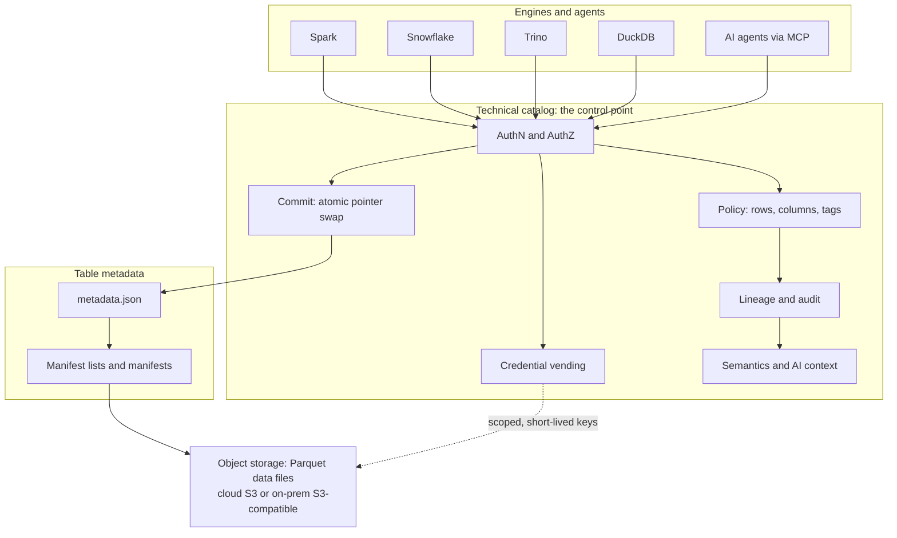
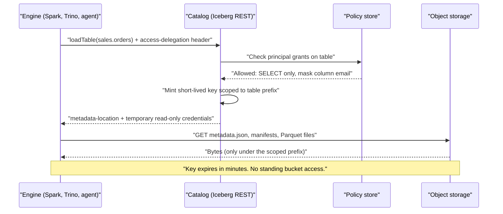
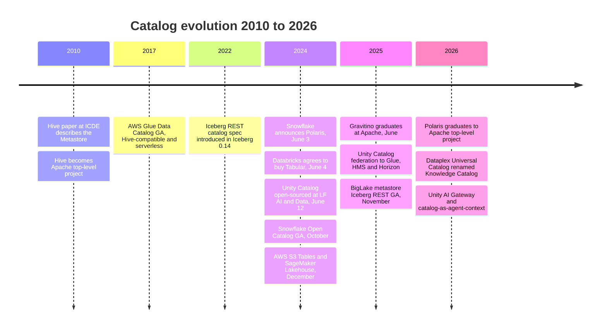

# 8. Catalogs and Metastores: The New Control Point
> **Depth:** L2 · **Reading time:** ~11 min · **Last verified:** 2026-11-01 · **Prerequisites:** [Ch 7 — Open Table Formats](ch07-open-table-formats.md)

## TL;DR

- A [technical catalog](../glossary.md#technical-catalog) (or [metastore](../glossary.md#metastore)) maps a name such as `sales.orders` to the current metadata file of an open table. It also stores schema and partition information, makes commits atomic, enforces access policy and, more and more, hands engines short-lived storage credentials.
- A [business catalog](../glossary.md#business-catalog) (Collibra, Alation, Atlan) is a different product. It helps people *find and trust* data through search, a glossary and stewardship workflows. It does not sit on the read or write path.
- The lineage runs from the [Hive Metastore](../glossary.md#hive-metastore) (about 2010, Thrift API over a relational database) to AWS Glue (2017), then to the vendor-neutral [Iceberg REST catalog](../glossary.md#iceberg-rest-catalog) API (introduced in 2022). From 2024 came Unity Catalog OSS, Apache Polaris and a catalog from each hyperscaler.
- Open formats such as Iceberg and Delta made the *files* portable. The power went to whoever runs the catalog, because every engine must ask it for commit rights, credentials and policy. Hence the "open format, closed catalog" debate.
- The strategic stakes keep rising. The catalog is now where lineage, usage telemetry and semantic context for AI agents collect. That is why Databricks bought Tabular, Snowflake gave Polaris to Apache, and AWS, Google and Microsoft give their catalogs away nearly free.

## Why this matters (business + Everpure lens)

[Chapter 7](ch07-open-table-formats.md) ended with an important detail. An Iceberg commit is just an atomic swap of one pointer, and the catalog holds that pointer. So once storage became a commodity (object storage) and the table layout became an open standard (Iceberg, Delta), the scarce thing left in the lakehouse is the service that decides *which version of a table is current* and *who may touch it*. Every query from every engine passes through that service first.

For an executive, the right mental model is a toll road. Data platforms used to lock customers in through proprietary storage formats. Open formats removed that lever. The catalog brings back a softer and arguably more valuable one: the vendor that runs the catalog sees every access, enforces every policy and holds the context that AI agents need to write correct queries. Switching catalogs means re-pointing every engine, re-creating every grant and re-wiring lineage. That is cheaper than migrating petabytes, but it is not trivial.

For Everpure, the catalog layer matters in two ways. First, an Iceberg lakehouse on FlashBlade only works if the catalog can vend credentials to an on-premises S3 endpoint. That makes catalog compatibility a qualification checkbox for storage sales. Second, the 1touch acquisition ($125.0M cash consideration, closed May 7, 2026, per the 10-Q) brought in discovery, classification and semantic-context technology.[^ep-10q] That is exactly the kind of metadata that catalogs ingest. One option a strategy team might evaluate, based on public information, is positioning Everpure Data Intelligence as a *metadata supplier* to the catalogs (Unity, Polaris/Horizon, Glue) rather than as a catalog competitor.

## How it works

### What a technical catalog actually does

A technical catalog has six jobs. Think of them as layers of one service:

1. **Namespace resolution.** It turns `prod.sales.orders` into a location: catalog → [namespace](../glossary.md#namespace) (database/schema) → table → the object-storage path of the current `metadata.json`. This lookup is the [metadata pointer](../glossary.md#metadata-pointer).
2. **Schema and partition information.** In Hive-era systems the catalog stored the full list of partitions. In Iceberg most of that moved into manifest files, and the catalog keeps only the pointer and a few properties.
3. **Atomic commit.** When two writers race, the catalog performs a compare-and-swap: "update the pointer from v41 to v42 *only if* it is still v41." The loser retries. This is the one operation that object storage alone cannot do safely across engines.
4. **Access control.** Grants on catalogs, schemas, tables, columns and rows, checked on every load and commit.
5. **[Credential vending](../glossary.md#credential-vending).** Instead of giving every engine permanent bucket keys, the catalog issues short-lived credentials scoped to one table's storage prefix.
6. **Audit, lineage and context.** Because every access passes through it, the catalog can log who read what, build lineage graphs and attach descriptions, tags and metrics. That last category is where AI agents get their grounding.

*Figure 8.1 — SV-7: every engine and agent must pass through the catalog to find, change or read a table, so whoever runs the catalog holds commit authority, credentials, policy and context.*

> **Bridge: DNS plus certificate authority.** The catalog plays the role of the lakehouse's DNS: it resolves a human name to the address of the current metadata. It is also the certificate authority, issuing short-lived, scoped credentials that storage will honor. Control both and you control the network, even though you own none of the servers (here, the data files). A semiconductor reader can also picture the memory management unit (MMU): every load and store is translated and permission-checked there before it touches DRAM.

### Technical catalog versus business catalog

The two products share a word and little else. A technical catalog is infrastructure on the hot path, measured in milliseconds and in correct commits. A business catalog is a system of engagement for analysts, stewards and compliance teams. It crawls technical catalogs, BI tools and pipelines, then adds a glossary ("what counts as an active customer"), ownership, certification badges and search. The two layers are now converging. Databricks and Snowflake add discovery and business semantics to Unity and Horizon (Snowflake bought Select Star in late 2025 for exactly that).[^ma-csv] Business-catalog vendors, for their part, reposition as the "context layer" for agents. Governance workflows are covered in [Chapter 15](../02-pipelines-and-governance/ch15-governance-security-privacy.md), and the vendors in [Chapter 33](../04-company-deep-dives/ch33-governance-catalog-security-companies.md).

### Credential vending, step by step

Credential vending is the mechanism that turns the catalog from a phone book into a gatekeeper. In the Iceberg REST protocol, a client signals that it wants delegated access by sending the `X-Iceberg-Access-Delegation` header with the value `vended-credentials`, or `remote-signing`, where the catalog signs each storage request instead.[^irc-spec][^minio-irc] Implementations scope the temporary keys to the table's prefix and never grant more than the caller's own rights. A read-only user gets read-only keys.[^minio-irc]

*Figure 8.2 — Credential vending means the engine never holds standing storage keys; the catalog decides, per request, what bytes an engine may read.*

The business consequence is subtle but large. Before vending, a data team had to give each engine its own identity and access-management (IAM) role on the bucket, and governance lived in two places that drifted apart. With vending, the bucket trusts *only the catalog*, and the catalog's policy becomes the single source of truth. That is good security. It also means the catalog vendor now holds the keys to your object store.

> **Going deeper (L3).** The REST spec is a single OpenAPI YAML file (`open-api/rest-catalog-open-api.yaml`) in the Iceberg repository. One 2026 compatibility review counts 35 operations, including `loadTable`, `commitTransaction` and newer server-side scan planning.[^irc-spec][^irc-report] Engines that support it need no vendor SDK. Iceberg documents the protocol as the successor to the Hive Thrift interface.[^irc-spec]

## Design choices and trade-offs

| Dimension | Technical catalog | Business catalog |
|---|---|---|
| Primary user | Engines, pipelines, agents | Analysts, data stewards, compliance |
| On the read/write path? | Yes: every load and commit | No: crawls and annotates |
| Core objects | Namespaces, tables, snapshots, grants | Glossary terms, owners, certifications, lineage views |
| Failure mode | Outage stops all queries | Outage stops search and workflow |
| Examples | Hive Metastore, Glue, Unity, Polaris, Horizon, Lakekeeper | Collibra, Alation, Atlan, Informatica (Salesforce) |
| Pricing logic | Bundled or per-request | Per-seat/per-asset subscription |

*Figure 8.3 — Technical catalogs sit on the hot path and are bundled; business catalogs sit beside it and are sold by subscription. The two are converging on "context for agents."*

The main architectural choices a buyer makes:

- **Platform-native vs neutral catalog.** A platform catalog (Unity on Databricks, Horizon on Snowflake, Glue on AWS) gives the deepest integration: fine-grained policy, lineage and optimizations work out of the box. A neutral catalog (Polaris, Lakekeeper, Gravitino) keeps engine choice open. The steelman for native is that governance is only as strong as its weakest engine. A single vendor enforcing column masks end to end beats a neutral catalog whose policies some engines ignore.
- **Iceberg-first vs multi-format.** Unity Catalog grew up on Delta and added Iceberg. Polaris and Lakekeeper are Iceberg-native. OneLake stores Delta and exposes Iceberg metadata by conversion.[^onelake-irc] Multi-format catalogs reduce migration pain but add translation edge cases.
- **Federation vs consolidation.** [Catalog federation](../glossary.md#catalog-federation) lets one catalog govern tables registered in another. Unity Catalog announced federation to Glue, Hive Metastore and Snowflake Horizon in June 2025 (public preview).[^uc-2025] Federation is pragmatic, but each hop is a place where policies can be lost in translation.
- **Versioned vs linear history.** Nessie adds git-like branches, tags and merges across many tables, which is useful for testing a pipeline on a branch before publishing.[^nessie] Most catalogs keep a single linear history per table.

## Who's who

| Catalog | Origin | Open source / license | Iceberg REST | Delta support | Governance depth | Vendor neutrality |
|---|---|---|---|---|---|---|
| Hive Metastore | Facebook, then Apache (c. 2010) | Yes, Apache 2.0 | No (Thrift API) | Partial (path registration) | Basic grants | High, but aging |
| AWS Glue Data Catalog / SageMaker Lakehouse | AWS (GA Aug 2017) | No, managed | Yes, `glue.<region>.amazonaws.com/iceberg`; Lake Formation vends credentials[^glue-irc] | Yes, registerable [VERIFY: Glue Delta engine coverage] | Lake Formation row/column grants | AWS-centric |
| Unity Catalog | Databricks (OSS release Jun 2024) | OSS Apache 2.0 at LF AI and Data; managed version richer[^uc-oss] | Yes: read GA, write preview as of Jun 2025[^uc-2025] | Native | Deep: ABAC, lineage, AI assets, Domains (2026)[^uc-2026] | Databricks-led |
| Apache Polaris / Snowflake Open Catalog | Snowflake (Jun 2024), Apache TLP 2026 | Yes, Apache 2.0, ASF governed[^polaris-tlp] | Native (reference-grade) | Generic tables [VERIFY: Delta via Polaris generic tables] | RBAC, credential vending | High (ASF) |
| Snowflake Horizon Catalog | Snowflake | No, managed (embeds Polaris) | Yes, read GA, writes preview[^horizon-irc] | Limited [VERIFY: Horizon Delta support] | Deep: masking, tags, lineage, Select Star discovery | Snowflake-led |
| Google BigLake metastore / Knowledge Catalog | Google | No, managed | Yes, GA Nov 2025, admin-enabled vending[^biglake-irc] | Limited [VERIFY: BigLake Delta support] | Knowledge Catalog lineage, quality, discovery[^gcp-kc] | GCP-centric |
| Microsoft OneLake catalog | Microsoft Fabric | No, managed | Preview, read-only metadata[^onelake-irc] | Native (Delta is OneLake's format) | Fabric governance, Purview [VERIFY: OneLake catalog governance features and launch date] | Azure-centric |
| Apache Gravitino | Datastrato, Apache TLP Jun 2025 | Yes, Apache 2.0[^gravitino] | Yes (REST service) | Via multi-format catalogs [VERIFY: Gravitino Delta support] | Unified metadata across sources | High (ASF) |
| Project Nessie | Dremio | Yes, Apache 2.0 | Yes | Limited [VERIFY: Nessie Delta support] | Git-like versioning | Medium; capabilities folded into Polaris[^polaris-nessie] |
| Lakekeeper | Vakamo | Yes, Apache 2.0, Rust[^lakekeeper] | Native | No (Iceberg-only) | Vended credentials, remote signing, change events | High |

*Figure 8.4 — Every major platform now speaks Iceberg REST, so the API is no longer the differentiator. The contest has moved to governance depth and who controls the roadmap. Cells summarize public docs as of 2026-11-01; Delta cells are the least verified.*

**Positioning in one line each.** *Databricks* uses Unity Catalog as the center of gravity of its platform and widens it to govern models, AI functions and agent traffic (Unity AI Gateway, 2026).[^uc-2026] *Snowflake* split its bet: Horizon is the rich proprietary layer, and Polaris is the neutral open-source layer that lets Snowflake argue it does not lock in data. *AWS* bundles Glue, Lake Formation and S3 Tables into the storage bill. *Google* and *Microsoft* tie catalogs to BigQuery and Fabric. *Gravitino*, *Nessie* and *Lakekeeper* are the independents: credible technology, thin commercial wrappers.

## History and trajectory

*Figure 8.5 — Fifteen years from a sidecar RDBMS to a strategic control point; the 2024 "catalog summer" compressed most of the shift into ten days in June.*

**The Hive era (2008–2017).** Facebook built Hive to run SQL on Hadoop. Its 2010 ICDE paper described a Metastore: a Thrift service backed by a relational database (MySQL or Postgres) that recorded tables, columns and every partition.[^hive-icde] Hive became an Apache top-level project in late 2010.[^hive-tlp] The design aged badly at cloud scale. Each partition was a row, and listing calls shipped a full storage descriptor per partition. Tables with tens of thousands of partitions caused client timeouts, and the backing database became the bottleneck.[^hive-7223][^lakefs-hms] The metastore also could not make multi-file commits atomic. That gap is the core reason table formats were invented.

**The managed era (2017–2022).** AWS Glue Data Catalog reached general availability in August 2017. It was Hive-compatible, serverless and shared by Athena, EMR and Redshift Spectrum.[^glue-ga] Its pricing set the template for the industry: the first million objects free, then $1.00 per 100,000 objects a month.[^glue-pricing] Even at large scale, that is a rounding error next to compute, which signaled that the catalog would be a loss leader.

**The open-API era (2022–2024).** The Iceberg community introduced the REST catalog specification in Iceberg 0.14 in 2022. It defined, for the first time, a vendor-neutral HTTP contract for load, commit and credentials.[^irc-dremio] Any engine that speaks REST can now use any compliant catalog, much as any browser can use any DNS server.

**The catalog summer (June 2024).** On June 3, 2024, Snowflake announced Polaris, an Iceberg REST catalog it promised to open-source within 90 days.[^polaris-pr] The next day Databricks announced it would buy Tabular, the company founded by Iceberg's creators (about 40 employees).[^tabular-pr] The price was undisclosed by Databricks; it was press-reported at about $2B.[^ma-csv] On June 12, Databricks open-sourced Unity Catalog under the LF AI & Data Foundation and said the product already served more than 10,000 organizations (company-stated).[^uc-oss] Snowflake shipped the managed Snowflake Open Catalog in October 2024.[^open-catalog] In December, AWS launched S3 Tables, Iceberg-native buckets with up to 3x faster queries and up to 10x more transactions per second than self-managed tables (company-stated claims).[^s3tables-pr] SageMaker Lakehouse followed as a unified Iceberg-compatible catalog.[^sm-lakehouse]

**Consolidation (2025–2026).** Gravitino graduated at Apache in June 2025.[^gravitino] Polaris followed: the incubator records graduation on February 15, 2026, and the ASF announced it on March 5, 2026.[^polaris-tlp] Polaris 1.4 shipped in April 2026 with multi-tenancy improvements.[^polaris-14] Google made BigLake metastore's Iceberg REST endpoint GA in November 2025 and renamed Dataplex Universal Catalog to Knowledge Catalog on April 10, 2026.[^biglake-irc][^gcp-kc] Snowflake's Horizon now exposes Iceberg REST to outside engines, with request billing of 0.5 credits per million calls planned for 2026.[^horizon-irc] The status of Unity Catalog OSS within LF AI & Data (sandbox vs incubation) could not be confirmed. [VERIFY: Unity Catalog OSS LF AI and Data maturity stage]

### Why the deals made sense

- **Databricks–Tabular.** At a price press-reported near $2B for a company of about 40 people, Databricks was buying control of the Iceberg roadmap's center of gravity, not revenue.[^tabular-pr][^ma-csv] It took a credible "neutral Iceberg catalog" company off the table just as Snowflake launched Polaris. It also brought the Iceberg creators into the Delta–Iceberg convergence effort. In finance terms, it was a defensive option premium on the control point.
- **Snowflake–Polaris.** Snowflake's historical moat was proprietary storage. Once customers demanded Iceberg, the credible move was to *give away* the catalog layer under ASF governance. That made "neutral" a Snowflake-originated asset, while monetizing the richer Horizon layer and the compute.
- **Hyperscalers bundling.** For AWS, Google and Microsoft the catalog is a complement to storage and compute. A free or nearly free catalog pulls Iceberg data into their object stores and their engines, the classic "commoditize your complement" play.

> **Bridge: finance.** Treat catalog control like a royalty position. The catalog owner earns little directly, but it holds a perpetual option on every downstream dollar: which engine is the default, which governance add-on is sold, and which AI assistant gets the context. As with a royalty, the value lies in the breadth of the base it touches, not in the fee.

**Where it goes next.** The catalog is turning into the grounding layer for AI agents. Descriptions, certified metrics, lineage and usage statistics are what a text-to-SQL agent needs to avoid confidently wrong answers (see [Chapter 22](../03-ai-data-stack/ch22-agents-and-data.md) and [Chapter 14](../02-pipelines-and-governance/ch14-semantic-layers-and-bi.md)). Whoever owns that context owns the agent experience, which is why "open format, closed catalog" is now a live procurement issue. The bear case for the platforms: the REST API makes catalogs swappable, and federation weakens any single owner's grip.

## Numbers that matter

| Metric | Value | Basis | Source / date |
|---|---|---|---|
| Databricks paid for Tabular | ~$2B (WSJ: $1–2B) | Press-reported; undisclosed by Databricks | TechCrunch 2024-08-14[^ma-csv] |
| Tabular team size at deal | ~40 people | Company-stated | Databricks PR 2024-06-04[^tabular-pr] |
| Unity Catalog organizations | >10,000 | Company-stated, Jun 2024 | Databricks PR 2024-06-12[^uc-oss] |
| Glue Data Catalog storage price | First 1M objects free; $1.00 per 100K objects/month above | List price | AWS pricing page[^glue-pricing] |
| Horizon Iceberg REST API billing | 0.5 credits per million calls (planned 2026) | List price, subject to change | Snowflake docs[^horizon-irc] |
| S3 Tables vs self-managed | Up to 3x query speed, up to 10x TPS | Company-stated claim | AWS PR 2024-12-03[^s3tables-pr] |
| Polaris incubation output | ~100 contributors, 6 releases, >2,800 PRs | Third-party summary | Fivetran blog 2026-02[^fivetran-polaris] |
| Iceberg REST spec size | 35 operations | Third-party count | Compatibility report 2026[^irc-report] |
| Everpure–1touch | $125.0M cash consideration | GAAP (10-Q) | Everpure 10-Q, qtr ended 2026-05-03[^ep-10q] |

*Figure 8.6 — The catalog's direct revenue is tiny (Glue charges dollars per 100,000 objects) while the deals around it run into billions: the value is in control, not in fees.*

## Storage bridge

> **Storage bridge.** For an on-premises lakehouse, the catalog must be able to mint scoped credentials, or remote-sign requests, for an S3-compatible endpoint, not only for AWS. Implementations such as Lakekeeper and MinIO AIStor already vend prefix-scoped S3 credentials or remote-sign requests against non-AWS object stores.[^lakekeeper][^minio-irc] For FlashBlade, the qualification questions are STS-style temporary credentials, per-prefix policy and request-signing performance under many small metadata reads. See the companion *Everpure Tech Atlas* for S3 protocol and FlashBlade detail. Strategic options are in [Chapter 45](../06-history-and-future/ch45-storage-moving-up-the-stack.md).

## Conversation playbook

**Three questions for product managers**

1. "Which catalog is the system of record for your Iceberg tables, and which engines can commit to it, not just read?" A good answer names one catalog per domain and lists writers explicitly. A weak answer is "all of them" (concurrent multi-catalog writes are a corruption risk).
2. "If you left your platform vendor, what would you have to rebuild: grants, lineage, tags, metric definitions?" Good answers show the team has priced the exit, and know that data files move freely while policies do not.
3. "Where do your AI agents get table descriptions and certified metrics?" Good answers point to the catalog or semantic layer, not to prompts stuffed with schema dumps.

**Three questions for engineers**

1. "Do your engines get vended credentials or standing bucket keys?" Good: vending with short time-to-live (TTL) keys and prefix scoping. A red flag is shared long-lived keys per engine.
2. "How do you handle commit conflicts and table maintenance (compaction, snapshot expiry)?" Good: the catalog or a managed service handles optimistic retries and scheduled maintenance.
3. "Have you tested federation, and what policies survive the hop?" Good answers acknowledge that row filters and masks often do not travel across catalogs.

**"Don't say this"**

- "Iceberg means no lock-in." The format is open; the catalog, its policies and its context may not be.
- "Collibra and Unity Catalog are competitors." Mostly they are complements: a business catalog versus a technical one, even though the overlap is growing.
- "The Hive Metastore is dead." Huge numbers of tables still sit behind it, and modern catalogs federate to it.
- "Polaris is Snowflake's catalog." It is an Apache top-level project. Snowflake's proprietary catalog is Horizon, which embeds Polaris.

## Going deeper

- Read the Iceberg REST OpenAPI spec and trace `loadTable` → `commitTable` to see exactly where atomicity and credentials live.[^irc-spec]
- Compare how Unity Catalog, Polaris and Lakekeeper map grants to vended-credential scopes, and where each enforces row and column policy (catalog vs engine).
- The Hive ICDE 2010 paper is short and shows why partition-in-RDBMS design had to be replaced.[^hive-icde]

## Key terms

- [Metastore](../glossary.md#metastore) — service that stores table definitions and locations for query engines; the Hive-era name for a technical catalog.
- [Technical catalog](../glossary.md#technical-catalog) — the on-path service that resolves table names to current metadata, arbitrates commits and enforces access.
- [Business catalog](../glossary.md#business-catalog) — a discovery, glossary and stewardship tool for people (Collibra, Alation, Atlan).
- [Hive Metastore](../glossary.md#hive-metastore) — Hive's Thrift-plus-RDBMS metadata service, still widely used and federated.
- [Iceberg REST catalog](../glossary.md#iceberg-rest-catalog) — the open HTTP/OpenAPI contract any engine can use to load and commit Iceberg tables.
- [Credential vending](../glossary.md#credential-vending) — the catalog issues short-lived, table-scoped storage credentials to an authorized engine.
- [Remote signing](../glossary.md#remote-signing) — the catalog signs each storage request instead of handing out credentials.
- [Catalog federation](../glossary.md#catalog-federation) — one catalog discovering and governing tables registered in another.
- [Namespace](../glossary.md#namespace) — a hierarchical container (database or schema) that groups tables in a catalog.
- [Metadata pointer](../glossary.md#metadata-pointer) — the catalog's record of which metadata file is a table's current version.

## Sources

[^ep-10q]: Everpure, Inc., Form 10-Q for the quarter ended 2026-05-03, SEC EDGAR, https://www.sec.gov/Archives/edgar/data/0001474432/000147443226000061/pstg-20260503.htm, published 2026-06; retrieved 2026-11-01. Also Cleary Gottlieb, "Everpure Completes Acquisition of 1touch," https://www.clearygottlieb.com/news-and-insights/news-listing/everpure-completes-acquisition-of-1touch, published 2026-05-11; retrieved 2026-11-01.
[^ma-csv]: Atlas dataset `data/ma_deals.csv` (rows: Databricks–Tabular; Snowflake–Select Star), citing TechCrunch, "Databricks reportedly paid $2 billion in Tabular acquisition," https://techcrunch.com/2024/08/14/databricks-reportedly-paid-2-billion-in-tabular-acquisition, published 2024-08-14, and Snowflake blog, https://www.snowflake.com/en/blog/snowflake-acquire-select-star/, published 2025-11-24; retrieved 2026-11-01.
[^irc-spec]: Apache Iceberg, "REST Catalog Spec," https://iceberg.apache.org/rest-catalog-spec/, n.d. (living spec); retrieved 2026-11-01.
[^minio-irc]: MinIO, "Iceberg REST Catalog Settings (AIStor Tables)," https://docs.min.io/aistor/reference/aistor-server/settings/aistor-tables/iceberg-rest/, n.d.; retrieved 2026-11-01.
[^irc-report]: Data Lakehouse Hub, "The 2026 Iceberg REST Catalog Compatibility Report," https://datalakehousehub.com/blog/iceberg-rest-catalog-compatibility-report-2026, published 2026; retrieved 2026-11-01 (third-party).
[^irc-dremio]: Dremio, "Apache Iceberg REST Catalog: what it is and how to use it," https://www.dremio.com/blog/apache-iceberg-rest-catalog-what-it-is-and-how-to-use-it/, n.d.; retrieved 2026-11-01.
[^onelake-irc]: Microsoft Learn, "OneLake table APIs for Iceberg," https://learn.microsoft.com/en-us/fabric/onelake/table-apis/onelake-iceberg-table-apis, n.d.; and Fabric blog, "OneLake Table APIs (Preview)," https://blog.fabric.microsoft.com/en-us/blog/now-in-preview-onelake-table-apis; retrieved 2026-11-01.
[^uc-2025]: Databricks blog, "What's new with Databricks Unity Catalog at Data + AI Summit 2025," https://www.databricks.com/blog/whats-new-databricks-unity-catalog-data-ai-summit-2025, published 2025-06; retrieved 2026-11-01.
[^uc-2026]: Databricks blog, "What's new with Unity Catalog at Data + AI Summit 2026," https://www.databricks.com/blog/whats-new-unity-catalog-data-ai-summit-2026, published 2026-06; retrieved 2026-11-01.
[^nessie]: Ilum documentation, "Project Nessie catalog," https://ilum.cloud/docs/features/catalogs/nessie/, n.d.; retrieved 2026-11-01. Project home: projectnessie.org.
[^glue-irc]: AWS Storage Blog, "Access data in Amazon S3 Tables using PyIceberg through the AWS Glue Iceberg REST endpoint," https://aws.amazon.com/blogs/storage/access-data-in-amazon-s3-tables-using-pyiceberg-through-the-aws-glue-iceberg-rest-endpoint/, n.d.; retrieved 2026-11-01.
[^uc-oss]: Databricks press release, "Databricks Open Sources Unity Catalog, Creating the Industry's Only Universal Catalog for Data and AI," https://www.databricks.com/company/newsroom/press-releases/databricks-open-sources-unity-catalog-creating-industrys-only-open, published 2024-06-12; retrieved 2026-11-01.
[^polaris-tlp]: Apache Polaris blog, "Apache Polaris graduates to top-level project," https://polaris.apache.org/blog/2026/02/19/apache-polaris-graduates-to-top-level-project/, published 2026-02-19; ASF, "The Apache Software Foundation Graduates Two Open Source Projects from Incubator," https://news.apache.org/foundation/entry/the-apache-software-foundation-graduates-two-open-source-projects-from-incubator, published 2026-03-05; Apache Incubator status page, https://incubator.apache.org/projects/polaris.html; retrieved 2026-11-01.
[^horizon-irc]: Snowflake documentation, "Access Apache Iceberg tables with an external engine through Snowflake Horizon Catalog," https://docs.snowflake.com/en/user-guide/tables-iceberg-access-using-external-query-engine-snowflake-horizon, n.d.; retrieved 2026-11-01.
[^biglake-irc]: Google Cloud blog, "BigLake metastore now supports Iceberg REST Catalog," https://cloud.google.com/blog/products/data-analytics/biglake-metastore-now-supports-iceberg-rest-catalog/, published 2025-11-19; and Google Cloud docs, "Use the BigLake metastore Iceberg REST catalog," https://docs.cloud.google.com/biglake/docs/blms-rest-catalog; retrieved 2026-11-01.
[^gcp-kc]: Google Cloud docs, "Knowledge Catalog (formerly Dataplex) overview" and release notes, https://docs.cloud.google.com/dataplex/docs/overview and https://docs.cloud.google.com/dataplex/docs/release-notes, accessed 2026-11-01; Atlan, "Google Knowledge Catalog," https://atlan.com/know/ai-agent/gcp/google-knowledge-catalog/, published 2026; retrieved 2026-11-01.
[^gravitino]: Apache Gravitino blog, "Gravitino becomes a top-level project," https://gravitino.apache.org/blog/gravitino-top-level-project, published 2025-06; ASF, "The Apache Software Foundation Announces Two New Top-Level Projects," https://news.apache.org/foundation/entry/the-apache-software-foundation-announces-two-new-top-level-projects, published 2025-06; retrieved 2026-11-01.
[^polaris-nessie]: Dremio blog, "Polaris Catalog, to be merged with Nessie, now available on GitHub," https://www.dremio.com/?p=21675, published 2024-07; and FOSS Force, "Snowflake open sources Apache Iceberg-related Polaris data catalog," https://fossforce.com/2024/07/snowflake-open-sources-apache-iceberg-related-polaris-data-catalog/, published 2024-07; retrieved 2026-11-01.
[^lakekeeper]: Lakekeeper, GitHub repository and documentation, https://github.com/lakekeeper/lakekeeper and https://docs.lakekeeper.io, n.d.; retrieved 2026-11-01.
[^hive-icde]: A. Thusoo et al., "Hive – A Petabyte Scale Data Warehouse Using Hadoop," IEEE ICDE 2010, copy at https://courses.cs.washington.edu/courses/csep544/21sp/papers/hive-icde-2010.pdf, published 2010; retrieved 2026-11-01.
[^hive-tlp]: Apache Hive, "Hive Contributors Meeting Minutes 2010-10-25," https://hive.apache.org/community/meetings/development-contributorsmeetings-hivecontributorsminutes101025/, published 2010-10-25; retrieved 2026-11-01.
[^hive-7223]: Apache JIRA, "HIVE-7223" (proposal to make Metastore partition listing more compact), https://issues.apache.org/jira/browse/HIVE-7223, n.d.; retrieved 2026-11-01.
[^lakefs-hms]: lakeFS blog, "Hive Metastore – it didn't age well," https://lakefs.io/blog/hive-metastore-it-didnt-age-well/, n.d.; retrieved 2026-11-01.
[^glue-ga]: AWS What's New, "Amazon Athena now integrates with AWS Glue," https://aws.amazon.com/about-aws/whats-new/2017/08/amazon-athena-now-integrates-with-aws-glue, published 2017-08-14; retrieved 2026-11-01.
[^glue-pricing]: AWS, "AWS Glue pricing," https://aws.amazon.com/glue/pricing/, n.d. (list price page); retrieved 2026-11-01.
[^polaris-pr]: Snowflake via Business Wire, "Snowflake Unveils Polaris Catalog and Emphasizes Commitment to Interoperability with AWS, Google Cloud, Microsoft Azure, Salesforce, and More," https://www.businesswire.com/news/home/20240603483144/en/, published 2024-06-03; retrieved 2026-11-01.
[^tabular-pr]: Databricks press release, "Databricks Agrees to Acquire Tabular, the Company Founded by the Original Creators of Apache Iceberg," https://www.databricks.com/company/newsroom/press-releases/databricks-agrees-acquire-tabular-company-founded-original-creators, published 2024-06-04; retrieved 2026-11-01.
[^open-catalog]: Snowflake blog, "Govern an Open Lakehouse with Snowflake Open Catalog, a Managed Service for Apache Polaris," https://www.snowflake.com/en/blog/govern-open-lakehouse-snowflake-open-catalog/, published 2024-10-18; retrieved 2026-11-01.
[^s3tables-pr]: Amazon via Business Wire, re:Invent 2024 announcement of Amazon S3 Tables, https://www.businesswire.com/news/home/20241203462924/en, published 2024-12-03; retrieved 2026-11-01.
[^sm-lakehouse]: AWS News Blog, "Amazon S3 Tables integration with Amazon SageMaker Lakehouse is now generally available," https://aws.amazon.com/blogs/aws/amazon-s3-tables-integration-with-amazon-sagemaker-lakehouse-is-now-generally-available, published 2025-03-13; retrieved 2026-11-01.
[^polaris-14]: Snowflake engineering blog, "What's New in Apache Polaris 1.4: Advanced Multi-Tenancy and Streamlined Deployment," https://www.snowflake.com/en/engineering-blog/apache-polaris-1-4-release/, published 2026-04-23; retrieved 2026-11-01.
[^fivetran-polaris]: Fivetran blog, "The impact of Apache Polaris graduating to top-level Apache project," https://www.fivetran.com/blog/the-impact-of-apache-polaris-graduating-to-top-level-apache-project, published 2026-02; retrieved 2026-11-01 (third-party).
