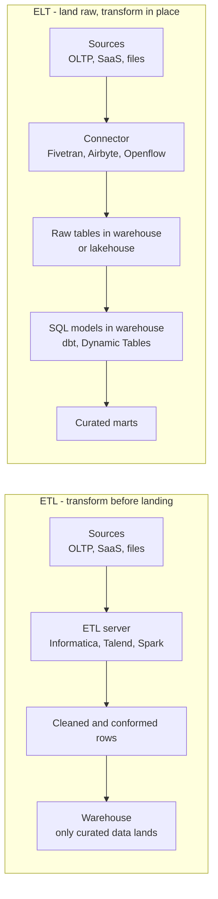
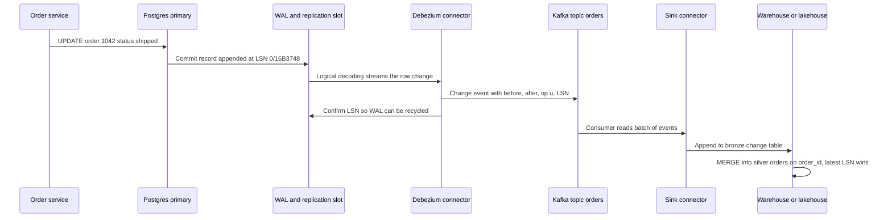
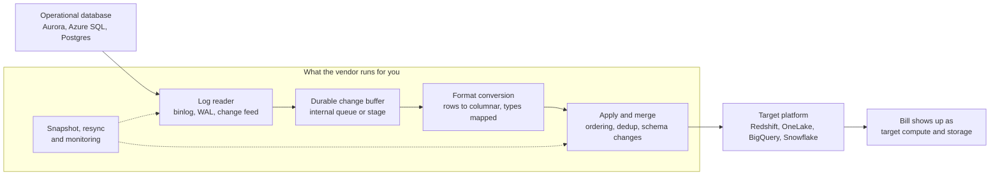
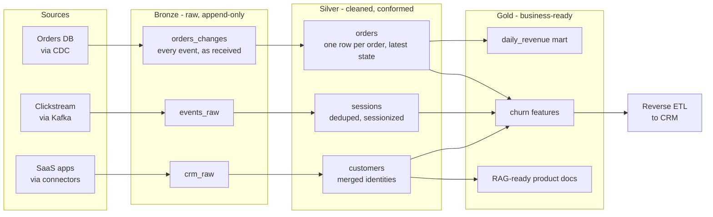
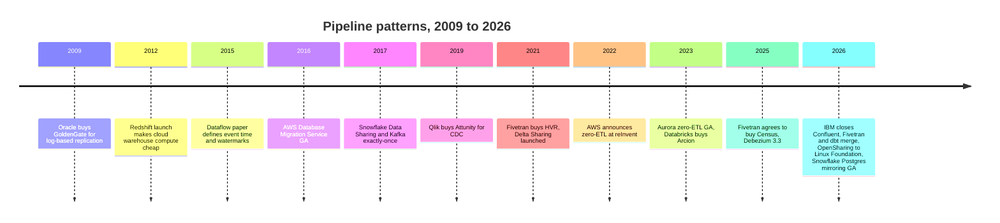

# 9. Pipeline Patterns
> **Depth:** L2 · **Reading time:** ~15 min · **Last verified:** 2026-11-01 · **Prerequisites:** [Ch 1 — The data stack map](../01-data-systems-foundations/ch01-data-stack-map.md)

## TL;DR

- A data pipeline makes copies. Each pattern is a different answer to three questions: where the data gets transformed, how often it moves, and how changes are detected. Most cost, freshness and failure trade-offs follow from those three answers.
- [ELT](../glossary.md#elt) replaced [ETL](../glossary.md#etl) as the default once cloud warehouses made compute cheap and elastic. Amazon priced Redshift at under $1,000 per TB per year in 2012, against an AWS estimate of $19,000–25,000 for an in-house warehouse.[^redshift-2012] ETL still wins when sensitive data must be scrubbed before it lands, or when warehouse compute is the most expensive thing you own.
- Log-based [change data capture](../glossary.md#change-data-capture) (CDC) reads the database's [write-ahead log](../glossary.md#write-ahead-log) instead of querying its tables. It is the most valuable pattern in this chapter, and the most consolidated: Qlik bought Attunity ($560M, 2019), Fivetran bought HVR ($700M, 2021) and Databricks bought Arcion (~$100M, 2023).[^ma-csv]
- "[Zero-ETL](../glossary.md#zero-etl)" does not mean there is no pipeline. It means the vendor runs it, usually CDC plus replication plus format conversion, inside its own platform. You save on engineering and pay in lock-in. [Zero-copy data sharing](../glossary.md#zero-copy-data-sharing) (Snowflake Secure Data Sharing, Delta Sharing/OpenSharing) is the stronger idea, because it removes the copy, not just the code.
- Correctness comes from two habits: [idempotent](../glossary.md#idempotency) loads (running a load twice gives the same result) and planned [backfills](../glossary.md#backfill). The [medallion architecture](../glossary.md#medallion-architecture) (bronze, silver, gold) is mostly a way to make both routine.

## Why this matters (business + Everpure lens)

Pipelines are where data platforms earn and lose money. Ingestion vendors charge per row moved. Fivetran, for example, bills on [monthly active rows](../glossary.md#monthly-active-rows) and in March 2025 moved its volume tiers from the account to each connection, which raised bills for many multi-connector customers.[^fivetran-pricing] Warehouses charge for the compute that transforms the data, and streaming platforms charge for always-on clusters. The largest recent deals in this layer were IBM's ~$11B purchase of Confluent (closed March 2026), Salesforce's ~$8B purchase of Informatica (equity value; closed November 2025) and the all-stock Fivetran–dbt Labs merger (closed June 2026; terms undisclosed; combined ARR "approaching $600M", company-stated).[^ma-csv] All three were bets on owning how data moves.

Zero-ETL and data sharing also change the bargaining position of every platform. A platform that runs the pipeline for you also decides where the copy lands, in which format, and how expensive it is to leave. That is why AWS, Microsoft, Google, Snowflake and Databricks all now offer free or nearly free replication into their own platforms ([Ch 28](../04-company-deep-dives/ch28-hyperscaler-data-platforms.md)).

For Everpure, the lens is copies. Each pipeline hop usually creates another full or partial copy: the raw landing zone, the cleaned layer, the business marts, the feature store, the vector index. Copy count drives storage footprint and governance risk at the same time. Everpure's 1touch acquisition ($125M, closed May 2026)[^ma-csv] and its Data Intelligence product are positioned around discovering and classifying data "without copying it". That puts Everpure on the same side of the argument as zero-copy sharing, and it makes copy-tracking a natural question for a strategy team to evaluate.

## How it works

### ETL vs ELT: where the transformation runs

**ETL** (extract, transform, load) cleans and reshapes data on a separate server before loading it into the warehouse. **ELT** (extract, load, transform) loads raw data first and transforms it inside the warehouse with SQL, typically using dbt ([Ch 12](ch12-transformation-and-orchestration.md)).

*Figure 9.1 — ETL spends compute outside the warehouse and lands only curated data. ELT lands everything raw and spends warehouse compute on transformation, which gives a full audit trail and the ability to replay.*

The order flipped for economic reasons. In the 2000s, warehouse capacity was a fixed appliance (Teradata, Netezza, Exadata) sized for peak load. Every CPU cycle spent on transformation was a cycle taken from analysts, so transformations ran on cheaper ETL servers. Cloud warehouses made compute elastic and billed by the second, and storage became cheap object storage. Redshift's launch price of under $1,000 per TB per year at reserved rates was a signal of the new cost curve.[^redshift-2012] Once compute could be rented on demand, the cheapest place to transform data was where it already sat. Landing raw data also meant a logic bug no longer lost information: you fix the SQL and re-run it over the raw history.

> **Bridge: semiconductors.** ELT is "ship raw wafers to the fab you already own." If you have a fab with spare, rentable capacity, you don't pay a third party to pre-process wafers in transit. You land them and process them in-house, where the tooling, metrology and audit trail already exist. ETL is outsourced pre-processing: it makes sense when the raw material is hazardous to bring on site (personal data) or when your own fab time is the scarcest resource.

**When ETL still wins.** There are three cases. First, privacy: if credit-card numbers or health records must never exist in the analytics environment, they have to be tokenized or dropped *before* landing. Once raw PII is in a bronze table, it is also in its snapshots, its backups and every clone. Second, cost control: at very high volume, filtering or pre-aggregating in a cheap stream processor or Spark job can cost far less than storing and scanning everything in a premium warehouse. Third, regulated boundaries: data-residency rules sometimes require transformation inside the source region. In practice most modern stacks run "EtLT", with light in-flight cleanup (masking, type fixes) and heavy modeling in the warehouse.

### Batch, micro-batch and streaming: how often it moves

The second choice is cadence. A **batch** job moves a bounded chunk on a schedule (nightly, hourly). A **[micro-batch](../glossary.md#micro-batch)** engine (Spark Structured Streaming's default mode, Snowflake Dynamic Tables) runs the same logic every few seconds to minutes. A **streaming** engine (Apache Flink, Kafka Streams, Spark's real-time mode) processes each event as it arrives ([Ch 11](ch11-streaming-and-event-platforms.md)).

| Dimension | Batch | Micro-batch | Streaming |
|---|---|---|---|
| Typical freshness | Hours to a day | Seconds to minutes | Milliseconds to seconds |
| Cost profile | Bursty; compute idles between runs | Steady; frequent small jobs | Always-on cluster plus state storage |
| Operational complexity | Lowest; rerun the job | Moderate; checkpoints and small files | Highest; state, watermarks, upgrades with state |
| Failure recovery | Re-run the window | Restart from last checkpoint | Restore state snapshot and replay from log offset |
| Late and out-of-order data | Absorbed if the window closes late enough | Watermark plus periodic merge | Watermarks, allowed lateness, retractions |
| Exactly-once | Easy via idempotent overwrite of a partition | Checkpoint plus idempotent or transactional sink | Transactional log plus two-phase commit to sink |
| Small-file pressure on lake tables | Low | High; needs compaction | Highest; needs compaction and buffering |
| Typical tools | Airflow plus Spark or dbt, warehouse tasks | Spark Structured Streaming, Dynamic Tables, Lakeflow Spark Declarative Pipelines (formerly Delta Live Tables) | Flink, Kafka Streams, Spark real-time mode |
| Good fit | Finance close, reporting, ML training sets | Operational dashboards, hourly-to-minute CDC | Fraud scoring, personalization, alerting |

*Figure 9.2 — Each step toward lower latency buys freshness with always-on cost and harder recovery. Most enterprises should default to micro-batch and justify true streaming per use case.*

> **Bridge: datacenter networking.** Batch is **store-and-forward switching**: receive the whole frame, check it, then send it on. That is simple, error-checked and adds latency. Streaming is **cut-through switching**: forward as soon as the header arrives. That gives the lowest latency, but errors propagate downstream before anyone can catch them. Micro-batch is a switch with small buffers, and most production networks and data platforms settle there.

**Event time, watermarks and late data (L2).** Streaming is hard because events arrive late and out of order. A phone that was offline uploads purchases two hours after they happened. Google's Dataflow paper (Akidau et al., VLDB 2015) set the vocabulary.[^dataflow] [Event time](../glossary.md#event-time) is when something happened. Processing time is when the system saw it. A [watermark](../glossary.md#watermark) is the engine's running estimate that "all events up to time T have probably arrived." When the watermark passes the end of a window, say 10:00–10:05, the engine emits a result. Events that arrive after that are [late data](../glossary.md#late-data). They are either dropped, or they trigger a corrected result if the window allows late updates. The paper's central argument is that you never get completeness for free. You choose a point on a correctness, latency and cost triangle. A 2026 retrospective by the same group concluded that the event-time foundation held up, but that the industry largely settled on two forms of completeness: watermarks where streams are visible, and snapshot-consistent table refreshes where they are not.[^dataflow-rev]

**[Exactly-once semantics](../glossary.md#exactly-once-semantics).** No network can deliver a message exactly once, because retries after timeouts create duplicates. Systems get "effectively once" by combining at-least-once delivery with deduplication or transactions. Kafka added idempotent producers and transactions in release 0.11 in 2017 (KIP-98).[^kafka-eos] Debezium 3.3 (October 2025) added exactly-once support to its core source connectors, building on the exactly-once source framework Kafka Connect gained in Kafka 3.3 (KIP-618, 2022).[^debezium-33] The guarantee only holds end to end if the *sink* is idempotent or transactional as well, for example a `MERGE` keyed on primary key and log position. That is the one question to ask anyone who claims exactly-once.

### Change data capture: how changes are detected

CDC answers "what changed since last time?" There are three ways to do it.

- **Query-based CDC** runs `SELECT … WHERE updated_at > :last_run`. It is simple and needs no database privileges, but it misses hard deletes, depends on every application setting `updated_at` correctly, and adds scan load to the production database.
- **Trigger-based CDC** adds database triggers that write each change to a shadow table. It captures deletes but slows every transaction, and DBAs dislike it.
- **Log-based CDC** reads the log the database already writes for crash recovery and replication: the write-ahead log (WAL) in Postgres, the binlog in MySQL, redo logs in Oracle. It captures every insert, update and delete in commit order, with little load on the source. Debezium (open source, Kafka Connect-based), Oracle GoldenGate (acquired 2009),[^goldengate] AWS Database Migration Service (GA 2016),[^dms] Fivetran HVR and Qlik Replicate all work this way.

*Figure 9.3 — Log-based CDC turns the database's own recovery log into an ordered event stream. The final MERGE keyed on primary key and log position is what makes replays harmless.*

> **Bridge: memory systems.** Query-based CDC is rescanning the whole disk to find what changed. Log-based CDC is **reading the filesystem journal**, or, closer to your home turf, **bus snooping** in a cache-coherent system. Each cache watches the write traffic already on the bus instead of polling memory, and stays coherent at almost no extra cost to the writer. The catch is the same in both cases: if the snooper falls behind, the protocol has to stall or the snooper has to resynchronize from scratch.

That catch is the main operational risk of log-based CDC. In Postgres, a replication slot forces the primary to keep WAL until the consumer confirms it. If the CDC connector stalls for a weekend, the WAL keeps growing and can fill the production database's disk. That turns an analytics outage into an application outage. Schema changes are the second risk: a renamed column must flow through the topic, the sink and every downstream model.

**Snapshot plus stream (backfill).** A log only holds recent history, so a new CDC pipeline starts with a full table snapshot and then switches to the log. The hard part is doing that without locking the table and without losing or duplicating changes that happen during the copy. Netflix's DBLog (2020) solved it by reading the table in primary-key chunks and inserting low and high watermark markers into the log around each chunk. Rows changed by the log within that window win over the chunk copy.[^dblog] Debezium adopted the approach as "incremental snapshots" (version 1.6, 2021), triggered by writing a signal row to the source database.[^debezium-incr] The same mechanism lets you re-backfill one table at any time while streaming continues.

### Reverse ETL: closing the loop

[Reverse ETL](../glossary.md#reverse-etl) pushes modeled data *out* of the warehouse into operational tools: churn scores into Salesforce, audiences into ad platforms, product usage into Zendesk. Mechanically it is CDC run against the warehouse. The tool computes which rows changed in a model since the last sync and calls the destination's API, handling rate limits and retries. Hightouch and Census defined the category around 2020. Fivetran agreed to buy Census in May 2025 (undisclosed; the closing date was not separately announced)[^census-deal] to sell ingestion and activation as one product. Hightouch repositioned toward AI-driven marketing and raised a press-reported $150M Series D at a $2.75B valuation in April 2026.[^hightouch] Reverse ETL also adds copies: the same customer table now exists in the warehouse and in five SaaS tools, each with its own retention and access rules.

### Zero-ETL: the pipeline you don't see

AWS introduced "zero-ETL" at re:Invent in November 2022 with Aurora-to-Redshift replication.[^aws-zetl-2022] It became generally available for Aurora MySQL in November 2023 at no extra charge beyond the underlying resources.[^aws-zetl-ga] DynamoDB-to-Redshift followed in October 2024, and the family now spans SaaS apps, S3 Tables and self-managed databases via AWS Glue.[^aws-zetl-more] Every platform has an equivalent:

- **Microsoft Fabric mirroring** replicates Azure SQL, Cosmos DB, Snowflake and others into OneLake as Delta tables. Replication compute is free, and each purchased capacity unit includes 1 TB of free mirror storage, so an F64 includes 64 TB.[^fabric-mirror]
- **Google Datastream** applies CDC from MySQL, PostgreSQL, Oracle and SQL Server directly into BigQuery (BigQuery target GA April 2023).[^gcp-datastream] BigQuery **federated queries** go further and query Cloud SQL or Spanner in place.[^bq-federated]
- **Snowflake Postgres mirroring** became GA in October 2026. A CDC worker pushes batches about every 15 seconds into Iceberg change-log tables that Snowflake reads.[^sf-pg-mirror]
- **Databricks Lakehouse Federation** registers external databases as read-only "foreign catalogs" in Unity Catalog and pushes queries down over JDBC, with no copy at all.[^dbx-federation]
- **Salesforce–Snowflake zero-copy** exposes Salesforce Data 360 (renamed from Data Cloud in October 2025) and Snowflake tables to each other through sharing rather than export.[^sf-sfdc]

*Figure 9.4 — Zero-ETL is CDC, buffering, format conversion and merge, packaged and run by the destination vendor. The engineering disappears from your org chart, but the copy and its cost still exist, and they now sit inside one vendor's platform.*

The honest assessment: zero-ETL is a real convenience for same-vendor, database-to-warehouse replication, and it removes a fragile layer of connector code. But it is free only in the way a printer is free. The source and target must both be the vendor's, transformation options are thin, and the data lands in the vendor's preferred format and catalog. Moving off later means rebuilding the pipeline you never had to build. Mirroring into open formats (Fabric writes Delta, Snowflake mirroring writes Iceberg) softens that lock-in. Federation softens it further by not copying at all, but it pays for that in query latency and load on the source system.

### Data sharing: the no-copy pipeline

Sharing removes the copy rather than hiding it. In Snowflake Secure Data Sharing, launched in 2017, a provider grants another account read access to its tables. No data is copied or moved, and the consumer pays only for the compute it uses to query.[^sf-sharing][^sf-sharing-2017] Delta Sharing (2021) does the same over an open REST protocol. The server hands the recipient short-lived signed URLs to the underlying Parquet files, so any engine can read them. In June 2026 Databricks contributed it to the Linux Foundation as **OpenSharing**, extended to Iceberg recipients and to AI assets such as models.[^opensharing] The constraint is physical: sharing across clouds or regions still requires replication, and egress fees reappear.

### Medallion architecture, idempotency and backfills

The [medallion architecture](../glossary.md#medallion-architecture) is Databricks' name for a layering convention that works on any lakehouse or warehouse.[^dbx-medallion] Bronze holds data as it arrived, append-only, often with loose types. Silver holds cleaned, deduplicated, conformed entities. Gold holds business-level aggregates and features ([Ch 7](../01-data-systems-foundations/ch07-open-table-formats.md) explains the table formats underneath).

*Figure 9.5 — Bronze keeps everything so any layer above can be rebuilt. Silver is where deduplication and merges make replays safe. Gold serves people, models and agents. Each layer is also a copy.*

The point of bronze is replayability. If a silver transformation had a bug for three weeks, you fix it and recompute silver and gold from bronze. That **backfill** is safe only if every step is **idempotent**. Loads overwrite a partition or `MERGE` on a key rather than blindly appending, so running them twice changes nothing. Practical rules: key every write on a natural or log-based identifier, process by event-time partition, make "re-run 2026-10-01 to 2026-10-21" a single orchestrator command, and never let a backfill and the live pipeline write the same partition at once ([Ch 12](ch12-transformation-and-orchestration.md)).

## Worked example: one order table, three designs

A mid-size retailer has an `orders` table in Postgres: about 50 million rows, about 2 million new orders a day and about 6 million row changes a day once status updates are counted. All figures in this section are illustrative estimates, not benchmarks.

| | A. Nightly batch ETL | B. Hourly ELT | C. CDC streaming |
|---|---|---|---|
| Mechanism | 01:00 extract by `updated_at`, transform on ETL server, load by 04:00 | Managed connector pulls `updated_at` deltas hourly; dbt `MERGE` into silver | Debezium reads WAL to Kafka; sink lands bronze each minute; `MERGE` to silver every 5 min |
| Freshness | 4–28 hours | 1–2 hours | 1–5 minutes |
| Main cost drivers | ETL server hours; source DB read load in window | Per-row connector fees (MAR); 24 warehouse merges a day | Always-on Kafka and connectors; frequent merges; compaction of small files |
| Relative run-cost index (estimate) | 1x | ~2–3x | ~4–8x |
| Captures hard deletes | No | No, unless soft-deletes | Yes |
| Typical failure mode | Missed batch window; bad `updated_at` silently skips rows | Overlapping windows create duplicates if merge isn't idempotent; clock skew | Stalled connector bloats WAL on the primary; schema change breaks sink; re-snapshot needed |
| Recovery | Re-run night; full reload if logic changed | Re-sync window; rebuild silver from bronze | Incremental snapshot of affected table; replay Kafka from offset |
| Best for | Finance reporting, monthly close | Most BI dashboards | Inventory, fraud, customer-facing status, agents |

*Figure 9.6 — Moving from nightly to minutes cuts staleness by two to three orders of magnitude and raises run cost several-fold (illustrative). The failure mode also moves closer to production: design C's worst case is a full disk on the order database.*

The decision rule is simple. Price the freshness. If a 5-minute-fresh inventory view prevents a measurable number of oversold orders, design C pays for itself. If the consumer is a weekly executive dashboard, design B is already generous. A common hybrid runs CDC only for the three or four tables that need it, and hourly ELT for everything else.

## Design choices and trade-offs

| Choice | Option 1 | Option 2 | Steelman for option 1 | Steelman for option 2 |
|---|---|---|---|---|
| Where to transform | ETL (before landing) | ELT (in warehouse) | PII never lands; compute is cheaper outside premium warehouse | Raw history enables replay; one SQL toolchain; analysts own logic |
| Change detection | Query-based | Log-based CDC | No DB privileges; trivial to set up; fine for append-mostly tables | Captures deletes and every change in order; low source load |
| Cadence | Batch / micro-batch | Streaming | Cheaper, simpler, easy reprocessing | Only option for sub-second decisions; continuous load avoids batch spikes |
| Who runs the pipeline | Self-run (Debezium, Airbyte OSS) | Vendor zero-ETL / managed connectors | Portability, no per-row fees, full control | No connector code; vendor absorbs schema drift and upgrades |
| Copy or not | Replicate | Share / federate | Predictable performance; isolates source from analytics load | No duplicate storage; one governed source of truth; instant updates |

*Figure 9.7 — Every row is a trade between control and convenience, or between freshness and cost. There is no universally right pattern, only a right one per table and consumer.*

The strongest argument against the "stream everything" camp is operational. Streaming state is hard to version, test and backfill, and most consumers can't act on data faster than hourly anyway. The strongest argument against the "batch is enough" camp is that AI agents and operational analytics increasingly *do* act in minutes, and log-based CDC is now cheap enough that the default is shifting toward continuous replication with batch-style modeling on top.

## Who's who

| Layer | Players (Nov 2026) | Positioning |
|---|---|---|
| Log-based CDC, open source | Debezium (Red Hat-sponsored), Flink CDC, PeerDB (ClickHouse) | De facto open standard; Debezium 3.3 added exactly-once; you operate it |
| Enterprise CDC / replication | Oracle GoldenGate, Qlik Replicate (ex-Attunity), Fivetran HVR, IBM, Striim, AWS DMS | Heterogeneous, high-volume, mainframe and Oracle sources |
| Managed ELT connectors | Fivetran (merged with dbt Labs), Airbyte, Matillion, Snowflake Openflow, Databricks Lakeflow Connect | Per-row or per-connector pricing; hundreds of SaaS APIs |
| Streaming platforms | IBM-Confluent, Redpanda, AWS MSK/Kinesis, Azure Event Hubs | The durable log between CDC and sinks |
| Reverse ETL / activation | Hightouch, Fivetran (Census, agreed 2025), Salesforce Data 360 | Warehouse-to-SaaS sync, moving into AI marketing |
| Zero-ETL / mirroring | AWS zero-ETL, Fabric mirroring, Google Datastream, Snowflake Postgres mirroring | Free or cheap replication into the vendor's own platform |
| Sharing / federation | Snowflake Secure Data Sharing, OpenSharing (Delta Sharing), Lakehouse Federation, BigQuery federated queries | Access without copying; governance by the provider |

*Figure 9.8 — Independent CDC and connector vendors are being squeezed from below by open source and from above by platforms offering replication for free. See [Ch 10](ch10-ingestion-and-integration.md) for connector economics and [Ch 30](../04-company-deep-dives/ch30-data-movement-streaming-companies.md) for company detail.*

## History and trajectory

*Figure 9.9 — Fifteen years ago CDC was niche replication software. Today it is the hidden engine of zero-ETL, and the companies that sold pipelines are being folded into platforms.*

The arc has three phases. From about 2000 to 2012, ETL tools (Informatica, Talend, DataStage) ran beside fixed-capacity warehouses, and CDC was specialist replication software (GoldenGate, Attunity, DataMirror). From 2012 to 2021, cloud warehouses and the "modern data stack" made ELT the default. Open-source Debezium and Kafka made log-based CDC accessible, and point vendors multiplied. From 2022 onward, the platforms have pulled the pipeline inside. AWS coined zero-ETL, Microsoft made mirroring free, and Snowflake and Databricks built their own connectors and CDC.[^aws-zetl-2022][^fabric-mirror][^sf-pg-mirror] Meanwhile the independents consolidated: Fivetran absorbed HVR and Tobiko, agreed to buy Census and then merged with dbt Labs; Salesforce absorbed Informatica; and IBM absorbed Confluent.[^ma-csv]

The next step is fewer copies, not faster ones. Open table formats let one copy serve many engines ([Ch 7](../01-data-systems-foundations/ch07-open-table-formats.md)). Sharing protocols let one copy serve many organizations. Federation lets some queries skip the copy entirely. Expect pipeline spend to shift from "moving bytes" toward governance of who reads which copy.

## Numbers that matter

| Metric | Value | Basis | Source / date |
|---|---|---|---|
| Redshift launch price vs in-house warehouse | < $1,000/TB/yr (reserved) vs $19,000–25,000/TB/yr | Vendor-stated estimate | Computerworld, 2012-11-28[^redshift-2012] |
| AWS zero-ETL announcement → GA | Nov 2022 preview → GA 2023-11-07 (Aurora MySQL) | Vendor-stated | AWS, 2022-11-29 and 2023-11-07[^aws-zetl-2022][^aws-zetl-ga] |
| Fabric free mirror storage | 1 TB per capacity unit (F64 = 64 TB); mirroring compute free | Vendor-stated pricing | Microsoft Learn, 2026[^fabric-mirror] |
| Snowflake Postgres mirroring batch interval | ~15 seconds | Vendor docs | Snowflake, 2026-10[^sf-pg-mirror] |
| Spark real-time mode latency | p99 ~40–300 ms on Databricks' GA benchmark pipelines; Spark 4.1 materials claim single-digit ms for simple stateless queries ([Ch 11](ch11-streaming-and-event-platforms.md)) | Vendor benchmark; workload-dependent | Databricks, 2026-03[^spark-rtm] |
| Fivetran pricing change | MAR tiering per connection from 2025-03-01 | Company-stated | Fivetran docs, 2025[^fivetran-pricing] |
| CDC deal prices | Attunity $560M (2019); HVR $700M (2021); Arcion ~$100M (2023) | Disclosed / press-reported | `data/ma_deals.csv`[^ma-csv] |
| IBM–Confluent | ~$11B, closed 2026-03-17 | Disclosed | `data/ma_deals.csv`[^ma-csv] |
| Fivetran + dbt Labs combined ARR | "Approaching $600M" | Company-stated, at close | Fivetran, 2026-06-01[^ma-csv] |
| Hightouch valuation | $2.75B post-money, $150M Series D (Apr 2026) | Press-reported | Adweek / Pulse 2.0, 2026-04[^hightouch] |

*Figure 9.10 — The deal prices show what buyers pay for CDC know-how. The pricing rows show where pipeline cost actually lands: per-row fees, target compute and storage.*

## Storage bridge

> **Storage bridge.** Every hop in Figure 9.5 is a write of a new copy: CDC change logs, bronze, silver, gold, reverse-ETL destinations and snapshots of each. A conservative stack can hold three to six physical copies of a hot table (estimate). That is a storage-capacity story and a data-security story at once, because each copy needs classification and access control. Zero-copy sharing, federation and open table formats reduce copy count; mirroring and reverse ETL increase it. For a vendor positioned around discovering and classifying data in place, a copy-lineage view ("this customer table exists in 7 places") is an option a strategy team might evaluate, based on public information. See the companion *Everpure Tech Atlas* for snapshot and data-reduction mechanics.

## Conversation playbook

**Questions for a PM**

1. "For your top customers, how many physical copies of a core table like orders exist across your platform and theirs, and do you charge for each?"
2. "When you say zero-ETL, what runs under the hood, and what does the customer lose (transform options, format choice, portability) compared with their own pipeline?"
3. "How do you price data movement (rows, connectors, compute or free as a loss leader), and how did your March 2025-style pricing changes land with customers?"

**Questions for an engineer**

1. "Is your CDC log-based? What happens to the source database's WAL or binlog if your connector stops for 48 hours?"
2. "How do you backfill one table without pausing the live stream? Do you use DBLog-style incremental snapshots?"
3. "Where exactly is exactly-once enforced: at the source connector, the log, or an idempotent `MERGE` at the sink? What key do you dedupe on?"

**What good answers sound like.** They separate delivery from effect ("at-least-once delivery, idempotent merge on primary key plus LSN"). They know their lag and retention numbers ("p95 lag under 30 seconds; we alert at 10 GB of retained WAL"). They treat bronze as the replay source and can name the command that backfills a date range. On zero-ETL, they admit the trade: convenience now, and an exit cost later.

**Don't say this**

- "Zero-ETL means there's no pipeline." There is one. The vendor runs it, and it is usually CDC.
- "ETL is obsolete." It is still the right answer for PII that must never land, and for cost control at very high volume.
- "Kafka gives us exactly-once, so duplicates are impossible." Only if the sink is transactional or idempotent too.
- "CDC has no impact on the source." Log reading is light, but a stalled consumer can fill the primary's disk.
- "Data sharing is free." Storage isn't duplicated, but consumers pay compute, and cross-region sharing reintroduces replication and egress.

## Going deeper

- Akidau et al., "The Dataflow Model" (VLDB 2015), and the 2026 retrospective "The Dataflow Model Revisited."[^dataflow][^dataflow-rev]
- Andreakis and Papapanagiotou, "DBLog: A Watermark Based Change-Data-Capture Framework" (2020), for snapshot-plus-stream backfill.[^dblog]
- Debezium documentation on Postgres logical decoding, replication slots and incremental snapshots.[^debezium-incr][^debezium-33]
- Kafka KIP-98 and Confluent's exactly-once write-up, for idempotent producers and transactions.[^kafka-eos]
- Databricks medallion guidance and the OpenSharing protocol specification on GitHub.[^dbx-medallion][^opensharing]

## Key terms

- [ETL](../glossary.md#etl) — extract, transform, load: data is reshaped on a separate system before landing in the warehouse.
- [ELT](../glossary.md#elt) — extract, load, transform: raw data lands first and is transformed inside the warehouse.
- [Change data capture](../glossary.md#change-data-capture) — detecting and streaming row-level inserts, updates and deletes from a source database.
- [Log-based CDC](../glossary.md#log-based-cdc) — CDC that reads the database's recovery log (WAL, binlog, redo) rather than querying tables.
- [Query-based CDC](../glossary.md#query-based-cdc) — CDC that polls tables for rows with a newer timestamp or ID; misses hard deletes.
- [Replication slot](../glossary.md#replication-slot) — a Postgres object that retains WAL until a consumer confirms it has read it.
- [Binlog](../glossary.md#binlog) — MySQL's binary log of committed changes, used for replication and CDC.
- [Micro-batch](../glossary.md#micro-batch) — processing a stream as a rapid series of small batch jobs.
- [Event time](../glossary.md#event-time) — the time an event actually happened, as opposed to when the system processed it.
- [Watermark](../glossary.md#watermark) — a stream processor's estimate that all events up to a given event time have arrived.
- [Late data](../glossary.md#late-data) — events arriving after the watermark has passed their window.
- [Exactly-once semantics](../glossary.md#exactly-once-semantics) — a guarantee that each event affects the result once, despite retries.
- [Idempotency](../glossary.md#idempotency) — the property that running an operation twice gives the same result as running it once.
- [Backfill](../glossary.md#backfill) — reprocessing historical data to fill gaps or apply corrected logic.
- [Incremental snapshot](../glossary.md#incremental-snapshot) — a chunked, lock-free table copy interleaved with a live CDC stream.
- [Reverse ETL](../glossary.md#reverse-etl) — syncing modeled warehouse data back into operational SaaS tools.
- [Zero-ETL](../glossary.md#zero-etl) — vendor-managed replication between its own services, usually built on CDC.
- [Data mirroring](../glossary.md#data-mirroring) — continuous vendor-managed replication of a database into an analytics platform.
- [Zero-copy data sharing](../glossary.md#zero-copy-data-sharing) — granting another party query access to data without duplicating it.
- [Query federation](../glossary.md#query-federation) — querying external databases in place by pushing queries down to them.
- [OpenSharing](../glossary.md#opensharing) — Linux Foundation open protocol for sharing data and AI assets, successor to Delta Sharing.
- [Medallion architecture](../glossary.md#medallion-architecture) — bronze, silver and gold layering of raw, cleaned and business-ready data.
- [Monthly active rows](../glossary.md#monthly-active-rows) — Fivetran's billing unit: distinct rows inserted, updated or deleted in a month.

## Sources

[^redshift-2012]: Computerworld, "Amazon introduces data warehouse service" (Redshift launch; reserved pricing under $1,000/TB/year; AWS estimate of $19,000–25,000/TB/year in-house), https://www.computerworld.com/article/1401411/amazon-introduces-data-warehouse-service.html, published 2012-11-28; retrieved 2026-11-01. In-house figure is an AWS estimate cited from Jeff Barr's launch post.
[^ma-csv]: AI Data Atlas, `data/ma_deals.csv` (rows: Qlik–Attunity 2019-02-21, Attunity 6-K; Fivetran–HVR 2021-09-20, Fivetran press release; Databricks–Arcion 2023-10-23, TechCrunch; Fivetran–Census 2025-05-01 (status: announced; closing not separately verified); Salesforce–Informatica closed 2025-11-18, ~$8B equity value, Business Wire; Fivetran–dbt Labs closed 2026-06-01, Fivetran press release (combined ARR "approaching $600M"); IBM–Confluent closed 2026-03-17, IBM release; Everpure–1touch closed 2026-05-07, Everpure 10-Q), as_of 2026-11-01; retrieved 2026-11-01.
[^fivetran-pricing]: Fivetran documentation, "2025 Pricing Updates" (connection-level MAR tiering effective 2025-03-01), https://fivetran.com/docs/core-concepts/usage-based-pricing/pricing-updates/2025-pricing-faq, published 2025; retrieved 2026-11-01. Impact on bills per third-party analyses (e.g., Weld, https://weld.app/blog/fivetran-pricing-2025), press-reported.
[^dataflow]: T. Akidau et al., "The Dataflow Model: A Practical Approach to Balancing Correctness, Latency, and Cost in Massive-Scale, Unbounded, Out-of-Order Data Processing," PVLDB 8(12):1792–1803, https://www.vldb.org/pvldb/vol8/p1792-Akidau.pdf, published 2015-08; retrieved 2026-11-01.
[^dataflow-rev]: T. Akidau, S. Fernández-Moctezuma, R. Lax, S. Mills, "The Dataflow Model Revisited," PVLDB 19, https://www.vldb.org/pvldb/vol19/p4953-fernandez-moctezuma.pdf, published 2026; retrieved 2026-11-01 (via search summary; full text not fetched).
[^kafka-eos]: Confluent blog, "Exactly-Once Semantics Are Possible: Here's How Kafka Does It," https://www.confluent.io/blog/exactly-once-semantics-are-possible-heres-how-apache-kafka-does-it/, published 2017 (updated 2025); and Apache Kafka, "KIP-98 – Exactly Once Delivery and Transactional Messaging," https://cwiki.apache.org/confluence/display/KAFKA/KIP-98+-+Exactly+Once+Delivery+and+Transactional+Messaging; retrieved 2026-11-01.
[^debezium-33]: Debezium blog, "Debezium 3.3.0.Final Released," https://debezium.io/blog/2025/10/01/debezium-3-3-final-released/, published 2025-10-01; retrieved 2026-11-01. Later 3.5.x releases and a 3.6 candidate exist per https://debezium.io/releases/.
[^goldengate]: Visual Studio Magazine, "Oracle Acquires GoldenGate Software," https://visualstudiomagazine.com/Articles/2009/07/23/Oracle-Acquires-GoldenGate-Software.aspx, published 2009-07-23; retrieved 2026-11-01. Terms undisclosed; Oracle states completion in September 2009.
[^dms]: AWS, "AWS Database Migration Service is Now Generally Available," https://aws.amazon.com/about-aws/whats-new/2016/03/aws-database-migration-service-is-now-generally-available/, published 2016-03-15; retrieved 2026-11-01.
[^dblog]: A. Andreakis, I. Papapanagiotou, "DBLog: A Watermark Based Change-Data-Capture Framework," arXiv:2010.12597, https://arxiv.org/abs/2010.12597, published 2020-10-23; retrieved 2026-11-01.
[^debezium-incr]: Debezium blog, "Incremental Snapshots in Debezium," https://debezium.io/blog/2021/10/07/incremental-snapshots, published 2021-10-07; and Debezium documentation, "Sending signals to a Debezium connector," https://debezium.io/documentation/reference/stable/configuration/signalling.html; retrieved 2026-11-01.
[^census-deal]: Fivetran press release, "Fivetran Signs Agreement to Acquire Census…," https://www.fivetran.com/press/fivetran-signs-agreement-to-acquire-census-delivering-the-first-end-to-end-data-movement-platform-for-the-ai-era, published 2025-05-01; TechCrunch, https://techcrunch.com/2025/05/01/fivetran-acquires-census-to-become-end-to-end-data-movement-platform/, published 2025-05-01; retrieved 2026-11-01. Price undisclosed; closing date not separately announced [VERIFY: Census closing date].
[^hightouch]: Adweek, "Hightouch Raised $322 Million Across Six Rounds…," https://www.adweek.com/dealroom/hightouch-raised-322-million-across-six-rounds-heres-how-the-company-skyrocketed-to-a-275-billion-valuation/, published 2026-04; Pulse 2.0, https://pulse2.com/hightouch-150-million-series-d-at-2-75-billion-valuation-raised-to-power-agentic-marketing-platform/amp/, published 2026-04-29; retrieved 2026-11-01. Press-reported; led by Goldman Sachs Alternatives and Bain Capital Ventures.
[^aws-zetl-2022]: Amazon, "AWS Announces Two New Capabilities to Move Toward a Zero-ETL Future on AWS," https://press.aboutamazon.com/2022/11/aws-announces-two-new-capabilities-to-move-toward-a-zero-etl-future-on-aws, published 2022-11-29; retrieved 2026-11-01.
[^aws-zetl-ga]: AWS, "AWS announces general availability of Amazon Aurora MySQL zero-ETL integration with Amazon Redshift," https://aws.amazon.com/about-aws/whats-new/2023/11/aws-general-availability-amazon-aurora-mysql-zero-etl-integration-redshift/, published 2023-11-07; retrieved 2026-11-01.
[^aws-zetl-more]: AWS, "AWS announces general availability of Amazon DynamoDB zero-ETL integration with Amazon Redshift," https://aws.amazon.com/about-aws/whats-new/2024/10/amazon-dynamodb-zero-etl-integration-redshift/, published 2024-10; "AWS Glue now supports zero-ETL integrations from Amazon DynamoDB and eight applications to S3 Tables," https://aws.amazon.com/about-aws/whats-new/2025/07/aws-glue-zero-etl-integrations-amazon-dynamodb-applications-s3-tables, published 2025-07; "Announcing AWS Glue zero-ETL for self-managed Database Sources," https://aws.amazon.com/about-aws/whats-new/2025/11/glue-zero-etl-selfmanaged, published 2025-11; retrieved 2026-11-01.
[^fabric-mirror]: Microsoft Learn, "Open mirroring in Microsoft Fabric" and "Cost of mirroring" (1 TB free mirror storage per purchased CU; mirroring compute free), https://learn.microsoft.com/en-ie/fabric/database/mirrored-database/open-mirroring, living document; retrieved 2026-11-01.
[^gcp-datastream]: Techzine, "Google Cloud makes Datastream for BigQuery generally available," https://www.techzine.eu/news/devops/104564/google-cloud-makes-datastream-for-bigquery-generally-available/, published 2023-04; retrieved 2026-11-01. GA per Google Cloud blog dated 2023-04-03 (secondary confirmation).
[^bq-federated]: Google Cloud documentation, "Introduction to federated queries," https://cloud.google.com/bigquery/docs/federated-queries-intro, living document; retrieved 2026-11-01 [VERIFY: page not re-opened this session].
[^sf-pg-mirror]: Snowflake engineering blog, "How we pushed CDC into Postgres, and turned replication into clockwork," https://www.snowflake.com/en/blog/engineering/postgres-to-snowflake-replication-mirroring/, published 2026-10-20; Snowflake documentation, "Postgres-to-Snowflake mirroring performance considerations," https://docs.snowflake.com/en/user-guide/snowflake-postgres/postgres-data-mirroring-performance; retrieved 2026-11-01.
[^dbx-federation]: Databricks documentation, "What is Lakehouse Federation?," https://docs.databricks.com/aws/en/query-federation/index.html, living document; retrieved 2026-11-01.
[^sf-sfdc]: Snowflake blog, "Bidirectional Data Sharing Between Snowflake and Salesforce Data Cloud Is Now Generally Available," https://snowflake.com/blog/bi-directional-data-sharing-snowflake-salesforce-ga, published 2024 [VERIFY: exact date]; CIO.com, "Salesforce debuts Zero Copy Partner Network," https://www.cio.com/article/2095136/salesforce-debuts-zero-copy-partner-network-to-ease-data-integration.html, published 2024-04; retrieved 2026-11-01. Data Cloud was renamed Data 360 at Dreamforce 2025 (~2025-10-14), per `meta/verified-facts.md` item 11.
[^sf-sharing]: Snowflake documentation, "About Secure Data Sharing," https://docs.snowflake.com/en/user-guide/data-sharing-intro, living document; retrieved 2026-11-01.
[^sf-sharing-2017]: Snowflake, "Data Sharing" white paper, https://www.snowflake.com/wp-content/uploads/2017/06/Snowflake_DataSharing_WP_06222017.pdf, published 2017-06-22; DBTA, "Snowflake Introduces Data Sharing," https://www.dbta.com/Editorial/News-Flashes/Snowflake-Introduces-Data-Sharing-119015.aspx, published 2017; retrieved 2026-11-01.
[^opensharing]: Linux Foundation, "Linux Foundation Announces OpenSharing Project to Standardize AI Asset and Data Exchange," https://www.linuxfoundation.org/press/linux-foundation-announces-opensharing-project-to-standardize-ai-asset-and-data-exchange, published 2026-06-10; Databricks press release, https://www.databricks.com/company/newsroom/press-releases/databricks-announces-opensharing, published 2026-06; retrieved 2026-11-01.
[^dbx-medallion]: Databricks documentation, "What is the medallion lakehouse architecture?," https://docs.databricks.com/aws/en/lakehouse/medallion.html, living document; retrieved 2026-11-01.
[^spark-rtm]: Databricks blog, "Announcing General Availability of Real-Time Mode for Apache Spark Structured Streaming on Databricks," https://www.databricks.com/blog/announcing-general-availability-real-time-mode-apache-spark-structured-streaming-databricks, published 2026-03-19 (date per localized page); retrieved 2026-11-01. Latency figures are vendor benchmarks.
