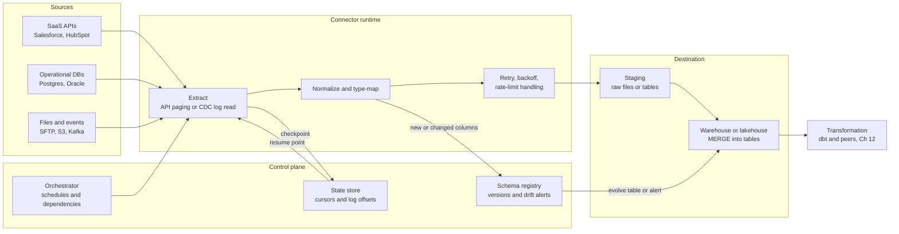
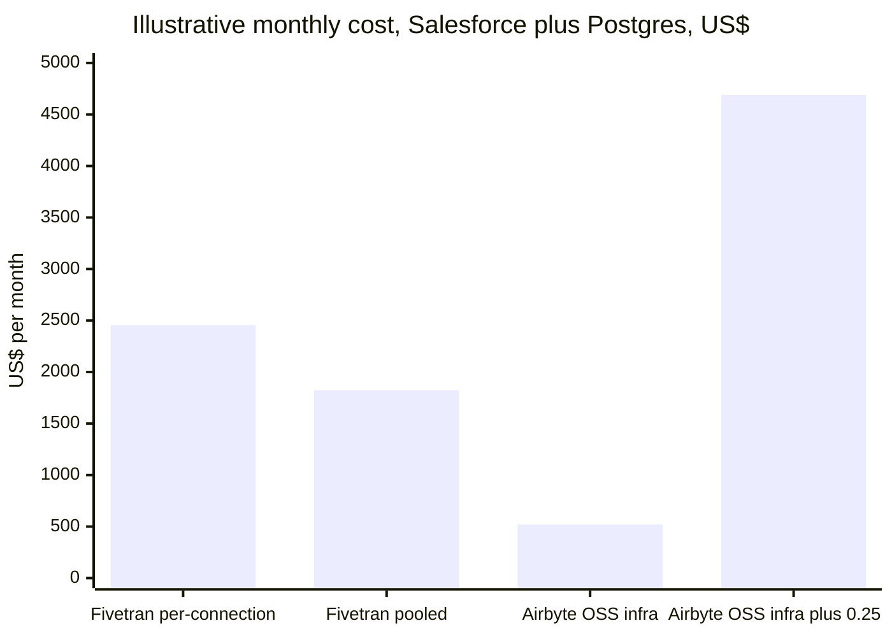
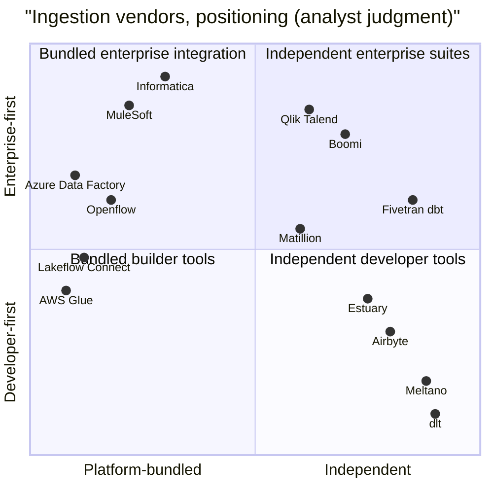
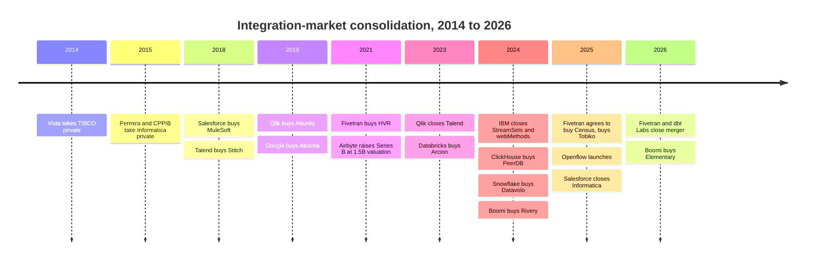

# 10. Ingestion and Integration
> **Depth:** L2 · **Reading time:** ~12 min · **Last verified:** 2026-11-01 · **Prerequisites:** [Ch 9 — Pipeline patterns](ch09-pipeline-patterns.md)

## TL;DR

- Ingestion tools copy data out of systems a company does not control (SaaS APIs, operational databases, files, event streams) and land it in a warehouse or lakehouse. The copy itself is easy. The hard part is everything around it: incremental sync, [schema drift](../glossary.md#schema-drift), rate limits, retries and type mapping, repeated across hundreds of sources that each change on their own schedule.
- A [connector](../glossary.md#connector) is a liability as much as an asset. Fivetran and Airbyte each advertise 700+ connectors,[^ft-700][^ab-700] and every one of them must be patched whenever the upstream API changes. Connector count is a moat because rivals have to pay the same maintenance bill to match it. It is also a cost center for the same reason.
- Pricing units differ by vendor and do not translate cleanly: Fivetran meters [monthly active rows](../glossary.md#monthly-active-rows) (MAR) per connection, Airbyte sells capacity ("Data Workers") or credits, Informatica sells pooled Informatica Processing Units (IPUs), Matillion sells credits, and the hyperscalers bill compute time or data volume. Fivetran's March 2025 and January 2026 changes made small connections relatively more expensive.[^ft-2025][^ft-2026]
- The independent layer has been squeezed from three sides. Platforms bundle connectors that are good enough (Databricks Lakeflow Connect, Snowflake Openflow, AWS/Azure/Google tools). AI-assisted connector builders lower the cost of the long tail. Consolidation does the rest: Fivetran merged with dbt Labs (closed June 2026, combined ARR "approaching $600M", company-stated),[^ft-dbt-close] and Salesforce closed its ~$8B Informatica purchase in November 2025.[^infa-close]
- For Everpure, ingestion decides where data lands. Managed SaaS pipelines default to cloud warehouses and cloud object stores. Self-hostable tools are the route by which on-prem S3 can become a landing zone.

## Why this matters (business + Everpure lens)

Every analytical or AI system starts with a copy. Before a model can answer a question about pipeline revenue, someone has to pull opportunity records out of Salesforce, invoices out of NetSuite and order rows out of Postgres, and keep those copies fresh. [Ch 9](ch09-pipeline-patterns.md) covered the patterns ([ELT](../glossary.md#elt), [change data capture](../glossary.md#change-data-capture), batch versus stream). This chapter covers the tools that implement them and the business that grew up around them.

That business deserves an executive's attention for three reasons. First, it is a classic consumption market whose unit economics are visible in public price lists, so it is a clean case study in how pricing units shape customer behavior (see [Ch 35](../05-business-and-economics/ch35-business-models.md)). Second, it is consolidating quickly, and the buyers are the platforms on either side: warehouses, application vendors and transformation tools. Third, the ingestion layer is where control of the data's location is decided. Whoever runs the pipe chooses the landing zone.

That third point is the Everpure lens. A pipeline that writes Salesforce data straight into a cloud warehouse leaves no role for on-prem storage. A pipeline that writes open-format files (Parquet, Iceberg) to an S3-compatible bucket the customer chooses leaves the storage decision open. The Storage bridge below covers the options.

## How it works

### What a connector actually does

A connector is a small program with a narrow job: read from one kind of source and emit records in a standard shape. In practice, a production connector handles seven things.

1. **Authentication and discovery.** It logs in (OAuth, API keys, database credentials), then lists the objects and fields available.
2. **Initial load ([backfill](../glossary.md#backfill)).** It copies history, often millions of rows, while staying inside the source's rate limits.
3. **[Incremental sync](../glossary.md#incremental-sync).** After the backfill it fetches only what changed. For APIs that means filtering on a cursor field such as `updated_at`. For databases it means reading the transaction log (Postgres WAL, MySQL binlog, Oracle redo) via CDC, which also catches deletes that a timestamp query misses.
4. **State.** It records how far it got (a timestamp, a log sequence number) in a [state store](../glossary.md#state-store) so it can resume after a crash without gaps or duplicates.
5. **Schema handling.** When a Salesforce admin adds a custom field or a developer widens a column, the connector detects the drift and either adds the column downstream, blocks the sync or alerts someone.
6. **Normalization.** It flattens nested JSON, maps source types to destination types (Oracle `NUMBER` to Snowflake `NUMBER(38,0)`, for example) and adds metadata columns such as sync time and a soft-delete flag.
7. **Resilience.** It retries on timeouts, backs off when rate-limited (the HTTP 429 response) and keeps loads [idempotent](../glossary.md#idempotency) so a retried batch does not double-count.

*Figure 10.1 — A connector is the small box in the middle. Most of the engineering, and most failures, sit in the control plane around it: the state store that makes resumption safe and the schema registry that decides what happens when the source changes.*

The destination step matters more than it looks. Most tools write a batch to a staging area, then run a `MERGE` (upsert) in the warehouse. That merge consumes the customer's warehouse compute, so a high-frequency sync can show up on the Snowflake or Databricks bill as well as the ingestion bill. Streaming ingestion into event platforms is a separate problem, covered in [Ch 11](ch11-streaming-and-event-platforms.md).

> **Going deeper (L3).** The hardest CDC problem is the handoff between snapshot and log. The connector must take a consistent snapshot of a table while the log keeps moving, then replay only the changes after the snapshot's log position. Debezium-style "incremental snapshots" interleave chunked table reads with log events and de-duplicate by primary key. Postgres adds an operational trap: a logical replication slot that is not read keeps WAL on the source disk indefinitely, so a stalled connector can fill the production database's volume.

### The economics of the long tail

The connector business follows a power law. A handful of sources (Salesforce, Postgres, MySQL, SQL Server, Google Ads, NetSuite) account for most of the rows moved. Hundreds more (niche marketing tools, HR systems, vertical SaaS) each matter to only a few customers, but every customer has a few of them. A vendor that lacks a customer's three obscure sources loses the deal, even if it handles the big ones well.

So vendors race on catalog breadth. Fivetran states 700+ fully managed connectors;[^ft-700] Airbyte's site now says 700+ as well, most of them community-built or maintained under its open-source program.[^ab-700] Estuary says it connects to 200+ systems.[^estuary]

> **Bridge: device drivers.** A connector catalog works like an operating system's driver library. Every new peripheral needs a driver, nobody buys an OS for its drivers, but a missing driver blocks the purchase. Maintenance never ends: each firmware revision, or here each API version deprecation, can break a driver that worked yesterday. Windows' advantage in the 1990s was partly the thousands of drivers written for it, and a similar asset accumulates in a connector catalog. It costs a great deal to maintain, and it is the reason customers stay.

The cost side is what investors underweight. A SaaS vendor that changes its pagination scheme, deprecates an API version or tightens a rate limit forces a fix on every connector vendor at once, on the SaaS vendor's timetable. The work does not scale down with usage, because a long-tail connector with ten customers needs roughly the same upkeep as a popular one. That is why both leaders try to push the long tail onto someone else. Airbyte relies on community contributions and a low-code Connector Builder with an AI assistant that drafts a connector from API documentation (launched with Airbyte 1.0 in September 2024).[^ab-ai] Fivetran's Connector SDK, generally available since June 2025, lets customers write Python connectors that Fivetran hosts, retries and meters like its own.[^ft-sdk] Python-native libraries such as dlt (dltHub) and the older Singer/Meltano ecosystem go further and treat connectors as code the data team owns.

### Pricing units: what is actually metered

| Vendor / product | Pricing unit | What drives the bill | Basis and source |
|---|---|---|---|
| Fivetran | Monthly active rows (MAR), tiered **per connection** since Mar 2025 | Distinct rows inserted, updated or (since Jan 2026) deleted per month, per connection; $5 base for connections with 1 to 1M MAR | List price; Standard tier falls from $500 per million MAR to $1.18 at >1B[^ft-pricing][^ft-2025][^ft-2026] |
| Airbyte Cloud | Credits (Standard) or capacity in "Data Workers" (Pro, Enterprise Flex) | Volume synced (credit tiers) or reserved parallel compute (capacity) | Company pricing page; capacity tiers quote-only[^ab-pricing] |
| Airbyte OSS / self-managed | Free to use; source-available under ELv2 (not an OSI open-source licence; some connectors MIT) | Your own Kubernetes compute plus engineering time | License docs[^ab-license] |
| Informatica IDMC | Informatica Processing Units (IPUs), pre-paid and pooled; Flex IPU option | IPUs consumed across any eligible IDMC service (integration, quality, catalog) | Company blogs; per-IPU rates not public[^infa-ipu] |
| Matillion | Credits consumed per "task hour" of pipeline run time | Pipeline run time by pipeline type and edition | Company terms; published rates conflict[^matillion] |
| AWS Glue | DPU-hours, billed per second | Spark/Python job run time × workers; $0.44 per DPU-hour standard, $0.29 Flex | List price, US East[^glue] |
| Azure Data Factory | Per 1,000 activity runs plus DIU-hours for data movement | Orchestration runs and copy throughput | List price; see footnote[^adf] |
| Fabric Data Factory | Fabric capacity units (CU-hours) drawn from a pre-bought capacity | Copy jobs and pipeline activities consume CU-hours | Microsoft docs[^fabric] |
| Google Datastream | GiB processed | CDC volume ($2.00/GiB for the first 2,500 GiB, down to $0.80) plus backfill ($0.40/GiB after 500 GiB free) | List price[^datastream] |
| Databricks Lakeflow Connect / Snowflake Openflow | Platform compute (DBUs / credits) | Ingestion compute on the platform's own meter | Product docs[^lakeflow][^openflow-ga] |

*Figure 10.2 — Only Fivetran and Datastream meter the data itself. Everyone else meters compute or pre-paid capacity, which moves the risk of an inefficient sync from vendor to customer.*

> **Bridge: finance.** MAR pricing is a **royalty per active subscriber**: Fivetran collects on each row that changed this month, not on the stock of rows held, much as a content licensor charges a distributor per active subscriber rather than per household passed. The 2025–2026 changes add a **minimum royalty per contract line** (the $5 base) and stop pooling volume across lines. Like any per-line minimum, they tax the small lines hardest.

### Worked example: Salesforce plus Postgres

The example is illustrative. Assumptions are stated, list prices only, and no negotiated discounts.

**Assumptions.** A mid-size company syncs (a) Salesforce, where about 2M distinct records change each month, and (b) a production Postgres database whose order and event tables see about 20M distinct changed rows a month. Fivetran Standard plan at the published tier table: $500 per million MAR up to 1M, $170 per million from 1M to 4M, $58 from 4M to 16M, $19.70 from 16M to 64M.[^ft-pricing]

**Fivetran, current rules (per connection).** Salesforce: $500 + 1 × $170 = **$670**/month. Postgres: $500 + 3 × $170 + 12 × $58 + 4 × $19.70 = **$1,785**/month. Total ≈ **$2,455/month, ≈ $29.5K/year** (estimate).

**Same table, pooled at account level.** Pooling 22M MAR gives ≈ **$1,824/month**. Per-connection tiering therefore costs this customer about 35% more (estimate). This applies today's table to the old account-level structure to isolate the tiering effect. It is not a reconstruction of pre-March 2025 invoices, which used a different rate structure.[^ft-2025]

**The long-tail effect is larger.** Thirty small marketing connections at 50K MAR each cost 30 × $25 = **$750**/month when billed separately, against **$585** pooled (estimate). Since January 2026, a connection between 1 and 1M MAR also pays at least the $5 base.[^ft-2026]

**Self-hosted Airbyte.** The software is free. Assume a three-node Kubernetes pool of AWS m6i.xlarge instances (~$0.192/hour on demand, assumption)[^ec2] ≈ $420/month, plus ~$100 for logs, storage and egress (assumption): ≈ **$520/month** in infrastructure. Add 0.25 of a data engineer at a $200K fully loaded annual cost (assumption) ≈ $4,170/month, and the total is ≈ **$4,690/month** (estimate). Warehouse `MERGE` compute is the same in both cases and is excluded.

*Figure 10.3 — At two connections, managed MAR pricing beats self-hosting once engineering time is counted. Self-hosting wins when a platform team already exists, when connection count and volume push MAR bills into six figures, or when data residency rules out SaaS. All figures are estimates from list prices and stated assumptions.*

Two further points. First, MAR is **regressive by connection**: at 1B MAR a single Postgres connection costs about $5,600/month on the same table, a fraction of a cent per thousand rows, while a 50K-MAR SaaS connection pays the top rate of $500 per million. High-volume database replication is cheap per row. The long tail is where the margin is. Second, a team's own engineering hours are the cost most often left out of build-versus-buy spreadsheets, and they are why managed ingestion exists.

## Design choices and trade-offs

| Choice | Managed SaaS (Fivetran, Airbyte Cloud) | Self-hosted open source (Airbyte OSS, dlt, Meltano) | Platform-bundled (Lakeflow Connect, Openflow, Glue, ADF) | Enterprise iPaaS/ETL suites (Informatica, Boomi, MuleSoft, Talend) |
|---|---|---|---|---|
| Who fixes broken connectors | Vendor | You (or community) | Platform vendor | Vendor |
| Catalog breadth | Widest | Wide but uneven quality | Narrow: top sources only | Wide, enterprise-app-heavy |
| Data residency | Vendor cloud (hybrid agents exist) | Anywhere, incl. on-prem | Inside the platform's cloud account | SaaS or on-prem agents |
| Cost shape | Usage-metered; rises with change volume | Fixed infra plus labor | Hidden in platform compute | Pre-paid commitments |
| Lock-in | Moderate (pipelines are configuration) | Low | High: lands only in that platform | High (proprietary mappings) |
| Best for | Lean teams, many SaaS sources | Platform teams, regulated data, high volume | Customers already committed to one platform | Large enterprises with app-to-app and data needs |

*Figure 10.4 — No option dominates. The real trade is between paying a vendor a usage meter to absorb connector maintenance and paying engineers to absorb it yourself.*

The steelman for each alternative is strong. **Platform bundling** wins on simplicity: a Databricks customer who needs only Salesforce, Workday and SQL Server gets them governed in Unity Catalog with no second vendor.[^lakeflow] **Self-hosting** wins on cost at scale and on sovereignty. **Enterprise suites** win where integration is mostly application-to-application. That is the key distinction between [iPaaS](../glossary.md#ipaas) (MuleSoft, Boomi: APIs and events that keep operational apps in sync, often in real time) and data integration (Fivetran, Airbyte: bulk copies into analytics). The two are converging, as Boomi's purchase of Rivery shows,[^rivery] but buyers and budgets still differ.

## Who's who

| Vendor | Model | Pricing unit | Deployment | Open source | Owner / status (Nov 2026) | Sweet spot |
|---|---|---|---|---|---|---|
| Fivetran (+ dbt Labs) | Managed ELT plus transformation, reverse ETL | MAR per connection | SaaS; hybrid agent | No (dbt Core is OSS) | Private; merger closed 2026-06-01[^ft-dbt-close] | Broad SaaS coverage for lean teams |
| Airbyte | Open-core ELT | Credits / Data Workers | Cloud, self-managed, OSS | Source-available (ELv2; some connectors MIT)[^ab-license] | Private; last priced round $150M Series B at $1.5B, Dec 2021[^ab-seriesb] | Developer teams, long-tail sources |
| Informatica IDMC | Enterprise data management suite | IPUs | SaaS, hybrid | No | Salesforce subsidiary since 2025-11-18[^infa-close] | Global 2000, MDM plus quality |
| Matillion | ETL/ELT with visual designer | Credits | SaaS, hybrid agents | No | Private | Snowflake/Databricks shops wanting low-code |
| Qlik Talend Cloud (incl. Stitch) | CDC replication plus ETL and quality | Subscription / capacity | SaaS, on-prem | Talend Open Studio retired (Qlik ended it on 2024-01-31)[^qlik-talend] | Private (Thoma Bravo); Talend closed May 2023[^qlik-talend] | Enterprise CDC (ex-Attunity) |
| Boomi (incl. Rivery) | iPaaS plus data integration | Subscription tiers | SaaS, runtime agents | No | Private; bought Rivery Dec 2024, Elementary Oct 2026[^rivery][^elementary] | Mid-market app-plus-data |
| MuleSoft | API-led application integration | Subscription / capacity | SaaS, on-prem | No | Salesforce since 2018 ($6.5B)[^mulesoft] | App-to-app APIs |
| Estuary | Real-time CDC plus batch | Data volume | SaaS, BYOC | Partly (Flow runtime) | Private; $17M Series A, Oct 2025 (company-stated)[^estuary] | Low-latency CDC |
| dlt (dltHub) | Python library for pipelines-as-code | Free library | Anywhere | Yes (Apache 2.0) | Private; seed round, press-reported $8M[^dlthub] | Engineers who want code, not UI |
| Databricks Lakeflow Connect | Bundled managed connectors | DBUs | Databricks only | No | Product (Arcion CDC inside)[^arcion] | Databricks-committed customers |
| Snowflake Openflow | Bundled, NiFi-based ingestion | Snowflake credits plus BYOC compute | Snowflake or customer VPC | Built on Apache NiFi | Product (from Datavolo)[^datavolo] | Snowflake customers, unstructured data |
| AWS Glue / AppFlow / DMS | Serverless ETL, SaaS flows, DB migration and CDC | DPU-hours / per flow / per instance-hour | AWS only | No | Product | AWS-native estates |

*Figure 10.5 — The independent vendors compete on breadth and neutrality. The platform tools compete on being already there. Owner/status is as of 2026-11-01. Striim and SnapLogic (private) and Meltano (open source, built on the Singer spec) are omitted for space.*

*Figure 10.6 — The upper-left quadrant filled up in 2025: Salesforce now owns both MuleSoft and Informatica, and both data platforms ship their own connectors. The independents are in the lower right, where they compete with free code. Placement is the author's judgment, not measured data.*

## History and trajectory

The first generation (Informatica, IBM DataStage, TIBCO, Talend) sold on-prem ETL servers to IT departments, licensed by CPU or by connector. Private equity took several of them private when growth slowed: Vista bought TIBCO ($4.3B, 2014) and Permira and CPPIB bought Informatica ($5.3B, 2015).[^tibco][^infa-pe] The cloud-warehouse wave created a second generation built on ELT and SaaS. Fivetran (founded 2012) and Stitch led it, and Airbyte followed in 2020 as the open-source challenger. That generation was valued at its peak in 2021, when Fivetran raised $565M and bought HVR for $700M, and Airbyte raised $150M at $1.5B.[^hvr][^ab-seriesb]

Consolidation since then has run in three directions. Platforms bought CDC and connector technology: Databricks bought Arcion (~$100M, 2023), ClickHouse bought PeerDB (2024) and Snowflake bought Datavolo (2024), which became Openflow.[^arcion][^peerdb][^datavolo] Application and infrastructure vendors bought integration: IBM bought StreamSets and webMethods (€2.13B, closed July 2024), and Salesforce bought Informatica.[^ibm][^infa-close] And the independents bundled themselves. Fivetran agreed to buy Census (reverse ETL; closing not separately announced) and bought Tobiko (SQLMesh) in 2025, then merged with dbt Labs.[^census][^tobiko][^ft-dbt-close]

*Figure 10.7 — Each wave of buyers sat one layer further from the connector itself: PE first, then application vendors, then data platforms, and finally the merger of the two best-known independents. Sources: deal footnotes in this section and `data/ma_deals.csv`.*

> **Bridge: EDA consolidation.** The pattern resembles chip-design software. Synopsys and Cadence spent decades buying point tools (simulation, verification, sign-off) until customers bought a flow rather than tools. Fivetran plus dbt is the same move: ingestion, transformation, semantic layer and activation sold as one flow, with the merged company pitching neutrality across Snowflake, Databricks and the hyperscalers. As in EDA, the bundle raises switching costs and makes it hard for startups to win with a single better tool.

**Why ingestion got squeezed.** Three forces compressed the standalone business. (1) *Bundling:* Lakeflow Connect, Openflow, Glue zero-ETL integrations and Fabric copy jobs cover the top sources at no extra line item, so independents keep the long tail and the multi-platform buyer. (2) *AI-assisted connector generation:* if a model can draft a REST connector from API docs in minutes,[^ab-ai] catalog breadth is worth less as a moat, though maintenance and support remain a moat. (3) *Consolidation:* buyers want fewer vendors, and the Fivetran + dbt merger answers that by growing scope rather than cutting price. The bear case is that the merged company becomes a slower-growing roll-up squeezed between platforms. The bull case is that its neutrality is worth more as customers run both Snowflake and Databricks. Company detail is in [Ch 30](../04-company-deep-dives/ch30-data-movement-streaming-companies.md).

## Numbers that matter

| Metric | Value | Basis | Source / date |
|---|---|---|---|
| Fivetran + dbt Labs combined ARR | Approaching $600M | Company-stated, at close | Fivetran, 2026-06-01[^ft-dbt-close] |
| Fivetran ARR (standalone) | >$300M | Company-stated | Fivetran, 2024-09-27[^ft-300m] |
| Salesforce–Informatica | ~$8B equity value, $25/share cash; closed 2025-11-18 | Disclosed | Business Wire, 2025-11-18[^infa-close] |
| Airbyte last priced round | $150M Series B at $1.5B | Company-stated | Business Wire, 2021-12-17[^ab-seriesb] |
| Connector catalogs | Fivetran 700+; Airbyte 700+ | Company-stated | Company sites, 2026[^ft-700][^ab-700] |
| Fivetran MAR list rate | $500 per million (first 1M) to $1.18 per million (>1B) | List price, Standard | Fivetran pricing, 2026[^ft-pricing] |
| Fivetran per-connection base | $5/month for 1 to 1M MAR | List price, from 2026-01-01 | Fivetran docs[^ft-2026] |
| AWS Glue ETL | $0.44 per DPU-hour ($0.29 Flex) | List price | AWS, 2026[^glue] |
| Google Datastream CDC | $2.00/GiB first 2,500 GiB, down to $0.80 | List price | Google Cloud, 2026[^datastream] |
| Boomi–Rivery | ~$100M | Press-reported (Calcalist); undisclosed | 2024-12[^rivery] |

*Figure 10.8 — The independent ingestion market is now small next to the platforms it feeds. The largest standalone player plus dbt Labs is approaching $0.6B of ARR (company-stated, June 2026).*

## Storage bridge

> **Storage bridge.** Ingestion sets the landing zone. Managed SaaS ingestion writes to cloud warehouses, or to cloud object stores registered in a cloud catalog. Fivetran, for example, added Unity Catalog registration for its data-lake destinations in 2024.[^ft-300m] Self-hostable tools (Airbyte OSS, dlt, NiFi and Openflow's bring-your-own-cloud mode) can write Parquet or Iceberg to any S3-compatible endpoint, including an on-prem FlashBlade. Based on public information, options a strategy team might evaluate include validated landing-zone designs with self-hostable ingestion tools, and positioning Everpure's Data Intelligence connectors (discovery in place, not movement) as complementary to pipelines. See the companion *Everpure Tech Atlas* for object-protocol detail.

## Conversation playbook

**Questions for a PM**

1. "What share of your rows, and of your revenue, comes from the top ten connectors versus the long tail? Which is growing faster?"
2. "How did the March 2025 per-connection change and the January 2026 delete and base-charge changes affect net revenue retention and churn among small accounts?"
3. "When a customer standardizes on Lakeflow Connect or Openflow for its top sources, what do you still win?"

**Questions for an engineer**

1. "How do you handle the snapshot-to-CDC handoff, and what stops a stalled Postgres replication slot from filling the source disk?"
2. "When a source adds, drops or retypes a column, what happens by default: evolve, block or quarantine?"
3. "How many engineer-hours a month go into connector maintenance, and how much of it is API-version churn versus bugs?"

**What good answers sound like.** They quantify maintenance ("about a third of connector engineering goes to upstream API changes"). They distinguish database CDC economics from SaaS-API economics. They are candid that platform-bundled connectors take the head of the distribution, and specific about where independents still win: multi-destination, long-tail, on-prem and regulated sources.

**Don't say this**

- "Connectors are a commodity." Building one is cheap. Maintaining hundreds against moving APIs is not.
- "MAR means you pay for the rows you store." You pay for distinct rows changed per month, per connection.
- "MuleSoft and Fivetran compete head-on." One mainly syncs applications through APIs, the other copies data into analytics. They overlap at the edges.
- "Open source is free." The software is. The engineers, on-call rotation and Kubernetes cluster are not.
- "Openflow is Snowflake's Fivetran." It is a NiFi-based flow engine with connectors, closer to a programmable pipeline runtime.

## Going deeper

- Fivetran's usage-based pricing docs, including the 2025 and 2026 update pages, are the clearest public explanation of how MAR is counted.[^ft-2025][^ft-2026]
- Airbyte's Connector Builder and AI Assist docs show what low-code connector generation can and cannot do.[^ab-ai]
- Debezium's documentation on incremental snapshots covers the CDC handoff problem.
- Apache NiFi's user guide covers the flow-based model behind Openflow.[^datavolo]
- For orchestration and transformation downstream of ingestion, see [Ch 12](ch12-transformation-and-orchestration.md).

## Key terms

- [Connector](../glossary.md#connector) — code that extracts data from one source type and emits standardized records.
- [Change data capture](../glossary.md#change-data-capture) — reading a database's transaction log to capture inserts, updates and deletes.
- [Backfill](../glossary.md#backfill) — the initial historical load before incremental syncs begin.
- [Incremental sync](../glossary.md#incremental-sync) — fetching only records changed since the last sync.
- [Cursor field](../glossary.md#cursor-field) — a column such as `updated_at` used to find changed records.
- [State store](../glossary.md#state-store) — where a pipeline records its progress so it can resume safely.
- [Schema drift](../glossary.md#schema-drift) — unplanned changes in a source's columns or types.
- [Schema registry](../glossary.md#schema-registry) — a service that versions schemas and checks compatibility.
- [Idempotency](../glossary.md#idempotency) — a property where repeating an operation gives the same result.
- [Rate limit](../glossary.md#rate-limit) — a cap on API calls per time window imposed by the source.
- [Monthly active rows](../glossary.md#monthly-active-rows) — Fivetran's billing unit: distinct rows changed per month per connection.
- [Informatica Processing Unit](../glossary.md#informatica-processing-unit) — Informatica's pre-paid, pooled consumption unit for IDMC services.
- [DPU-hour](../glossary.md#dpu-hour) — AWS Glue's unit: one data processing unit of compute for one hour.
- [Capacity-based pricing](../glossary.md#capacity-based-pricing) — billing for reserved processing capacity rather than data volume.
- [Connector SDK](../glossary.md#connector-sdk) — a kit for writing custom connectors that a vendor's runtime hosts.
- [Singer](../glossary.md#singer) — an open specification for taps and targets that exchange JSON records.
- [iPaaS](../glossary.md#ipaas) — integration platform as a service for application-to-application integration.
- [ELT](../glossary.md#elt) — extract, load, then transform inside the destination.
- [Reverse ETL](../glossary.md#reverse-etl) — syncing modeled warehouse data back into operational apps.

## Sources

[^ft-700]: Fivetran, "Fivetran vs. Airbyte" comparison page (700+ fully managed connectors), https://www.fivetran.com/compare/fivetran-vs-airbyte, living document; retrieved 2026-11-01. Company-stated.
[^ab-700]: Airbyte, homepage and connector catalog (700+ connectors), https://airbyte.com/connectors, living document; retrieved 2026-11-01. Company-stated; Airbyte's older docs say 600+.
[^ft-2025]: Fivetran Docs, "Usage-Based Pricing Updates 2025" (connection-level tiering from 2025-03-01; pre-March 2025 annual contracts stay account-level until renewal), https://fivetran.com/docs/usage-based-pricing/2025-pricing-faq, published 2025; retrieved 2026-11-01.
[^ft-2026]: Fivetran Docs, "Usage-Based Pricing Updates 2026" (deletes and history-mode changes count toward paid MAR; $5 base charge for standard connections at 1 to 1M MAR; effective 2026-01-01 for pay-as-you-go, at renewal for annual contracts), https://fivetran.com/docs/core-concepts/usage-based-pricing/pricing-updates/2026-pricing-updates, published 2025-12/2026; retrieved 2026-11-01.
[^ft-pricing]: Fivetran, "Pricing" (Standard plan tier table: thresholds 0/1/4/16/64/250/1,000M MAR at $500/$170/$58/$19.70/$6.72/$2.29/$1.18 per million; Free plan 500K MAR), https://www.fivetran.com/pricing, living document; retrieved 2026-11-01. List prices; contracts vary.
[^ft-dbt-close]: Fivetran, "Fivetran & dbt Labs Complete Merger to Create the Data Infrastructure for Trusted AI Agents," press release, https://www.fivetran.com/press/fivetran-dbt-labs-complete-merger-to-create-the-data-infrastructure-for-trusted-ai-agents, published 2026-06-01; retrieved 2026-11-01. Announcement: Business Wire, "Fivetran and dbt Labs Unite to Set the Standard for Open Data Infrastructure," https://www.businesswire.com/news/home/20251013172495/en, published 2025-10-13.
[^ft-300m]: Fivetran, "Fivetran Surpasses $300M ARR, Driven by Growing AI and Data Movement Demand," press release, https://www.fivetran.com/press/fivetran-surpasses-300m-arr-driven-by-growing-ai-and-data-movement-demand, published 2024-09-27; retrieved 2026-11-01.
[^ft-sdk]: Fivetran blog, "Fivetran Connector SDK: Unlocking every data source," https://www.fivetran.com/blog/fivetran-connector-sdk-unlocking-every-data-source, published 2025-06-02; retrieved 2026-11-01.
[^infa-close]: Salesforce via Business Wire (FinancialContent), "Salesforce Completes Acquisition of Informatica," https://markets.financialcontent.com/clarkebroadcasting.mymotherlode/article/bizwire-2025-11-18-salesforce-completes-acquisition-of-informatica, published 2025-11-18; retrieved 2026-11-01. Deal value: Bloomberg Law, https://news.bloomberglaw.com/tech-and-telecom-law/salesforce-agrees-to-buy-informatica-in-deal-worth-8-billion, published 2025-05-27.
[^infa-ipu]: Informatica blogs, "Announcing Consumption Pricing for Informatica Intelligent Data Management Cloud," https://www.informatica.com/blogs/announcing-consumption-pricing-for-informatica-intelligent-data-management-cloud.html, and "Announcing Volume Tier Pricing and Flex IPU Consumption-Based Pricing for IDMC," https://www.informatica.com/blogs/announcing-volume-tier-pricing-and-flex-ipu-consumption-based-pricing-for-informatica-intelligent-data-management-cloud.html, publication dates not captured [VERIFY: dates]; retrieved 2026-11-01.
[^ab-pricing]: Airbyte, "Pricing" (Standard credit-based; Pro and Enterprise Flex capacity-based on Data Workers), https://www.airbyte.com/pricing, living document; retrieved 2026-11-01. Capacity-based pricing launch covered by BigDATAwire, https://bigdatawire.com/this-just-in/airbyte-introduces-capacity-based-pricing-for-predictable-data-movement-costs [VERIFY: launch date]. Entry-tier credit prices conflict across secondary sources and are not used here.
[^ab-license]: Airbyte Docs, "Licenses" (connectors and public repos under Elastic License 2.0, except the protocol), https://docs.airbyte.com/community/licenses/, living document; retrieved 2026-11-01. Airbyte's license FAQ still says some connectors are MIT; the per-connector `metadata.yaml` governs.
[^ab-seriesb]: Airbyte via Business Wire, "Airbyte Closes $150 Million Series B Funding Round Led by Altimeter Capital and Coatue Management," https://www.businesswire.com/news/home/20211217005648/en/, published 2021-12-17; retrieved 2026-11-01. $1.5B valuation company-stated.
[^ab-ai]: Airbyte via Business Wire, Airbyte 1.0 launch with AI Assistant for Connector Builder, https://www.businesswire.com/news/home/20240924140740/en, published 2024-09-24; Airbyte Docs, "AI Assist," https://docs.airbyte.com/platform/connector-development/connector-builder-ui/ai-assist, living document; retrieved 2026-11-01.
[^matillion]: Matillion, "Pricing," https://matillion.com/pricing, and "Credit Consumption Terms," https://www.matillion.com/legal/credit-consumption-terms, living documents; retrieved 2026-11-01. The pricing page and the legal terms give different credits-per-task-hour ratios [VERIFY: current ratio by edition].
[^glue]: AWS, "AWS Glue pricing" (ETL jobs $0.44 per DPU-hour, per-second billing with 1-minute minimum on Glue 2.0+; Flex $0.29), https://aws.amazon.com/glue/pricing/, living document; retrieved 2026-11-01. US East list price.
[^adf]: Microsoft Azure, "Data Factory pipeline pricing," https://azure.microsoft.com/en-us/pricing/details/data-factory/data-pipeline/, living document; retrieved 2026-11-01. Meter structure confirmed; the USD rates (about $1 per 1,000 orchestration runs on the Azure integration runtime and $0.25 per DIU-hour for cloud data movement) come from secondary summaries and are not shown in the table [VERIFY: rates in Azure calculator].
[^fabric]: Microsoft Learn, "Pricing for pipelines in Data Factory in Microsoft Fabric" and "Pricing for Copy job," https://learn.microsoft.com/fabric/data-factory/pricing-pipelines and https://learn.microsoft.com/fabric/data-factory/pricing-copy-job, living documents; retrieved 2026-11-01.
[^datastream]: Google Cloud, "Datastream pricing," https://cloud.google.com/datastream/pricing, living document; retrieved 2026-11-01. List prices; vary by region.
[^lakeflow]: Databricks Docs, "Managed connectors in Lakeflow Connect," https://docs.databricks.com/aws/en/ingestion/lakeflow-connect/, living document; Databricks blog, "Announcing General Availability of Lakeflow Connect" (Salesforce and Workday), https://www.databricks.com/blog/announcing-general-availability-lakeflow-connect, 2025 [VERIFY: publication date]; retrieved 2026-11-01. Connector status varies by cloud.
[^openflow-ga]: Snowflake Docs, release notes "May 20, 2025: Snowflake Openflow (Preview)," https://docs.snowflake.com/en/release-notes/2025/other/2025-05-20-openflow; "May 30, 2025: Snowflake Openflow (General Availability)," https://docs.snowflake.com/release-notes/2025/other/2025-05-30-openflow; "Sep 08, 2026: Second generation Openflow deployments and runtimes (General availability)," https://docs.snowflake.com/en/release-notes/2026/other/2026-09-08-openflow-gen2-deployment-runtime-ga (AWS and Azure); retrieved 2026-11-01.
[^datavolo]: Snowflake, "Snowflake Agrees to Acquire Open Data Integration Platform, Datavolo," press release, https://www.snowflake.com/news/snowflake-agrees-to-acquire-open-data-integration-platform-datavolo/, published 2024-11-20; retrieved 2026-11-01.
[^arcion]: TechCrunch, "After $43B valuation, Databricks acquires data replication startup Arcion for $100M," https://techcrunch.com/2023/10/23/after-43b-valuation-databricks-acquires-data-replication-startup-arcion-for-100m, published 2023-10-23; retrieved 2026-11-01. ~$100M including incentives.
[^peerdb]: TechCrunch, "Real-time database startup ClickHouse acquires PeerDB to expand its Postgres support," https://techcrunch.com/2024/07/30/real-time-database-startup-clickhouse-acquires-peerdb-to-expand-its-postgres-support, published 2024-07-30; retrieved 2026-11-01.
[^rivery]: Boomi via Business Wire, "Boomi Boosts Data Management Capabilities with Acquisition of Modern Data Integration Provider Rivery," https://www.businesswire.com/news/home/20241212909154/en, published 2024-12-12; retrieved 2026-11-01. ~$100M price press-reported by Calcalist, https://www.calcalistech.com/ctechnews/article/h1eodtavjl, 2024-12; not confirmed by Boomi.
[^elementary]: BigDATAwire, "What Boomi's Acquisition of Elementary Means for Data Teams," https://www.hpcwire.com/bigdatawire/2026/10/26/what-boomis-acquisition-of-elementary-means-for-data-teams/, published 2026-10-26; retrieved 2026-11-01.
[^qlik-talend]: Qlik, "Qlik Acquires Talend," press release, https://www.qlik.com/us/news/company/press-room/press-releases/qlik-acquires-talend, published 2023-05-16; BigDATAwire, https://www.hpcwire.com/bigdatawire/2023/05/16/qlik-completes-acquisition-talend/, 2023-05-16; retrieved 2026-11-01. Terms undisclosed. Talend Open Studio discontinuation effective 2024-01-31 per Qlik's 2023 end-of-life notice (reviewer knowledge, settled pre-2025; notice not re-fetched).
[^mulesoft]: Salesforce, "Salesforce Signs Definitive Agreement to Acquire MuleSoft," https://investor.salesforce.com/news/news-details/2018/Salesforce-Signs-Definitive-Agreement-to-Acquire-MuleSoft/default.aspx, published 2018-03-20; retrieved 2026-11-01.
[^estuary]: Estuary Series A release via Venture Capital Access Online, "Estuary Raises $17M Series A…," https://www.vcaonline.com/news/2025102107/estuary-raises-17m-series-a-to-power-ai-for-enterprises-with-right-time-data-movement/, published 2025-10-21 (M13-led; 200+ systems, company-stated); retrieved 2026-11-01. SiliconANGLE headlined the round at $14M, https://siliconangle.com/2025/10/21/estuary-raises-14m-try-solve-one-hardest-problems-data-movement/ [VERIFY: $17M vs $14M].
[^dlthub]: why.berlin / Berlin Partner, "Python data tool dltHub lands $8M seed funding" (Bessemer-led), https://why.berlin/n/python-data-tool-dlthub-lands-8m-seed-funding, 2025 [VERIFY: announcement date]; retrieved 2026-11-01. Press-reported.
[^ec2]: AWS, "Amazon EC2 On-Demand Pricing" (m6i.xlarge, US East), https://aws.amazon.com/ec2/pricing/on-demand/, living document; retrieved 2026-11-01. Rate used as a modeling assumption [VERIFY: $0.192/hour still current].
[^tibco]: Financier Worldwide, "Vista Equity acquires TIBCO for $4.3bn," https://financierworldwide.com/vista-equity-acquires-tibco-for-43bn, published 2014-09-29; retrieved 2026-11-01.
[^infa-pe]: Permira, "Informatica announces agreement to be acquired by the Permira funds and Canada Pension Plan Investment Board," https://www.permira.com/news-and-insights/news/informatica-announces-agreement-to-be-acquired-by-the-permira-funds-and-canada-pension-plan-investment-board/, published 2015-04-07; retrieved 2026-11-01.
[^hvr]: Fivetran, "Fivetran to Acquire HVR; Announces $565 Million in Series D Funding," https://www.fivetran.com/press/fivetran-to-acquire-hvr-announces-565-million-in-series-d-funding, published 2021-09-20; retrieved 2026-11-01.
[^ibm]: IBM Newsroom, "IBM Completes Acquisition of StreamSets and webMethods," https://newsroom.ibm.com/2024-07-01-IBM-Completes-Acquisition-of-StreamSets-and-webMethods,-Bolstering-its-Automation,-Data-and-AI-Portfolios, published 2024-07-01; retrieved 2026-11-01.
[^census]: Business Wire, "Fivetran Signs Agreement to Acquire Census," https://www.businesswire.com/news/home/20250501266140/en, published 2025-05-01; retrieved 2026-11-01. Closing not separately confirmed.
[^tobiko]: Fivetran, "Fivetran Acquires Tobiko Data…," press release, https://www.fivetran.com/press/fivetran-acquires-tobiko-data-to-power-the-next-generation-of-advanced-ai-ready-data-transformation, published 2025-09-03; retrieved 2026-11-01.
