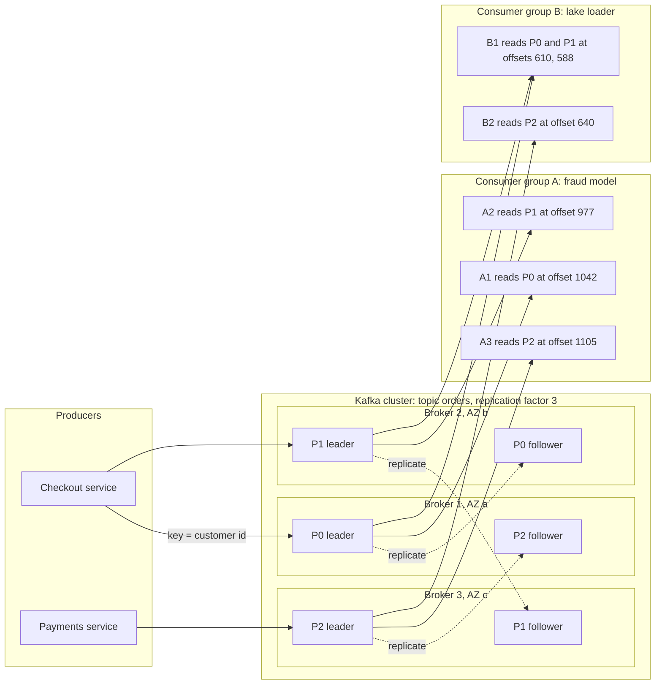
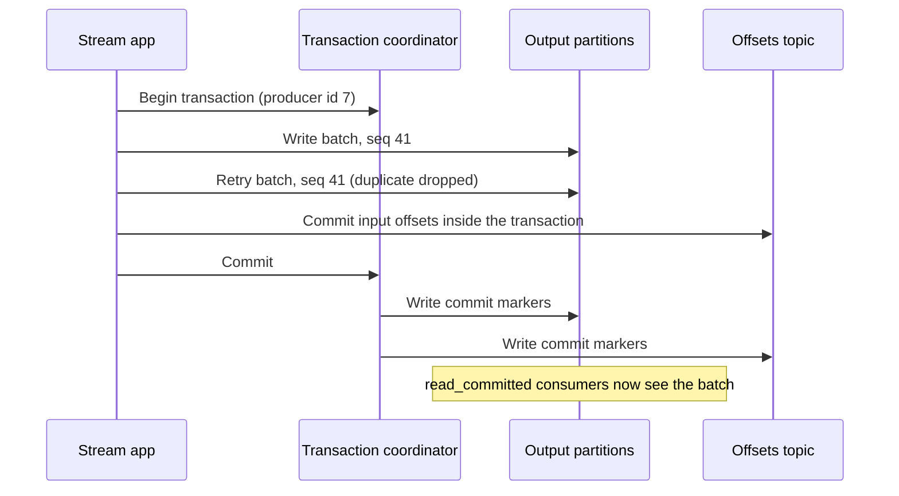
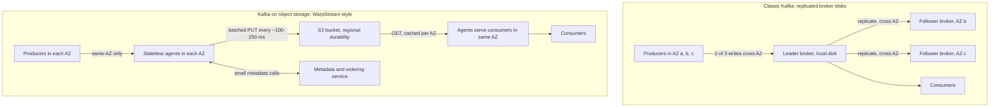
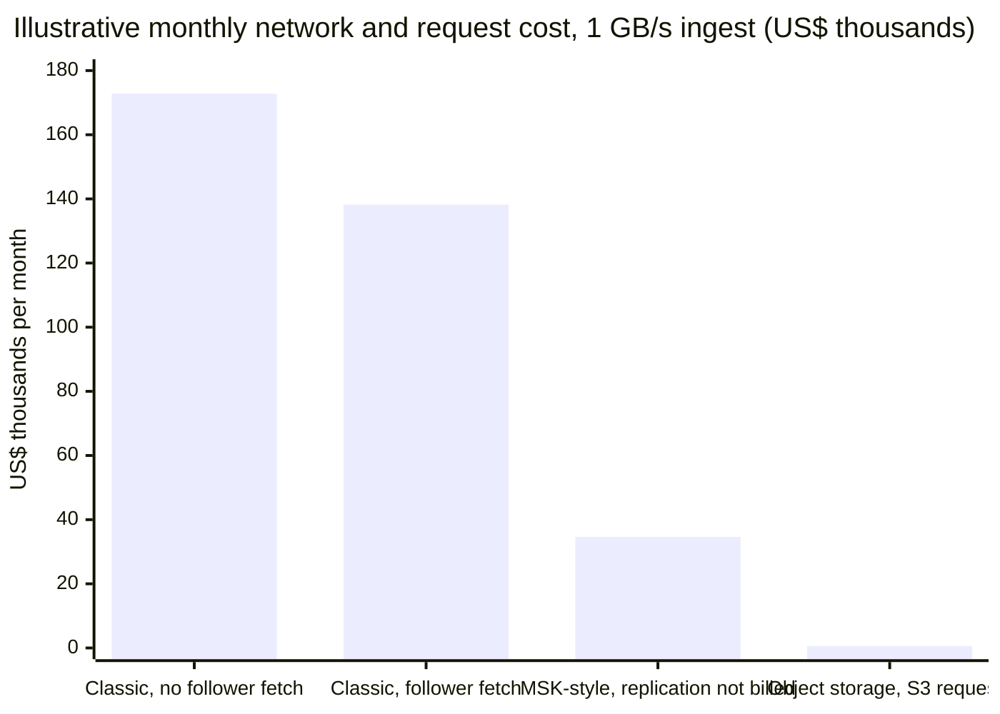
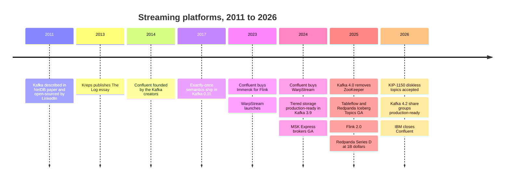

# 11. Streaming and Event Platforms
> **Depth:** L2 · **Reading time:** ~12 min · **Last verified:** 2026-11-01 · **Prerequisites:** [Ch 9 — Pipeline patterns](ch09-pipeline-patterns.md)

## TL;DR

- **The log is the idea.** Apache Kafka turned a database's internal write-ahead log into a shared, append-only, partitioned log that any number of systems can write to and read from at their own pace. That one abstraction decouples producers from consumers, and it is why Kafka became the default event backbone.[^kreps-log][^netdb]
- **The architecture is being rebuilt around object storage.** Classic Kafka copies every byte to three brokers in three availability zones (AZs). On AWS, cross-AZ traffic is billed at $0.01/GB in each direction, so for high-volume workloads the network bill can exceed the compute bill.[^aws-xaz] WarpStream, Confluent Freight, AutoMQ, Bufstream, StreamNative Ursa, Redpanda Cloud Topics and Apache Kafka's own accepted "diskless" proposal (KIP-1150) write straight to S3 instead, accepting hundreds of milliseconds of latency in exchange for much lower cost.[^warpstream-acq][^freight][^kip1150]
- **The stream is becoming a table.** Confluent Tableflow and Redpanda Iceberg Topics materialize topics as Apache Iceberg tables, which collapses the classic "Kafka → ETL job → lake" pipeline into a single storage-level setting.[^tableflow][^rp-iceberg]
- **Processing is consolidating around Flink, with Spark catching up.** Apache Flink is the stateful, event-time stream processor of record. Spark 4.1 added a real-time mode, and streaming databases (RisingWave, Materialize) offer the same results through SQL materialized views.[^flink-docs][^spark-rtm]
- **The business is now strategic.** IBM closed its ~$11B (enterprise value, announced) acquisition of Confluent on March 17, 2026, which values the category as the real-time feed for enterprise AI agents. Redpanda raised $100M at a $1B valuation (company-stated) in April 2025.[^ibm-close][^rp-fund]

## Why this matters (business + Everpure lens)

Batch pipelines ([Ch 9](ch09-pipeline-patterns.md)) answer the question "what happened yesterday?". Streaming answers "what is happening now?". That matters more in the AI era than it did in the dashboard era, for four concrete reasons:

1. **Fresh features.** A fraud model scoring a card swipe needs the last 60 seconds of activity for that card, not last night's aggregate. Stream processors compute these rolling features continuously and push them to an online feature store.
2. **Agent triggers.** An AI agent that waits for a human prompt is a chatbot. An agent that reacts to an event (an order stuck in fulfilment, a sensor drifting out of range) needs an event bus to subscribe to. Confluent's late-2025 "Streaming Agents" and "Real-Time Context Engine" launches were explicitly positioned this way.[^confluent-intel]
3. **RAG index freshness.** A retrieval-augmented generation (RAG) system is only as current as its vector index. When a product price or policy document changes, a streaming pipeline can re-embed the change and update the index in seconds, instead of waiting for a nightly re-index.
4. **Change data capture (CDC) to vector stores.** [Change data capture](../glossary.md#change-data-capture) turns database commits into a stream of events. Kafka is the usual carrier that fans those changes out to the warehouse, the search index and the vector database at the same time.

For a corporate-development reader, the market also tells a story. IBM paid roughly 9.4x Confluent's trailing GAAP revenue for the category leader. Confluent itself bought WarpStream to defend against the object-storage designs that undercut it on cost.[^cflt-10q][^ibm-10q] The technical shift in this chapter, from replicated broker disks to object storage, is also a shift in where streaming bytes physically land. That is directly relevant to Everpure (formerly Pure Storage; NYSE: P, formerly PSTG). Its June 2026 **Data Stream** product already positions FlashBlade as the place where data is vectorized and staged for AI pipelines.[^everpure-ds]

## How it works

### The log abstraction

Jay Kreps' 2013 essay "The Log" argued that the humble commit log, the structure every database already uses internally for recovery, is the right unifying abstraction for data integration across a company.[^kreps-log] A log is an ordered, append-only sequence of records. Each record gets a sequential number called an **offset**. Records are never updated in place. Readers do not delete what they read; each reader just remembers the offset it has reached.

The 2011 NetDB paper by Kreps, Neha Narkhede and Jun Rao described how LinkedIn built Kafka on this idea. Messages are addressed by logical offset, the operating-system page cache does the buffering, and consumers pull data rather than having brokers push it.[^netdb] Because a sequential append is the cheapest thing a disk or SSD can do, one broker could absorb very high write rates on commodity hardware.

Kafka's vocabulary maps onto that design:

- A **[topic](../glossary.md#topic)** is a named log, such as `orders` or `card-swipes`.
- A topic is split into **[partitions](../glossary.md#partition)**. Each partition is an independent, ordered log. Ordering is guaranteed only *within* a partition, so producers choose a key (customer ID, card number) that routes related events to the same partition.
- **[Brokers](../glossary.md#broker)** are the servers that store partitions and serve reads and writes.
- Each partition has one **leader** replica and, typically, two **followers** on other brokers (replication factor 3). The followers that are fully caught up form the **[in-sync replica](../glossary.md#in-sync-replicas)** (ISR) set. A write configured with `acks=all` is acknowledged only once every ISR member has it.[^kafka-docs]
- **[Consumer groups](../glossary.md#consumer-group)** are how applications read. Each partition is assigned to exactly one consumer within a group, so a group with three consumers reading a three-partition topic gets three-way parallelism. A second group (say, the fraud model and the data-lake loader) reads the same data independently, with its own offsets. Kafka stores those committed offsets in an internal topic.[^kafka-docs]
- **Retention** decides how long data stays: by time (seven days is the common default) or by size. **[Log compaction](../glossary.md#log-compaction)** is the alternative. It keeps only the latest record per key, which turns a topic into a durable changelog of current state, such as "latest address per customer".[^kafka-docs]

*Figure 11.1 — SV-8: a topic is a set of partitioned logs replicated across brokers. Two consumer groups read the same data independently, each tracking its own offsets, which is what decouples producers from consumers. (Followers per partition simplified to one for legibility; replication factor 3 means two.)*

**Why the log decouples.** Producers and consumers never talk to each other. The producer only needs the topic to accept its write. A consumer can be fast, slow, offline for a day, or brand new and replaying from offset zero; none of that affects the producer or the other consumer groups. Before logs, connecting N source systems to M destinations needed up to N×M point-to-point pipelines. With a log in the middle, it needs N+M connections.[^kreps-log] That N+M property, more than raw throughput, is why Kafka spread from LinkedIn to most large enterprises.

> **Bridge: semiconductors.** A Kafka partition is a FIFO ring buffer with many independent read pointers, like a NIC receive ring that several DMA engines drain at their own pace. The difference is that the "ring" lives on disk and wraps by retention time rather than by slot count. A slow reader is not back-pressured; it just falls behind, and only loses data if it is still behind when retention expires.

> **Bridge: datacenter infrastructure.** The ISR works like a RAID-1 mirror set. A write completes when all healthy mirrors have it. A mirror that lags is dropped from the set (the array runs "degraded") and is re-admitted after it resynchronizes.

> **Bridge: multicore scheduling.** A consumer group looks like work-stealing across cores, but it is closer to *static* partitioning. Each partition is pinned to one consumer until a rebalance moves it. True queue-style sharing, where idle consumers take individual records from a busy partition, arrived only with "share groups" (KIP-932), declared production-ready in Kafka 4.2 in February 2026.[^kafka42]

### From ZooKeeper to KRaft

For its first decade, Kafka kept cluster metadata (which broker leads which partition, topic configs, ACLs) in a separate Apache ZooKeeper ensemble. That meant two distributed systems to operate. It also put a ceiling on partition counts, because a new controller had to reload all metadata from ZooKeeper after a failover. **[KRaft](../glossary.md#kraft)** (Kafka Raft) moved metadata into an internal Kafka log, replicated by a Raft quorum of controllers. Kafka 4.0, released in March 2025, removed ZooKeeper entirely. Clusters must migrate to KRaft on a 3.x release (3.9 is the bridge) before they can upgrade.[^kafka40] Redpanda had taken a similar path from the start: a single C++ binary that runs Raft per partition, with no external coordinator.[^rp-docs]

### Exactly-once: idempotence plus transactions

By default, a network retry can cause a producer to write the same record twice ("at-least-once"). KIP-98, shipped in Kafka 0.11 (2017), added two mechanisms:[^kip98]

1. An **[idempotent producer](../glossary.md#idempotent-producer)**. Each producer gets an ID and stamps every batch with a per-partition sequence number. The broker discards any batch whose sequence it has already accepted, so retries cannot create duplicates.
2. **Transactions.** A producer can write to several partitions *and* commit its consumer offsets as one atomic unit. Consumers set to `read_committed` see either all of those writes or none of them.

Together these give **[exactly-once semantics](../glossary.md#exactly-once-semantics)** for read-process-write loops that stay inside Kafka. The guarantee ends at the boundary: if the output goes to an external database, that system must also be idempotent or join the transaction (Flink's two-phase-commit sinks do this).

*Figure 11.2 — Exactly-once in Kafka is two mechanisms: sequence numbers make retries harmless, and transaction markers make multi-partition writes atomic.*

> **Bridge: semiconductors.** The idempotent producer is an idempotent DMA descriptor: each descriptor carries a sequence tag, so a replayed descriptor is recognized and dropped instead of being written twice. The transaction commit marker plays the role of the doorbell write that makes a batch of descriptors visible to the device at once.

### Tiered storage, then diskless

Kafka's broker-local disks made long retention expensive. Every byte of history sat on three replicas of block storage. **[Tiered storage](../glossary.md#tiered-storage)** (KIP-405) moves closed log segments to object storage, while recent "hot" segments stay on broker disks. It was under development from Kafka 3.6 and was declared production-ready in Kafka 3.9 (November 2024).[^kafka39] Tiered storage cuts *storage* cost. It does not touch the *network* cost, because the hot tier is still replicated three times across AZs.

The newer "Kafka on object storage" designs go further. They make object storage the primary store and the brokers stateless.

*Figure 11.3 — Classic Kafka gets durability by copying bytes between AZs. Object-storage designs delegate durability to S3, which replicates across AZs inside its own price. That removes the inter-AZ bill but adds a write-batching delay.*

WarpStream's agents buffer writes for a fraction of a second, upload a combined file to S3, and register the file's offsets with a metadata service that fixes the order. Any agent can serve any partition, so scaling is just adding containers. The cost of this design is latency. WarpStream's own benchmark reported a 169 ms p99 produce latency on the low-latency S3 Express One Zone tier (vendor-reported), and a customer case study cited roughly 400 ms produce and about 1 s end-to-end on standard S3.[^warpstream-bench] Confluent describes its Freight clusters, which use the same direct-to-object-storage approach, as moving latency from sub-100 ms to as much as a second or two, in return for up to 90% lower cost (company claim).[^freight]

## Worked example: the cross-AZ bill for 1 GB/s

The arithmetic below is **illustrative, not a quote**. Assumptions: self-managed Kafka on EC2 in one AWS region; 1 GB/s of sustained, already-compressed produce traffic; replication factor 3 across three AZs; producers spread evenly across AZs; one consumer group; a 30-day month (2,592,000 seconds); and AWS's published intra-region, cross-AZ rate of $0.01/GB charged on each side, so $0.02 per GB that crosses.[^aws-xaz]

Monthly ingest is 1 GB/s × 2,592,000 s = **2,592,000 GB (≈2.6 PB)**.

| Traffic leg (classic Kafka) | GB crossing an AZ per month | Monthly cost at $0.02/GB |
|---|---|---|
| Producer → leader (2/3 of writes land in another AZ) | 1,728,000 | $34,560 |
| Leader → two followers (both in other AZs) | 5,184,000 | $103,680 |
| Leader → consumers, no follower fetching (2/3 cross) | 1,728,000 | $34,560 |
| **Total, follower fetching off** | 8,640,000 | **$172,800** |
| Total, rack-aware follower fetching on (KIP-392) | 6,912,000 | $138,240 |

*Figure 11.4 — Replication alone is 60% of the classic bill. Fixing consumer placement helps; only removing broker-to-broker copying changes the order of magnitude.*

Now the object-storage design. Producers and consumers talk only to agents in their own AZ, so cross-AZ data traffic is roughly zero. EC2-to-S3 transfer within a region is free.[^s3-pricing] What remains is S3 request charges. Assume nine agents (three per AZ), each uploading one object every 250 ms: that is 36 PUTs per second, or 93.3 million a month. At $0.005 per 1,000 PUTs that comes to about $467. If each AZ reads every object once, that adds 280 million GETs at $0.0004 per 1,000, about $112.[^s3-pricing] The total is **≈$580/month**, versus $138K–$173K for classic Kafka: a reduction of more than 99% on this line item.

*Figure 11.5 — On these assumptions, inter-AZ transfer dominates classic Kafka's network bill, while the object-storage design pays only S3 request fees. Illustrative arithmetic, not vendor pricing.*

Three caveats keep this honest. First, Amazon MSK does not bill inter-broker replication traffic within a cluster, although client traffic that crosses AZs is still billed. That is the "MSK-style" bar, which assumes follower fetching for consumers.[^msk-pricing] Second, this compares network lines only. S3 storage, compute and vendor licence fees still apply. A faster flush interval (say 50 ms to cut latency) multiplies PUT costs by five, though the total stays small. Third, the saving is bought with latency, so it suits logs, telemetry, lake ingestion and CDC fan-out, not sub-10 ms trading or payments authorization.

## Stream processing

A log moves events; a stream processor computes on them. The hard parts are **state** (running counts, joins, windows), **time** and **recovery**.

- **[Event time](../glossary.md#event-time)** versus processing time. Events arrive late and out of order: a phone reconnects after a tunnel and uploads ten minutes of taps. Flink tracks **[watermarks](../glossary.md#watermark)**, a running estimate that "no events older than T are still expected". A window closes when the watermark passes its end, which makes results correct by when things *happened*.[^flink-docs]
- **[Checkpoints](../glossary.md#checkpoint).** Flink periodically takes a consistent snapshot of all operator state plus the Kafka offsets it has reached, using a variant of the Chandy–Lamport snapshot algorithm. After a crash it rewinds to the last checkpoint and replays the log from there. The log's replayability is what makes this cheap.[^flink-docs]
- **Disaggregated state.** Flink 2.0 (released 2025) can keep primary state in remote object storage through its ForSt store, with local disk as a cache. This is the same storage-disaggregation trend as diskless Kafka, applied to the processor.[^flink2]

> **Going deeper (L3).** A Flink checkpoint is triggered by injecting "barrier" markers into each source partition. Each operator snapshots its state when barriers from all inputs have arrived, then forwards the barrier. Unaligned checkpoints let barriers overtake in-flight records to avoid stalls under backpressure, at the cost of storing those records in the snapshot.[^flink-docs]

| Dimension | Apache Flink | Spark Structured Streaming | Kafka Streams | RisingWave | Materialize |
|---|---|---|---|---|---|
| Processing model | Record-at-a-time dataflow | Micro-batch; real-time mode (Spark 4.1) for stateless queries | Record-at-a-time library | Streaming SQL database | Incremental view maintenance (Differential Dataflow) |
| Typical latency | Milliseconds | ~100 ms+ micro-batch; single-digit ms p99 claimed in real-time mode (vendor) | Milliseconds | Sub-second (vendor) | Sub-second (vendor) |
| State and recovery | Large keyed state (RocksDB/ForSt); checkpoints to object storage | State store plus checkpoint/WAL | Local RocksDB plus compacted changelog topics in Kafka | Managed state on object storage | In-memory/disk arrangements; durable storage on object store |
| Event-time support | Full: watermarks, late data, rich windows | Watermarks, windows | Windows and grace periods | Watermarks, SQL windows | SQL temporal filters |
| Interface | Java/Python DataStream, Table API, SQL | DataFrame/SQL (Python, Scala) | Java library embedded in your app | Postgres-compatible SQL | Postgres-compatible SQL |
| Deployment | Cluster (self-run, Confluent, AWS, Ververica, Alibaba) | Spark clusters, Databricks | No cluster: runs inside the application | Open source (Apache 2.0) or managed cloud | Managed cloud or self-managed |
| Exactly-once | Checkpoints plus two-phase-commit sinks | Checkpoints plus idempotent/transactional sinks | Kafka transactions | Checkpointed, end to end into supported sinks | Strict serializability for views |
| Sweet spot | Complex, stateful, high-scale pipelines | Teams already on Spark/Databricks | Kafka-centric microservices | SQL teams wanting live views | Operational queries over always-fresh joins |

*Figure 11.6 — Flink is the general-purpose engine. Spark wins on reuse of existing skills, Kafka Streams on having no cluster, and the streaming databases on SQL simplicity.*

Sources for the table: Flink and Spark documentation, Databricks' Spark 4.1 announcement, and company materials for RisingWave and Materialize.[^flink-docs][^spark-rtm][^streamdb] Latency claims are vendor-stated and workload-dependent.

## Design choices and trade-offs

| Design | Durability comes from | Produce latency | Cross-AZ network | Ops burden | Best for |
|---|---|---|---|---|---|
| Classic Kafka (broker disks, RF=3) | Copies on three brokers | Single-digit to tens of ms | High (replication plus clients) | High: partition rebalancing, disk sizing | Low-latency transactions, mature ecosystems |
| Kafka plus tiered storage (KIP-405) | Hot: broker copies. Cold: object store | Same as classic | Still high on hot tier | Medium | Long retention and replay at lower storage cost |
| Diskless / object-native (WarpStream, Freight, AutoMQ, Bufstream, Ursa, KIP-1150) | Object store (S3 multi-AZ) | ~100 ms to ~1–2 s | Near zero | Low: stateless agents | Logs, telemetry, CDC fan-out, lake ingestion |
| Redpanda (C++, thread-per-core, Raft) | Raft replicas; tiered and cloud topics optional | Low ms (vendor) | High unless cloud topics | Lower than Kafka: single binary | Latency-sensitive Kafka API workloads |
| Cloud-native services (Kinesis, Pub/Sub, Event Hubs) | Provider-managed | Tens of ms (varies) | Bundled in price | Lowest | Teams standardized on one cloud |

*Figure 11.7 — The core trade is latency versus cost: whoever does the replication, broker or object store, decides both.*

**Steelman for classic Kafka.** Object storage moves the failure domain to S3 and the ordering problem to a metadata service, both of which must be engineered carefully. Classic Kafka also has a decade of operational knowledge behind it. The latency floor of object-native designs rules them out for a large share of transactional workloads, and on MSK much of the replication cost disappears anyway.

**Steelman for diskless.** Most streaming bytes by volume are logs, metrics and clickstream data, which tolerate a second of latency. For these, paying for three copies across AZs is waste. Apache Kafka's own community accepted the KIP-1150 diskless-topics design in March 2026 (implementation still to come), which signals the mainstream agrees.[^kip1150]

**The stream becomes a table.** Tableflow (Iceberg GA in March 2025; Delta Lake initially in preview) and Redpanda Iceberg Topics (GA in Redpanda 25.1, April 2025) write topic data as Parquet files plus Iceberg metadata, using the schema registry to define the table.[^tableflow][^rp-iceberg] Bufstream and Ursa do the same natively.[^bufstream][^ursa] The analytical copy then needs no separate connector fleet, and the [open table format](../01-data-systems-foundations/ch07-open-table-formats.md) becomes the hand-off point between streaming and the lakehouse. For live analytical serving on top, see [Ch 23](../03-ai-data-stack/ch23-real-time-analytics-htap.md).

## Who's who

| Platform | Owner / status | Protocol | Storage architecture | Latency tier | Deployment | Iceberg path |
|---|---|---|---|---|---|---|
| Apache Kafka / Confluent | Apache project; Confluent owned by IBM since 2026-03-17 | Kafka | Broker disks plus tiered storage; Kora engine in Confluent Cloud; Freight (object-direct) | Low ms (standard); ~1–2 s (Freight) | Self-managed, Confluent Cloud, Platform | Tableflow |
| Redpanda | Private (Series D, April 2025) | Kafka API | C++ thread-per-core, Raft per partition; tiered storage; Cloud Topics on object storage | Low ms (vendor) | Self-managed, BYOC, serverless | Iceberg Topics (GA 25.1) |
| WarpStream | Confluent (acquired Sept 2024), now IBM | Kafka API | Stateless agents, S3 only | ~0.2–1 s | Bring your own cloud (BYOC) | Tableflow-style table output (WarpStream Tableflow) [VERIFY: product status] |
| AutoMQ | Private; open-source Kafka fork | Kafka (fork) | Shared storage on S3 with a write-ahead log (S3, EBS or FSx) | Tens of ms to sub-second (vendor) | Self-managed, BYOC | Table topic [VERIFY: GA status] |
| Apache Pulsar / StreamNative | Apache project; StreamNative commercial | Pulsar plus Kafka API (Ursa) | Brokers plus BookKeeper; Ursa is leaderless on object storage | Low ms (classic); higher (Ursa) | Self-managed, cloud, BYOC | Ursa writes Iceberg/Delta |
| Amazon Kinesis / MSK | AWS | Kinesis API / Kafka | Shards (Kinesis); MSK Standard and Express brokers | Tens of ms | Managed | Firehose to S3 Tables/Iceberg |
| Google Pub/Sub / Managed Kafka | Google Cloud | Pub/Sub API / Kafka | Global managed service; Managed Service for Apache Kafka | Tens of ms | Managed | BigQuery subscriptions; BigLake Iceberg |
| Azure Event Hubs | Microsoft | AMQP plus Kafka endpoint | Managed partitions | Tens of ms | Managed (Standard and Premium tiers for Kafka) | Fabric / Capture to lake |

*Figure 11.8 — The Kafka protocol has become the industry's common interface, and the real competition is now over the storage engine behind it.*

Sources: Confluent, Redpanda, AutoMQ, StreamNative, AWS, Google and Microsoft documentation.[^warpstream-acq][^rp-docs][^automq][^ursa][^msk-express][^gcp-kafka][^eventhubs] Latency tiers are indicative, from vendor documentation.

Positioning in brief:

- **Confluent (IBM)** has the broadest portfolio: open-source Kafka stewardship, Confluent Cloud, WarpStream for BYOC, Flink through the 2023 Immerok purchase ($54.9M cash per its 10-Q), and Tableflow. Under IBM it will be pulled toward watsonx, MQ, webMethods and IBM Z.[^cflt-10q][^ibm-close]
- **Redpanda** sells performance and simplicity (no JVM, single binary) and has pushed hard into agent tooling and Iceberg. Its Cloud Topics tier, announced at Streamfest 2025 with GA targeted for March 2026, adds object-storage economics within the same cluster.[^rp-streamfest] `[VERIFY: Cloud Topics GA date]`
- **AutoMQ and Bufstream** compete on price. AutoMQ keeps Kafka's own code with S3 underneath; Bufstream adds Protobuf schema enforcement at the broker and was Jepsen-tested.[^automq][^bufstream]
- **Hyperscalers** win by default inside their clouds. MSK Express brokers (GA November 2024) claim up to 3x per-broker throughput, Google runs a managed Kafka service alongside Pub/Sub, and Event Hubs accepts Kafka clients unchanged.[^msk-express][^gcp-kafka][^eventhubs] Kinesis remains AWS-native, with shards provisioned for 1 MB/s of writes each.[^kinesis]

Company-level economics and deal history are covered in [Ch 30](../04-company-deep-dives/ch30-data-movement-streaming-companies.md).

## History and trajectory

*Figure 11.9 — Fifteen years in two phases: first the log won the data-integration argument, then the storage underneath it was rebuilt for cloud economics.*

The arc has three chapters. **2011–2017: the log wins.** LinkedIn open-sourced Kafka in 2011, and its creators founded Confluent in 2014.[^netdb][^cflt-10k] Exactly-once semantics in 2017 made Kafka credible for financial workloads.[^kip98] **2018–2023: managed services.** Confluent Cloud, MSK, Event Hubs' Kafka endpoint and Pulsar competed on operations rather than features, and Flink became the processing standard. **2023–2026: cloud economics.** WarpStream's 2023 launch showed that inter-AZ fees, not servers, dominated large Kafka bills, and within 18 months Confluent had bought it.[^warpstream-acq] Iceberg integration then turned topics into tables, and IBM's March 2026 acquisition made streaming a component of a larger AI-platform company.[^ibm-close]

Looking ahead, three things seem likely. Object storage will become the default primary store for high-volume topics (Kafka's own KIP-1150 points that way). The boundary between "topic" and "table" will keep blurring. And streaming will be sold as the event and context layer for AI agents rather than as plumbing.

## Numbers that matter

| Metric | Value | Basis | Source / date |
|---|---|---|---|
| AWS cross-AZ data transfer (same region) | $0.01/GB out + $0.01/GB in | Published list price | AWS EC2 pricing, retrieved 2026-11-01[^aws-xaz] |
| Classic Kafka cross-AZ cost, 1 GB/s, RF=3 | ≈$138K–$173K per month | Estimate (this chapter's illustrative arithmetic) | Worked example above |
| Object-storage design, same load | ≈$0.6K per month in S3 requests | Estimate (illustrative) | Worked example; S3 pricing[^s3-pricing] |
| IBM–Confluent deal | ~$11B EV; $31/share cash; closed 2026-03-17 | Announced deal value | IBM release, 2026-03-17[^ibm-close] |
| IBM-recorded purchase price | $11.6B | GAAP (acquisition accounting) | IBM 10-Q, Q1 2026[^ibm-10q] |
| Confluent revenue, FY2025 (Jan–Dec 2025) | $1,167M, +21%; Confluent Cloud $624M, +27% | GAAP | Confluent 10-K FY2025[^cflt-10k] |
| Implied deal multiple | ~9.4x EV / FY2025 revenue | Estimate | Derived from the two rows above |
| WarpStream acquisition | $135.1M preliminary consideration (plus up to $76.2M holdbacks) | GAAP disclosure | Confluent 10-Q, Q3 2024[^cflt-10q] |
| Immerok (Flink) acquisition | $54.9M cash | GAAP disclosure | Confluent 10-Q[^cflt-10q] |
| Redpanda Series D | $100M at $1B valuation, led by GV (April 2025) | Company-stated / press-reported | Redpanda, 2025-04[^rp-fund] |
| Confluent customer base | >6,500 organizations; ~40% of Fortune 500 | Company-stated, press-reported | ChannelWeb, 2026-03[^ibm-close] |
| Freight cluster trade | Up to 90% lower TCO; latency up to ~1–2 s | Company claim | Confluent, 2025[^freight] |
| WarpStream p99 produce latency (S3 Express One Zone) | 169 ms | Vendor benchmark | WarpStream[^warpstream-bench] |
| Spark 4.1 real-time mode | Single-digit ms p99 for stateless queries | Vendor claim | Databricks[^spark-rtm] |

*Figure 11.10 — The headline numbers: a $0.02/GB network tax, an ~$11B exit and a 9.4x revenue multiple for the category leader.*

## Storage bridge

> **Storage bridge.** Diskless streaming turns the event platform into an object-storage workload: large sequential PUTs every few hundred milliseconds, bursts of parallel GETs on replay, and retention measured in weeks or months instead of days. That shifts demand from replicated block volumes on brokers toward cheap, high-throughput S3-compatible capacity, the profile of FlashBlade-class systems. AutoMQ and Bufstream already document support for self-hosted S3-compatible stores, so on-premises "Kafka on object storage" is a real deployment pattern. See the companion *Everpure Tech Atlas* for object-store throughput and erasure-coding detail.[^automq][^bufstream]

Options a strategy team might evaluate, based on public information: certifying Everpure object storage as a backend for Kafka-compatible diskless engines (WarpStream BYOC, AutoMQ, Bufstream, Redpanda Cloud Topics); positioning Data Stream as a consumer of Kafka and CDC topics, so that vector indexes stay fresh; and tracking the IBM–Confluent integration, because IBM is both a storage competitor and a potential channel.

## Conversation playbook

**Questions for a product manager**

1. "What share of your customers' streaming volume is latency-tolerant enough for an object-storage tier, and how do you price that tier against your classic clusters?"
2. "When a customer turns on Iceberg output, which connectors or ETL jobs do they switch off, and does that change your revenue per GB?"
3. "How do AI-agent workloads show up in your usage: new topics, more consumers per topic, or longer retention for replay?"

**Questions for an engineer**

1. "What is your p99 produce and end-to-end latency on standard S3 versus S3 Express, and what flush interval produces it?"
2. "In a diskless design, what orders the records, and what happens to in-flight batches if that metadata service loses its quorum?"
3. "How do you deliver exactly-once into an external sink such as a vector database: transactions, idempotent upserts or something else?"

**What good answers sound like.** They quantify the latency and cost trade with a named configuration ("p99 of about 400 ms on S3 Standard at a 250 ms flush"). They distinguish storage cost from network cost. They admit that exactly-once ends at system boundaries unless the sink cooperates. And they describe Iceberg output in terms of which pipelines it replaces, not as a checkbox.

**Don't say this**

- "Kafka is a message queue." It is a replayable log. Queue semantics (share groups) were added only in Kafka 4.2.
- "Tiered storage solves Kafka's cloud cost problem." It cuts storage cost but leaves hot-tier cross-AZ replication in place.
- "Exactly-once means no duplicates anywhere." It holds inside Kafka; external sinks must be idempotent or transactional.
- "Kafka still needs ZooKeeper." Not since Kafka 4.0 (2025).
- "Object-storage Kafka is just cheaper Kafka." It is a different latency class, so match it to the workload.

## Going deeper

- Read Kreps' "The Log" for the integration argument, and the NetDB 2011 paper for the original design.[^kreps-log][^netdb]
- KIP-405 (tiered storage), KIP-98 (exactly-once), KIP-932 (share groups) and KIP-1150 (diskless) are the four Kafka proposals that define today's architecture.[^kafka39][^kip98][^kafka42][^kip1150]
- The VLDB 2025 papers on Flink 2.0 disaggregated state and StreamNative Ursa show the object-storage shift from the research side.[^flink2][^ursa]
- Upstream patterns live in [Ch 9](ch09-pipeline-patterns.md), table formats in [Ch 7](../01-data-systems-foundations/ch07-open-table-formats.md), real-time serving in [Ch 23](../03-ai-data-stack/ch23-real-time-analytics-htap.md), and the companies in [Ch 30](../04-company-deep-dives/ch30-data-movement-streaming-companies.md).

## Key terms

- [Event streaming](../glossary.md#event-streaming) — moving and processing records continuously, as they happen, rather than in scheduled batches.
- [Append-only log](../glossary.md#append-only-log) — an ordered sequence of records that is only ever added to; readers track their position by offset.
- [Topic](../glossary.md#topic) — a named stream in Kafka, made up of one or more partitions.
- [Partition](../glossary.md#partition) — an independently ordered shard of a topic; the unit of parallelism and ordering.
- [Offset](../glossary.md#offset) — the sequential position of a record within a partition.
- [Broker](../glossary.md#broker) — a Kafka server that stores partitions and serves reads and writes.
- [In-sync replicas](../glossary.md#in-sync-replicas) — the set of replicas fully caught up with a partition leader; required to acknowledge `acks=all` writes.
- [Consumer group](../glossary.md#consumer-group) — a set of consumers that share a topic's partitions, each group tracking its own offsets.
- [Share group](../glossary.md#share-group) — Kafka 4.x queue-style consumption in which several consumers process records from the same partition.
- [Log compaction](../glossary.md#log-compaction) — retention that keeps only the latest record per key.
- [KRaft](../glossary.md#kraft) — Kafka's built-in Raft-based metadata quorum, which replaced ZooKeeper.
- [Idempotent producer](../glossary.md#idempotent-producer) — a producer whose retries cannot create duplicates, thanks to per-partition sequence numbers.
- [Exactly-once semantics](../glossary.md#exactly-once-semantics) — the guarantee that each input affects the output exactly once, despite retries and failures.
- [Tiered storage](../glossary.md#tiered-storage) — offloading older log segments from broker disks to object storage (KIP-405).
- [Diskless Kafka](../glossary.md#diskless-kafka) — Kafka-compatible designs whose primary store is object storage, with stateless brokers.
- [Bring your own cloud](../glossary.md#bring-your-own-cloud) — a deployment model in which the vendor's data plane runs in the customer's cloud account.
- [Inter-AZ data transfer](../glossary.md#inter-az-data-transfer) — the per-GB cloud charge for traffic between availability zones in the same region.
- [Change data capture](../glossary.md#change-data-capture) — turning database commits into a stream of change events.
- [Stream processing](../glossary.md#stream-processing) — continuous computation (filters, joins, aggregations) over unbounded event streams.
- [Event time](../glossary.md#event-time) — the time an event actually occurred, as opposed to when it was processed.
- [Watermark](../glossary.md#watermark) — a stream processor's running estimate that no events older than a given time are still expected.
- [Checkpoint](../glossary.md#checkpoint) — a consistent snapshot of processor state and input offsets used for recovery.
- [Streaming database](../glossary.md#streaming-database) — a database that keeps SQL materialized views continuously up to date from streams.
- [Schema registry](../glossary.md#schema-registry) — a service that stores and versions the schemas of stream records.

## Sources

[^kreps-log]: Jay Kreps, "The Log: What every software engineer should know about real-time data's unifying abstraction," LinkedIn Engineering Blog, https://engineering.linkedin.com/distributed-systems/log-what-every-software-engineer-should-know-about-real-time-datas-unifying, published 2013-12-16; retrieved 2026-11-01.
[^netdb]: Jay Kreps, Neha Narkhede, Jun Rao, "Kafka: a Distributed Messaging System for Log Processing," NetDB '11 workshop (Athens, 2011-06-12); copy at https://people.csail.mit.edu/matei/courses/2015/6.S897/readings/kafka.pdf, published 2011-06; retrieved 2026-11-01.
[^kafka-docs]: Apache Software Foundation, "Apache Kafka documentation: Design (replication, log compaction, consumer groups)," https://kafka.apache.org/documentation/#design, n.d.; KIP-392 (fetch from closest replica), https://cwiki.apache.org/confluence/display/KAFKA/KIP-392%3A+Allow+consumers+to+fetch+from+closest+replica, n.d.; retrieved 2026-11-01.
[^kafka40]: Apache Software Foundation, "Apache Kafka 4.0.0 release notes," https://dlcdn.apache.org/kafka/4.0.0/RELEASE_NOTES.html, published 2025-03 (release date 2025-03-18 per secondary coverage, e.g., SSOJet, https://ssojet.com/blog/kafka-40-release-simplified-architecture-with-default-kraft); retrieved 2026-11-01.
[^kafka42]: Apache Software Foundation, "Apache Kafka 4.2.0 Release Announcement," https://kafka.apache.org/blog/2026/02/17/apache-kafka-4.2.0-release-announcement/, published 2026-02-17; retrieved 2026-11-01.
[^kafka39]: Confluent, "Introducing Apache Kafka 3.9," https://www.confluent.io/blog/introducing-apache-kafka-3-9/, published 2024-11; Apache Kafka, "KIP-405: Kafka Tiered Storage," https://cwiki.apache.org/confluence/display/KAFKA/KIP-405%3A+Kafka+Tiered+Storage, n.d.; retrieved 2026-11-01.
[^kip98]: Apache Kafka, "KIP-98: Exactly Once Delivery and Transactional Messaging," https://cwiki.apache.org/confluence/display/KAFKA/KIP-98+-+Exactly+Once+Delivery+and+Transactional+Messaging, n.d. (shipped in Kafka 0.11, 2017); retrieved 2026-11-01.
[^kip1150]: Aiven, "KIP-1150 accepted and the road ahead," https://aiven.io/blog/kip-1150-accepted-and-the-road-ahead, published 2026-03-12 (vote passed 2026-03-02); Instaclustr, "Kafka 'Diskless' — Proposals, Status & Insights," https://www.instaclustr.com/support/documentation/announcements/apache-kafka/kafka-diskless-proposals-status-insights/, n.d.; retrieved 2026-11-01.
[^aws-xaz]: Amazon Web Services, "Amazon EC2 On-Demand Pricing — Data Transfer within the same AWS Region," https://aws.amazon.com/ec2/pricing/on-demand/, n.d.; rate cross-checked via Last Week in AWS, "How much does AWS data transfer cost between AZs in the same region?", https://www.lastweekinaws.com/blog/aws-cross-az-data-transfer-costs-more-than-aws-says, n.d.; retrieved 2026-11-01.
[^s3-pricing]: Amazon Web Services, "Amazon S3 pricing" (S3 Standard, US East: PUT $0.005 per 1,000; GET $0.0004 per 1,000; same-region transfer to AWS services free), https://aws.amazon.com/s3/pricing/, n.d.; retrieved 2026-11-01.
[^msk-pricing]: Amazon Web Services, "Amazon MSK pricing," https://aws.amazon.com/msk/pricing/, n.d.; retrieved 2026-11-01.
[^msk-express]: Amazon Web Services, "Express brokers for Amazon MSK is now generally available," https://aws.amazon.com/about-aws/whats-new/2024/11/express-brokers-amazon-msk-generally-available, published 2024-11-07; retrieved 2026-11-01.
[^kinesis]: Amazon Web Services, "Amazon Kinesis Data Streams quotas and limits," https://docs.aws.amazon.com/streams/latest/dev/service-sizes-and-limits.html, n.d.; retrieved 2026-11-01.
[^gcp-kafka]: Google Cloud, "Managed Service for Apache Kafka release notes," https://cloud.google.com/managed-kafka/docs/release-notes, n.d.; retrieved 2026-11-01. [VERIFY: service GA date]
[^eventhubs]: Microsoft, "Azure Event Hubs for Apache Kafka overview," Microsoft Learn, https://learn.microsoft.com/en-us/azure/event-hubs/azure-event-hubs-apache-kafka-overview, n.d.; retrieved 2026-11-01.
[^warpstream-acq]: Confluent, "Confluent Acquires WarpStream to Advance Next Gen BYOC Data Streaming," Business Wire, https://www.businesswire.com/news/home/20240909282386/en/Confluent-Acquires-WarpStream-to-Advance-Next-Gen-BYOC-Data-Streaming, published 2024-09-09; retrieved 2026-11-01.
[^warpstream-bench]: WarpStream, "WarpStream S3 Express One Zone benchmark and total cost of ownership," https://www.warpstream.com/blog/warpstream-s3-express-one-zone-benchmark-and-total-cost-of-ownership, n.d.; WarpStream, "Cost-effective logging at scale: ShareChat's journey to WarpStream," https://www.warpstream.com/blog/cost-effective-logging-at-scale-sharechats-journey-to-warpstream, n.d.; retrieved 2026-11-01. Vendor-reported.
[^freight]: Confluent, "Freight Clusters Are Generally Available," https://www.confluent.io/blog/freight-clusters-are-generally-available/, published 2025 (Q1 2025 launch); retrieved 2026-11-01. Company claims.
[^cflt-10q]: Confluent, Inc., Form 10-Q for the quarter ended 2024-09-30, SEC EDGAR, https://www.sec.gov/Archives/edgar/data/1699838/000095017024119042/cflt-20240930.htm, published 2024-11; retrieved 2026-11-01. (Immerok consideration per an earlier 2023 10-Q, as recorded in data/ma_deals.csv.)
[^cflt-10k]: Confluent, Inc., Form 10-K for fiscal year ended 2025-12-31, SEC EDGAR, https://www.sec.gov/Archives/edgar/data/1699838/000169983826000006/cflt-20251231.htm, published 2026; retrieved 2026-11-01. FY2025 figures as recorded in data/public_comps.csv (via secondary summary; re-check against the 10-K).
[^ibm-close]: IBM, "IBM Completes Acquisition of Confluent," via Stock Titan, https://www.stocktitan.net/news/IBM/ibm-completes-acquisition-of-confluent-making-real-time-data-the-lbuwdbharsqe.html, published 2026-03-17; ChannelWeb UK, "IBM completes $11bn Confluent acquisition," https://www.channelweb.co.uk/news-network/2026/ibm-completes-11bn-confluent-acquisition, published 2026-03; retrieved 2026-11-01.
[^ibm-10q]: IBM, Form 10-Q for the quarter ended 2026-03-31, SEC EDGAR, https://www.sec.gov/Archives/edgar/data/0000051143/000005114326000038/ibm-20260331.htm, published 2026-04; retrieved 2026-11-01.
[^tableflow]: Confluent, "Confluent Announces the General Availability of Tableflow," Business Wire, https://www.businesswire.com/news/home/20250318342911/en/confluent-announces-the-general-availability-of-tableflow, published 2025-03-18; Confluent docs, "Tableflow overview," https://docs.confluent.io/cloud/current/topics/tableflow/overview.html, n.d.; retrieved 2026-11-01.
[^rp-iceberg]: Redpanda, "Redpanda 25.1: Iceberg Topics now generally available," https://redpanda.com/blog/redpanda-25-1-iceberg-topics-ga, published 2025-04-07; Redpanda docs, "About Iceberg Topics," https://docs.redpanda.com/current/manage/topic-iceberg-integration/, n.d.; retrieved 2026-11-01.
[^rp-streamfest]: Redpanda, "Streamfest day 2: Smarter streaming in the cloud and the future of Kafka," https://www.redpanda.com/blog/redpanda-streamfest-2025-day-2, published 2025; retrieved 2026-11-01.
[^rp-docs]: Redpanda, "How Redpanda Works" (architecture documentation), https://docs.redpanda.com/current/get-started/architecture/, n.d.; corroborated by Conduktor, "Redpanda vs Kafka: Architecture, Trade-offs," https://conduktor.io/glossary/redpanda-vs-kafka, n.d.; retrieved 2026-11-01.
[^rp-fund]: Redpanda, "Redpanda Raises $100M Series D," https://www.redpanda.com/press/redpanda-raises-100m-launches-enterprise-agentic-ai-platform, published 2025-04; Bloomberg Law, "GV, Lightspeed Funding Lifts Redpanda to Unicorn Valuation," https://news.bloomberglaw.com/ip-law/gv-lightspeed-funding-deal-lifts-redpanda-to-unicorn-valuation, published 2025-04; retrieved 2026-11-01.
[^automq]: AutoMQ, "AutoMQ" (GitHub repository and README), https://github.com/automq/automq, n.d.; AutoMQ, "AutoMQ x FSx: 10ms latency diskless Kafka on AWS," https://www.automq.com/blog/automq-fsx-10ms-latency-diskless-kafka-on-aws, published 2025-12; retrieved 2026-11-01.
[^bufstream]: Buf Technologies, "Bufstream documentation," https://buf.build/docs/bufstream, n.d.; retrieved 2026-11-01.
[^ursa]: StreamNative, "Ursa: A Lakehouse-Native Data Streaming Engine for Kafka," PVLDB 18(12): 5184–5196, https://www.vldb.org/pvldb/vol18/p5184-guo.pdf, published 2025; retrieved 2026-11-01.
[^flink-docs]: Apache Flink, "Timely Stream Processing" and "Checkpointing" documentation, https://nightlies.apache.org/flink/flink-docs-stable/docs/concepts/time/ and https://nightlies.apache.org/flink/flink-docs-stable/docs/dev/datastream/fault-tolerance/checkpointing/, n.d.; retrieved 2026-11-01.
[^flink2]: Mei et al., "Disaggregated State Management in Apache Flink 2.0," PVLDB 18, https://www.vldb.org/pvldb/vol18/p4846-mei.pdf, published 2025; Ververica, "Embracing the Future with Apache Flink 2.0," https://www.ververica.com/blog/embracing-the-future-apache-flink-2-0, published 2025; retrieved 2026-11-01.
[^spark-rtm]: Databricks, "Introducing Apache Spark 4.1," https://www.databricks.com/blog/introducing-apache-sparkr-41, published 2025-12 [VERIFY: day]; Apache Spark, "Real-time mode" documentation, https://apache.googlesource.com/spark/+/master/docs/streaming/real-time-mode.md, n.d.; retrieved 2026-11-01. Vendor claims.
[^streamdb]: Materialize, "Materialize Secures $60M Series C Funding," https://materialize.com/materialize-raises-a-series-c/, published 2021-09-30; TechTarget, "RisingWave Labs raises $36M for stream processing database," https://www.techtarget.com/searchdatamanagement/news/252526292/RisingWave-Labs-raises-36M-for-stream-processing-database, published 2022-10; retrieved 2026-11-01.
[^confluent-intel]: Confluent, "Introducing Real-Time Context Engine," https://www.confluent.io/blog/introducing-real-time-context-engine-ai/, published 2025-10; retrieved 2026-11-01.
[^everpure-ds]: Everpure, "Everpure Announces Data Stream," https://www.everpuredata.com/company/newsroom/press-releases/everpure-announces-data-stream.html, published 2026-06-17; retrieved 2026-11-01.
