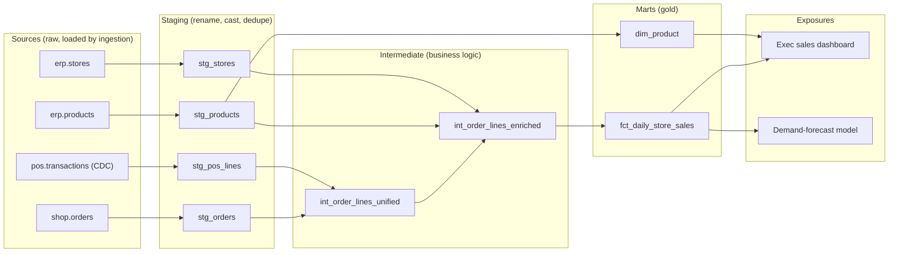
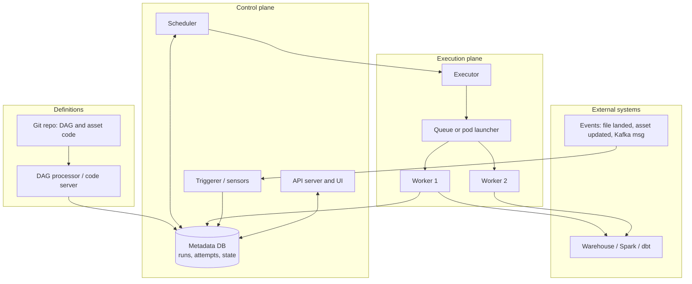
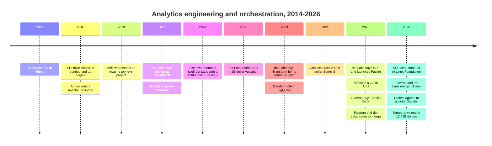

# 12. Transformation and Orchestration
> **Depth:** L2 · **Reading time:** ~14 min · **Last verified:** 2026-11-01 · **Prerequisites:** [Ch 9 — Pipeline patterns](ch09-pipeline-patterns.md)

## TL;DR

- **Transformation is where raw data becomes business truth.** In the [ELT](../glossary.md#elt) pattern, data lands raw in the warehouse or lakehouse. SQL models then clean, join and aggregate it into tables people trust. [dbt](../glossary.md#dbt) made this a software discipline: version control, tests and a dependency graph applied to SQL.
- **Orchestration decides when work runs, in what order, and what happens when it fails.** Apache Airflow is the incumbent. It started at Airbnb in 2014 and shipped its 3.0 rewrite in April 2025.[^airflow-hist][^airflow3] Dagster (asset-centric), Prefect (Python-native) and Temporal ([durable execution](../glossary.md#durable-execution)) are the main alternatives.
- **The independent tool layer has consolidated.** Fivetran bought Tobiko Data (SQLMesh) in September 2025 and closed its all-stock merger with dbt Labs on 1 June 2026. The combined ARR is "approaching $600M" (company-stated).[^tobiko][^merger-close] Prefect agreed to acquire Dagster in July 2026.[^prefect-dagster]
- **Platforms are absorbing the layer from below.** Snowflake Dynamic Tables, Databricks Lakeflow Spark Declarative Pipelines (formerly Delta Live Tables) and Google Dataform build transformation into the engine. Snowflake also runs dbt projects natively (GA November 2025).[^dbt-sf][^ldp][^dataform]
- **For agents, the orchestration layer is becoming a control plane.** Temporal's Series E valued it at $12.55B in September 2026 (company-stated), on the thesis that long-running AI agents need retries and saved state.[^temporal] [Data contracts](../glossary.md#data-contract) carry the same thinking to the interface between data producers and consumers.

## Why this matters (business + Everpure lens)

Every dashboard number, forecast feature and RAG source table has passed through a transformation layer. That layer encodes the company's business logic: what counts as "net revenue", which orders are cancelled, how a store is mapped to a region. A strategy professional should care for three reasons.

First, this is where **lock-in lives**. Moving warehouses is painful, but rewriting 2,000 dbt models is worse. That is why dbt's 2025 license change and the Fivetran–dbt merger worried customers so much. It is also why Snowflake and Databricks want transformation to run inside their own engines.

Second, **orchestration is a reliability business with weak pricing power**. Airflow is free and offered as a managed service by AWS (MWAA) and Google (Cloud Composer). Commercial vendors therefore compete on operations, observability and developer experience, not on scheduling itself.

Third, **agents are reshaping the category**. An agent that runs for hours, calls tools and waits for human approval needs the same primitives as a data pipeline: retries, saved state and a clear record of what happened. Investors have priced this in: Temporal's valuation went from $5B to $12.55B in seven months (company-stated).[^temporal-d][^temporal]

For Everpure (formerly Pure Storage; NYSE: P), the main point is narrow: each transformation layer creates **derived copies**. A "gold" mart is a new physical table built from silver and bronze tables, often with several environment copies for development and CI. That multiplies capacity and makes lineage-aware retention a real storage-policy question. Everpure's data-intelligence ambitions sit next to this layer, not inside it.

## How it works

### Transformation: from raw tables to a model graph

A dbt project is a folder of SQL `SELECT` statements, each saved as a file called a *model*. Model code mixes SQL with [Jinja](../glossary.md#jinja) templating. The key function is `ref('other_model')`. It does two jobs: it resolves to the right physical table name for the current environment, and it records a dependency edge. dbt parses every `ref()` and `source()` call into a [directed acyclic graph](../glossary.md#directed-acyclic-graph) (DAG). It then runs models in dependency order, in parallel where the graph allows.[^dbt-mat]

Each model has a [materialization](../glossary.md#materialization), which sets how the result persists:[^dbt-mat]

- **View:** nothing is stored. It is cheap to build, but every query recomputes it.
- **Table:** the model is fully rebuilt on each run. It is simple and correct but costly at scale.
- **Incremental:** only new or changed rows are processed and merged into an existing table. This is the main cost lever for large fact tables. It is also the main source of subtle bugs, such as late-arriving rows and duplicate keys.
- **Ephemeral:** the model is inlined as a CTE (common table expression) into the models downstream of it.

Tests (`unique`, `not_null`, `relationships`, `accepted_values` and custom SQL) are declared in YAML next to the models and run as queries after each build. Documentation is generated from the same YAML and the DAG. [Exposures](../glossary.md#exposure) record the dashboards, ML models or applications that consume a mart, so the graph extends to the business outcome.



*Figure 12.1 — A dbt project is a dependency graph built from `ref()` calls. Staging isolates source quirks, intermediate models hold business logic, and marts are what exposures consume.*

Here is the retailer's daily sales mart as an incremental model. The three-day lookback reprocesses recent days, so point-of-sale rows that arrive late are still counted:

```sql
{{ config(materialized='incremental', unique_key=['store_id', 'sale_date']) }}

select
    store_id,
    cast(ordered_at as date)   as sale_date,
    sum(net_amount)            as net_sales,
    count(distinct order_id)   as orders
from {{ ref('int_order_lines_enriched') }}

where ordered_at >= (select dateadd(day, -3, max(sale_date)) from {{ this }})

group by 1, 2
```

> **Bridge: semiconductors.** dbt's `ref()` graph works like the build system in a chip flow. RTL feeds synthesis, synthesis feeds place-and-route, and place-and-route feeds timing sign-off. Make-style dependency tracking rebuilds only what changed downstream. dbt's `state:modified+` selector does the same for SQL: it rebuilds changed models and their descendants and skips the rest. Incremental models resemble incremental compilation. They are fast, but you trust that the cached state is still valid.

### SQLMesh, Fusion and the "compiler" turn

dbt Core treats SQL as text: Jinja renders a string, and the warehouse finds the errors. Newer tools parse the SQL itself. **SQLMesh** (built by Tobiko Data on its SQLGlot parser) understands every query. That gives it [column-level lineage](../glossary.md#column-level-lineage) and change classification: it can tell a breaking change from a non-breaking one before anything runs. Its `plan` command shows the effect of a change, runs unit tests and asks for approval before applying.[^sqlmesh-docs] SQLMesh also has [virtual data environments](../glossary.md#virtual-data-environment). Users work against a layer of views that points at versioned physical tables. A dev or CI environment can therefore reuse production tables that have not changed, and promotion becomes a pointer swap, not a rebuild.[^sqlmesh-docs]

dbt Labs answered by buying **SDF Labs**, a Rust SQL-compiler start-up, in January 2025.[^sdf] In May 2025 it launched the **dbt Fusion engine**, a Rust rewrite that parses large projects up to 30x faster than dbt Core (company-stated) and understands SQL dialects natively.[^fusion] The license caused the controversy. Fusion shipped as a mix of proprietary code and source-available code under the Elastic License 2.0 (ELv2), which is not open source by OSI standards and bars use in a competing managed service. dbt Core stayed Apache 2.0.[^fusion-lic] Competitors, including Tobiko, called it the start of dbt Core's decline.[^fusion-lic]

The merger changed the picture. dbt Labs has since released **dbt Core v2**: a Rust runtime under Apache 2.0, built from code previously promised under ELv2. The fuller Fusion binary remains proprietary under dbt's product licensing agreement.[^core-v2] As of this writing, Core v2 is in alpha/beta and Fusion is GA on Snowflake, with other adapters in preview.[^core-v2][^fusion-avail] `[VERIFY: Core v2 launch date and current maturity; Fusion GA adapters]`

### Analytics engineering as a discipline

The bigger shift was in people, not tools. Before about 2016, SQL business logic lived in BI tools, stored procedures or analysts' laptops. It had no version control, no code review and no tests. dbt, which started in 2016 at the Philadelphia consultancy Fishtown Analytics, applied software engineering to SQL: Git, pull requests, CI runs on every change and tests that block a merge.[^fishtown] The job title [analytics engineer](../glossary.md#analytics-engineering) spread between about 2018 and 2020 through dbt's community writing. It describes someone between the data engineer, who moves data, and the analyst, who interprets it. `[VERIFY: earliest documented use of "analytics engineer"]` Cloud warehouses made it work economically. Once compute was elastic and charged per use, rebuilding everything in SQL inside the warehouse beat a separate ETL server.

### Data contracts: moving quality upstream

Transformation code depends on whatever the source systems emit. When an application team renames a column, the pipeline breaks at 2 a.m. A **data contract** is an agreement owned by the producer. It covers the schema, meaning, freshness and quality SLAs for a dataset, and it is enforced in the producer's CI before a change ships. Andrew Jones began using the term at GoCardless in 2020, wrote about it publicly in 2021 and published a book on it in 2023.[^jones] Chad Sanderson, co-author of O'Reilly's *Data Contracts*, did much to popularize the idea. Standardization now sits with **Bitol**, a Linux Foundation AI & Data project. Its Open Data Contract Standard (ODCS) is a YAML specification at version 3.1.0 (December 2025), covering schema, quality rules, SLAs, ownership and pricing.[^odcs] dbt's "model contracts" are a consumer-side relative: a model fails to build if its output columns and types drift from a declared shape.

> **Bridge: semiconductors.** A data contract is the interface specification between IP blocks on an SoC. The bus protocol, signal widths and timing budget are agreed before either team tapes out. An IP vendor does not change an AXI port width and leave the integrator to find out in silicon. A data contract gives application teams the same discipline toward the data teams downstream of them.

### Orchestration: scheduler, executor, memory

An [orchestrator](../glossary.md#orchestrator) turns a graph of tasks into executions. The architecture is similar across tools: code defines the workflow, a scheduler decides what is ready, an executor sends work to workers, and a metadata database records every attempt.



*Figure 12.2 — Orchestrators separate deciding (scheduler plus metadata DB) from doing (executor plus workers). Sensors and triggers let external events, not only the clock, start work.*

The key mechanics:

- **Scheduling.** Time-based schedules (cron, such as "02:00 daily") are simple but blind to data. Event-driven or asset-aware scheduling starts work when upstream data actually changes. Airflow 3.0 renamed "datasets" to **assets** and added event-driven scheduling. Dagster was built around [software-defined assets](../glossary.md#software-defined-asset), where the unit is the table, not the task.[^airflow3][^dagster-docs]
- **Retries and [idempotency](../glossary.md#idempotency).** Transient failures such as warehouse timeouts or API rate limits are routine. Retries with backoff handle them, but only if each task can be rerun safely, for example with `MERGE` instead of `INSERT`.
- **[Backfills](../glossary.md#backfill).** Reprocessing past dates after a bug fix or a new column. Airflow 3.0 moved backfills into the scheduler, so they are tracked like normal runs.[^airflow3] Date-partitioned assets make it possible to backfill only the affected slices.
- **SLAs and freshness.** "The sales mart is ready by 06:00" is a promise about data, not a task. Asset-aware tools state it directly as a freshness policy. Task-centric tools state it indirectly, through deadlines and alerts.
- **[Sensors](../glossary.md#sensor).** Tasks that wait for a condition, such as a file landing or a partition appearing. Airflow's "deferrable" sensors release their worker slot while waiting.

> **Bridge: fab operations.** An orchestrator is a fab's manufacturing execution system (MES). The MES knows each lot's route (the DAG), sends lots to available tools (workers), holds a lot when a tool drifts out of spec (a failed test), records every step for genealogy (the metadata DB) and reworks a lot from a given step rather than scrapping the wafer (clear and rerun downstream). Asset-centric orchestration is like tracking work-in-progress by wafer state, not by recipe step.

### Durable execution: orchestration for agents

Temporal comes from a different tradition: application workflows, not data. Developers write ordinary code, and the runtime saves every step's result in an event history. After a crash, the workflow resumes at the exact line where it stopped, even weeks later. That is why AI-agent builders adopted it. An agent loop of "plan, call tool, wait for approval, retry" is a long-running workflow that must survive restarts.[^temporal] Airflow 3.1 (September 2025) moved in the same direction with human-in-the-loop operators that pause a task until someone approves it in the UI.[^airflow31]

## Worked example: the retailer's nightly mart under failure

Take the Figure 12.1 project. It has about 40 models, runs nightly at 02:00 and must be ready by 06:00 for the executive dashboard. One night two things break. At 02:20 a warehouse timeout kills `int_order_lines_enriched`. Then, on a re-run, `stg_pos_lines` fails because the POS team renamed `discount_amt` to `discount_amount`.

In **Airflow**, the outcome depends on how dbt was wired in. A single `dbt build` task fails as one unit. The on-call engineer reruns all 40 models or hand-crafts a `--select` command. With per-model tasks (the open-source Astronomer Cosmos package generates them), Airflow retries the timed-out task automatically, and an engineer can "clear" the failed task and everything downstream. Airflow still sees tasks, not tables. Unless assets are declared, it cannot say which dashboards are now stale.

In **Dagster**, each dbt model is an asset. The UI shows `int_order_lines_enriched` and its descendants as failed or stale, and "re-materialize failed and downstream" is one action. dbt tests appear as asset checks, and a freshness policy on `fct_daily_store_sales` raises the 06:00 alert directly. With daily partitions, backfilling last week's bad data touches only seven partitions.

Neither orchestrator fixes the column rename. Retrying a schema break just fails again. The fixes are a dbt model contract, which stops the build loudly before bad data reaches the mart, and, better, an ODCS contract checked in the POS team's CI, which blocks the rename before it ships. **Orchestrators recover from transient failures. Contracts prevent semantic ones.**

| Failure | Airflow (task-centric) | Dagster (asset-centric) | What really fixes it |
|---|---|---|---|
| Warehouse timeout | Task retries with backoff; clear and rerun downstream | Run retry; re-materialize failed and downstream | Idempotent models (MERGE) |
| Late POS data | Sensor or deferrable wait; else silent gap | Upstream asset not fresh, so downstream waits or warns | Incremental lookback window |
| Column renamed upstream | Fails on every retry | Fails on every retry; asset check shows the impact | Producer data contract plus dbt model contract |
| Bug fixed, history wrong | Scheduler-managed backfill over a date range (3.0+) | Partition backfill of only affected days | Partitioned, idempotent marts |
| "Is the dashboard stale?" | Inferred from task state unless assets declared | Native freshness status per asset | Freshness SLA as code |

*Figure 12.3 — The same failures look different to a task-centric and an asset-centric orchestrator. Neither can retry its way past a semantic break.*

## Design choices and trade-offs

| Tool | Paradigm | Where it runs | License / model | Strength | Main weakness |
|---|---|---|---|---|---|
| dbt Core (v1.x / v2) | SQL + Jinja models, `ref()` DAG | Any warehouse via adapters | Apache 2.0 (Core v2 runtime is Rust) | Huge ecosystem and talent pool | Text templating; v1 parse slow on big projects |
| dbt platform (Cloud) / Fusion | Same models plus IDE, CI, semantic layer, Mesh | SaaS; Fusion binary local | Proprietary SaaS; Fusion under dbt license | Fastest path for enterprises; SQL comprehension | Now part of Fivetran; pricing and roadmap risk |
| SQLMesh | Parsed SQL/Python, plan-based deploys | Many engines via SQLGlot | Apache 2.0; Linux Foundation project (2026) | Virtual environments, column lineage, cheap CI | Smaller community; owner also owns dbt |
| Coalesce | Visual, metadata-driven, generates SQL | Snowflake first, others added | Proprietary SaaS | Fast for teams that prefer GUIs and templates | Less portable; smaller ecosystem |
| Dataform (Google) | SQLX models in BigQuery | BigQuery only | Free in GCP (pay for queries) | Zero extra cost, native to BigQuery | Single-cloud |
| Snowflake Dynamic Tables | Declarative SQL with target lag | Snowflake only | Snowflake consumption | No orchestrator needed; incremental refresh | Logic locked to one engine; limited testing |
| Lakeflow Spark Declarative Pipelines | Declarative SQL/Python tables, streaming or batch | Databricks; core in Apache Spark 4.1 | Databricks consumption; Spark core Apache 2.0 | Batch + streaming, expectations built in | Best features remain Databricks-managed |

*Figure 12.4 — Transformation tools range from portable frameworks (dbt, SQLMesh) to engine-native features (Dynamic Tables, Lakeflow, Dataform). Portability is traded against operational simplicity.*

Sources for the table: dbt, SQLMesh, Snowflake, Databricks and Google documentation, plus the licensing notes above.[^dbt-mat][^core-v2][^sqlmesh-lf][^dt][^ldp][^dataform][^coalesce]

**Steelman for engine-native transformation.** Snowflake Dynamic Tables let a user declare a query and a target lag, down to a 60-second minimum. Snowflake then works out the refresh order and refreshes incrementally where possible, with no scheduler to run.[^dt] For a Snowflake-only shop that removes a whole tool. **Steelman for portable frameworks.** Business logic is the company's most durable asset. Keeping it in an engine-neutral repo with tests preserves negotiating leverage at renewal. That is why Snowflake and Databricks both chose to *host* dbt rather than fight it.[^dbt-sf]

| Dimension | Apache Airflow | Dagster | Prefect | Temporal | Lakeflow Jobs | Kestra |
|---|---|---|---|---|---|---|
| Core abstraction | Task DAG (assets since 3.0) | Software-defined asset | Python flow/task | Durable workflow and activity | Job of notebook/pipeline/SQL tasks | YAML-declared flow |
| Authoring | Python | Python, dbt-aware | Plain Python decorators | Go/Java/Python/TS SDKs | UI, YAML bundles, API | YAML plus UI, any language scripts |
| Trigger model | Cron, asset events, sensors | Declarative automation, sensors, schedules | Schedules, events, ad hoc | Code-driven, signals, timers | Schedules, file arrival, table update | Schedules, events, webhooks |
| Failure recovery | Retries; clear task plus downstream | Re-materialize failed and downstream | Retries, caching, resume | Replay to exact step from event history | Repair-run of failed tasks | Retries, replay from a failed task |
| Lineage / data awareness | Weak to moderate (assets, OpenLineage) | Strong (asset graph, checks) | Moderate | None (not data-specific) | Strong inside Unity Catalog | Moderate |
| Commercial / managed | Astronomer Astro, AWS MWAA, Google Cloud Composer | Dagster+ (now part of Prefect) | Prefect Cloud | Temporal Cloud | Bundled in Databricks | Kestra Enterprise / Cloud |
| Best fit | Heterogeneous enterprise pipelines | Data-platform teams, dbt-heavy shops | Python and ML teams | Agents, transactions, long-running apps | Databricks-centric estates | Polyglot, config-first teams |

*Figure 12.5 — Airflow wins on ubiquity, Dagster on data awareness, Temporal on durability, and platform-native jobs on convenience. The choice depends mostly on how heterogeneous the estate is.*

## Who's who

- **Fivetran + dbt Labs.** Fivetran now owns the default ingestion connector library, the default transformation framework (dbt), its main challenger (SQLMesh, donated to the Linux Foundation in March 2026) and reverse ETL (Census).[^merger-close][^sqlmesh-lf] It is a full ELT vendor sitting between the warehouses and their customers. George Fraser is CEO and Tristan Handy is president. See [Ch 30](../04-company-deep-dives/ch30-data-movement-streaming-companies.md).
- **Astronomer.** The main commercial steward of Airflow and largest contributor to it. It sells the Astro managed service and raised a $93M Series D in May 2025 (press-reported valuation of about $775M).[^astro-d] Its risk is that AWS and Google sell managed Airflow next to their own compute. MWAA has supported Airflow 3.0 since October 2025.[^mwaa]
- **Prefect + Dagster.** Prefect announced the acquisition of Dagster Labs on 13 July 2026, with terms undisclosed. Both products keep their names and licenses: Dagster is pitched as the "outcomes" layer and Prefect as the "execution" layer.[^prefect-dagster] `[VERIFY: closing date]`
- **Temporal.** The durable-execution leader, born from Uber's Cadence. It reported more than 4,300 paying customers (press-reported) at its Series E.[^temporal]
- **Platforms.** Snowflake (Dynamic Tables, dbt Projects on Snowflake), Databricks (Lakeflow Spark Declarative Pipelines and Lakeflow Jobs, formerly Delta Live Tables and Workflows)[^ldp][^lakeflow-jobs] and Google (Dataform, Cloud Composer).
- **Others.** Coalesce (visual transformation; $50M Series B, April 2024)[^coalesce], Kestra (open-source declarative orchestration) and Mage (notebook-style pipelines). Spark/PySpark jobs remain the default for heavy non-SQL transformation, scheduled by any of the orchestrators above.

## History and trajectory



*Figure 12.6 — The open-source tools of 2014–2020 became the venture-funded companies of 2021–2022, and then the consolidation targets of 2025–2026.*

The arc has three phases. **2014–2020, open-source invention.** Airflow (Airbnb, open-sourced 2015, Apache top-level project January 2019)[^airflow-hist] and dbt (2016) replaced proprietary ETL GUIs with code. **2021–2022, the modern-data-stack peak.** dbt Labs raised a $150M Series C and renamed itself in June 2021, then a $222M Series D at a $4.2B valuation (company-stated) in February 2022.[^fishtown][^funding-csv] Fivetran raised at $5.6B in September 2021.[^funding-csv] **2023–2026, rebundling.** dbt Labs bought Transform (2023), passed $100M ARR (company-stated, February 2025) and bought SDF.[^transform][^dbt-100m][^sdf] Then the independents merged: Fivetran–Tobiko, Fivetran–dbt and Prefect–Dagster. The platforms meanwhile built or hosted transformation natively. Both 2021-vintage valuations were never re-priced. The all-stock merger avoided a price test, which suggests the standalone marks were rich. See [Ch 43](../06-history-and-future/ch43-modern-data-stack.md).

Next: transformation becomes a **compiler problem**, with parsed SQL, column lineage and cheap virtual environments, and orchestration becomes an **agent runtime problem**. Agents will write more dbt models. That raises the value of tests, contracts and semantic definitions ([Ch 14](ch14-semantic-layers-and-bi.md)) and of observability ([Ch 13](ch13-data-quality-observability-lineage.md)) as guardrails.

## Numbers that matter

| Metric | Value | Basis | Source / date |
|---|---|---|---|
| Fivetran + dbt Labs combined ARR | "Approaching $600M" | Company-stated, at close | Fivetran, 2026-06-01[^merger-close] |
| Fivetran + dbt Labs customers | "Well north of" 10,000 | Company-stated, at announcement | dbt Labs, 2025-10-13[^merger-ann] |
| dbt Labs ARR | >$100M | Company-stated | dbt Labs, 2025-02-05[^dbt-100m] |
| dbt Cloud paying customers | >5,000 (+30% YoY) | Company-stated | dbt Labs, 2025-02-05[^dbt-100m] |
| dbt Labs last priced valuation | $4.2B (Series D, $222M) | Company-stated | Feb 2022[^funding-csv] |
| Fusion parse speed vs dbt Core | Up to 30x | Company-stated benchmark | dbt Labs, 2025-05-28[^fusion] |
| Airflow monthly downloads | ~31M (Nov 2024; <900K in 2020) | Company-stated (Astronomer: PyPI + Docker pulls) | Astronomer, 2025[^soa] |
| Airflow contributors | 3,000+ (2025 report); 3.4K (current site) | Company-stated | Astronomer[^soa][^astro-about] |
| Astronomer Series D | $93M at ~$775M valuation | Press-reported | May 2025[^astro-d] |
| Temporal Series E | $550M at $12.55B | Company-stated | 2026-09-14[^temporal] |
| Temporal annualized revenue | >$250M | Press-reported | 2026-09[^temporal] |
| Snowflake Dynamic Tables minimum target lag | 60 seconds | Product documentation | Snowflake docs[^dt] |

*Figure 12.7 — The transformation layer is a roughly half-billion-dollar ARR franchise. Orchestration's value is moving toward agent-era durable execution.*

## Conversation playbook

**Three questions for a PM**

1. "What share of your customers run transformation inside the warehouse's native features versus dbt or SQLMesh, and is that share moving?" A good answer gives a trend with numbers and explains which workloads move first, typically simple Snowflake-only pipelines.
2. "Since the Fivetran–dbt merger, how have your dbt-platform renewals and Core-to-Cloud conversions changed?" A good answer separates license anxiety, which is about Core v2 and Fusion terms, from pricing anxiety. It names churn destinations honestly.
3. "How do agents use your orchestrator today: as callers, as authors of workflows, or as workloads?" A good answer is concrete, for example "x% of new DAGs are agent-generated," and mentions human-in-the-loop gates.

**Three questions for an engineer**

1. "When an upstream schema changes, where does it fail first: producer CI, dbt contract, or production?" A good answer is "producer CI, via a contract check." A weak one is "we find out from the dashboard."
2. "How do you backfill a bad week without reprocessing the year?" A good answer mentions date partitions, idempotent MERGE models and scheduler-managed backfills.
3. "How many environment copies of your gold tables exist, and who deletes them?" A good answer mentions zero-copy clones or virtual environments plus a retention policy. This is also the storage-relevant question.

**Don't say this**

- "dbt is a database" or "dbt moves data." dbt compiles SQL and sends it to an engine. It stores nothing and ingests nothing.
- "Airflow processes the data." Airflow schedules and tracks work. Workers or external engines do the processing.
- "dbt went closed-source." dbt Core stayed Apache 2.0, and Core v2 is Apache 2.0. Fusion, the enhanced engine, is proprietary.
- "Delta Live Tables" as a current product name. It is Lakeflow Spark Declarative Pipelines.
- "Data contracts are just schemas." They also cover ownership, meaning, SLAs and enforcement in the producer's CI.

## Going deeper

> **Going deeper (L3).** Read Airflow 3.0's release notes for the Task SDK and Task Execution API, which split workers off from direct metadata-DB access.[^airflow3] Read SQLMesh's docs on change categorization and virtual environments.[^sqlmesh-docs] dbt's materializations and incremental-strategy pages explain `merge` vs `delete+insert` vs `microbatch`.[^dbt-mat] The ODCS v3 specification on GitHub has a full contract example.[^odcs] Temporal's documentation on event-history replay explains why workflow code must be deterministic.

Related chapters: [Ch 9](ch09-pipeline-patterns.md) (ELT and CDC patterns), [Ch 10](ch10-ingestion-and-integration.md) (connectors that land the sources), [Ch 13](ch13-data-quality-observability-lineage.md) (tests, observability, lineage), [Ch 14](ch14-semantic-layers-and-bi.md) (metrics on top of marts), [Ch 30](../04-company-deep-dives/ch30-data-movement-streaming-companies.md) (Fivetran, dbt Labs and peers as businesses), [Ch 43](../06-history-and-future/ch43-modern-data-stack.md) (modern data stack rise and rebundling).

## Key terms

- [dbt](../glossary.md#dbt) — open-source framework that compiles SQL plus Jinja models into a dependency graph and runs them in a warehouse.
- [Analytics engineering](../glossary.md#analytics-engineering) — applying software practices (Git, CI, tests, code review) to SQL transformation.
- [Directed acyclic graph](../glossary.md#directed-acyclic-graph) — a graph of tasks or models with dependency edges and no cycles; sets run order.
- [Materialization](../glossary.md#materialization) — how a dbt model persists: view, table, incremental or ephemeral.
- [Incremental model](../glossary.md#incremental-model) — a model that processes only new or changed rows and merges them into an existing table.
- [Exposure](../glossary.md#exposure) — a declared downstream consumer (dashboard, ML model, app) of dbt models.
- [Column-level lineage](../glossary.md#column-level-lineage) — tracing which source columns feed each output column.
- [Virtual data environment](../glossary.md#virtual-data-environment) — SQLMesh's view layer over versioned physical tables, allowing cheap dev/CI environments.
- [Data contract](../glossary.md#data-contract) — a producer-owned, enforced agreement on a dataset's schema, meaning, quality and SLAs.
- [Orchestrator](../glossary.md#orchestrator) — software that schedules, runs, retries and records workflows.
- [Software-defined asset](../glossary.md#software-defined-asset) — Dagster's unit: a data asset declared in code with its upstream dependencies.
- [Backfill](../glossary.md#backfill) — rerunning a pipeline over historical periods.
- [Idempotency](../glossary.md#idempotency) — the property that rerunning a task gives the same result as running it once.
- [Sensor](../glossary.md#sensor) — a task that waits for an external condition before downstream work starts.
- [Durable execution](../glossary.md#durable-execution) — a runtime that saves each workflow step so code resumes exactly where it stopped after a failure.
- [Dynamic table](../glossary.md#dynamic-table) — Snowflake's declarative table that refreshes automatically to meet a target lag.
- [Declarative pipeline](../glossary.md#declarative-pipeline) — a pipeline defined by the tables it should produce, not the steps; e.g., Lakeflow Spark Declarative Pipelines.
- [Jinja](../glossary.md#jinja) — the Python templating language dbt uses for macros and `ref()`.
- [ELT](../glossary.md#elt) — extract, load, then transform inside the destination engine.

## Sources

[^airflow-hist]: Apache Airflow, "Project" (history section), https://airflow.apache.org/docs/apache-airflow/1.10.4/project.html, n.d. (docs v1.10.4, 2019); retrieved 2026-11-01.
[^airflow3]: Apache Airflow, "Release Notes — Airflow 3.0.0," https://airflow.apache.org/docs/apache-airflow/3.0.0/release_notes.html, published 2025-04-22; retrieved 2026-11-01.
[^airflow31]: Apache Airflow blog, "Apache Airflow 3.1.0: Human-Centered Workflows," https://airflow.apache.org/blog/airflow-3.1.0/, published 2025-09-25; Astronomer, "Introducing Apache Airflow 3.1," https://www.astronomer.io/blog/introducing-apache-airflow-3-1/, 2025-09; retrieved 2026-11-01.
[^mwaa]: AWS What's New, "Announcing Apache Airflow 3.0 support in Amazon Managed Workflows for Apache Airflow," https://aws.amazon.com/about-aws/whats-new/2025/10/apache-airflow-3-amazon-mwaa, published 2025-10-01; retrieved 2026-11-01.
[^soa]: Astronomer, "State of Apache Airflow 2025," https://www.astronomer.io/airflow/state-of-airflow/2025/, 2025; Astronomer press release, "Astronomer Releases 2025 State of Airflow Report," https://www.astronomer.io/press-releases/astronomer-releases-2025-state-of-airflow-report/, 2025; Astronomer blog, "How we track the growth of Apache Airflow," https://www.astronomer.io/blog/how-we-track-the-growth-of-apache-airflow/, n.d.; retrieved 2026-11-01.
[^astro-about]: Astronomer, "About us," https://www.astronomer.io/about-us/, n.d.; retrieved 2026-11-01.
[^astro-d]: Contrary Research, "Astronomer," https://research.contrary.com/company/astronomer, 2025 (as recorded in `data/private_funding.csv`); retrieved 2026-11-01.
[^dbt-mat]: dbt Labs documentation, "Materializations," https://docs.getdbt.com/docs/build/materializations, n.d.; retrieved 2026-11-01.
[^dbt-100m]: dbt Labs blog, "dbt Labs surpasses $100M ARR," https://getdbt.com/blog/dbt-labs-100m-arr-milestone, published 2025-02-05; BigDATAwire, "dbt Labs Surpasses $100M ARR," https://www.hpcwire.com/bigdatawire/this-just-in/dbt-labs-surpasses-100m-arr-expands-global-customer-base/, 2025-02; retrieved 2026-11-01.
[^sdf]: dbt Labs blog, "dbt Labs acquires SDF Labs," https://getdbt.com/blog/dbt-labs-acquires-sdf-labs, published 2025-01-14; SiliconANGLE, https://siliconangle.com/2025/01/14/big-data-company-dbt-labs-buys-sdf-labs-improve-sql-code-comprehension/, 2025-01-14; retrieved 2026-11-01.
[^fusion]: dbt Labs blog, "dbt Labs redefines dbt with new Fusion engine," https://www.getdbt.com/blog/dbt-labs-redefines-dbt-with-new-fusion-engine, published 2025-05-28; BigDATAwire, "dbt Labs Cranks the Performance Dial with New Fusion Engine," https://www.bigdatawire.com/2025/05/28/dbt-labs-cranks-the-performance-dial-with-new-fusion-engine, 2025-05-28; retrieved 2026-11-01.
[^fusion-lic]: dbt Labs blog, "New code, new license: understanding the new license for the dbt Fusion engine," https://www.getdbt.com/blog/new-code-new-license-understanding-the-new-license-for-the-dbt-fusion-engine, published 2025-05; Tobiko Data blog, "dbt Fusion: the death of dbt Core?," https://tobikodata.com/blog/dbt-fusion-death-of-dbt-core, 2025; retrieved 2026-11-01.
[^core-v2]: dbt Labs developer blog, "dbt Core v2 is here," https://docs.getdbt.com/blog/dbt-core-v2-is-here, 2026 (exact date unverified; weekly digest places it in July 2026); dbt Labs, "Licensing FAQ," https://www.getdbt.com/licenses-faq, n.d.; retrieved 2026-11-01.
[^fusion-avail]: dbt Labs documentation, "About the dbt Fusion engine" and "Fusion readiness checklist," https://docs.getdbt.com/docs/fusion/about-fusion and https://docs.getdbt.com/docs/fusion/fusion-readiness, n.d.; retrieved 2026-11-01.
[^merger-ann]: dbt Labs blog, "dbt Labs and Fivetran merge announcement," https://www.getdbt.com/blog/dbt-labs-and-fivetran-merge-announcement, published 2025-10-13; Reuters via TradingView, "a16z-backed data firms Fivetran, dbt Labs to merge in all-stock deal," https://de.tradingview.com/news/reuters.com%2C2025%3Anewsml_L6N3VU00K%3A0-a16z-backed-data-firms-fivetran-dbt-labs-to-merge-in-all-stock-deal, 2025-10-13; retrieved 2026-11-01.
[^merger-close]: Fivetran press release, "Fivetran & dbt Labs Complete Merger to Create the Data Infrastructure for Trusted AI Agents," https://www.fivetran.com/press/fivetran-dbt-labs-complete-merger-to-create-the-data-infrastructure-for-trusted-ai-agents, published 2026-06-01; Pulse2, https://pulse2.com/fivetran-and-dbt-labs-complete-merger-to-build-trusted-ai-data-infrastructure/, 2026-06-05; retrieved 2026-11-01.
[^tobiko]: Fivetran press release, "Fivetran Acquires Tobiko Data to Power the Next Generation of Advanced, AI-Ready Data Transformation," https://www.fivetran.com/press/fivetran-acquires-tobiko-data-to-power-the-next-generation-of-advanced-ai-ready-data-transformation, published 2025-09-03; Business Wire, https://www.businesswire.com/news/home/20250903275106/en/, 2025-09-03; retrieved 2026-11-01.
[^sqlmesh-lf]: Fivetran press release, "Fivetran Contributes SQLMesh to the Linux Foundation to Advance Open Data Infrastructure," https://www.fivetran.com/press/fivetran-contributes-sqlmesh-to-the-linux-foundation-to-advance-open-data-infrastructure, published 2026-03-25; Linux Foundation, "Linux Foundation Welcomes SQLMesh Project," https://www.linuxfoundation.org/press/linux-foundation-welcomes-sqlmesh-project, 2026-03-25; retrieved 2026-11-01.
[^sqlmesh-docs]: SQLMesh documentation, "FAQ," https://sqlmesh.readthedocs.io/en/latest/faq/faq/, n.d.; SQLMesh GitHub README, https://github.com/SQLMesh/sqlmesh, n.d.; retrieved 2026-11-01.
[^coalesce]: TechCrunch, "Coalesce raises more cash to transform data for Snowflake customers," https://techcrunch.com/2024/04/04/coalesce-raises-more-cash-to-transform-data-for-snowflake-customers/, published 2024-04-04; Coalesce blog, "Let's Talk About Our Series B," https://coalesce.io/company-news/lets-talk-about-our-series-b/, 2024-04; retrieved 2026-11-01.
[^dataform]: Google Cloud blog, "Welcoming Dataform to BigQuery," https://cloud.google.com/blog/products/data-analytics/welcoming-dataform-to-bigquery, published 2020-12-08; TechCrunch, "Google quietly acquires Dataform," https://techcrunch.com/2020/12/09/google-quietly-acquires-dataform/, 2020-12-09; Google Cloud blog (Japan), "Introducing Dataform in GA," https://cloud.google.com/blog/ja/products/data-analytics/introducing-dataform-in-ga, 2023-06; retrieved 2026-11-01.
[^dt]: Snowflake documentation, "Dynamic tables," https://docs.snowflake.com/en/user-guide/dynamic-tables-intro, and "Understanding dynamic table initialization and refresh," https://docs.snowflake.com/en/user-guide/dynamic-tables/refresh-modes, n.d.; retrieved 2026-11-01. GA date (reported as April 2024 by third parties) not confirmed from a Snowflake source.
[^dbt-sf]: Snowflake release notes, "Nov 06, 2025: dbt Projects on Snowflake (General availability)," https://docs.snowflake.com/en/release-notes/2025/other/2025-11-06-dbt-projects-on-snowflake-ga, published 2025-11-06; "May 19, 2026: dbt Projects on Snowflake updates," https://docs.snowflake.com/release-notes/2026/other/2026-05-19-dbt-projects-on-snowflake-updates, 2026-05-19; retrieved 2026-11-01.
[^ldp]: Databricks documentation, "What happened to Delta Live Tables (DLT)?," https://docs.databricks.com/aws/en/ldp/where-is-dlt, n.d.; Databricks release notes, "November 2025," https://docs.databricks.com/aws/en/release-notes/product/2025/november, 2025-11; retrieved 2026-11-01.
[^lakeflow-jobs]: Databricks blog, "What's new in Workflows," https://www.databricks.com/blog/whats-new-workflows, 2025; Flexera, "Databricks Data + AI Summit 2025 recap," https://www.flexera.com/blog/finops/databricks-data-ai-summit-2025/, 2025-06; retrieved 2026-11-01.
[^dagster-docs]: Dagster documentation, "Software-defined assets," https://docs.dagster.io/concepts/assets/software-defined-assets, n.d.; Dagster API reference, "Assets," https://docs.dagster.io/api/python-api/assets, n.d.; retrieved 2026-11-01.
[^prefect-dagster]: Dagster blog, "Prefect is acquiring Dagster," https://dagster.io/blog/prefect-is-acquiring-dagster, published 2026-07-13; Dagster, "Customer FAQ: Prefect Acquisition," https://dagster.io/dagster-customer-faq, 2026-07; Techstrong.ai, "Prefect to acquire Dagster Labs to drive AI workflow automation," https://techstrong.ai/features/prefect-to-acquire-dagster-labs-to-drive-ai-workflow-automation/, 2026-07; retrieved 2026-11-01.
[^temporal]: Temporal, "Temporal raises $550M at a $12.55B valuation," https://temporal.io/news/temporal-raises-550m-at-a-12-55b-valuation, published 2026-09-14; GeekWire, https://www.geekwire.com/2026/temporal-raises-550m-hits-12-55b-valuation-as-agentic-ai-wave-fuels-massive-growth/, 2026-09; The Next Web, "Temporal raises $550m at $12.55bn," https://thenextweb.com/news/temporal-550m-series-e-12-55bn-valuation-lightspeed, 2026-09-14 (source of the >$250M annualized-revenue figure, press-reported); retrieved 2026-11-01.
[^temporal-d]: Business Wire, "Temporal Raises $300M Series D to Make Agentic AI Real for Companies," https://www.businesswire.com/news/home/20260217453156/en/, published 2026-02-17; retrieved 2026-11-01.
[^jones]: Andrew Jones, *Driving Data Quality with Data Contracts*, Packt, published 2023-06, https://oreilly.com/library/view/driving-data-quality/9781837635009 (preface dates the term to August 2020 and first public writing to April 2021); retrieved 2026-11-01.
[^odcs]: Bitol (Linux Foundation AI & Data), "Open Data Contract Standard," https://github.com/bitol-io/open-data-contract-standard, n.d.; Bitol, "Bitol Announces ODCS v3.1.0," https://bitol.io/?p=302, 2025-12; retrieved 2026-11-01.
[^fishtown]: Newswire, "Fishtown Analytics Rebrands as dbt Labs; Closes $150M to Develop Open-Source Analytics Engineering Software," https://www.newswire.com/view/content/fishtown-analytics-rebrands-as-dbt-labs-closes-150m-to-develop-open-21427433, 2021-06; Technical.ly, "dbt Labs Series C," https://technical.ly/philly/2021/06/30/dbt-labs-series-c/, 2021-06-30; Philadelphia Inquirer, https://www.inquirer.com/business/dbt-labs-fishtown-analytics-tristan-handy-fivetran-acquisition-20251218.html, 2025-12-18; retrieved 2026-11-01.
[^funding-csv]: `data/private_funding.csv` rows for dbt Labs Series D (2022-02-24, $222M, $4.2B, company-stated, via Sacra https://sacra.com/c/dbt/) and Fivetran Series D (2021-09-20, $565M, $5.6B, company-stated, via Sacra https://sacra.com/c/fivetran/); retrieved 2026-11-01.
[^transform]: Technical.ly, "dbt Labs acquiring Transform," https://technical.ly/startups/dbt-labs-acquiring-transform/, 2023-02-08 (as recorded in `data/ma_deals.csv`); retrieved 2026-11-01.
