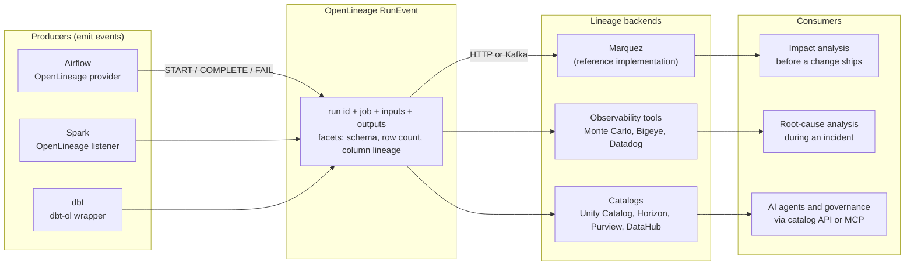
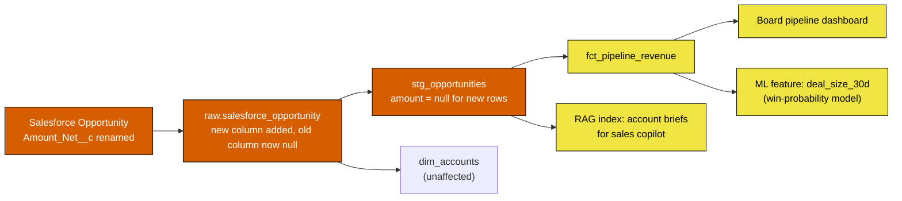
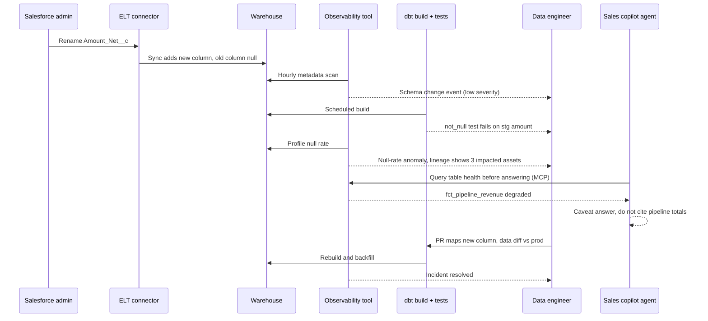
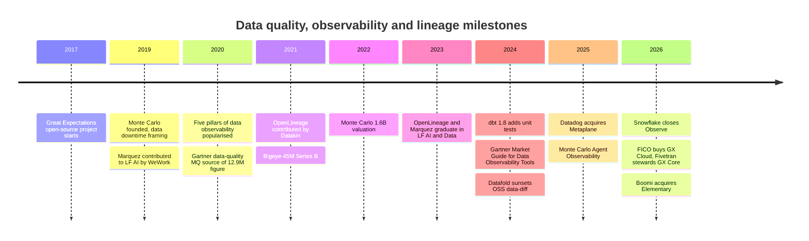

# 13. Data Quality, Observability and Lineage
> **Depth:** L2 · **Reading time:** ~15 min · **Last verified:** 2026-11-01 · **Prerequisites:** [12. Transformation and Orchestration](ch12-transformation-and-orchestration.md)

## TL;DR

- **Data downtime** is any period when data is late, missing, wrong or misleading. It rarely shows up as an error. More often a dashboard quietly shows a wrong number. The best-known cost estimates are soft: Gartner's $12.9M per organization per year rests on a 2020 vendor-reference survey of self-estimated costs, and Monte Carlo's surveys are vendor-sponsored. Both say the problem is common and expensive.
- **Testing and observability solve different problems.** Tests such as dbt tests, Great Expectations (GX) and Soda check rules you wrote in advance (known unknowns). Observability watches metadata for drift you did not predict (unknown unknowns). Monte Carlo's "five pillars" are freshness, volume, schema, distribution and lineage.
- **Lineage is the map that turns an alert into an answer.** It tells you what broke upstream and who is hurt downstream. Lineage is captured three ways: by parsing SQL in query logs, from runtime events (the OpenLineage standard emitted by Airflow, Spark and dbt), or natively by the platform (Unity Catalog, Snowflake Horizon, Microsoft Purview). Column-level lineage is the useful grade and the hard one.
- **Standalone vendors are being absorbed.** Datadog bought Metaplane (April 2025). Snowflake bought Observe (closed February 2026; $596.2M preliminary consideration per Snowflake's FY2026 10-K, against ~$1B press-reported), though Observe does IT telemetry, not data quality. Boomi bought Elementary (October 2026). FICO bought GX Cloud and Fivetran took over stewardship of GX Core (May 2026). Databricks and Snowflake now ship native anomaly detection. Monte Carlo remains the best-funded independent; its last priced round valued it at $1.6B in May 2022 (company-stated).
- **AI raises the stakes.** An agent acts on data without a human sanity check. Freshness, quality scores and lineage therefore have to become machine-readable inputs that agents can query, for example through MCP servers and catalog APIs, before they act.

## Why this matters (business + Everpure lens)

Monte Carlo coined the term **[data downtime](../glossary.md#data-downtime)** by analogy with application downtime: periods when data is partial, erroneous, stale or otherwise unreliable. The difference is visibility. An outage sets off a pager. A bad join that doubles revenue in a board deck sets off nothing until a finance analyst notices. The economics follow from that asymmetry. Detection is slow, so the damage builds up before anyone starts fixing it.

The most quoted cost figure needs careful handling. Gartner's widely repeated claim is that poor data quality costs organizations an average of **$12.9M a year**. That number traces back to Gartner's 2020 Magic Quadrant for Data Quality Solutions. Its basis was a survey of reference customers of the 16 evaluated vendors, and those customers estimated their own costs. The figure is useful as a signal. It is not a measured economy-wide average.[^gartner-129] Monte Carlo's own surveys, fielded by Wakefield Research, say much the same and should be labelled as vendor-sponsored. In the 2022 edition, respondents reported about 61 incidents a month, about 13 hours to identify and resolve each, and bad data affecting about 26% of revenue. They also said data engineers spent roughly 40% of their time on data-quality problems.[^mc-2022] The 2023 edition (200 respondents) reported 67 incidents a month and data downtime up 1.89x year on year. In 74% of cases, business stakeholders found the problem before the data team did.[^mc-2023]

For a corporate-development reader, three things matter. First, this layer is where the "modern data stack" is consolidating fastest, so it is a live M&A market (see [Who's who](#whos-who)). Second, AI turns quality from a reporting nuisance into an operational risk. A retrieval-augmented generation (RAG) assistant or an agent that reads a stale table makes a wrong decision at machine speed. Third, the signals that observability tools mine are *metadata*: row counts, commit timestamps, query logs, access patterns. Metadata is still data.

> **Everpure lens.** Telemetry is just more data, and storage systems already see access frequency, reader identity and object age for every dataset. Based on public information, a strategy team might evaluate whether storage-level signals, combined with the discovery and classification capabilities from the 1touch acquisition, could enrich lineage and classification for catalogs and observability tools.[^everpure-1touch]

## How it works

### Testing: assertions you write in advance

A **[data test](../glossary.md#data-test)** is an assertion run against a dataset. Examples: `order_id` is never null and is unique, `status` is one of five values, every `customer_id` in orders exists in customers. In dbt (see [Chapter 12](ch12-transformation-and-orchestration.md)), these are declared in YAML next to the model and run after each build. dbt 1.8 (May 2024) added **[unit tests](../glossary.md#unit-test)**. A unit test feeds mock input rows to a model's SQL and checks the output, which tests the *logic* in CI before any production data is touched. With that release dbt renamed the old `tests:` key to `data_tests:` to keep the two kinds apart.[^dbt-18] **Great Expectations** (now GX Core, open source under Apache 2.0) expresses the same idea as "Expectations" in Python.[^gx-1] **Soda** made **[data contracts](../glossary.md#data-contract)** the default way to write checks in Soda Core 4.0. Its first public release was January 2026, and it replaced the older SodaCL checks language.[^soda-4]

Tests are cheap, exact and explainable. Their weakness is coverage. A team with 2,000 tables cannot write thoughtful assertions for every column, and no one writes a test for a failure they have not imagined.

> **Bridge: semiconductors (BIST and DFT).** Data tests are the pipeline equivalent of design-for-test (DFT) and built-in self-test (BIST). You insert scan chains and memory-BIST engines where you *know* faults can occur, and they give fast, deterministic pass/fail results. They do not catch a marginal timing failure that only appears at a certain temperature in the field. Unit tests are like pre-silicon verification against a testbench. Data tests are like production test on real wafers.

### Observability: watching metadata for what you did not predict

**[Data observability](../glossary.md#data-observability)** inverts the approach. Rather than asking engineers to state rules, the tool collects metadata from every table and learns what "normal" looks like. Monte Carlo popularised five signals, its "five pillars." The company's current materials sometimes swap "distribution" for "quality," but the original list is the one most people quote.[^mc-pillars]

| Pillar | Question it answers | What is measured | How it is usually collected |
|---|---|---|---|
| Freshness | Did the table update when it should have? | Time since last write; gap between updates | Warehouse metadata (last-altered time, commit history), orchestrator run logs |
| Volume | Did the expected amount of data arrive? | Row count, bytes, rows added per load | Information-schema or table statistics; a cheap `COUNT(*)` |
| Schema | Did the shape change? | Columns added, dropped, renamed or retyped | Diffing snapshots of the information schema; DDL in query logs |
| Distribution | Are the values still plausible? | Null rate, distinct count, min/max/mean, share of each category | Profiling queries on sampled rows; this is the most compute-hungry pillar |
| Lineage | What feeds this table, and what does it feed? | Upstream and downstream tables, columns, jobs, dashboards | Query-log SQL parsing, OpenLineage events, platform-native lineage |

*Figure 13.1 — Four pillars detect a problem; the fifth, lineage, explains it and sizes the blast radius.*

**How anomaly detection works at L2.** The tool runs a small metadata query against each monitored table on a schedule, typically every hour. It stores the results as a time series per table and fits a model with trend and seasonality, since Monday loads are bigger than Sunday loads. It then alerts when a new point falls outside a learned band. Freshness models predict *when* the next commit should land. Databricks' data quality monitoring, for example, builds a per-table model of commit timing and marks a table stale when a commit is unusually late. It also predicts an expected row-count range and flags a table as incomplete when the count falls below that range.[^dbx-dqm] Snowflake does the same through **[data metric functions](../glossary.md#data-metric-function)** (DMFs). Its system DMFs, such as `ROW_COUNT`, `FRESHNESS` and `NULL_COUNT`, attach to tables on a schedule, and anomaly detection can be enabled on `ROW_COUNT` and `FRESHNESS`. The model shows a "training in progress" status until it has enough history.[^sf-dmf] The second input is **query-log mining**. Every warehouse logs the SQL it ran. Parsing those logs shows which tables are read most, by whom, and which feed executive dashboards. Tools use this to rank alerts by importance and to build lineage without any instrumentation.

> **Bridge: fab yield management (SPC).** This is statistical process control applied to metadata. A fab puts control charts on critical dimensions, film thickness and particle counts, and acts on Western Electric-style rules (one point beyond 3σ, or a run of points trending one way) before a lot is scrapped. Data observability puts control charts on row counts and null rates. It has the same core trade-off: tight limits catch drift early but flood engineers with false alarms. Alert fatigue is the most common reason observability deployments stall.

### Lineage: table-level, column-level, and how it is captured

**[Data lineage](../glossary.md#data-lineage)** is the directed graph of how data flows from sources through transformations to consumers. **Table-level** lineage says `fct_revenue` reads `stg_opportunities`. **[Column-level lineage](../glossary.md#column-level-lineage)** says `fct_revenue.amount_usd` derives from `stg_opportunities.amount` times an FX rate. Only the column-level version tells you that a change to one Salesforce field breaks three of forty downstream dashboards. That precision is what makes impact analysis useful rather than alarming.

Lineage is captured in three ways:

1. **Static SQL parsing of query logs.** A parser reads each `INSERT … SELECT` or `CREATE TABLE AS` statement in the warehouse history and works out which input columns feed which output columns. It needs no instrumentation but misses logic outside SQL, such as Python, Spark DataFrames or external tools. Snowflake's column lineage in Snowsight is derived from access history. It added lineage for stored procedures and tasks (generally available in October 2025) and lineage that survives temporary tables and views (generally available in September 2026).[^sf-lineage]
2. **Runtime events via [OpenLineage](../glossary.md#openlineage).** Jobs announce what they read and wrote as they run. OpenLineage is an open specification for those events. Each event names a *run*, a *job* and input and output *datasets*, and carries extensible "facets" such as schema, row counts or a column-lineage map. Datakin contributed it to LF AI & Data in 2021, and it graduated in July 2023. **[Marquez](../glossary.md#marquez)**, originally contributed by WeWork, is the reference implementation that stores and serves these events; it graduated in September 2023.[^ol-lfai] Airflow ships a native OpenLineage provider (replacing an older add-on package that broke on Airflow internals), Spark emits events through a listener, and dbt is covered by a wrapper.[^ol-airflow]
3. **Platform-native lineage.** If every query runs through one engine and catalog, the platform can record lineage from its own query plans. Unity Catalog captures table and column lineage automatically for Unity Catalog tables and exposes it in system tables. Gaps remain for path-based reads, some user-defined functions and the legacy Hive metastore.[^uc-lineage] Microsoft Purview builds lineage from Data Factory copy activities, Synapse and Databricks processing.[^purview] Native lineage is the most accurate within one platform and blind outside it, which is why OpenLineage feeds into these catalogs matter. See [Chapter 8](../01-data-systems-foundations/ch08-catalogs-and-metastores.md).

*Figure 13.2 — OpenLineage separates who emits lineage from who stores it. Any producer can feed any backend, the same way OpenTelemetry decoupled application tracing from tracing vendors.*

> **Bridge: wafer genealogy.** Lineage is the data equivalent of lot and wafer genealogy in a fab. When a field return shows a failure, genealogy traces the die back through package, wafer, lot, tool and chamber, then forward to every other part that shared that chamber, and those parts get quarantined. Column-level lineage does both jobs too: backward trace for root cause, forward trace for containment. Like genealogy, it is only as good as the instrumentation at each step. One untracked rework step, or one Python script outside the lineage system, breaks the chain.

### SLAs, SLOs, incidents and contracts

Mature teams borrow from site reliability engineering. A **[data SLO](../glossary.md#data-slo)** is an internal target, for example "`fct_revenue` is refreshed by 07:00 UTC on 99% of business days, with a null rate below 0.1% on `amount_usd`." An SLA is the version promised to a consumer, sometimes with consequences attached. Observability tools then become incident systems. An alert opens an incident, lineage assigns an owner, the owner triages in Slack or PagerDuty, and post-mortems feed back into tests. Data contracts push the agreement upstream. The team that owns a source system commits to a schema and semantics, and any breaking change has to fail that team's CI rather than appear in someone else's dashboard. Contracts and dbt model contracts are the preventive layer. Observability is the detective layer. Governance policies ([Chapter 15](ch15-governance-security-privacy.md)) decide who may see the data at all.

### The AI-era twist: trusted data for agents

A human analyst who sees revenue up 300% overnight stops and asks why. An agent does not. As agents start to query warehouses, trigger workflows and answer customers ([Chapter 22](../03-ai-data-stack/ch22-agents-and-data.md)), quality signals have to move from dashboards for humans to inputs for machines. An agent should check before it acts: is this table fresh, did it pass its checks, what is its lineage, is it certified? Vendors are building exactly this. Monte Carlo launched Agent Observability in September 2025 to monitor agent inputs and outputs. It extended the product in March 2026 to cover agent trajectories and pre-production evaluations, and it offers a hosted MCP server so assistants can query monitors and incidents.[^mc-agent] RAG makes lineage stricter still. A vector index is a downstream asset of the documents and tables it was built from, so a stale or poisoned source should be traceable to the index and to the answers built on it. Observability for AI pipelines therefore spans two layers. One is classic data checks on the corpus; the other is evaluation of LLM outputs for groundedness, drift and cost.

## Worked example: a renamed Salesforce field

A sales-operations admin renames the custom field `Amount_Net__c` to `Net_Amount__c` on the Salesforce Opportunity object to tidy the naming. Nothing errors. Many managed connectors handle a source-field rename by syncing new values into a *new* column and leaving the old column in place, with nulls for new records and no historical backfill. Fivetran documents exactly this behaviour for HubSpot custom fields; it is a common pattern, not a universal rule, so check each connector.[^fivetran-rename] The staging model still selects `amount_net__c`, so from that point every new opportunity carries a null amount. The figures below are illustrative.

*Figure 13.3 — One upstream rename silently degrades a board dashboard, an ML feature and an AI copilot. Column-level lineage shows that `dim_accounts` is safe, so only three consumers need warnings, not forty.*

How each layer catches it, in order of speed:

- **Schema monitor (observability).** At the next metadata scan, the tool sees a new column `net_amount__c` in the raw table. That alone is a low-severity event, since columns are added all the time.
- **Distribution monitor.** Within one or two loads, the null rate of `amount_net__c` in new rows jumps from roughly 0% to 100%. That is far outside the control band, so a high-severity alert fires and is correlated with the schema event.
- **dbt data test.** A `not_null` test on `stg_opportunities.amount` fails at the next scheduled build. It is precise, but only because someone wrote that test.
- **Column-level lineage.** The incident view lists affected assets: the revenue fact table, the board dashboard, the `deal_size_30d` feature and the copilot's index. Owners are notified and the dashboard is flagged "degraded."
- **Data diff in CI (prevention).** Once the fix is a pull request that maps the new column name, a data-diff tool such as Datafold compares the rebuilt tables with production row by row before merge.
- **Contract (prevention next time).** A contract on the source, enforced in CI, would have blocked the rename or required a deprecation window.
- **Without any of this,** the regional VP notices at the Monday forecast call that pipeline is down 40%.

*Figure 13.4 — Detection and response for the rename. The agent's health check is the new step: the agent caveats its answer rather than repeating a wrong number.*

## Design choices and trade-offs

| Choice | Option A | Option B | When A wins | When B wins |
|---|---|---|---|---|
| Detection method | Explicit tests and contracts | ML anomaly detection on metadata | Critical tables with known rules; regulated reporting; cheap to run | Large estates (1,000+ tables) where rules cannot keep up; unknown failure modes |
| Where it lives | Platform-native (Databricks data quality monitoring, Snowflake DMFs) | Standalone (Monte Carlo, Bigeye, Anomalo) | Single-platform shop; cost-sensitive; "good enough" freshness and volume checks | Multi-platform estates; need cross-system lineage, BI coverage, incident workflow |
| Lineage capture | SQL parsing of query logs | Runtime events (OpenLineage) | Warehouse-centric SQL stacks; zero instrumentation | Polyglot pipelines with Spark, Python and Airflow outside the warehouse |
| Profiling depth | Metadata only (counts, timestamps) | Row-level content profiling | Low compute cost; no data leaves the platform | Subtle value drift, such as a currency mix shift, that metadata cannot see |
| Buyer | Data engineering | IT operations / SRE (Datadog-style) | Data semantics matter most | One pane for infrastructure, apps and pipelines; consolidated vendor spend |

*Figure 13.5 — The main trade-off is coverage against noise and cost. Most mature teams run tests on their top tables and anomaly detection everywhere else.*

The strongest case for standalone tools is that data estates are not single-platform. Data flows from Salesforce through Fivetran into Snowflake, through dbt, out to Tableau and into a Databricks feature store. Only a neutral tool sees the whole path. The strongest counter-argument is that the platforms now see most of the path at no extra licence cost, and "good enough plus bundled" usually beats "best of breed plus a procurement cycle."

## Who's who

| Vendor | Type | Positioning | Latest public signal |
|---|---|---|---|
| Monte Carlo | Standalone observability | Category creator; five pillars, lineage, incident workflow; extending to agent observability | $135M Series D led by IVP at $1.6B post-money (company-stated, May 2022); no later priced round found[^mc-d] |
| Bigeye | Standalone observability | Enterprise focus, lineage-driven monitoring across modern and legacy sources | $45M Series B led by Coatue (Sept 2021)[^bigeye] |
| Anomalo | Standalone data quality | Unsupervised ML on table *contents*, not just metadata; strong on unstructured-data quality for AI | $33M Series B led by SignalFire, Databricks Ventures participating (Jan 2024)[^anomalo] |
| Acceldata | Standalone, multi-layer | Data plus pipeline and compute observability; strong in Hadoop and on-prem estates | $50M Series C led by March Capital (Feb 2023)[^acceldata] |
| Sifflet | Standalone (Paris) | Observability with catalog and business context | ~$18M round from EQT Ventures, Mangrove and Capmont (2025)[^sifflet] |
| Metaplane → Datadog | Absorbed into IT observability | ML monitors plus column-level lineage, now "Metaplane by Datadog" | Acquired April 2025, undisclosed; Datadog took data observability to GA in Q4 2025[^dd-metaplane][^dd-ga] |
| Elementary → Boomi | dbt-native open source | Observability inside dbt projects; adopted by 1,500+ data teams | Acquired by Boomi Oct 2026; ~$40–45M press-reported (Calcalist)[^boomi] |
| Soda | Open-core testing | Data contracts as the default check format (Soda Core 4.0) | First public 4.0 release Jan 2026[^soda-4] |
| GX (Great Expectations) | Open-source testing | Python Expectations; the most widely known OSS test framework | GX Cloud sold to FICO; Fivetran became GX Core steward (May 2026)[^gx-2026] |
| Datafold | CI and regression | Data diff: compares tables row by row before merge or migration | Sunset open-source data-diff in May 2024 to focus on its cloud product[^datafold] |
| Databricks (native) | Platform-native | Data quality monitoring: anomaly detection plus data profiling (formerly Lakehouse Monitoring); Unity Catalog lineage | Billed as serverless compute; schema-wide "intelligent scanning"[^dbx-dqm] |
| Snowflake (native) | Platform-native | Data metric functions, anomaly detection on volume and freshness, Horizon lineage | System DMFs; Observe adds IT telemetry, not data quality[^sf-dmf][^sf-observe] |

*Figure 13.6 — Twelve players, three trajectories: independents (top), absorbed (middle), and platform-native features that set the price floor (bottom).*

**Data observability is not IT observability.** IT observability (Datadog, Observe, Chronosphere, Splunk) watches logs, metrics and traces to answer "is the system up and fast?" Data observability watches datasets to answer "is the number right?" The Snowflake–Observe deal is IT observability. Observe stores telemetry on Snowflake using Apache Iceberg and OpenTelemetry, and Snowflake's FY2026 10-K shows $596.2M in preliminary consideration, against roughly $1B reported in the press.[^sf-observe] The two categories meet at pipeline health, and that overlap is why Datadog bought Metaplane.

**Why consolidation is happening.** There are four forces. First, the platforms now give away freshness and volume checks, which removes the easiest half of the standalone value. Second, observability is a natural *module* of something larger. Datadog wants the data engineer's seat next to the SRE's seat. Boomi and Fivetran want "trusted data" next to integration and transformation; Fivetran now combines dbt (merger closed June 2026), SQLMesh and GX Core stewardship.[^fivetran-dbt] Third, "telemetry is just more data" favours vendors who already own cheap storage and compute, the logic behind Palo Alto Networks–Chronosphere ($3.35B) and Snowflake–Observe.[^chronosphere] Fourth, 2021–22-vintage valuations make independent fundraising hard. Monte Carlo's $1.6B mark was set in May 2022, at the tail of the funding boom, and no later priced round has been disclosed. The bull case for independents is cross-platform neutrality and the new agent-trust budget. The bear case is that both get bundled. Company-level detail is in [Chapter 33](../04-company-deep-dives/ch33-governance-catalog-security-companies.md).

## History and trajectory

*Figure 13.7 — The category went from open-source testing (2017) to a venture-funded category (2019–2022) to absorption into platforms (2025–2026) in under a decade.*

Gartner published its first *Market Guide for Data Observability Tools* in June 2024 and a 2026 edition in February 2026, a sign that the category is now treated as a standard buying line.[^gartner-mg] The GX start date (2017) rests on the project's public history: the open-source repository dates to 2017, and the February 2018 "Down with Pipeline Debt" essay introduced it widely. This is settled pre-2025 knowledge confirmed by the reviewer, not a document retrieved for this chapter. Expect three things next. Platform-native monitors will extend from volume and freshness into distribution checks. OpenLineage will become the default way external tools feed native catalogs. Quality and lineage signals will be served to agents as a standard part of the context they use, alongside semantic-layer metadata.

## Numbers that matter

| Metric | Value | Basis | Source / date |
|---|---|---|---|
| Average annual cost of poor data quality per organization | $12.9M | Estimate; self-reported by vendor-reference customers, Gartner 2020 MQ | [^gartner-129] (2020; repeated in later Gartner material) |
| Data incidents per organization per month | ~61 (2022) → 67 (2023) | Vendor-sponsored survey (Monte Carlo / Wakefield) | [^mc-2022] 2022-08-09; [^mc-2023] 2023-05-02 |
| Time to identify and resolve an incident | ~13 hours | Vendor-sponsored survey, 2022 | [^mc-2022] |
| Share of revenue affected by bad data | ~26% | Vendor-sponsored survey, respondent estimate, 2022 | [^mc-2022] |
| Stakeholders find issues before the data team | 74% | Vendor-sponsored survey, 2023 | [^mc-2023] |
| Monte Carlo post-money valuation | $1.6B | Company-stated, Series D, May 2022 | [^mc-d] |
| Snowflake–Observe consideration | $596.2M | Disclosed, preliminary, FY2026 10-K (FY ends Jan 31, 2026) | [^sf-observe] |
| Boomi–Elementary price | ~$40–45M | Press-reported (Calcalist) | [^boomi] 2026-10 |
| Palo Alto Networks–Chronosphere | $3.35B | Disclosed deal value (IT observability) | [^chronosphere] 2025-11-19 |
| Everpure–1touch (discovery and classification) | $125.0M | Disclosed cash consideration, 10-Q | [^everpure-1touch] 2026-06 |

*Figure 13.8 — The cost numbers are soft and survey-based, while the deal numbers are hard. Use the first to explain why the category exists and the second to price it.*

## Storage bridge

> **Storage bridge.** Observability tools mostly read warehouse metadata, but object stores generate the same raw signals underneath: last-modified times, object counts, bytes written per prefix and per-request access logs. These map directly onto the freshness, volume and lineage pillars for files that never pass through a warehouse, such as the PDFs and images behind a RAG index. See the companion *Everpure Tech Atlas* for how arrays expose these logs and metadata.

## Conversation playbook

**Three questions for a product manager**

1. "What share of your monitors are customer-written rules versus learned anomalies, and what is the false-positive rate customers accept before muting?" *Good answer:* a specific ratio and a muting or feedback mechanism that tunes thresholds, not "our ML is very accurate."
2. "When Databricks and Snowflake give freshness and volume checks away, what do customers still pay you for?" *Good answer:* cross-platform lineage into BI and SaaS sources, incident workflow, distribution or content checks, and agent-facing trust APIs, with a churn number to back it up.
3. "How do agents consume your signals today?" *Good answer:* a named MCP server or API, real customers gating agent actions on health checks, and pricing tied to it.

**Three questions for an engineer**

1. "Is your lineage parsed from SQL, emitted via OpenLineage, or read from the platform, and what falls through the gaps?" *Good answer:* names the blind spots, such as Python transforms, path-based reads and BI extracts.
2. "What does monitoring cost in warehouse compute, and who pays?" *Good answer:* metadata-only scans for most tables, sampled profiling for critical ones, and a stated credit or DBU (Databricks Unit) overhead.
3. "How do you handle seasonality and planned changes, such as a backfill or a holiday?" *Good answer:* seasonal models, maintenance windows and lineage-aware suppression, so one upstream failure does not page twenty owners.

**Don't say this**

- "Observability replaces testing." It does not. Tests encode business rules that no anomaly model can infer.
- "Bad data costs companies $12.9M a year." Say instead that a 2020 Gartner reference-customer survey put the self-estimated average at $12.9M.
- "Snowflake bought Observe for data quality." Observe is IT telemetry observability built on Snowflake. Data quality on Snowflake comes from DMFs and partners.
- "We have lineage" (from table-level only). Ask whether it is column-level and whether it crosses system boundaries.
- "OpenLineage is a product." It is a specification. Marquez is the reference backend.

## Going deeper

> **Going deeper (L3).** Read the OpenLineage object model (RunEvent, Job, Run, Dataset, facets) and the `ColumnLineageDatasetFacet` that maps output fields to input fields. Try Marquez locally with the Airflow provider to see events arrive. For anomaly detection, look at how vendors combine seasonal decomposition with dynamic thresholds and user feedback. Note that Snowflake's anomaly detection only begins alerting after a training period. For SQL-parsing lineage, SQLGlot (now part of Fivetran via Tobiko Data) is a widely used open-source parser and optimizer.

## Key terms

- [Data downtime](../glossary.md#data-downtime) — a period when data is late, missing, wrong or otherwise unreliable.
- [Data observability](../glossary.md#data-observability) — automated monitoring of dataset metadata to detect, triage and explain data problems.
- [Data test](../glossary.md#data-test) — an explicit assertion, such as not-null or unique, run against production data.
- [Unit test](../glossary.md#unit-test) — a test of transformation logic against mock inputs, run in development or CI.
- [Data contract](../glossary.md#data-contract) — an enforceable agreement on a dataset's schema, semantics and quality between producer and consumer.
- [Data lineage](../glossary.md#data-lineage) — the graph of how data flows from sources through transformations to consumers.
- [Column-level lineage](../glossary.md#column-level-lineage) — lineage resolved to individual columns rather than whole tables.
- [OpenLineage](../glossary.md#openlineage) — an open specification for lineage events emitted by data jobs at runtime.
- [Marquez](../glossary.md#marquez) — the open-source reference implementation that collects and serves OpenLineage events.
- [Data metric function](../glossary.md#data-metric-function) — Snowflake's scheduled function that measures a quality metric on a table.
- [Data SLO](../glossary.md#data-slo) — an internal target for a dataset's freshness, completeness or accuracy.
- [Five pillars of data observability](../glossary.md#five-pillars-of-data-observability) — freshness, volume, schema, distribution and lineage.
- [Data diff](../glossary.md#data-diff) — a row-by-row comparison of two versions of a table to catch regressions.

## Sources

[^gartner-129]: Reliable (reliamag.com), "The Cost of Bad Manufacturing Data (2026)," analysis of the provenance of Gartner's $12.9M figure (2020 Magic Quadrant for Data Quality Solutions, reference survey of 154 organizations), https://reliamag.com/topics/guides/cost-of-bad-manufacturing-data, published 2026; and Verato, "Gartner DQ," citing Gartner, "12 Actions Data and Analytics Leaders Can Take to Improve Data Quality" (July 2024), https://verato.com/resources/gartner-dq, n.d.; retrieved 2026-11-01. [VERIFY: confirm wording against the original Gartner document]
[^mc-2022]: Monte Carlo via Business Wire, "Data Engineers Spend Two Days Per Week Firefighting Bad Data, Monte Carlo Survey Says," https://markets.financialcontent.com/wss/article/bizwire-2022-8-9-data-engineers-spend-two-days-per-week-firefighting-bad-data-monte-carlo-survey-says, published 2022-08-09; BigDATAwire, "Monte Carlo Survey Finds Data Engineers Spend 40% of Their Workday on Bad Data," https://www.hpcwire.com/bigdatawire/2022/08/12/monte-carlo-survey-finds-data-engineers-spend-40-of-their-workday-on-bad-data/, published 2022-08-12; retrieved 2026-11-01.
[^mc-2023]: Monte Carlo via Business Wire, "Data Downtime Nearly Doubled Year Over Year, Monte Carlo Survey Says," https://www.businesswire.com/news/home/20230502005377/en/5435996/Data-Downtime-Nearly-Doubled-Year-Over-Year-Monte-Carlo-Survey-Says, published 2023-05-02; BigDATAwire, "Data Quality Is Getting Worse, Monte Carlo Says," https://www.hpcwire.com/bigdatawire/2023/05/02/data-quality-is-getting-worse-monte-carlo-says/, published 2023-05-02; retrieved 2026-11-01.
[^mc-pillars]: Monte Carlo, "Introducing the 5 Pillars of Data Observability," https://montecarlodata.com/blog-introducing-the-5-pillars-of-data-observability, published c. 2020 [VERIFY: original publication date]; Monte Carlo, "What Is Data Observability?," https://www.montecarlodata.com/blog-what-is-data-observability/, updated 2025-07-31; retrieved 2026-11-01.
[^dbt-18]: dbt Labs, "Upgrading to v1.8," https://docs.getdbt.com/docs/dbt-versions/core-upgrade/upgrading-to-v1.8, and "Announcing unit testing," https://docs.getdbt.com/blog/announcing-unit-testing, 2024; Materialize changelog, "dbt 1.8.0," https://materialize.com/changelog/2024-05-27-dbt-1.8.0, published 2024-05-27; retrieved 2026-11-01.
[^gx-1]: Great Expectations, "The next step for GX OSS: 1.0," https://greatexpectations.io/blog/the-next-step-for-gx-oss-1-0, published 2024 [VERIFY: exact GX 1.0 release date]; retrieved 2026-11-01.
[^soda-4]: Soda, "Soda Core – Release notes" (v4: initial release 2025-09-01; soda-core 4.0.5 first public release 2026-01-28), https://docs.soda.io/soda-v4/release-notes/soda-core-release-notes, accessed 2026-11-01; retrieved 2026-11-01.
[^dbx-dqm]: Databricks, "Data quality monitoring" documentation (anomaly detection for freshness and completeness; data profiling formerly Lakehouse Monitoring; serverless billing), https://docs.databricks.com/aws/en/data-quality-monitoring, accessed 2026-11-01; retrieved 2026-11-01.
[^sf-dmf]: Snowflake, "System data metric functions," https://docs.snowflake.com/en/user-guide/data-quality-system-dmfs, and "Detecting anomalies in data quality," https://docs.snowflake.com/en/user-guide/data-quality-anomaly, accessed 2026-11-01; retrieved 2026-11-01.
[^sf-lineage]: Snowflake, "Data Lineage" (Snowsight), https://docs.snowflake.com/en/user-guide/ui-snowsight-lineage; release notes "Lineage for stored procedures and tasks (General availability)," https://docs.snowflake.com/release-notes/2025/other/2025-10-03-process-lineage, published 2025-10-03; "Lineage preservation through temporary tables and views (General availability)," https://docs.snowflake.com/release-notes/2026/other/2026-09-21-lineage-temporary-objects, published 2026-09-21; retrieved 2026-11-01.
[^ol-lfai]: LF AI & Data Foundation, "OpenLineage" project page (contributed by Datakin May 2021; graduated July 2023), https://lfai.foundation/projects/openlineage; "Marquez" project page (contributed by WeWork December 2019; graduated September 2023), https://lfai.foundation/projects/marquez/; retrieved 2026-11-01.
[^ol-airflow]: Apache Airflow, "apache-airflow-providers-openlineage changelog" (2.0.0), https://airflow.apache.org/docs/apache-airflow-providers-openlineage/2.0.0/changelog.html, accessed 2026-11-01; Databricks Data + AI Summit 2023 session deck on OpenLineage with Spark and dbt, https://microsites.databricks.com/sites/default/files/dais/2023/dais2023-231128.pdf, 2023; retrieved 2026-11-01.
[^uc-lineage]: Databricks Community, "Unity Catalog lineage: lineage that just works" and "How to enable column-level lineage in Databricks" (community posts, secondary), https://community.databricks.com/t5/community-articles/unity-catalog-lineage-lineage-that-just-works/m-p/141855 and https://community.databricks.com/t5/data-engineering/how-to-enable-column-level-lineage-in-databricks/m-p/165923, 2025–2026; retrieved 2026-11-01. [VERIFY: confirm against official Databricks lineage documentation]
[^purview]: Microsoft Learn, "Data lineage in classic Data Catalog" (Microsoft Purview), https://learn.microsoft.com/en-us/purview/concept-data-lineage, accessed 2026-11-01; retrieved 2026-11-01.
[^mc-agent]: Monte Carlo via Business Wire, "Monte Carlo Launches Agent Observability to Help Teams Build Reliable AI," https://www.businesswire.com/news/home/20250909271741/en/Monte-Carlo-Launches-Agent-Observability-to-Help-Teams-Build-Reliable-AI, published 2025-09-09; "Monte Carlo's New Agent Observability Delivers End-to-End Visibility Across Context, Performance, Behavior and Outputs," https://www.businesswire.com/news/home/20260312700545/en/, published 2026-03-12; Monte Carlo, "Accelerating agent trust with Monte Carlo's MCP server," https://montecarlo.ai/accelerating-agent-trust-with-monte-carlos-mcp-server, updated 2026-07-30; retrieved 2026-11-01.
[^fivetran-rename]: Fivetran, "How Does Fivetran Handle Custom Field Name Changes?" (HubSpot connector), https://fivetran.com/docs/connectors/applications/hubspot/troubleshooting/custom-field-name-changes, accessed 2026-11-01; Gearset, "How to handle API rename of a Salesforce component through the pipeline," https://docs.gearset.com/en/articles/11003069-how-to-handle-api-rename-of-a-salesforce-component-through-the-pipeline, n.d.; retrieved 2026-11-01.
[^mc-d]: Monte Carlo via Business Wire, "Monte Carlo Raises $135M Series D to Accelerate the Rapid Growth of the Data Observability Category," https://www.businesswire.com/news/home/20220524005417/en/, published 2022-05-24; Gunderson Dettmer, "Monte Carlo Reaches $1.6B Valuation with $135M Series D Financing," https://www.gunder.com/news/monte-carlo-reaches-1-6b-valuation-with-135m-series-d-financing, 2022; retrieved 2026-11-01.
[^bigeye]: Bigeye via Business Wire, "Bigeye Raises $45M Series B to Scale Leading Data Observability Platform," https://www.businesswire.com/news/home/20210923005170/en/, published 2021-09-23; retrieved 2026-11-01.
[^anomalo]: TFIR, "Anomalo Raises $33M In Series B Funding For Its Data Quality Platform," https://tfir.io/anomalo-raises-33m-in-series-b-funding-for-its-data-quality-platform/, published 2024-01; retrieved 2026-11-01.
[^acceldata]: O'Melveny, "Global Legal Chronicle: Acceldata's $50 Million Series C Funding Round," https://www.omm.com/news/in-the-news/global-legal-chronicle-acceldata-s-50-million-series-c-funding-round/, published 2023-02; retrieved 2026-11-01.
[^sifflet]: Pulse 2.0, "Sifflet: $18 Million Raised For Data Observability Platform," https://pulse2.com/sifflet-18-million-raised-for-data-observability-platform/amp/, published 2025-06 [VERIFY: round label and exact date; CB Insights lists 2025-06-19]; retrieved 2026-11-01.
[^dd-metaplane]: Datadog, "Datadog Brings Observability to Data Teams by Acquiring Metaplane," https://investors.datadoghq.com/news-releases/news-release-details/datadog-brings-observability-data-teams-acquiring-metaplane, published 2025-04-23; TechCrunch, "Datadog acquires AI-powered observability startup Metaplane," https://techcrunch.com/2025/04/23/datadog-acquires-ai-powered-observability-startup-metaplane, published 2025-04-23; retrieved 2026-11-01.
[^dd-ga]: Insider Monkey, "Datadog, Inc. (NASDAQ:DDOG) Q4 2025 Earnings Call Transcript," https://www.insidermonkey.com/blog/datadog-inc-nasdaqddog-q4-2025-earnings-call-transcript-1693332/, published 2026-02; retrieved 2026-11-01.
[^boomi]: Constellation Research, "Boomi acquires Elementary Data, adds data observability, quality, governance layer," https://www.constellationr.com/insights/news/boomi-acquires-elementary-data-adds-data-observability-quality-governance-layer, published 2026-10; iTWire, "Boomi acquires Elementary Data to bring trusted, governed data to the AI era," https://itwire.com/it-industry-news/deals/boomi-acquires-elementary-data-to-bring-trusted-governed-data-to-the-ai-era, published 2026-10-19; Calcalist (price, press-reported), https://www.calcalistech.com/ctechnews/article/b1zgj8mnzg, 2026-10; retrieved 2026-11-01.
[^gx-2026]: Great Expectations, "An update from Great Expectations," https://www.greatexpectations.io/blog/an-update-from-great-expectations, published 2026-05-06; Fivetran, "Fivetran to Become Steward of the Great Expectations Open Source Community and GX Core Project," https://www.fivetran.com/press/fivetran-to-become-steward-of-the-great-expectations-open-source-community-and-gx-core-project, published 2026-05-13; retrieved 2026-11-01.
[^datafold]: Datafold, "Sunsetting open-source data-diff," https://www.datafold.com/blog/sunsetting-open-source-data-diff, published 2024-05-17; GitHub, datafold/data-diff, https://github.com/datafold/data-diff; retrieved 2026-11-01.
[^sf-observe]: Snowflake via Business Wire, "Snowflake Announces Intent to Acquire Observe to Deliver AI Powered Observability at Enterprise Scale," https://www.businesswire.com/news/home/20260108681865/en/, published 2026-01-08; Snowflake Inc., Form 10-K for fiscal year ended January 31, 2026 (Observe purchase accounting, $596.2M preliminary consideration), https://www.sec.gov/Archives/edgar/data/1640147/000164014726000008/snow-20260131.htm, published 2026-03; TechCrunch, https://techcrunch.com/2026/01/08/snowflake-announces-its-intent-to-buy-observability-platform-observe, published 2026-01-08; retrieved 2026-11-01.
[^fivetran-dbt]: TechTarget, "Fivetran, dbt Labs complete merger to form data layer for AI," https://www.techtarget.com/searchdatamanagement/news/366643590/Fivetran-DBT-Labs-complete-merger-to-form-data-layer-for-AI, published 2026-06; retrieved 2026-11-01.
[^chronosphere]: SecurityWeek, "Palo Alto Networks to Acquire Observability Platform Chronosphere in $3.35 Billion Deal," https://securityweek.com/palo-alto-networks-to-acquire-observability-platform-chronosphere-in-3-35-billion-deal/, published 2025-11-19; retrieved 2026-11-01.
[^everpure-1touch]: Everpure, Inc., Form 10-Q for the quarter ended 2026-05-03 (1touch, $125.0M cash consideration), https://www.sec.gov/Archives/edgar/data/0001474432/000147443226000061/pstg-20260503.htm, published 2026-06; Computer Weekly, "Everpure aims to bridge AI data gap with Universal Data Intelligence," https://www.computerweekly.com/news/366644438/Everpure-aims-to-bridge-AI-data-gap-with-Universal-Data-Intelligence, published 2026-06; retrieved 2026-11-01.
[^gartner-mg]: Gartner, "Market Guide for Data Observability Tools," abstract, https://www.gartner.com/en/documents/5533895, published 2024-06-25; Monte Carlo, "What the 2026 Gartner Market Guide for Data Observability Tools means for your data and AI team," https://www.montecarlodata.com/blog-what-2026-gartner-market-guide-for-data-observability-tools-means-for-your-data-and-ai-team-my-take/, published 2026-02; retrieved 2026-11-01.
