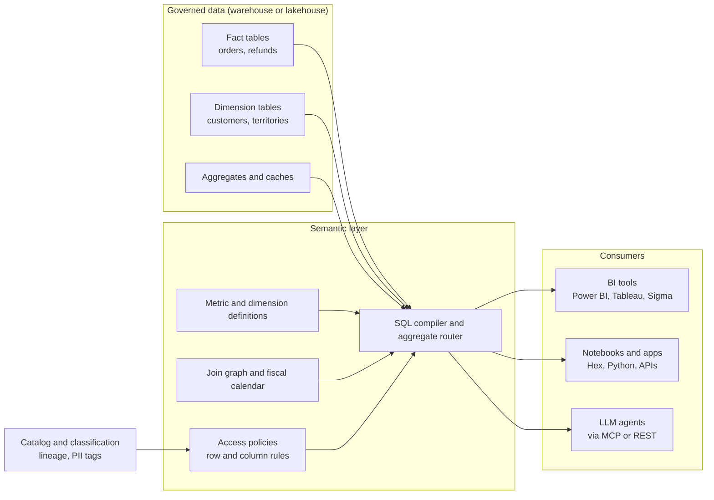
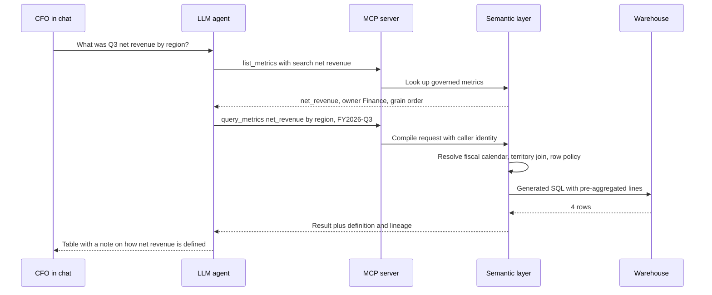
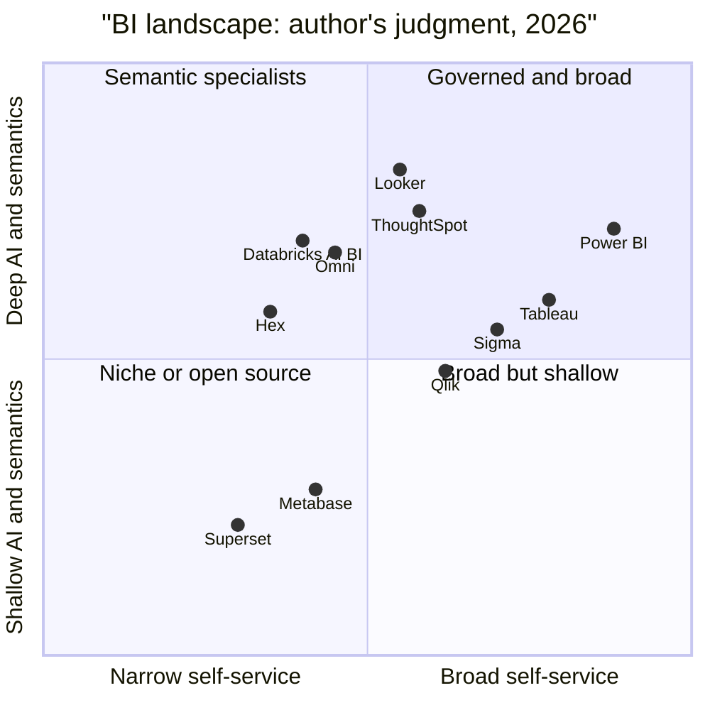
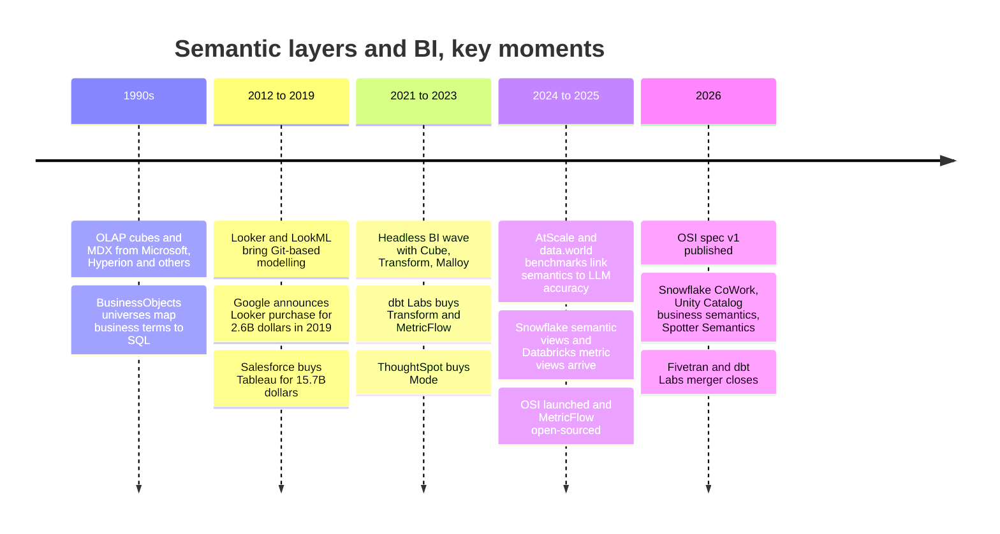

# 14. Semantic Layers and BI
> **Depth:** L2 · **Reading time:** ~12 min · **Last verified:** 2026-11-01 · **Prerequisites:** [Ch 12 — Transformation and Orchestration](ch12-transformation-and-orchestration.md)

## TL;DR

- A [semantic layer](../glossary.md#semantic-layer) is a governed dictionary of business meaning (entities, [measures](../glossary.md#measure), [dimensions](../glossary.md#dimension), join paths and access rules) that compiles requests like "net revenue by region" into correct SQL. "Revenue" gets defined once and reused everywhere.
- The idea is old: OLAP cubes, BusinessObjects universes and LookML all did it. What changed is *where* it lives. It is moving out of individual BI tools and into the data platform itself (Snowflake semantic views, Databricks metric views) or into neutral services (dbt Semantic Layer/MetricFlow, Cube, AtScale).
- LLMs made the semantic layer strategic. Published benchmarks, most of them vendor-run, show that natural-language questions answered against governed definitions are far more accurate than text-to-SQL over raw tables. One example: 16.7% → 54.2% in data.world's 2023 study.[^dw-bench]
- BI front ends are commoditising. Gartner's Leaders list is stable, Microsoft bundles Power BI into Fabric, and venture money is flowing to newer warehouse-native tools (Sigma at $3B, Omni at $1.5B in 2026).[^sigma-e][^omni-c] The control point is shifting from the dashboard to the definitions underneath it.
- For Everpure: semantic context is where data intelligence (classification, business meaning) turns into something agents can use. That ties the 1touch thesis to this layer (see [Ch 15](ch15-governance-security-privacy.md) and [Ch 45](../06-history-and-future/ch45-storage-moving-up-the-stack.md)).

## Why this matters (business + Everpure lens)

Every large company has the "three revenue numbers" problem. Finance, sales and the board deck each report a different figure for the same quarter, because each team's dashboard encodes its own logic for refunds, currency conversion and which calendar applies. The cost is more than embarrassment. Meetings spent reconciling numbers delay decisions, and auditors and regulators expect one figure.

LLMs raise the stakes. A human analyst who writes a bad join usually notices that the total looks wrong. An agent answering a CFO's question in Slack does not notice, and it answers instantly and confidently. Vendors now present the semantic layer as the *agent-safe API to enterprise data*: an agent may ask only for metrics that someone has defined and governed, through an interface that enforces who may see what. This is why Snowflake, Databricks, Google, Microsoft, Salesforce and ThoughtSpot all reworked their semantic offerings between 2024 and 2026, and why Snowflake convened a cross-vendor standard, Open Semantic Interchange (OSI), in September 2025.[^osi-launch] OSI is not a Snowflake-only effort: Databricks joined in January 2026, alongside Qlik and AtScale.[^osi-v1]

For an Everpure strategy reader, the point is where *meaning* sits in the stack. Everpure's 2026 purchase of 1touch was explicitly about discovering and classifying data and building semantic context about what it is.[^1touch] The semantic layer in this chapter is the analytics-facing version of the same idea. Classification tells you a column holds customer PII. A metric definition tells you that `SUM(amount) - SUM(refunds)` grouped by sales territory is what "net revenue by region" means. An agent needs both. Options a strategy team might evaluate, based on public information, include feeding classification and sensitivity tags into the semantic layers customers already run (via OSI or catalog integrations) rather than building a competing metrics layer. [Ch 15](ch15-governance-security-privacy.md) covers the classification engine, and [Ch 45](../06-history-and-future/ch45-storage-moving-up-the-stack.md) covers the broader move up the stack.

## How it works

### The four ingredients

A semantic model has four ingredients:

- **Entities**: the business nouns (customer, order, product), each mapped to tables and keys.
- **Measures**: aggregations with rules. `net_revenue = sum(gross) − sum(refunds) − sum(discounts)`, in USD at the booking-date FX rate.
- **Dimensions**: the attributes you slice by (region, fiscal quarter, product line), including hierarchies such as country → region → theatre.
- **Relationships**: the legal join paths between entities, with cardinality, so the engine knows that orders-to-order-lines is one-to-many.

Most layers add **access policies** (row- and column-level rules: "EMEA managers see only EMEA") and a **performance layer** (caching, pre-built aggregate tables and [aggregate awareness](../glossary.md#aggregate-awareness), meaning the engine routes a query to a small rollup when it can).

At query time, the client asks for *metrics and dimensions*, not tables: `net_revenue BY region WHERE fiscal_quarter = 'FY25-Q3'`. The semantic engine works out the joins, applies the fiscal calendar and security filters, generates dialect-specific SQL for Snowflake, BigQuery, Databricks and so on, and returns the result. The warehouse still does the heavy computation. The semantic layer is a compiler, not a database.



*Figure 14.1 — The semantic layer sits between governed tables and every consumer, so BI tools, notebooks and agents get the same "net revenue", and catalog classifications feed its access rules.*

Agents increasingly reach the semantic layer through the [Model Context Protocol](../glossary.md#model-context-protocol) (MCP), an open standard for exposing tools to LLMs. Instead of handing the model a list of 4,000 tables, the MCP server offers a few tools such as `list_metrics`, `describe_metric` and `query_metrics`. ThoughtSpot (Spotter Semantics, March 2026) and dbt both ship MCP servers for their semantic layers, and Databricks positions its 2026 Unity Catalog semantics as reachable over SQL, API and MCP.[^ts-semantics][^dbx-uc26] [Ch 22](../03-ai-data-stack/ch22-agents-and-data.md) covers the agent side.

> **Bridge: semiconductors (instruction-set architecture).** A semantic layer is to analytics what an ISA is to a CPU. x86 and Arm let compilers and operating systems target a stable contract while the microarchitecture underneath (pipelines, caches, process node) changes every generation. Metric definitions do the same job. Dashboards and agents target `net_revenue`, while data engineers rebuild tables, migrate from Redshift to Snowflake or switch from Parquet to Iceberg underneath. When that contract breaks, every consumer breaks, which is why the layer that owns it has pricing power.

> **Bridge: finance (GAAP definitions).** A metric definition is a mini accounting policy. GAAP fixes how revenue is recognised so that two analysts reading the same 10-K get the same number, and auditors test against that one definition. A governed metrics layer does the same inside a company: one definition, version-controlled in Git, owned by Finance, changed only through review, with lineage showing which reports use it. "Non-GAAP adjusted EBITDA" is what you get when every team keeps its own definition in a spreadsheet.

### Worked example: "What was Q3 net revenue by region?"

Take a mid-size SaaS company on Snowflake. Its tables are `orders` (one row per order, with `order_total`), `order_lines` (one row per SKU), `refunds`, `customers` (with both `billing_country` and `sales_territory_id`) and `territories`. The fiscal year starts on 1 February.

**Path A: raw-schema text-to-SQL.** An LLM given only the table list writes plausible SQL:

```sql
-- Plausible but wrong
SELECT c.billing_country AS region, SUM(o.order_total) AS net_revenue
FROM orders o
JOIN order_lines l ON l.order_id = o.order_id      -- fan-out: order_total repeats per line
JOIN customers c   ON c.customer_id = o.customer_id
WHERE o.order_date BETWEEN '2025-07-01' AND '2025-09-30'  -- calendar Q3, not fiscal Q3
GROUP BY 1;                                        -- refunds and FX ignored
```

Four errors stack up. (1) A **fan-out** join counts each order once per line item, inflating revenue roughly 3x if orders average three lines. (2) It uses *calendar* Q3, while the company's fiscal Q3 runs August–October. (3) It ignores refunds and currency, so the result is gross, not net. (4) "Region" in this company means sales territory, not billing country. The query runs, returns a tidy table, and every number in it is wrong. Nothing in the output warns the user.

**Path B: via the semantic layer.** The agent cannot write that SQL. It can only call `query_metrics(metrics=["net_revenue"], group_by=["region"], where="fiscal_quarter = 'FY2026-Q3'")`. The layer already knows that `net_revenue` is defined at order grain, net of refunds and converted at booking-date FX, that `region` resolves through `sales_territory_id`, and that FY2026-Q3 means Aug–Oct 2025. It generates SQL that aggregates `order_lines` *before* joining (avoiding the fan-out), applies the caller's row-level policy and returns the answer. If the user asks for something with no defined metric, such as "net revenue per active seat" when seats are not modelled, the layer refuses instead of guessing.



*Figure 14.2 — Via the semantic layer, the agent chooses metrics instead of writing joins, so the fan-out, calendar and region errors in Path A cannot happen.*

What does the evidence say? The best-known study is data.world's 2023 benchmark. On an insurance schema, GPT-4 answered 16.7% of enterprise questions correctly zero-shot over SQL tables and 54.2% over a knowledge-graph (semantic) representation of the same data. On the hardest questions, SQL accuracy was 0%.[^dw-bench] AtScale's vendor-run 2024 test on 40 TPC-DS questions reported 20% accuracy without its semantic layer and 92.5% with it.[^atscale-bench] dbt Labs' April 2026 update reports that frontier models reach 98–100% on questions *within the modelled scope* of its Semantic Layer, versus 84–90% for text-to-SQL on the same well-modelled data.[^dbt-bench] Google says LookML cuts errors in natural-language queries by up to two-thirds in internal tests.[^looker-twothirds] Read these numbers carefully. All but the academic preprint are vendor-run, the question sets are small (11–40 questions), and the semantic layer scores well partly because it declines questions it cannot answer. The direction is consistent, though. Models get better every year, but they cannot infer your fiscal calendar or your definition of region. Only governed context supplies that.

## Design choices and trade-offs

The main architectural choice is *where the definitions live*. There are three options. **BI-embedded** layers (LookML, Power BI semantic models, Tableau Semantics) are mature and tightly integrated, but they tie the definitions to one front end. **Universal / headless** layers (dbt Semantic Layer, Cube, AtScale) serve any consumer, but they add a service to run and depend on BI vendors to integrate with them. **Platform-native** layers (Snowflake semantic views, Databricks metric views) carry no extra licence and sit next to the governance engine, but they bind the definitions to one data platform. OSI is an attempt to make definitions portable across all three.

| Layer | Owner | Where definitions live | Language / format | Query interface | Status (as of 2026-11-01) |
|---|---|---|---|---|---|
| LookML | Google (Looker) | Looker project in Git | LookML (YAML-like DSL) | Looker Explores, SQL interface, Conversational Analytics API | Mature (since ~2012); grounds Looker conversational analytics, GA[^looker-ca] |
| dbt Semantic Layer / MetricFlow | Fivetran + dbt Labs | dbt project YAML | MetricFlow spec; engine Apache 2.0 since Oct 2025 | JDBC/GraphQL APIs, BI integrations, MCP | GA in dbt platform; MetricFlow open-sourced 2025-10-14[^metricflow-oss] |
| Cube | Cube Dev | Cube data model files | YAML/JS; open-source core | SQL (Postgres wire), REST, GraphQL, MDX for Excel | OSS plus Cube Cloud; agentic analytics product 2025[^cube-d3] |
| AtScale | AtScale | AtScale semantic models | SML (open semantic modelling language) | MDX/DAX/SQL interfaces for Excel, Power BI, Tableau | Commercial; OSI working-group member[^osi-v1] |
| Snowflake semantic views | Snowflake | Schema-level database object | `CREATE SEMANTIC VIEW` DDL (YAML models still supported) | SQL `SEMANTIC_VIEW()` queries, Cortex Analyst, CoWork | Definition GA at Summit 2025; querying then in preview[^sf-sv] `[VERIFY: query GA status in 2026]` |
| Databricks metric views | Databricks | Unity Catalog object | YAML spec registered in Unity Catalog | SQL `MEASURE()`, AI/BI dashboards, Genie | Public Preview from 2025-05-29; GA status [VERIFY: metric views GA date]; extended as Unity Catalog Metrics/Business Semantics at DAIS 2026 (secondary)[^dbx-mv][^dbx-uc26] |
| Power BI semantic models | Microsoft | Power BI / Fabric workspace | Tabular model, DAX measures, TMDL | Power BI, Excel, XMLA endpoint, Copilot | Mature; "Prep data for AI" (schema, verified answers, instructions) for Copilot[^pbi-prep] |

*Figure 14.3 — Seven semantic layers, three architectures: BI-embedded (LookML, Power BI), universal (dbt, Cube, AtScale) and platform-native (Snowflake, Databricks). Portability, not expressiveness, is what separates them.*

The case *against* a separate semantic layer deserves a hearing. Many teams find that a well-modelled set of dbt "marts" tables plus a catalog with good descriptions gets most of the benefit, and they skip another runtime hop and another vendor bill. Semantic layers also struggle with ad-hoc analysis: data scientists exploring a new question often need raw tables, and a layer that is too strict pushes them to export CSVs. And the "define once" promise works only if Finance actually owns the definitions. Otherwise the layer becomes another place where three versions of revenue live. The honest position is that the semantic layer earns its keep where questions repeat, governance matters and agents are involved. It is unnecessary for one-off exploration.

## Who's who

Semantic-layer vendors are covered in Figure 14.3. The BI front-end market looks like this:

| Vendor | Owner / status | Pricing model | AI assistant | Semantic model | Sweet spot |
|---|---|---|---|---|---|
| Power BI | Microsoft; part of Fabric | Per user (Pro $14, PPU $24/user/month from Apr 2025) plus Fabric capacity[^pbi-price] | Copilot (Fabric F2+ or P1 capacity)[^pbi-copilot] | Power BI semantic models (DAX) | Microsoft 365 shops; default enterprise choice |
| Tableau | Salesforce | Per user (Standard list: Creator $75, Explorer $42, Viewer $15/user/month); Tableau+ bundle quoted[^tableau-price] | Tableau Next / Agentforce agents | Tableau Semantics (on Salesforce Data 360, formerly Data Cloud) | Visual analytics; Salesforce CRM estates |
| Looker | Google Cloud | Platform fee plus per-user, quoted | Gemini in Looker, Conversational Analytics | LookML | BigQuery/GCP; governed embedded analytics |
| Qlik Sense / Qlik Cloud | Qlik (Thoma Bravo, private) | Capacity- and user-based subscriptions | Qlik Answers | Associative engine, Qlik data models | Legacy enterprise, manufacturing, integration bundle (Talend) |
| Sigma | Private ($3B valuation, May 2026)[^sigma-e] | Per user, with free viewers on some tiers [VERIFY: current Sigma tiering] | Sigma AI / agentic apps | Data models on warehouse; consumes dbt/Snowflake semantics | Spreadsheet UX directly on Snowflake/Databricks |
| ThoughtSpot | Private (incl. Mode since 2023) | Per user and consumption tiers | Spotter agent | Spotter Semantics / TML, MCP server[^ts-semantics] | Search-first self-service, embedded analytics |
| Hex | Private (Series C $70M, 2025)[^hex-c] | Per editor seat | Hex Magic / agents | Syncs dbt, Snowflake, Databricks semantic models | Notebooks plus apps for data teams |
| Omni | Private ($1.5B valuation, Apr 2026)[^omni-c] | Per user, quoted | Omni AI | Built-in semantic model with dbt sync | Looker-style governance with spreadsheet speed |
| Superset / Preset | Apache (OSS) / Preset (commercial) | Free OSS; Preset per user | Preset AI assist | Lightweight datasets and metrics | Cost-sensitive, engineering-led teams |
| Metabase | Metabase (open core) | Free OSS; cloud tiers per user | Metabot | Models and metrics | Startups and internal tools |
| Databricks AI/BI | Databricks | Included; consumption of SQL compute | Genie (GA Jun 2025; Genie One 2026)[^genie-ga] | Unity Catalog metric views | Lakehouse-native business users |

*Figure 14.4 — BI vendors now differ less in charting and more in pricing unit (seat vs consumption), AI assistant, and whose semantic model they treat as canonical.*



*Figure 14.5 — Author's qualitative judgment, not Gartner's: incumbents win on reach, while semantic depth, which matters most for agents, is spread across Looker, ThoughtSpot, Omni and the platform-native tools.*

On the analyst view: Gartner's June 2025 Magic Quadrant for Analytics and BI Platforms named Microsoft, Salesforce (Tableau), Google (Looker), Qlik, Oracle and ThoughtSpot as Leaders, with Sigma as the only new entrant.[^gartner-2025] The 2026 edition is dated 29 June 2026. Vendor pages confirm Salesforce (its 14th year), Google and Qlik as Leaders, and the full 2026 list is [VERIFY: complete 2026 ABI MQ Leaders list].[^gartner-2026]

Conversational analytics is now table stakes. Databricks made AI/BI Genie GA in June 2025.[^genie-ga] Snowflake renamed Snowflake Intelligence to **Snowflake CoWork** at Summit 2026, with semantic views as its grounding layer.[^sf-cowork] Microsoft ties Power BI Copilot to "AI-prepped" semantic models.[^pbi-prep] Google made Looker Conversational Analytics GA, grounded in LookML.[^looker-ca] Salesforce's Tableau Next runs Agentforce agents on Tableau Semantics.[^tableau-next] Every vendor's answer to "why trust the chatbot?" points back to the semantic model. [Ch 34](../04-company-deep-dives/ch34-application-giants-data-platforms.md) covers how Salesforce and Microsoft use BI to deepen application lock-in.

> **Bridge: EDA licensing (per-seat pricing).** BI seats resemble per-seat EDA licences from Synopsys and Cadence: priced per named engineer, sticky because workflows and training build up around the tool, and defended through bundling. As with EDA, the pressure on seats comes from usage that doesn't map to a person. EDA vendors faced cloud burst licences and token-based pools. BI vendors face AI agents that query on behalf of thousands of non-licensed employees. Expect BI pricing to drift toward consumption (Fabric capacity, Databricks compute, Snowflake AI credits), much as EDA moved toward token and subscription pools.

## History and trajectory



*Figure 14.6 — The semantic layer has been invented three times: inside the cube, inside the BI tool and now inside the data platform. Each move shifted control to whoever held the definitions.*

**Cubes and universes (1990s–2000s).** OLAP cubes pre-computed aggregates along fixed dimensions and exposed them through MDX (Multidimensional Expressions). Business users got fast, consistent answers, provided the question fit the cube. BusinessObjects' "universe" was arguably the first semantic layer in the modern sense: a mapping from business vocabulary to SQL joins. Both were tied to their vendors and rebuilt whenever the schema changed.

**LookML and the cloud warehouse (2012–2020).** Looker's insight was to keep the semantic model as code in Git and generate SQL live against cloud warehouses instead of pre-building cubes. That matched the economics of Redshift, BigQuery and Snowflake, where compute was elastic. Google announced a $2.6B all-cash acquisition on 6 June 2019, and it closed in February 2020 after UK CMA review.[^looker-acq][^ma-csv] Four days after Google's announcement, Salesforce agreed to buy Tableau for $15.7B in stock.[^ma-csv] In a single week, BI became a hyperscaler and application-suite feature.

**Headless BI (2020–2023).** Practitioners then argued that metrics should not be locked inside any one BI tool. Cube, Transform (MetricFlow) and Google's open-source Malloy, created by Looker founder Lloyd Tabb, all pursued "headless" or universal semantics.[^malloy] Consolidation followed. dbt Labs acquired Transform in February 2023 to build the dbt Semantic Layer,[^transform] and ThoughtSpot bought Mode for $200M in cash and stock in June 2023.[^mode] Cube raised $25M led by Databricks Ventures in 2024, a sign that platforms wanted neutral semantics in their ecosystems.[^cube-25m]

**Platform-native semantics and OSI (2025–2026).** In 2025 the data platforms brought semantics in-house. Snowflake made semantic-view definitions GA at Summit 2025,[^sf-sv] and Databricks put metric views into Public Preview on 29 May 2025.[^dbx-mv] In September 2025 Snowflake launched OSI with Salesforce, dbt Labs, BlackRock and RelationalAI as co-leads, plus partners including Cube, Hex, Omni, Sigma and ThoughtSpot.[^osi-launch] dbt open-sourced MetricFlow under Apache 2.0 in October 2025 to back the effort.[^metricflow-oss] OSI published its v1.0 spec on GitHub in January 2026, and Databricks, Qlik, AtScale and others joined the working group. Governance is meant to move to a neutral foundation.[^osi-v1] Meanwhile Fivetran and dbt Labs completed their merger on 1 June 2026, putting the most widely used open metrics engine inside an ingestion-plus-transformation vendor ([Ch 12](ch12-transformation-and-orchestration.md)).[^ma-csv]

**Trajectory.** Three bets look reasonable. (1) Definitions will increasingly be authored once and *synchronised* across tools via OSI-style formats, much as Iceberg made table formats portable ([Ch 8](../01-data-systems-foundations/ch08-catalogs-and-metastores.md) covers the catalog parallel). (2) The semantic layer will merge with the catalog and governance layer, because agents need meaning, permissions and lineage in one call. (3) BI dashboards will not vanish, but their share of the analytics budget will shrink relative to agent and platform consumption. The counter-case is that OSI may stall as a lowest-common-denominator spec while each platform keeps its richest features proprietary. Standards bodies convened by one vendor often end up that way. The main reasons to expect otherwise are Databricks' January 2026 entry, which brings Snowflake's chief rival inside, and the stated plan to move governance to a neutral foundation.

## Numbers that matter

| Metric | Value | Basis | Source / date |
|---|---|---|---|
| GPT-4 accuracy, enterprise SQL questions: raw tables vs knowledge graph | 16.7% → 54.2% | Academic preprint (data.world authors) | Sequeda et al., 2023-11-13[^dw-bench] |
| AtScale TPC-DS text-to-SQL: without vs with semantic layer | 20% → 92.5% (40 questions) | Vendor-run benchmark | BigDATAwire, 2024-08-15[^atscale-bench] |
| dbt benchmark, in-scope questions: text-to-SQL vs Semantic Layer | 90.0% vs 98.2% (Claude Sonnet 4.6); 84.1% vs 100% (GPT-5.3-Codex) | Vendor-run benchmark, 11 questions × 20 runs | dbt Labs, 2026-04[^dbt-bench] |
| Google Looker acquisition | $2.6B all-cash | Disclosed deal value | Alphabet, 2019-06-06[^looker-acq] |
| Salesforce–Tableau | $15.7B all-stock | Disclosed deal value | Cooley, 2019-06-10[^ma-csv] |
| ThoughtSpot–Mode | $200M cash and stock | Disclosed deal value | TechCrunch, 2023-06-26[^mode] |
| Power BI Pro / PPU list price | $10 → $14; $20 → $24 per user/month | List price, effective 2025-04-01 | Microsoft Power BI blog[^pbi-price] |
| Tableau Creator / Explorer / Viewer (Standard) | $75 / $42 / $15 per user/month | List price, billed annually | Tableau pricing page[^tableau-price] |
| Sigma ARR and valuation | ~$200M ARR (Apr 2026), ~2x YoY; $3B post-money | Company-stated ARR; press-reported valuation | Sigma / SiliconANGLE, 2026-05-18[^sigma-e] |
| Omni Series C | $120M at $1.5B (~4x YoY revenue growth) | Company-stated / press-reported | Omni, SiliconANGLE, 2026-04-23[^omni-c] |
| Fabric paying customers | 19,000+ | Company-stated at FabCon 2025, via secondary recap | Theobald Software, 2025[^fabric-cust] |

*Figure 14.7 — Benchmarks show a large accuracy gap between raw text-to-SQL and governed semantics, and seat prices are rising even as the pricing model moves toward consumption.*

## Storage bridge

This chapter needs no storage bridge: semantic layers compile SQL and do not change how bytes are stored. The link to Everpure is the metadata path, which runs from classification ([Ch 15](ch15-governance-security-privacy.md)) to semantic context to agents. See [Ch 45](../06-history-and-future/ch45-storage-moving-up-the-stack.md).

## Conversation playbook

**Questions for a PM**

1. "Where do your metric definitions live today: in each BI tool, in dbt, or in the platform? Who in Finance signs off on a change to 'net revenue'?"
2. "When your AI assistant answers a question it has no governed metric for, what does it do: refuse, fall back to raw SQL, or warn?"
3. "If a customer has definitions in Snowflake semantic views *and* Power BI, how do you keep them in sync? Do you import or export via OSI?"

**Questions for an engineer**

1. "How does your layer prevent fan-out and chasm-trap double counting across one-to-many joins?"
2. "Are row- and column-level policies enforced in the semantic layer, in the warehouse, or both, and which identity does an agent's query run as?"
3. "What is your aggregate-awareness or caching strategy, and how do you invalidate caches when upstream dbt models rebuild?"

**What good answers sound like.** Definitions as version-controlled code with named owners. Explicit refusal behaviour for agents. Security enforced at the warehouse using the end user's identity, not a shared service account. A clear answer on OSI import and export. And benchmark claims that state the question set and scope.

**Don't say this**

- "LLMs will soon be good enough to skip the semantic layer." Better models fix SQL syntax. They cannot infer your fiscal calendar or what your company means by "region".
- "The semantic layer is a database." It compiles queries and caches results. The warehouse still executes them.
- "OSI means definitions are fully portable now." v1.0 covers core metrics, dimensions and relationships. Vendor-specific features still don't translate.
- "Headless BI is dead because dbt was acquired." The ideas moved into platforms and standards. Only the standalone-startup model faded.

## Going deeper

> **Going deeper (L3).** Read the MetricFlow source (Apache 2.0) to see how a metric request becomes a dataflow plan and then dialect-specific SQL. Compare it with Snowflake's `SEMANTIC_VIEW()` query syntax and Databricks' `MEASURE()` function on metric views. Study the OSI v1.0 YAML schema on GitHub. For accuracy methodology, read the data.world paper (arXiv:2311.07509) and the open `dbt-llm-sl-bench` repository, and note how each scores "correct".

## Key terms

- [Semantic layer](../glossary.md#semantic-layer) — governed business definitions (metrics, dimensions, joins, policies) that compile requests into SQL.
- [Metrics layer](../glossary.md#metrics-layer) — a semantic layer focused on metric definitions; often used interchangeably.
- [Measure](../glossary.md#measure) — an aggregation with business rules, such as net revenue.
- [Dimension](../glossary.md#dimension) — an attribute used to group or filter measures, such as region or fiscal quarter.
- [OLAP cube](../glossary.md#olap-cube) — pre-aggregated multidimensional store queried with MDX.
- [MDX](../glossary.md#mdx) — Multidimensional Expressions, the query language for OLAP cubes.
- [LookML](../glossary.md#lookml) — Looker's code-based semantic modelling language.
- [Headless BI](../glossary.md#headless-bi) — a semantic layer decoupled from any single visualisation tool.
- [MetricFlow](../glossary.md#metricflow) — dbt's open-source metric compiler behind the dbt Semantic Layer.
- [Semantic view](../glossary.md#semantic-view) — Snowflake's schema-level semantic model object.
- [Metric view](../glossary.md#metric-view) — Databricks Unity Catalog object defining governed metrics.
- [Open Semantic Interchange](../glossary.md#open-semantic-interchange) — the cross-vendor initiative and spec for portable semantic models.
- [Aggregate awareness](../glossary.md#aggregate-awareness) — routing a query to a pre-built rollup when it can answer it.
- [Fan-out](../glossary.md#fan-out) — row multiplication from a one-to-many join that inflates sums.
- [Text-to-SQL](../glossary.md#text-to-sql) — an LLM generating SQL from a natural-language question.
- [Conversational analytics](../glossary.md#conversational-analytics) — natural-language Q&A over governed data inside BI or data platforms.
- [Model Context Protocol](../glossary.md#model-context-protocol) — open standard for exposing tools and data to LLM agents.

## Sources

[^dw-bench]: Juan Sequeda, Dean Allemang, Bryon Jacob (data.world), "A Benchmark to Understand the Role of Knowledge Graphs on Large Language Model's Accuracy for Question Answering on Enterprise SQL Databases," arXiv:2311.07509, https://arxiv.org/abs/2311.07509, published 2023-11-13; full report https://data.world/mstatic/assets/pdf/kg_llm_accuracy_benchmark_11132023_public.pdf; retrieved 2026-11-01.
[^atscale-bench]: BigDATAwire, "AtScale Claims Text-to-SQL Breakthrough with Semantic Layer," https://bigdatawire.com/2024/08/15/atscale-claims-text-to-sql-breakthrough-with-semantic-layer, published 2024-08-15; retrieved 2026-11-01. Vendor-run test (Gemini 1.5 Pro, 40 TPC-DS questions).
[^dbt-bench]: dbt Labs, "Semantic Layer vs. Text-to-SQL: 2026 benchmark update," https://docs.getdbt.com/blog/semantic-layer-vs-text-to-sql-2026, published 2026-04; retrieved 2026-11-01. Vendor-run; ACME Insurance dataset, 11 questions, 20 runs per model.
[^looker-twothirds]: Google Cloud blog, "How Looker's semantic layer enhances gen AI trustworthiness," https://cloud.google.com/blog/products/business-intelligence/how-lookers-semantic-layer-enhances-gen-ai-trustworthiness, published 2025; retrieved 2026-11-01. Company-stated, internal tests.
[^osi-launch]: Snowflake press release, "Snowflake, Salesforce, dbt Labs, and More, Revolutionize Data Readiness for AI with Open Semantic Interchange Initiative," https://snowflake.com/en/news/press-releases/snowflake-salesforce-dbt-labs-and-more-revolutionize-data-readiness-for-ai-with-open-semantic-interchange-initiative, published 2025-09-23; retrieved 2026-11-01.
[^osi-v1]: Snowflake blog, "Open Semantic Interchange's specs finalized," https://www.snowflake.com/en/blog/open-semantic-interchanges-specs-finalized/, published 2026-01-27; dbt Labs, "The OSI spec updates," https://www.getdbt.com/blog/the-osi-spec-updates, published 2026-01-29; retrieved 2026-11-01.
[^metricflow-oss]: dbt Labs, "dbt Labs Affirms Commitment to Open Semantic Interchange by Open Sourcing MetricFlow," https://www.getdbt.com/blog/dbt-labs-affirms-commitment-to-open-semantic-interchange-by-open-sourcing-metricflow, published 2025-10-14; retrieved 2026-11-01.
[^1touch]: World Wide Technology (reposting Pure Storage release), "Pure Storage rebrands to Everpure and announces intent to acquire 1touch," https://www.wwt.com/news/pure-storage-rebrands-to-everpure-and-announces-intent-to-acquire-1touch, published 2026-02-23; Computer Weekly, "Everpure aims to bridge AI data gap with Universal Data Intelligence," https://www.computerweekly.com/news/366644438/Everpure-aims-to-bridge-AI-data-gap-with-Universal-Data-Intelligence, published 2026-06; retrieved 2026-11-01.
[^ts-semantics]: IT Brief, "ThoughtSpot unveils Spotter Semantics AI-native layer," https://itbrief.com.au/story/thoughtspot-unveils-spotter-semantics-ai-native-layer, published 2026-03-13; retrieved 2026-11-01.
[^dbx-uc26]: Databricks blog (Korean edition), "What's new in Unity Catalog at Data + AI Summit 2026," https://www.databricks.com/kr/blog/whats-new-unity-catalog-data-ai-summit-2026, published 2026-06; Atlan, "What is Unity Catalog Metrics?," https://atlan.com/know/ai-agent/databricks/unity-catalog-metrics/, published 2026; retrieved 2026-11-01. Feature status partly secondary.
[^dbx-mv]: Databricks documentation, "Unity Catalog metric views," https://docs.databricks.com/aws/en/metric-views, retrieved 2026-11-01; Databricks platform release notes, May 2025 (metric views Public Preview, 2025-05-29), https://docs.databricks.com/aws/release-notes/product/2025/may, retrieved 2026-11-01.
[^sf-sv]: Snowflake documentation, "Summit announcements: June 02–05, 2025" (semantic views GA for definition, querying in preview), https://docs.snowflake.com/en/release-notes/2025/june-summit, published 2025-06; "Oct 02, 2025: Using the database object explorer in Snowsight to create and manage semantic views (GA)," https://docs.snowflake.com/release-notes/2025/other/2025-10-02-semantic-views-in-snowsight; retrieved 2026-11-01.
[^sf-cowork]: IT Brief Australia, "Snowflake renames AI tools amid broader platform push," https://itbrief.com.au/story/snowflake-renames-ai-tools-amid-broader-platform-push, published 2026-06; Snowflake documentation, "Getting started with Snowflake CoWork," https://docs.snowflake.com/en/user-guide/snowflake-cortex/snowflake-cowork/getting-started; retrieved 2026-11-01.
[^looker-ca]: Google Cloud blog, "Conversational Analytics in Looker is now GA," https://cloud.google.com/blog/products/business-intelligence/looker-conversational-analytics-now-ga, published 2026 [VERIFY: exact GA date]; retrieved 2026-11-01.
[^looker-acq]: Alphabet Investor Relations, "Google to Acquire Looker," https://abc.xyz/investor/news/news-details/2019/Google-to-Acquire-Looker-06-06-2019/default.aspx, published 2019-06-06; TechCrunch, "Google closes $2.6B Looker acquisition," https://techcrunch.com/2020/02/13/google-closes-2-6b-looker-acquisition/, published 2020-02-13; retrieved 2026-11-01.
[^ma-csv]: AI Data Atlas, `data/ma_deals.csv` rows for Google–Looker (TechCrunch 2020-02-13), Salesforce–Tableau (Cooley, https://www.cooley.com/news/coverage/2019/2019-06-10-tableau-enters-agreement-to-sell-to-salesforce-for-15-billion, 2019-06-10) and Fivetran–dbt Labs (Fivetran press release; closed 2026-06-01); retrieved 2026-11-01.
[^transform]: Technical.ly, "dbt Labs acquiring Transform," https://technical.ly/startups/dbt-labs-acquiring-transform/, published 2023-02-08; retrieved 2026-11-01. Value undisclosed.
[^mode]: TechCrunch, "ThoughtSpot acquires Mode Analytics, a BI platform, for $200M in cash and stock," https://techcrunch.com/2023/06/26/thoughtspot-acquires-mode-analytics-a-bi-platform-for-200m-in-cash-and-stock, published 2023-06-26; ThoughtSpot press release, https://www.thoughtspot.com/press-releases/thoughtspot-acquires-mode-analytics-for-200m; retrieved 2026-11-01.
[^malloy]: BigDATAwire, "Looker Founder Helps Create New Data Exploration Language, Malloy," https://www.bigdatawire.com/2022/05/03/looker-founder-helps-create-new-data-exploration-language-malloy, published 2022-05-03; retrieved 2026-11-01.
[^cube-25m]: DBTA, "Cube Raises $25M to Supercharge the Universal Semantic Layer, Backed by Databricks," https://www.dbta.com/Editorial/News-Flashes/Cube-Raises-25M-to-Supercharge-the-Universal-Semantic-Layer-Backed-by-Databricks-164448.aspx, published 2024-06; retrieved 2026-11-01. Press-reported.
[^cube-d3]: SiliconANGLE, "Semantic data layer startup Cube automates analytics with AI agents," https://siliconangle.com/2025/06/02/semantic-data-layer-startup-cube-automates-analytics-ai-agents/, published 2025-06-02; Cube documentation, https://cube.dev/docs; retrieved 2026-11-01.
[^pbi-prep]: Microsoft Learn, "Prepare your data for AI" (AI data schema, verified answers, AI instructions), https://learn.microsoft.com/en-us/power-bi/create-reports/copilot-prepare-data-ai, retrieved 2026-11-01.
[^pbi-price]: Microsoft Power BI blog, "Important update to Microsoft Power BI pricing," https://community.fabric.microsoft.com/t5/Power-BI-Updates-Blog/Important-update-to-Microsoft-Power-BI-pricing/ba-p/5174341, published 2024-11; The Register, "Microsoft's new Power BI prices," https://www.theregister.com/2025/04/02/microsoft_power_bi_hikes/, published 2025-04-02; retrieved 2026-11-01. List prices.
[^pbi-copilot]: Microsoft Learn, "Enable Copilot in Microsoft Fabric," https://learn.microsoft.com/en-us/training/modules/manage-copilot-fabric/enable-copilot; Microsoft Fabric blog, "Copilot and AI capabilities will be accessible to all paid SKUs," https://community.fabric.microsoft.com/t5/Fabric-Updates-Blog/Copilot-and-AI-Capabilities-will-be-accessible-to-all-paid-SKUs/ba-p/5172881, published 2025; retrieved 2026-11-01.
[^tableau-price]: Tableau, "Pricing," https://www.tableau.com/pricing, retrieved 2026-11-01. List prices, Standard edition, billed annually.
[^tableau-next]: IT Brief UK, "Salesforce launches Tableau Next to automate data analysis," https://itbrief.co.uk/story/salesforce-launches-tableau-next-to-automate-data-analysis, published 2025-04; Tableau, "Tableau Next," https://tableau.com/products/tableau-next; retrieved 2026-11-01. Salesforce renamed Data Cloud to Data 360 at Dreamforce 2025 (~2025-10-14), per `meta/verified-facts.md` item 11.
[^genie-ga]: Databricks blog, "AI/BI Genie is now Generally Available," https://www.databricks.com/blog/aibi-genie-now-generally-available, published 2025-06-12; retrieved 2026-11-01. Genie One per AI Data Atlas `meta/research-briefing.md` (DAIS 2026 coverage).
[^sigma-e]: Sigma, "Series E announcement," https://sigmacomputing.com/resources/announcements/series-e, published 2026-05-18; SiliconANGLE, "Sigma Computing seals $80M funding round, pivots toward agentic analytics," https://siliconangle.com/2026/05/18/sigma-computing-seals-80m-funding-round-pivots-toward-agentic-analytics/, published 2026-05-18; retrieved 2026-11-01. ARR company-stated; valuation press-reported.
[^omni-c]: Omni, "Omni Raises Series C at $1.5B Valuation," https://omni.co/blog/press-release-omni-series-c-funding, published 2026-04-23; SiliconANGLE, https://siliconangle.com/2026/04/23/omni-raises-120m-round-backed-gv-ai-analytics-platform/, published 2026-04-23; retrieved 2026-11-01.
[^hex-c]: Fortune via Yahoo Finance, "Exclusive: Hex raises a $70 million Series C," https://finance.yahoo.com/news/exclusive-hex-raises-70-million-110500797.html, published 2025-05; retrieved 2026-11-01.
[^gartner-2025]: CX Today, "Gartner Magic Quadrant for Analytics and Business Intelligence (ABI) Platforms 2025: The Rundown," https://www.cxtoday.com/customer-data-platform/gartner-magic-quadrant-for-analytics-and-business-intelligence-abi-platforms-2025-the-rundown/, published 2025-06; Oracle press release, https://www.oracle.com/news/announcement/oracle-named-leader-in-2025-gartner-magic-quadrant-for-analytics-and-business-intelligence-platforms-2025-06-23/, published 2025-06-23; retrieved 2026-11-01. Public summaries of a paywalled report.
[^gartner-2026]: Tableau, "2026 Gartner Magic Quadrant for Analytics and Business Intelligence Platforms," https://www.tableau.com/asset/gartner-magic-quadrant; Qlik, https://www.qlik.com/us/gartner-magic-quadrant-business-intelligence; Google Cloud blog, "Looker in 2026 Gartner Analytics and BI Platforms MQ," https://cloud.google.com/blog/products/business-intelligence/looker-in-2026-gartner-analytics-and-bi-platforms-mq; report dated 2026-06-29; retrieved 2026-11-01.
[^fabric-cust]: Theobald Software, "SAP Meets Microsoft Fabric: Key Takeaways from FabCon 2025," https://theobald-software.com/en/blog/fabcon-2025, published 2025-04; retrieved 2026-11-01. Company-stated figure via secondary recap.
