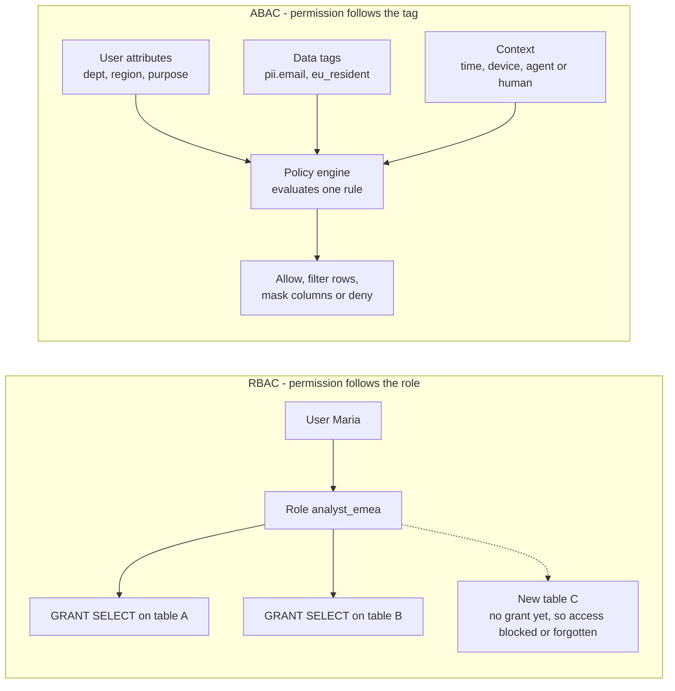
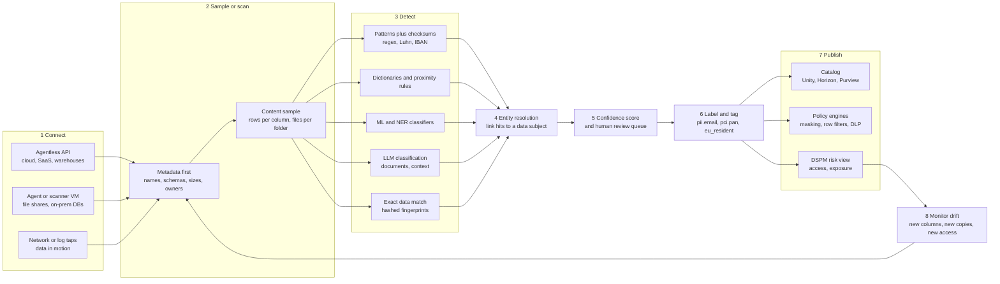
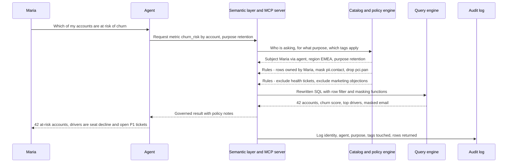
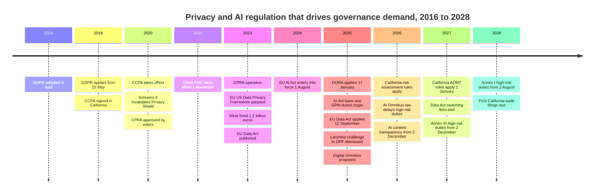

# 15. Governance, Security and Privacy
> **Depth:** L2 · **Reading time:** ~13 min · **Last verified:** 2026-11-01 · **Prerequisites:** [Ch 8 — Catalogs and metastores](../01-data-systems-foundations/ch08-catalogs-and-metastores.md)

## TL;DR

- Governance answers three questions about every piece of data: *what is it*, *who may use it, and for what purpose*, and *where has it gone*. Classification answers the first, access policy the second and lineage the third. Each depends on the one before, and most failures start with the first: a policy cannot protect a column nobody knows holds card numbers.
- Access control has moved from **roles** to **attributes**. Under [role-based access control](../glossary.md#role-based-access-control) (RBAC), permission is granted to a role, table by table. Under [attribute-based access control](../glossary.md#attribute-based-access-control) (ABAC), a single policy is written against tags on the data and attributes of the user ("mask anything tagged `pii.email` unless purpose = support"), so it covers tables that do not exist yet. Unity Catalog ABAC became generally available in 2026, and Snowflake's tag-based masking is GA.[^uc-abac][^sf-tag]
- A discovery and classification engine is a pipeline: connect, sample, detect (patterns plus checksums, dictionaries, ML and LLM classifiers, exact-data fingerprints), resolve detections to a person, score confidence, write tags to the catalog, then watch for drift. [Data security posture management](../glossary.md#data-security-posture-management) (DSPM) adds a map of who can reach that data and where it is exposed.
- The category is consolidating into larger security and data-protection platforms. Palo Alto bought Dig (2023), Proofpoint bought Normalyze (2024) and agreed to buy Varonis for about $6.3B (October 2026), and Veeam closed its $1.725B Securiti acquisition (December 2025).[^dig][^normalyze][^varonis-8k][^securiti] Everpure bought 1touch for $125.0M (closed May 2026).[^ep-10q] Cyera is the independent holdout, at a press-reported $12B valuation.[^cyera-g]
- Regulation creates the demand. GDPR fines totalled about €7.1B by January 2026,[^dla] the average breach cost $4.44M globally and $10.22M in the US in IBM's 2025 study,[^ibm] and the EU AI Act's data-governance duties for high-risk systems now start in December 2027 after the 2026 Omnibus delay.[^omnibus] AI agents widen the risk because they read far more data than any analyst could.

## Why this matters (business + Everpure lens)

Every data platform in this atlas eventually sells governance. Catalogs ([Ch 8](../01-data-systems-foundations/ch08-catalogs-and-metastores.md)) are where permissions live, which is why Databricks and Snowflake fight over them. Lineage ([Ch 13](ch13-data-quality-observability-lineage.md)) is what makes deletion and audit possible. Semantic layers ([Ch 14](ch14-semantic-layers-and-bi.md)) decide which definitions an AI agent sees. The common question underneath all three is whether the system knows what the data *is*. Only then can it decide who may see it.

Generative AI has made that question urgent. A human analyst queries a few tables. An agent with a retrieval index reads millions of documents, including old file shares no one has classified, and repeats what it finds. IBM's 2025 study found that 20% of surveyed organisations had a breach involving "shadow AI" (unsanctioned AI tools), and that it added about $670,000 to the average cost.[^ibm-ai] Boards that once treated data classification as a compliance chore now treat it as a gate on AI deployment.

For Everpure, this is the most important chapter in Part 2. On 23 February 2026, the day Pure Storage renamed itself Everpure, it announced the purchase of **1touch**, a data discovery, classification and semantic-context company.[^ep-wwt] The deal closed on 7 May 2026 for $125.0M in cash (GAAP, per the 10-Q).[^ep-10q] The technology relaunched in June 2026 as **Everpure Data Intelligence**. Trade coverage describes it as discovering and classifying structured and unstructured data across Everpure arrays, third-party storage, clouds and SaaS without copying the data.[^ep-cw] An October 2026 update added a metadata-only File Edition and a [Model Context Protocol](../glossary.md#model-context-protocol) (MCP) interface for querying classified data in natural language.[^ep-oct]

Why would a storage company buy a classifier? The storage layer sees every byte, including the copies that never reach a catalog: backups, snapshots, exports, scratch buckets and decade-old SMB shares. Governance vendors spend heavily on connectors to reach that data. A storage system already holds it. The argument, in short, is that classification plus semantic context turns raw capacity into *governed, AI-ready* data, and governed data is worth more per terabyte. The section on [who's who](#whos-who) lays out the options a strategy team might evaluate, based on public information.

## How it works

### Access control models: from roles to attributes

**RBAC** is the model most enterprises still run. Permissions such as SELECT on `crm.customers` go to roles such as `analyst_emea`, and users are assigned roles. It is easy to audit ("who has this role?") but scales badly. With 5,000 tables, 40 sensitivity levels and 30 regions, administrators end up creating a role for every combination, which practitioners call *role explosion*. Each new table also needs fresh grants, so protection lags creation.

**ABAC**, formalised in NIST SP 800-162 (2014), evaluates a rule at request time against attributes of the **subject** (department, clearance, location), the **object** (tags such as `pii`, `pci`, `eu_resident`), the **action** and the **environment** (time, device, stated purpose).[^nist-abac] One policy, such as "mask columns tagged `pii.contact` for anyone whose purpose is not `support`", protects every current and future column carrying that tag. The cost is that ABAC is only as good as its tags, which is why it arrived together with automated classification.

Two enforcement forms matter in analytics. **Row-level security** silently adds a filter (`WHERE region = user.region`). **Column-level security** either blocks a column or applies a [dynamic masking](../glossary.md#dynamic-data-masking) function that returns `j***@example.com` instead of the address. Both are applied by the query engine when it rewrites the query, so the user never sees the policy, only its effect.

*Figure 15.1 — RBAC binds permissions to roles and objects one grant at a time. ABAC evaluates a rule against tags and attributes at query time, so new tables are covered the moment they are tagged.*

**Policy engines** are where rules are written and evaluated. They come in three flavours:

1. **General-purpose decision engines.** [Open Policy Agent](../glossary.md#open-policy-agent) (OPA), a CNCF graduated project, takes a JSON request, evaluates rules in its Rego language and returns a decision. The application or proxy then enforces that decision.[^opa] In August 2025 OPA's creators and most of the Styra team joined Apple. The project's governance and licence did not change.[^opa-apple]
2. **Platform-native engines.** Apache Ranger grew up in the Hadoop ecosystem with plugins for Hive, HDFS, Kafka and Trino.[^ranger] Databricks Unity Catalog now offers ABAC row filters and column masks driven by governed tags (GA 2026).[^uc-abac] Snowflake lets administrators attach a masking policy to a tag, so any column that inherits the tag is masked, and it is extending tag-based policies to row access, aggregation and projection.[^sf-tag]
3. **Overlay vendors.** Immuta and Privacera (founded by Ranger's creators) write policy once and push it down into each platform's native controls, which suits a multi-platform estate.[^immuta][^privacera]

> **Bridge: hardware memory tagging.** ABAC resembles ARM's Memory Tagging Extension. MTE stores a small tag with each 16-byte granule of memory and a matching tag in the pointer, and the hardware checks the two on every access. Under RBAC, by contrast, permission depends on *which page table you are running in*. Data tags play the role of memory tags: the check travels with the data, not with the program. Capability systems such as CHERI go further and make the access right an unforgeable token. The scoped, short-lived credentials that catalogs now issue to query engines ([Ch 8](../01-data-systems-foundations/ch08-catalogs-and-metastores.md)) work on the same principle.

### Inside a discovery and classification engine

Tags have to come from somewhere. A classification engine produces them. Commercial products differ in packaging, but the pipeline underneath is similar.

*Figure 15.2 — A discovery engine turns raw bytes into tags that catalogs and policy engines can enforce. The loop back from monitoring matters most: data estates change daily, so classification is never finished.*

**Connect.** *Agentless* tools use cloud and SaaS APIs (S3 listing, snapshot sharing, Snowflake's information schema, the Microsoft Graph API). They deploy in hours, which is why the cloud-first DSPM wave (Cyera, Dig, Normalyze, Sentra) is agentless.[^normalyze][^sentra] *Agent or scanner* deployments run a VM or container near on-prem file servers and databases, where no cloud API exists. 1touch's original product also mapped data in motion from network traffic, so it could find data stores no one had listed.[^1touch-inventa] Customers care about the security of the scanner itself. Most modern tools scan inside the customer's account and send only metadata and findings to the vendor's control plane.

**Sample or scan.** A full content scan of a petabyte is expensive. AWS Macie charges $1.00 per GB inspected at list price, and Google's Sensitive Data Protection also bills discovery by bytes profiled or by subscription unit.[^macie][^gsdp] At $1/GB, one full pass over 1 PB is roughly $1M before any volume discount (estimate; Macie's tiering above 50 TB was not confirmed `[VERIFY: Macie per-GB tier schedule]`). Engines therefore triage. They read metadata first (column names, file types, owners, last access). They sample content: a few hundred rows per column is usually enough to classify a structured column, because its values are homogeneous. They deduplicate identical files by hash, and they rescan only what has changed. Unstructured data is harder. A single PDF can mix a contract, a passport scan and a health note, so sampling must be per document and often per page, and images need OCR.

**Detect.** Detectors run from cheap to expensive:

- **Patterns plus validation.** A regex finds 16-digit strings. A Luhn checksum discards about 90% of random digit strings that are not valid card numbers. IBAN and national ID checksums work the same way.
- **Dictionaries and proximity.** A nine-digit number near the words "SSN" or "social security" scores higher than one in a log file.
- **ML and named-entity recognition.** Models tag names, addresses and medical terms in free text. Microsoft Purview's *trainable classifiers* learn document types (résumés, source code, contracts) from examples.[^purview-class]
- **LLM classification.** Large models can read a document and say "this is a merger term sheet" or "this ticket describes a customer's diagnosis." They capture context no pattern can. They are also slow and costly per token, which matters at petabyte scale, and the prompt itself must not leak the data.
- **Fingerprinting and exact data match (EDM).** The customer uploads hashed values from a system of record, such as the real customer table, and the engine flags exact matches anywhere. Purview's EDM works this way.[^purview-class] EDM is the most precise detector, but it only finds data that is already known.

**Resolve entities.** For privacy, finding "an email address" is not enough. The engine must know *whose* it is. Entity resolution links detections across systems to one data subject (customer 4471 = `j.ng@…` = the phone number in a support ticket). That is what turns a classification tool into a privacy tool: it can answer a data subject access request (DSAR) by listing every location holding that person's data. BigID built its early business on this identity-centric approach.[^bigid]

**Score, tag, publish, monitor.** Each finding carries a confidence score. High-confidence hits become tags automatically, and borderline ones go to a data steward. The tags are written to the catalog and the policy engine, which is where enforcement actually happens. DSPM then overlays *access*: which identities, roles, service accounts and public links can reach each sensitive store. Last, the engine watches for drift, such as a new column, a fresh export to a scratch bucket, or a role that suddenly gained read access.

> **Bridge: wafer inspection.** A classification engine is a fab's defect-inspection flow applied to data. Optical inspection (metadata and regex) is fast and flags candidates. Review SEM (ML and LLM classifiers) is slower and classifies them. Disposition (tag, mask, quarantine, delete) follows the defect code. The economics are the same too. You cannot put every wafer through e-beam review, so you sample by risk, and you tune thresholds to trade escapes (false negatives, here a missed SSN) against overkill (false positives, here masked data that analysts needed). A good vendor can tell you its escape rate on your data, not just a headline accuracy figure.

> **Going deeper (L3).** Confidence scores combine detector outputs much as a Bayesian spam filter combines word evidence. Each detector contributes a likelihood ratio (a Luhn-valid 16-digit string beside "Visa" is strong evidence; a bare 9-digit number is weak), and column-level aggregation over the sample sharpens the estimate. If 180 of 200 sampled values match, the column is tagged even though 10% did not. Ask vendors whether thresholds are calibrated per data source, and how stewards' corrections feed back into the model.

### DSPM: from labels to posture

Classification says what data is. **DSPM**, a category Gartner began tracking around 2022, combines that with *where it sits* and *who can reach it*, then ranks the exposures.[^dspm-market] Typical findings include a production customer snapshot copied to an unencrypted bucket in a test account, a SharePoint folder of payroll files shared with "everyone", or an AI assistant's index built from a share containing health data. DSPM borrows the model of cloud security posture management, which it often plugs into: continuous scanning, a risk score and a remediation ticket. Adjacent capabilities, such as data detection and response (alerting on unusual access) and data loss prevention (blocking data leaving), are converging into the same products. Cyera's $162M purchase of Trail Security, a DLP company, is one example.[^cyera-trail]

### Protecting data that must be used

Classification and policy decide *whether* someone sees data. A second toolkit changes *what* they see.

| Technique | What it does | Reversible? | Typical use | Watch-outs |
|---|---|---|---|---|
| Static masking | Permanently rewrites values in a copy (dev, test, vendor extracts) | No | Non-production copies | Masked copies drift from production; join keys must stay consistent |
| Dynamic masking | Rewrites values at query time based on policy | Underlying data unchanged | Analytics, BI, agents | Only as strong as the policy and its tags; inference via filters is possible |
| Vaulted tokenization | Swaps a value for a random token, keeping the mapping in a secured vault | Yes, via the vault | Card numbers (PCI), national IDs | The vault is a high-value target and a latency hop |
| Vaultless or format-preserving tokenization | Derives the token cryptographically (e.g., format-preserving encryption) so it keeps the shape of the original | Yes, with the key | Legacy systems that validate formats | Key management becomes the control; same input gives the same token, which enables linkage |
| Hashing or pseudonymisation | One-way transform of identifiers | No (but linkable) | Joining datasets without names | Under GDPR, pseudonymised data is still personal data |
| Differential privacy | Adds calibrated noise to aggregate results within a "privacy budget" | Not applicable | Published statistics, collaboration queries | Accuracy falls for small groups; the budget must be managed |
| Clean rooms | Two parties query combined data under agreed rules without seeing each other's rows | Not applicable | Advertising measurement, retail media | Rules and minimum aggregation thresholds carry all the protection |

*Figure 15.3 — Masking hides values, tokenization substitutes them, and differential privacy and clean rooms release only aggregates. The legal point executives miss is that tokenized or pseudonymised data usually remains personal data under GDPR.*[^gdpr]

Differential privacy moved from theory to production when the US Census Bureau used it for the 2020 census.[^census-dp] Clean rooms became a product category around the same time. AWS Clean Rooms went GA in March 2023 and added differential privacy in April 2024.[^aws-cr] Snowflake bought Samooha in December 2023 to build its clean rooms.[^samooha] LiveRamp paid about $200M for Habu in January 2024.[^habu]

> **Bridge: address translation.** Tokenization is a page table for sensitive values. Applications hold a *virtual* identifier (the token) that is useless on its own, and only a privileged translation step (the vault, or the key for format-preserving schemes) maps it to the *physical* value. As with an MMU, the security comes from controlling who can perform the translation, and the cost is the extra lookup on every dereference. Vaultless schemes are like a fixed hash-based mapping: there is no table to walk, but anyone holding the key can translate everything.

### Lineage-based compliance: access, erasure, retention

GDPR gives individuals a right of access (Article 15) and a right to erasure (Article 17), and controllers must respond within one month, extendable by two further months for complex requests.[^gdpr] Doing this at scale requires the classification engine's entity map (where does this person's data live?) and lineage ([Ch 13](ch13-data-quality-observability-lineage.md)) to show which derived tables, features, embeddings and backups it flowed into. Erasure in a lakehouse is not instant either. A DELETE in Iceberg or Delta only removes the row from the *current* snapshot. The bytes persist until compaction and snapshot expiry run ([Ch 7](../01-data-systems-foundations/ch07-open-table-formats.md)). Retention policy, written as tags such as `retain_until=2027-12-31`, is therefore part of governance, not just storage housekeeping. Embeddings and fine-tuned models raise an open question: whether "erasing" a person requires rebuilding the index or retraining the model. Regulators have not settled it.

## Worked example: an agent asks for "customers at risk of churn"

Maria, a customer-success manager in Dublin, asks her company's AI agent: *"Which of my accounts are at risk of churn, and why?"* The agent works through an MCP server and the semantic layer ([Ch 14](ch14-semantic-layers-and-bi.md), [Ch 22](../03-ai-data-stack/ch22-agents-and-data.md)). The relevant data has already been classified:

- `crm.customers`: `email` and `phone` tagged `pii.contact`; `country` drives a row-level tag `eu_resident`; `marketing_objection` is a consent flag.
- `billing.payments`: `card_number` tagged `pci.pan`, stored tokenized.
- `support.tickets.body`: free text, which an LLM classifier tagged `pii.free_text`, with 3% of tickets also tagged `special_category.health` because customers described medical reasons for cancelling.
- `ml.churn_scores`: derived; lineage shows it was built from all three.

*Figure 15.4 — The agent never sees raw card numbers, health narratives or accounts outside Maria's book. The policy is evaluated once per request against tags, not written into the agent's prompt.*

Four things happen that a role-based design would struggle with:

1. **Purpose is an attribute.** The same agent answering a fraud investigator would get different columns. GDPR's purpose-limitation principle becomes executable.
2. **Health data is excluded, not masked.** Health information is a special category under GDPR Article 9, and using it to target retention offers would need an Article 9 basis the company almost certainly lacks. The classifier's `special_category.health` tag removes those ticket bodies from the agent's context entirely, while the derived "open P1 ticket" driver survives.
3. **Objections are honoured automatically.** Under GDPR Article 21, a person may object to profiling for direct marketing, and that objection is absolute.[^gdpr] Rows with `marketing_objection = true` are filtered out before scoring reaches a retention campaign. California's new automated-decision rules, which apply from 1 January 2027, may require separate analysis if scores feed "significant decisions." Most retention marketing would not qualify, but counsel should confirm.[^cppa]
4. **The log is the evidence.** The audit record (who, through which agent, for what purpose, which tags) is what a regulator or auditor will ask for. It is also what lets the DSPM tool notice if the agent starts pulling ten times its usual volume.

The failure mode is just as instructive. Suppose an engineer adds a `notes` column to `crm.customers` and an account manager pastes passport numbers into it. Until the classifier's drift scan tags that column, ABAC has nothing to act on, and the agent could surface it. Classification latency, measured in hours or days, is the real exposure window.

## Design choices and trade-offs

| Decision | Option A | Option B | A wins when… | B wins when… |
|---|---|---|---|---|
| Where policy lives | Platform-native (Unity Catalog, Snowflake Horizon) | Central overlay (Immuta, Privacera, OPA) | One dominant platform; native performance and features matter | Several platforms; one auditable policy set across them |
| How to reach data | Agentless APIs | Agents or scanners inside the network | Cloud and SaaS estates; speed to value | On-prem file shares, mainframes, air-gapped sites |
| Scan depth | Sampling plus metadata | Full content scan | Structured columns, petabyte estates, cost limits | Regulated unstructured stores; proof of absence needed |
| Detector mix | Patterns, dictionaries, EDM | ML or LLM classifiers | Known identifiers; explainability for auditors | Free text, documents, novel data types |
| Value protection | Dynamic masking | Tokenization | Analytics with role-dependent views | Payment data and systems of record where raw values must never land |
| Who owns tags | Central governance team | Data producers (data-mesh style) | Regulated firms that need consistency | Fast-moving domains; owners know their data |

*Figure 15.5 — Most real estates mix both columns. The useful question is which option is the default and how exceptions are governed.*

**Steelmanning the alternatives.** The case for *platform-native* policy is strong. Enforcement inside the engine is fastest, cannot be bypassed by a direct connection, and is improving quickly. Unity Catalog and Snowflake both now evaluate tag-driven policies natively.[^uc-abac][^sf-tag] The case for *overlays* is that few large firms run one platform, and auditors want a single answer to "who can see customer data?" On detectors, the case against LLM classification is cost and repeatability: the same document may be labelled differently on two runs, which an auditor will not accept without confidence thresholds and human review. The case for it is that regex never understood a merger memo.

## Who's who

| Vendor | Owner / status (Nov 2026) | Approach | Structured / unstructured | Deployment | Notable deal or funding |
|---|---|---|---|---|---|
| Everpure Data Intelligence (ex-1touch) | Everpure subsidiary since 2026-05-07 | Discovery, classification, semantic context; data in motion and at rest; MCP interface | Both | Hybrid; Everpure and third-party storage, cloud, SaaS | $125.0M cash (GAAP, 10-Q)[^ep-10q][^ep-oct] |
| Cyera | Independent, private | Agentless cloud DSPM plus DLP | Both | SaaS, cloud-first | $600M Series G at $12B (press-reported, Jun 2026); bought Trail Security for $162M[^cyera-g][^cyera-trail] |
| BigID | Independent, private | Identity-centric discovery and privacy | Both | SaaS or self-hosted | Series E (Riverwood) valued "over $1B" (company-stated, 2024)[^bigid] |
| Varonis | Public (VRNS); pending sale to Proofpoint | File-permission and activity analytics; DSPM | Mostly unstructured, expanding | SaaS (transition from on-prem) | $6.3B, $49.75/share cash; close expected 1H 2027[^varonis-8k] |
| Securiti | Veeam (closed 2025-12-11) | Privacy operations plus DSPM ("data command center") | Both | Hybrid | $1.725B[^securiti] |
| Normalyze | Proofpoint (agreed 2024-10-29) | Agentless, in-place DSPM scanning | Both | Cloud | Undisclosed[^normalyze] |
| Dig Security | Palo Alto Networks (Prisma Cloud) | Agentless DSPM plus data detection and response | Both | Cloud | $400M (press-reported, 2023)[^dig] |
| Sentra | Independent, private | Agentless cloud DSPM | Both | Cloud, SaaS | $50M Series B (Apr 2025); >$100M raised (company-stated)[^sentra] |
| Laminar / Flow / Eureka | Rubrik / CrowdStrike / Tenable | DSPM absorbed into backup and security suites | Both | Cloud | Laminar and Flow undisclosed; Eureka $29.2M cash (10-Q)[^dspm-tuckins] |
| Microsoft Purview | Microsoft | Sensitivity labels, DLP, EDM, trainable classifiers, DSPM for AI | Both; deepest in M365 | Cloud | Bundled in Microsoft 365 licensing[^purview-class][^purview-dspm] |
| Google Sensitive Data Protection | Google Cloud | Inspection, de-identification, discovery profiles | Both | Cloud | Usage or subscription pricing[^gsdp] |
| Amazon Macie | AWS | ML plus managed identifiers for S3 | Mostly unstructured objects in S3 | Cloud | $1.00/GB inspected (list)[^macie] |
| Immuta | Independent, private | ABAC policy overlay; agent data provisioning | Structured | SaaS, pushes into Snowflake and Databricks | $100M Series E (2022)[^immuta] |
| Privacera | Independent, private | Ranger-based cross-platform policy | Structured | SaaS or self-hosted | $50M Series B (2021)[^privacera] |

*Figure 15.6 — Independent DSPM vendors are being bought by security, backup and now storage companies. Cyera is the main well-funded independent left, and the clouds bundle "good enough" classification into their platforms.*

**Positioning.** Three groups compete. *Security platforms* (Palo Alto, Proofpoint, CrowdStrike, Tenable) buy DSPM to add data context to threat and identity products. *Data-protection and backup vendors* (Veeam–Securiti, Rubrik–Laminar) buy it because they already hold copies of everything and want to sell "know what's in your backups." *Data platforms and clouds* (Databricks, Snowflake, Microsoft, Google, AWS) build classification into their catalogs, so tags are created where policy is enforced. Databricks also bought Okera for data-access governance in 2023.[^okera] Varonis's price, about 8.5x its calendar-2026 revenue guidance (estimate from the deal value and guidance midpoint), is the clearest public mark for a scaled, profitable-adjacent vendor in the category.[^varonis-8k] Cyera's $12B, reportedly about 80x ARR (a figure the company disputed), is the growth-scarcity mark.[^cyera-g]

**Everpure's position.** Everpure followed the backup vendors' logic but from primary storage, and at a far lower price ($125M versus $1.725B for Securiti). Based on public information, options a strategy team might evaluate include:

- *Feature path.* Use Data Intelligence to make Everpure arrays (and rivals' arrays) self-describing, for example by flagging that a FlashBlade bucket feeding a retrieval index contains `special_category` data before Data Stream vectorises it.[^ep-cw]
- *Integration path.* Publish tags into the catalogs customers already run, such as Unity Catalog, Snowflake Horizon and Purview, so that Everpure becomes the classification source and the platforms do the enforcing. This avoids competing with Cyera on security features.
- *Platform path.* Extend into DSPM and access governance. That would put Everpure up against Proofpoint–Varonis, Veeam–Securiti and the clouds, which is a larger market but a much more crowded one.

The bear case is that classification is becoming a free feature of catalogs and clouds. The bull case is that no catalog sees the unstructured and shadow copies that storage sees. [Ch 33](../04-company-deep-dives/ch33-governance-catalog-security-companies.md) profiles these companies, and [Ch 45](../06-history-and-future/ch45-storage-moving-up-the-stack.md) puts the move in the context of storage vendors moving up the stack.

## History and trajectory

*Figure 15.7 — Regulation arrives in waves. Each wave (GDPR 2018, US states from 2020, the AI Act from 2025) has produced a new round of classification and governance spending.*

**Three waves of demand.** *Wave 1 (2016–2019): privacy compliance.* GDPR, adopted in 2016 and applied from May 2018, allows fines of up to €20M or 4% of worldwide turnover, whichever is higher.[^gdpr] It created the DSAR and erasure workloads that BigID, OneTrust and Securiti built businesses on. California followed with the CCPA (effective 2020) and the CPRA (operative 2023).[^ccpa] *Wave 2 (2020–2024): sovereignty and cloud sprawl.* The CJEU's Schrems II judgment (July 2020) struck down the EU–US Privacy Shield and made transfer impact assessments routine.[^schrems] The 2023 Data Privacy Framework survived a first challenge in the EU General Court in September 2025, though an appeal remains possible.[^latombe] China's PIPL (November 2021) added data-localisation and cross-border transfer controls.[^pipl] Meanwhile cloud migration scattered copies across accounts, and cloud-native DSPM appeared to find them. *Wave 3 (2025 onward): AI and resilience.* The EU AI Act entered into force in August 2024.[^aiact] Its Article 10 requires high-risk systems to use training, validation and test data subject to documented governance, and the 2026 Omnibus moved those high-risk obligations to December 2027 (standalone systems) and August 2028 (product-embedded systems).[^omnibus] DORA, applicable to EU financial firms since January 2025, requires ICT risk management and registers of third-party providers.[^dora] The EU Data Act, applicable since September 2025, gives users rights to data from connected products and gives cloud customers switching rights.[^dataact]

In the US, there is still no federal privacy law. Secondary summaries of the IAPP tracker count about 20 states with comprehensive privacy laws in 2026; counts vary with the definition used.[^iapp] `[VERIFY: IAPP count of states with comprehensive privacy laws as of 2026-11]` For a multinational, the practical effect is that "where is personal data, whose is it, and which law applies" has to be answered continuously, by machine.

**What's next.** The GDPR part of the EU Digital Omnibus, proposed in November 2025, would narrow what counts as personal data and add AI-processing provisions. It was still in negotiation in late 2026.[^omnibus] Agent governance (purpose-bound credentials, MCP gateways, per-agent audit) is the next build-out. Snowflake's agreement to buy Natoma, an MCP gateway company, for about $110M (May 2026) shows platform vendors moving into this space.[^natoma]

## Numbers that matter

| Metric | Value | Basis | Source / date |
|---|---|---|---|
| GDPR fines, year from 28 Jan 2025 | ~€1.2B | Survey aggregate | DLA Piper, Jan 2026[^dla] |
| Cumulative GDPR fines, May 2018 to 10 Jan 2026 | ~€7.1B | Survey aggregate | DLA Piper, Jan 2026[^dla] |
| Personal-data breach notifications in Europe | 443 per day (+22%) | Survey aggregate | DLA Piper, Jan 2026[^dla] |
| Largest single GDPR fine | €1.2B (Meta, May 2023) | Regulator decision | EDPB, 2023-05-22[^meta-fine] |
| Average breach cost, global / US | $4.44M (−9%) / $10.22M | Survey estimate (Ponemon for IBM) | IBM, Jul 2025[^ibm] |
| Extra cost where shadow AI was high | ~$670,000 | Survey estimate | IBM, 2025[^ibm-ai] |
| GDPR maximum fine | €20M or 4% of worldwide turnover | Statute (Art. 83) | GDPR[^gdpr] |
| DSAR response deadline | 1 month, +2 for complex cases | Statute (Art. 12) | GDPR[^gdpr] |
| Amazon Macie inspection price | $1.00 per GB (list) | Vendor list price | AWS, retrieved 2026-11-01[^macie] |
| Full scan of 1 PB at $1/GB | ~$1M | Estimate, before tiering | Derived from [^macie] |
| Proofpoint–Varonis | $6.3B; ~8.5x CY2026 revenue guidance | Disclosed; multiple is estimate | Varonis 8-K Ex. 99.1, 2026-10-15[^varonis-8k] |
| Veeam–Securiti | $1.725B | Company-stated | Business Wire, 2025-12-11[^securiti] |
| Everpure–1touch | $125.0M cash | GAAP, 10-Q | Everpure 10-Q, 2026-06[^ep-10q] |
| Cyera latest round | $600M at $12B post-money | Press-reported | SecurityWeek, Jun 2026[^cyera-g] |
| DSPM market size | No verified independent figure; vendor-cited ~$415M for 2024 | Vendor-cited estimate | Palo Alto Networks Cyberpedia[^dspm-market] `[VERIFY: independent DSPM market size]` |

*Figure 15.8 — Fines are large but rare. Breach costs and the growing number of AI-related incidents do more to drive budgets. The deal values show buyers paying 8–80x revenue for data context.*

## Storage bridge

> **Storage bridge.** Classification is metadata about content, and storage already holds much of that metadata: object tags, file ACLs, snapshot catalogs, access logs. A storage-resident classifier can scan close to the data without egress, deduplicate scans across snapshots that share blocks, and tag shadow copies (backups, clones, scratch buckets) that no catalog ever registered. The hard parts are the read load placed on production arrays and writing tags *out* to the catalogs where policy is enforced. See the companion *Everpure Tech Atlas* for snapshot, metadata and object-tagging mechanics.

## Conversation playbook

**Questions for a PM**

1. "When your classifier tags a column, where does that tag go: your own console, or Unity Catalog, Snowflake Horizon and Purview, so their engines enforce it? How long does it take?"
2. "What share of your customers' sensitive data findings come from unstructured stores and from copies no catalog knew about?"
3. "How do you price: per GB scanned, per data store, or per identity? What happens to the customer's bill when they double their data?"

**Questions for an engineer**

1. "Walk me through your sampling strategy for a 2 PB S3 estate and a 50 TB SMB share. What are the escape rate and the false-positive rate, measured on real customer data?"
2. "Where do your LLM classifiers run, what data leaves the customer's boundary, and how do you make labels repeatable enough for audit?"
3. "How do you resolve a detection to a specific data subject across systems, and how do you prove an erasure request was completed in backups and derived tables?"

**What good answers sound like.** Specific and measured: "We sample 500 rows per column and escalate to a full scan above 0.8 confidence for `pci` types"; "tags sync to Unity Catalog governed tags within 15 minutes"; "LLM classification runs in the customer's VPC, with no content leaving it." Good answers separate detection accuracy from enforcement and admit that classification latency is a live exposure.

**Don't say this**

- "Tokenized data isn't personal data." Under GDPR, pseudonymised data generally remains personal data if anyone can re-identify it.
- "We have RBAC, so we're governed." Without classification, roles protect tables, not the sensitive columns and documents inside them.
- "DSPM replaces the catalog." DSPM finds and scores risk. Catalogs and engines enforce policy.
- "Classification is a one-time project." Estates change daily. Drift monitoring is the product.
- "The EU AI Act high-risk rules apply from August 2026." The 2026 Omnibus moved them to December 2027 and August 2028.

## Going deeper

- NIST SP 800-162, for the formal ABAC model (subject, object, environment, policy).[^nist-abac]
- OPA documentation, especially Rego and the decision/enforcement split.[^opa]
- Snowflake tag-based masking and Databricks ABAC docs, to see how tags become SQL rewrites.[^sf-tag][^uc-abac]
- Microsoft Purview data classification overview, for EDM, fingerprinting and trainable classifiers.[^purview-class]
- Dwork, McSherry, Nissim and Smith (2006), the founding paper on differential privacy.[^dwork]

## Key terms

- [Role-based access control](../glossary.md#role-based-access-control) — permissions granted to roles, and roles assigned to users.
- [Attribute-based access control](../glossary.md#attribute-based-access-control) — access decided at request time from attributes of user, data, action and context.
- [Row-level security](../glossary.md#row-level-security) — a policy that filters which rows a user can see.
- [Column-level security](../glossary.md#column-level-security) — a policy that blocks or masks specific columns.
- [Dynamic data masking](../glossary.md#dynamic-data-masking) — rewriting sensitive values at query time based on policy.
- [Static data masking](../glossary.md#static-data-masking) — permanently replacing sensitive values in a copy of the data.
- [Tag-based policy](../glossary.md#tag-based-policy) — a policy attached to a tag so it applies to every object carrying that tag.
- [Policy engine](../glossary.md#policy-engine) — software that evaluates access rules and returns allow, deny or transform decisions.
- [Open Policy Agent](../glossary.md#open-policy-agent) — CNCF general-purpose policy engine using the Rego language.
- [Apache Ranger](../glossary.md#apache-ranger) — open-source policy framework for Hadoop-era data platforms.
- [Data classification](../glossary.md#data-classification) — labelling data by type and sensitivity.
- [Data discovery](../glossary.md#data-discovery) — finding where data stores and sensitive data exist.
- [Exact data match](../glossary.md#exact-data-match) — detecting sensitive data by matching hashed values from a reference table.
- [Luhn checksum](../glossary.md#luhn-checksum) — check-digit algorithm that validates card-number candidates.
- [Named-entity recognition](../glossary.md#named-entity-recognition) — ML that tags names, places and other entities in text.
- [Entity resolution](../glossary.md#entity-resolution) — linking records across systems to the same real-world person or thing.
- [Data security posture management](../glossary.md#data-security-posture-management) — continuous discovery of sensitive data, who can access it and where it is exposed.
- [Shadow data](../glossary.md#shadow-data) — copies of data outside governed, catalogued systems.
- [Data loss prevention](../glossary.md#data-loss-prevention) — controls that detect and block sensitive data leaving approved boundaries.
- [Tokenization](../glossary.md#tokenization) — replacing a sensitive value with a surrogate token.
- [Format-preserving encryption](../glossary.md#format-preserving-encryption) — encryption whose output keeps the original value's format.
- [Pseudonymisation](../glossary.md#pseudonymisation) — processing data so it cannot be attributed to a person without separate information.
- [Differential privacy](../glossary.md#differential-privacy) — adding calibrated noise so outputs reveal little about any individual.
- [Data clean room](../glossary.md#data-clean-room) — environment where parties analyse combined data without seeing each other's rows.
- [Data subject access request](../glossary.md#data-subject-access-request) — an individual's legal request to see the personal data held on them.
- [Right to erasure](../glossary.md#right-to-erasure) — GDPR right to have personal data deleted in defined circumstances.
- [Purpose limitation](../glossary.md#purpose-limitation) — principle that data be used only for specified, compatible purposes.
- [Data sovereignty](../glossary.md#data-sovereignty) — data being subject to the laws of the place it is stored or its subjects reside.
- [Model Context Protocol](../glossary.md#model-context-protocol) — open protocol for connecting AI agents to tools and data.

## Sources

[^ep-wwt]: World Wide Technology (reposting Pure Storage press release), "Pure Storage rebrands to Everpure and announces intent to acquire 1touch," https://www.wwt.com/news/pure-storage-rebrands-to-everpure-and-announces-intent-to-acquire-1touch, published 2026-02-23; retrieved 2026-11-01. Also Cleary Gottlieb, "Everpure (f/k/a Pure Storage) to Acquire 1touch," https://www.clearygottlieb.com/news-and-insights/news-listing/everpure-f-k-a-pure-storage-to-acquire-1touch, published 2026-02; retrieved 2026-11-01.
[^ep-10q]: Everpure, Inc., Form 10-Q for the quarter ended 2026-05-03 (1touch closed 2026-05-07; $125.0M stated cash consideration, subject to adjustments and escrow), SEC EDGAR, https://www.sec.gov/Archives/edgar/data/0001474432/000147443226000061/pstg-20260503.htm, published 2026-06; retrieved 2026-11-01. Closing also announced by Cleary Gottlieb, https://www.clearygottlieb.com/news-and-insights/news-listing/everpure-completes-acquisition-of-1touch, 2026-05-11.
[^ep-cw]: Computer Weekly, "Everpure aims to bridge AI data gap with Universal Data Intelligence," https://www.computerweekly.com/news/366644438/Everpure-aims-to-bridge-AI-data-gap-with-Universal-Data-Intelligence, published 2026-06; retrieved 2026-11-01 (via `meta/research-briefing.md`). See also Everpure via PR Newswire, "Everpure Unveils Data-Primacy Architecture for the AI Era," https://www.prnewswire.com/news-releases/everpure-unveils-data-primacy-architecture-for-the-ai-era-302803097.html, 2026-06-17.
[^ep-oct]: HPCwire/AIwire, "Everpure enhances Data Intelligence to bolster customer AI projects," https://www.hpcwire.com/aiwire/2026/10/07/verpure-enhances-data-intelligence-to-bolster-customer-ai-projects/, published 2026-10-07; retrieved 2026-11-01. Trade-press account of File Edition and MCP integration; Everpure's own release not located.
[^1touch-inventa]: 1touch.io (vendor blog syndicated by Security Boulevard), "Sensitive data discovery the 1touch.io Inventa way," https://securityboulevard.com/2021/07/sensitive-data-discovery-the-1touch-io-inventa-way/, published 2021-07; retrieved 2026-11-01. Vendor-authored; describes network-traffic-led, agentless discovery.
[^cyera-g]: SecurityWeek, "Cyera raises $600 million at $12 billion valuation," https://www.securityweek.com/cyera-raises-600-million-at-12-billion-valuation/amp/, published 2026-06; retrieved 2026-11-01 (as recorded in `data/private_funding.csv`). The ~80x ARR multiple was press-reported (Calcalist/TechCrunch per secondary summaries) and disputed by a Cyera spokesperson. Prior round: StorageNewsletter, "Cyera raised $400 million at $9 billion valuation," https://www.storagenewsletter.com/2026/01/06/cyera-raised-400-million-at-9-billion-valuation/, 2026-01-06.
[^cyera-trail]: Cyera, "Cyera acquires Trail Security for $162M…," press release, https://www.cyera.com/press-releases/cyera-acquires-trail-security-for-162m-redefining-ai-powered-data-security-with-comprehensive-data-loss-prevention, published 2024-10-17; retrieved 2026-11-01.
[^bigid]: Foley & Lardner, "Foley represents Riverwood Capital as lead investor in Series E round for BigID," https://www.foley.com/news/2024/03/foley-represents-riverwood-capital-as-lead-investor-in-series-e-round-for-bigid/, published 2024-03; retrieved 2026-11-01. Valuation "over $1B" is company-stated (per `data/private_funding.csv`).
[^varonis-8k]: Varonis Systems, Inc., Form 8-K Exhibit 99.1 (merger agreement with Proofpoint), SEC EDGAR, https://www.sec.gov/Archives/edgar/data/0001361113/000121390026109901/ea030861001ex99-1.htm, published 2026-10-15; retrieved 2026-11-01. SiliconANGLE, "Proofpoint agrees to buy data security company Varonis for $6.3B in cash," https://siliconangle.com/2026/10/15/proofpoint-agrees-to-buy-data-security-company-varonis-for-6-3b-in-cash/, 2026-10-15. Revenue multiple uses the FY2026 (calendar) guidance midpoint of $735–739M in `data/public_comps.csv` (estimate).
[^normalyze]: Proofpoint, "Proofpoint Signs Definitive Agreement to Acquire Normalyze," press release, https://www.proofpoint.com/us/newsroom/press-releases/proofpoint-signs-definitive-agreement-acquire-normalyze, published 2024-10-29; retrieved 2026-11-01. Terms undisclosed.
[^securiti]: Veeam via Business Wire, "Veeam Completes Acquisition of Securiti AI…," https://www.businesswire.com/news/home/20251211040418/en/Veeam-Completes-Acquisition-of-Securiti-AI-to-Create-the-Industrys-First-Trusted-Data-Platform-for-Accelerating-Safe-AI-at-Scale, published 2025-12-11; retrieved 2026-11-01. $1.725B as stated in deal coverage; announcement date `[VERIFY: Veeam–Securiti announcement date, Oct 2025]`.
[^dig]: Palo Alto Networks, "A Decade of Strategic Acquisitions" (Cyberpedia), https://www.paloaltonetworks.com/cyberpedia/palo-alto-networks-strategic-acquisitions, n.d.; retrieved 2026-11-01. $400M originally press-reported (per `data/ma_deals.csv`).
[^sentra]: Sentra via Business Wire, Series B announcement ($50M led by Key1 Capital; >$100M total raised, company-stated), https://www.businesswire.com/news/home/20250422569273/en, published 2025-04-22; retrieved 2026-11-01. Series A: Help Net Security, https://www.helpnetsecurity.com/2023/02/02/sentra-funding/, 2023-02-02.
[^dspm-tuckins]: Tenable Holdings, Form 10-Q for the quarter ended 2024-09-30 (Eureka: $29.2M cash, net of $0.4M cash acquired), https://www.sec.gov/Archives/edgar/data/1660280/000166028024000153/tenb-20240930.htm, published 2024-11; SecurityWeek, "CrowdStrike to acquire Flow Security," https://www.securityweek.com/crowdstrike-to-acquire-flow-security, published 2024-03; Rubrik–Laminar (announced 2023-08, terms undisclosed) per deal-tracker summaries `[VERIFY: Rubrik–Laminar primary release]`; all retrieved 2026-11-01.
[^okera]: Futurum Group, "Databricks Acquires Okera," https://futurumgroup.com/insights/databricks-acquires-okera, published 2023-05; retrieved 2026-11-01 (per `data/ma_deals.csv`).
[^immuta]: Immuta via Business Wire, "Immuta Raises $100 Million in Series E Funding," https://www.businesswire.com/news/home/20220608005624/en, published 2022-06-08; Immuta newsroom (2026 agentic data-provisioning launches), https://www.immuta.com/newsroom/press-releases/; retrieved 2026-11-01.
[^privacera]: Insight Partners, "Privacera Secures $50 Million Series B…," https://www.insightpartners.com/ideas/privacera-secures-50-million-series-b-advances-cloud-first-data-governance-and-security-across-global-organizations/, published 2021-03; Privacera leadership page (founders created Apache Ranger), https://privacera.com/leadership/; retrieved 2026-11-01.
[^opa]: Open Policy Agent, "Documentation," https://www.openpolicyagent.org/docs, living document; retrieved 2026-11-01.
[^opa-apple]: T. Koponen, T. Hinrichs, T. Sandall, "A note from Teemu, Tim, and Torin to the Open Policy Agent community," OPA blog, https://openpolicyagent.org/blog/note-from-teemu-tim-and-torin-to-the-open-policy-agent-community-2dbbfe494371, published 2025-08; retrieved 2026-11-01.
[^ranger]: Apache Software Foundation, "Apache Ranger," https://ranger.apache.org/, living document; retrieved 2026-11-01.
[^uc-abac]: Databricks blog, "ABAC row filtering and column masking policies, governed tags and data classification are now generally available," https://www.databricks.com/blog/abac-row-filtering-and-column-masking-policies-governed-tags-and-data-classification-are-now, published 2026; Databricks release notes, April 2026 (governed tags GA 2026-04-02), https://docs.databricks.com/gcp/en/release-notes/product/2026/april; retrieved 2026-11-01. `[VERIFY: exact GA date of ABAC policies; one docs page still showed Public Preview]`
[^sf-tag]: Snowflake documentation, "Tag-based masking policies," https://docs.snowflake.com/en/user-guide/tag-based-masking-policies, and "Attribute-based access control (ABAC) using tag-based policies," https://docs.snowflake.com/en/user-guide/tag-based-policies, living documents; retrieved 2026-11-01. Masking GA; aggregation, row access, projection and join policies listed as public preview for tag-based use.
[^purview-class]: Microsoft Learn, "Data classification overview" (sensitive information types, exact data match, document fingerprinting, trainable classifiers), https://learn.microsoft.com/en-us/purview/data-classification-overview, living document; retrieved 2026-11-01.
[^purview-dspm]: Microsoft Learn, "Microsoft Purview Data Security Posture Management (DSPM) for AI," https://learn.microsoft.com/en-us/purview/dspm-for-ai, living document; retrieved 2026-11-01.
[^gsdp]: Google Cloud, "Sensitive Data Protection pricing" (discovery billed by bytes profiled or subscription units), https://cloud.google.com/sensitive-data-protection/pricing, living document; retrieved 2026-11-01.
[^macie]: AWS, "Amazon Macie pricing," https://aws.amazon.com/macie/pricing/, and "Understanding estimated usage costs for Macie," https://docs.aws.amazon.com/macie/latest/user/account-mgmt-costs-calculations.html, living documents; retrieved 2026-11-01. $1.00/GB inspected, US East list; higher-volume tiers not confirmed.
[^dspm-market]: Palo Alto Networks Cyberpedia, "DSPM market," https://www.paloaltonetworks.com/cyberpedia/dspm-market, n.d.; retrieved 2026-11-01. Vendor source citing Gartner (2022 Hype Cycle entry; 2025 Market Guide for DSPM dated 2025-09-17, paywalled). Treat market-size figures as vendor-cited.
[^census-dp]: US Census Bureau, "Disclosure Avoidance and the 2020 Census" / differential privacy, https://www.census.gov/programs-surveys/decennial-census/decade/2020/planning-management/process/disclosure-avoidance/differential-privacy.html, living document; retrieved 2026-11-01. `[VERIFY: URL not re-fetched in this session]`
[^aws-cr]: AWS, "AWS Clean Rooms is now generally available," https://aws.amazon.com/about-aws/whats-new/2023/03/aws-clean-rooms-generally-available, published 2023-03-21; "AWS Clean Rooms Differential Privacy is now generally available," https://aws.amazon.com/about-aws/whats-new/2024/04/aws-clean-room-differential-privacy, published 2024-04-10; retrieved 2026-11-01.
[^samooha]: TechCrunch, "Snowflake goes all in on data clean rooms with Samooha acquisition," https://techcrunch.com/2023/12/18/snowflake-goes-all-in-on-data-clean-rooms-with-samooha-acquisition, published 2023-12-18; retrieved 2026-11-01.
[^habu]: LiveRamp Holdings, Form 8-K Exhibit 99.1 (agreement to acquire Habu for ~$200M), https://www.sec.gov/Archives/edgar/data/733269/000110465924004503/tm243478d1_ex99-1.htm, published 2024-01-17; retrieved 2026-11-01.
[^gdpr]: Regulation (EU) 2016/679 (General Data Protection Regulation), EUR-Lex, https://eur-lex.europa.eu/eli/reg/2016/679/oj, published 2016-05-04 (applies from 2018-05-25); Articles 4(5), 9, 12, 15, 17, 21, 83 and Recital 26; retrieved 2026-11-01.
[^dla]: DLA Piper, "DLA Piper GDPR Fines and Data Breach Survey: January 2026," https://www.dlapiper.com/en/insights/publications/2026/01/dla-piper-gdpr-fines-and-data-breach-survey-january-2026, published 2026-01; full report PDF https://blogs.dlapiper.com/advocatus/files/2026/01/dla-piper-gdpr-fines-and-data-breach-survey-2026.pdf; retrieved 2026-11-01.
[^meta-fine]: European Data Protection Board, "1.2 billion euro fine for Facebook as a result of EDPB binding decision," https://www.edpb.europa.eu/news/news/2023/12-billion-euro-fine-facebook-result-edpb-binding-decision_en, published 2023-05-22; retrieved 2026-11-01. `[VERIFY: URL not re-fetched in this session]`
[^ibm]: IBM, "Cost of a Data Breach Report 2025" (research by Ponemon Institute), https://www.ibm.com/reports/data-breach, published 2025-07; retrieved 2026-11-01. Cross-checked with CyberScoop, https://cyberscoop.com/ibm-cost-data-breach-2025/, 2025-07.
[^ibm-ai]: IBM X-Force, "2025 Cost of a Data Breach Report: Navigating the AI rush without sidelining security," https://www.ibm.com/think/x-force/2025-cost-of-a-data-breach-navigating-ai, published 2025-07; retrieved 2026-11-01. Survey estimates.
[^iapp]: IAPP, "US State Privacy Legislation Tracker," https://iapp.org/resources/article/us-state-privacy-legislation-tracker, living document (member resource); count of ~20 states taken from secondary summaries (Clym; Consently, July 2026); retrieved 2026-11-01.
[^cppa]: California Privacy Protection Agency, "California Finalizes Regulations to Strengthen Consumers' Privacy," https://www.cppa.ca.gov/announcements/2025/20250923.html, published 2025-09-23; Skadden, https://www.skadden.com/insights/publications/2025/10/california-finalizes-cppa-regulations, 2025-10; retrieved 2026-11-01 (via `meta/research-briefing.md`).
[^ccpa]: State of California Department of Justice, "California Consumer Privacy Act (CCPA)," https://oag.ca.gov/privacy/ccpa, living document (CCPA effective 2020-01-01; CPRA amendments operative 2023-01-01); retrieved 2026-11-01.
[^aiact]: Regulation (EU) 2024/1689 (Artificial Intelligence Act), EUR-Lex, https://eur-lex.europa.eu/eli/reg/2024/1689/oj, published 2024-07-12 (in force 2024-08-01; Article 10 on data governance); retrieved 2026-11-01.
[^omnibus]: Council of the EU, "Artificial intelligence: Council and Parliament agree to simplify and streamline rules," https://www.consilium.europa.eu/en/press/press-releases/2026/05/07/artificial-intelligence-council-and-parliament-agree-to-simplify-and-streamline-rules/, published 2026-05-07; Future of Privacy Forum, "The AI Act implementation timeline: What changes under the AI Omnibus?," https://fpf.org/blog/the-ai-act-implementation-timeline-what-changes-under-the-ai-omnibus/, 2026 (Regulation (EU) 2026/1744, OJ 2026-07-24; Annex III to 2027-12-02, Annex I to 2028-08-02). GDPR Omnibus status: MediaLaws tracker, https://www.medialaws.eu/digital-omnibus-legislative-tracker/, 2026; retrieved 2026-11-01 (via `meta/research-briefing.md`).
[^dataact]: Regulation (EU) 2023/2854 (Data Act), EUR-Lex, https://eur-lex.europa.eu/eli/reg/2023/2854/oj, published 2023-12-22 (applies from 2025-09-12); Society for Computers and Law, "EU Data Act in force from 12 September 2025," https://www.scl.org/eu-data-act-in-force-from-12-september-2025/, 2025-09; retrieved 2026-11-01.
[^dora]: Regulation (EU) 2022/2554 (Digital Operational Resilience Act), EUR-Lex, https://eur-lex.europa.eu/eli/reg/2022/2554/oj, published 2022-12-27 (applies from 2025-01-17); retrieved 2026-11-01.
[^schrems]: Court of Justice of the EU, Case C-311/18, *Data Protection Commissioner v Facebook Ireland and Maximillian Schrems* ("Schrems II"), judgment of 2020-07-16, https://curia.europa.eu/juris/liste.jsf?num=C-311/18; retrieved 2026-11-01.
[^latombe]: IAPP, "European General Court dismisses Latombe challenge, upholds EU-US Data Privacy Framework," https://iapp.org/news/a/european-general-court-dismisses-latombe-challenge-upholds-eu-us-data-privacy-framework, published 2025-09-03; retrieved 2026-11-01. Case T-553/23.
[^pipl]: Stanford DigiChina, "Translation: Personal Information Protection Law of the People's Republic of China — Effective Nov. 1, 2021," https://digichina.stanford.edu/work/translation-personal-information-protection-law-of-the-peoples-republic-of-china-effective-nov-1-2021/, published 2021-08; retrieved 2026-11-01. `[VERIFY: URL not re-fetched in this session]`
[^natoma]: Snowflake Inc., Form 10-Q for the quarter ended 2026-04-30 (Natoma Labs, ~$110M stated consideration), https://www.sec.gov/Archives/edgar/data/0001640147/000164014726000030/snow-20260430.htm, published 2026-05/06; retrieved 2026-11-01 (per `data/ma_deals.csv`).
[^dwork]: C. Dwork, F. McSherry, K. Nissim, A. Smith, "Calibrating Noise to Sensitivity in Private Data Analysis," Theory of Cryptography Conference (TCC 2006), https://doi.org/10.1007/11681878_14, published 2006-03; retrieved 2026-11-01.
[^nist-abac]: V. Hu et al., NIST Special Publication 800-162, "Guide to Attribute Based Access Control (ABAC) Definition and Considerations," https://csrc.nist.gov/pubs/sp/800/162/upd2/final, published 2014-01 (updated 2019); retrieved 2026-11-01.
