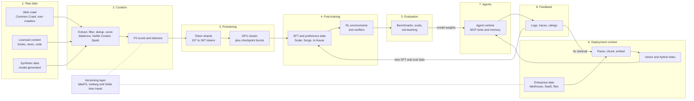
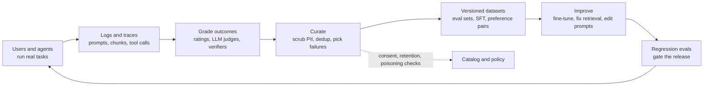
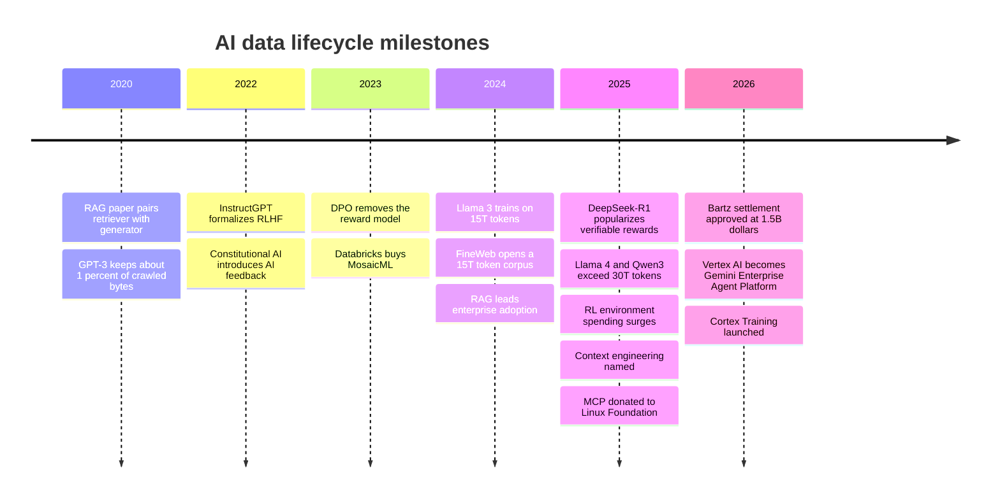

# 16. The AI Data Lifecycle
> **Depth:** L2 · **Reading time:** ~16 min · **Last verified:** 2026-11-01 · **Prerequisites:** [Ch 1 — The data stack map](../01-data-systems-foundations/ch01-data-stack-map.md)

## TL;DR

- A model's data passes through eight stages: raw data, curation, pretraining, post-training, evaluation, deployment context, agents and feedback. Each stage has its own data shape, volume, tools and risks. Most AI quality problems are data problems that showed up at one of these stages.
- There are two lifecycles. The **frontier-lab lifecycle** runs from web-scale crawls to a trained model. Llama 3 used more than 15 trillion [tokens](../glossary.md#token),[^llama3-blog] Qwen3 about 36 trillion,[^qwen3] and a single 2026 Common Crawl snapshot is about 360 TiB.[^cc-aug26] Perhaps a dozen organizations run it.
- The **enterprise lifecycle** starts from a finished model and adds the company's own data at run time: [retrieval-augmented generation](../glossary.md#retrieval-augmented-generation) (RAG), light fine-tuning, and [AI agents](../glossary.md#ai-agent) calling tools over governed data. Thousands of companies run it, and data platforms (Databricks, Snowflake, AWS, Google) compete for it.
- The valuable stages have moved over time. In 2020–2023 it was pretraining scale. Since 2024 it has been curation quality, post-training (preference data, [RL environments](../glossary.md#rl-environment) and [verifiers](../glossary.md#verifiable-reward)) and, for enterprises, context: which governed facts reach the model at the moment it answers.
- Storage demand differs by stage. Curation and training need high-throughput sequential reads plus random reads for shuffling. Checkpoints write in bursts. RAG needs low-latency random reads over vectors. Feedback logs grow without limit. Reproducibility depends on [data versioning](../glossary.md#data-versioning) (lakeFS, Iceberg/Delta [time travel](../glossary.md#time-travel)), in the same way a fab depends on lot genealogy.

## Why this matters (business + Everpure lens)

Investors describe AI as a compute story, and the GPU bill supports that view. Data is the input that compute cannot substitute for. Gartner predicted that through 2026 organizations will abandon 60% of AI projects that lack AI-ready data (analyst prediction).[^gartner] IDC estimated that about 90% of organizational data is unstructured (2022, analyst estimate, vendor-sponsored).[^idc] Unstructured data is the kind that RAG and agents consume, and it is the kind that traditional warehouses ignored. Whoever cleans, classifies, versions and serves that data captures the lifecycle's recurring spend. Training a model is closer to a one-time capital project.

For a corporate-development reader, the useful split is between stages where frontier labs build everything in-house and stages where enterprises buy. Labs build their own crawlers, curation pipelines and RL environments, and they buy mainly GPUs, storage and human data from vendors such as Scale AI. Scale AI was valued at about $29B when Meta bought 49% of it in June 2025 (press-reported).[^scale] Enterprises buy almost everything: the model through an API, the vector index, the evaluation tools and the agent runtime. That is the market where Databricks, Snowflake and the hyperscalers compete. It is also where Everpure has positioned its 2026 moves. Data Intelligence (from the 1touch acquisition) discovers and classifies data, and Data Stream vectorizes data on FlashBlade with NVIDIA GPUs.[^everpure-ds] Both sit in the enterprise curation and deployment-context stages. They do not touch frontier pretraining.

## How it works

### The master map

*Figure 16.1 — The AI data lifecycle (SV-9). Stages 1–5 are the frontier-lab path, which produces model weights. Stages 6–8 are the enterprise path, which wraps those weights in company data. The feedback loop feeds both.*

### Stages 1–2: raw data and curation, the wafer-cleaning step

Raw data comes from four places. The **web** is the largest. The Common Crawl Foundation's August 2026 crawl held about 2.14 billion pages, or 360 TiB uncompressed, and its archive spans more than 300 billion pages.[^cc-aug26][^cc-home] **Licensed content** includes books, news archives, code and transcripts, bought under contract. **Enterprise data** is the documents, tickets and tables a company owns. **[Synthetic data](../glossary.md#synthetic-data)** is text, code or reasoning traces that one model generates to train another.

[Data curation](../glossary.md#data-curation) turns that raw material into training tokens, and almost all of it is thrown away. A modern pipeline does five things. It **extracts** text from HTML or PDF. It **filters** by language, by heuristics (repetition, symbol ratios) and by URL blocklists. It **deduplicates**, usually with [MinHash](../glossary.md#minhash) near-duplicate detection. It **scores quality** with a [quality classifier](../glossary.md#quality-classifier), which is a small model trained to predict whether a page looks like good reference text. Finally it removes [PII](../glossary.md#pii) and applies [tokenization](../glossary.md#tokenization). Hugging Face's FineWeb shows the result. It took 96 Common Crawl snapshots and produced 15 trillion tokens, about 44 TB on disk. Its paper found that deduplicating within each snapshot worked better than deduplicating across all of them.[^fineweb] The educational subset, FineWeb-Edu (1.3 trillion tokens), was selected by a classifier, and models trained on it did better on knowledge benchmarks.[^fineweb]

**Worked example: the yield of curation.** GPT-3's team started from 45 TB of compressed Common Crawl text and kept 570 GB after filtering. That is roughly 1.3% of the bytes.[^gpt3] FineWeb is far less aggressive, but it still discards most of what it crawls. Ninety-six snapshots at a few hundred TiB each is tens of petabytes of raw HTML, and the output is 44 TB of text (estimate from the published figures). The economics resemble mining more than warehousing. Most of the compute goes into deciding what to discard, and the quality of those decisions drives model quality more than the size of the raw pile does.

> **Bridge: semiconductors.** Curation is wafer cleaning and yield improvement. Dedup removes particles that would print the same defect on many dies, which in a model shows up as memorized boilerplate. Quality scoring works like inline inspection: a cheap classifier screens every page, so expensive GPU hours go only to good material. Poisoned or toxic documents are contamination. A few particles can kill a die, and a few hundred documents can implant a backdoor (see Governance below). Fabs win on yield learning, not on buying more silicon.

**Storage profile.** Curation is a batch analytics job over files and objects. Spark, Ray or Hugging Face's datatrove read WARC files sequentially at high throughput and write [Parquet](../glossary.md#parquet) shards. MinHash dedup is a large shuffle. This is the stage that looks most like a lakehouse workload ([Ch 7](../01-data-systems-foundations/ch07-open-table-formats.md)), and it is the main overlap between frontier labs and data platforms. [Ch 17](ch17-unstructured-data-processing.md) covers parsing and [Ch 20](ch20-training-data-supply-chain.md) covers sourcing, licensing and labeling vendors.

### Stage 3: pretraining, the wafer fab

[Pretraining](../glossary.md#pretraining) teaches a model to predict the next token across the curated corpus. Corpus sizes keep growing:

- Llama 2 used about 2 trillion tokens.
- Llama 3 used more than 15 trillion (company-stated), with a mix of roughly 50% general knowledge, 25% math and reasoning, 17% code and 8% multilingual.[^llama3-blog][^llama3-paper]
- Llama 4 used more than 30 trillion (company-stated).[^llama4]
- Qwen3 used about 36 trillion across 119 languages.[^qwen3]

At about 4 bytes of English text per token (rule of thumb, estimate), 15 trillion tokens is roughly 60 TB of text. That is small by storage standards. The hard part is reading it fast, in a shuffled order, many times, while thousands of GPUs wait on each read.

The Llama 3 paper is one of the few public descriptions of the storage underneath. Meta trained on Tectonic, its distributed file system: 240 PB on 7,500 SSD-equipped servers, with 2 TB/s sustained and 7 TB/s peak throughput.[^llama3-paper] The paper names bursty checkpoint writes, which saturate the fabric for short periods, as the main storage challenge. It also reports 466 job interruptions during a 54-day period of pretraining, about one every 2.8 hours.[^llama3-paper] A [model checkpoint](../glossary.md#model-checkpoint) is the insurance against those interruptions.

**Worked example: checkpoint size.** Mixed-precision training with the Adam optimizer holds roughly 16 bytes of state per parameter (bf16 weights and gradients, plus fp32 master weights and two optimizer moments). For a 405-billion-parameter model that is about 6.5 TB per full checkpoint (estimate). At 2 TB/s that takes a few seconds in the ideal case. In practice tens of thousands of GPUs write at the same moment and then go quiet. Labs therefore checkpoint asynchronously to host memory or local NVMe and then drain to shared storage.

> **Bridge: semiconductors.** Checkpoints and dataset versions are **wafer lot genealogy**. When a field failure comes back, a fab traces the die to its lot, tool and recipe. When a model regresses, a lab has to trace it to the checkpoint, the data mix and the exact shard manifest. Without that record, nobody can reproduce or explain the result.

### Stage 4: post-training, from base model to product

A pretrained model completes text. [Post-training](../glossary.md#post-training) turns it into an assistant, and it uses a different kind of data: small, expensive and made by people or verifiers. InstructGPT (Ouyang et al., 2022) set the template.[^instructgpt] There were three steps:

1. [Supervised fine-tuning](../glossary.md#supervised-fine-tuning) (SFT) on about 13,000 prompts with demonstrations written by labelers.
2. A [reward model](../glossary.md#reward-model) trained on about 33,000 prompts where labelers ranked model outputs.
3. Reinforcement learning against that reward model on about 31,000 prompts.

Labelers preferred the 1.3-billion-parameter InstructGPT over the 175-billion-parameter GPT-3. The method is [reinforcement learning from human feedback](../glossary.md#reinforcement-learning-from-human-feedback) (RLHF). It established that a few tens of thousands of carefully made examples can matter more than a 100x larger model.

Three changes since then have shaped the data market:

- **AI feedback replaced some human feedback.** Constitutional AI (2022) used a model, guided by written principles, to produce preference labels. This is [RLAIF](../glossary.md#reinforcement-learning-from-ai-feedback).[^cai]
- **Simpler preference methods arrived.** [Direct preference optimization](../glossary.md#direct-preference-optimization) (DPO, 2023) trains directly on [preference data](../glossary.md#preference-data), meaning chosen and rejected answer pairs, with no separate reward model.[^dpo]
- **Verifiable rewards and environments took over reasoning training.** DeepSeek-R1 (January 2025) showed that RL with rule-checked rewards can produce strong reasoning: did the code pass its tests, did the math answer match.[^r1] Labs have since moved heavily into RL environments, which are sandboxed replicas of software, websites and workflows where an agent attempts tasks and a verifier scores it. TechCrunch reported in September 2025 that Anthropic had discussed spending more than $1B on environments over a year (press-reported).[^rl-env]

Post-training data volumes are modest. Meta reported more than 10 million human-annotated examples for Llama 3's post-training.[^llama3-blog] That is gigabytes, not petabytes. The cost per example is high, though. Labeling and environment vendors sell expertise and throughput, not storage, which is why this stage supports companies like Scale AI and its rivals ([Ch 20](ch20-training-data-supply-chain.md)).

### Stage 5: evaluation

Evaluation decides whether a checkpoint ships. It has three layers. Public **benchmarks** are fixed question sets with known answers, and they suffer from contamination when test items leak into training data. Private **evals** are task suites built to match a lab's or customer's real use, often graded by an [LLM judge](../glossary.md#llm-judge). **[Red-teaming](../glossary.md#red-teaming)** means human and automated attempts to make the model misbehave. Eval sets are small and highly sensitive. They must be versioned, kept out of training data (decontaminated) and protected like source code, because a leaked eval set stops measuring anything. For enterprises this is the stage they most often skip and most need. Databricks' Agent Bricks, for example, sells automatically generated task evaluations and LLM judges.[^dbx-dais25]

### Stage 6: deployment context, where enterprises live

Enterprises rarely change model weights. They change what the model sees. RAG (Lewis et al., 2020) paired a generator with a retriever over 21 million Wikipedia passages, so knowledge could be updated by swapping the index instead of retraining.[^rag] The enterprise version follows the same pattern ([Ch 19](ch19-retrieval-architectures.md)):

1. Pull documents from SharePoint, ticketing systems, contracts and lakehouse tables.
2. Parse and chunk them ([Ch 17](ch17-unstructured-data-processing.md)).
3. Embed each chunk ([Ch 18](ch18-embeddings-and-vector-search.md)).
4. Index the vectors with keyword search alongside.
5. At query time, retrieve the top chunks, check permissions and place them in the prompt.

Menlo Ventures' 2024 survey found RAG in 51% of enterprise generative-AI deployments, compared with 9% that relied mainly on fine-tuning (survey, press-reported).[^menlo24] In 2025 the discipline was renamed [context engineering](../glossary.md#context-engineering). Anthropic describes it as deciding, on every model call, which instructions, retrieved data, tool results and history to include.[^context-eng]

Fine-tuning has not disappeared. It has become a managed feature that each platform offers. Snowflake's Cortex Fine-tuning (GA February 2025) trains parameter-efficient adapters inside the account.[^sf-ft] Snowflake added Cortex Training for managed GPU fine-tuning of open-weight models at Summit 2026.[^sf-summit26] AWS's Bedrock Knowledge Bases can use S3 Vectors as a managed RAG store.[^s3v-bedrock]

### Stages 7–8: agents and the feedback loop

Agents add two data flows. The first is **tools**. The model calls SQL, APIs and search through interfaces such as the [Model Context Protocol](../glossary.md#model-context-protocol), which Anthropic donated to the Linux Foundation's Agentic AI Foundation in December 2025.[^mcp] The second is **memory**: session notes and long-term user facts that have to be stored, retrieved, expired and governed ([Ch 22](ch22-agents-and-data.md)). Each agent run also produces a **trace**, a record of the prompt, retrieved chunks, tool calls and outcome. Traces are the raw material for the flywheel.

*Figure 16.2 — The data flywheel. Usage produces traces, grading turns traces into labeled examples, and versioned datasets feed both improvement and the regression evals that protect against backsliding. Governance sits on the curation step, because that is where user data becomes training data.*

The [data flywheel](../glossary.md#data-flywheel) is the strongest moat argument in AI, and it is often overstated. It works when outcomes can be graded cheaply, as with code that compiles or a ticket that gets resolved. It also needs the right to reuse the data. It stalls when feedback is sparse (few users click thumbs-down), noisy or contractually off-limits. Most enterprise contracts bar model vendors from training on customer data, so the flywheel mostly turns inside the customer's own boundary. That is a structural advantage for data platforms that already hold the logs.

> **Bridge: semiconductors.** Field returns feed yield learning. A fab that has lot genealogy (Stage 3) and failure analysis on returned parts improves every generation, and one without them repeats its defects. Traces are the field returns of an AI system.

### Governance risks by stage

- **Copyright** sits mostly in Stages 1–2. In *Bartz v. Anthropic*, Judge Alsup held in 2025 that training on books was fair use but that keeping pirated copies was not. The case then settled for $1.5B, about $3,000 per work, and the settlement received final approval in July 2026.[^bartz] The lesson for data teams is that provenance records matter as much as the training itself. FineWeb's dataset card likewise records domains removed after a cease-and-desist notice.[^fineweb-card]
- **PII** appears at every stage, and it is worst in Stage 8, where user conversations become training candidates.
- **[Data poisoning](../glossary.md#data-poisoning)** is cheaper than intuition suggests. Anthropic, the UK AI Security Institute and the Alan Turing Institute found that about 250 malicious documents could backdoor models from 600M to 13B parameters, whatever the model size. For the largest model that was 0.00016% of its training tokens (research result, narrow trigger behavior).[^poison] In RAG the same attack only requires getting one document into the index.

## Design choices and trade-offs

| Dimension | Frontier-lab lifecycle | Enterprise lifecycle |
|---|---|---|
| Goal | Produce general model weights | Make a bought model useful on proprietary data |
| Dominant stages | 1–5 (crawl, curate, pretrain, post-train, eval) | 6–8 (context, agents, feedback), plus light fine-tuning |
| Data volume | Tens of PB raw, 15–36T tokens curated | GB to low-PB of documents and tables, millions of chunks (estimate) |
| Data shape | Web text, code, licensed corpora, synthetic traces | PDFs, tickets, email, contracts, warehouse tables, logs |
| Who builds | In-house teams (OpenAI, Anthropic, Google, Meta, xAI, Qwen, DeepSeek) | Platform teams using Databricks, Snowflake, AWS, Google, Microsoft and startups |
| Spend pattern | Capex-like training runs, then human data and RL environments | Consumption: tokens, vector queries, compute credits |
| Storage I/O | Sequential throughput, shuffle reads, checkpoint bursts | Low-latency random reads (vectors), many small files, logs |
| Main governance risk | Copyright, poisoning, benchmark contamination | Access control (who may retrieve what), PII, retention |
| Reproducibility tool | Shard manifests, checkpoint lineage, lakeFS | Iceberg/Delta time travel, index versions, eval sets |

*Figure 16.3 — Two lifecycles share a vocabulary but little else. Data platforms compete in the right-hand column. Storage vendors serve both, with different I/O profiles.*

The steelman for "enterprises will train their own models" is real but narrow. Domain-heavy firms in pharma, finance and chip design do continued pretraining or deep fine-tuning on proprietary corpora, and managed services such as Cortex Training and Mosaic AI lower the cost. For most companies, though, a frontier model with good retrieval and evals beats a custom model on cost per unit of quality. The adoption numbers above (RAG ahead of fine-tuning) reflect that.

The opposite steelman, "long context makes RAG obsolete," is also partly true. Million-token windows remove the need for chunking on small corpora. Long context does not handle permissions, freshness or cost at enterprise scale, so retrieval remains the default ([Ch 19](ch19-retrieval-architectures.md)).

## Who's who

| Stage | Representative tools / vendors | Data shape | Storage I/O profile |
|---|---|---|---|
| 1. Raw data | Common Crawl, own crawlers, publishers' licensing deals, synthetic generators | WARC/HTML, PDFs, code repos | Bulk sequential ingest; cold object storage |
| 2. Curation | datatrove, NVIDIA NeMo Curator, Spark, Ray, Databricks, Lilac (Databricks) | Parquet text shards, MinHash signatures | High-throughput scans; shuffle-heavy dedup |
| 3. Pretraining | PyTorch, Megatron, in-house stacks; Tectonic-class file systems | Tokenized binary shards; Safetensors checkpoints | Sequential reads plus random shuffle; checkpoint write bursts |
| 4. Post-training | Scale AI, Surge AI, Mercor, Snorkel; RL-environment startups | Prompt/response pairs, rankings, environment specs | Small datasets; sandbox VMs; trace logging |
| 5. Evaluation | Open benchmark suites, Weights & Biases, MLflow, Braintrust, Agent Bricks evals | Question sets, judge rubrics, scores | Small, versioned, access-restricted |
| 6. Deployment context | Databricks Vector Search, Snowflake Cortex Search, Bedrock Knowledge Bases + S3 Vectors, Gemini Enterprise Agent Platform, Pinecone, Elasticsearch, pgvector | Chunks, embeddings, metadata | Low-latency random reads; frequent index refresh |
| 7. Agents | MCP servers, Agent Bricks, Snowflake CoWork and Cortex Agents, Bedrock agents, LangGraph | Tool calls, memory records | Small transactional reads/writes (often Postgres) |
| 8. Feedback | LangSmith, Arize, W&B Weave, lakehouse tables, lakeFS | Traces, ratings, preference pairs | Append-heavy logs; long retention |

*Figure 16.4 — Tools by stage. Frontier labs build most of rows 1–4 in-house. The enterprise market is rows 5–8 plus curation of unstructured data, which is where data platforms, vector vendors and storage vendors overlap. Vendor lists are illustrative, not exhaustive; product status per footnotes.*[^dbx-dais25][^sf-summit26][^s3v-bedrock][^gemini-ap]

**Where data platforms fit, and where they don't.** Databricks (Mosaic AI, Agent Bricks, Vector Search, Unity Catalog), Snowflake (Cortex AI, Cortex Search, CoWork), AWS (SageMaker Unified Studio, Bedrock) and Google (Vertex AI, renamed the Gemini Enterprise Agent Platform in April 2026)[^gemini-ap] all cover Stages 5–8 and enterprise-scale Stage 2. Their pitch is that governance, lineage and access control already live in the platform, so context and feedback should too ([Ch 21](ch21-ml-platforms-feature-stores-llmops.md); [Ch 25](../04-company-deep-dives/ch25-databricks.md)). They are largely absent from frontier pretraining. Labs do not run 16,000-GPU jobs from a warehouse, and their curation stacks are bespoke. Databricks' $1.3B MosaicML purchase (2023) was a bet that mid-sized custom pretraining would become an enterprise market. The later folding of that work into Agent Bricks suggests the market chose RAG and agents instead.[^mosaic]

**Versioning** is the horizontal layer. lakeFS adds Git-style branches, commits and merges over object storage, so a training run can pin an exact dataset commit. lakeFS took over stewardship of the DVC open-source project in November 2025.[^lakefs] Iceberg and Delta time travel give the same pinning for tables ([Ch 7](../01-data-systems-foundations/ch07-open-table-formats.md)). Vector indexes are the weak spot. Few teams can say which index version produced a given answer.

## History and trajectory

*Figure 16.5 — The center of gravity moved from pretraining scale (2020–2024) to post-training and context (2025–2026). Each shift moved value toward data that is scarcer and better governed.*

There are three phases. **Scale (2020–2023):** better models came from more tokens and parameters, and data work meant filtering crawls. **Quality (2023–2024):** FineWeb-Edu and the Llama 3 data mix showed that classifier-selected data and careful mixing beat raw volume.[^fineweb][^llama3-paper] **Experience (2025 onward):** usable web text is close to exhausted, so labs make new data through synthetic generation, RL environments and verifiers, and enterprises compete on context. The next likely constraint is rights. Licensing deals and court settlements are turning provenance into a cost line, and the enterprise flywheel depends on consent terms in customer contracts. Both favor platforms that keep lineage. Expect "AI-ready data" products (classification, PII tagging, versioned unstructured corpora) to keep consolidating into data and storage platforms.

## Numbers that matter

| Metric | Value | Basis | Source / date |
|---|---|---|---|
| Common Crawl monthly snapshot (Aug 2026) | ~2.14B pages, ~360 TiB uncompressed | Publisher-stated | Common Crawl, 2026-08[^cc-aug26] |
| Common Crawl archive | >300B pages | Publisher-stated | Common Crawl site, 2026[^cc-home] |
| GPT-3 Common Crawl filtering | 45 TB compressed in, 570 GB kept | Paper-stated | Brown et al., 2020-05-28[^gpt3] |
| FineWeb | 15T tokens from 96 snapshots, ~44 TB; card now >18.5T | Project-stated | Penedo et al., 2024-06; HF card[^fineweb][^fineweb-card] |
| FineWeb-Edu | 1.3T tokens | Project-stated | Penedo et al., 2024-06[^fineweb] |
| Llama 3 pretraining | >15T tokens (~7x Llama 2) | Company-stated | Meta, 2024-04-18[^llama3-blog] |
| Llama 4 pretraining | >30T tokens | Company-stated | Meta, 2025-04-05[^llama4] |
| Qwen3 pretraining | ~36T tokens, 119 languages | Company-stated | Qwen tech report, 2025-05[^qwen3] |
| Llama 3 training storage | 240 PB, 2 TB/s sustained, 7 TB/s peak | Paper-stated | Llama 3 paper, 2024-07[^llama3-paper] |
| Llama 3 job interruptions | 466 in 54 days | Paper-stated | Llama 3 paper, 2024-07[^llama3-paper] |
| Full checkpoint, 405B params | ~6.5 TB | Estimate (16 bytes/param) | This chapter |
| InstructGPT datasets | ~13k SFT, ~33k RM, ~31k RL prompts | Paper-stated | Ouyang et al., 2022-03[^instructgpt] |
| Llama 3 human-annotated post-training examples | >10M | Company-stated | Meta, 2024-04-18[^llama3-blog] |
| Poisoning threshold | ~250 documents (0.00016% of tokens at 13B) | Research result | Anthropic et al., 2025-10[^poison] |
| Unstructured share of org data | ~90% (2022) | Analyst estimate, vendor-sponsored | IDC via StorageNewsletter, 2023-09-07[^idc] |
| Enterprise deployments using RAG vs fine-tuning | 51% vs 9% (2024) | Survey, press-reported | Menlo Ventures, 2024-11[^menlo24] |
| Enterprise gen-AI spend | ~$37B (2025), up ~3.2x | Survey-based estimate | Menlo Ventures, 2025-12-09[^menlo25] |
| AI projects abandoned without AI-ready data | 60% through 2026 | Analyst prediction | Gartner, 2025-02-26[^gartner] |
| Bartz v. Anthropic settlement | $1.5B, ~$3,000 per work | Court-approved settlement | Jurist, 2026-07[^bartz] |

*Figure 16.6 — Curated pretraining corpora are tens of terabytes, but the infrastructure that serves them runs to hundreds of petabytes and terabytes per second. The enterprise numbers are about adoption and readiness, not bytes.*

## Storage bridge

> **Storage bridge.** Each stage needs something different from storage. Curation needs high-throughput sequential scans and shuffle bandwidth on object storage. Training needs sustained reads with random sampling, plus enough write bandwidth to absorb checkpoint bursts without stalling GPUs. RAG needs low-latency random reads over vector indexes and frequent small updates. Feedback needs cheap, durable, append-heavy capacity with retention controls. Everpure's FlashBlade, Data Stream and Data Intelligence address the enterprise stages (classification, vectorization, governed serving). Whether to go further, for example by versioning unstructured corpora or offering checkpoint-tier services, is among the options a strategy team might evaluate, based on public information. See the companion *Everpure Tech Atlas* for checkpointing, GPUDirect and AI-storage benchmarks; [Ch 24](ch24-data-meets-compute-and-storage.md) covers the compute and storage interplay.

## Conversation playbook

**Questions for a PM**

1. "Which lifecycle stages do your customers pay you for today, and which do they still build themselves? How has that changed since 2024?"
2. "How do you know a customer's RAG or agent system got better last quarter? Who owns the eval set?"
3. "What rights do your contracts give you, or the customer, to reuse traces and feedback for tuning?"

**Questions for an engineer**

1. "Can you reproduce a model or agent answer from six months ago: dataset commit, checkpoint, index version and prompt?"
2. "What is your read pattern during training, and how long does a full checkpoint take to write and restore?"
3. "Where do PII scrubbing and permission checks happen: at ingest, at indexing or at retrieval time?"

**What good answers sound like.** They separate frontier and enterprise needs. They quote specific numbers ("we checkpoint every 30 minutes, asynchronously, about 6 TB per write"; "the eval set has 400 graded tasks and gates every release"). They treat data versioning and access control as first-class requirements, and they acknowledge that the flywheel needs gradable outcomes and reuse rights.

**Don't say this**

- "Enterprises will all pretrain their own models." Most use RAG, light fine-tuning and agents on frontier or open-weight models.
- "More data always wins." Curation quality and post-training data now matter more than raw volume.
- "RAG eliminates hallucination." It reduces hallucination when retrieval is right and permissions are enforced, and it adds a new poisoning surface.
- "Training data is a storage capacity problem." A 15T-token corpus is about 60 TB. The challenge is throughput, shuffling and checkpoint bursts.
- "Every AI app has a data flywheel." Only if outcomes are cheap to grade and the data can legally be reused.

## Going deeper

- Penedo et al., *The FineWeb Datasets* (2024), on dedup and classifier filtering at scale.[^fineweb]
- *The Llama 3 Herd of Models* (2024), sections on data mix, infrastructure, storage and reliability.[^llama3-paper]
- Ouyang et al., *InstructGPT* (2022), and Rafailov et al., *DPO* (2023), for the post-training data recipe.[^instructgpt][^dpo]
- Lewis et al., *Retrieval-Augmented Generation* (2020).[^rag]
- Anthropic, "Effective context engineering for AI agents" (2025).[^context-eng]
- lakeFS documentation on branching and reproducibility.[^lakefs]

## Key terms

- [Token](../glossary.md#token) — the sub-word unit a language model reads and predicts; English averages roughly four characters per token.
- [Tokenization](../glossary.md#tokenization) — converting text into token IDs with a fixed vocabulary before training or inference.
- [Pretraining](../glossary.md#pretraining) — training a model to predict the next token over a very large general corpus.
- [Post-training](../glossary.md#post-training) — the stages after pretraining (SFT, preference tuning, RL) that turn a base model into an assistant.
- [Data curation](../glossary.md#data-curation) — extracting, filtering, deduplicating, scoring and cleaning raw data into training-ready form.
- [MinHash](../glossary.md#minhash) — a hashing technique that estimates document similarity cheaply, used for near-duplicate removal.
- [Quality classifier](../glossary.md#quality-classifier) — a small model that scores documents for training value.
- [PII](../glossary.md#pii) — personally identifiable information, such as names, emails and IDs, that must be removed or controlled.
- [Synthetic data](../glossary.md#synthetic-data) — training data generated by models rather than collected from people or the web.
- [Supervised fine-tuning](../glossary.md#supervised-fine-tuning) — training on example prompts paired with ideal responses (SFT).
- [Reward model](../glossary.md#reward-model) — a model trained on human rankings to score outputs during RL.
- [Reinforcement learning from human feedback](../glossary.md#reinforcement-learning-from-human-feedback) — tuning a model with RL against a reward learned from human preferences (RLHF).
- [Reinforcement learning from AI feedback](../glossary.md#reinforcement-learning-from-ai-feedback) — RLHF with preference labels produced by a model under written principles (RLAIF).
- [Direct preference optimization](../glossary.md#direct-preference-optimization) — training directly on chosen/rejected pairs without a separate reward model (DPO).
- [Preference data](../glossary.md#preference-data) — pairs or rankings of model outputs labeled by which is better.
- [RL environment](../glossary.md#rl-environment) — a sandboxed replica of a task or software system where an agent acts and is scored.
- [Verifiable reward](../glossary.md#verifiable-reward) — an RL reward computed by an automatic check, such as tests passing or a matching answer.
- [LLM judge](../glossary.md#llm-judge) — a language model used to grade other models' outputs against a rubric.
- [Red-teaming](../glossary.md#red-teaming) — adversarial testing to find unsafe or unintended model behavior.
- [Retrieval-augmented generation](../glossary.md#retrieval-augmented-generation) — fetching relevant content at query time and adding it to the prompt (RAG).
- [Context engineering](../glossary.md#context-engineering) — choosing, on every model call, which instructions, data, tool results and history to include.
- [AI agent](../glossary.md#ai-agent) — a model-driven program that plans and calls tools to complete a task.
- [Model Context Protocol](../glossary.md#model-context-protocol) — open standard (MCP) for exposing tools and data to AI agents.
- [Data flywheel](../glossary.md#data-flywheel) — a loop in which product usage produces data that improves the product.
- [Data poisoning](../glossary.md#data-poisoning) — inserting malicious examples into training or retrieval data to implant unwanted behavior.
- [Model checkpoint](../glossary.md#model-checkpoint) — a saved snapshot of model weights and optimizer state used to resume or roll back training.
- [Data versioning](../glossary.md#data-versioning) — recording immutable, addressable versions of datasets so runs can be reproduced.
- [Time travel](../glossary.md#time-travel) — querying a table as of an earlier snapshot or version.
- [Parquet](../glossary.md#parquet) — the dominant open columnar file format, also used for curated text shards.

## Sources

[^cc-aug26]: Common Crawl Foundation, "August 2026 Crawl Archive Now Available," https://commoncrawl.org/blog/august-2026-crawl-archive-now-available, published 2026-08; retrieved 2026-11-01. Other 2026 snapshots: February 2.1B pages / 363 TiB; April 2.19B / 379 TiB; May 2.16B / 366 TiB (same blog series).
[^cc-home]: Common Crawl Foundation, home and overview pages ("over 300 billion pages"), https://commoncrawl.org/, living page; retrieved 2026-11-01.
[^fineweb]: Guilherme Penedo et al. (Hugging Face), "The FineWeb Datasets: Decanting the Web for the Finest Text Data at Scale," arXiv:2406.17557, https://huggingface.co/papers/2406.17557, published 2024-06-25; companion blog https://huggingfacefw-blogpost-fineweb-v1.static.hf.space/ (44 TB figure); retrieved 2026-11-01.
[^fineweb-card]: Hugging Face, "HuggingFaceFW/fineweb" dataset card (>18.5T tokens; domain removals after cease-and-desist), https://huggingface.co/datasets/HuggingFaceFW/fineweb, living document; retrieved 2026-11-01.
[^gpt3]: Tom Brown et al. (OpenAI), "Language Models are Few-Shot Learners," arXiv:2005.14165, https://arxiv.org/abs/2005.14165, published 2020-05-28; retrieved 2026-11-01.
[^llama3-blog]: Meta AI, "Introducing Meta Llama 3: The most capable openly available LLM to date," https://ai.meta.com/blog/meta-llama-3/, published 2024-04-18; retrieved 2026-11-01. Company-stated; corroborated by The Register (2024-04-19) and IEEE Spectrum (Llama 2 at 2T tokens).
[^llama3-paper]: Llama Team, AI @ Meta, "The Llama 3 Herd of Models," arXiv:2407.21783, https://arxiv.org/abs/2407.21783, published 2024-07-31; retrieved 2026-11-01. Data mix (section 3.1), storage (Tectonic: 240 PB, 7,500 SSD servers, 2 TB/s sustained, 7 TB/s peak; checkpoint bursts) and reliability (466 interruptions in 54 days).
[^llama4]: Meta AI, "The Llama 4 herd: The beginning of a new era of natively multimodal AI innovation," https://ai.meta.com/blog/llama-4-multimodal-intelligence/, published 2025-04-05; retrieved 2026-11-01. Company-stated ">30 trillion tokens"; in this sweep confirmed only via secondary summaries.
[^qwen3]: Qwen Team, "Qwen3 Technical Report," arXiv:2505.09388, https://arxiv.org/abs/2505.09388, published 2025-05-14; retrieved 2026-11-01.
[^instructgpt]: Long Ouyang et al. (OpenAI), "Training language models to follow instructions with human feedback," arXiv:2203.02155, https://arxiv.org/abs/2203.02155, published 2022-03-04; retrieved 2026-11-01.
[^cai]: Yuntao Bai et al. (Anthropic), "Constitutional AI: Harmlessness from AI Feedback," arXiv:2212.08073, https://arxiv.org/abs/2212.08073, published 2022-12-15; retrieved 2026-11-01.
[^dpo]: Rafael Rafailov et al., "Direct Preference Optimization: Your Language Model is Secretly a Reward Model," arXiv:2305.18290, https://arxiv.org/abs/2305.18290, published 2023-05-29; retrieved 2026-11-01.
[^r1]: DeepSeek-AI, "DeepSeek-R1: Incentivizing Reasoning Capability in LLMs via Reinforcement Learning," arXiv:2501.12948, https://arxiv.org/abs/2501.12948, published 2025-01-22; retrieved 2026-11-01.
[^rl-env]: TechCrunch, "Silicon Valley bets big on 'environments' to train AI agents," https://techcrunch.com/2025/09/16/silicon-valley-bets-big-on-environments-to-train-ai-agents/, published 2025-09-16; Epoch AI, "The state of RL environments," https://epoch.ai/gradient-updates/state-of-rl-envs, 2026; retrieved 2026-11-01. The >$1B Anthropic figure originates with The Information (press-reported, single origin).
[^rag]: Patrick Lewis et al., "Retrieval-Augmented Generation for Knowledge-Intensive NLP Tasks," NeurIPS 2020, arXiv:2005.11401, https://arxiv.org/abs/2005.11401, published 2020-05-22; retrieved 2026-11-01.
[^context-eng]: Anthropic Engineering, "Effective context engineering for AI agents," https://www.anthropic.com/engineering/effective-context-engineering-for-ai-agents, published 2025-09-29; retrieved 2026-11-01.
[^mcp]: Anthropic, "Donating the Model Context Protocol and establishing the Agentic AI Foundation," https://anthropic.com/news/donating-the-model-context-protocol-and-establishing-of-the-agentic-ai-foundation, published 2025-12-09; retrieved 2026-11-01.
[^poison]: Anthropic (with UK AI Security Institute and Alan Turing Institute), "A small number of samples can poison LLMs of any size," https://www.anthropic.com/research/small-samples-poison, published 2025-10; Dark Reading coverage, https://www.darkreading.com/application-security/only-250-documents-poison-any-ai-model, 2025-10; retrieved 2026-11-01.
[^bartz]: JURIST, "Judge approves record $1.5 billion AI copyright settlement involving Anthropic," https://www.jurist.org/news/2026/07/judge-approves-record-1-5-billion-settlement-involving-anthropic/, published 2026-07; preliminary approval: ChatGPT Is Eating the World, https://chatgptiseatingtheworld.com/2025/09/25/judge-alsup-grants-preliminary-approval-of-1-5-billion-settlement-largest-in-copyright-history-in-class-action-filed-by-bartz-v-anthropic/, 2025-09-25; retrieved 2026-11-01. Work count reported as ~465,000–500,000; treat as approximate.
[^idc]: StorageNewsletter, "What Every Executive Needs to Know About Unstructured Data" (summary of IDC white paper *Untapped Value*, sponsored by Box), https://www.storagenewsletter.com/2023/09/07/what-every-executive-needs-to-know-about-unstructured-data/, published 2023-09-07; retrieved 2026-11-01. Analyst estimate; vendor-sponsored.
[^gartner]: Gartner, "Lack of AI-Ready Data Puts AI Projects at Risk," https://www.gartner.com/en/newsroom/press-releases/2025-02-26-lack-of-ai-ready-data-puts-ai-projects-at-risk, published 2025-02-26; retrieved 2026-11-01.
[^menlo24]: Menlo Ventures, "2024: The State of Generative AI in the Enterprise," https://menlovc.com/2024-the-state-of-generative-ai-in-the-enterprise/, published 2024-11; retrieved 2026-11-01 via secondary summaries (51% RAG, 9% fine-tuning). Survey; press-reported.
[^menlo25]: Menlo Ventures via GlobeNewswire/FinancialContent, "Menlo Ventures' 2025 State of Generative AI Report: Enterprise Investment Hit $37B in 2025, Tripling in One Year," https://www.financialcontent.com/article/gnwcq-2025-12-9-menlo-ventures-2025-state-of-generative-ai-report-enterprise-investment-hit-37b-in-2025-tripling-in-one-year, published 2025-12-09; retrieved 2026-11-01. Survey of ~500 US enterprise decision-makers.
[^sf-ft]: Snowflake, "Feb 07, 2025: Snowflake Cortex Fine-tuning (General availability)," https://docs.snowflake.com/en/release-notes/2025/other/2025-02-07-cortex-finetuning, published 2025-02-07; and "Fine-tuning (Snowflake Cortex)," https://docs.snowflake.com/en/user-guide/snowflake-cortex/cortex-finetuning, living document; retrieved 2026-11-01.
[^sf-summit26]: Flexera, "Snowflake Summit 2026 recap: rebrands, acquisition and 25+ announcements," https://www.flexera.com/blog/perspectives/snowflake-summit-2026/, published 2026-06; Atlan, "What is Snowflake Cortex Training?," https://atlan.com/know/snowflake/snowflake-cortex-training/, 2026; retrieved 2026-11-01. Secondary sources; Cortex Training reported in public preview.
[^s3v-bedrock]: AWS, "Using S3 Vectors with Amazon Bedrock Knowledge Bases," https://docs.aws.amazon.com/AmazonS3/latest/userguide/s3-vectors-bedrock-kb.html, living document; AWS News Blog, "Top announcements of AWS re:Invent 2025" (S3 Vectors GA), https://aws.amazon.com/blogs/aws/top-announcements-of-aws-reinvent-2025, 2025-12; retrieved 2026-11-01.
[^gemini-ap]: HPCwire/AIwire, "Google Unveils Gemini Enterprise Agent Platform," https://www.hpcwire.com/aiwire/2026/04/23/google-unveils-gemini-enterprise-agent-platform/, published 2026-04-23; Virtualization Review, https://virtualizationreview.com/articles/2026/04/24/google-cloud-next-26-gemini-enterprise-agent-platform-leads-ai-centric-news.aspx, 2026-04-24; retrieved 2026-11-01.
[^dbx-dais25]: Databricks, "Data + AI Summit 2025 announcements," https://www.databricks.com/kr/events/dataaisummit-2025-announcements, published 2025-06; Flexera, "Databricks Data + AI Summit 2026 recap," https://www.flexera.com/blog/perspectives/databricks-data-ai-summit-2026-recap-genie-one-ltap-lakehouse-rt-and-every-major-launche/, 2026-06; retrieved 2026-11-01.
[^mosaic]: Databricks, "Databricks Completes Acquisition of MosaicML," https://www.databricks.com/company/newsroom/press-releases/databricks-completes-acquisition-mosaicml, published 2023-07-19; retrieved 2026-11-01. Brand folding into Agent Bricks per `meta/research-briefing.md` [VERIFY: current status of the Mosaic AI brand].
[^lakefs]: lakeFS (Treeverse), "lakeFS Acquires DVC," https://lakefs.io/blog/lakefs-acquires-dvc/, published 2025-11-18; lakeFS documentation, https://docs.lakefs.io/, living document; retrieved 2026-11-01.
[^scale]: TechCrunch, "Scale AI confirms 'significant' investment from Meta, says CEO Alexandr Wang is leaving," https://techcrunch.com/2025/06/13/scale-ai-confirms-significant-investment-from-meta-says-ceo-alexandr-wang-is-leaving/, published 2025-06-13; retrieved 2026-11-01. $14.3B for 49% (press-reported), as in `data/private_funding.csv`.
[^everpure-ds]: Everpure via PR Newswire, "Everpure Unveils Data-Primacy Architecture for the AI Era," https://www.prnewswire.com/news-releases/everpure-unveils-data-primacy-architecture-for-the-ai-era-302803097.html, published 2026-06-17; Computer Weekly, "Everpure aims to bridge AI data gap with Universal Data Intelligence," https://www.computerweekly.com/news/366644438/Everpure-aims-to-bridge-AI-data-gap-with-Universal-Data-Intelligence, 2026-06; retrieved 2026-11-01.
