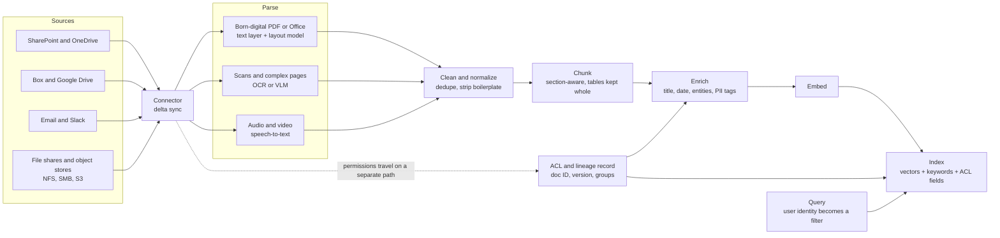
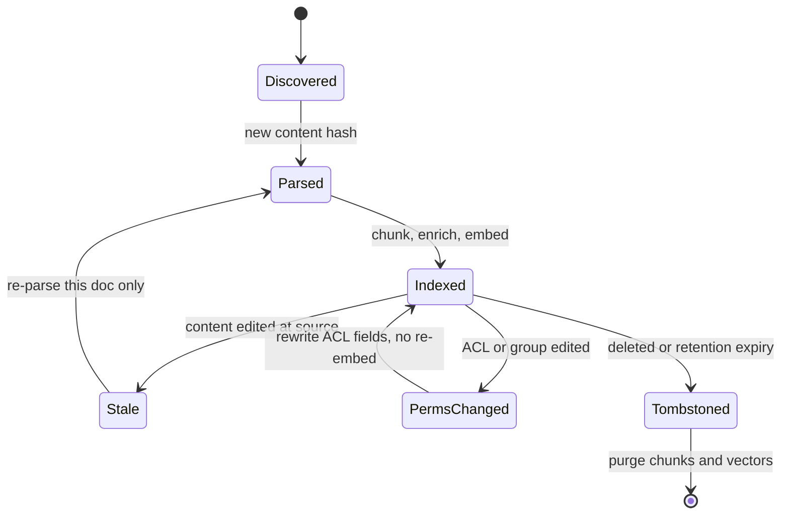
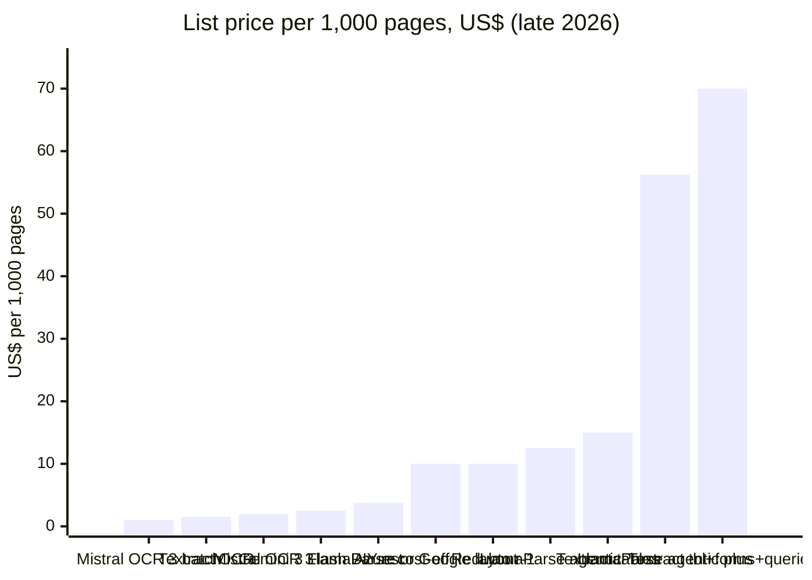
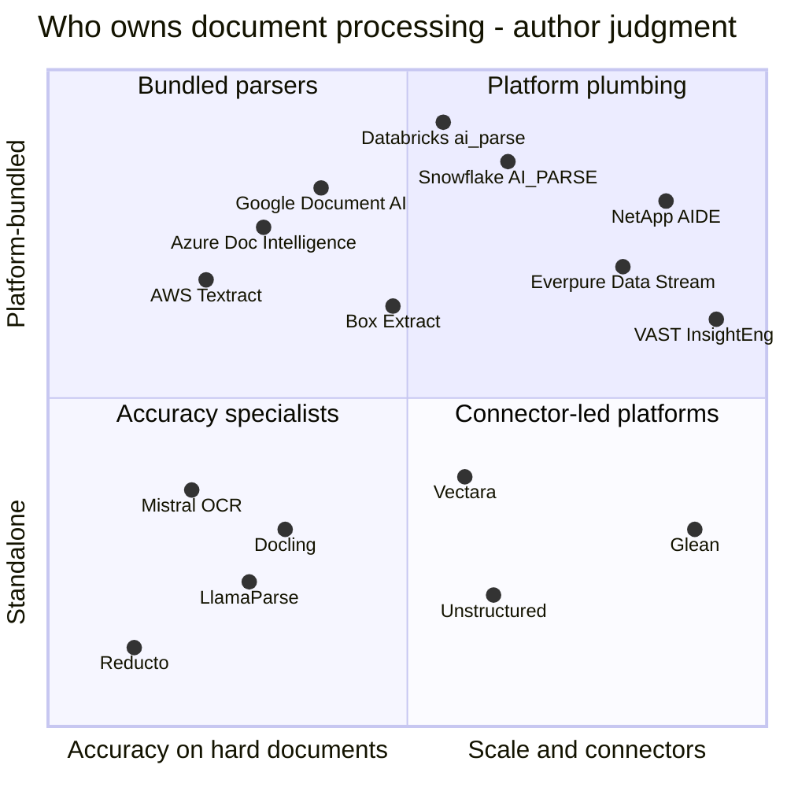
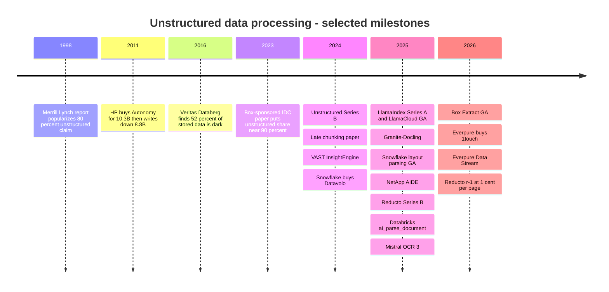

# 17. Unstructured Data Processing
> **Depth:** L2 · **Reading time:** ~14 min · **Last verified:** 2026-11-01 · **Prerequisites:** [Ch 16 — The AI data lifecycle](ch16-ai-data-lifecycle.md)

## TL;DR

- Most enterprise knowledge sits in contracts, decks, emails, scans and recordings, not in tables. The often-quoted "80–90% unstructured" figure is a rule of thumb. It goes back to a 1998 claim, and its modern version is a Box-sponsored IDC paper (August 2023) that put the share at about 90%.[^idc-box][^grimes] Treat it as directionally right but weakly measured.
- Turning a file into something an AI system can retrieve takes a seven-step pipeline: ingest, [parse](../glossary.md#document-parsing), clean, [chunk](../glossary.md#chunking), enrich, [embed](../glossary.md#embedding) and index. Parsing and chunking decide answer quality. Indexing is close to a commodity.
- Parsing has split into three tiers. Cheap OCR runs at about $1–2 per 1,000 pages. Layout-aware parsing costs about $10 per 1,000 pages. Agentic parsing driven by a [vision-language model](../glossary.md#vision-language-model) costs about $10–60 per 1,000 pages. All figures are list prices, as of late 2026.[^textract][^gdocai][^mistral-ocr3][^llamaparse][^reducto-r1] For a typical corpus the method you choose matters more than the vendor.
- The hard enterprise problems are not parsing. They are **[ACL propagation](../glossary.md#acl-propagation)**, meaning each chunk carries the source file's permissions, and **[incremental sync](../glossary.md#incremental-sync)**, meaning the index tracks edits, permission changes and deletions without reprocessing everything. Microsoft's own Copilot oversharing guidance shows what goes wrong when permissions are messy at the source.[^m365]
- Four groups are competing to own this layer. There are standalone startups (Unstructured, LlamaIndex, Reducto), hyperscaler document-AI APIs, data platforms that expose parsing as a SQL function (Databricks `ai_parse_document`, Snowflake `AI_PARSE_DOCUMENT`), and content and storage platforms (Box, Glean, NetApp AIDE, VAST, Everpure Data Stream). The storage vendors have the strongest argument from data gravity and the shortest track record in shipping data-processing software.

## Why this matters (business + Everpure lens)

Structured data has fifty years of tooling behind it: schemas, SQL, warehouses and BI. Unstructured data mostly had file shares, search boxes and records-retention policies. In practice it was **[dark data](../glossary.md#dark-data)**. Veritas's 2016 Databerg survey of 2,550 IT leaders found that respondents classed 52% of stored data as "dark", meaning its value was unknown, and another 33% as redundant, obsolete or trivial.[^veritas] The only famous attempt to monetise this data at scale, HP's $10.3B purchase of Autonomy in 2011, ended in an $8.8B impairment.[^hp-autonomy] Executives learned to treat "unlock your unstructured data" as a warning sign.

Generative AI changed the economics. A language model can read a contract, but only if someone first turns the PDF into clean text with the right structure, splits it into retrievable pieces, and remembers who is allowed to see each piece. That preparation work is now the bottleneck for [retrieval-augmented generation](../glossary.md#retrieval-augmented-generation) ([Ch 19](ch19-retrieval-architectures.md)) and for agents. Every major platform is moving into it. Snowflake bought Datavolo in November 2024 for multimodal ingestion.[^datavolo] Databricks shipped document parsing as a SQL function in 2025.[^dbx-parse] Box made metadata extraction a product in January 2026.[^box-extract]

For Everpure, the point is simple. Most of these files already sit on file and object storage, much of it on-premises, so the processing layer is the natural adjacency for a storage vendor. Everpure's 2026 moves fit that reading. It closed the 1touch acquisition ($125M stated cash consideration) for discovery and classification,[^everpure-1touch] and it launched **Data Stream**, which vectorises data on FlashBlade with NVIDIA GPUs and applies access controls at the stream level.[^everpure-ds] The open question is which steps of the pipeline a storage vendor can credibly own, and which it should leave to partners.

## How it works

### Step 1 — Ingest: connectors, not copies

A pipeline starts with [connectors](../glossary.md#connector) to SharePoint and OneDrive, Box, Google Drive, Confluence, email and Slack, plus NFS/SMB shares and S3 buckets. Each connector has three jobs. It pulls content, it pulls **metadata** such as owner, path, modified time and version, and it pulls **permissions**: the source's [access control list](../glossary.md#access-control-list), its group memberships and its sharing links. The third job is the one teams underestimate. Glean, which built its business on this layer, synchronises each app's identities and permissions into its index and filters every result at query time to what the user may see in the source system.[^glean-docs]

### Step 2 — Parse: from bytes to structured text

Parsing turns a file into ordered text plus structure. The method depends on the input.

- **Born-digital PDFs and Office files.** These files already contain a text layer, so extraction is cheap and exact. Characters are not the problem; structure is. A PDF stores glyphs at coordinates, not paragraphs. Two-column layouts, running headers, footnotes and multi-page tables all need **[layout analysis](../glossary.md#layout-analysis)** to recover headings, table cells and the **[reading order](../glossary.md#reading-order)**.
- **Scans, faxes and photos.** These need [optical character recognition](../glossary.md#optical-character-recognition) (OCR). OCR is probabilistic and returns a confidence score for each word, which a pipeline can use to route low-confidence pages to a stronger model or to a human.
- **Complex pages.** Charts, nested tables, handwriting and forms increasingly go to **vision-language models (VLMs)**, which read a rendered page image and emit Markdown or JSON directly. IBM's open-source Granite-Docling does this with a 258M-parameter model (September 2025).[^docling] Mistral OCR 3 does it as a $2-per-1,000-page API.[^mistral-ocr3] Reducto and LlamaParse route each page to the cheapest model that can handle it.[^reducto-r1][^llamaparse]
- **Audio and video.** Speech-to-text produces a transcript with speaker labels and timestamps, and the timestamps play the role page numbers play in documents.

VLM parsing has a known failure mode. A classical OCR engine garbles a character it cannot read. A generative model may instead write a plausible number that was never on the page. Production pipelines therefore keep bounding boxes, page references and confidence scores, so that any extracted value can be traced back to pixels.

> **Bridge: semiconductors.** Parsing is the fab's **wafer-ID read**. When the lot ID comes from the MES database, it is exact, like a born-digital text layer. When an optical reader has to read a laser-scribed mark that processing has degraded, the read is probabilistic, like OCR. Fabs handle that with confidence thresholds, re-reads and operator fallback. Layout analysis corresponds to automated optical inspection, where knowing *where* a feature sits on the die matters as much as reading it. In both settings, the cost of a misread shows up later in the process, where it is harder to trace.

### Steps 3–4 — Clean and chunk

Cleaning removes boilerplate (headers, footers, legal disclaimers repeated on every page), de-duplicates near-identical versions and normalises encodings. **Chunking** then splits the document into units that will each get an embedding and compete for a slot in the model's prompt.

The basic trade-off is precision versus context. Small chunks match a query sharply, but they lose the surrounding facts: a clause that says "the Supplier" without naming it, or a table row cut off from its header. Large chunks keep context, but they dilute the embedding and fill the prompt with irrelevant text. **[Chunk overlap](../glossary.md#chunk-overlap)**, typically 10–20% (practitioner convention, not a standard), softens the boundary problem at the cost of storing and embedding some text twice.

> **Bridge: memory hierarchy.** Choosing chunk size is choosing a **cache-line or block size**. If the line is too small, tag and metadata overhead dominates and spatial locality is lost: every access pulls one fact without its neighbours. If it is too large, each miss drags in bytes the program never uses, and the cache holds fewer useful lines. Overlap works like a prefetch of the adjacent line. Section-aware chunking is like aligning allocations to page boundaries, so that one logical object does not straddle two lines.

Evidence on which strategy wins is thin and depends on the corpus. NVIDIA's published test found page-level chunking gave the best average end-to-end accuracy (0.648) across its datasets, with token-based splits between 0.603 and 0.645. The test set was mostly paginated reports, and NVIDIA did not run a full grid search.[^nvidia-chunk] **[Late chunking](../glossary.md#late-chunking)**, proposed by Jina AI in September 2024, flips the order of operations. It embeds the whole document with a long-context model first and pools token vectors into chunk vectors afterwards, so a pronoun keeps its referent.[^late-chunk]

### Step 5 — Enrich metadata, and carry the ACL

Each chunk needs metadata attached before it is embedded: document title, section path, page, date, author, extracted entities (parties, amounts, product names), a [data classification](../glossary.md#data-classification) label, and [PII](../glossary.md#personally-identifiable-information) tags for personally identifiable information ([Ch 15](../02-pipelines-and-governance/ch15-governance-security-privacy.md)). Above all, it needs the **source ACL and a stable document ID and version**. At query time the retriever filters candidates by the caller's identity *before* ranking, which is [permission-aware retrieval](../glossary.md#permission-aware-retrieval). Filtering after generation is too late, because the model has already read the restricted text.

*Figure 17.1 — Content and permissions take separate paths from the source and meet again in the index. If the ACL path breaks, the RAG system still works, but it leaks.*

> **Bridge: memory hierarchy.** ACL propagation is like carrying **security attributes with every cache line**. A secure-world bit or memory tag has to follow the data from DRAM into L3, L2 and L1. If one level drops the tag when it copies the line, isolation fails silently, even though every other level enforces it correctly. A chunk index is one more level of copies, and the ACL is its tag.

### Steps 6–7 — Embed and index, then keep it current

Embedding and indexing are covered in [Ch 18](ch18-embeddings-and-vector-search.md). The part that belongs here is **keeping the index in sync**. Enterprise content changes all the time. A file is edited, a folder is re-shared to a new group, an employee leaves, or a document is deleted under a retention rule. A pipeline that only appends new material ends up serving stale or revoked content. A good one handles four events differently, as Figure 17.2 shows.

*Figure 17.2 — Incremental sync is a state machine for each document. A permission change should cost a metadata update, not a re-embed. A deletion has to reach every derived copy.*

Two things make this hard. The first is **permission churn**. Group memberships change far more often than documents do, and many sources (SharePoint sharing links, nested groups, inherited folder permissions) cannot cheaply say "what changed since time T". The second is **fan-out on deletion**. One deleted PDF may have produced 70 chunks, 70 vectors, a summary and cached answers, and each of these is a copy that a privacy regulator would also regard as the data. A [content hash](../glossary.md#content-hash) for each document and lineage from document to chunk ([Ch 13](../02-pipelines-and-governance/ch13-data-quality-observability-lineage.md)) are the minimum machinery. Microsoft's oversharing blueprint for Microsoft 365 Copilot gives a practical warning. Its first step is to fix SharePoint permissions and restrict discovery of over-shared sites *before* rollout, because the assistant faithfully respects whatever ACLs it finds.[^m365]

## Worked example: a 40-page supply contract

Take a 40-page born-digital PDF contract containing six pricing tables and a scanned signature page. The assumptions are estimates: about 550 words per dense legal page, and about 1.33 tokens per word.

| Step | Calculation | Result (estimate) |
|---|---|---|
| Text volume | 40 pages × ~550 words × ~1.33 tokens/word | ~29,000 tokens |
| Fixed 512-token chunks, 15% overlap | 29,000 ÷ (512 − 77) | ~67 chunks, ~34,000 tokens embedded |
| Section-aware chunks | ~30 clauses + 6 whole tables + 1 signature page | ~37 chunks, little duplication |
| Parse cost, OCR only (Textract, Azure Read, Google OCR at $1.50 per 1,000 pages) | 40 × $0.0015 | ~$0.06 |
| Parse cost, layout model (Azure Layout or Google Layout Parser at $10 per 1,000 pages) | 40 × $0.010 | ~$0.40 |
| Parse cost, Textract tables + forms + queries ($70 per 1,000 pages) | 40 × $0.070 | ~$2.80 |
| Parse cost, Reducto r-1 (~1 cent per page) | 40 × $0.01 | ~$0.40 |
| Embedding (assumed $0.02 per million tokens) | 34,000 tokens | well under $0.01 |

*Figure 17.3 — For a single contract, parsing costs pennies and embedding costs less still. Prices are from the vendor list prices cited in Figure 17.4; volumes are author estimates.* [VERIFY: embedding list price assumption]

The executive lesson comes from scaling this up. A 10-million-page document estate costs roughly $7,000–15,000 to OCR (depending on volume tiers), about $100,000 to layout-parse, and about $560,000 on LlamaParse's top agentic tier (estimates at list price). Every parser or model upgrade then multiplies that by the number of re-processing runs. The fixed-size chunks also carry a quality cost that does not appear on the invoice. At least two of the six pricing tables would be split across chunks, so a question like "what is the unit price in year three?" would retrieve a row without its column headers.

*Figure 17.4 — List prices span a roughly 70x range. Most of the spread comes from the method (plain OCR, then layout, then agentic VLM), not from the vendor. Sources: AWS, Google and Azure pricing pages; Mistral (December 2025); Reducto (September 2026); LlamaParse credits at a press-reported $1.25 per 1,000 credits. The Gemini figure is an author estimate (258 input tokens and ~750 output tokens per page at aggregator-reported list prices).*[^textract][^gdocai][^azure-di][^mistral-ocr3][^reducto-r1][^llamaparse][^gemini-doc][^gemini-price]

| Method | US$ per 1,000 pages | Basis | Source / date |
|---|---|---|---|
| Mistral OCR 3, batch API | $1 | Vendor list price | Mistral, 2025-12[^mistral-ocr3] |
| AWS Textract DetectDocumentText (OCR) | $1.50 (first 1M pages/month), $0.60 above | Vendor list price | AWS pricing[^textract] |
| Google Enterprise Document OCR | $1.50 (1k–5M pages), $0.60 above | Vendor list price | Google pricing[^gdocai] |
| Azure Document Intelligence Read | $1.50 | Third-party-reported list price | Azure pricing / Microsoft Q&A[^azure-di] |
| Mistral OCR 3, standard API | $2 | Vendor list price | Mistral, 2025-12[^mistral-ocr3] |
| DIY VLM parse with Gemini 3 Flash | ~$2.5 | Estimate | Google docs; aggregator pricing[^gemini-doc][^gemini-price] |
| LlamaParse cost-effective / agentic / agentic plus | $3.75 / $12.50 / $56.25 | 3 / 10 / 45 credits per page × $1.25 per 1,000 credits (press-reported) | LlamaIndex docs; usagepricing tracker, 2026-08[^llamaparse] |
| Azure Layout; Google Layout Parser | $10 | Vendor list price | Azure, Google pricing[^azure-di][^gdocai] |
| Reducto r-1 | ~$10 ("1 cent per page, all in") | Company-stated | Reducto, 2026-09[^reducto-r1] |
| AWS Textract AnalyzeDocument tables / tables + forms + queries | $15 / $70 | Vendor list price (US West) | AWS pricing[^textract] |
| Databricks `ai_parse_document` | Not a flat rate; varies with page complexity | Company-stated "3–5x lower cost" than rivals | Databricks blog, 2025-11[^dbx-parse] |
| Snowflake `AI_PARSE_DOCUMENT` | AI Credits per 1,000 pages, by mode | Company-stated method; rate in consumption table | Snowflake docs[^sf-parse] |

*Figure 17.5 — Cost per 1,000 pages by method. Data-platform functions bill in platform credits, which makes direct comparison hard. Ask for the effective price per 1,000 pages on the customer's own document mix.*

## Design choices and trade-offs

| Strategy | How it splits | Retrieval precision | Context preserved | Cost / complexity | Best for | Main failure mode |
|---|---|---|---|---|---|---|
| [Fixed-size](../glossary.md#fixed-size-chunking) | Every N tokens, with overlap | Medium | Low | Lowest; no parsing needed | Homogeneous prose, quick prototypes | Splits tables and clauses mid-thought |
| [Recursive](../glossary.md#recursive-chunking) | Paragraph, then sentence, then word separators until under N | Medium-high | Medium | Low | General documents, the de facto default | Ignores visual structure such as tables and columns |
| [Semantic](../glossary.md#semantic-chunking) | Breaks where embedding similarity between sentences drops | High on topic shifts | Medium | Medium; embeds every sentence | Transcripts, long narrative text | Unstable chunk sizes; little gain on well-structured documents |
| [Section-aware](../glossary.md#section-aware-chunking) (layout) | Follows headings, pages and tables from the parser | High | High | Medium-high; needs a good layout parser | Contracts, filings, manuals, slide decks | Only as good as the parse; long sections need sub-splitting |
| Page-level | One chunk per page | Medium-high | Medium-high | Low once parsed | Paginated reports, decks | Arbitrary page breaks in prose |
| [Late chunking](../glossary.md#late-chunking) | Embed the full document, then pool into chunks | High where cross-references matter | Highest | Higher; needs a long-context embedding model | Documents dense with pronouns and defined terms | Bounded by the embedding model's context window |
| Parent-child (small-to-big) | Retrieve small chunks, return the enclosing section | High | High | Medium; two-level index | Q&A over long technical documents | Larger prompts and higher LLM cost per query |

*Figure 17.6 — No chunking strategy dominates. Section-aware chunking wins when the parser recovers structure. Fixed-size chunking survives because it is cheap and needs no parser. Sources: NVIDIA chunking benchmark; Jina late-chunking paper; author synthesis.*[^nvidia-chunk][^late-chunk]

The steelman for simple methods is real. If documents are short and well formatted, recursive splitting with modest overlap plus a reranker ([Ch 19](ch19-retrieval-architectures.md)) gets most of the benefit. Better retrieval upstream can also make up for a mediocre chunker. The case for sophisticated parsing is strongest where errors are expensive: financial tables, regulated documents and contracts, where one misread figure is a compliance incident.

A second trade-off is **where parsing runs**. A SQL function inside Databricks or Snowflake keeps governance in one catalog and bills against an existing commitment, but it requires the files to be staged where that platform can read them. A standalone API usually leads on accuracy for hard pages and supports any destination, but it adds a vendor, a data-processing agreement and another copy of the data. Processing in the storage layer avoids moving data at all, but the buyer gets whatever parser the storage vendor chose to embed.

## Who's who

| Vendor / project | Type | Parsing approach | Connectors and ACLs | Commercial notes |
|---|---|---|---|---|
| Unstructured | Open-source library + hosted platform | Partitioning with hi-res layout models and VLM options | Many source and destination connectors | $40M Series B (March 2024); ~$65M raised in total (press-reported)[^unstructured-b] |
| LlamaIndex (LlamaParse, LlamaCloud) | Framework + parsing/indexing service | Tiered: fast, cost-effective, agentic, agentic plus | LlamaCloud data sources | $19M Series A (March 2025, Norwest); $27.5M total[^llamaindex-a] |
| Reducto | Standalone API | Layout models plus VLM correction; r-1 model | API-first; few connectors | $75M Series B (October 2025, a16z); ~$108M total[^reducto-b] |
| Docling (IBM) | Open source | Layout and table models; Granite-Docling 258M VLM | None (library) | Apache 2.0; free to self-host[^docling] |
| Mistral OCR 3 | Model API | End-to-end VLM OCR to Markdown or JSON | None | $2 per 1,000 pages; $1 batch[^mistral-ocr3] |
| AWS Textract / Azure Document Intelligence / Google Document AI | Hyperscaler APIs | OCR, layout, forms, tables, custom extractors | Cloud storage triggers | $1.50–$70 per 1,000 pages by feature[^textract][^azure-di][^gdocai] |
| Databricks `ai_parse_document` / Agent Bricks | Data-platform SQL function | In-house document-intelligence models | Unity Catalog volumes and governance | Beta / public preview; "3–5x lower cost" (company-stated)[^dbx-parse] |
| Snowflake `AI_PARSE_DOCUMENT` / AI Functions; Openflow | Data-platform SQL function + ingestion | OCR and LAYOUT modes; up to 2,000 pages per file | Stages; Openflow (from Datavolo) connectors | LAYOUT mode GA August 2025[^sf-parse][^datavolo] |
| Box (Box AI, Box Extract) | Content platform | Frontier-model extraction into metadata templates | Native Box permissions | Box Extract GA January 2026[^box-extract] |
| Glean | Enterprise search / work AI | Parses connected content for its own index | 100+ connectors, permission-aware | $100M ARR in February 2025 (company-stated); $150M Series F at $7.2B (June 2025, press-reported)[^glean-arr][^glean-f] |
| Vectara | RAG-as-a-service | Built-in ingestion and parsing | Platform connectors | $25M Series A (July 2024); $53.5M total[^vectara] |
| NetApp AIDE / VAST InsightEngine / Everpure Data Stream | Storage-embedded pipelines | Embedding at the storage layer on NVIDIA GPUs and software (NIM; AI Data Platform design for NetApp and Everpure) | Inherit file-system and object permissions (vendor claims) | Announced October 2025, October 2024 and June 2026 respectively[^netapp-aide][^vast][^everpure-ds] |

*Figure 17.7 — The parser market has at least twelve credible options. Differentiation is moving from raw OCR accuracy to connectors, permissions and the cost of hard pages.*

*Figure 17.8 — Startups sit bottom-left on accuracy for hard documents. Data and storage platforms sit top-right on bundling and scale. Placement is author judgment based on public product descriptions, not on benchmarks.*

Positioning, in brief:

- **Standalone startups** win evaluations on difficult pages and move fastest. Their risk is commoditisation from below: Mistral cut its price to $1 per 1,000 pages in batch, and Docling is free. They also face bundling from above.
- **Hyperscaler APIs** are the default inside each cloud and are priced by feature. They are rarely the most accurate on messy tables, but procurement is already in place.
- **Data platforms** turn parsing into one more SQL function under their own catalog. That is a strong position for files already staged in the lakehouse, and a weak one for the SharePoint estate.
- **Content and storage platforms** hold the files and the permissions. Box and Glean already enforce source ACLs. NetApp, VAST and Everpure are betting that processing data where it lives beats copying it to a cloud parser.

The bull case for the startups is that hard documents are where the value is, and accuracy compounds through every downstream step. The bear case is that a model upgrade, such as one better VLM, can erase a year of pipeline engineering, and buyers will take "good enough and already governed" from their data platform. Company-level detail is in [Ch 32](../04-company-deep-dives/ch32-ai-native-data-companies.md).

## History and trajectory

*Figure 17.9 — Thirty years of "dark data" talk turned into a product category within about 24 months, once language models created a consumer for clean text.*

The 80% figure has an awkward history. Seth Grimes traced it in 2008 to a 1998 Merrill Lynch report by Shilakes and Tylman and found no primary measurement behind it. AIIM's John Mancini looked for an even earlier Coopers & Lybrand source and could not find a copy.[^grimes][^cmswire] The 2023 IDC paper restated the number at about 90%, but Box paid for it, so cite it as sponsored research.[^idc-box] A defensible way to say it: *most* enterprise content by volume is unstructured, and nobody has measured the share precisely.

The trajectory since 2024 has three strands. First, **parsing moved from OCR engines to VLMs**, and per-page prices for hard documents fell. Reducto says its older agentic models cost 3–6 cents per page and r-1 costs 1 cent.[^reducto-r1] Second, **data platforms absorbed parsing**. Snowflake's layout parsing reached GA in August 2025 and its page limit rose to 2,000 per file in April 2026, and Databricks added parsing to Agent Bricks in late 2025.[^sf-parse][^dbx-parse] Third, **storage vendors moved toward the pipeline**: VAST InsightEngine (October 2024, built with NVIDIA NIM microservices), then NetApp AIDE (October 2025) and Everpure Data Stream (June 2026), both of which cite NVIDIA's AI Data Platform reference design, announced in March 2025, after InsightEngine launched.[^vast][^netapp-aide][^everpure-ds] Over the next two years, expect permission-aware indexing to become a standard checkbox, and expect parsing prices to approach OCR prices for all but the hardest pages.

## Numbers that matter

| Metric | Value | Basis | Source / date |
|---|---|---|---|
| Unstructured share of enterprise data | ~90% | Vendor-sponsored analyst estimate (IDC for Box) | IDC #US51128223, 2023-08[^idc-box] |
| "Dark" share of stored data | 52% (plus 33% ROT) | Survey of 2,550 IT leaders | Veritas, 2016-03-15[^veritas] |
| OCR list price, hyperscalers | $1.50 per 1,000 pages | Vendor list price | AWS, Google, Azure pricing[^textract][^gdocai][^azure-di] |
| Layout parsing list price | $10 per 1,000 pages | Vendor list price | Azure, Google pricing[^azure-di][^gdocai] |
| Mistral OCR 3 | $2 per 1,000 pages ($1 batch) | Vendor list price | Mistral, 2025-12[^mistral-ocr3] |
| Reducto r-1 | ~1 cent per page (was 3–6 cents for agentic) | Company-stated | Reducto, 2026-09[^reducto-r1] |
| Gemini tokens per PDF page | ~258 (text-only average) | Vendor documentation | Google AI docs[^gemini-doc] |
| Snowflake `AI_PARSE_DOCUMENT` page limit | 2,000 pages per file | Vendor documentation | Snowflake, 2026-04-30[^sf-parse] |
| Best average accuracy in NVIDIA chunking test | 0.648 (page-level) | Vendor benchmark | NVIDIA[^nvidia-chunk] |
| Reducto total funding | ~$108M | Company-stated | PR Newswire, 2025-10-14[^reducto-b] |
| Everpure–1touch consideration | $125M cash | GAAP disclosure (10-Q) | Everpure 10-Q, 2026-06[^everpure-1touch] |

*Figure 17.10 — The numbers to remember: about 90% (sponsored), $1.50 versus $10 per 1,000 pages for OCR versus layout, and 1 cent per page for the agentic frontier.*

## Storage bridge

> **Storage bridge.** Unstructured data processing reads and rewrites the file estate: millions of small reads during parsing, write bursts of derived chunks and vectors, and metadata-heavy change detection. Storage that can stream change notifications and expose permissions as queryable metadata makes incremental sync and ACL propagation much cheaper. For Everpure, Data Intelligence (from 1touch) supplies discovery, classification and context, and Data Stream supplies vectorisation with stream-level access controls.[^everpure-1touch][^everpure-ds] Options a strategy team might evaluate, based on public information, include: embedding an open parser such as Docling or Unstructured behind Data Stream; partnering with accuracy specialists for hard pages; making the array the authoritative source of document IDs, versions and ACLs that Databricks, Snowflake and Glean connectors consume; or a combination of these. See the companion *Everpure Tech Atlas* for FlashBlade and protocol detail, and [Ch 45](../06-history-and-future/ch45-storage-moving-up-the-stack.md) for the strategic frame.

## Conversation playbook

**Questions for a PM**

1. "What share of your customers' documents are scanned, table-heavy or slide decks, and what do you charge per 1,000 pages for each tier on their real mix?"
2. "When a SharePoint group membership changes, how long until search and RAG results reflect it, and is that guaranteed in the contract?"
3. "Which connectors do you build yourselves, and which do you license or rely on partners for?"

**Questions for an engineer**

1. "Do you filter by ACL before vector ranking or after? How do you handle nested groups and anonymous sharing links?"
2. "When a document is deleted, how do you find and purge every chunk, vector and cached answer derived from it?"
3. "How do you detect VLM hallucinations in parsed tables, and do you keep bounding boxes for each extracted value?"

**What good answers sound like.** They give a measured permission-propagation lag ("group changes reach the index within 15 minutes, deletions within one sync cycle"). They describe tiered routing ("90% of pages go to cheap OCR and only flagged pages go to the VLM"). They separate the cost of a permission update from the cost of a re-embed. They can show lineage from any chunk back to a document version and page.

**Don't say this**

- "80–90% of data is unstructured, according to IDC." The modern figure is sponsored research, and the original claim has no primary measurement. Say "most, by most estimates".
- "OCR is a solved problem." Character recognition is mostly solved. Tables, reading order and hallucination-free extraction are not.
- "The vector database handles security." It filters on whatever ACL fields the pipeline wrote. If propagation is wrong, filtering is wrong.
- "Bigger chunks are safer." They waste prompt budget and blur embeddings. Size should follow document structure.
- "Parse once and you're done." Model upgrades, permission churn and deletions make this a continuous pipeline.

## Going deeper

- Günther et al., *Late Chunking* (arXiv 2409.04701), for contextual chunk embeddings.[^late-chunk]
- The Docling technical report and the Granite-Docling model card, for an open layout and VLM parsing stack.[^docling]
- Microsoft's Copilot oversharing blueprint, for a practical permissions-remediation sequence.[^m365]
- Vendor docs for Snowflake `AI_PARSE_DOCUMENT` and Databricks `ai_parse_document`, for the SQL-function pattern.[^sf-parse][^dbx-parse]

## Key terms

- [Unstructured data](../glossary.md#unstructured-data) — content without a predefined schema, such as documents, email, images, audio and video.
- [Dark data](../glossary.md#dark-data) — stored data whose content and value the organisation does not know.
- [Document parsing](../glossary.md#document-parsing) — converting a file into ordered text plus structure such as headings, tables and pages.
- [Optical character recognition](../glossary.md#optical-character-recognition) — converting images of text into machine-readable characters, with a confidence score for each word.
- [Layout analysis](../glossary.md#layout-analysis) — detecting a page's regions (headings, paragraphs, tables, figures) and their relationships.
- [Reading order](../glossary.md#reading-order) — the sequence in which a human would read a page's text blocks.
- [Vision-language model](../glossary.md#vision-language-model) — a model that takes images and text as input, used to parse page images directly.
- [Chunking](../glossary.md#chunking) — splitting documents into retrievable units for embedding.
- [Chunk overlap](../glossary.md#chunk-overlap) — text repeated at adjacent chunk boundaries so that context is not lost.
- [Fixed-size chunking](../glossary.md#fixed-size-chunking) — splitting every N tokens regardless of structure.
- [Recursive chunking](../glossary.md#recursive-chunking) — splitting by progressively finer separators until chunks fit a size limit.
- [Semantic chunking](../glossary.md#semantic-chunking) — splitting where adjacent sentences' embeddings diverge.
- [Section-aware chunking](../glossary.md#section-aware-chunking) — splitting along the headings, pages and tables recovered by a layout parser.
- [Late chunking](../glossary.md#late-chunking) — embedding a whole document first, then pooling token vectors into chunk vectors.
- [Access control list](../glossary.md#access-control-list) — the list of users and groups permitted to access a resource.
- [ACL propagation](../glossary.md#acl-propagation) — carrying a source document's permissions onto every derived chunk and vector.
- [Permission-aware retrieval](../glossary.md#permission-aware-retrieval) — filtering retrieval candidates by the caller's identity before ranking.
- [Incremental sync](../glossary.md#incremental-sync) — updating a target with only what changed at the source since the last run.
- [Content hash](../glossary.md#content-hash) — a fingerprint of a file's bytes, used to detect changes and duplicates.
- [Personally identifiable information](../glossary.md#personally-identifiable-information) — data that can identify an individual (PII).
- [Data classification](../glossary.md#data-classification) — labelling data by sensitivity or type to drive policy.
- [Connector](../glossary.md#connector) — a component that extracts data and metadata from a specific source system.
- [Embedding](../glossary.md#embedding) — a numeric vector representing meaning, used for similarity search.
- [Retrieval-augmented generation](../glossary.md#retrieval-augmented-generation) — adding retrieved content to a model's prompt at query time.

## Sources

[^idc-box]: IDC (sponsored by Box), "Untapped Value: What Every Executive Needs to Know About Unstructured Data," IDC doc #US51128223, https://bitpipe.computerweekly.com/resource/1706846435_778 and Box landing page https://www.boxenterprise.net/fr-fr/resources/unstructured-data-paper, published 2023-08; retrieved 2026-11-01. Vendor-sponsored; methodology not reviewed (page not fetched).
[^grimes]: Wikipedia, "Unstructured data" (citing C. Shilakes and J. Tylman, "Enterprise Information Portals," Merrill Lynch, 1998-11-16, and S. Grimes, "Unstructured Data and the 80 Percent Rule," Clarabridge Bridgepoints, 2008-08-01), https://en.wikipedia.org/wiki/Unstructured_data, living document; retrieved 2026-11-01.
[^cmswire]: J. Mancini, "Deconstructing a Content Management Urban Legend," CMSWire, https://www.cmswire.com/information-management/deconstructing-a-content-management-urban-legend, n.d. [VERIFY: publication date]; retrieved 2026-11-01.
[^veritas]: Veritas Technologies, "Veritas Global Databerg Report Finds 85% of Stored Data Is Either Dark or Redundant, Obsolete, or Trivial (ROT)," press release, https://www.veritas.com/news-releases/2016-03-15-veritas-global-databerg-report-finds-85-percent-of-stored-data, published 2016-03-15; retrieved 2026-11-01.
[^hp-autonomy]: The Register, "HP buys Autonomy," https://www.theregister.com/2011/10/04/hp_buys_autonomy/, published 2011-10-04; retrieved 2026-11-01. Deal value $10.3B (press-reported) and $8.8B impairment (November 2012) as recorded in `data/ma_deals.csv`.
[^datavolo]: Snowflake, "Snowflake Agrees to Acquire Open Data Integration Platform Datavolo," press release, https://www.snowflake.com/news/snowflake-agrees-to-acquire-open-data-integration-platform-datavolo/, published 2024-11-20; retrieved 2026-11-01. Terms undisclosed; became Snowflake Openflow (per `data/ma_deals.csv`).
[^dbx-parse]: Databricks, "From PDFs to Production: Announcing State-of-the-Art Document Intelligence on Databricks," blog, https://www.databricks.com/blog/pdfs-production-announcing-state-art-document-intelligence-databricks-article, published 2025-11 [VERIFY: day]; and "ai_parse_document function" (Beta), https://docs.databricks.com/aws/sql/language-manual/functions/ai_parse_document, living document; retrieved 2026-11-01. Cost comparison is company-stated.
[^sf-parse]: Snowflake documentation, "AI Parse Document layout mode (General availability)," https://docs.snowflake.com/release-notes/2025/other/2025-08-21-aisql-ai-parse-document-layout-ga, published 2025-08-21; "AI_PARSE_DOCUMENT increased page limit to 2,000 pages," https://docs.snowflake.com/release-notes/2026/other/2026-04-30-ai-parse-document-2000-pages, published 2026-04-30; "Migrate legacy SNOWFLAKE.CORTEX functions to AI Functions," https://docs.snowflake.com/en/user-guide/snowflake-cortex/aisql-migrate-legacy-functions; "Snowflake AI pricing," https://docs.snowflake.com/en/user-guide/snowflake-cortex/pricing; retrieved 2026-11-01.
[^box-extract]: Box, Inc., "Box Announces General Availability of Box Extract," Business Wire, https://www.businesswire.com/news/home/20260115566865/en, published 2026-01-15; and TechTarget, "Box releases Box Extract, its AI metadata agent," https://www.techtarget.com/searchContentManagement/news/366637320/Box-releases-Box-Extract-its-AI-metadata-agent, 2026-01; retrieved 2026-11-01.
[^everpure-1touch]: Everpure, Inc., Form 10-Q (quarter ended 2026-05-03), https://www.sec.gov/Archives/edgar/data/0001474432/000147443226000061/pstg-20260503.htm, filed 2026-06; retrieved 2026-11-01. $125.0M stated cash consideration; closed 2026-05-07 (per `data/ma_deals.csv`).
[^everpure-ds]: Everpure via PR Newswire, "Everpure Unveils Data-Primacy Architecture for the AI Era," https://www.prnewswire.com/news-releases/everpure-unveils-data-primacy-architecture-for-the-ai-era-302803097.html, published 2026-06-17; Computer Weekly, "Everpure aims to bridge AI data gap with Universal Data Intelligence," https://www.computerweekly.com/news/366644438/Everpure-aims-to-bridge-AI-data-gap-with-Universal-Data-Intelligence, 2026-06; Techzine, "Stop vectorizing garbage: inside Everpure's smart AI data pipeline," https://www.techzine.eu/blogs/infrastructure/144105/stop-vectorizing-garbage-inside-everpures-smart-ai-data-pipeline/, 2026-06; retrieved 2026-11-01 (via `meta/research-briefing.md`).
[^glean-docs]: Glean, "Connectors power Glean" (permission-aware indexing), https://docs.glean.com/connectors/connectors-power-glean, living document; retrieved 2026-11-01.
[^glean-arr]: Glean, "Glean Achieves $100M ARR in Three Years Delivering True AI ROI to the Enterprise," Business Wire, https://www.businesswire.com/news/home/20250205543527/en/, published 2025-02-05; retrieved 2026-11-01. Company-stated ARR. Later figures ($200M, December 2025; ~$300M, May 2026) are reported by secondary sources such as Sacra (https://sacra.com/c/glean) [VERIFY: primary source for post-2025 ARR].
[^glean-f]: `data/private_funding.csv` (Glean Series F, 2025-06-10, $150M at $7.2B post-money, press-reported, lead Wellington Management), source https://en.wikipedia.org/wiki/Glean_Technologies; retrieved 2026-11-01.
[^m365]: Microsoft Learn, "Microsoft 365 Copilot deployment blueprint: address oversharing," https://learn.microsoft.com/en-us/copilot/microsoft-365/microsoft-365-copilot-blueprint-oversharing, living document; retrieved 2026-11-01.
[^textract]: AWS, "Amazon Textract pricing," https://aws.amazon.com/textract/pricing/, living document; and AWS News Blog, "Amazon Textract updates: up to 32% price reduction in 8 AWS Regions…," https://aws.amazon.com/blogs/aws/amazon-textract-updates-up-to-32-price-reduction-in-8-aws-regions-and-up-to-50-reduction-in-asynchronous-job-processing-times, published 2021-08; retrieved 2026-11-01. Rates vary by region.
[^azure-di]: Microsoft, "Azure AI Document Intelligence pricing," https://azure.microsoft.com/pricing/details/ai-document-intelligence/, living document (USD rates not rendered in search; Read $1.50 and Layout $10 per 1,000 pages confirmed via Microsoft Q&A https://learn.microsoft.com/en-us/answers/a/12439288 and third-party tables); retrieved 2026-11-01. [VERIFY: current USD list rates on the official page]
[^gdocai]: Google Cloud, "Document AI pricing," https://cloud.google.com/document-ai/pricing, living document; retrieved 2026-11-01.
[^mistral-ocr3]: Mistral AI, "Mistral OCR 3," https://mistral.ai/news/mistral-ocr-3, published 2025-12 [VERIFY: day]; InfoQ coverage, https://www.infoq.com/news/2026/01/mistral-ocr3, 2026-01; retrieved 2026-11-01.
[^llamaparse]: LlamaIndex, "LlamaParse pricing," https://developers.llamaindex.ai/llamaparse/general/pricing/, living document (tiers at 1/3/10/45 credits per page); credit price of $1.25 per 1,000 credits per usagepricing.com tracker, https://usagepricing.com/blueprint/llamaindex, 2026-08; retrieved 2026-11-01. [VERIFY: credit price on official page]
[^reducto-r1]: Reducto, "Introducing r-1" (parse r-1 model and pricing change effective 2026-09-01), https://reducto.ai/blog/parse-r-1-model, published 2026-09 [VERIFY: day]; legacy credit usage, https://docs.reducto.ai/reference/legacy-credit-usage.md; retrieved 2026-11-01. Company-stated.
[^reducto-b]: Reducto, "Reducto Raises $75M Series B to Define the Future of AI Document Intelligence," PR Newswire, https://www.prnewswire.com/news-releases/reducto-raises-75m-series-b-to-define-the-future-of-ai-document-intelligence-302581462.html, published 2025-10-14; retrieved 2026-11-01 (per `data/private_funding.csv`).
[^unstructured-b]: Pillsbury Winthrop Shaw Pittman, "Menlo Ventures' $40M Series B Funding of Unstructured," https://pillsburylaw.com/en/news-and-insights/menlo-ventures-40m-series-b-funding-unstructured.html, 2024-03; Pulse 2.0, https://pulse2.com/unstructured-llm-data-preprocessing-solutions-provider-raises-40-million, 2024-03; retrieved 2026-11-01. Round per `data/private_funding.csv`; $65M total is press-reported.
[^llamaindex-a]: LlamaIndex, "Announcing our Series A and LlamaCloud General Availability," https://www.llamaindex.ai/blog/announcing-our-series-a-and-llamacloud-general-availability, published 2025-03-04; TechCrunch, https://techcrunch.com/2025/03/04/llamaindex-launches-a-cloud-service-for-building-unstructed-data-agents, 2025-03-04; retrieved 2026-11-01.
[^docling]: IBM, "Granite-Docling: End-to-end document understanding with one tiny model," https://ibm.com/new/announcements/granite-docling-end-to-end-document-conversion, published 2025-09-17; retrieved 2026-11-01. [VERIFY: date and foundation of Docling's Linux Foundation donation]
[^vectara]: Vectara, "Vectara Secures $25 Million Series A Funding…," Business Wire, https://www.businesswire.com/news/home/20240716489550/en/, published 2024-07-16; retrieved 2026-11-01.
[^netapp-aide]: Blocks & Files, "NetApp disaggregates ONTAP storage and provides an AI Data Engine," https://blocksandfiles.com/2025/10/14/netapp-disaggregates-ontap-storage-and-provides-an-ai-data-engine/, published 2025-10-14; TechTarget, https://www.techtarget.com/searchstorage/news/366632757/NetApp-adds-AI-Data-Engine-expands-Nvidia-partnership, 2025-10; retrieved 2026-11-01.
[^vast]: VAST Data, "VAST Data Unveils VAST InsightEngine with NVIDIA," press release, https://www.vastdata.com/press-releases/vast-data-unveils-vast-insightengine-with-nvidia, published 2024-10-01; retrieved 2026-11-01. ACL-per-element claim is vendor-stated.
[^late-chunk]: M. Günther, I. Mohr, D. J. Williams, B. Wang, H. Xiao, "Late Chunking: Contextual Chunk Embeddings Using Long-Context Embedding Models," arXiv:2409.04701, https://arxiv.org/abs/2409.04701, v1 published 2024-09; retrieved 2026-11-01.
[^nvidia-chunk]: NVIDIA Technical Blog, "Finding the Best Chunking Strategy for Accurate AI Responses," https://developer.nvidia.com/blog/finding-the-best-chunking-strategy-for-accurate-ai-responses/, published 2025 [VERIFY: date]; retrieved 2026-11-01. Vendor benchmark; not a full grid search.
[^gemini-doc]: Google AI for Developers, "Document understanding" (PDF pages tokenized as images, ~258 tokens per page, up to 1,000 pages), https://ai.google.dev/gemini-api/docs/document-processing, living document; retrieved 2026-11-01.
[^gemini-price]: Morph, "Gemini API Pricing (2026)," https://www.morphllm.com/gemini-api-pricing, 2026-09 (Gemini 3 Flash $0.50 / $3.00 per 1M input / output tokens), aggregator citing https://ai.google.dev/gemini-api/docs/pricing; retrieved 2026-11-01. [VERIFY: official Gemini 3 Flash list price]
