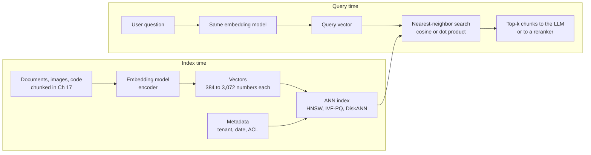
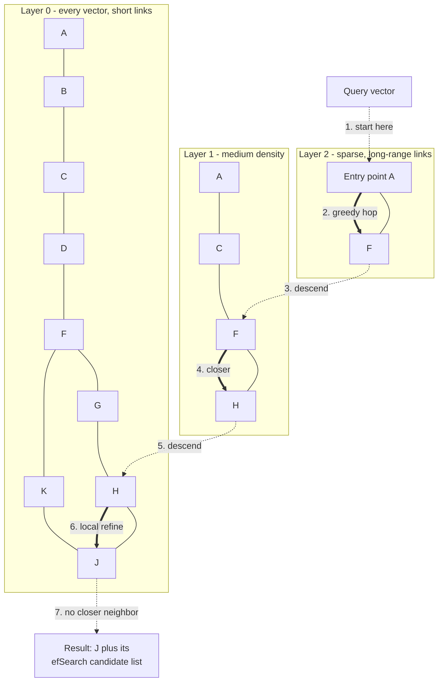
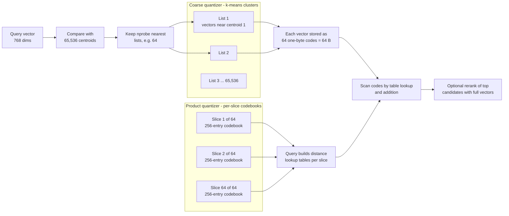
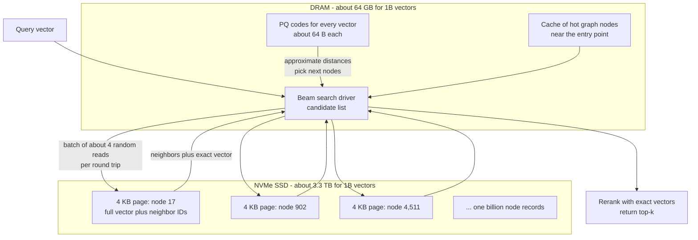
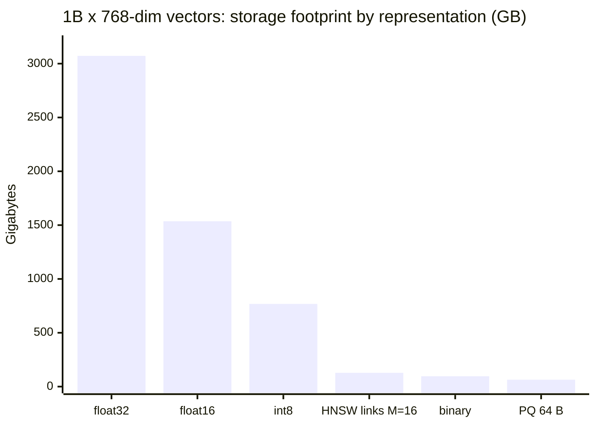
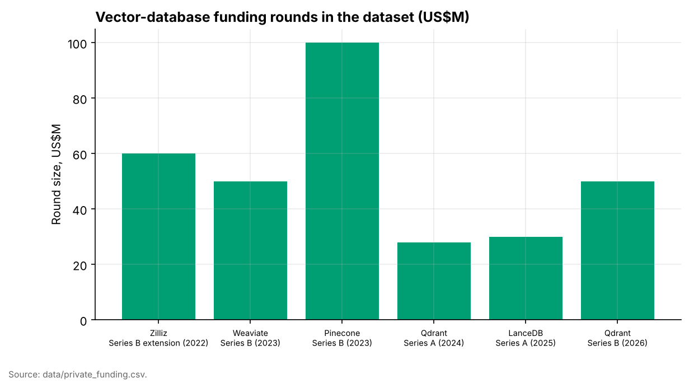
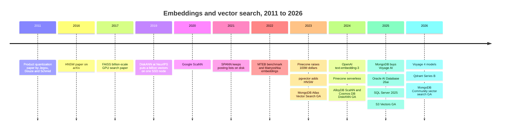

# 18. Embeddings and Vector Search
> **Depth:** L2 · **Reading time:** ~14 min · **Last verified:** 2026-11-01 · **Prerequisites:** [Ch 17 — Unstructured data processing](ch17-unstructured-data-processing.md), [Ch 2 — Data models](../01-data-systems-foundations/ch02-data-models.md)

## TL;DR

- An [embedding](../glossary.md#embedding) model turns a chunk of text, an image or a code file into a point in a space of roughly 384 to 3,072 dimensions, placed so that similar meanings land close together. Search then becomes geometry: find the points nearest to the query's point, scored by cosine similarity or dot product.
- Exact search compares the query with every stored vector, which is too slow at scale. Production systems use [approximate nearest neighbor](../glossary.md#approximate-nearest-neighbor) (ANN) indexes. These accept a small loss of [recall](../glossary.md#recall-at-k) in exchange for speedups of 100x or more. The main families are graphs ([HNSW](../glossary.md#hnsw), [DiskANN](../glossary.md#diskann)), clusters ([IVF](../glossary.md#ivf)) and compression ([product quantization](../glossary.md#product-quantization)).
- Memory is the binding constraint. One billion 768-dimension float32 vectors take about 3.1 TB before any index structure. An in-RAM HNSW index of that size needs a rack of large-memory servers. DiskANN keeps a 64 GB compressed copy in DRAM and leaves the full vectors and graph on NVMe flash. For media alone, that is roughly 25x cheaper at similar recall (illustrative estimate, below).
- The market has split. Dedicated vector databases (Pinecone, Weaviate, Qdrant, Milvus/Zilliz, Chroma, LanceDB, turbopuffer, Vespa) compete against "vector as a feature" in Postgres, MongoDB, Oracle, SQL Server, Elasticsearch, Redis, Databricks, Snowflake and, since December 2025, Amazon S3 itself.[^s3v] Funding for the pure plays has been modest since 2023.
- **Everpure lens:** the 2024–2026 designs (DiskANN, SPANN/SPFresh, turbopuffer, Chroma Cloud, S3 Vectors, Milvus 2.6 tiered storage) all push vector data out of DRAM and onto flash and object storage. Billion-scale retrieval on NVMe and S3-compatible storage is a concrete opportunity for a storage vendor.

## Why this matters (business + Everpure lens)

Retrieval decides what a large language model gets to read. Every RAG system ([Ch 19](ch19-retrieval-architectures.md)), every enterprise "chat with your documents" product and most agent memory designs start with a vector query. If retrieval misses the right paragraph, the model either answers without it or makes something up. Retrieval quality therefore becomes answer quality, and buyers will pay to get it right.

The commercial question is who captures that spend. In 2023 the answer looked like a new database category: Pinecone raised $100M at a press-reported $750M valuation in April 2023.[^pinecone-b] By 2026 nearly every incumbent database had added a vector type and an ANN index. MongoDB bought the embedding-model company Voyage AI for a press-reported $220M (February 2025).[^mdb-voyage] AWS turned vector storage into an S3 bucket type.[^s3v] The strategic question in this chapter is whether the standalone vector database survives once the feature is everywhere. It is the same question [Ch 2](../01-data-systems-foundations/ch02-data-models.md) asks of every specialist data model.

For Everpure, vectors are a storage workload with an unusual shape. A billion-vector corpus is several terabytes of hot, randomly accessed data. Engineers once held it in DRAM because nothing else was fast enough, but flash-native index designs now make NVMe the cheaper tier at similar recall. Everpure's June 2026 Data Stream launch, which vectorises selected data on FlashBlade with NVIDIA GPUs, places the company on the producing side of this workload.[^ep-ds] Zilliz named Pure Storage among storage partners for Milvus 2.6's tiered storage, which places it on the serving side as well.[^milvus26]

## How it works

### From content to coordinates

An embedding model is a neural network encoder. It takes an input (a 512-token text chunk, an image, a code function) and outputs a fixed-length list of numbers. The list is the same length for every input: 1,536 numbers for OpenAI's text-embedding-3-small and 3,072 for text-embedding-3-large.[^openai-emb] Each number is a coordinate. The model has been trained so that "the invoice is overdue" and "payment is late" end up near each other, while "the invoice template" sits further away even though it shares a keyword.

The training method is **[contrastive learning](../glossary.md#contrastive-learning)**. The model sees pairs that should match (a question and the passage that answers it, or an image and its caption) alongside many that should not. It is penalised whenever a matching pair is further apart than a non-matching one. After billions of such comparisons, distance in the space tracks similarity of meaning. Nobody designs the individual dimensions. They are learned, and none of them maps cleanly to a human concept.

Similarity is measured in one of two ways. **[Cosine similarity](../glossary.md#cosine-similarity)** is the angle between two vectors. The **dot product** is the same measure when vectors are normalised to unit length, which most modern models do. Ranking by either is equivalent to ranking by straight-line (Euclidean) distance on unit vectors. Most databases therefore expose all three and let the model's documentation decide.

*Figure 18.1 — Documents and queries must pass through the same model. Changing the model means re-embedding the whole corpus, which is the main switching cost in this layer.*

### Dimensions, quantization and Matryoshka

More dimensions usually mean better retrieval, but every dimension costs 4 bytes per vector at full precision (float32). A 768-dimension vector is 3 KB and a 3,072-dimension vector is 12 KB. That can exceed the size of the text chunk it represents. Two techniques cut this cost.

**[Scalar quantization](../glossary.md#scalar-quantization)** stores each coordinate in fewer bits. Going from float32 to int8 cuts size by 4x. **[Binary quantization](../glossary.md#binary-quantization)** keeps one bit per dimension (is the coordinate positive or negative?) for a 32x cut. Redis documents exactly these trade-offs for its vector sets: int8 is the default, and binary is described as faster with lower recall.[^redis] Elasticsearch's "BBQ" index applies binary quantization automatically to HNSW and states a memory reduction of about 32x.[^elastic] In practice, systems search the compressed vectors to find a few hundred candidates, then **[rescore](../glossary.md#rescoring)** those candidates with full-precision vectors read from a cheaper tier.

**[Matryoshka embeddings](../glossary.md#matryoshka-embedding)** shrink the vector itself. Named after Russian nesting dolls, Matryoshka Representation Learning (MRL, 2022) trains a model so that the first 256 or 512 coordinates are already a usable embedding on their own.[^mrl] A customer can store a short prefix for a fast first pass and keep the full vector for reranking. OpenAI's 2024 models,[^openai-emb] Google's Gemini Embedding (GA July 2025, default 3,072 dimensions, recommended truncations of 1,536 and 768)[^gemini-emb] and Voyage 4 (2,048 down to 256 dimensions)[^voyage4] all support this. Cohere's Embed v4 offers 256 to 1,536 dimensions, with int8 and binary output types.[^cohere-emb]

> **Bridge: semiconductors (quantization is ADC bit depth).** Quantizing an embedding is like choosing the bit depth of an analog-to-digital converter. A 32-bit float is a high-resolution sample. An int8 code is an 8-bit ADC, which keeps 256 levels per channel and loses little that matters to the downstream task. Binary is a 1-bit comparator: crude on its own, but fast and good enough to triage before a precise second pass. Product quantization (below) is closer to vector quantization in a codec: it encodes blocks of coordinates against a learned codebook rather than rounding each one separately.

### Exact search and the need to approximate

Exact **[k-nearest neighbors](../glossary.md#k-nearest-neighbors)** (kNN) search compares the query with every stored vector. At 1 million 768-dimension vectors, that is about 770 million multiply-adds per query. A modern CPU core with SIMD instructions can do it in milliseconds, so brute force is a reasonable choice below a few million vectors. At 1 billion vectors, each query must stream about 3 TB of data, which is far too slow for interactive use.

ANN indexes avoid looking at most vectors. Their quality is measured as **recall@k**: of the true 10 nearest neighbours, how many did the index return? A recall@10 of 0.95 means 9.5 of the 10 on average. Every ANN design sets a three-way trade between recall, latency and cost (memory, flash, compute). Each tuning parameter moves along that frontier.

> **Bridge: wafer yield.** Recall@k is the yield of a retrieval system. You can raise yield by testing more thoroughly (larger search lists, more clusters probed), which costs time on the tester. Or you can buy a better process (a better index or better embeddings), which costs capital. The last few points of yield are the most expensive, and the economic target is the yield at which a downstream defect (a missed paragraph) costs less than another unit of test time. A team quoting "99% recall" without the latency and dollars attached is quoting a yield without a cycle time.

### HNSW: a skip list made of graphs

Hierarchical Navigable Small World (HNSW) graphs, published by Malkov and Yashunin in 2016, are the default index in most products.[^hnsw] Every vector is a node, and each node links to a few dozen of its near neighbours. A search starts at an entry point and moves greedily to whichever neighbour is closer to the query, stopping when no neighbour is closer. On a single flat graph this greedy walk can take many steps, so HNSW adds layers. The bottom layer holds every node. Each higher layer holds a random, exponentially smaller sample with longer-range links. A query crosses the sparse top layers in a few long hops, drops down, and refines its position locally in the dense bottom layer.

*Figure 18.2 — HNSW search: a few long hops in the sparse upper layers, then a short local search in the dense bottom layer. The number of distance computations grows roughly with the logarithm of the corpus size, not linearly.*

Three parameters govern the trade-off. **M** is the number of links per node. Higher M improves recall but adds memory and build time. **efConstruction** is how hard the builder searches for good neighbours when inserting a node. **efSearch** is the size of the candidate list kept during a query. It is the main runtime dial: raising it from 40 to 400 lifts recall towards 0.99 at several times the latency. HNSW's drawback is memory. The graph and the full vectors must both sit in RAM for good performance, because each hop is a random access. With M=16, the bottom-layer links alone add about 128 bytes per vector (32 neighbour IDs of 4 bytes each). That is small next to a 3 KB vector, but it cannot be compressed away. Deletes are also awkward, because removing a node leaves holes in its neighbours' link lists.

> **Bridge: skip lists and page tables.** HNSW is a skip list generalised from a sorted line to a high-dimensional space. A skip list keeps express lanes over a linked list so a lookup takes O(log n) hops instead of n. HNSW's upper layers are the express lanes. It also resembles a multi-level page table: each level narrows the region of the address space you are in, until the last level points at the exact page. The difference is that HNSW's "translation" is approximate. A greedy hop can occasionally take a wrong turn, and that is where lost recall comes from.

### IVF and product quantization: partition, then compress

The second family comes from the FAISS lineage at Meta and INRIA.[^pq][^faiss] An **inverted file index (IVF)** runs k-means on the corpus to find, say, 65,536 centroids, then assigns each vector to its nearest centroid's list. A query compares itself with all centroids, picks the closest **nprobe** lists (8 or 64, for example) and scans only those. With 65,536 lists and nprobe=64, the query touches about 0.1% of the data. Raising nprobe raises recall and cost together.

**Product quantization (PQ)**, introduced by Jégou, Douze and Schmid in 2011, compresses the vectors inside those lists.[^pq] It cuts a 768-dimension vector into 64 sub-vectors of 12 dimensions each. For each slice it learns a small **[codebook](../glossary.md#codebook)** of 256 representative sub-vectors. Every vector is then stored as 64 one-byte codes, one per slice: 64 bytes instead of 3,072, a 48x reduction. Distances are computed from lookup tables of query-to-codeword distances, so a scan reads bytes and adds table entries, which CPUs and GPUs do very quickly. **[IVF-PQ](../glossary.md#ivf-pq)** combines the two, and it is the standard way to fit billions of vectors on one machine or GPU.

*Figure 18.3 — IVF-PQ: the clusters decide where to look, and the codebooks decide how cheaply each candidate is scored. Recall is lost twice, once by skipping clusters and once by compression, which is why reranking with full vectors is common.*

Google's **ScaNN** (2020) refines the quantization step. It uses anisotropic quantization, which spends its error budget where it matters least for ranking by inner product.[^scann] It is available in open source and as the ScaNN index in AlloyDB, which Google made GA in October 2024 and claims scales beyond a billion vectors (company-stated).[^alloydb]

### DiskANN: the memory hierarchy, applied

Microsoft Research's DiskANN (NeurIPS 2019) asked what happens when the index does not fit in RAM.[^diskann] Its graph algorithm, **[Vamana](../glossary.md#vamana)**, builds a single-layer graph with long-range edges designed in, so a search needs fewer hops than HNSW's bottom layer. The layout follows the memory hierarchy. PQ-compressed copies of all vectors sit in DRAM, at 64 bytes or less each. The full-precision vectors and the graph's neighbour lists sit on SSD, stored together so that one 4 KB read returns both a node's exact vector and its edges. The search navigates using the cheap in-memory codes and issues small batches of SSD reads to expand the most promising nodes. It then reranks with the exact vectors it fetched along the way.

*Figure 18.4 — DiskANN keeps only compressed codes in DRAM. Each query touches a few dozen SSD pages instead of streaming terabytes, which is why one server with an SSD can serve a billion vectors.*

The paper's headline result is that a 16-core workstation with 64 GB of RAM and an inexpensive SSD served the billion-point SIFT1B dataset at more than 5,000 queries per second. Mean latency was under 3 ms at 95%+ 1-recall@1 (authors' benchmark).[^diskann] The numbers are consistent with simple arithmetic. If a query expands about 100 nodes in batches of 4, it makes about 25 round trips. At roughly 100 µs per NVMe random read, that comes to about 2.5 ms (estimate). Microsoft has since built DiskANN into Azure Cosmos DB (GA for the NoSQL API in November 2024)[^cosmos] and SQL Server 2025. In SQL Server 2025 the VECTOR type is GA and DiskANN is the only ANN index type, although the on-premises index remained a preview feature in Microsoft's documentation as of retrieval.[^sqlserver] pgvectorscale brings a DiskANN-style index to Postgres,[^pgvectorscale] and Redis 8.2 added an SVS-Vamana index type.[^redis]

> **Bridge: memory hierarchy (DiskANN is a cache design).** DiskANN is the classic split between tags and data. A CPU cache keeps small tags in fast SRAM and the bulk data one level down. DiskANN keeps small "tags" (PQ codes) in DRAM to decide which nodes are worth fetching, and keeps the full lines (exact vectors plus edges) on NAND. Like a good cache, it lays data out so that one fetch brings back everything the next step needs, and it pins hot lines (nodes near the entry point) in the faster tier. Anyone who has priced an HBM-versus-DRAM trade-off already understands why this beats holding everything in the top tier.

### Object storage, SPANN and GPUs

The next step down the hierarchy is object storage, where an access takes about 100 ms instead of 100 µs, and graph walks stop working. Cluster-based designs fit better here. **SPANN** (Microsoft, NeurIPS 2021) keeps cluster centroids in memory and posting lists on disk,[^spann] and **SPFresh** (SOSP 2023) adds in-place updates.[^spfresh] turbopuffer's documentation describes an SPFresh-based centroid index with object storage as the source of truth and NVMe as a cache. A cold query downloads the centroids, then fetches the chosen clusters in as few object-storage round trips as possible.[^tpuf] Chroma Cloud (August 2025) also combines SPANN and SPFresh, with an object-storage-backed write-ahead log.[^chroma] Amazon S3 Vectors, GA on 2 December 2025, takes the idea to its limit. It offers up to 2 billion vectors per index and 20 trillion per bucket, with AWS stating about 100 ms query latency and up to 90% lower cost than alternatives (company-stated).[^s3v]

At the other extreme, GPUs build and search indexes in bulk. NVIDIA's cuVS library includes **[CAGRA](../glossary.md#cagra)**, a graph index designed for GPU parallelism (2023).[^cagra] It is integrated into FAISS, Milvus and OpenSearch's remote index builder. A common pattern builds the graph on a GPU in minutes and then converts it to HNSW for cheaper CPU serving.[^cuvs] GPUs make the most sense for index builds and re-embedding jobs, and for very high-throughput batch queries. They are rarely needed for a typical RAG query stream.

### Filtering and the hybrid-search teaser

Real queries carry conditions: "this tenant's documents, from 2026, that this user may see". Applying these to ANN search is harder than it sounds. **[Pre-filtering](../glossary.md#pre-filtering)** narrows the candidate set first and then searches it, which is exact but can break the graph into disconnected islands. **[Post-filtering](../glossary.md#post-filtering)** searches first and filters afterwards. It is simple, but a restrictive filter can leave only 2 of the 10 results. **In-graph filtering** checks the predicate during traversal, as Qdrant's payload-aware HNSW and the ACORN research design do.[^acorn] pgvector 0.8.0's iterative index scans patch post-filtering by continuing the search until enough rows survive.[^pgvector] Filter selectivity is the most common cause of a vector system that benchmarks well but misses results in production. Pure vector search also misses exact tokens such as part numbers and names. Production systems therefore pair it with keyword search ([BM25](../glossary.md#bm25)) and a reranker, which is the [hybrid search](../glossary.md#hybrid-search) pattern covered in [Ch 19](ch19-retrieval-architectures.md).

## Worked example: memory math for one billion vectors

Take 1 billion chunks embedded at 768 dimensions, roughly the corpus of a large enterprise or a mid-sized web index. The arithmetic is exact. Prices are illustrative assumptions, not quotes.

- Raw float32: 1,000,000,000 × 768 × 4 bytes = **3.07 TB** (about 2.8 TiB).
- int8: 768 GB. Binary: 96 GB. PQ at 64 bytes per vector: **64 GB**.
- HNSW bottom-layer links at M=16: 32 × 4 bytes = 128 bytes per vector, or **128 GB**.
- DiskANN on-SSD records at a maximum degree of 64 (assumption): 3,072 + 256 bytes = 3,328 bytes, fitting one 4 KB page, or about **3.3 TB** of NVMe.

*Figure 18.5 — Compression spans a 48x range, from 3,072 GB at full precision to 64 GB with PQ. Whatever must be in DRAM sets the bill, so the design question is which of these bars lives in which tier. Arithmetic by the author.*

| Design (one replica) | DRAM | NVMe / object | Media cost at $8/GB DRAM, $0.12/GB NVMe | Notes |
|---|---|---|---|---|
| HNSW, float32, all in RAM | 3,200 GB | — | ≈ $25,600 | Highest recall and lowest latency; needs several large-memory nodes |
| HNSW, int8 plus rescoring | 896 GB | 3.1 TB (full vectors) | ≈ $7,500 | Common 2025–26 default in managed services |
| DiskANN (PQ in RAM, graph on SSD) | 64 GB | 3.3 TB | ≈ $910 | Single node per the 2019 paper; low single-digit ms |
| Object-storage native (SPFresh, S3 Vectors) | cache only | 3.3 TB in S3 | ≈ $78 per month at $0.023/GB-month | ~100 ms warm to sub-second cold; pay per query |

*Figure 18.6 — Illustrative media cost for one replica (estimate; DRAM and NVMe prices are round-number assumptions, so substitute current quotes; S3 Standard list price per AWS).[^s3-pricing] Moving the full vectors from DRAM to flash cuts media cost by roughly 25x in this example. Moving them to object storage turns capex into a small monthly rent.*

Production adds replicas (often 2–3x), headroom and compute, so absolute dollars run higher. The ratios hold, and they explain the industry's direction since 2023: keep the bytes that steer the search in fast memory, and push the bulk to flash or object storage.

## Design choices and trade-offs

| Algorithm | Structure | Memory per 768-d vector (indicative) | Query latency profile | Updates and deletes | Filtering | Where you meet it |
|---|---|---|---|---|---|---|
| Flat (exact kNN) | None; scan all | 3,072 B (float32) | Linear in corpus; fine below ~1–5M | Trivial | Exact, any predicate | pgvector without index, FAISS Flat, small apps |
| HNSW | Multi-layer proximity graph | ~3,200 B (vector + links); less with int8 | Sub-ms to few ms in RAM | Inserts fine; deletes leave tombstones | Post-filter or in-graph | pgvector, Qdrant, Weaviate, Milvus, Elastic, Redis, Oracle, MongoDB |
| IVF-Flat / IVF-PQ | k-means lists, optional PQ codes | 3,072 B or ~64 B | Few ms; tuned by nprobe | Easy appends; recluster as data drifts | Per-list filter | FAISS, Milvus, LanceDB, Oracle (IVF), pgvector (IVFFlat) |
| ScaNN | Partitions plus anisotropic quantization | Small (quantized) | Low ms at high QPS | Periodic rebuild/retrain | Pre/post | AlloyDB, Vertex AI Vector Search, open source |
| DiskANN / Vamana | Single-layer graph on SSD, PQ in RAM | ~64 B in RAM + ~3.3 KB on SSD | Low single-digit ms on NVMe | FreshDiskANN-style streaming updates | Filtered variants | Azure Cosmos DB, SQL Server 2025, pgvectorscale |
| SPANN / SPFresh | Centroids in RAM, posting lists on disk or object store | Centroids only in RAM | ms on SSD; ~100 ms+ on object storage | In-place rebalancing (SPFresh) | Per-cluster | turbopuffer, Chroma Cloud |
| CAGRA (GPU) | Fixed-degree graph optimised for GPUs | GPU HBM, or export to HNSW | Very high batch throughput | Rebuild-oriented | Limited | cuVS in FAISS, Milvus, OpenSearch builds |

*Figure 18.7 — No algorithm dominates. HNSW wins on latency when memory is affordable. IVF-PQ and DiskANN win on cost at billion scale. Cluster-on-object-storage designs win on cost for large, mostly cold, multi-tenant data. Sources: algorithm papers and product docs cited in this chapter.*

The deeper trade-off is between the **cost of memory and the cost of a miss**. A consumer chatbot that sends the top 20 chunks to a reranker can tolerate 0.90 recall from a cheap index. A legal or medical retrieval system might pay for 0.99. Neither number means much without the embedding model, chunking and filters attached. Teams that switch from a strong to a weak embedding model often lose more quality than any index setting can recover.

## Who's who

| Product | Type | Index algorithms | Primary data tier | Deployment | 2025–26 note |
|---|---|---|---|---|---|
| Pinecone | Dedicated, proprietary | Proprietary (serverless) | Object storage + cache | Managed SaaS, BYOC | Serverless since Jan 2024; CEO Ash Ashutosh from Sep 2025[^pinecone-sls][^pinecone-ceo] |
| Weaviate | Dedicated, open source (BSD) | HNSW, flat, dynamic; PQ/BQ/SQ | RAM + disk | OSS, cloud | Last priced round $50M Series B, 2023 (CSV)[^funding] |
| Qdrant | Dedicated, open source (Apache 2.0, Rust) | Payload-aware HNSW; scalar, binary, PQ | RAM or mmap'd disk | OSS, cloud, hybrid | $50M Series B, Mar 2026 (CSV)[^funding] |
| Milvus / Zilliz | Dedicated, open source (LF AI) | HNSW, IVF, DiskANN, GPU CAGRA, RaBitQ | Tiered: RAM, SSD, object | OSS, Zilliz Cloud | Milvus 2.6 (Jun 2025) tiered storage, Kafka-free WAL[^milvus26] |
| Chroma | Dedicated, open source (Apache 2.0) | HNSW locally; SPANN + SPFresh in cloud | Object storage | OSS, Chroma Cloud | Chroma Cloud launched Aug 2025[^chroma] |
| LanceDB | Embedded / lakehouse format | IVF-PQ, HNSW variants | Lance files on object storage | OSS, cloud | $30M Series A, Jun 2025 (CSV)[^funding] |
| turbopuffer | Dedicated, proprietary | SPFresh centroids, BM25 | Object storage + NVMe cache | Managed SaaS | Seed from Thrive Capital, Dec 2025 (press-reported)[^tpuf-funding] |
| Vespa | Search and ranking engine | HNSW plus tensor ranking | RAM + disk | OSS, Vespa Cloud | Spun out of Yahoo, 2023 [VERIFY: spin-out date and funding] |
| pgvector / pgvectorscale | Postgres extension | HNSW, IVFFlat; StreamingDiskANN | Postgres pages | Every major cloud Postgres | 0.8.0 iterative scans (Nov 2024); 0.8.1 for PG18[^pgvector] |
| Elasticsearch / OpenSearch | Search engine feature | HNSW (Lucene), BBQ; FAISS in OpenSearch | RAM + disk | OSS, cloud | BBQ binary quantization; GPU builds via cuVS[^elastic][^cuvs] |
| MongoDB Atlas Vector Search | Document DB feature | HNSW, quantization | Search nodes | Atlas; Community Ed. GA Jun 2026 | Voyage AI acquired Feb 2025; Voyage 4 Jan 2026[^mdb-voyage][^voyage4] |
| Oracle AI Vector Search (26ai) | Relational DB feature | HNSW (in-memory), IVF (partitioned) | SGA memory + tablespace | On-prem, OCI, multicloud | 26ai replaced 23ai via Oct 2025 release update; no extra charge[^oracle] |
| SQL Server 2025 / Azure SQL | Relational DB feature | DiskANN | Database pages on SSD | On-prem, Azure | VECTOR type GA Nov 2025; index preview on-prem[^sqlserver] |
| Azure Cosmos DB | NoSQL feature | DiskANN, quantized flat | SSD | Azure | DiskANN GA (NoSQL) Nov 2024[^cosmos] |
| Redis | In-memory feature | HNSW, FLAT, SVS-Vamana; vector sets | RAM | OSS, cloud | Vector sets with int8/binary quantization (Redis 8)[^redis] |
| Databricks Vector Search | Lakehouse feature | Managed ANN | Delta tables + endpoints | Databricks | Storage-optimized endpoints: 1B+ vectors, ~250–500 ms (company-stated)[^dbx-vs] |
| Snowflake (VECTOR type, Cortex Search) | Warehouse feature | Managed hybrid search | Snowflake storage | Snowflake | Hybrid vector + keyword service[^snow-cortex] |
| Amazon S3 Vectors | Storage-service feature | Managed (undisclosed) | S3 | AWS | GA Dec 2025; 2B vectors per index[^s3v] |
| AlloyDB AI (ScaNN) | Postgres-compatible feature | ScaNN | RAM + disk | Google Cloud, AlloyDB Omni | ScaNN index GA Oct 2024[^alloydb] |

*Figure 18.8 — Nineteen products, two business models. The dedicated vendors compete on scale, latency and tuning depth. The feature vendors compete on "no new system". Object-storage designs (turbopuffer, Chroma Cloud, S3 Vectors, Pinecone serverless) are where price compression is coming from.*

*Figure 18.9 — The pure plays have raised modest rounds since 2023, and Pinecone's 2023 Series B remains the high-water mark in the dataset. Capital has flowed instead to the platforms that absorbed the feature. Source: `data/private_funding.csv`; Chroma's 2023 seed is excluded for lack of a confirmed amount.*[^funding]

### Does the standalone vector database survive?

**The bear case: feature absorption plus price compression.** Most enterprise corpora hold millions of vectors, not billions. At that scale, pgvector or MongoDB in a database the customer already runs is good enough. It also solves the problems a separate system creates: keeping embeddings in sync with source rows, enforcing the same access controls and joining with relational filters. Hyperscalers have turned the product into a storage feature priced per gigabyte, as with S3 Vectors.[^s3v] Funding reflects this. Pinecone has raised no priced round since 2023 and reportedly held early talks with bankers about a sale. Calcalist, citing The Information, named Oracle, IBM, MongoDB and Snowflake as possible suitors (press-reported; no deal announced).[^pinecone-sale] Weaviate's last priced round dates from 2023.[^funding] When the top of a category stops raising, the market is pricing it as a feature.

**The bull case: scale, latency and specialized workloads.** The hard cases are growing, not shrinking. Code-search and agent-memory products index billions of small, frequently updated vectors across millions of tenants. Recommendation and ads systems need low-millisecond latency at very high QPS. Multimodal corpora (video frames, images) multiply vector counts. General-purpose databases struggle with these. HNSW inside a Postgres buffer pool competes for memory with OLTP. Index builds compete for CPU. Multi-tenant isolation at millions of namespaces is not what a relational engine is designed for. The newer pure plays did not try to beat incumbents on features. They re-platformed onto object storage and won on cost per vector. Qdrant's $50M Series B in March 2026 shows investors still back focused vendors with traction.[^funding]

**Our view.** The middle of the market belongs to "vector as a feature", and that market is already mostly settled. Standalone vendors survive at two ends: the very large, multi-tenant, cost-sensitive end (object-storage-native designs) and the latency-critical, high-QPS end (specialist engines and GPUs). The likely exit for many is acquisition by a database, cloud or search vendor. That follows the IBM–DataStax and MongoDB–Voyage pattern ([Ch 32](../04-company-deep-dives/ch32-ai-native-data-companies.md)). The strongest counter-argument is that RAG quality depends more on hybrid search, reranking and freshness than on raw ANN speed. A vendor that owns that full retrieval pipeline could become a durable platform rather than a feature.

## History and trajectory

*Figure 18.10 — The algorithms were mostly in place by 2021. The 2023–2026 story is commercial: a funding burst after ChatGPT, then rapid absorption of the feature into databases and storage.*

The algorithms came out of web-scale image and ad search at INRIA, Meta, Microsoft and Google between 2011 and 2021.[^pq][^hnsw][^faiss][^diskann][^scann][^spann] ChatGPT turned them into a product category almost overnight. In 2023 Pinecone raised its $100M Series B,[^pinecone-b] pgvector added HNSW in version 0.5.0,[^pgvector-cl] and MongoDB made Atlas Vector Search GA.[^mdb-vs] The 2024–2025 phase brought absorption and re-platforming. Pinecone moved to a serverless, object-storage-backed design.[^pinecone-sls] Microsoft placed DiskANN in Cosmos DB and SQL Server.[^cosmos][^sqlserver] Oracle shipped AI Vector Search at no extra charge.[^oracle] AWS made vectors an S3 primitive.[^s3v] Embedding models consolidated into databases (MongoDB–Voyage) and adopted Matryoshka truncation and quantized outputs by default.[^mdb-voyage][^gemini-emb][^cohere-emb]

The benchmark that keeps vendors honest is MTEB, the Massive Text Embedding Benchmark (2022), now extended to more than 500 tasks in more than 250 languages as MMTEB (ICLR 2025).[^mteb] Its leaderboard reshuffles every few months, and open-weight models (BGE, E5, Nomic, Jina, Qwen-family embedders) regularly sit near commercial ones. In the MMTEB paper, the best publicly available model overall was the comparatively small multilingual-e5-large-instruct.[^mteb] For buyers, this means embedding quality is converging fast. The durable costs are re-embedding a corpus whenever the model changes, and the index that holds the result.

Looking to 2027, three directions are visible. First, more tiering: flash-native and object-native indexes become the default for anything above about 100 million vectors. Second, more GPU-assisted index builds, because re-embedding cycles get shorter as models improve.[^cuvs] Third, retrieval engines merge with lakehouse formats such as Lance and Iceberg, so vectors become another column in governed tables ([Ch 7](../01-data-systems-foundations/ch07-open-table-formats.md), [Ch 24](ch24-data-meets-compute-and-storage.md)).

## Numbers that matter

| Metric | Value | Basis | Source / date |
|---|---|---|---|
| Embedding size, OpenAI text-embedding-3-large | 3,072 dims (12 KB float32) | Vendor spec; bytes = arithmetic | OpenAI, 2024-01-25[^openai-emb] |
| Gemini Embedding default size | 3,072 dims; 1,536 and 768 recommended truncations | Vendor spec | Google, 2025-07-14[^gemini-emb] |
| 1B × 768-d float32 | ≈ 3.07 TB raw | Arithmetic | This chapter |
| Same corpus with PQ (64 B/vector) | ≈ 64 GB | Arithmetic | Jégou et al. method[^pq] |
| DiskANN on SIFT1B, one node | >5,000 QPS, <3 ms mean, 95%+ 1-recall@1, 64 GB RAM | Authors' benchmark | NeurIPS 2019[^diskann] |
| S3 Vectors scale | 2B vectors/index; 20T per bucket; ~100 ms queries | Company-stated | AWS, 2025-12-02[^s3v] |
| Databricks storage-optimized endpoints | 1B+ vectors; ~250–500 ms latency | Company-stated (docs) | Databricks docs, n.d.[^dbx-vs] |
| AlloyDB ScaNN | >1B vectors; p95 < 25 ms | Company-stated | Google Cloud, 2024-10-03[^alloydb] |
| MongoDB–Voyage AI price | $220M | Press-reported (cash + stock) | 2025-02-24[^mdb-voyage] |
| Pinecone Series B | $100M at $750M post-money | Press-reported | 2023-04-27[^pinecone-b] |
| Qdrant Series B | $50M | Press-reported | 2026-03-12[^funding] |
| Binary quantization memory cut | ~32x vs float32 | Vendor-stated | Elastic, Redis docs[^elastic][^redis] |

*Figure 18.11 — The numbers to carry into a meeting. The vendor latency figures are not comparable with each other, because recall targets, dimensions and filters differ.*

## Storage bridge

> **Storage bridge.** Vector search is turning into a flash and object-storage workload. DiskANN-style indexes issue bursts of small random 4 KB reads at low queue depth, where tail latency matters more than bandwidth. SPFresh-style and S3 Vectors designs issue fewer, larger range-GETs, where time to first byte and per-request cost dominate. Re-embedding and index builds are large sequential jobs that feed GPUs. For an on-prem S3 and NVMe platform such as FlashBlade, options a strategy team might evaluate, based on public information, include: certified reference designs with Milvus, which already lists Pure Storage as a 2.6 tiered-storage partner,[^milvus26] and with other object-native engines; an S3-Vectors-compatible API on-prem; and extending Data Stream from producing embeddings to serving them.[^ep-ds] See the companion *Everpure Tech Atlas* for flash latency and object-protocol detail.

## Conversation playbook

**Questions for a PM**

1. "How many vectors does your median customer have, and how many does your largest? What share of customers are above 100 million?" (This shows whether the product competes with pgvector or with DiskANN-class systems.)
2. "When a customer changes embedding models, what does re-embedding cost them in time and money, and do you help with it?"
3. "Where does your index live: DRAM, NVMe or object storage? How has your cost per million vectors moved since S3 Vectors launched?"

**Questions for an engineer**

1. "At what recall@10 do you quote latency, with what filter selectivity, and on which dataset?"
2. "How do you handle a filter that matches 0.1% of the corpus: pre-filter, post-filter or in-graph?"
3. "What happens to recall and latency after 30% of the vectors have been updated or deleted? How often do you rebuild or compact?"

**What good answers sound like.** They quote latency and recall together, at a stated percentile and filter selectivity. They know their bytes per vector in each tier ("int8 in RAM, float32 on NVMe for rescoring"). They treat the embedding model and chunking as bigger quality levers than the index. They have a clear plan for deletes, compaction and re-embedding.

**Don't say this**

- "Vector databases are a commodity now." Small-scale vector search is. Billion-scale, multi-tenant, filtered, fresh retrieval at low cost is still hard engineering.
- "Higher dimensions are always better." Matryoshka truncation and quantization often keep 95%+ of the quality at a fraction of the bytes.
- "ANN is exact." It is approximate by design, so always ask for recall.
- "RAG just needs a vector DB." Production RAG needs hybrid keyword search, reranking, filters and access control ([Ch 19](ch19-retrieval-architectures.md)).
- "HNSW is the only index that matters." At billion scale, IVF-PQ, DiskANN and cluster-on-object-storage designs usually win on cost.

## Going deeper

- Malkov and Yashunin, the HNSW paper, especially the section on heuristic neighbour selection.[^hnsw]
- Subramanya et al., the DiskANN paper, on the Vamana graph and the SSD layout.[^diskann]
- Jégou, Douze and Schmid on product quantization, and the Faiss library paper for a survey of index families.[^pq][^faiss]
- Chen et al., SPANN, and the SPFresh paper for update-friendly, disk-resident cluster indexes.[^spann][^spfresh]
- The turbopuffer architecture page, a clear public description of an object-storage-native index.[^tpuf]
- Ootomo et al., CAGRA, and NVIDIA's cuVS integration notes for GPU builds.[^cagra][^cuvs]

> **Going deeper (L3).** HNSW's neighbour selection is not "keep the M closest". It keeps a candidate only if it is closer to the new node than to any neighbour already chosen, which preserves edges in diverse directions and keeps the graph navigable. Vamana generalises this with a slack factor α > 1. That deliberately keeps some long edges, so a single-layer graph gets the hop count HNSW obtains from its upper layers. This one pruning rule matters more for quality than most of the published tuning knobs.

## Key terms

- [Embedding](../glossary.md#embedding) — a learned vector representation where similar content lies close together.
- [Contrastive learning](../glossary.md#contrastive-learning) — training that pulls matching pairs together and pushes non-matching pairs apart.
- [Cosine similarity](../glossary.md#cosine-similarity) — similarity measured by the angle between two vectors.
- [k-nearest neighbors](../glossary.md#k-nearest-neighbors) — exact search for the k vectors closest to a query.
- [Approximate nearest neighbor](../glossary.md#approximate-nearest-neighbor) — search that trades a little recall for large speed and cost gains.
- [Recall at k](../glossary.md#recall-at-k) — share of the true top-k neighbours an index actually returns.
- [HNSW](../glossary.md#hnsw) — layered proximity-graph index searched by greedy descent.
- [IVF](../glossary.md#ivf) — index that clusters vectors with k-means and searches only the nearest clusters.
- [Product quantization](../glossary.md#product-quantization) — compression that encodes vector slices as codebook indexes.
- [Codebook](../glossary.md#codebook) — the learned set of representative sub-vectors used by product quantization.
- [IVF-PQ](../glossary.md#ivf-pq) — IVF clustering combined with PQ-compressed vectors.
- [Scalar quantization](../glossary.md#scalar-quantization) — storing each coordinate in fewer bits, such as int8.
- [Binary quantization](../glossary.md#binary-quantization) — storing one bit per dimension for a 32x size reduction.
- [Matryoshka embedding](../glossary.md#matryoshka-embedding) — embedding whose leading dimensions form a usable shorter embedding.
- [Rescoring](../glossary.md#rescoring) — re-ranking compressed-search candidates with full-precision vectors.
- [DiskANN](../glossary.md#diskann) — SSD-resident graph index with compressed vectors held in DRAM.
- [Vamana](../glossary.md#vamana) — the single-layer graph-construction algorithm behind DiskANN.
- [CAGRA](../glossary.md#cagra) — NVIDIA's GPU-optimised graph index in cuVS.
- [Pre-filtering](../glossary.md#pre-filtering) — applying metadata filters before vector search.
- [Post-filtering](../glossary.md#post-filtering) — applying metadata filters after vector search.
- [Hybrid search](../glossary.md#hybrid-search) — combining keyword (BM25) and vector retrieval, usually with reranking.
- [BM25](../glossary.md#bm25) — the standard keyword relevance-scoring function.
- [Vector database](../glossary.md#vector-database) — a database built primarily to store, index and query embeddings.

## Sources

[^hnsw]: Y. Malkov and D. Yashunin, "Efficient and robust approximate nearest neighbor search using Hierarchical Navigable Small World graphs," arXiv:1603.09320, https://arxiv.org/abs/1603.09320, published 2016-03 (IEEE TPAMI 42(4), 2018/2020, https://doi.org/10.1109/TPAMI.2018.2889473); retrieved 2026-11-01 (canonical citation).
[^diskann]: S. Jayaram Subramanya, F. Devvrit, R. Kadekodi, R. Krishnaswamy, H. V. Simhadri, "DiskANN: Fast Accurate Billion-point Nearest Neighbor Search on a Single Node," NeurIPS 2019, https://papers.nips.cc/paper/2019/hash/09853c7fb1d3f8ee67a61b6bf4a7f8e6-Abstract.html, published 2019-12; Microsoft Research publication page, https://www.microsoft.com/en-us/research/publication/diskann/; retrieved 2026-11-01. Benchmarks are the authors'.
[^pq]: H. Jégou, M. Douze, C. Schmid, "Product Quantization for Nearest Neighbor Search," IEEE TPAMI 33(1), https://ieeexplore.ieee.org/document/5432202 (open version https://inria.hal.science/inria-00514462), published 2011-01; retrieved 2026-11-01 (canonical citation).
[^faiss]: J. Johnson, M. Douze, H. Jégou, "Billion-scale similarity search with GPUs," arXiv:1702.08734, https://arxiv.org/abs/1702.08734, published 2017-02; M. Douze et al., "The Faiss library," arXiv:2401.08281, https://arxiv.org/abs/2401.08281, published 2024-01; retrieved 2026-11-01 (canonical citations).
[^scann]: R. Guo et al., "Accelerating Large-Scale Inference with Anisotropic Vector Quantization," ICML 2020, arXiv:1908.10396, https://arxiv.org/abs/1908.10396, published 2019-08/2020-07; retrieved 2026-11-01 (canonical citation).
[^spann]: Q. Chen et al., "SPANN: Highly-efficient Billion-scale Approximate Nearest Neighbor Search," NeurIPS 2021, arXiv:2111.08566, https://arxiv.org/abs/2111.08566, published 2021-11; retrieved 2026-11-01 (canonical citation).
[^spfresh]: Y. Xu et al., "SPFresh: Incremental In-Place Update for Billion-Scale Vector Search," SOSP 2023, https://dl.acm.org/doi/10.1145/3600006.3613166, published 2023-10; retrieved 2026-11-01 (not live-fetched).
[^cagra]: H. Ootomo et al., "CAGRA: Highly Parallel Graph Construction and Approximate Nearest Neighbor Search for GPUs," arXiv:2308.15136, https://arxiv.org/abs/2308.15136, published 2023-08 (ICDE 2024); retrieved 2026-11-01 (canonical citation).
[^cuvs]: NVIDIA Technical Blog, "Enhancing GPU-Accelerated Vector Search in Faiss with NVIDIA cuVS," https://developer.nvidia.com/blog/enhancing-gpu-accelerated-vector-search-in-faiss-with-nvidia-cuvs, published 2025; NVIDIA Technical Blog, "Optimizing Vector Search for Indexing and Real-Time Retrieval with NVIDIA cuVS," https://developer.nvidia.com/blog/optimizing-vector-search-for-indexing-and-real-time-retrieval-with-nvidia-cuvs/, published 2025; NVIDIA cuVS docs, "Integration Patterns," https://docs.nvidia.com/cuvs/user-guide/integration-patterns, n.d.; retrieved 2026-11-01. Performance claims are vendor-stated.
[^mrl]: A. Kusupati et al., "Matryoshka Representation Learning," NeurIPS 2022, arXiv:2205.13147, https://arxiv.org/abs/2205.13147, published 2022-05; retrieved 2026-11-01 (canonical citation).
[^mteb]: N. Muennighoff et al., "MTEB: Massive Text Embedding Benchmark," arXiv:2210.07316, https://arxiv.org/abs/2210.07316, published 2022-10; K. Enevoldsen et al., "MMTEB: Massive Multilingual Text Embedding Benchmark," ICLR 2025, https://proceedings.iclr.cc/paper_files/paper/2025/hash/fc0e3f908a2116ba529ad0a1530a3675-Abstract-Conference.html (arXiv:2502.13595), published 2025; MTEB leaderboard, https://huggingface.co/spaces/mteb/leaderboard, live; retrieved 2026-11-01.
[^openai-emb]: OpenAI, "New embedding models and API updates," https://openai.com/index/new-embedding-models-and-api-updates/, published 2024-01-25; retrieved 2026-11-01 (not live-fetched).
[^gemini-emb]: Google Developers Blog, "Gemini Embedding now generally available in the Gemini API," https://developers.googleblog.com/en/gemini-embedding-available-gemini-api/, published 2025-07-14; retrieved 2026-11-01. Vendor-stated.
[^cohere-emb]: Cohere documentation, "Cohere's Embed Models" (embed-v4.0 output dimensions and embedding types), https://docs.cohere.com/docs/cohere-embed, n.d.; Microsoft Azure AI Foundry model catalog, "Cohere Embed 4," https://ai.azure.com/catalog/models/embed-v-4-0, 2025-12; retrieved 2026-11-01. Release month (April 2025) per secondary sources [VERIFY: Cohere Embed v4 release date].
[^voyage4]: IT Brief UK, "MongoDB adds Voyage 4 AI models, automates vector search," https://itbrief.co.uk/story/mongodb-adds-voyage-4-ai-models-automates-vector-search, published 2026-01; OpenRouter model page, "voyage-4" (dimensions 2048/1024/512/256), https://openrouter.ai/voyageai/voyage-4, n.d.; retrieved 2026-11-01.
[^mdb-voyage]: MongoDB, Inc., "MongoDB Announces Acquisition of Voyage AI to Enable Organizations to Build Trustworthy AI Applications," press release, https://www.mongodb.com/press/mongodb-announces-acquisition-of-voyage-ai, published 2025-02-24; price per Seeking Alpha, "MongoDB acquires Voyage AI for $220M to boost AI search," https://seekingalpha.com/news/4412466-mongodb-acquires-voyage-ai-for-220m-to-boost-ai-search, published 2025-02-24 (press-reported; MongoDB did not state a price in the release); retrieved 2026-11-01. Matches `data/ma_deals.csv`.
[^mdb-vs]: Constellation Research, "MongoDB Atlas Vector Search, Atlas Search Nodes generally available," https://www.constellationr.com/insights/news/mongodb-atlas-vector-search-atlas-search-nodes-generally-available, published 2023-12-04; MongoDB, "Now GA: MongoDB Search and Vector Search for Community Edition," https://www.mongodb.com/products/updates/now-ga-mongodb-search-and-vector-search-for-community-edition/, published 2026-06-30; retrieved 2026-11-01.
[^s3v]: AWS News Blog, "Amazon S3 Vectors now generally available with increased scale and performance," https://aws.amazon.com/blogs/aws/amazon-s3-vectors-now-generally-available-with-increased-scale-and-performance, published 2025-12-02; AWS What's New, "Amazon S3 Vectors is now generally available with 40 times the scale of preview," https://aws.amazon.com/about-aws/whats-new/2025/12/amazon-s3-vectors-generally-available/, published 2025-12-02; latency and cost claims per AWS, "Top announcements of AWS re:Invent 2025," https://aws.amazon.com/blogs/aws/top-announcements-of-aws-reinvent-2025, published 2025-12; retrieved 2026-11-01. Company-stated.
[^s3-pricing]: AWS, "Amazon S3 pricing" (S3 Standard, first 50 TB/month, US East), https://aws.amazon.com/s3/pricing/, living document; retrieved 2026-11-01. [VERIFY: S3 Standard list price still $0.023/GB-month]
[^pgvector]: PostgreSQL Global Development Group, "pgvector 0.8.0 Released!," https://www.postgresql.org/about/news/pgvector-080-released-2952/, published 2024-11; EDB, "pgvector 0.8.1 release notes," https://www.enterprisedb.com/docs/pg_extensions/pgvector/rel_notes/pgvector_0.8.1_rel_notes/, published 2025; retrieved 2026-11-01.
[^pgvector-cl]: pgvector project, CHANGELOG (0.5.0 adds HNSW index type, 2023-08), https://github.com/pgvector/pgvector/blob/master/CHANGELOG.md, n.d.; retrieved 2026-11-01 (not live-fetched).
[^pgvectorscale]: Timescale (TigerData), pgvectorscale repository (StreamingDiskANN index, statistical binary quantization), https://github.com/timescale/pgvectorscale, n.d.; retrieved 2026-11-01 (not live-fetched).
[^sqlserver]: Microsoft Azure SQL Dev Blog, "SQL Server 2025 embraces vectors: setting the foundation for empowering your data with AI," https://devblogs.microsoft.com/azure-sql/sql-server-2025-embraces-vectors-setting-the-foundation-for-empowering-your-data-with-ai, published 2025-11-18; Microsoft Learn, "Vector search and vector indexes in the SQL Database Engine," https://learn.microsoft.com/sql/relational-databases/vectors/vectors-sql-server, living document; retrieved 2026-11-01.
[^cosmos]: Microsoft Azure Updates, "Generally Available: DiskANN in Azure Cosmos DB for NoSQL," https://azure.microsoft.com/updates/public-preview-diskann-vector-indexing-and-search-in-azure-cosmos-db-nosql, 2024-11; Azure Cosmos DB Blog, "Azure Cosmos DB with DiskANN Part 2: Scaling to 1 Billion Vectors with <100ms Search Latency," https://devblogs.microsoft.com/cosmosdb/azure-cosmos-db-with-diskann-part-2-scaling-to-1-billion-vectors-with, published 2025-04-21; N. Upreti et al., PVLDB 18, https://www.vldb.org/pvldb/vol18/p5166-upreti.pdf, 2025; retrieved 2026-11-01.
[^alloydb]: Google Cloud Blog, "ScaNN for AlloyDB index is GA," https://cloud.google.com/blog/products/databases/scann-for-alloydb-index-is-ga, published 2024-10-03; retrieved 2026-11-01. Company-stated.
[^oracle]: Oracle, "Oracle AI Database 26ai," https://www.oracle.com/database/ai-native-database-26ai/, published 2025-10; Oracle AI Vector Search User's Guide (26), release-update notes, https://docs.oracle.com/en/database/oracle/oracle-database/26/vecse/july-2025-release-update-23.9.html, n.d.; retrieved 2026-11-01.
[^dbx-vs]: Databricks documentation, "Mosaic AI Vector Search" and "Vector Search performance guide," https://docs.databricks.com/aws/en/generative-ai/vector-search and https://docs.databricks.com/aws/generative-ai/vector-search-best-practices, living documents; retrieved 2026-11-01. Company-stated.
[^snow-cortex]: Snowflake documentation, "Cortex Search overview," https://docs.snowflake.com/en/user-guide/snowflake-cortex/cortex-search/cortex-search-overview, living document; retrieved 2026-11-01 (not live-fetched).
[^elastic]: Elastic, "Elasticsearch dense_vector field type: bbq_hnsw / Better Binary Quantization," https://www.elastic.co/docs/reference/elasticsearch/mapping-reference/bbq, living document (preview builds surfaced via docs-v3-preview.elastic.dev); retrieved 2026-11-01. Vendor-stated.
[^redis]: InfoQ, "Redis Introduces Vector Sets," https://www.infoq.com/news/2025/04/redis-vector-sets, published 2025-04; S. Sanfilippo, "Vector Sets and Similarity Search," https://redis.antirez.com/fundamental/vector-sets.html, n.d.; Redis blog, "Vector indexes in Redis" (SVS-VAMANA in 8.2), https://redis.io/blog/vector-indexes-in-redis/, n.d.; retrieved 2026-11-01.
[^milvus26]: Zilliz, "Milvus 2.6: Built for Scale, Designed to Reduce Costs," https://zilliz.com/news/milvus-2-6-built-for-scale-designed-to-reduce-costs, published 2025-06-12; BigDATAwire, "Zilliz Releases Milvus 2.6 with Tiered Storage and Int8 Compression to Cut Vector Search Costs," https://www.bigdatawire.com/this-just-in/zilliz-releases-milvus-2-6-with-tiered-storage-and-int8-compression-to-cut-vector-search-costs, published 2025-06; retrieved 2026-11-01. Storage-partner list (Cohesity, Pure Storage, MinIO, NetApp) per this coverage.
[^chroma]: Chroma, "Introducing Chroma Cloud," changelog, https://www.trychroma.com/changelog/introducing-chroma-cloud, published 2025-08; retrieved 2026-11-01. Company-stated.
[^tpuf]: turbopuffer, "Architecture," https://turbopuffer.com/docs/architecture, living document; retrieved 2026-11-01. Company-stated.
[^tpuf-funding]: CB Insights, "turbopuffer financials," https://www.cbinsights.com/company/turbopuffer/financials, n.d. (aggregator); Let's Data Science, "Turbopuffer Secures Funding To Scale Search," https://letsdatascience.com/news/turbopuffer-secures-funding-to-scale-search-6939db58, 2025-12; retrieved 2026-11-01. Press-reported; round size not disclosed [VERIFY: turbopuffer round amount and lead].
[^pinecone-b]: TechCrunch, "Pinecone drops $100M investment on $750M valuation as vector database demand grows," https://techcrunch.com/2023/04/27/pinecone-drops-100m-investment-on-750m-valuation-as-vector-database-demand-grows/, published 2023-04-27; retrieved 2026-11-01. Press-reported; matches `data/private_funding.csv`.
[^pinecone-sls]: Pinecone, "Introducing Pinecone Serverless," https://www.pinecone.io/blog/serverless/, published 2024-01-16; retrieved 2026-11-01 (not live-fetched).
[^pinecone-ceo]: Pinecone blog, "Moving Pinecone forward with Ash Ashutosh as CEO," https://pinecone.io/blog/growing-ai-ambitions, published 2025-09-08; VentureBeat, https://venturebeat.com/data-management/pinecone-founder-edo-liberty-steps-aside-as-ceo-and-appoints-googler-ash, 2025-09; retrieved 2026-11-01 (via `meta/research-briefing.md`).
[^pinecone-sale]: Calcalist (CTech), citing The Information, "Pinecone exploring potential sale," https://www.calcalistech.com/ctechnews/article/rz31q82b5, 2025 [VERIFY: publication date]; retrieved 2026-11-01. Press-reported; no transaction announced as of retrieval.
[^acorn]: L. Patel et al., "ACORN: Performant and Predicate-Agnostic Search Over Vector Embeddings and Structured Data," SIGMOD 2024, arXiv:2403.04871, https://arxiv.org/abs/2403.04871, published 2024-03; Qdrant documentation, "Indexing" (filterable HNSW), https://qdrant.tech/documentation/concepts/indexing/, n.d.; retrieved 2026-11-01 (not live-fetched).
[^funding]: `data/private_funding.csv` (rows for Zilliz 2022, Weaviate 2023, Pinecone 2023, Qdrant 2024 and 2026, LanceDB 2025), as of 2026-11-01; Qdrant Series B per TechTarget, "Qdrant raises $50M in funding to fuel vector database growth," https://techtarget.com/searchdatamanagement/news/366640132/Qdrant-raises-50M-in-funding-to-fuel-vector-database-growth, published 2026-03; retrieved 2026-11-01. Press-reported.
[^ep-ds]: Everpure via PR Newswire, "Everpure Unveils Data-Primacy Architecture for the AI Era," https://www.prnewswire.com/news-releases/everpure-unveils-data-primacy-architecture-for-the-ai-era-302803097.html, published 2026-06-17; Techzine, "Stop vectorizing garbage: inside Everpure's smart AI data pipeline," https://www.techzine.eu/blogs/infrastructure/144105/stop-vectorizing-garbage-inside-everpures-smart-ai-data-pipeline/, 2026-06; retrieved 2026-11-01.
