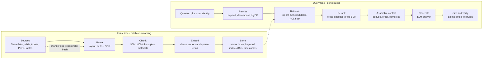
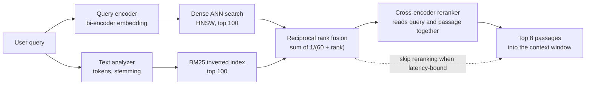
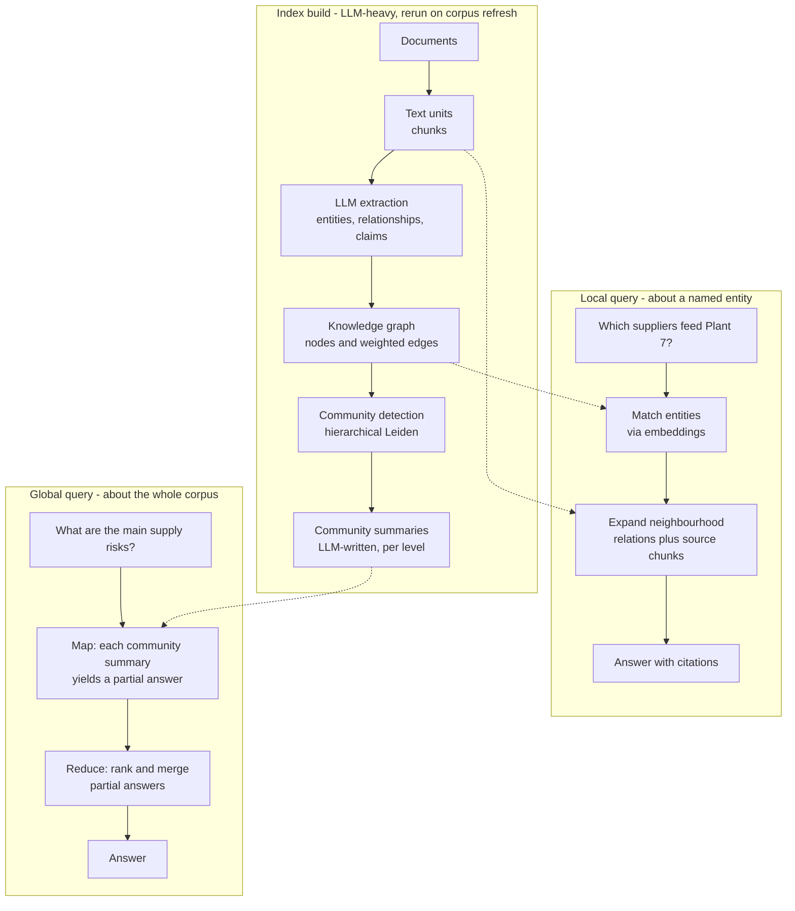
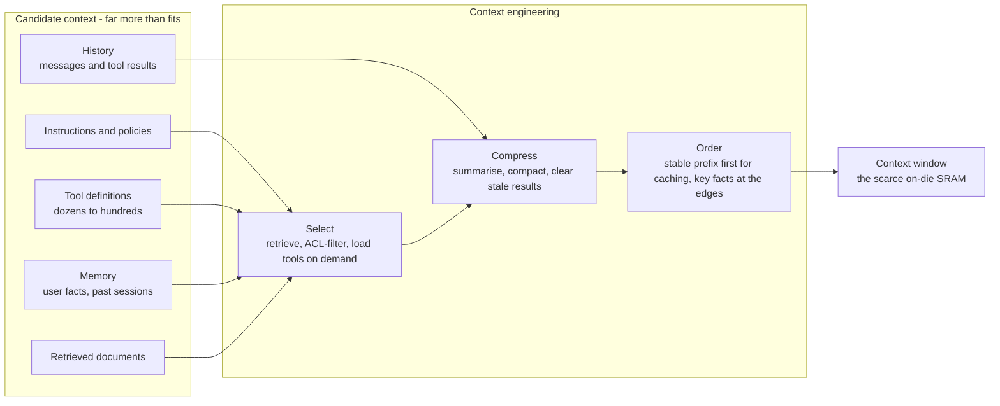
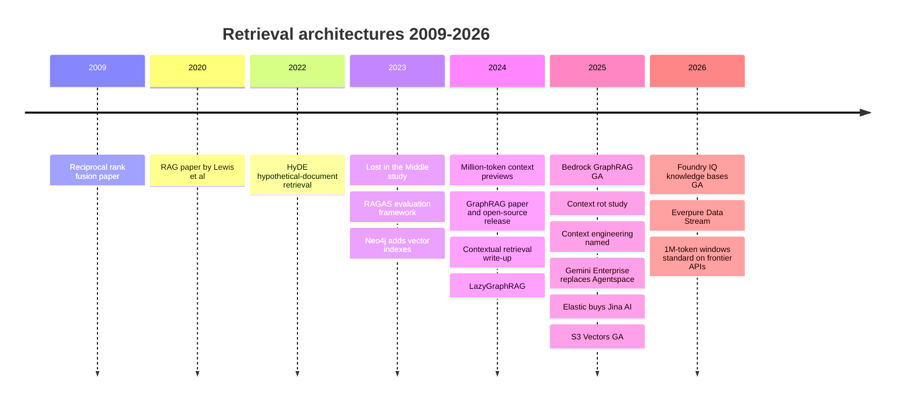

# 19. Retrieval Architectures: RAG, Hybrid Search, GraphRAG and Context Engineering
> **Depth:** L2 · **Reading time:** ~13 min · **Last verified:** 2026-11-01 · **Prerequisites:** [Ch 18 — Embeddings and vector search](ch18-embeddings-and-vector-search.md), [Ch 17 — Unstructured data processing](ch17-unstructured-data-processing.md)

## TL;DR

- [Retrieval-augmented generation](../glossary.md#retrieval-augmented-generation) (RAG) gives a language model the right documents at question time instead of relying on what it memorised in training. It has two halves. At **index time**, sources are parsed, chunked, embedded and stored. At **query time**, the question is rewritten, candidates are retrieved and reranked, a context is assembled, and the model generates an answer with citations.[^lewis2020]
- Production systems almost never use vectors alone. [Hybrid search](../glossary.md#hybrid-search) runs keyword ([BM25](../glossary.md#bm25)) and dense retrieval in parallel, merges them with [reciprocal rank fusion](../glossary.md#reciprocal-rank-fusion), then lets a [cross-encoder](../glossary.md#cross-encoder) [reranker](../glossary.md#reranker) pick the final handful. On Snowflake's internal benchmark, each step adds quality: NDCG@10 of 0.22 (keyword), 0.49 (vector), 0.53 (hybrid) and 0.59 (hybrid plus reranker), vendor-reported.[^sf-cortex]
- [GraphRAG](../glossary.md#graphrag) (Microsoft Research, 2024) has an LLM extract entities and relationships, cluster them into communities and pre-write summaries. That answers "global" questions about a whole corpus, which chunk retrieval handles badly, but indexing is expensive.[^edge2024]
- Million-token context windows did not kill RAG. In an illustrative 800K-token workload, stuffing everything into the prompt costs about $1.61 per query uncached and about $0.17 with prompt caching, versus about $0.03 for RAG (Claude Sonnet 5.5 list prices, Nov 2026). Long inputs also degrade answer quality ("lost in the middle", "context rot").[^anthropic-pricing][^liu2023][^context-rot]
- The 2025 term [context engineering](../glossary.md#context-engineering) widens the frame. Retrieval is one input to a scarce context window, alongside instructions, tools, memory and history. Selecting, compressing and ordering those tokens is now the core skill in building agents.[^ctx-eng] For storage, the effects are low-latency reads on large indexes, freshness pipelines from primary data and a new tier for offloaded [KV caches](../glossary.md#kv-cache).

## Why this matters (business + Everpure lens)

RAG is how most enterprises actually use generative AI on their own data. A model trained on the public internet knows nothing about a company's contracts, tickets, part numbers or policies. Fine-tuning on that data is slow, costly and impossible to permission. Retrieval solves both problems. Each answer is assembled from documents the user is already allowed to see, retrieved at the moment of the question, and each claim can point back to a source. That makes retrieval the battleground for enterprise search and "AI assistant" budgets. Glean, an enterprise-search start-up, was valued at $7.2B in its June 2025 Series F (press-reported), and later said its annual recurring revenue had reached $300M in May 2026 (company-stated, press-reported).[^glean-tc][^glean-arr] Microsoft, Google, AWS, Databricks and Snowflake all sell retrieval as a managed feature of their platforms.

The quality of a RAG system is mostly set by its data, not its model. Most failures trace back to parsing, chunking, stale indexes or missing permissions, which are data-engineering problems ([Ch 17](ch17-unstructured-data-processing.md), [Ch 13](../02-pipelines-and-governance/ch13-data-quality-observability-lineage.md)). This is why platform vendors with governed data (catalogs, lineage, access policies) argue they should own retrieval, and why pure-play vector databases have been squeezed ([Ch 18](ch18-embeddings-and-vector-search.md), [Ch 32](../04-company-deep-dives/ch32-ai-native-data-companies.md)).

For Everpure the link is direct. Retrieval adds three storage-adjacent workloads. The first is low-latency random reads against very large vector and keyword indexes. The second is continuous pipelines that keep indexes in step with primary data on file and object storage. The third is KV-cache offload for long-context inference. Everpure's **Data Stream** (announced June 2026) already sits in the first two: it vectorises data on FlashBlade with stream-level access controls, using the NVIDIA AI Data Platform design.[^everpure-datastream] Its **Key-Value Accelerator** targets the third.[^everpure-kva] The Storage bridge below sets out the options a strategy team might evaluate, based on public information.

## How it works

### The two halves of RAG

The 2020 paper by Lewis et al. that named RAG paired a neural retriever over about 21 million Wikipedia passages with a generator model. The paper showed that a model given retrieved passages beat much larger models that had to rely on memory alone for knowledge-heavy questions.[^lewis2020] Enterprise systems keep that split but add many stages.

*Figure 19.1 — SV-10: the RAG pipeline. Index time is a data pipeline. Query time is a latency-bound serving path. Chunk sizes and candidate counts are typical design ranges, not benchmarks.*

**Index time** is a data pipeline. Parsing turns PDFs, slides and HTML into clean text with structure (headings, tables, page numbers). Chunking splits that text into retrievable units, usually a few hundred to about a thousand tokens, with metadata such as title, section, owner, date and access-control list attached. Embedding turns each chunk into a vector ([Embedding](../glossary.md#embedding); [Ch 18](ch18-embeddings-and-vector-search.md)), and often also into sparse keyword terms. Storage writes the vectors into a [vector index](../glossary.md#vector-index) and the terms into an inverted index, keeping the metadata as filterable fields. Anthropic's 2024 "contextual retrieval" write-up shows how much index-time choices matter. Prepending a short LLM-written description of where each chunk sits in its document cut the top-20 retrieval failure rate by about 35%. Adding contextual BM25 raised the cut to 49%, and adding a reranker raised it to 67% (vendor benchmark).[^contextual-retrieval]

**Query time** is a serving path with a latency budget. The question is first rewritten: expanded with synonyms, split into sub-questions, or turned into a hypothetical answer whose embedding is then searched ([HyDE](../glossary.md#hyde), Gao et al. 2022).[^hyde] Retrieval pulls a broad candidate set, filtered by the user's permissions. Reranking narrows it. Assembly removes duplicates, orders the passages and fits them into a token budget. The model generates an answer, and a final step checks that each cited passage actually supports the sentence citing it.

> **Bridge: memory hierarchy.** Think of the LLM's trained weights as a huge, slow, lossy main memory. They hold a compressed copy of the world, cost a full training run to update, and cannot be permissioned. RAG is a cache in front of that memory. Retrieval is a **prefetch** that pulls the few lines this query needs from the corpus (the backing store) into the context window (the on-chip SRAM) just before the model executes. Like any prefetcher, it is judged on hit rate and pollution. Fetch the wrong lines and the model computes on garbage. Fetch too many and you evict the useful ones.

### Hybrid search, fusion and reranking

Dense vectors capture meaning: "laptop won't power on" finds "notebook fails to boot". They are weak on exact tokens such as part numbers, error codes, legal citations and names, which keyword search handles well. BM25, the standard Lucene and Elasticsearch scoring function, rewards rare query terms that appear often in a document. Running both and merging the results is the default production design.

Merging is harder than it looks, because a cosine similarity of 0.82 and a BM25 score of 14.3 are on different scales. [Reciprocal rank fusion](../glossary.md#reciprocal-rank-fusion) (RRF; Cormack, Clarke and Büttcher, SIGIR 2009) ignores the scores and uses only ranks. Each document receives the sum, over all result lists, of 1/(k + rank), with k = 60 in the original paper. Documents ranked well by several systems rise to the top.[^rrf2009] Elasticsearch, OpenSearch, Azure AI Search and most vector databases ship it.

*Figure 19.2 — Hybrid retrieval. Two cheap recall-oriented searches run in parallel, RRF merges them using ranks only, and an expensive precision-oriented reranker reorders a short list.*

A worked example of RRF with k = 60:

| Passage | Dense rank | BM25 rank | RRF score | Fused rank |
|---|---|---|---|---|
| A: "Error E-4471 on pump controller" | 7 | 1 | 1/67 + 1/61 = 0.0313 | 1 |
| B: "Controller fault troubleshooting" | 1 | 9 | 1/61 + 1/69 = 0.0309 | 2 |
| C: "Pump maintenance overview" | 2 | not retrieved | 1/62 = 0.0161 | 3 |
| D: "E-4471 firmware release note" | not retrieved | 2 | 1/62 = 0.0161 | 3 (tie) |

*Figure 19.3 — RRF rewards agreement. Passage A, a strong keyword match that dense search ranked only seventh, overtakes the top dense hit because both systems found it.*

The [reranker](../glossary.md#reranker) is a different kind of model. Retrieval uses a [bi-encoder](../glossary.md#bi-encoder): query and document are embedded separately, so document vectors can be pre-computed and searched in milliseconds. A cross-encoder reads the query and each candidate passage together and outputs one relevance score. That is far more accurate but has to run per pair at query time, so it can only score tens or hundreds of candidates. Commercial options include Cohere Rerank 4, priced by resellers at $2.00 (Fast) to $2.50 (Pro) per 1,000 searches of up to 100 documents (press-reported), Voyage AI's rerankers (MongoDB bought Voyage for $220M in 2025), Jina AI's (Elastic bought Jina in October 2025) and open-weight models such as BAAI's BGE reranker.[^cohere-rerank][^mongodb-voyage][^elastic-jina] A reranker usually adds tens to a few hundred milliseconds (estimate, depending on model size, candidate count and hardware).

> **Bridge: semiconductor test.** Reranking is two-stage inspection. A fab does not put every die on the expensive parametric tester. A fast optical or electrical screen removes the obvious failures, and precise measurement is reserved for the shortlist. Bi-encoder retrieval is the cheap screen, tuned for recall so no good die is thrown away. The cross-encoder is the precise measurement, tuned for precision on the few that reach it. Spend more at the first stage and you lose throughput. Skip the second and you ship marginal parts.

### Where RAG breaks

Most RAG incidents are data problems that look like model problems.

| Failure mode | Symptom | Root cause | Fix |
|---|---|---|---|
| Bad chunking | Answers miss half a table or a clause's exception | Fixed-size splits cut across structure. Chunks lack document context | Structure-aware parsing and chunking ([Ch 17](ch17-unstructured-data-processing.md)). Add contextual headers. Use parent-child retrieval |
| Missing ACLs | User sees salary data or another client's contract in an answer | Index built with a service account. Permissions not copied or not enforced at query time | Store ACLs with each chunk and filter at retrieval by the caller's identity. Re-sync permissions on change |
| Stale index | Confident answer citing a superseded policy | Batch re-indexing lags the source. Deletes never propagated | Change-data-capture or event-driven re-indexing. Track index freshness as an SLO. Honour deletes |
| Vocabulary mismatch | Misses on part numbers, codes, names | Dense-only retrieval | Hybrid BM25 plus dense with RRF. Query rewriting |
| Lost in the middle | Relevant passage was retrieved, but the answer ignores it | Models attend best to the start and end of long inputs | Retrieve fewer, better passages. Rerank. Put the strongest evidence at the edges |
| Hallucinated citations | Footnote points to a real document that does not support the claim | Model generates citations as text, unchecked | Constrain citations to retrieved chunk IDs. Run an entailment or LLM-judge check before display |
| Global questions | "What are the main themes across all incident reports?" gets a shallow answer | Top-k retrieval sees only a few chunks | GraphRAG-style summaries, map-reduce over the corpus, or an agentic multi-step search |
| Indirect prompt injection | Answer follows instructions hidden in a retrieved web page or email | Retrieved text is treated as trusted instructions | Separate data from instructions. Sanitise sources. Limit the tools an agent can call after reading untrusted content |

*Figure 19.4 — RAG failure modes. Six of the eight are fixed in the data pipeline or the index, not by changing the model.*

The "lost in the middle" result deserves emphasis because it shapes context assembly. Liu et al. (2023, published in TACL 2024) moved the one relevant document through a stack of 20 retrieved documents. Accuracy followed a U-shape: highest when the document came first or last, lowest in the middle. For one model, middle-position accuracy fell below its score with no documents at all.[^liu2023] Chroma's 2025 "context rot" study of 18 models found that reliability falls as input grows, even on simple tasks.[^context-rot] More context is not free even when it fits.

### Agentic RAG

Classic RAG retrieves once and then answers. **Agentic RAG** makes retrieval a tool the model calls as often as it needs: search, read, notice a gap, refine the query, search a different source, and stop when the evidence is sufficient. It handles multi-hop questions ("which customers on the old contract template have renewals next quarter?") that need a document search, then a SQL query, then another search. The cost is more model calls, less predictable latency and harder evaluation. Microsoft's Azure AI Search added an "agentic retrieval" mode that plans sub-queries with an LLM and runs them in parallel; the Foundry IQ knowledge bases built on it were declared generally available in June 2026.[^foundry-iq] [Ch 22](ch22-agents-and-data.md) covers the agent side, including the [Model Context Protocol](../glossary.md#model-context-protocol) that exposes retrieval and SQL as tools.

### GraphRAG and knowledge graphs

Top-k retrieval assumes the answer lives in a few passages. Some questions are about the whole corpus: "what are the recurring supplier risks across five years of audit reports?" Microsoft Research's GraphRAG (Edge et al., April 2024; open-sourced July 2024) builds structure first.[^edge2024][^ms-graphrag-blog]

*Figure 19.5 — GraphRAG. Expensive LLM work moves to index time, so that global questions can be answered from pre-written community summaries rather than a handful of chunks.*

The trade-off is cost. Every chunk goes through an LLM extraction pass, and every community gets an LLM-written summary, so indexing can cost orders of magnitude more than embedding. Microsoft's own follow-up, LazyGraphRAG (November 2024), defers summarisation to query time. Microsoft reports indexing costs equal to vector RAG and 0.1% of full GraphRAG, with comparable global-query quality at more than 700 times lower query cost (vendor benchmark).[^lazygraphrag]

GraphRAG builds a graph on the fly from text. Many enterprises already have curated graphs: product hierarchies, supply chains, org charts, customer-account links. Neo4j, the leading [property graph](../glossary.md#property-graph) database ([Ch 2](../01-data-systems-foundations/ch02-data-models.md)), added native vector indexes in 2023, so one [Cypher](../glossary.md#cypher) query can find semantically similar chunks and then traverse their relationships.[^neo4j-vector] Neo4j reported passing $200M in ARR in November 2024 (company-stated), with a $2B valuation reaffirmed by a $50M investment.[^neo4j-arr] AWS made GraphRAG generally available in Bedrock Knowledge Bases in March 2025, backed by Neptune Analytics.[^bedrock-graphrag] At the top end sits the [ontology](../glossary.md#ontology): a governed model of business objects, properties, links and permitted actions. Palantir's Foundry Ontology is the best-known commercial example.[^palantir-ontology] The idea is the same one semantic layers apply to metrics ([Ch 14](../02-pipelines-and-governance/ch14-semantic-layers-and-bi.md)): give the model the business's own definitions rather than letting it infer them from prose.

### Long context versus retrieval

Context windows grew from 32K tokens to 1M or more within two years. Google previewed a 1M-token Gemini 1.5 Pro in February 2024.[^gemini15] By late 2026, Anthropic lists 1M tokens for its current Opus, Sonnet and Haiku models, and OpenAI lists about 1.05M for GPT-5.5.[^anthropic-pricing][^openai-gpt55] The obvious question is whether to retrieve at all, or simply put the whole corpus in the prompt.

**Worked example (illustrative).** A team has an 800,000-token corpus (roughly 1,500 pages) and expects 10,000 questions a day. Each answer is 500 tokens. RAG sends 10,000 input tokens per question: about 8,000 of retrieved passages plus instructions. Prices are Anthropic list prices for Claude Sonnet 5.5, retrieved November 2026: $2 per million input tokens, $10 per million output tokens, cache reads at $0.20 per million, and 5-minute cache writes at 1.25 times the input price.[^anthropic-pricing][^anthropic-caching]

- *Long context, no caching:* 0.8M × $2 = $1.60 of input plus $0.005 of output, about **$1.61 per query**, or about $16,000 a day.
- *Long context, cached prefix:* 0.8M × $0.20 = $0.16 plus output, about **$0.17 per query**, or about $1,650 a day. Each cache refill costs about $2.00 on top.
- *RAG:* 0.01M × $2 = $0.02, plus output, plus about $0.0025 for a reranker call at Rerank 4 Pro pricing, about **$0.03 per query**, or about $275 a day before index costs.[^cohere-rerank]

[Prompt caching](../glossary.md#prompt-caching) cuts the gap from about 57 times to about 6 times. That is a large change in the economics, and it is why "just use long context" is now a reasonable answer for small, stable, shared corpora. At GPT-5.5 list prices ($5 input, $0.50 cached input, $30 output per million tokens) the same three figures are about $4.02, $0.42 and $0.07. A press-reported surcharge on prompts above 272K tokens would roughly double the uncached long-context figure.[^openai-gpt55][^gpt55-surcharge]

| Dimension | Long context ("stuff the window") | Retrieval (RAG) |
|---|---|---|
| Illustrative cost per query (800K corpus, Sonnet 5.5, Nov 2026) | ~$1.61 uncached; ~$0.17 with cache hits | ~$0.03 including rerank |
| Time to first token | Seconds to tens of seconds to prefill a cold 800K prompt (estimate). Fast on a cache hit | Retrieval plus rerank adds roughly 0.1–0.5 s (estimate), then a short prefill |
| Corpus size ceiling | About 1M tokens, roughly 1,500–2,000 pages | Effectively unbounded (billions of chunks) |
| Answer quality | Strong on synthesis across a whole small document set. Degrades with length (lost in the middle, context rot) | Bounded by retrieval recall. A missed passage cannot be used |
| Freshness | Re-send or re-cache on every change. Cache invalidates on any prefix edit | Incremental re-indexing of changed chunks |
| Access control | Whole corpus visible to every user of that prompt, unless you build one prompt per permission set | Per-chunk ACL filter per user |
| Citations and audit | Possible, but the model must locate evidence in 800K tokens | Natural: each answer maps to retrieved chunk IDs |
| Operational complexity | Low: no index, no pipeline | High: parsing, chunking, embedding, index operations, evaluation |
| Best fit | One contract set, one codebase, one long report, analysed in depth | Enterprise knowledge bases, many users, frequent change |

*Figure 19.6 — Long context versus RAG. Caching narrows the cost gap but leaves the permission, freshness and scale arguments for retrieval intact. In practice, teams combine the two: retrieve broadly, then give a large window to a reranked set.*

"Needle in a haystack" tests, which hide one fact in a long filler text and ask the model to find it, mostly measure lookup. Real tasks need the model to combine many facts spread across the input, and that is where long-context accuracy falls off. Chroma's study argues that standard long-context benchmarks mix input length with task difficulty, which flatters long windows.[^context-rot]

### Context engineering

By 2025 the working unit was no longer the prompt but the whole context window. Anthropic's engineering team described [context engineering](../glossary.md#context-engineering) in September 2025 as curating the smallest set of high-signal tokens for each step of an agent: instructions, tool definitions, retrieved documents, memory and message history.[^ctx-eng]

*Figure 19.7 — Context engineering treats retrieval as one of five inputs competing for a fixed token budget. Ordering matters twice: once for model attention and once for cache hits on a stable prefix.*

The three operations map onto features vendors now ship. *Select* covers RAG and loading tool definitions on demand. *Compress* covers summarising old turns ("compaction") and clearing stale tool outputs. *Order* covers putting stable content first so prompt caches hit, and placing key evidence where the model attends to it most.

> **Bridge: on-die SRAM.** The context window behaves like limited on-die SRAM. Capacity is fixed per model generation. Every byte placed there displaces another. Performance depends less on raw capacity than on what the scheduler chooses to keep resident. A chip with a larger cache but a poor replacement policy loses to a smaller cache with a good one. Context engineering is the replacement policy. The KV cache, the model's internal state for tokens already processed, is the literal hardware cost of that SRAM. It is what gets spilled to DRAM and flash when the window grows (see the Storage bridge).

### Evaluating retrieval systems

RAG is evaluated in two layers. Retrieval metrics, such as recall@k, NDCG and **context precision** (are the retrieved passages relevant, and ranked first?), need a labelled set of questions with known good passages. Generation metrics ask whether the answer is **faithful** (every claim supported by the retrieved context) and **relevant** (it addresses the question). The RAGAS framework (Es et al., 2023) popularised reference-free versions of these metrics computed by an LLM.[^ragas] [LLM-as-judge](../glossary.md#llm-as-judge) scoring is cheap and scales, but judges have biases: they favour longer answers and their own model family's style. Good teams calibrate judges against a few hundred human-labelled examples and re-run the suite whenever the chunker, embedding model or prompt changes. An index change is a release, and should be tested like one.

## Design choices and trade-offs

| Approach | Best at | Weak at | Index-time cost | Query-time cost | Choose when |
|---|---|---|---|---|---|
| BM25 keyword only | Exact terms, codes, names. Mature, explainable | Synonyms, paraphrase, multilingual | Low | Very low (ms) | Search over technical identifiers. A baseline you should always keep |
| Dense vectors only | Meaning and paraphrase | Rare tokens, numbers, negation | Moderate (embedding) | Low (ms) | Prototypes. Conversational content |
| Hybrid + RRF + rerank | Best general-purpose quality | More moving parts. Reranker latency | Moderate | Moderate (tens to hundreds of ms) | Default for production enterprise RAG |
| GraphRAG / knowledge graph | Global and multi-hop questions, entity-centric queries | Expensive, slow to rebuild. Extraction errors become facts | High (LLM per chunk) | Moderate to high | Investigations, research, supply-chain and compliance corpora |
| Agentic RAG | Multi-step, multi-source questions | Unpredictable cost and latency. Harder to evaluate | Same as underlying indexes | High (many model calls) | Analyst-style tasks where minutes are acceptable |
| Long context | Deep synthesis of one bounded document set | Cost without caching, permissions, freshness, scale | None | High uncached, moderate cached | Single large documents, codebases, stable shared corpora |

*Figure 19.8 — No single retrieval design wins. Most production systems layer hybrid retrieval and reranking under an agent, and add graph or long-context paths for specific question types.*

**Steelman the alternatives.** *For long context:* model prices fall every year, caching has removed most of the cost penalty for shared corpora, and every RAG pipeline is a new place for bugs. A team that can fit its problem in the window should try that first. *For pure vector search:* modern embedding models handle many exact-match cases, and one index is simpler than two. *For GraphRAG:* when the questions are about relationships, chunk retrieval is answering the wrong question, however well it is tuned. *Against all of them:* without access controls and freshness, nothing else matters. A highly relevant answer drawn from a document the user should not see is a security incident, not a quality win.

## Who's who

| Player | Offering | Positioning (Nov 2026) |
|---|---|---|
| Glean | Enterprise search and assistant across SaaS apps, with permission-aware connectors and a knowledge graph | Largest independent. $7.2B valuation (Jun 2025, press-reported). $300M ARR (May 2026, company-stated)[^glean-tc][^glean-arr] |
| Microsoft | Microsoft 365 Copilot over the Microsoft Graph. Azure AI Search with agentic retrieval. Foundry IQ knowledge bases | Default for Microsoft 365 shops. Permissions inherited from the Microsoft Graph[^foundry-iq] |
| Google | Gemini Enterprise (formerly Agentspace, renamed Oct 2025). Vertex AI Search and RAG Engine | $30/user/month Enterprise, $21 Business at launch (press-reported)[^gemini-ent][^vertex-rag] |
| AWS | Bedrock Knowledge Bases (vector, hybrid, GraphRAG on Neptune). S3 Vectors | Managed RAG close to S3 data. S3 Vectors GA Dec 2025[^bedrock-graphrag][^s3vectors] |
| Databricks | Vector Search (now "AI Search"), Agent Bricks knowledge assistants | Retrieval governed by Unity Catalog. Storage-optimised tier for 1B+ vectors[^databricks-aisearch][^dais25] |
| Snowflake | Cortex Search (hybrid plus reranking, managed) | Retrieval inside the Snowflake perimeter. Feeds CoWork agents[^sf-cortex] |
| Elastic | Elasticsearch: BM25, vectors, RRF, rerankers. Jina AI models (acquired Oct 2025) | Incumbent search engine re-platformed for hybrid RAG[^elastic-jina] |
| Neo4j | Graph database with vector indexes and a GraphRAG library | Graph-plus-vector leader. >$200M ARR (Nov 2024, company-stated)[^neo4j-arr] |
| Vectara, Coveo | RAG-as-a-service (Vectara). AI search for commerce and service (Coveo, TSX-listed) | Specialists squeezed between platforms and Glean |
| Cohere, Voyage (MongoDB), Jina (Elastic), BAAI | Embedding and reranking models | Rerankers increasingly bundled by database vendors[^cohere-rerank][^mongodb-voyage] |

*Figure 19.9 — Retrieval is being absorbed into platforms. Independents survive by spanning many SaaS sources with permission-aware connectors (Glean) or by owning a data model that platforms lack (Neo4j).*

The pattern since 2024 is consolidation of the retrieval stack into the platforms that already hold governed data. MongoDB bought Voyage AI ($220M, 2025) and Elastic bought Jina AI ($43.4M purchase consideration per its 10-Q), each bringing embedding and reranking models in-house.[^mongodb-voyage][^elastic-jina] The independent enterprise-search case rests on breadth. A company's knowledge is spread across Slack, Jira, Salesforce, Google Drive and SharePoint, and no single platform vendor indexes its rivals' apps with full permission fidelity. The bear case for independents is that Microsoft and Google bundle "good enough" search into seats customers already pay for.

## History and trajectory

*Figure 19.10 — Retrieval moved from a research add-on (2020) to a platform feature (2025–26). The open question shifted from "RAG or not" to "what goes into the window".*

Three phases stand out. **2020–2022: research.** RAG was one technique among several for knowledge-heavy NLP. **2023–2024: the vector-database boom and its correction.** ChatGPT made "chat with your documents" the first enterprise use case. Every database added a vector type, and practitioners learned that chunking, hybrid search and reranking mattered more than the choice of index ([Ch 18](ch18-embeddings-and-vector-search.md)). **2025–2026: agents and context.** Retrieval became a tool inside agent loops. Long windows and caching changed the cost picture. The scarce resource moved from "which documents" to "which tokens".

The likely next step is retrieval over *structured and unstructured data together*, with permissions and semantics drawn from the catalog and semantic layer ([Ch 14](../02-pipelines-and-governance/ch14-semantic-layers-and-bi.md), [Ch 22](ch22-agents-and-data.md)). The bear case for today's RAG stacks is that models internalise more retrieval behaviour themselves, which would commoditise orchestration frameworks but not the indexes or the governed data under them.

## Numbers that matter

| Metric | Value | Basis | Source / date |
|---|---|---|---|
| RRF constant k | 60 | Paper default, still the common default | Cormack et al., SIGIR 2009[^rrf2009] |
| Hybrid + rerank quality ladder | NDCG@10 0.22 → 0.49 → 0.53 → 0.59 (keyword, vector, hybrid, + reranker) | Vendor-reported, internal benchmark | Snowflake, 2024[^sf-cortex] |
| Contextual retrieval gain | −35% / −49% / −67% top-20 retrieval failures (contextual embeddings / + BM25 / + rerank) | Vendor benchmark | Anthropic, 2024-09[^contextual-retrieval] |
| Claude Sonnet 5.5 list price | $2 in / $10 out per M tokens. Cache read $0.20. 5-min cache write 1.25x | List price | Anthropic pricing, retrieved 2026-11-01[^anthropic-pricing][^anthropic-caching] |
| GPT-5.5 list price | $5 in / $0.50 cached / $30 out per M tokens. ~1.05M context | List price | OpenAI model page, retrieved 2026-11-01[^openai-gpt55] |
| Illustrative cost per query, 800K-token corpus | ~$1.61 uncached long context; ~$0.17 cached; ~$0.03 RAG | Estimate from list prices | This chapter, Nov 2026 |
| Reranker price | $2.00–$2.50 per 1,000 searches (Rerank 4 Fast / Pro) | Press-reported (reseller listings) | 2026[^cohere-rerank] |
| LazyGraphRAG indexing cost | 0.1% of full GraphRAG | Vendor-reported | Microsoft Research, 2024-11[^lazygraphrag] |
| Databricks storage-optimised vector endpoint | >1B 768-dim vectors. ~250 ms added latency | Vendor docs | Databricks, 2026[^databricks-aisearch] |
| KV cache for 1M tokens, 70B-class model (FP16, GQA) | ~330 GB | Estimate from published architecture | Llama 3 70B config[^llama3-config] |
| Glean | $7.2B valuation (Jun 2025). $300M ARR (May 2026) | Press-reported / company-stated | TechCrunch; press reports[^glean-tc][^glean-arr] |
| Neo4j | >$200M ARR. $2B valuation | Company-stated | Neo4j, 2024-11-19[^neo4j-arr] |

*Figure 19.11 — The numbers that drive retrieval design: fusion and reranking add measurable quality, caching moves long-context cost by about 10x, and KV-cache size is what turns long context into a storage problem.*

## Storage bridge

> **Storage bridge.** Retrieval creates three storage workloads. (1) **Index serving:** small random reads against vector and inverted indexes that exceed DRAM. Flash-resident ANN designs such as DiskANN make latency a storage-performance question ([Ch 18](ch18-embeddings-and-vector-search.md)). (2) **Freshness:** indexes are derived data, so they are only as current as the pipeline from primary file and object storage. Change notifications, snapshots and permission metadata at the storage layer shorten that loop. That is the ground Everpure's Data Stream and Data Intelligence (1touch) products occupy.[^everpure-datastream] (3) **KV-cache offload:** a 1M-token context on a 70B-class model holds about 330 GB of KV state (estimate), more than one GPU's memory. NVIDIA Dynamo can tier KV blocks from HBM to CPU memory, local SSD and networked storage, and NVIDIA's BlueField-4-based context-memory tier (CMX) formalises a pod-level flash tier for it, with Dell, IBM, VAST and WEKA named as supporters.[^dynamo-kv][^nvidia-cmx] Everpure's Key-Value Accelerator integrates with Dynamo and keeps reusable prefixes on FlashBlade over NFS and S3 (vendor claims).[^everpure-kva] Options a strategy team might evaluate, based on public information: how far to go up the stack from serving indexes to owning parts of the retrieval pipeline, and how to position KVA against the NVIDIA CMX partner ecosystem. See the companion *Everpure Tech Atlas* for flash and protocol detail.

## Conversation playbook

**Questions for a PM**

1. "What share of your customers' RAG answers can be traced to a permission-filtered source chunk, and how do you prove it in an audit?"
2. "How fresh is the index relative to the source system, in minutes, and how do deletes propagate?"
3. "Where do customers choose long context over retrieval today, and how did prompt caching change that mix?"

**Questions for an engineer**

1. "Do you run hybrid retrieval? How do you fuse the lists (RRF, weighted scores, learned), and what does the reranker add in quality and latency?"
2. "What is your evaluation set? How many labelled questions are there, which metrics (context precision, faithfulness) do you track, and how do you calibrate the LLM judge?"
3. "When the context grows past a few hundred thousand tokens, where does the KV cache live, and what is your hit rate on shared prefixes?"

**What good answers sound like.** They give numbers: "recall@50 of 0.92 on a 600-question gold set", "index lag p95 of 4 minutes", "reranking adds 120 ms and 6 points of NDCG". They treat permissions as a retrieval-time filter, not a prompt instruction. They describe retrieval changes being shipped through an evaluation gate, and they can say which question types they route to graph, agentic or long-context paths.

**Don't say this**

- "Long context windows make RAG obsolete." Caching narrowed the cost gap, but permissions, freshness, scale and context rot did not go away.
- "RAG eliminates hallucinations." It reduces them and makes them checkable. Models still misread or over-generalise retrieved text, and citations need verification.
- "We just need a better vector database." Most quality problems are in parsing, chunking, hybrid retrieval and reranking, not in the ANN index.
- "GraphRAG is a better RAG." It answers a different class of question, at a much higher indexing cost.
- "The model respects document permissions." Models enforce nothing. Access control must happen before tokens reach the window.

## Going deeper

- Lewis et al., "Retrieval-Augmented Generation for Knowledge-Intensive NLP Tasks" (NeurIPS 2020).[^lewis2020]
- Liu et al., "Lost in the Middle" (TACL 2024), and Chroma's "Context Rot" report with reproducible code.[^liu2023][^context-rot]
- Edge et al., "From Local to Global: A Graph RAG Approach to Query-Focused Summarization", plus the LazyGraphRAG post.[^edge2024][^lazygraphrag]
- Anthropic, "Effective context engineering for AI agents" and "Contextual Retrieval".[^ctx-eng][^contextual-retrieval]
- Es et al., "RAGAS: Automated Evaluation of Retrieval Augmented Generation".[^ragas]

> **Going deeper (L3).** Late-interaction models such as ColBERT sit between bi-encoders and cross-encoders. They store one vector per token rather than one per chunk and score with a sum of maximum similarities. That gives most of a cross-encoder's precision at retrieval speed, at the cost of an index that can be an order of magnitude larger (estimate), which is a direct storage-capacity trade.

## Key terms

- [Retrieval-augmented generation](../glossary.md#retrieval-augmented-generation) — fetching relevant content at query time and adding it to a model's prompt.
- [Chunking](../glossary.md#chunking) — splitting documents into retrievable units with attached metadata.
- [Hybrid search](../glossary.md#hybrid-search) — combining keyword and dense-vector retrieval for one query.
- [BM25](../glossary.md#bm25) — the standard keyword relevance-scoring function.
- [Reciprocal rank fusion](../glossary.md#reciprocal-rank-fusion) — merging ranked lists by summing 1/(k + rank) across them.
- [Bi-encoder](../glossary.md#bi-encoder) — a model that embeds query and document separately so documents can be pre-indexed.
- [Cross-encoder](../glossary.md#cross-encoder) — a model that reads query and document together to score relevance precisely.
- [Reranker](../glossary.md#reranker) — a second-stage model that reorders a short candidate list.
- [HyDE](../glossary.md#hyde) — retrieving with the embedding of an LLM-written hypothetical answer.
- [Agentic RAG](../glossary.md#agentic-rag) — retrieval exposed as a tool an agent calls iteratively.
- [GraphRAG](../glossary.md#graphrag) — RAG over an LLM-extracted entity graph with pre-written community summaries.
- [Knowledge graph](../glossary.md#knowledge-graph) — entities and typed relationships stored as a graph.
- [Ontology](../glossary.md#ontology) — a governed model of business objects, properties, links and actions.
- [Lost in the middle](../glossary.md#lost-in-the-middle) — models' tendency to under-use information in the middle of long inputs.
- [Context rot](../glossary.md#context-rot) — declining model reliability as input length grows.
- [Prompt caching](../glossary.md#prompt-caching) — reusing a processed prompt prefix at a discounted price and lower latency.
- [Context engineering](../glossary.md#context-engineering) — selecting, compressing and ordering everything that enters a model's context window.
- [KV cache](../glossary.md#kv-cache) — stored attention keys and values for tokens already processed.
- [Context precision](../glossary.md#context-precision) — the share of retrieved passages that are relevant, weighted by rank.
- [Faithfulness](../glossary.md#faithfulness) — the degree to which an answer's claims are supported by the retrieved context.
- [LLM-as-judge](../glossary.md#llm-as-judge) — using a language model to grade another model's outputs.
- [Embedding](../glossary.md#embedding) — a vector representation placing similar items close together.
- [Vector index](../glossary.md#vector-index) — a structure for approximate nearest-neighbour search over embeddings.
- [Property graph](../glossary.md#property-graph) — nodes and edges that carry key-value properties.
- [Cypher](../glossary.md#cypher) — Neo4j's graph query language.
- [Model Context Protocol](../glossary.md#model-context-protocol) — open standard for exposing tools and data to agents.

## Sources

[^lewis2020]: P. Lewis et al., "Retrieval-Augmented Generation for Knowledge-Intensive NLP Tasks," NeurIPS 2020, arXiv:2005.11401, https://arxiv.org/abs/2005.11401, published 2020-05-22; retrieved 2026-11-01.
[^liu2023]: N. F. Liu et al., "Lost in the Middle: How Language Models Use Long Contexts," arXiv:2307.03172 (Transactions of the ACL, 2024), https://arxiv.org/abs/2307.03172, published 2023-07-06; retrieved 2026-11-01.
[^edge2024]: D. Edge et al., "From Local to Global: A Graph RAG Approach to Query-Focused Summarization," Microsoft Research, arXiv:2404.16130, https://arxiv.org/abs/2404.16130, published 2024-04-24; retrieved 2026-11-01.
[^ms-graphrag-blog]: Microsoft Research, "GraphRAG: New tool for complex data discovery now on GitHub," https://www.microsoft.com/en-us/research/blog/graphrag-new-tool-for-complex-data-discovery-now-on-github/, published 2024-07-02; retrieved 2026-11-01.
[^lazygraphrag]: Microsoft Research, "LazyGraphRAG: Setting a new standard for quality and cost," https://www.microsoft.com/en-us/research/blog/lazygraphrag-setting-a-new-standard-for-quality-and-cost/, published 2024-11-25; retrieved 2026-11-01. Vendor-run benchmarks.
[^rrf2009]: G. V. Cormack, C. L. A. Clarke, S. Büttcher, "Reciprocal Rank Fusion outperforms Condorcet and Individual Rank Learning Methods," SIGIR 2009, https://doi.org/10.1145/1571941.1572114, published 2009-07; retrieved 2026-11-01.
[^ragas]: S. Es, J. James, L. Espinosa-Anke, S. Schockaert, "RAGAS: Automated Evaluation of Retrieval Augmented Generation," arXiv:2309.15217 (EACL 2024 demos), https://arxiv.org/abs/2309.15217, published 2023-09-26; retrieved 2026-11-01.
[^hyde]: L. Gao, X. Ma, J. Lin, J. Callan, "Precise Zero-Shot Dense Retrieval without Relevance Labels" (HyDE), arXiv:2212.10496 (ACL 2023), https://arxiv.org/abs/2212.10496, published 2022-12-20; retrieved 2026-11-01.
[^anthropic-pricing]: Anthropic, "Pricing" and "Models overview" (Claude Opus 5.5 $4/$20, Sonnet 5.5 $2/$10, Haiku 5.5 $0.10/$0.50 per M tokens; 1M-token context; cache reads $0.20/M on Opus 5.5 and Sonnet 5.5), https://platform.claude.com/docs/en/about-claude/pricing, living document (snapshot dated 2026-10-06); retrieved 2026-11-01. List prices, first-party API. [VERIFY: whether any long-context surcharge applies to Sonnet 5.5 above 200K tokens]
[^anthropic-caching]: Anthropic, "Prompt caching" (5-minute cache writes at 1.25x base input price, 1-hour writes at 2x; reads ~0.1x on most models), https://platform.claude.com/docs/en/build-with-claude/prompt-caching, living document; retrieved 2026-11-01.
[^openai-gpt55]: OpenAI, "GPT-5.5" model page (input $5.00, cached input $0.50, output $30.00 per M tokens; 1,050,000-token context), https://developers.openai.com/api/docs/models/gpt-5.5, living document; retrieved 2026-11-01. List prices.
[^gpt55-surcharge]: AI Pricing Guru, "OpenAI GPT-5.5 Launches: $5/$30 Pricing, 1M Context" (reports $10/$45 per M tokens for prompts above 272K tokens), https://www.aipricing.guru/news/openai-gpt-5-5-launches-pricing-april-2026/, published 2026-04; retrieved 2026-11-01. Press-reported; [VERIFY: long-prompt surcharge against OpenAI's pricing page].
[^gemini15]: Google, "Our next-generation model: Gemini 1.5," https://blog.google/technology/ai/google-gemini-next-generation-model-february-2024/, published 2024-02-15; retrieved 2026-11-01.
[^cohere-rerank]: Puter Developer, "Cohere API Pricing: Full Breakdown of Costs (Jun 2026)" (Rerank 4 Fast $2.00, Pro $2.50 per 1,000 searches; a search is one query with up to 100 documents), https://developer.puter.com/tutorials/cohere-api-pricing/, published 2026-06; Pinecone docs, "cohere-rerank-4-fast," https://docs.pinecone.io/models/cohere-rerank-4-fast, retrieved 2026-11-01. Press-reported reseller pricing; [VERIFY: rates on Cohere's own pricing page; reported Oct 2026 move to per-token Rerank 5 pricing].
[^glean-tc]: TechCrunch, "Enterprise AI startup Glean lands a $7.2B valuation," https://techcrunch.com/2025/06/10/enterprise-ai-startup-glean-lands-a-7-2b-valuation, published 2025-06-10; retrieved 2026-11-01. Press-reported; matches `data/private_funding.csv` ($150M Series F, Wellington Management lead).
[^glean-arr]: `data/private_funding.csv` (Glean row notes: $300M ARR May 2026, company-stated); cross-checked with Caplight company page, https://www.caplight.com/company/glean, retrieved 2026-11-01. Company-stated figure seen only via secondary sources; [VERIFY: Glean primary press release, May 2026].
[^sf-cortex]: Snowflake, "Snowflake Cortex Search: State-of-the-Art Hybrid Search for RAG Applications," https://www.snowflake.com/en/blog/cortex-search-ai-hybrid-search/, published 2024; retrieved 2026-11-01. Internal benchmark, vendor-reported. [VERIFY: exact publication date]
[^contextual-retrieval]: Anthropic, "Introducing Contextual Retrieval," https://www.anthropic.com/news/contextual-retrieval, published 2024-09-19; retrieved 2026-11-01. Vendor benchmark; figures cross-checked with Maginative, https://www.maginative.com/article/anthropics-contextual-retrieval-technique-enhances-rag-accuracy-by-67, 2024-09.
[^context-rot]: K. Hong, A. Troynikov, J. Huber, "Context Rot: How Increasing Input Tokens Impacts LLM Performance," Chroma technical report, https://research.trychroma.com/context-rot, published 2025-07-14; code at https://github.com/chroma-core/context-rot; retrieved 2026-11-01.
[^ctx-eng]: Anthropic Engineering, "Effective context engineering for AI agents," https://www.anthropic.com/engineering/effective-context-engineering-for-ai-agents, published 2025-09-29; retrieved 2026-11-01.
[^foundry-iq]: Microsoft Foundry Blog, announcement of Foundry IQ knowledge bases general availability, https://devblogs.microsoft.com/foundry/?p=2502, published 2026-06-02; retrieved 2026-11-01. Agentic retrieval GA in REST API 2026-04-01 per secondary sources (DZone, https://dzone.com/articles/foundry-iq-langgraph-mcp); some knowledge-source types remain in preview.
[^neo4j-vector]: Neo4j, "Vector indexes" (Cypher Manual) and "GraphRAG for Python," https://neo4j.com/docs/cypher-manual/current/indexes/semantic-indexes/vector-indexes/ and https://neo4j.com/docs/neo4j-graphrag-python/current/, living documents; retrieved 2026-11-01. Native vector search added in 2023 per Neo4j company timeline, https://neo4j.com/company/.
[^neo4j-arr]: Neo4j, "Neo4j Surpasses $200M in Revenue, Accelerates Leadership in GenAI-Driven Graph Technology," https://neo4j.com/press-releases/neo4j-revenue-milestone-2024/, published 2024-11-19; TechCrunch, https://techcrunch.com/2024/11/19/database-startup-neo4j-embraces-ai-to-supercharge-growth, 2024-11-19; retrieved 2026-11-01. Company-stated ARR.
[^bedrock-graphrag]: AWS, "Amazon Bedrock Knowledge Bases supports GraphRAG now generally available," https://aws.amazon.com/about-aws/whats-new/2025/03/amazon-bedrock-knowledge-bases-graphrag-generally-available, published 2025-03-07; AWS Machine Learning Blog, https://aws.amazon.com/blogs/machine-learning/announcing-general-availability-of-amazon-bedrock-knowledge-bases-graphrag-with-amazon-neptune-analytics/, 2025-03; retrieved 2026-11-01.
[^palantir-ontology]: Palantir, "Ontology overview," Foundry documentation, https://www.palantir.com/docs/foundry/ontology/overview/, living document; retrieved 2026-11-01.
[^gemini-ent]: Axios, "Google unifies its AI for business efforts with Gemini Enterprise," https://www.axios.com/2025/10/09/google-gemini-enterprise-subscription, published 2025-10-09; retrieved 2026-11-01. Press-reported launch pricing; Agentspace rename per `meta/research-briefing.md`.
[^vertex-rag]: Google Cloud, "Vertex AI RAG Engine overview," https://cloud.google.com/vertex-ai/generative-ai/docs/rag-engine/rag-overview, living document (regional availability table updated 2025-09); retrieved 2026-11-01.
[^s3vectors]: AWS News Blog, "Top announcements of AWS re:Invent 2025," https://aws.amazon.com/blogs/aws/top-announcements-of-aws-reinvent-2025, published 2025-12; Blocks & Files, https://www.blocksandfiles.com/ai-ml/2025/12/03/aws-piles-on-s3-upgrades-from-vector-search-to-50-tb-objects/1704690, 2025-12-03; retrieved 2026-11-01.
[^databricks-aisearch]: Databricks documentation, "Vector Search" and "Databricks AI Search" (storage-optimised endpoints: >1B 768-dimension vectors, ~250 ms added latency; product renamed AI Search), https://docs.databricks.com/aws/en/generative-ai/vector-search.html and https://docs.databricks.com/aws/en/ai-search/ai-search, living documents; retrieved 2026-11-01. [VERIFY: date of the Vector Search → AI Search rename]
[^dais25]: Databricks, "Data + AI Summit 2025 announcements" (Agent Bricks), https://www.databricks.com/kr/events/dataaisummit-2025-announcements, published 2025-06; retrieved 2026-11-01.
[^elastic-jina]: Elastic N.V., "Elastic Completes Acquisition of Jina AI," https://ir.elastic.co/News--Events/news/news-details/2025/Elastic-Completes-Acquisition-of-Jina-AI-a-Leader-in-Frontier-Models-for-Multimodal-and-Multilingual-Search/default.aspx, published 2025-10-09; Elastic Form 10-Q (quarter ended 2026-07-31; acquisition date 2025-10-07, purchase consideration $43.4M), https://www.sec.gov/Archives/edgar/data/0001707753/000170775326000054/estc-20260731.htm; retrieved 2026-11-01. GAAP purchase accounting.
[^mongodb-voyage]: Seeking Alpha, "MongoDB acquires Voyage AI for $220M to boost AI search," https://seekingalpha.com/news/4412466-mongodb-acquires-voyage-ai-for-220m-to-boost-ai-search, published 2025-02-24; retrieved 2026-11-01. As recorded in `data/ma_deals.csv`.
[^dynamo-kv]: NVIDIA, "Dynamo Distributed KV Cache Manager," https://docs.nvidia.com/dynamo/latest/architecture/kv_cache_manager.html, living document; retrieved 2026-11-01.
[^nvidia-cmx]: NVIDIA, "CMX context memory storage platform," https://www.nvidia.com/en-us/data-center/ai-storage/cmx/, living document; Blocks & Files, "Nvidia standardizes GPU cluster KV cache offload to NVMe SSDs," https://blocksandfiles.com/2026/01/06/nvidia-standardizes-gpu-cluster-kv-cache-offload-to-nvme-ssds/, published 2026-01-06; retrieved 2026-11-01. Partner list per trade coverage.
[^everpure-kva]: Everpure blog, "Pure KVA integrates NVIDIA Dynamo for scalable, low-latency LLM inference," https://blog.everpuredata.com/news-events/pure-kva-integrates-nvidia-dynamo-for-scalable-low-latency-llm-inference/, and "Everpure KVA Meets FlashBlade//EXA," https://blog.everpuredata.com/purely-technical/everpure-kva-meets-flashblade-exa-enterprise-kv-caching-at-neocloud-scale/, published 2025–2026; retrieved 2026-11-01. Vendor claims; [VERIFY: GA date of the Dynamo integration, reported for Feb–Apr 2026].
[^everpure-datastream]: Everpure via PR Newswire, "Everpure Unveils Data-Primacy Architecture for the AI Era," https://www.prnewswire.com/news-releases/everpure-unveils-data-primacy-architecture-for-the-ai-era-302803097.html, published 2026-06-17; retrieved 2026-11-01. Per `meta/research-briefing.md` section A.
[^llama3-config]: Meta, Llama 3 70B `config.json` (80 layers, 8 key-value heads, head dimension 128), https://huggingface.co/meta-llama/Meta-Llama-3-70B/blob/main/config.json, published 2024-04-18; retrieved 2026-11-01. Estimate: 80 × 8 × 128 × 2 (K and V) × 2 bytes ≈ 0.33 MB per token, so ~330 GB per 1M tokens.
