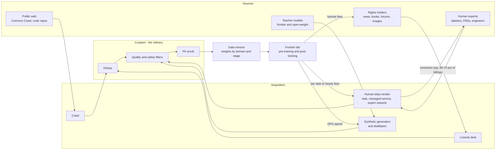
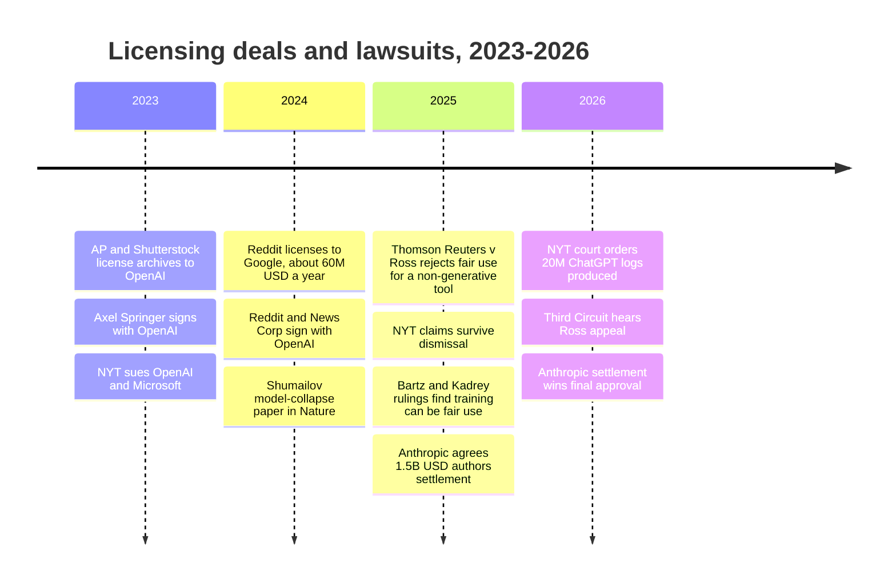

# 20. The Training-Data Supply Chain
> **Depth:** L2 · **Reading time:** ~16 min · **Last verified:** 2026-11-01 · **Prerequisites:** [Ch 16 — The AI data lifecycle](ch16-ai-data-lifecycle.md)

## TL;DR

- Frontier models are built from four input channels: crawled web data, licensed content, human-produced data (labels, preference rankings, expert demonstrations) and synthetic data generated by other models. Each channel has its own cost curve, legal risk and supplier structure. Together they form a supply chain, and curation (deduplication, quality filtering, PII removal, mixing) is the refinery in the middle.
- Human data has moved up-market fast. Cheap crowd labeling (Appen's model) is shrinking. Expert networks that rent out PhDs, doctors and senior engineers by the hour are growing quickly. Mercor's priced valuation went to $10B (October 2025, company-confirmed),[^mercor-c] and Snorkel AI's to $3.5B (September 2026, company-stated).[^snorkel-e] Bootstrapped Surge AI reportedly passed $1B of 2024 revenue (press-reported).[^surge-reuters]
- The buyer side is a handful of frontier labs, so vendor neutrality is the asset that matters most. Meta paid a press-reported ~$14.3B for 49% of Scale AI in June 2025 and hired its CEO.[^meta-scale] Within weeks, Google and OpenAI were reported to be winding down work with Scale, and Scale cut about 14% of staff.[^scale-customers][^scale-layoffs] A large investment from one customer drove the others away.
- The legal backdrop moved in 2025–2026. Two US district courts held, on the records before them, that training models on books can be fair use (Bartz v. Anthropic; Kadrey v. Meta, June 2025). In Bartz, building a library from pirated copies was a separate question, and it cost Anthropic a $1.5B class settlement, which received final approval in July 2026.[^bartz-final][^fairuse] Licensing now looks less like a legal shield and more like paid access to fresh, hard-to-crawl content.
- Curation beats raw scale. FineWeb-Edu kept only the "educational" 1.3T tokens of a 15T-token web corpus, and models trained on it scored much better on knowledge and reasoning benchmarks.[^fineweb] The tooling (MinHash dedup, LLM-labeled quality classifiers, GPU pipelines such as NVIDIA NeMo Curator) is now commodity. What stays scarce is the judgment about what goes into the mixture.

## Why this matters (business + Everpure lens)

Compute gets the headlines, but data is the input that separates frontier labs from each other. Every lab can buy the same GPUs. Few can buy the same expert-written reasoning traces, the same licensed archives or the same tuned data mixture. That is why spending on human data has grown into a multi-billion-dollar market in three years. Handshake, a college careers network, built a ~$1B run-rate AI-data business in about a year (company-stated run-rate; gross billings).[^handshake] It is also why the most valuable data vendors look less like software companies and more like staffing firms or specialty-materials suppliers, which matters for how you value them.

For a corporate-development reader, the chapter answers three questions. Where does value accrue in this chain? Today it goes to scarce expert supply and to curation know-how, not to commodity labeling. How durable are these businesses, given that a few buyers control most demand? And what does the chain mean for infrastructure vendors?

The Everpure angle is the third question. Training corpora and curated datasets are large, long-lived and versioned. A lab keeps raw crawl snapshots, several deduplicated and filtered derivatives, and the exact mixture behind each model checkpoint, sometimes for years, for reproducibility and litigation. Under the Anthropic settlement, the company had to destroy the pirated files it held,[^bartz-final] so provable deletion and lineage are now legal requirements, not just good hygiene. Enterprise fine-tuning has the same problem at smaller scale: find the sensitive data, classify it, scrub it and keep a record. This is the work that Everpure's 2026 1touch acquisition (data discovery, classification and semantic context) was bought to do.[^everpure-1touch] See the Storage bridge below and [Ch 15](../02-pipelines-and-governance/ch15-governance-security-privacy.md).

## How it works

### Four channels into one refinery

Think of a model's training data as a bill of materials. Pre-training consumes trillions of tokens, mostly crawled web text plus code, books and papers. Post-training consumes far fewer tokens, but they are far more expensive per token. They include supervised demonstrations, preference rankings for [reinforcement learning from human feedback](../glossary.md#reinforcement-learning-from-human-feedback) (RLHF), expert-graded rubrics and, increasingly, [RL environments](../glossary.md#rl-environment): simulated tasks in which a model's attempts can be scored automatically. The InstructGPT paper (2022) established the RLHF recipe that made this human-data market possible.[^instructgpt]

*Figure 20.1 — The training-data supply chain. Money flows back up the chain from a few labs. Most of the human-data dollar passes through vendors to contractors, so a vendor's real margin is its take rate, not its gross billings.*

### Human data: from crowd labels to rented PhDs

Human-data vendors use three business models, and the differences show up directly in their margins.

1. **Per-task marketplaces.** Crowd workers draw bounding boxes or rate outputs at piece rates. This was Appen's model, and Toloka's. It is a commodity: easy to multi-source and priced down every year. Appen's revenue fell to $230.8M in FY2025 (calendar year, company-reported, down from $234.3M), after Google ended its contract in March 2024. Only 75% growth in China kept it close to flat.[^appen] Its gross margin was about 24% in an earlier period (estimate).[^scale-sacra]
2. **Managed services.** The vendor owns the workflow, quality control and tooling, and sells finished datasets on contract. This was Scale AI's model, and it is Surge's and Invisible's. Margins are higher. Scale ran at roughly 50%+ gross margin when it was much smaller (estimate),[^scale-sacra] and Surge has reportedly been profitable since founding (press-reported).[^surge-reuters]
3. **Expert networks.** The vendor recruits credentialed people (lawyers, physicians, mathematicians, senior software engineers) and bills labs by the hour. Mercor, Handshake AI and Turing are the clearest cases. Revenue is reported gross: contractor pay runs about 60–70% of billings (estimate), so the net take is roughly 30–40%.[^mercor-sacra] Handshake says it pays about $60M a month to more than 30,000 people (company-stated).[^handshake]

The shift is from volume to scarcity. A 2019-era label cost cents. A 2026-era expert rubric for a graduate-level chemistry problem costs the hourly rate of a chemist. Labs pay that because models already handle easy tasks, and the remaining gains come from hard examples that only experts can write or grade. The newest product is the RL environment: a sandboxed task (a codebase with failing tests, a spreadsheet to reconcile) plus an automatic grader. Vendors build environments once and sell access to many labs. That looks more like software than staffing, and it is why Snorkel describes its new money as funding a "data factory".[^snorkel-e]

> **Bridge: semiconductor supply chain.** Map the vendors onto fab inputs. Crowd labeling is **bulk chemicals**: interchangeable, multi-sourced and priced on cost. Expert data is **specialty gases and photoresist**: small in volume, critical to yield, made by a few qualified suppliers, and earning high margins because a lab cannot easily requalify a new source mid-program. RL environments and evaluation suites aim to be **ASML**: a reusable tool that every customer needs and few can build. The gap is that ASML's moat is decades of physics and a patent wall. A data vendor's moat is a recruited workforce and a quality process, which a well-funded rival can copy in a year.

### Worked example: what $14.3B buys when it is not an acquisition

In June 2025, Meta paid a press-reported ~$14.3B for a 49% **non-voting** stake in Scale AI, which implies a ~$29B valuation. CEO Alexandr Wang left to lead Meta's superintelligence effort, and Jason Droege became interim CEO.[^meta-scale] A year earlier, Scale's Series F had priced it at $13.8B (company-stated, May 2024).[^scale-f] On press-reported 2024 revenue of about $870M,[^surge-bb] the implied multiple is about 33x trailing revenue (estimate).

What did Meta actually buy? A useful way to break it down:

| Component | What Meta got | What it cost Scale |
|---|---|---|
| Talent | Wang and a small team to run its lab (an acquihire in effect) | Founder-CEO; replaced by an outside CEO (Francis deSouza, effective August 2026)[^scale-ceo] |
| Supply insight | A large stakeholder's view of the leading data vendor | Neutrality: Google and OpenAI reported winding down work[^scale-customers] |
| Structure | A non-control stake, widely read as limiting merger-review exposure (analyst judgment) | About 14% of staff and 500 contractors cut in July 2025[^scale-layoffs] |
| Financial | An equity stake marked at ~$29B | Later talks reportedly at a lower ~$20B mark `[VERIFY: Scale AI 2026 round at ~$20B]` |

*Figure 20.2 — An acquihire-plus-supply deal: Meta captured talent and influence without control, and Scale paid with its most valuable asset, neutrality.*

The lesson for anyone valuing a supplier in a concentrated market is the one TSMC built its business on: never be owned by, or compete with, one of your customers. When a few labs account for most of the spend (Sacra estimates Surge earned over $1B from about 12 customers),[^surge-sacra] a stake held by one lab gives the others a reason to leave. The same risk can come from an operational failure. After a security breach at the end of March 2026, Meta paused its work with Mercor while OpenAI and Anthropic reviewed their exposure (press-reported).[^mercor-breach] Labs treat their data recipes as trade secrets. A vendor that sees several labs' recipes is a concentration of secrets as well as a supplier.

### Synthetic data: the model as its own supplier

[Synthetic data](../glossary.md#synthetic-data) is training data generated by a model rather than collected from people or the world. Its most common form is [distillation](../glossary.md#distillation): a large "teacher" model writes answers or reasoning traces, and a smaller "student" model is trained on them. NVIDIA built a product line around this. More than 98% of the alignment data for Nemotron-4 340B Instruct was synthetic, and NVIDIA released the generator, a reward model to grade its outputs and the pipeline under an open model license (June 2024).[^nemotron] For robotics and driving, NVIDIA's Cosmos world models (January 2025) generate physics-aware video. NVIDIA says they were trained on 20 million hours of video (vendor claim).[^cosmos] NVIDIA also bought Gretel, a synthetic-tabular-data startup, in March 2025 for an undisclosed price, reported by Wired as nine figures (press-reported).[^gretel]

The appeal is economic. GPU time is cheaper than expert time and scales without recruiting. The risk is statistical. Shumailov et al. (*Nature*, July 2024) showed that models trained recursively on their own outputs suffer [model collapse](../glossary.md#model-collapse). The rare "tails" of the original distribution disappear first, and after enough generations the output degrades into repetitive text.[^collapse] In practice labs manage the risk in three ways. They keep a fixed anchor of real data. They add synthetic data to that anchor instead of replacing it. And they use synthetic data mainly where outputs can be checked automatically, such as code that must pass tests or math with a verifiable answer. As a result, synthetic data and expert data complement each other more than they substitute: experts write the hard seeds and graders, and models multiply them.

### Licensed content and the legal backdrop

Licensing deals began in 2023 and spread through 2024. Reddit licensed its posts to Google for a reported ~$60M a year (February 2024, press-reported)[^reddit-google] and to OpenAI (May 2024; ~$70M a year is an outside estimate).[^reddit-openai] News Corp signed with OpenAI for a reported ~$250M over five years (May 2024, press-reported).[^newscorp] Earlier deals with the Associated Press, Shutterstock and Axel Springer set the template `[VERIFY: AP–OpenAI Jul 2023, Shutterstock–OpenAI Jul 2023, Axel Springer–OpenAI Dec 2023 dates and terms]`. Scholarly publishers became meaningful sellers too. Wiley reported about $49M of AI licensing revenue in its FY2026 (May 2025–April 2026, as reported by a secondary source).[^wiley]

*Figure 20.3 — Deals came first, then the rulings. The 2025 decisions protected training as a use but not piracy as a way of acquiring data. Some 2023 deal dates are pending verification.*

The rulings split along a clear line. In *Bartz v. Anthropic* (June 2025), Judge Alsup held that training on books was fair use. He sent the claims about downloading millions of pirated copies, and about keeping a permanent library, toward trial. In *Kadrey v. Meta*, decided days later, Judge Chhabria also ruled for Meta. His reasoning was narrow: he suggested that evidence of "market dilution" (AI-generated books crowding out human ones) could win a future case.[^fairuse] In February 2025, *Thomson Reuters v. Ross* went the other way for a non-generative legal-research tool that competed with its source. That case was on appeal to the Third Circuit, with argument scheduled for June 2026.[^ross] Anthropic settled the piracy exposure for $1.5B, about $3,000 per work across roughly 480,000 works. Final approval came on July 20, 2026, and the settlement releases only conduct through August 25, 2025.[^bartz-final] *New York Times v. OpenAI* survived dismissal in March 2025 and remained in discovery in 2026, with no trial date found.[^nyt]

> **Bridge: IP licensing.** Today's content deals are mostly **paid-up licenses**: a fixed annual fee for access, like a cross-license that settles a patent dispute. Rights holders want what Qualcomm and Arm have, a **running royalty** tied to each unit sold, which in this market means each query answered or each citation shown. The fair-use rulings weaken the stick (the threat of an injunction), so the value of a license now rests on the carrot: fresh, structured content that cannot be crawled freely. That is why Reddit, which controls access to its API and its live data, could reportedly seek a second round of deals in 2025.[^reddit-next]

### Curation at scale: dedup, quality, PII

Raw web text is mostly duplicates, boilerplate and spam. Curation turns it into training data in a fixed sequence of stages, cheapest first.

```mermaid
flowchart LR
    RAW["Raw crawl<br/>HTML snapshots"] --> EXT["Text extraction<br/>and language ID"]
    EXT --> EXACT["Exact dedup<br/>hash of normalized text"]
    EXACT --> FUZZY["Near-dup dedup<br/>MinHash signatures plus LSH buckets"]
    FUZZY --> SEM["Semantic dedup<br/>embedding clusters"]
    SEM --> QC["Quality classifier<br/>LLM-labeled sample, small model scores all"]
    QC --> SAFE["Toxicity and PII filters<br/>regex, NER, blocklists"]
    SAFE --> DECON["Benchmark decontamination"]
    DECON --> OUT["Curated shards<br/>versioned, with lineage"]
```

*Figure 20.4 — A typical dedup and filtering pipeline. Each stage costs more per document than the one before, so cheap stages run first to shrink the data that reaches expensive ones.*

**Exact dedup** hashes each normalized document and drops repeats. **Near-duplicate** detection uses [MinHash](../glossary.md#minhash): each document is reduced to a short signature whose overlap estimates the documents' word-shingle overlap ([Jaccard similarity](../glossary.md#jaccard-similarity)). [Locality-sensitive hashing](../glossary.md#locality-sensitive-hashing) (LSH) then buckets signatures so that only likely matches are compared. This matters because duplicates are everywhere. Lee et al. found a single 61-word sentence repeated more than 60,000 times in the C4 corpus, and showed that deduplication reduces memorized output and speeds training.[^lee-dedup] **Semantic dedup** goes further. It embeds documents, clusters them and removes near-identical meanings even when the wording differs. The SemDeDup paper reported removing about half of a large image-text set with little loss in model quality.[^semdedup]

**Quality classifiers** are where judgment comes in. FineWeb-Edu used Llama-3-70B-Instruct to grade a sample of pages for educational value, trained a small classifier on those grades, and ran it over the full 15T-token FineWeb corpus. The 1.3T tokens it kept produced clearly better models on knowledge- and reasoning-heavy benchmarks such as MMLU and ARC.[^fineweb] DataComp turned the same idea into a benchmark: it holds the model and training budget fixed and lets teams compete only on filtering.[^datacomp] Finally, PII scrubbing and toxicity filters remove emails, phone numbers and IDs, along with abusive content. In enterprise fine-tuning, this is where governance tooling ([Ch 15](../02-pipelines-and-governance/ch15-governance-security-privacy.md)) meets the training pipeline.

The output feeds a [data mixture](../glossary.md#data-mixture): the weights given to web, code, math, books and synthetic data at each training stage. Labs typically upweight scarce high-quality sources and save the best data for the final phase of training. The mixture is among a lab's most closely held secrets, which is part of why the Mercor breach alarmed customers.

> **Bridge: defect screening.** A dedup pipeline is **wafer inspection** for text. Exact hashing is die-to-database comparison: cheap, run on everything, and it only catches perfect matches. MinHash-LSH is sampling inspection: a probabilistic check tuned to a false-positive budget. The quality classifier is **yield binning**: every document passes, but it lands in a grade bucket, and the mixture decides how much of each bin to use. As in a fab, screening is cheap relative to what it protects. A training run that wastes 20% of its GPU-hours on duplicated tokens is like running a lithography tool on known-bad wafers.

> **Going deeper (L3).** With *b* LSH bands of *r* rows each, two documents with Jaccard similarity *s* collide in at least one band with probability 1 − (1 − s^r)^b. That S-curve lets engineers set the threshold (commonly around 0.7–0.8) and trade recall against compute. NVIDIA's NeMo Curator runs MinHash, LSH and connected-components grouping on GPUs with RAPIDS. NVIDIA claims a 4.5 TB RedPajama dedup dropped from 37 hours on CPUs to 3 hours on four DGX A100 nodes, 20x faster and 5x cheaper (vendor claim).[^curator] FineWeb's open-source `datatrove` library and Spark, Ray or Daft jobs do the same work on CPUs.

## Design choices and trade-offs

| Channel | Unit cost | Scales with | Legal / ethical risk | Quality ceiling | Who controls supply |
|---|---|---|---|---|---|
| Crawled web | Lowest (crawl plus curation compute) | Compute and storage | Fair use favorable for training (2025 rulings), but robots.txt and output claims are still live | Limited by the web's average; needs heavy filtering | Nobody, though sites increasingly block crawlers |
| Licensed content | Fixed fees; ~$50M–$60M a year for the largest reported deals (press-reported) | Number of rights holders signed | Low once signed; license scope matters | High for fresh, structured content | Rights holders with access control (Reddit, news, publishers) |
| Human / expert data | Highest per token; hourly expert rates | Recruiting | Contractor classification, data security (Mercor breach) | Highest for frontier reasoning | Few vendors; workforce is the moat |
| Synthetic / distilled | GPU time | Compute | Terms-of-service limits on training with rivals' outputs; collapse risk | Bounded by the teacher plus the verifier | Whoever has the best teacher model and graders |

*Figure 20.5 — Each channel trades cost against control. Labs mix all four; the strategic question is which one sets the binding constraint for the next model.*

The steelman for buying less human data is that synthetic generation plus automated verifiers will keep driving down the share of human-written tokens. The counter-argument is that someone still has to write the hard seed problems and grade the ungradable domains (law, medicine, strategy), so the market moves to rarer experts rather than disappearing. The steelman for licensing is weaker after 2025. Training itself looks defensible, so licenses now buy freshness and access rather than legal peace. A hard ruling in *NYT v. OpenAI*, or market-dilution evidence in a future case, could reverse that.

## Who's who

| Vendor | Model | Customers (public reporting) | Latest funding / valuation (basis, date) | Status, Nov 2026 | Margin profile | Differentiation |
|---|---|---|---|---|---|---|
| Scale AI | Managed service, moving to enterprise and government apps | Meta (49% holder); Google, OpenAI reported winding down 2025[^scale-customers] | ~$29B implied by Meta's $14.3B for 49% (press-reported, Jun 2025)[^meta-scale] | New CEO Francis deSouza from Aug 2026[^scale-ceo] | ~50%+ gross margin in an earlier period (estimate)[^scale-sacra] | Scale, tooling, government work; neutrality lost |
| Surge AI | Managed expert service | A dozen or so frontier-lab customers (estimate)[^surge-sacra] | No priced primary round; talks at $15B–$25B reported Jul 2025 (press-reported)[^surge-bbg] | Bootstrapped; >$1B 2024 revenue (press-reported)[^surge-reuters] | Profitable (press-reported) | Quality reputation; independence |
| Mercor | Expert network, hourly billing | OpenAI, Anthropic; Meta paused Apr 2026[^mercor-breach] | $10B Series C (company-confirmed, Oct 2025);[^mercor-c] ~$20B talks 2026 (press-reported)[^mercor-2026] | Run-rate >$2B claimed by CEO, mid-2026 (press-reported)[^mercor-2026] | Contractor pay ~60–70% of billings (estimate)[^mercor-sacra] | AI-run recruiting of credentialed experts |
| Handshake AI | Expert network from a campus job network | Frontier labs (estimate)[^handshake] | `[VERIFY: latest valuation]` | ~$1B run-rate, Apr 2026 (company-stated, gross)[^handshake] | Net ~40% of gross (estimate)[^handshake] | Built-in supply of students and PhDs |
| Turing | Expert coding data plus enterprise services | OpenAI and other LLM labs[^turing] | $111M Series E at $2.2B (company-stated, Mar 2025)[^turing] | Private, growing | `[VERIFY]` | Large software-engineer pool for code and agent data |
| Invisible Technologies | Managed service plus enterprise AI ops | Labs and enterprises[^invisible] | $100M at >$2B (company-stated floor, Sep 2025)[^invisible] | Private | `[VERIFY]` | Process-heavy managed workforce |
| Snorkel AI | Programmatic labeling software, now expert data and evals | Enterprises and frontier labs[^snorkel-e] | $350M Series E at $3.5B (company-stated, Sep 2026)[^snorkel-e] | Run-rate ~$375M (company-stated)[^snorkel-e] | Software-plus-service blend `[VERIFY]` | Weak-supervision IP; "data factory" for evals and RL |
| Labelbox | Labeling software plus expert network | `[VERIFY]` | `[VERIFY: last round and valuation]` | Private | Software margins on platform `[VERIFY]` | Tooling layer used in-house by labs and enterprises |
| Toloka | Crowd plus expert marketplace | `[VERIFY]` | $72M led by Bezos Expeditions (press-reported, May 2025)[^toloka] | Private; spun out of the Nebius group `[VERIFY]` | Marketplace take rate `[VERIFY]` | Global crowd, multilingual coverage |
| Appen (ASX: APX) | Per-task crowd and managed projects | Lost Google (Mar 2024); China segment growing[^appen] | Public; FY2025 revenue $230.8M (company-reported)[^appen] | Turnaround; FY2026 guide $270M–$300M[^appen] | ~24% gross margin, earlier period (estimate);[^scale-sacra] net loss $21.8M FY2025[^appen] | Scale in commodity annotation; China |

*Figure 20.6 — Human-data vendors arranged from managed services through expert networks to commodity crowds. Valuations follow scarcity of supply, not headcount.*

*Figure 20.7 — Priced valuations cluster between $2B and $10B, with Scale as a one-off strategic mark. The largest numbers (Surge, Mercor's next round) are talks, not closed rounds. Source: `data/private_funding.csv`, chapter staging rows and `data/ch20_valuation_talks.csv`.*

**Curation and synthetic tooling.** NVIDIA covers the GPU end: NeMo Curator for text and video curation, Nemotron and Cosmos for synthetic generation, and Gretel's team for tabular synthesis.[^curator][^nemotron][^cosmos][^gretel] Hugging Face hosts the open datasets (FineWeb and others) and the `datatrove` tooling.[^fineweb] Databricks and Anyscale (Ray) are the general-purpose CPU and GPU batch engines. Daft is a newer multimodal dataframe engine. Lab-internal pipelines remain the largest "vendor" of all. MLOps platforms that version and serve these datasets are covered in [Ch 21](ch21-ml-platforms-feature-stores-llmops.md), and the AI-native data companies in [Ch 32](../04-company-deep-dives/ch32-ai-native-data-companies.md).

## History and trajectory

- **2009–2019: the crowd era.** ImageNet-style labeling made crowd annotation a business. Appen and Scale (founded 2016) grew on computer-vision and autonomous-driving work.
- **2022: RLHF creates a new product.** InstructGPT showed that a small amount of human preference data could change model behavior dramatically. Labs began buying rankings and demonstrations instead of bounding boxes.[^instructgpt]
- **2023–2024: licensing and litigation start together.** OpenAI's first archive deals and the NYT lawsuit (December 2023) were followed by Reddit, News Corp and others in 2024.[^reddit-google][^newscorp] Scale raised at $13.8B (May 2024).[^scale-f] Google ended its Appen contract (March 2024).[^appen]
- **2025: the expert pivot and the Meta–Scale shock.** Turing ($2.2B, March), Snorkel ($1.3B, May), Toloka ($72M, May), Invisible (>$2B, September) and Mercor ($10B, October) all raised.[^turing][^snorkel-d][^toloka][^invisible][^mercor-c] Meta's Scale stake in June sent customers to Surge, Mercor and others.[^meta-scale][^scale-customers] NVIDIA bought Gretel (March).[^gretel] Fair-use rulings arrived in June, and Anthropic settled with authors.[^fairuse][^bartz-final]
- **2026: scale and its stresses.** Handshake reported a ~$1B run-rate (April).[^handshake] The Mercor breach showed the security risk of concentrated suppliers (April).[^mercor-breach] The Anthropic settlement won final approval (July). Scale hired an outside CEO and leaned toward enterprise applications (July).[^scale-ceo] Snorkel tripled its valuation to $3.5B (September).[^snorkel-e]

**Trajectory.** Expect three shifts. First, a move from selling labor to selling reusable assets: environments, evals and graders that can be licensed to many labs. Second, buyers diversifying across several vendors and pulling expert networks in-house, which compresses take rates. Third, consolidation, in which model and cloud vendors acquire curation and synthetic-data capability, as NVIDIA did with Gretel. The M&A angle is covered in [Ch 39](../05-business-and-economics/ch39-ma-history.md).

## Numbers that matter

| Metric | Value | Basis | Source / date |
|---|---|---|---|
| Meta stake in Scale AI | ~$14.3B for 49%, non-voting; ~$29B implied | press-reported | Jun 2025[^meta-scale] |
| Scale AI Series F | $1B at $13.8B | company-stated | May 2024[^scale-f] |
| Scale AI layoffs after deal | ~14% of staff (~200) plus 500 contractors | press-reported | Jul 2025[^scale-layoffs] |
| Surge AI 2024 revenue | >$1B, bootstrapped | press-reported | Jul 2025[^surge-reuters] |
| Mercor Series C | $350M at $10B | company-confirmed | Oct 2025[^mercor-c] |
| Mercor run-rate | ~$450M (Sep 2025) to >$2B claimed (mid-2026) | press-reported, gross | 2025–2026[^mercor-rr][^mercor-2026] |
| Snorkel AI Series E | $350M at $3.5B; ~$375M run-rate | company-stated | Sep 2026[^snorkel-e] |
| Handshake AI run-rate | ~$1B; ~$60M a month paid to 30K+ experts | company-stated, gross | Apr 2026[^handshake] |
| Appen FY2025 revenue | $230.8M (FY2024 $234.3M); net loss $21.8M | company-reported, calendar FY | Feb 2026[^appen] |
| Anthropic authors settlement | $1.5B; ~$3,000 per work; ~480K works | court-approved | Final Jul 20, 2026[^bartz-final] |
| Reddit–Google license | ~$60M a year | press-reported | Feb 2024[^reddit-google] |
| News Corp–OpenAI | ~$250M over 5 years | press-reported | May 2024[^newscorp] |
| FineWeb / FineWeb-Edu | 15T tokens / 1.3T tokens | paper | Jun 2024[^fineweb] |
| Nemotron-4 340B alignment data | >98% synthetic | vendor technical report | Jun 2024[^nemotron] |
| NeMo Curator GPU dedup | 20x faster, 5x cheaper than CPU | vendor claim | NVIDIA blog[^curator] |

*Figure 20.8 — The figures to remember. Note how few are audited: this market runs on press reports and company-stated run-rates, mostly gross of contractor pay.*

## Storage bridge

> **Storage bridge.** A training corpus is a data lake with unusual requirements. It is petabyte-scale and written once, but it is re-read many times per training run. Every derived version (deduplicated, filtered, mixed) must be kept and tied to the model checkpoint it fed, both for reproducibility and for litigation holds. The Anthropic settlement's requirement to destroy pirated files shows that deletion must also be provable. Snapshots, immutable versioning, lineage metadata and fast parallel reads are the storage-layer capabilities involved. Everpure's 1touch-based data intelligence (discovery, classification, sensitive-data context) maps onto the PII-scrub and provenance stages for enterprise fine-tuning sets. That is an option a strategy team might evaluate, based on public information. See the companion *Everpure Tech Atlas* for the AI-storage detail.

## Conversation playbook

**Questions for a PM**

1. "What share of your training-data spend goes to human data versus licensing versus synthetic generation, and how has that mix shifted since 2024?"
2. "How many data vendors do you qualify for each workstream, and what would you do if your largest one took a strategic investment from a competing lab?"
3. "For licensed content, are you paying for training rights, for retrieval and citation, or both, and is any deal priced per use?"

**Questions for an engineer**

1. "What dedup stack do you run (exact, MinHash-LSH, semantic), and what Jaccard threshold and band configuration did you settle on?"
2. "How do you build and validate your quality classifier, and how do you decontaminate against the benchmarks you report?"
3. "How do you version corpora and mixtures so you can reproduce a checkpoint, or prove that a takedown request was honored?"

**What good answers sound like.** They give a mix in rough percentages and a multi-vendor policy ("no vendor above about 30% of a program"). They distinguish gross billings from net take when quoting vendor size. On curation, they name thresholds and ablations ("we tested the classifier cut-off on 1B-token proxies"), and they treat lineage as a requirement, not a nice-to-have.

**Don't say this**

- "Meta acquired Scale AI." It bought a 49% non-voting stake. The difference explains both the deal structure and the customer exodus.
- "Mercor has $2B of revenue." That is a claimed gross run-rate, before 60–70% contractor pay (estimate).
- "The courts said AI training is fair use, full stop." Two district courts said so on specific facts. Piracy was not excused, *NYT v. OpenAI* is unresolved and *Ross* went the other way.
- "Synthetic data will make human data obsolete." Model collapse and the need for verifiers keep humans in the loop. The work has moved to harder tasks, not gone away.
- "More data is always better." FineWeb-Edu showed that a 9% slice of a corpus can beat the whole.

## Going deeper

- Penedo et al., *The FineWeb Datasets* (NeurIPS 2024), the clearest public ablation of dedup and quality filtering.[^fineweb]
- Lee et al., *Deduplicating Training Data Makes Language Models Better* (2021),[^lee-dedup] and Abbas et al., *SemDeDup* (2023).[^semdedup]
- Gadre et al., *DataComp* (2023), for data-centric benchmarking.[^datacomp]
- Shumailov et al., *Nature* (2024), on model collapse.[^collapse]
- NVIDIA, *Nemotron-4 340B Technical Report* (2024), on synthetic alignment pipelines.[^nemotron]

## Key terms

- [Reinforcement learning from human feedback](../glossary.md#reinforcement-learning-from-human-feedback) — tuning a model with a reward signal learned from human preference rankings.
- [RL environment](../glossary.md#rl-environment) — a sandboxed task with an automatic grader that a model practices on during reinforcement learning.
- [Expert network](../glossary.md#expert-network) — a vendor that rents credentialed specialists by the hour to write or grade training data.
- [Synthetic data](../glossary.md#synthetic-data) — training data generated by a model rather than collected from people or the world.
- [Distillation](../glossary.md#distillation) — training a smaller student model on the outputs of a larger teacher model.
- [Model collapse](../glossary.md#model-collapse) — degradation when models train recursively on model-generated data and lose the tails of the real distribution.
- [MinHash](../glossary.md#minhash) — a compact signature whose overlap estimates the Jaccard similarity of two documents.
- [Jaccard similarity](../glossary.md#jaccard-similarity) — the size of two sets' intersection divided by the size of their union.
- [Locality-sensitive hashing](../glossary.md#locality-sensitive-hashing) — hashing that puts similar items in the same bucket so only likely matches are compared.
- [Semantic deduplication](../glossary.md#semantic-deduplication) — removing documents with near-identical meaning using embedding clusters.
- [Quality classifier](../glossary.md#quality-classifier) — a small model that scores documents for usefulness so a corpus can be filtered.
- [Data mixture](../glossary.md#data-mixture) — the proportions of each data source used at each stage of training.
- [Benchmark decontamination](../glossary.md#benchmark-decontamination) — removing evaluation questions from training data so scores are not inflated.
- [Fair use](../glossary.md#fair-use) — the US copyright defense weighing purpose, nature, amount and market effect of a use.
- [Acquihire](../glossary.md#acquihire) — a deal whose main purpose is hiring a team rather than buying a business.

## Sources

[^meta-scale]: TechCrunch, "Scale AI confirms 'significant' investment from Meta, says CEO Alexandr Wang is leaving," https://techcrunch.com/2025/06/13/scale-ai-confirms-significant-investment-from-meta-says-ceo-alexandr-wang-is-leaving/, published 2025-06-13; CNBC via NBC Chicago, https://www.nbcchicago.com/news/business/money-report/scale-ais-alexandr-wang-confirms-departure-for-meta-as-part-of-14-3-billion-deal/3767336/, published 2025-06; DeepLearning.AI, The Batch, https://www.deeplearning.ai/the-batch/meta-invests-14-3-billion-in-scale-ai-hires-ceo-alexandr-wang, published 2025-06; retrieved 2026-11-01. $14.3B and ~$29B are press-reported (as in `data/private_funding.csv`).
[^scale-f]: `data/private_funding.csv` row "Scale AI, 2024-05-21, Series F, $1,000M at $13.8B (company-stated, Accel)", source https://www.silicon.co.uk/cloud/ai/surge-ai-funding-620404; retrieved 2026-11-01.
[^scale-layoffs]: TechRepublic, "Scale AI Lays Off Hundreds After $14.3B Meta Investment" (citing Bloomberg), https://www.techrepublic.com/article/news-scale-ai-layoffs/, published 2025-07; Storyboard18, https://www.storyboard18.com/how-it-works/scale-ai-lays-off-14-of-staff-following-metas-14-3-bn-investment-75048.htm, published 2025-07; retrieved 2026-11-01. Press-reported.
[^scale-customers]: UPI, Scale AI layoffs and customer departures, https://www.upi.com/Top_News/US/2025/07/16/4661752702358/, published 2025-07-16; TipRanks (citing Reuters), https://www.tipranks.com/news/meta-backed-scale-ai-cuts-14-of-its-workforce, published 2025-07; retrieved 2026-11-01. OpenAI denied the decision was related to Meta. Press-reported.
[^scale-ceo]: Scale AI, "Scale appoints new CEO," https://scale.com/blog/scale-appoints-new-ceo, published 2026-07-30; Quartz, https://qz.com/scale-ai-francis-desouza-ceo-google-cloud-073026, published 2026-07-30; retrieved 2026-11-01.
[^scale-sacra]: Sacra, "Scale: the $290M/year Mechanical Turk of machine learning," https://sacra.com/research/scale-ai-mechanical-turk/, published c. 2022 `[VERIFY: date]`; retrieved 2026-11-01. Gross margins for Scale (~50%+), Appen (~24%) and TELUS International (~21%) are analyst estimates from an earlier period.
[^surge-bb]: Ben's Bites, summary of a press report that Surge AI told staff it had $1B in 2024 revenue versus Scale's $870M, https://news.bensbites.com/posts/42121-a-look-at-scale-ai-rival-surge-ai-which-raised-no-outside-capital-told-staff-it-had-1b-in-2024-revenue-vs-scales-870m-and-has-always-been-profitable, published 2025 `[VERIFY: original outlet and date]`; retrieved 2026-11-01. Press-reported.
[^surge-reuters]: Seeking Alpha, "Surge AI, rival of Scale AI, pursues $1B in first capital raise: report" (citing Reuters), https://seekingalpha.com/news/4464337-surge-ai-rival-of-scale-ai-pursues-1b-in-first-capital-raise-report, published 2025-07; retrieved 2026-11-01. Revenue and profitability are press-reported.
[^surge-bbg]: Bloomberg, "Scale Rival Surge AI in Talks for Funding at $25 Billion Value," https://www.bloomberg.com/news/articles/2025-07-30/scale-rival-surge-ai-in-talks-for-funding-at-25-billion-value, published 2025-07-30; retrieved 2026-11-01. Talks, no confirmed close.
[^surge-sacra]: Sacra, "Surge AI," https://sacra.com/research/surge-ai, living document; retrieved 2026-11-01. Customer count and revenue are estimates.
[^mercor-c]: TechCrunch, "Mercor quintuples valuation to $10B with $350M Series C," https://techcrunch.com/2025/10/27/mercor-quintuples-valuation-to-10b-with-350m-series-c/, published 2025-10-27; retrieved 2026-11-01. Company-confirmed.
[^mercor-rr]: TechCrunch, "Sources: AI training startup Mercor eyes $10B+ valuation on $450 million run rate," https://techcrunch.com/2025/09/09/sources-ai-training-startup-mercor-eyes-10b-valuation-on-450m-run-rate/, published 2025-09-09; retrieved 2026-11-01. Press-reported.
[^mercor-2026]: Crypto Briefing, "Nvidia explores investment in AI data supplier Mercor valued at $20B" (citing Bloomberg), https://cryptobriefing.com/nvidia-mercor-ai-data-investment/, published 2026 `[VERIFY: date]`; AI Weekly, https://aiweekly.co/alerts/mercor-books-614m-in-h1-2026-leaning-on-openai-anthropic, published 2026; retrieved 2026-11-01. The >$2B run-rate was posted by CEO Brendan Foody on X (press-reported); the $20B round is talks.
[^mercor-sacra]: Sacra, "Mercor," https://sacra.com/c/mercor/, living document; Enterprise DNA (citing Sacra), https://enterprisedna.co/resources/ai-map/data; retrieved 2026-11-01. Contractor pay at 60–70% of gross is an estimate.
[^mercor-breach]: TechCrunch, "After data breach, $10B-valued startup Mercor is having a month," https://techcrunch.com/2026/04/09/after-data-breach-10b-valued-startup-mercor-is-having-a-month, published 2026-04-09; The Next Web, https://thenextweb.com/news/meta-mercor-breach-ai-training-secrets-risk, published 2026-04-04 (first reported by WIRED); retrieved 2026-11-01.
[^handshake]: Dealroom, "Handshake's ARR crosses $1B as AI training revenue surges," https://dealroom.co/news/127345-handshakes-arr-crosses-1b-as-ai-training-revenue-surges/, published 2026-04-14; Sacra, "Handshake," https://sacra.com/c/handshake/ (estimates: ~$1.1B gross and ~$450M net run-rate, April 2026); Handshake job posting citing ~$1B run-rate and ~$60M a month paid to 30K+ people, https://careers.base10.vc/companies/joinhandshake-com/jobs/87622264-software-engineer-handshake-ai; retrieved 2026-11-01.
[^turing]: Turing, "Turing gears up to power next wave of AGI with $111 million in Series E," https://www.turing.com/press/turing-111-million-series-e, published 2025-03-06; TechCrunch, https://techcrunch.com/2025/03/06/turing-a-key-coding-provider-for-openai-and-other-llm-producers-raises-111m-at-a-2-2b-valuation, published 2025-03-06; retrieved 2026-11-01.
[^invisible]: Business Wire, "Invisible Technologies Raises $100 Million to Power the Next Generation of AI Infrastructure for the Enterprise," https://businesswire.com/news/home/20250916425748/en/, published 2025-09-16; Bloomberg (syndicated), "Scale AI Rival Invisible Technologies Valued at Over $2 Billion," https://news.bloombergtax.com/daily-tax-report-international/scale-ai-rival-invisible-technologies-valued-at-over-2-billion, published 2025-09-17; retrieved 2026-11-01.
[^snorkel-d]: Snorkel AI, "Snorkel AI raises $100 million to build better evaluators for AI models," https://snorkel.ai/press/snorkel-ai-raises-100-million-to-build-better-evaluators-for-ai-models/, published 2025-05; retrieved 2026-11-01. Company-stated $1.3B valuation, led by Addition.
[^snorkel-e]: Snorkel AI, "Snorkel AI raises $350M to scale the data factory for frontier AI," https://snorkel.ai/press/snorkel-ai-raises-350m-to-scale-the-data-factory-for-frontier-ai/, published 2026-09-22; TechCrunch, "Snorkel AI triples valuation to $3.5B as demand for AI training data booms," https://techcrunch.com/2026/09/22/snorkel-ai-triples-valuation-to-3-5b-as-demand-for-ai-training-data-booms, published 2026-09-22; retrieved 2026-11-01. Run-rate company-stated (~$375M; Reuters reported >$350M).
[^toloka]: Techleap Finder, "Bezos invests $72M in Toloka expansion," https://finder.techleap.nl/news/feed/bezos-invests-72m-in-toloka-expansion, published 2025-05; retrieved 2026-11-01. Secondary source.
[^appen]: Appen Limited, FY2025 results announcement (ASX), https://announcements.asx.com.au/asxpdf/20260225/pdf/06wq7ntr51bhgl.pdf, published 2026-02-25; retrieved 2026-11-01. Calendar fiscal year; figures in US$; Google contract terminated effective March 2024.
[^gretel]: TechCrunch, "Nvidia reportedly acquires synthetic data startup Gretel," https://techcrunch.com/2025/03/19/nvidia-reportedly-acquires-synthetic-data-startup-gretel, published 2025-03-19; retrieved 2026-11-01. Price undisclosed; Wired reported nine figures (as in `data/ma_deals.csv`).
[^nemotron]: NVIDIA, "Nemotron-4 340B Technical Report," arXiv:2406.11704, https://arxiv.org/html/2406.11704v1, published 2024-06; NVIDIA blog, https://blogs.nvidia.com/blog/nemotron-4-synthetic-data-generation-llm-training, published 2024-06-14; retrieved 2026-11-01.
[^cosmos]: NVIDIA, "NVIDIA Launches Cosmos World Foundation Model Platform to Accelerate Physical AI Development," https://investor.nvidia.com/news/press-release-details/2025/NVIDIA-Launches-Cosmos-World-Foundation-Model-Platform-to-Accelerate-Physical-AI-Development/default.aspx, published 2025-01-06; TechCrunch, https://techcrunch.com/2025/01/06/nvidia-releases-its-own-brand-of-world-models, published 2025-01-06; retrieved 2026-11-01. Training-data figures are vendor claims.
[^collapse]: I. Shumailov et al., "AI models collapse when trained on recursively generated data," *Nature* 631, 755–759, https://www.nature.com/articles/s41586-024-07566-y, published 2024-07; retrieved 2026-11-01.
[^reddit-google]: Engadget (citing Reuters), "Reddit is licensing its content to Google to help train its AI models," https://engadget.com/reddit-is-licensing-its-content-to-google-to-help-train-its-ai-models-200013007.html, published 2024-02-22; retrieved 2026-11-01. Press-reported.
[^reddit-openai]: Search Engine Land, "OpenAI may pay Reddit $70M for licensing deal," https://searchengineland.com/openai-may-pay-reddit-70m-for-licensing-deal-451882, published 2025 `[VERIFY: date]`; retrieved 2026-11-01. Estimate, not a disclosed term.
[^reddit-next]: Bloomberg, "Reddit Seeks to Strike Next AI Content Pact With Google, OpenAI," https://www.bloomberg.com/news/articles/2025-09-17/reddit-seeks-to-strike-next-ai-content-pact-with-google-openai, published 2025-09-17; retrieved 2026-11-01.
[^newscorp]: SiliconANGLE, "OpenAI strikes deal with News Corp to access Wall Street Journal content," https://siliconangle.com/2024/05/22/openai-strikes-deal-news-corp-access-wall-street-journal-content/, published 2024-05-22; retrieved 2026-11-01. ~$250M over five years first reported by the WSJ; press-reported.
[^wiley]: CASRAI, "Scholarly publisher AI licensing deals 2026," https://www.casrai.org/news/scholarly-publisher-ai-licensing-deals-2026, published 2026; retrieved 2026-11-01. Secondary summary of Wiley FY2026 results `[VERIFY: against Wiley 10-K]`.
[^bartz-final]: JURIST, "Judge approves record $1.5 billion AI copyright settlement involving Anthropic," https://www.jurist.org/news/2026/07/judge-approves-record-1-5-billion-settlement-involving-anthropic/, published 2026-07; Authors Guild, "Court grants final approval to Anthropic copyright settlement," https://authorsguild.org/news/court-grants-final-approval-anthropic-copyright-settlement/, published 2026-07; retrieved 2026-11-01.
[^fairuse]: McKool Smith, "AI Infringement Case Updates" (Kadrey v. Meta; Bartz v. Anthropic), https://www.mckoolsmith.com/newsroom-ailitigation-14, published 2025-07; ChatGPT Is Eating the World, "The fair use triangle: state of fair use in AI training 2025," https://chatgptiseatingtheworld.com/2025/10/06/the-fair-use-triangle-state-of-fair-use-in-ai-training-2025-no-more-decisions-until-mid-to-late-2026/, published 2025-10-06; retrieved 2026-11-01.
[^ross]: McKool Smith, "Thomson Reuters v. Ross Intelligence: The 'Fair Use' Shot Heard Around The Litigation World," https://www.mckoolsmith.com/newsroom-ailitigation-10, published 2025-02; Florida State University College of Law, "First AI Copyright Appeal's Reach Hinges on Market Impact Issue," https://law.fsu.edu/sites/default/files/2026-06/First%20AI%20Copyright%20Appeal%E2%80%99s%20Reach%20Hinges%20on%20Market%20Impact%20Issue.pdf, published 2026-06; retrieved 2026-11-01. Third Circuit No. 25-02153; outcome `[VERIFY]`.
[^nyt]: NPR via WHRO, "Judge allows New York Times copyright case against OpenAI to go forward," https://www.whro.org/2025-03-26/judge-allows-new-york-times-copyright-case-against-openai-to-go-forward, published 2025-03-26; ChatAI Guide, "OpenAI lawsuits 2026," https://chatai.guide/news/openai-lawsuits-2026/, published 2026 (January 5, 2026 log-production order); retrieved 2026-11-01.
[^fineweb]: G. Penedo et al., "The FineWeb Datasets: Decanting the Web for the Finest Text Data at Scale," arXiv:2406.17557, https://arxiv.org/abs/2406.17557, published 2024-06-25; NeurIPS 2024 Datasets and Benchmarks, https://proceedings.neurips.cc/paper_files/paper/2024/hash/370df50ccfdf8bde18f8f9c2d9151bda-Abstract-Datasets_and_Benchmarks_Track.html; retrieved 2026-11-01.
[^curator]: NVIDIA Technical Blog, "Curating Trillion-Token Datasets: Introducing NVIDIA NeMo Data Curator," https://developer.nvidia.com/blog/curating-trillion-token-datasets-introducing-nemo-data-curator/, published 2023 `[VERIFY: date]`; retrieved 2026-11-01. Speed and cost figures are vendor claims.
[^lee-dedup]: K. Lee et al., "Deduplicating Training Data Makes Language Models Better," arXiv:2107.06499, https://arxiv.org/abs/2107.06499, published 2021-07; retrieved 2026-11-01 (from prior knowledge; not re-fetched because the search budget was exhausted).
[^semdedup]: A. Abbas et al., "SemDeDup: Data-efficient learning at web-scale through semantic deduplication," arXiv:2303.09540, https://arxiv.org/abs/2303.09540, published 2023-03; retrieved 2026-11-01 (not re-fetched). `[VERIFY: ~50% LAION removal figure]`
[^datacomp]: S. Y. Gadre et al., "DataComp: In search of the next generation of multimodal datasets," arXiv:2304.14108, https://arxiv.org/abs/2304.14108, published 2023-04; retrieved 2026-11-01 (not re-fetched).
[^everpure-1touch]: World Wide Technology (reposting Pure Storage release), "Pure Storage rebrands to Everpure and announces intent to acquire 1touch," https://www.wwt.com/news/pure-storage-rebrands-to-everpure-and-announces-intent-to-acquire-1touch, published 2026-02-23; Cleary Gottlieb, "Everpure Completes Acquisition of 1touch," https://www.clearygottlieb.com/news-and-insights/news-listing/everpure-completes-acquisition-of-1touch, published 2026-05-11; retrieved 2026-11-01.
[^instructgpt]: L. Ouyang et al., "Training language models to follow instructions with human feedback," arXiv:2203.02155, https://arxiv.org/abs/2203.02155, published 2022-03; retrieved 2026-11-01 (not re-fetched).
