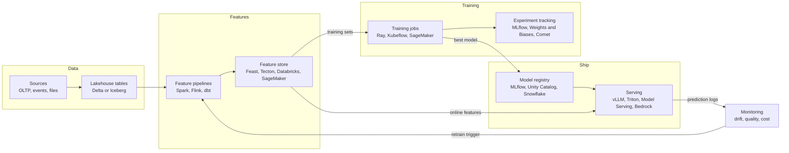
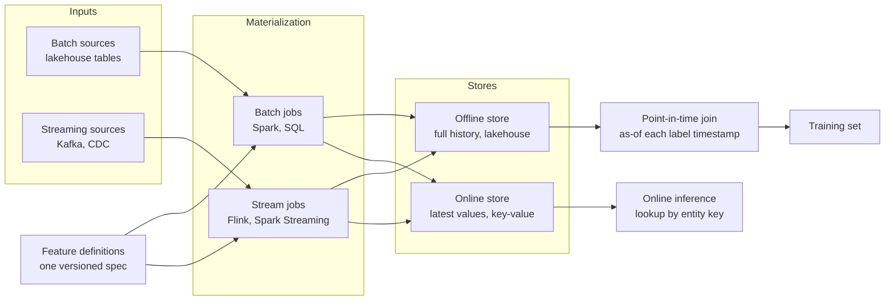
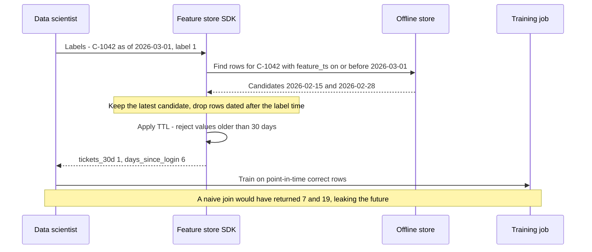
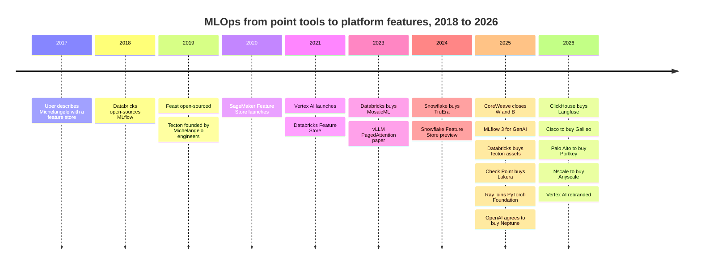

# 21. ML Platforms, Feature Stores and LLMOps
> **Depth:** L2 · **Reading time:** ~15 min · **Last verified:** 2026-11-01 · **Prerequisites:** [Ch 16 — The AI data lifecycle](ch16-ai-data-lifecycle.md)

## TL;DR

- Machine learning in production is mostly data engineering with a model in the middle. The classic lifecycle runs data → features → training → registry → serving → monitoring, and [MLOps](../glossary.md#mlops) is the discipline of making that loop repeatable. MLflow, which Databricks open-sourced in 2018, became the default system of record for it. Databricks says MLflow passed 30M monthly downloads around the MLflow 3 launch in June 2025 (company-stated).[^mlflow3]
- A [feature store](../glossary.md#feature-store) solves one expensive problem: making sure the model sees the same feature values in training as it will see in production. It pairs an offline store (history, on the lakehouse) with an online store (latest values, in a key-value database) and generates training sets with [point-in-time joins](../glossary.md#point-in-time-join) so that no future data leaks into the past.
- [LLMOps](../glossary.md#llmops) is the same loop for generative AI, with different nouns: prompts instead of features, [traces](../glossary.md#llm-trace) instead of prediction logs, [evals](../glossary.md#llm-evaluation) and [LLM-as-judge](../glossary.md#llm-as-judge) instead of accuracy metrics, plus guardrails and gateways in the request path.
- The standalone MLOps category was absorbed. CoreWeave bought Weights & Biases (~$1.7B, press-reported, closed May 2025); Databricks bought Tecton's assets (Aug 2025); OpenAI agreed to buy Neptune (Dec 2025); ClickHouse bought Langfuse (Jan 2026); Cisco is buying Galileo and Palo Alto Networks is buying Portkey (both announced Apr 2026); Nscale agreed to buy Anyscale for a press-reported ~$1.65B (Jul 2026).[^wandb][^tecton-dbx][^neptune][^langfuse][^galileo][^portkey][^nscale]
- The buyers fall into three groups: data platforms (the model needs the data), GPU clouds (moving up the stack), and security or observability vendors (the LLM request path is a new control point). Independent survivors are those with an open-source wedge and a fresh GenAI category, such as LangChain, Braintrust, Arize and Inferact (vLLM).

## Why this matters (business + Everpure lens)

For a strategy team, this layer is the clearest recent example of a tooling category being absorbed by the platforms underneath it. Between 2018 and 2022, investors funded a separate company for each box in the ML lifecycle: experiment tracking, feature stores, model monitoring, labelling and orchestration. By 2026 most of those boxes are features inside Databricks, Snowflake, the hyperscalers, or a GPU cloud. The pattern matters because the same pressure now bears on LLMOps tools, AI gateways and, one layer down, storage-adjacent data services.

The economics explain it. MLOps tools sit on top of data that the platform already holds. A feature store is a set of governed tables plus a cache. A model registry is a catalog entry. A monitoring job is a scheduled query over prediction logs. When the platform holds the tables, the catalog and the compute, it can offer each function at a lower marginal cost, often bundled into consumption pricing, and it can make governance work across all of them. The data gravity argument in [Ch 25](../04-company-deep-dives/ch25-databricks.md) and [Ch 26](../04-company-deep-dives/ch26-snowflake.md) applies directly.

For Everpure, three things matter. First, this layer is **storage-heavy in bursts**: training checkpoints, feature-table history and model artifacts are large, versioned and written all at once. Second, feature tables and model artifacts increasingly live as open tables and objects on S3-compatible storage under a catalog such as Unity Catalog, which is the "bucket under someone else's catalog" question from [Ch 7](../01-data-systems-foundations/ch07-open-table-formats.md). Third, the buyers of LLMOps companies (security and observability vendors) show that whoever sits in the AI request path can sell governance. Everpure's 1touch-based Data Intelligence, which classifies data before it reaches AI pipelines, is an adjacent position on the data side of the same path.

## How it works

### The classic ML lifecycle

Google's 2015 "hidden technical debt" paper made the point that the model code is a small box surrounded by much larger systems for data collection, feature extraction, serving and monitoring.[^sculley] Uber's Michelangelo platform (described publicly in 2017) was the first widely copied design that put those boxes into one internal product, and it included a feature store.[^michelangelo] Most later tools are a commercial version of one or more Michelangelo boxes.

*Figure 21.1 — The ML lifecycle is a loop, and four of its six stages are data management. That is why data platforms could absorb most of it.*

Each stage produces a versioned artifact that the next stage consumes. The feature pipeline produces feature tables. Training produces a model file plus metadata: parameters, metrics, and the code and data versions behind it. [Experiment tracking](../glossary.md#experiment-tracking) records that metadata for every run so a team can compare 200 training runs and reproduce the winner. The [model registry](../glossary.md#model-registry) promotes a chosen version through stages (candidate, staging, production) with an audit trail. Serving loads the registered version behind an endpoint. Monitoring compares live inputs and outputs with the training baseline and flags [data drift](../glossary.md#data-drift).

MLflow covered tracking, a model packaging format and a registry from the start. Databricks launched it as an open-source project in June 2018, and it later moved to the Linux Foundation.[^mlflow-launch] **MLflow 3** (June 2025) was the GenAI rewrite. It added OpenTelemetry-based tracing with integrations for more than 20 GenAI libraries, evaluation with LLM judges over datasets built from production traces, and a new `LoggedModel` entity that tracks a model or agent version across runs rather than inside one run.[^mlflow3][^mlflow-docs] The design choice is notable. Databricks did not build a separate LLMOps product. It extended the tool that already held the ML system of record.

### Feature stores: what problem they solve

A **feature** is a model input computed from raw data, such as "number of support tickets in the last 30 days" or "days since last login". Features cause three recurring problems in production.

1. **[Training/serving skew](../glossary.md#training-serving-skew).** The data scientist computes `tickets_30d` in a notebook with pandas over a nightly snapshot. The engineer re-implements it in Java for the live API using a streaming counter. The two versions disagree at the edges (time zones, late events, what counts as a ticket), and the model degrades in production without any error being raised.
2. **Point-in-time correctness.** A training example is a moment in the past. Every feature attached to it must be the value that was knowable at that moment, not today's value. Getting this wrong leaks future information and inflates offline accuracy (worked example below).
3. **Reuse and latency.** Fifty models may each want `tickets_30d`. Without a shared definition, each team computes its own, and the online path has to answer in single-digit milliseconds, which a warehouse query cannot do.

A feature store answers all three with one definition and two stores. The feature is defined once, as code. A materialization job computes it into an **[offline store](../glossary.md#offline-store)**, which keeps full history with timestamps (today, a Delta or Iceberg table on the lakehouse), and into an **[online store](../glossary.md#online-store)**, which keeps only the latest value per entity in a low-latency key-value database such as Redis or DynamoDB. Training reads history from the offline store with point-in-time joins. Serving reads the latest values from the online store by key. Because both are produced by the same pipeline, skew is designed out rather than tested for.

*Figure 21.2 — One definition feeds both stores. The offline store answers "what was true then?" for training, and the online store answers "what is true now?" for serving. The two answers are consistent by construction.*

> **Bridge: semiconductors.** Training/serving skew is the ML version of **pre-silicon versus post-silicon correlation**. A design team signs off on timing and power using models (SPICE decks, liberty files, emulation), then measures the real chip and finds the corners where the models were wrong. The fix in both worlds is to make the model and production share the same characterization data. A feature store is that shared characterization. In the same way, a feature registry works like a **standard-cell library**: each cell (feature) is characterized once, versioned and reused across many designs (models). Nobody re-derives a NAND2's timing for every chip, and nobody should re-implement `tickets_30d` for every model.

### Worked example: a churn model and the leaky join

A subscription business wants to predict which customers will cancel in the next 30 days. Each training example is a pair (customer, prediction date) with a label: did the customer cancel within 30 days after that date? Take customer C-1042. The prediction date is 1 March 2026, and the customer cancelled on 15 March, so the label is 1.

The feature table for `support_tickets_30d` holds a timestamped row each time the value is recomputed:

| customer | feature_ts | support_tickets_30d | days_since_login |
|---|---|---|---|
| C-1042 | 2026-02-15 | 1 | 3 |
| C-1042 | 2026-02-28 | 1 | 6 |
| C-1042 | 2026-03-14 | 5 | 16 |
| C-1042 | 2026-03-20 | 7 | 19 |

*Figure 21.3 — Illustrative feature history for one customer (hypothetical data). The values after the cancellation process starts on 14 March are symptoms of churn, not predictors of it.*

A **naive join** attaches the latest row to every training example: 7 tickets and 19 days since login. The model learns that "7 tickets means churn". That is true, but the tickets were filed during the cancellation process, after the prediction date. Offline accuracy looks excellent. In production, on 1 March, the online store shows 1 ticket for this customer, the model sees nothing unusual, and the customer is lost. This is [data leakage](../glossary.md#data-leakage), and it is the most common reason a model that tested well fails in production.

A **point-in-time join** attaches, for each training example, the most recent feature row whose timestamp is at or before the prediction date. For 1 March that is the 28 February row: 1 ticket, 6 days. Offline accuracy falls, but it now predicts production accuracy honestly.

*Figure 21.4 — The point-in-time join is an "as-of" lookup for every label row, plus a freshness limit. Feature stores make it the default, which is most of their value.*

Feast documents exactly this behaviour: for each entity row it scans backward from the row's timestamp, takes the latest value, and drops values older than the feature view's time-to-live.[^feast-pit] At scale the join is expensive, because millions of label rows each need a range lookup into a large history table. That is why feature stores add partitioning by time and entity, and why lakehouse vendors argue it should run where the history already lives.

> **Going deeper (L3).** Without a feature store, the same join in SQL is a window over the union of labels and features: for each `(customer, label_ts)`, rank feature rows with `feature_ts <= label_ts` by `feature_ts DESC` and keep rank 1, then filter `label_ts - feature_ts <= INTERVAL '30 days'`. Some engines provide an `ASOF JOIN` that does this natively. Two further traps catch teams who hand-roll it: event time versus ingestion time (a row computed late but stamped early still leaks), and features that are aggregated over a window ending *after* the label time.

### LLMOps: the same loop with new nouns

Generative AI keeps the loop but changes what moves through it. Most enterprises do not train foundation models. They build applications that call a model with a prompt, retrieved context ([Ch 19](ch19-retrieval-architectures.md)) and tools, often chained into agents ([Ch 22](ch22-agents-and-data.md)). The units being managed change accordingly.

- **Prompts become versioned artifacts.** A prompt registry stores templates with versions and links each version to evaluation results, as a model registry does for weights.
- **Traces replace prediction logs.** A [trace](../glossary.md#llm-trace) records every step of a request: the prompt, retrieval calls, tool calls, model responses, tokens, latency and cost. Most tools now emit OpenTelemetry-compatible spans, which is why general observability vendors (Datadog, Splunk) and analytical databases (ClickHouse) can compete here.
- **Evals replace accuracy metrics.** An offline eval runs the application over a [golden set](../glossary.md#golden-set) of curated questions with reference answers. Because free text has no single right answer, a second model often scores the output against a rubric. That is LLM-as-judge, which is cheap and scalable but must itself be calibrated against human labels. Online evals score sampled production traces in the same way.
- **Guardrails and gateways sit in the request path.** [Guardrails](../glossary.md#guardrails) check inputs and outputs for prompt injection, data leakage, toxicity or off-policy answers. An [AI gateway](../glossary.md#ai-gateway) is a proxy in front of many model providers that handles routing, failover, rate limits, credentials, caching and spend caps.
- **Serving becomes a GPU-efficiency problem.** Open-weight models run on inference engines such as vLLM, whose PagedAttention design manages the key-value cache in pages, as an operating system manages virtual memory.[^vllm-paper] NVIDIA packages engines as NIM microservices. Managed APIs (Bedrock, Microsoft Foundry, Databricks Model Serving) hide the engine entirely.

| Category | What it does | Representative tools | Status / owner (Nov 2026) |
|---|---|---|---|
| Experiment tracking | Log runs, params, metrics, artifacts | MLflow; Weights & Biases; Comet (Opik); Neptune | MLflow open source (Databricks-led); W&B owned by CoreWeave since May 2025[^wandb]; Neptune agreed to be acquired by OpenAI Dec 2025, external service phased out[^neptune] |
| Tracing and observability | Capture LLM and agent traces, cost, latency | LangSmith; Langfuse; Arize Phoenix; Datadog LLM Observability; Galileo; TruLens; MLflow Tracing | LangChain independent ($1.25B, Oct 2025)[^langchain]; Langfuse owned by ClickHouse (Jan 2026)[^langfuse]; Arize independent ($70M Series C, Feb 2025)[^arize]; Galileo to Cisco/Splunk (2026)[^galileo]; TruLens with Snowflake via TruEra (2024)[^truera] |
| Evaluation | Golden sets, LLM-as-judge, regression tests | Braintrust; MLflow evaluation; LangSmith; Arize; Agent Bricks | Braintrust independent ($80M Series B at a press-reported $800M, Feb 2026)[^braintrust] |
| Guardrails and AI security | Block injection, leakage, unsafe output | NeMo Guardrails; Guardrails AI; Lakera; Protect AI | NeMo Guardrails open source (NVIDIA)[^tool-docs]; Lakera owned by Check Point (~$300M press-reported, 2025)[^lakera]; Protect AI owned by Palo Alto Networks ($634.5M purchase consideration, closed Jul 2025)[^protectai] |
| AI gateway | Routing, failover, keys, spend caps | LiteLLM; Portkey; Databricks Unity AI Gateway; cloud-native gateways | LiteLLM open source[^tool-docs]; Portkey to Palo Alto Networks (announced Apr 2026)[^portkey]; Unity AI Gateway launched at DAIS 2026[^unity-gw] |
| Model serving | Run models efficiently on GPUs | vLLM; SGLang; NVIDIA NIM and Triton; TGI; Databricks Model Serving; Bedrock | vLLM hosted by PyTorch Foundation, commercialised by Inferact ($150M seed, Jan 2026)[^ray-pt][^inferact]; Hugging Face TGI in maintenance mode[^tgi] |
| Fine-tuning | Adapt open-weight models to domain data | Mosaic AI; Snowflake Cortex Training; Bedrock custom models; hyperscaler tuning | Bundled into data platforms and clouds; Cortex Training announced Summit 2026[^sf-summit] |

*Figure 21.5 — Every LLMOps category has an open-source anchor, and in five of seven categories at least one leading independent was bought between 2024 and 2026.*

> **Bridge: semiconductors.** LLM evals are **post-silicon validation**. A chip is not shipped because the RTL simulated correctly; it ships when the validation suite exercises enough of the specification on real silicon, and coverage metrics say where the gaps are. A golden set is the test program, LLM-as-judge is an automated tester whose own accuracy must be correlated against a reference (human graders), and online evals are field-return analysis. The hard part in both worlds is coverage: a 500-question golden set that misses the edge cases customers hit is a 98% pass rate that means very little.

### How the platforms absorbed MLOps

**Databricks** has the most complete in-house stack. MLflow is the tracking and evaluation layer. Feature engineering, models and functions are governed in [Unity Catalog](../glossary.md#unity-catalog), so a feature table is just a Delta table with a primary key and lineage to the models that use it, with online serving managed by Databricks.[^dbx-fs] Mosaic AI (from the 2023 MosaicML deal) and Agent Bricks cover model serving, fine-tuning and agent evaluation. Tecton's real-time feature technology was acquired in August 2025 to feed agents with fresh context, after the smaller Fennel feature-engineering deal in April 2025.[^tecton-dbx] At DAIS 2026 Databricks added Unity AI Gateway for governing agent traffic and AI spend.[^unity-gw]

**Snowflake** built the same boxes inside its governance boundary. Snowflake ML includes a Feature Store with incremental refresh from batch and streaming sources, a Model Registry that accepts models trained elsewhere, and ML Observability for drift and performance monitoring.[^sf-ml] Cortex supplies hosted models, agents and, from Summit 2026, managed fine-tuning (Cortex Training).[^sf-summit] TruEra (2024) supplied evaluation and observability.[^truera]

**Hyperscalers** bundle the whole lifecycle into their AI platforms: Amazon SageMaker (with SageMaker Feature Store) and Bedrock on AWS;[^tool-docs] Vertex AI, rebranded in April 2026 as the Gemini Enterprise Agent Platform, on Google Cloud;[^geap] and Azure Machine Learning plus Microsoft Foundry (renamed from Azure AI Foundry at Ignite 2025) on Azure.[^foundry]

**Open-source compute stayed neutral.** Ray, the distributed-compute framework behind Anyscale, joined the PyTorch Foundation in October 2025, alongside PyTorch and vLLM.[^ray-pt] Kubeflow remains the Kubernetes-native option, and Feast its usual feature-store companion, packaged by Red Hat in OpenShift AI.[^rh-feast] Open governance did not protect the vendors behind them, though: Anyscale itself agreed to sell to Nscale, a GPU cloud.[^nscale]

## Design choices and trade-offs

| Decision | Option A | Option B | When A wins | When B wins |
|---|---|---|---|---|
| ML platform | Data-platform native (Databricks, Snowflake) | Best-of-breed stack (W&B, Feast, Arize, LiteLLM) | Data already on the platform; governance and lineage across features and models matter most | Multi-cloud, multi-platform estates; research-heavy teams that need deep experiment UX |
| Feature store | Lakehouse-native (feature table = governed table) | Dedicated feature platform (Tecton-style, Hopsworks) | Batch and near-real-time features; cost control | Sub-10 ms, high-QPS streaming features (fraud, ads) with complex windowed aggregations |
| Online store | Managed by platform | Bring your own (Redis, DynamoDB, Cassandra) | Fewer moving parts | Existing low-latency infrastructure and SLAs |
| LLM tracing | Framework-tied (LangSmith, MLflow) | Neutral OpenTelemetry into general observability (Datadog, Splunk, ClickHouse) | Deep agent debugging and eval workflow | One pane for app and AI telemetry; security-team ownership |
| Model serving | Managed API (Bedrock, Foundry, Cortex) | Self-hosted engine (vLLM, NIM) on own GPUs | Spiky demand; frontier closed models | Steady high volume on open weights; data residency; GPU cost control |
| Evaluation | LLM-as-judge at scale | Human review on a smaller set | Regression testing every release | Calibrating the judge; high-stakes domains |

*Figure 21.6 — The recurring trade-off is integration versus specialisation. Integration wins on governance and cost; specialisation wins at the latency and scale extremes.*

The steelman for best-of-breed is real. Platform feature stores are strongest for batch features. Real-time fraud and ad-ranking features with sliding windows over streams are hard, and that is why Databricks bought Tecton rather than building it. Weights & Biases kept a loyal research base because its experiment UX and reports were better than the platforms' versions. The counter-argument is that most enterprise models are not latency-critical, and the buyer, often a CDO rather than an ML researcher, values one governance model over a better UI.

## Who's who

| Player | Role in this layer | Positioning (Nov 2026) |
|---|---|---|
| Databricks | MLflow, Unity Catalog features and models, Mosaic AI, Agent Bricks, Tecton | Most complete in-house lifecycle; MLflow as open standard ([Ch 25](../04-company-deep-dives/ch25-databricks.md))[^mlflow3][^tecton-dbx] |
| Snowflake | Snowflake ML (Feature Store, Model Registry, ML Observability), Cortex | Lifecycle inside the governance boundary; TruEra for evals ([Ch 26](../04-company-deep-dives/ch26-snowflake.md))[^sf-ml][^truera] |
| AWS / Google / Microsoft | SageMaker and Bedrock / Gemini Enterprise Agent Platform / Azure ML and Foundry | Bundled with compute and models; renamed toward "agent platforms" in 2025–2026[^geap][^foundry] |
| CoreWeave, Nscale | GPU clouds that bought W&B and Anyscale | Neoclouds moving up the stack to add software margin and stickiness[^wandb][^nscale] |
| LangChain, Braintrust, Arize | Independent LLMOps (tracing, evals) | Open-source or developer wedge; well funded in 2025–2026[^langchain][^braintrust][^arize] |
| Palo Alto, Check Point, Cisco | Security and observability acquirers | Bought Protect AI, Portkey, Lakera, Galileo to own the AI request path[^protectai][^portkey][^lakera][^galileo] |
| Feast, Kubeflow, Ray, vLLM | Open-source anchors | Foundation-hosted or community-governed; commercial owners change, projects persist[^ray-pt][^rh-feast] |

*Figure 21.7 — Ownership of MLOps tools moved to platforms, GPU clouds and security vendors. Open-source projects are the stable layer.*

## History and trajectory

*Figure 21.8 — Dates per sources cited in this section and [^history]. Each wave of tools was bought by a different kind of acquirer: data platforms in 2023–2025, then GPU clouds, security vendors and observability vendors in 2025–2026.*

**Phase 1: internal platforms (2015–2019).** Large consumer-internet companies built in-house platforms (Uber's Michelangelo, Airbnb's Bighead, Google's TFX) because no product existed.[^michelangelo][^sculley] MLflow and Feast came out of this period as open-source generalisations.[^mlflow-launch]

**Phase 2: the point-tool boom (2019–2022).** Venture money funded a company per box. Weights & Biases raised at a $1.25B valuation in 2023 (press-reported). Tecton was valued at a press-reported ~$900M and Anyscale at a press-reported ~$1.4B in 2022.[^wandb-round][^tecton-dbx][^nscale] The hyperscalers launched feature stores and unified ML platforms in 2020–2021.[^history]

**Phase 3: GenAI reset and absorption (2023–2026).** Large language models made much classic MLOps less central (fewer custom models to train) and created new needs (tracing, evals, guardrails, gateways). Data platforms bought the parts closest to data: MosaicML, TruEra, Tecton. GPU clouds bought the developer-facing parts: W&B and Anyscale. Frontier labs bought tools for internal use and shut external service: OpenAI–Neptune.[^neptune] Security and observability vendors bought the request path: Protect AI, Lakera, Portkey, Galileo. Langfuse's sale to ClickHouse showed that LLM traces are just another high-volume telemetry table.[^langfuse]

**Where it goes next.** The LLMOps categories are on the same path as classic MLOps, compressed into three years instead of seven. Expect evaluation and tracing to become features of agent platforms ([Ch 22](ch22-agents-and-data.md)), gateways to merge with security products, and the surviving independents to be those that own an open-source standard. MLflow's position is the one to watch: if it becomes the default OpenTelemetry-compatible trace and eval format across vendors, Databricks holds the standard much as it held Delta Lake.

> **Bridge: finance.** Read these acquisitions as a **roll-up of features into platforms**, priced on strategic rather than standalone value. W&B at a press-reported ~$1.7B was roughly 1.4x its last private mark of $1.25B,[^wandb][^wandb-round] and Anyscale's press-reported ~$1.65B was about 20% above the $1.38B 2022 valuation that press reports cite (our arithmetic).[^nscale] Those are modest step-ups for companies that were category leaders. Other targets, such as Tecton (an asset deal) and Neptune (wound down for outside customers), point to acqui-hire economics. The lesson for diligence is that a tool sitting on a platform's data has an acquirer universe of perhaps five companies, and that caps the exit multiple.

## Numbers that matter

| Metric | Value | Basis | Source / date |
|---|---|---|---|
| MLflow monthly downloads | >30M | Company-stated (Databricks) | Databricks blog, 2025-06[^mlflow3] |
| MLflow 3 tracing integrations | 20+ GenAI libraries | Company-stated | Databricks blog, 2025-06[^mlflow3] |
| CoreWeave–Weights & Biases | ~$1.7B; closed 2025-05-05 | Press-reported (The Information) | CoreWeave IR; `data/ma_deals.csv`[^wandb] |
| W&B last private valuation | $1.25B (2023) | Press-reported | `data/private_funding.csv`[^wandb-round] |
| Databricks–Tecton | Undisclosed asset acquisition; announced 2025-08-22 | Undisclosed | Databricks blog; Fenwick[^tecton-dbx] |
| OpenAI–Neptune | <$400M in stock | Press-reported (The Information) | VKTR / Reuters coverage, 2025-12[^neptune] |
| Nscale–Anyscale | ~$1.65B; ~200 staff | Press-reported (Bloomberg source) | TechCrunch, 2026-07-30[^nscale] |
| Palo Alto–Protect AI | $634.5M total purchase consideration | GAAP (10-K, FY ended 2025-07-31) | PANW 10-K[^protectai] |
| Check Point–Lakera | ~$300M | Press-reported | SecurityWeek, 2025-09[^lakera] |
| LangChain Series B | $125M at $1.25B post-money | Company-announced round; valuation press-reported | SiliconANGLE, 2025-10-20[^langchain] |
| Braintrust Series B | $80M at $800M post-money | Press-reported (CEO to Axios) | Axios Pro, 2026-02-17[^braintrust] |
| Inferact (vLLM) seed | $150M at $800M | Press-reported | TechCrunch, 2026-01-22[^inferact] |
| Training checkpoint, 70B-parameter model with Adam | ~1 TB per checkpoint | Estimate (~14 bytes/param for weights, fp32 master copy and optimizer state) | Derived from ZeRO paper accounting[^zero] |

*Figure 21.9 — Deal prices cluster between $0.3B and $1.7B: real money, but small next to the platforms that bought them. The checkpoint row is why this layer reaches the storage budget.*

## Storage bridge

> **Storage bridge.** This layer writes in bursts. A synchronous training checkpoint pauses every GPU while roughly a terabyte per 70B-parameter model (estimate) is written, so checkpoint bandwidth translates directly into idle GPU time. Feature stores add long-retention, time-partitioned history tables on object storage, and registries add many versioned model artifacts that serving fleets read simultaneously during a rollout. Options a strategy team might evaluate, based on public information, include certifying FlashBlade as the offline store and artifact store under Unity Catalog and Snowflake external volumes, and positioning Everpure Data Intelligence classification upstream of feature and eval datasets. See the companion *Everpure Tech Atlas* for checkpoint I/O patterns and performance detail.

## Conversation playbook

**Questions for a PM**

1. "Where do your customers' feature tables, model artifacts and checkpoints physically live, and who owns the catalog entry for each: the data platform, the ML platform or the customer?"
2. "Which LLMOps functions (tracing, evals, gateway, guardrails) do customers buy from you, and which do they get from their data platform or cloud? How has that changed since the 2025–2026 acquisitions?"
3. "When a customer moves from classic ML to agents, does their spend on your layer go up or down?"

**Questions for an engineer**

1. "How do you guarantee point-in-time correctness for training sets? Event time or ingestion time, and what TTL?"
2. "How do you detect training/serving skew in production: do you log served feature values and compare them with offline recomputation?"
3. "How is your LLM-as-judge calibrated against human labels, and how big and how fresh is your golden set?"

**What good answers sound like.** Specific and quantitative: "feature tables are Delta tables in Unity Catalog with a timestamp key; we log served features and diff against offline values daily; our judge agrees with human graders on about N% of a 1,000-item set, refreshed monthly from production traces." Good answers admit where the platform is weak, usually low-latency streaming features or multi-cloud tracing.

**Don't say this**

- "Feature stores are dead." The standalone category consolidated, but the function moved into Databricks, Snowflake and the clouds. Point-in-time correctness still matters for every tabular model.
- "LLMs don't need MLOps." They need more of it. The objects are prompts, traces and evals instead of weights and accuracy metrics.
- "Weights & Biases was a Databricks deal." CoreWeave, a GPU cloud, bought it.
- "MLflow is a Databricks product." It is open source under the Linux Foundation and Databricks leads it. Managed MLflow is the product.
- "High offline accuracy proves the model works." Without point-in-time joins it may only prove the model can read the future.

## Going deeper

- Sculley et al., "Hidden Technical Debt in Machine Learning Systems" (NeurIPS 2015), the foundational MLOps paper.[^sculley]
- Feast documentation on point-in-time joins and TTLs, for the mechanics in Figure 21.4.[^feast-pit]
- Kwon et al., "Efficient Memory Management for LLM Serving with PagedAttention" (SOSP 2023), for why vLLM won.[^vllm-paper]
- Rajbhandari et al., "ZeRO" (2019), for the memory and checkpoint arithmetic of large-model training.[^zero]
- Related chapters: [Ch 16](ch16-ai-data-lifecycle.md) for the full AI data loop, [Ch 20](ch20-training-data-supply-chain.md) for training data, and [Ch 13](../02-pipelines-and-governance/ch13-data-quality-observability-lineage.md) for data observability, which LLM tracing increasingly resembles.

## Key terms

- [MLOps](../glossary.md#mlops) — practices and tools that make the ML lifecycle repeatable, governed and monitored.
- [LLMOps](../glossary.md#llmops) — MLOps adapted to LLM applications: prompts, traces, evals, guardrails and gateways.
- [Feature store](../glossary.md#feature-store) — system that defines features once and serves consistent values to training and inference.
- [Offline store](../glossary.md#offline-store) — the feature store's full, timestamped history, used to build training sets.
- [Online store](../glossary.md#online-store) — the feature store's low-latency key-value copy of the latest feature values.
- [Point-in-time join](../glossary.md#point-in-time-join) — joining each label row to the latest feature values known at its timestamp.
- [Training/serving skew](../glossary.md#training-serving-skew) — mismatch between feature values seen in training and in production.
- [Data leakage](../glossary.md#data-leakage) — information unavailable at prediction time entering training data and inflating offline accuracy.
- [Experiment tracking](../glossary.md#experiment-tracking) — logging each training run's parameters, metrics, code and artifacts for comparison and reproduction.
- [Model registry](../glossary.md#model-registry) — catalog of model versions with lineage, stages and approvals.
- [Data drift](../glossary.md#data-drift) — change in the distribution of live inputs relative to training data.
- [LLM trace](../glossary.md#llm-trace) — a record of every step, token count, latency and cost in one LLM or agent request.
- [LLM evaluation](../glossary.md#llm-evaluation) — systematic scoring of LLM application outputs, offline on test sets or online on production samples.
- [LLM-as-judge](../glossary.md#llm-as-judge) — using a language model to grade another model's output against a rubric.
- [Golden set](../glossary.md#golden-set) — a curated, versioned test set of inputs with reference answers.
- [Guardrails](../glossary.md#guardrails) — input and output checks that block unsafe, leaking or off-policy LLM behaviour.
- [AI gateway](../glossary.md#ai-gateway) — a proxy in front of model providers for routing, keys, rate limits, caching and spend control.
- [Unity Catalog](../glossary.md#unity-catalog) — Databricks' governance catalog for tables, features, models and functions.

## Sources

[^mlflow3]: Databricks, "MLflow 3.0: Unified AI Experimentation, Observability, and Governance," https://www.databricks.com/blog/mlflow-30-unified-ai-experimentation-observability-and-governance, published 2025-06 (Data + AI Summit 2025); retrieved 2026-11-01. Monthly-download figure is company-stated; secondary sources cite 33M–60M, not used.
[^mlflow-docs]: MLflow project, "MLflow 3" documentation (LoggedModel, GenAI tracing and evaluation), https://mlflow.org/docs/3.0.1/mlflow-3, published 2025-06; retrieved 2026-11-01. Databricks, "Install MLflow 3," https://docs.databricks.com/aws/mlflow/mlflow-3-install, living document; retrieved 2026-11-01.
[^mlflow-launch]: Databricks, "Introducing MLflow: an Open Source Machine Learning Platform," https://www.databricks.com/blog/2018/06/05/introducing-mlflow-an-open-source-machine-learning-platform.html, published 2018-06-05; retrieved 2026-11-01 (pre-2025 source, not re-opened in this session). MLflow joined the Linux Foundation in 2020 (pre-2025 knowledge).
[^sculley]: D. Sculley et al., "Hidden Technical Debt in Machine Learning Systems," NeurIPS 2015, https://papers.nips.cc/paper/5656-hidden-technical-debt-in-machine-learning-systems, published 2015-12; retrieved 2026-11-01 (pre-2025 source).
[^michelangelo]: Uber Engineering, "Meet Michelangelo: Uber's Machine Learning Platform," https://www.uber.com/blog/michelangelo-machine-learning-platform/, published 2017-09-05; retrieved 2026-11-01 (pre-2025 source).
[^feast-pit]: Feast, "Point-in-time joins" (concepts documentation), https://docs.feast.dev/getting-started/concepts/point-in-time-joins, living document; retrieved 2026-11-01. Feast blog (2026 posts incl. native MLflow integration, 2026-06-01), https://feast.dev/blog; retrieved 2026-11-01.
[^rh-feast]: Red Hat, "Feast: the open source feature store for AI" (OpenShift AI 2.20 technology preview), https://www.redhat.com/de/blog/feast-open-source-feature-store-ai, published 2025; retrieved 2026-11-01. Red Hat Developer, "Improve RAG retrieval training with Feast and Kubeflow Trainer," https://developers.redhat.com/articles/2025/12/16/improve-rag-retrieval-training-feast-kubeflow-trainer, published 2025-12-16; retrieved 2026-11-01.
[^tecton-dbx]: Databricks, "Tecton is joining Databricks to power real-time data for personalized AI agents," https://databricks.com/blog/tecton-joining-databricks-power-real-time-data-personalized-ai-agents, published 2025-08-22; Fenwick, "Fenwick Represents Databricks in Acquisition of the Assets of Tecton," https://www.fenwick.com/insights/experience/fenwick-represents-databricks-in-acquisition-of-the-assets-of-tecton, published 2025-08/09; both retrieved 2026-11-01. Terms undisclosed; the "$900M" in some headlines is Tecton's earlier valuation, not the deal price. Fennel (Apr 2025) per `data/ma_deals.csv` and Ch 25.
[^dbx-fs]: Databricks, "Feature engineering and serving" (feature tables in Unity Catalog, online feature serving), https://docs.databricks.com/aws/en/machine-learning/feature-store/, living document; retrieved 2026-11-01.
[^sf-ml]: Snowflake, "Snowflake ML: End-to-End Machine Learning" (Feature Store, Model Registry, ML Observability), https://docs.snowflake.com/en/developer-guide/snowpark-ml, living document; Snowflake blog, "Build and Manage ML Features for Production-Grade Pipelines with Snowflake Feature Store," https://snowflake.com/en/blog/build-manage-production-ml-snowflake-feature-store, published 2024; both retrieved 2026-11-01.
[^sf-summit]: Flexera, "Snowflake Summit 2026 recap," https://www.flexera.com/blog/perspectives/snowflake-summit-2026/, published 2026-06; SELECT, https://select.dev/posts/snowflake-summit-2026-product-announcement-recap, published 2026-06; both retrieved 2026-11-01 (secondary; via `meta/research-briefing.md`).
[^unity-gw]: SiliconANGLE, "Key takeaways from day two of Databricks Data + AI Summit," https://siliconangle.com/2026/06/17/key-takeaways-day-two-databricks-data-ai-summit/, published 2026-06-17; Databricks, "What's new with Unity Catalog at Data + AI Summit 2026," https://www.databricks.com/blog/whats-new-unity-catalog-data-ai-summit-2026, published 2026-06; both retrieved 2026-11-01.
[^geap]: HPCwire/AIwire, "Google Unveils Gemini Enterprise Agent Platform," https://www.hpcwire.com/aiwire/2026/04/23/google-unveils-gemini-enterprise-agent-platform/, published 2026-04-23; retrieved 2026-11-01. Announced at Google Cloud Next '26 (2026-04-22) as the successor to Vertex AI; existing APIs reported unchanged (secondary).
[^foundry]: Directions on Microsoft, "Microsoft Ignite 2025: Ten Things You Need to Know," https://www.directionsonmicrosoft.com/microsoft-ignite-2025-ten-things-you-need-to-know/, published 2025-11-18; retrieved 2026-11-01.
[^wandb]: CoreWeave, "CoreWeave Completes Acquisition of Weights & Biases," https://investors.coreweave.com/news/news-details/2025/CoreWeave-Completes-Acquisition-of-Weights--Biases/default.aspx, published 2025-05-05; retrieved 2026-11-01. ~$1.7B price press-reported (The Information, via Maginative) as recorded in `data/ma_deals.csv`.
[^wandb-round]: `data/private_funding.csv`, Weights & Biases Series C-2 (2023-08-09), $1.25B post-money, press-reported (source: multiples.vc, aggregator); retrieved 2026-11-01.
[^neptune]: OpenAI, "OpenAI to acquire Neptune," https://openai.com/index/openai-to-acquire-neptune/, published 2025-12; VKTR, "OpenAI buys Neptune for under $400M," https://www.vktr.com/ai-news/openai-buys-neptune-for-under-400m-in-ai-governance-push/, published 2025-12; Notes from Poland, https://notesfrompoland.com/2025/12/04/openai-to-acquire-polish-founded-startup/, published 2025-12-04; all retrieved 2026-11-01. Price (<$400M, stock) press-reported from The Information; external services reported to end by 2026-03-04.
[^langfuse]: ClickHouse, "ClickHouse acquires Langfuse," https://clickhouse.com/blog/clickhouse-acquires-langfuse-open-source-llm-observability, published 2026-01-16; retrieved 2026-11-01 (as in `data/ma_deals.csv`).
[^truera]: btw.media, "Snowflake acquires TruEra," https://btw.media/en/snowflake-acquires-truera, published 2024-05; retrieved 2026-11-01 (as in `data/ma_deals.csv`).
[^galileo]: Network World, "Cisco to acquire Galileo for AI observability," https://www.networkworld.com/article/4156855/cisco-to-acquire-galileo-for-ai-observability.html, published 2026-04; Futurum Group, "Cisco to Acquire Galileo," https://futurumgroup.com/insights/cisco-to-acquire-galileo-ai-agent-observability-cant-run-at-human-speed/, published 2026-04; both retrieved 2026-11-01. Announced 2026-04-09, terms undisclosed; a 2026-05-22 close is reported only by secondary sources.
[^portkey]: Palo Alto Networks, "Palo Alto Networks to Acquire Portkey to Secure the Rise of AI Agents," https://investors.paloaltonetworks.com/news-releases/news-release-details/palo-alto-networks-acquire-portkey-secure-rise-ai-agents, published 2026-04-30; retrieved 2026-11-01. Terms undisclosed; expected close in PANW fiscal Q4 2026 (May–Jul 2026).
[^protectai]: Palo Alto Networks, Form 10-K for fiscal year ended 2025-07-31, https://www.sec.gov/Archives/edgar/data/1327567/000132756725000027/panw-20250731.htm, published 2025-08/09; and "Palo Alto Networks Completes Acquisition of Protect AI," https://investors.paloaltonetworks.com/news-releases/news-release-details/palo-alto-networks-completes-acquisition-protect-ai/, published 2025-07-22; both retrieved 2026-11-01.
[^lakera]: SecurityWeek, "Check Point to Acquire AI Security Firm Lakera," https://www.securityweek.com/check-point-to-acquire-ai-security-firm-lakera/, published 2025-09; Globes, https://en.globes.co.il/en/article-1001521951, published 2025-09; both retrieved 2026-11-01. ~$300M press-reported; not disclosed by Check Point.
[^nscale]: TechCrunch, "Nscale buys Anyscale as it seeks to own more of the AI compute stack," https://techcrunch.com/2026/07/30/nscale-buys-anyscale-as-it-seeks-to-own-more-of-the-ai-compute-stack/, published 2026-07-30; The Star (wire), https://www.thestar.com.my/tech/tech-news/2026/07/30/ai-cloud-provider-nscale-to-buy-software-startup-anyscale, published 2026-07-30; both retrieved 2026-11-01. ~$1.65B per a Bloomberg source (press-reported); terms not disclosed by the companies; close expected H2 2026. Prior valuation reported as $1.38B (2022) by Runtime Wire; another report says ">$1B".
[^ray-pt]: Anyscale, "Ray by Anyscale joins PyTorch Foundation," https://www.anyscale.com/blog/ray-by-anyscale-joins-pytorch-foundation, published 2025-10-22; HPCwire/AIwire, "PyTorch Foundation Welcomes Ray," https://www.hpcwire.com/aiwire/2025/10/23/pytorch-foundation-welcomes-ray-to-deliver-a-unified-open-source-ai-compute-stack/, published 2025-10-23; both retrieved 2026-11-01. Coverage notes the Foundation also hosts vLLM.
[^inferact]: TechCrunch, "Inference startup Inferact lands $150M to commercialize vLLM," https://techcrunch.com/2026/01/22/inference-startup-inferact-lands-150m-to-commercialize-vllm/, published 2026-01-22; Bloomberg, https://www.bloomberg.com/news/articles/2026-01-22/andreessen-backed-inferact-raises-150-million-in-seed-round, published 2026-01-22; both retrieved 2026-11-01. $800M post-money press-reported; led by a16z and Lightspeed.
[^tgi]: Hugging Face, "Text Generation Inference" documentation (maintenance-mode notice recommending vLLM, SGLang and local engines), https://huggingface.co/docs/text-generation-inference/index, living document; retrieved 2026-11-01.
[^langchain]: SiliconANGLE, "AI agent tooling provider LangChain raises $125M at $1.25B valuation," https://siliconangle.com/2025/10/20/ai-agent-tooling-provider-langchain-raises-125m-1-25b-valuation, published 2025-10-20; Fortune, https://fortune.com/2025/10/20/exclusive-early-ai-darling-langchain-is-now-a-unicorn-with-a-fresh-125-million-in-funding/, published 2025-10-20; both retrieved 2026-11-01. Led by IVP.
[^braintrust]: Axios Pro, "AI observability startup Braintrust raises $80M at $800M valuation," https://www.axios.com/pro/enterprise-software-deals/2026/02/17/ai-observability-braintrust-80-million-800-million, published 2026-02-17; retrieved 2026-11-01. Led by Iconiq; valuation attributed to the CEO, not in the company's own release.
[^arize]: Arize AI, "Arize AI raises $70M Series C," https://arize.com/blog/arize-ai-raises-70m-series-c/, published 2025-02-20; TechCrunch, https://techcrunch.com/2025/02/20/arize-ai-hopes-it-has-first-mover-advantage-in-ai-observability, published 2025-02-20; both retrieved 2026-11-01. Led by Adams Street Partners; valuation undisclosed.
[^vllm-paper]: W. Kwon et al., "Efficient Memory Management for Large Language Model Serving with PagedAttention," SOSP 2023, https://arxiv.org/abs/2309.06180, published 2023-09-12; retrieved 2026-11-01 (pre-2025 source).
[^zero]: S. Rajbhandari et al., "ZeRO: Memory Optimizations Toward Training Trillion Parameter Models," https://arxiv.org/abs/1910.02054, published 2019-10-04; retrieved 2026-11-01. The paper counts 16 bytes/parameter for mixed-precision Adam (2 fp16 weights, 2 fp16 gradients, 12 fp32 weights and moments); a checkpoint omitting gradients is ~14 bytes/parameter, so 70B × 14 B ≈ 0.98 TB (estimate).
[^tool-docs]: Product and project documentation, all living documents, retrieved 2026-11-01: NVIDIA NeMo Guardrails, https://github.com/NVIDIA/NeMo-Guardrails; Guardrails AI, https://github.com/guardrails-ai/guardrails; LiteLLM, https://github.com/BerriAI/litellm; Amazon SageMaker Feature Store, https://docs.aws.amazon.com/sagemaker/latest/dg/feature-store.html; Amazon Bedrock, https://aws.amazon.com/bedrock/; Vertex AI Feature Store, https://cloud.google.com/vertex-ai/docs/featurestore/latest/overview; NVIDIA NIM, https://docs.nvidia.com/nim/; Datadog LLM Observability, https://docs.datadoghq.com/llm_observability/; Comet Opik, https://github.com/comet-ml/opik.
[^history]: Pre-2025 launch announcements, not re-opened in this session; retrieved 2026-11-01: Google Cloud, "Introducing Feast: an open source feature store for machine learning," https://cloud.google.com/blog/products/ai-machine-learning/introducing-feast-an-open-source-feature-store-for-machine-learning, published 2019-01; AWS, "Introducing Amazon SageMaker Feature Store," https://aws.amazon.com/about-aws/whats-new/2020/12/introducing-amazon-sagemaker-feature-store/, published 2020-12; Google Cloud, "Google Cloud launches Vertex AI, unified platform for MLOps," https://cloud.google.com/blog/products/ai-machine-learning/google-cloud-launches-vertex-ai-unified-platform-for-mlops, published 2021-05-18. Databricks Feature Store (2021) and Snowflake Feature Store preview (Summit 2024) per vendor documentation cited in [^dbx-fs] and [^sf-ml].
