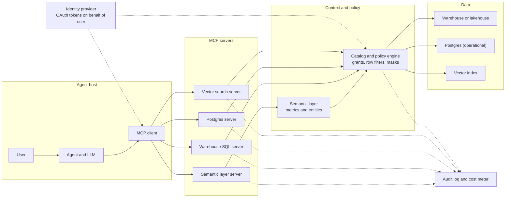
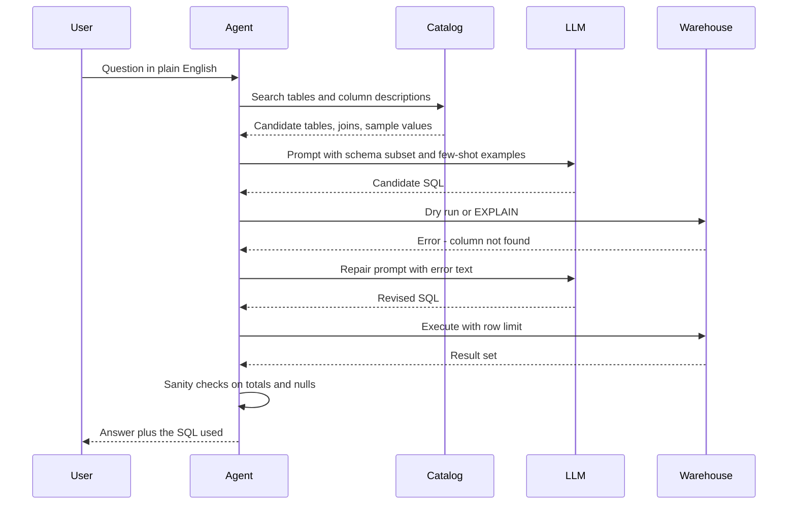
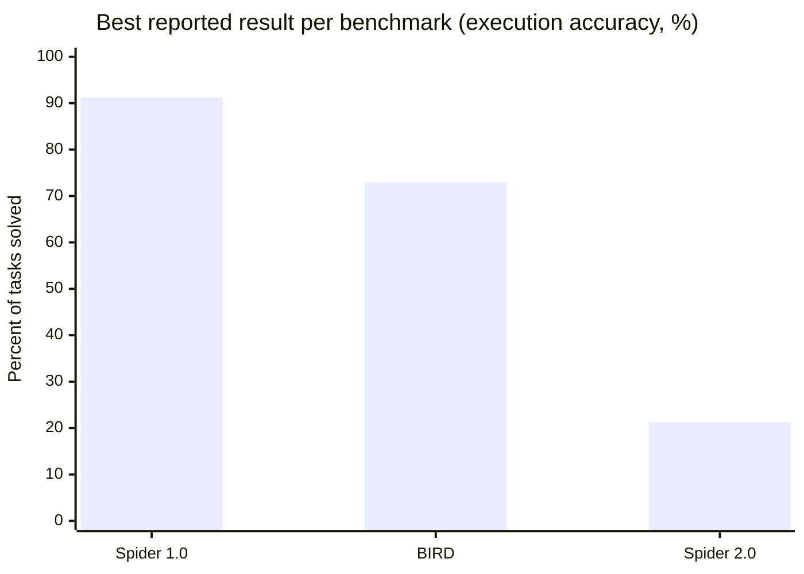
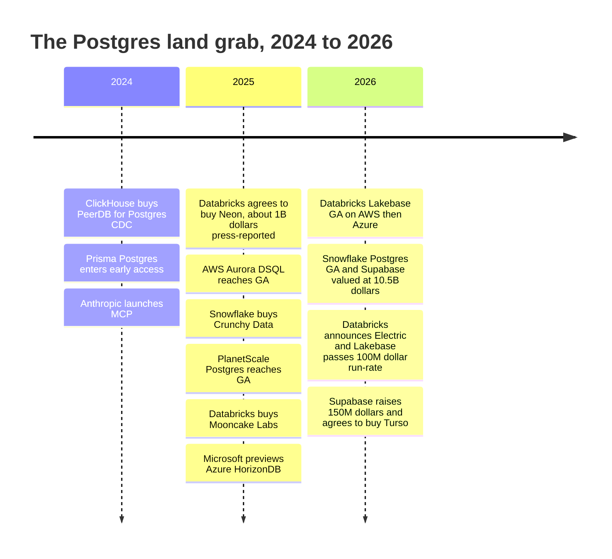

# 22. Agents and Data
> **Depth:** L2 · **Reading time:** ~18 min · **Last verified:** 2026-11-01 · **Prerequisites:** [Ch 19 — Retrieval Architectures](ch19-retrieval-architectures.md), [Ch 14 — Semantic Layers and BI](../02-pipelines-and-governance/ch14-semantic-layers-and-bi.md)

## TL;DR

- AI agents reach data in three ways: they write SQL themselves ([text-to-SQL](../glossary.md#text-to-sql)), they call governed tools such as a semantic-layer metric API, or they retrieve documents and memories (see [Ch 19](ch19-retrieval-architectures.md)). Most production systems blend all three behind one protocol.
- Text-to-SQL looks close to solved on academic benchmarks and is far from solved on real schemas. The Spider 2.0 paper (2025) compares the best published results of the time on Spider 1.0 (91.2%) and BIRD (73.0%) with only 21.3% for its own best setup on the enterprise-style Spider 2.0.[^spider2] The fix is context, not a bigger model: a catalog for schema linking, a semantic layer for business meaning, and a loop that tests and repairs queries.
- The [Model Context Protocol](../glossary.md#model-context-protocol) (MCP) became the standard way to plug agents into data. Anthropic launched it in November 2024. OpenAI, Google and Microsoft adopted it in 2025, and Anthropic donated it to the Linux Foundation's [Agentic AI Foundation](../glossary.md#agentic-ai-foundation) in December 2025.[^mcp-launch][^mcp-adopt][^mcp-donate] Every major data platform now ships an MCP server.
- Governance is the real product. The hard problems are [identity propagation](../glossary.md#identity-propagation) (the agent acts *as* a specific user), least-privilege tools, row filters, audit and cost limits. The top security risk is [prompt injection](../glossary.md#prompt-injection) hidden in the data an agent reads.
- Agents also *create* databases. Neon said more than 80% of its databases were provisioned by agents (company-stated, May 2025), and that claim helped set off a Postgres land grab: Databricks–Neon (Lakebase), Snowflake–Crunchy Data (Snowflake Postgres), Supabase at a $10.5B valuation, plus new hyperscaler Postgres services.[^neon-dbx][^supabase-f]

## Why this matters (business + Everpure lens)

For twenty years the consumer of enterprise data was a person: an analyst writing SQL or an executive opening a dashboard. Agents change the shape of demand. A person might run 30 queries a day. An agent working through a research task can issue hundreds in a few minutes, each small, many speculative, and many retried after an error. The access pattern moves from a few large scans to a swarm of small, latency-sensitive, policy-checked calls. That changes what platforms sell (governed endpoints rather than seats) and what infrastructure must withstand.

The commercial stakes are visible in the deal flow. Databricks paid about $1B (press-reported) for Neon, and its Lakebase Postgres line passed a $100M revenue run-rate (company-stated) within about a year.[^neon-dbx][^dbx-q2] Snowflake bought Crunchy Data. Supabase's valuation roughly doubled in eight months to $10.5B (press-reported post-money).[^supabase-f] Snowflake, Databricks and Google each made an MCP server generally available or a headline launch.[^sf-mcp][^dbx-mcp][^bq-mcp] The thesis behind all of it: whoever controls the agent's path to data controls the next decade of data consumption.

For Everpure, two things follow. First, agent workloads multiply metadata lookups, small reads and short-lived database copies. Instant branching depends on [copy-on-write](../glossary.md#copy-on-write) snapshots, which is native storage territory (see the Storage bridge below). Second, agents fail without semantic context: what a column means, whether it holds personal data, who may see it. That is the stated purpose of Everpure's 1touch acquisition (closed May 2026), which discovers, classifies and adds semantic context to data.[^1touch] One option a strategy team might evaluate, based on public information, is exposing that classification through MCP so that agent platforms consume it at query time.

## How it works

### The access path: from agent to bytes

Figure 22.1 shows the reference path. An agent *host* (Claude, ChatGPT, Microsoft Copilot, or an in-house app) runs an MCP *client*. The client connects to several MCP *servers*, each wrapping one system. Well-run servers do not talk straight to tables. They go through a semantic layer, which turns a request for "net revenue by region" into SQL, and through a catalog that enforces grants, row filters and masks before any bytes move. Identity and audit run alongside the whole path, so every query can be traced to a human principal and to the agent acting for them.



*Figure 22.1 — SV-11: the agent never touches tables directly; every request passes through an MCP server, the semantic layer and the catalog's policy engine, with identity and audit spanning the whole path.*

### Text-to-SQL: why benchmarks flatter it

Text-to-SQL means a large language model (LLM) turns a natural-language question into SQL. A production system has four stages, shown in Figure 22.2. **[Schema linking](../glossary.md#schema-linking)** finds the few tables and columns that matter among thousands, usually by searching catalog descriptions and embeddings of column names. **Few-shot prompting** adds worked examples of verified question–SQL pairs, ideally from the same domain. **Generation** produces candidate SQL, often several candidates. A **[self-correction loop](../glossary.md#self-correction-loop)** then compiles or dry-runs each candidate, feeds any error back to the model, checks that the result is plausible (row counts, nulls, totals) and repairs the query before answering.



*Figure 22.2 — The text-to-SQL loop: most accuracy gains come from better schema linking and the execute-and-repair cycle, not from the first draft of SQL.*

The benchmarks tell a cautionary story. Spider 1.0 (2018) uses small, clean, single-database schemas, and leading systems now exceed 90% there. BIRD (2023) added larger, messier databases and "evidence" hints. On BIRD's public leaderboard, Google reported 80.04% execution accuracy for Gemini-SQL2 in June 2026, and Huawei reported 82.39% for its DataGallery system in September 2026. The human baseline the leaderboard lists is 92.96%.[^bird-gemini][^bird-huawei] [Spider 2.0](../glossary.md#spider-2-0), presented at ICLR 2025, used 632 real enterprise workflow tasks on BigQuery, Snowflake and other engines, with databases that often exceed 1,000 columns. The best setup in the paper, OpenAI's o1-preview inside an agent framework, solved 21.3%. The paper compares that with 91.2% on Spider 1.0 and 73.0% on BIRD. Those two figures match the leading leaderboard systems of the time, not o1-preview runs on those benchmarks.[^spider2] Third-party snapshots in 2026 put the best Spider 2.0-Lite scores in the 45–53% range (vendor-reported, differing subsets).[^spider2-repo]

Figure 22.3 shows the gap as the Spider 2.0 paper presents it. The bars come from different systems, so read the chart as "best available result on each benchmark", not as one model scored three ways.



*Figure 22.3 — Accuracy collapses as schemas approach enterprise reality. Spider 1.0 and BIRD bars are the leading leaderboard results cited in the Spider 2.0 paper; the Spider 2.0 bar is o1-preview with an agent framework (arXiv v2, March 2025).*

Real enterprise accuracy is lower still, for reasons no benchmark fully captures. Schemas have thousands of tables with names like `F_ACCT_USG_D2`. The same concept lives in three places with different freshness. Business logic, such as fiscal calendars, which accounts count as "enterprise", or whether refunds net against revenue, is written down nowhere a model can read. And a wrong answer looks exactly like a right one. A query that double-counts through a one-to-many join returns a confident number, not an error.

The fix is to give the model context instead of hoping it infers it. Chapter 14 covered the evidence. data.world's 2023 study found GPT-4 answered 16.7% of enterprise questions correctly over raw SQL tables and 54.2% over a semantic representation. dbt Labs' vendor-run 2026 update reports 98–100% within the modeled scope of its semantic layer.[^dw-bench][^dbt-bench] In practice the best systems do both. They use a semantic layer for the questions that repeat (metrics, standard dimensions), and fall back to text-to-SQL with catalog context, certified example queries and the repair loop for the long tail. They show the generated SQL so a human can check it.

> **Going deeper (L3).** Schema linking at scale is a retrieval problem. Teams embed table and column descriptions, sample values and past query logs, then retrieve the top-k candidates. Some also mine join paths from query history, so the model learns that `orders.cust_id` joins to `customers.id` even when no foreign key is declared. Candidate generation often samples several SQL drafts and picks by self-consistency, meaning the result most drafts agree on. Spider 2.0's repository includes Snowflake, SQLite and dbt-project variants (547, 547 and 68 tasks) for testing exactly these pipelines.[^spider2-repo]

### MCP: the bus between agents and systems

MCP defines three roles. The **host** is the application the user interacts with. The **client** is the connector inside the host that keeps one session per server. The **[MCP server](../glossary.md#mcp-server)** wraps a system such as a warehouse, a CRM or a file store. Servers expose three primitives. **Tools** are functions the model can call (`run_query`, `list_metrics`). **Resources** are data the host can read into context (a table description, a document). **Prompts** are reusable templates the user can invoke. Local servers talk over standard input/output; remote servers use streamable HTTP. The specification moved quickly. The June 2025 revision classed remote MCP servers as OAuth 2.1 resource servers that publish protected-resource metadata and must validate tokens issued specifically for them, with clients required to name the target server through resource indicators. The November 2025 revision refined authorization further, for example in how clients register with servers.[^mcp-auth][^keycloak] A further revision dated July 2026 has been reported [VERIFY: contents and status of the 2026-07-28 MCP specification revision].

| Element | What it is | Data-platform example | Who controls it |
|---|---|---|---|
| Host | App the user works in | Claude, ChatGPT, Copilot, Cursor, an internal portal | End user or IT |
| Client | Per-server connector inside the host | Session to the Snowflake server | Host vendor |
| Server | Wrapper around one system | Snowflake-managed, Databricks-managed, BigQuery remote, Postgres, MongoDB servers | Data-platform vendor or customer |
| Tool | Callable function with a JSON schema | `query_metrics`, `execute_sql`, `vector_search` | Server author |
| Resource | Readable context | Table docs, semantic model, file | Server author |
| Prompt | Reusable template | "Explain this metric" | Server author |
| Authorization | OAuth 2.1 token per user and server | Token scoped to analyst role, audience-bound to one server | Identity provider and server |

*Figure 22.4 — MCP's roles and primitives: the protocol standardizes the plug, while the server author decides how broad each tool is, which is where governance succeeds or fails.*

Adoption was unusually fast for an industry standard. OpenAI announced support in March 2025, Google added MCP to the Gemini API and SDK by May 2025, and Microsoft committed to MCP across Windows and Azure at Build in May 2025.[^mcp-adopt] When Anthropic donated MCP to the Agentic AI Foundation on December 9, 2025, a directed fund co-founded with Block and OpenAI, it cited more than 97 million monthly SDK downloads and over 10,000 active servers (company-stated).[^mcp-donate] Data vendors followed. Snowflake's managed MCP server went GA on November 4, 2025, exposing Cortex Analyst and Cortex Search under role-based access control. Databricks launched managed MCP servers for Unity Catalog functions, vector search and Genie in June 2025; its docs list them as Public Preview. Google made a remote BigQuery MCP server GA at Next '26. AWS shipped an MCP server with Aurora DSQL.[^sf-mcp][^dbx-mcp][^bq-mcp][^dsql]

> **Bridge: PCIe and USB.** MCP is to agents what PCIe or USB is to a computer. Before USB, every peripheral needed its own port and driver. Afterward, any compliant device worked with any compliant host, and the market for peripherals exploded. MCP does the same for the N-hosts-times-M-systems integration problem: write one server and every compliant agent can use it. The analogy also shows the limit. A bus standard guarantees that a device can talk. It does not guarantee the device is trustworthy, which is why systems added an IOMMU. MCP likewise standardizes the connection and leaves trust to identity, policy and tool design.

MCP connects an agent to tools and data. Google's **[Agent2Agent protocol](../glossary.md#agent2agent-protocol)** (A2A), launched in April 2025 and given to the Linux Foundation in June 2025, connects agents to *other agents*: a procurement agent handing a sub-task to a supplier's agent, with task status and capability discovery.[^a2a] The two are complements. For data teams, MCP is the one that matters today, because it is how agents reach governed data.

### Risks: the lethal trifecta

The defining MCP security case came in July 2025. Researchers showed that a coding agent connected to Supabase's MCP server, with a service-role credential that bypassed row-level security, could be manipulated by text inside a customer support ticket. The ticket told the agent to copy a private token table into a place the attacker could read.[^willison] Simon Willison named the pattern the [lethal trifecta](../glossary.md#lethal-trifecta): an agent with access to private data, exposure to untrusted content and a channel to send data out. Any one MCP server that combines all three is exploitable. Supabase's response, a read-only and project-scoped mode by default, removes one leg.[^willison]

| Risk | How it happens | Control |
|---|---|---|
| Indirect prompt injection | Instructions hidden in rows, documents or tickets the agent reads | Treat retrieved data as untrusted; read-only defaults; human approval before writes or sends |
| Over-broad tools | One `execute_sql` tool running as a service account or admin | Narrow, typed tools (metrics, not raw SQL); least-privilege roles per tool |
| Data exfiltration | Private data plus an outbound channel (email, web fetch, issue comment) | Break the trifecta: egress allow-lists; no mixing of untrusted input and outbound tools in one session |
| Confused deputy and token passthrough | Server forwards or reuses a powerful token not issued for it | Audience-bound OAuth tokens; spec-mandated token validation; no passthrough |
| Tool poisoning and silent updates | A third-party server's tool descriptions carry hidden instructions or change after approval | Private registry and allow-list; pinned server versions; review of tool manifests |
| Runaway cost and load | Agent loops issue thousands of queries or full scans | Per-agent rate limits, query cost caps, warehouse budgets, AI gateways |
| Audit gaps | Queries appear under a shared service identity | Identity propagation; log both the user and the agent identity on every call |

*Figure 22.5 — MCP risks and controls: most failures come from tool scope and identity, not from the protocol itself, so the controls belong in server design and the policy layer.*

### Governed access: who is the agent?

The central governance question is simple to state: when an agent runs a query, whose permissions apply? The weak answer is a shared service account with broad rights. That makes row-level security meaningless and the audit log useless. The strong answer is **identity propagation**. The user authenticates, the identity provider issues a token through an [on-behalf-of flow](../glossary.md#on-behalf-of-flow) that names both the user (subject) and the agent (actor), and every downstream system enforces the *user's* grants. Microsoft's Entra Agent ID, announced at Build in May 2025, gives agents their own directory identities with declared delegated permissions, and carries the agent as the actor in issued tokens.[^entra] Other identity vendors are building the same pattern. This is what the industry calls [agentic identity](../glossary.md#agentic-identity): the agent is a first-class principal, but it never holds more rights than the human it serves.

On top of identity sit the policy layers covered in [Ch 15](../02-pipelines-and-governance/ch15-governance-security-privacy.md) and [Ch 8](../01-data-systems-foundations/ch08-catalogs-and-metastores.md). [Attribute-based access control](../glossary.md#attribute-based-access-control) (ABAC) applies rules based on tags, so a column tagged `pii` is masked for any principal without a privacy-cleared attribute. [Row-level security](../glossary.md#row-level-security) filters rows by the user's region or book of business. Audit records which agent ran which query for whom. Cost controls, a newer need, cap what an agent may spend per task. Databricks' Unity AI Gateway and Snowflake's Natoma purchase (agent and MCP governance, reported May 2026) show the platforms treating agent traffic as something to meter and police.[^dbx-q2][^natoma]

> **Bridge: privilege rings and the IOMMU.** A CPU runs user code in ring 3 and the kernel in ring 0. A user process cannot read another process's memory because the memory-management unit checks every access against that process's page tables. An IOMMU extends the same rule to devices, so a network card doing direct memory access (DMA) can touch only the pages mapped for it. Identity propagation is the IOMMU for agents. The agent is a powerful device on the bus, but each request is translated and checked against the page table, here the entitlements, of the user it is working for. A shared service account is the equivalent of letting a device DMA anywhere.

### Agent memory: a cache hierarchy for context

Agents need memory beyond a single prompt. The context window holds the current task. Anything longer-lived must be written out and recalled. Commercial memory layers emerged in 2025. Mem0 raised $24M (seed plus Series A, October 2025) for a memory API that extracts facts from conversations and stores them in vector and graph form.[^mem0] Zep's open-source Graphiti engine builds a temporal knowledge graph that records when each fact was true. Its January 2025 paper reports beating MemGPT on two memory benchmarks (author-reported).[^zep] Letta, the commercial successor to the MemGPT research project, lets the agent manage tiered memory blocks itself. ChatGPT, Claude and Gemini also ship user-level memory features, which makes memory a platform feature as well as a standalone product.

| Memory type | What it holds | Typical store | Lifetime | Examples | Cache-hierarchy analogue |
|---|---|---|---|---|---|
| Working (context window) | Current instructions, recent turns, tool results | Model context and KV cache | Seconds to one session | Every LLM | Registers and L1 |
| Session buffer | Summarized conversation state, checkpoints | Key-value store or Postgres | Hours to days | Framework checkpointers | L2/L3 cache |
| Semantic long-term | Facts and preferences ("user prefers EMEA view") | Vector index, often pgvector | Weeks to months | Mem0, platform memory features | DRAM |
| Temporal/relational | Entities, relationships, when facts held | Knowledge graph | Months, versioned | Zep/Graphiti | DRAM with timestamps |
| Procedural | Instructions, skills, learned workflows | Files, prompts, repositories | Long-lived | Letta memory blocks, skill files | Firmware or microcode |
| System of record | The enterprise's actual data | Warehouse, lakehouse, Postgres | Years, governed | Reached via MCP tools, not memorized | NAND flash |

*Figure 22.6 — Agent memory is a hierarchy: small, fast, volatile context at the top and governed systems of record at the bottom, with the same promotion, eviction and coherence problems as a CPU cache.*

> **Bridge: memory hierarchy.** The context window is registers and L1: tiny, very fast and wiped at the end of the task. Vector memory is DRAM: much larger, slower to reach, and filled by an explicit load (retrieval). The warehouse is NAND: vast and durable, reached only through a controller (the MCP server and catalog). The design problems are the familiar ones. What to prefetch into context, what to evict when the window fills, and how to keep cached facts coherent when the source changes. A memory that says "Acme's owner is Dana" after the account was reassigned is a stale cache line. Memory should cache *pointers and preferences*. Business facts should be re-read from the governed source.

### Worked example: "Which enterprise customers' usage dropped more than 20% last month, and who are their account owners?"

Priya, a revenue-operations manager in the EMEA region, asks this in her company's agent host. The scenario is illustrative; the mechanics are standard.

1. **Authentication.** Priya is signed in through single sign-on. When the agent first calls the semantic-layer MCP server, the identity provider issues an OAuth token naming Priya as subject and the agent as actor, valid only for that server.
2. **Disambiguation through the semantic layer.** The agent calls `list_metrics` and finds the certified metric `product_usage_units` (monthly, net of internal test accounts) and the dimension `customer.segment`. "Last month" resolves to the last complete fiscal month, which the layer defines. If the layer offered two usage metrics, the agent should ask which one Priya means rather than guess.
3. **Governed query.** The agent calls `query_metrics` for usage by customer for the last two months where segment is Enterprise. The layer generates SQL and the catalog applies Priya's row filter (region = EMEA). She sees EMEA accounts only, and the agent cannot widen that.
4. **Computation and guardrails.** The agent computes month-over-month change and filters for drops above 20%. A good agent also applies a minimum-baseline filter so a customer going from 10 units to 7 does not top the list, and it states that rule in its answer.
5. **Second system for owners.** Account owners live in the CRM, reached through a second MCP server under the same delegated identity. ABAC rules mask owners' phone numbers (tagged `pii`) but show names and email addresses.
6. **Audit and cost.** Each call is logged with Priya's identity, the agent identity, the tool, the generated SQL and the compute cost. The task stays inside a per-session query budget.
7. **Answer.** The agent returns a table of accounts, usage change and owners. It shows the metric definition and SQL it used, and offers to draft emails, which, because it is a write action, requires Priya's explicit approval.

```sql
-- Generated by the semantic layer, not written by the LLM (illustrative)
SELECT c.customer_id, c.name,
       SUM(CASE WHEN u.fiscal_month = :prev THEN u.units END) AS prev_units,
       SUM(CASE WHEN u.fiscal_month = :last THEN u.units END) AS last_units
FROM analytics.usage_monthly u
JOIN analytics.customers c ON c.customer_id = u.customer_id
WHERE c.segment = 'Enterprise' AND u.is_internal = FALSE
  AND c.region = 'EMEA'          -- injected by row-level policy for this user
GROUP BY 1, 2;
```

The point of the example is where the intelligence sits. The LLM chose tools and assembled the answer. The definitions, the fiscal calendar, the region filter and the masking came from governed layers that would give a dashboard the same result.

### Agents as database builders: the Postgres renaissance

The second agent–data story is about creating databases, not querying them. AI coding tools and app builders spin up a new Postgres database for each prototype, test run or branch of work. Neon's architecture suited this. It separated Postgres compute from a storage service built from "safekeepers" (a durable write-ahead log) and a page server that keeps data pages on object storage.[^neon-arch] That makes a new database or a [database branch](../glossary.md#database-branching) a metadata operation, a copy-on-write fork that takes seconds. Idle compute can [scale to zero](../glossary.md#scale-to-zero), so a forgotten prototype costs almost nothing. When Databricks agreed to buy Neon in May 2025, it cited Neon's telemetry that over 80% of databases on the platform were created by AI agents (company-stated).[^neon-dbx]

Why Postgres rather than something new? Four reasons. The ecosystem is enormous (drivers, ORMs, hosting, talent). Extensions such as pgvector let one engine handle transactions, JSON and vectors. LLMs write good Postgres SQL because the dialect dominates public code and documentation. And the permissive license means anyone can build a service on it without negotiating with a vendor. The counter-argument is that Postgres's single-writer, process-per-connection design was not built for thousands of tiny, bursty tenants. Each vendor below re-engineers the layers under Postgres to fix that.

| Offering | Owner | Architecture | Branching | Scale-to-zero | Pricing unit | Status (Nov 2026) |
|---|---|---|---|---|---|---|
| Neon | Databricks (acq. 2025, ~$1B press-reported) | Postgres compute over safekeepers plus page server on object storage | Yes, copy-on-write, seconds | Yes | Compute-hours plus storage | GA; tech basis of Lakebase |
| Databricks Lakebase | Databricks | Neon architecture inside the platform, governed by Unity Catalog | Yes, zero-copy | Yes (not with high availability) | Databricks consumption units (n.v.) | GA on AWS Feb 2026, Azure Mar 2026; >$100M run-rate (company-stated) |
| Snowflake Postgres | Snowflake (Crunchy Data, $164.5M cash per 10-Q) | Managed Postgres with mirroring into Snowflake | n.v. | n.v. | Snowflake credits (n.v.) | GA at Summit, Jun 2026 |
| Supabase | Independent ($10.5B post-money, Jun 2026) | Postgres per project plus auth, storage, functions, realtime | Yes, Git-linked preview branches (n.v.) | Free projects pause when idle (n.v.) | Per-project compute tier plus usage | GA; acquiring Turso |
| Amazon Aurora DSQL | AWS | Distributed, active-active multi-Region, Postgres-compatible | No | Serverless; pay per use | Distributed processing units plus storage | GA May 2025 |
| Google AlloyDB | Google | Postgres-compatible, disaggregated storage, columnar engine | Clones (n.v.) | No | vCPU-hours plus storage | GA (2022); real-time replication to BigQuery GA Apr 2026 |
| Azure HorizonDB | Microsoft | Scale-out Postgres-compatible, disaggregated storage; up to 3,072 vCores, 128 TB | n.v. | n.v. | n.v. | Preview since Nov 2025 |
| PlanetScale Postgres | Independent | Postgres on local NVMe ("Metal") with replicas | n.v. for Postgres | No | Per cluster per month (Metal from $50) | GA 2025 |
| Xata | Independent (core Apache 2.0) | Unmodified Postgres on copy-on-write storage volumes | Yes, with PII anonymization | n.v. | n.v. | GA; open-source core |
| Prisma Postgres | Prisma | Postgres on unikernels and microVMs | n.v. | Usage-based, no idle compute (n.v.) | Per operation (n.v.) | Production-ready (early access Oct 2024) |
| Turso | Being acquired by Supabase | SQLite-compatible, database-per-tenant, embedded replicas | n.v. | n.v. | n.v. | Deal announced Oct 2026 |

*Figure 22.7 — Postgres for agents: the differentiators are branching, scale-to-zero and per-use pricing, all of which depend on separating compute from storage. "n.v." = not verified for this edition [VERIFY: cells marked n.v.].[^neon-dbx][^lakebase-ga][^dbx-q2][^ma-csv][^sf-postgres][^supabase-f][^dsql][^alloydb][^horizondb][^planetscale][^xata][^prisma][^turso]*

## Design choices and trade-offs

| Approach | Flexibility | Accuracy on enterprise data | Governance | Cost per question | Best for |
|---|---|---|---|---|---|
| Raw text-to-SQL over the schema | Highest | Low (Spider 2.0-style tasks: ~20–50%) | Weak unless the identity is propagated | Moderate; many retries | Exploration by experts who read the SQL |
| Text-to-SQL with catalog context, examples and repair loop | High | Medium | Good if run under the user's identity | Higher (several LLM and dry-run calls) | Long-tail analytics questions |
| Semantic-layer tools (metric API) | Limited to modeled metrics | High within scope; refuses outside it | Strong; definitions and policy centralized | Low | Recurring KPIs, executive questions |
| Purpose-built task tools (`get_account_health`) | Lowest | Highest for that task | Strongest; reviewed code path | Lowest | High-volume, high-risk workflows |
| Retrieval over documents and memory | Medium | Depends on chunking and ranking (see Ch 19) | Needs per-document permissions | Low to moderate | Policies, contracts, tickets |

*Figure 22.8 — The accuracy–flexibility trade-off: the more the agent writes itself, the more it can answer and the less it can be trusted; production designs route each question to the narrowest tool that can answer it.*

The steelman for raw text-to-SQL is that models keep improving. Spider 2.0-Lite scores roughly doubled between the paper and 2026 snapshots, and semantic layers cover only what someone has modeled. That is fair. But accuracy is not the only constraint. Governance and auditability favor narrow tools even when a model could write the SQL, because a reviewed tool fails in predictable ways. The likely end state is layered: narrow tools for the top hundred questions, semantic-layer access for metrics, and supervised text-to-SQL for everything else.

On the database side, the trade-off is managed-platform gravity versus independence. Lakebase and Snowflake Postgres promise that operational data lands in the analytics platform with no pipeline. Databricks calls the unified version LTAP, which it describes as coming soon (see [Ch 23](ch23-real-time-analytics-htap.md)). Supabase and Neon-style independents promise developer experience and portability. Hyperscalers promise scale and procurement simplicity.

## Who's who

- **Agent hosts and model vendors:** Anthropic (MCP originator), OpenAI, Google (Gemini Enterprise, A2A originator), Microsoft (Copilot, Entra Agent ID). All support MCP.
- **Data platforms with MCP servers:** Snowflake (managed MCP GA Nov 2025; CoWork agent), Databricks (managed MCP servers, Genie, Agent Bricks, Unity AI Gateway), Google BigQuery (remote MCP server GA), AWS (MCP servers across databases, including Aurora DSQL), MongoDB and Postgres community servers. See [Ch 25](../04-company-deep-dives/ch25-databricks.md) and [Ch 29](../04-company-deep-dives/ch29-operational-database-vendors.md).
- **Semantic and context layers:** dbt/Fivetran, Cube, AtScale, ThoughtSpot, Looker, plus the platform-native layers (see [Ch 14](../02-pipelines-and-governance/ch14-semantic-layers-and-bi.md)).
- **Agent memory:** Mem0, Zep (Graphiti), Letta, plus memory features built into the major assistants.
- **Postgres for agents:** Neon/Lakebase, Snowflake Postgres, Supabase (with Turso), Aurora DSQL, AlloyDB, Azure HorizonDB, PlanetScale, Xata, Prisma Postgres; Databricks also bought Mooncake Labs (Postgres-to-columnar) and announced Electric (PGlite, local Postgres for agent sandboxes).[^ma-csv]

## History and trajectory



*Figure 22.9 — Within 24 months every major data platform bought or built a Postgres service, with prices set by the claim that agents, not people, now create most new databases. Sources: data/ma_deals.csv and footnotes in this chapter; deal context in [Ch 39](../05-business-and-economics/ch39-ma-history.md).*

Text-to-SQL research runs back to the 1970s, but the modern era began with Spider 1.0 in 2018. LLMs pushed Spider 1.0 accuracy above 90% by 2023, which prompted harder benchmarks: BIRD in 2023 and Spider 2.0 (preprint November 2024, ICLR 2025).[^spider2] In parallel, vendors moved from "chat with your data" demos (2023) to semantic-layer-grounded assistants (2024–2025) to named agent products: Genie One at Databricks, CoWork at Snowflake (renamed from Snowflake Intelligence at Summit 2026), and Gemini Enterprise at Google.[^dbx-q2]

MCP's arc ran from launch in November 2024, through adoption by OpenAI, Google and Microsoft in spring 2025 and a June 2025 authorization rework, to neutral governance under the Linux Foundation in December 2025.[^mcp-launch][^mcp-adopt][^mcp-auth][^mcp-donate] The 2026 story has been consolidation of agent governance into the data platforms (Unity AI Gateway, Snowflake–Natoma) and hardening against prompt-injection incidents.

Three bets for the next two years. (1) Agent traffic will exceed human query traffic on major platforms, and pricing will follow the agent (per task or per governed call) rather than the seat. (2) MCP servers will consolidate into a few governed gateways per enterprise, because security teams will not approve hundreds of unvetted servers. (3) Operational and analytical Postgres will converge on shared storage, with branching treated as a basic expectation. The bear case: agent accuracy plateaus on messy data, enterprises cap agents at read-only dashboards, and the Postgres land grab turns out to have priced in vibe-coding prototypes that never become production workloads.

## Numbers that matter

| Metric | Value | Basis | Source / date |
|---|---|---|---|
| Spider 1.0 / BIRD / Spider 2.0, best reported results (Spider 2.0: o1-preview with agent framework) | 91.2% / 73.0% / 21.3% | Academic paper (first two are leaderboard results it cites) | Lei et al., arXiv v2, 2025-03[^spider2] |
| BIRD top submitted system | 82.39% execution accuracy (Huawei DataGallery) | Vendor-reported leaderboard result | Technology Magazine, 2026-09[^bird-huawei] |
| BIRD human baseline | 92.96% | Leaderboard reference | BIRD leaderboard[^bird-huawei] |
| GPT-4 over SQL vs semantic representation | 16.7% vs 54.2% | Vendor-run study | data.world, 2023-11[^dw-bench] |
| MCP monthly SDK downloads at donation | >97M | Company-stated | Anthropic, 2025-12-09[^mcp-donate] |
| Active MCP servers at donation | >10,000 | Company-stated | Anthropic, 2025-12-09[^mcp-donate] |
| Neon databases created by agents | >80% | Company-stated telemetry | Databricks/Neon, 2025-05[^neon-dbx] |
| Databricks–Neon price | ~$1B | Press-reported | TechRepublic, 2025-05[^neon-dbx] |
| Snowflake–Crunchy Data | $164.5M cash (vs ~$250M press-reported) | GAAP (10-Q disclosure) | Snowflake 10-Q, 2025-12[^ma-csv] |
| Lakebase revenue run-rate | >$100M | Company-stated run-rate | Databricks, 2026-08-13[^dbx-q2] |
| Supabase valuation | $10.5B post-money ($500M Series F) | Press-reported | Orrick, 2026-06[^supabase-f] |
| Mem0 funding | $24M (seed + Series A) | Press-reported | TechCrunch, 2025-10-28[^mem0] |
| Azure HorizonDB scale | Up to 3,072 vCores, 128 TB; "up to 3x" open-source Postgres throughput | Company-stated (preview) | Microsoft, 2025-11[^horizondb] |

*Figure 22.10 — The numbers that matter: a 70-point accuracy gap between clean and enterprise benchmarks, a protocol at roughly 100M monthly downloads, and Postgres deals priced on agent-created databases.*

## Storage bridge

> **Storage bridge.** Agent-built apps turn database branching into a storage feature. Neon branches by forking metadata in a page server that keeps pages on object storage. Xata branches by taking a copy-on-write snapshot of the underlying volume and booting a fresh Postgres on it, with no changes to Postgres itself.[^neon-arch][^xata] Either way, the speed and cost of a branch are set by the snapshot and clone path, plus metadata performance under thousands of short-lived tenants. That is the same capability an enterprise array uses for instant clones. Meanwhile, governed agent queries arrive as many small, random reads that are sensitive to latency. See the companion *Everpure Tech Atlas* for snapshot and clone mechanics. For strategic options, see [Ch 45](../06-history-and-future/ch45-storage-moving-up-the-stack.md).

## Conversation playbook

**Three questions for product managers**

1. "When an agent queries your platform, whose identity does the query run as, and does the audit log show both the user and the agent?" A good answer describes an on-behalf-of token, with the user's row filters enforced and a separate actor field in the logs. A weak answer mentions a service account per agent.
2. "What share of agent questions go through the semantic layer versus free-form SQL, and how do you measure accuracy on *your* questions?" Good answers cite an internal evaluation set built from real questions with verified answers, not Spider or BIRD scores.
3. "How many MCP servers are approved in your environment, and who reviews a new one?" Good answers describe a registry or gateway, pinned versions and a security review. "Developers install what they need" is a red flag.

**Three questions for engineers**

1. "Which of your MCP tools can write, send or fetch from the internet, and can any session combine those with untrusted input?" Good: the team can name the trifecta and show which leg each configuration removes.
2. "How does your text-to-SQL pipeline do schema linking and repair?" Good: retrieval over catalog descriptions and query logs, dry-run validation, result sanity checks, and showing the SQL to the user.
3. "For your agent-created databases, what is the branch-creation time and the cost of an idle branch?" Good answers give seconds and near-zero idle compute, and know whether branching happens at the page-server layer or at the storage-volume layer.

**What good answers sound like:** specific about identity flows, honest about accuracy on their own data, and focused on narrowing tools rather than widening them.

**"Don't say this"**

- "Text-to-SQL is solved; models score over 90%." That is Spider 1.0. On enterprise-style Spider 2.0, the best system in the paper scored about 21%.
- "MCP is secure" or "MCP is insecure." MCP is a connection standard. Security depends on server scope, identity and policy.
- "The agent has its own admin account, so it can answer anything." That is exactly the confused-deputy pattern that defeats row-level security.
- "Agent memory replaces the warehouse." Memory caches context. Governed facts should be re-read from the system of record.
- "Agents create 80% of all databases." That was Neon's company-stated figure for its own platform in 2025, not an industry statistic.

## Going deeper

- Read the Spider 2.0 paper's error analysis; schema linking and dialect errors dominate failures.[^spider2]
- Read the MCP authorization specification and trace how a remote server validates an audience-bound token.[^mcp-auth]
- Simon Willison's lethal-trifecta posts are the clearest practitioner treatment of agent data exfiltration.[^willison]
- Neon's architecture documentation explains safekeepers, the page server and copy-on-write branching.[^neon-arch]

## Key terms

- [Text-to-SQL](../glossary.md#text-to-sql) — an LLM translating a natural-language question into a SQL query.
- [Schema linking](../glossary.md#schema-linking) — selecting the relevant tables, columns and joins from a large schema before generating SQL.
- [Self-correction loop](../glossary.md#self-correction-loop) — executing or dry-running generated SQL and feeding errors back to the model to repair it.
- [Execution accuracy](../glossary.md#execution-accuracy) — benchmark metric: the share of questions whose generated SQL returns the same result as the reference query.
- [Spider 2.0](../glossary.md#spider-2-0) — 2024–2025 text-to-SQL benchmark of 632 real enterprise workflow tasks on large cloud schemas.
- [BIRD benchmark](../glossary.md#bird-benchmark) — text-to-SQL benchmark with large, messy databases and external-knowledge hints.
- [Model Context Protocol](../glossary.md#model-context-protocol) — open standard for connecting AI agents to tools and data, now governed by the Agentic AI Foundation.
- [MCP server](../glossary.md#mcp-server) — a service that wraps one system and exposes tools, resources and prompts to MCP clients.
- [Agentic AI Foundation](../glossary.md#agentic-ai-foundation) — Linux Foundation directed fund that has governed MCP since December 2025.
- [Agent2Agent protocol](../glossary.md#agent2agent-protocol) — open protocol, from Google and now at the Linux Foundation, for agents to delegate tasks to other agents.
- [Prompt injection](../glossary.md#prompt-injection) — malicious instructions embedded in content an LLM reads, causing it to act against its user.
- [Lethal trifecta](../glossary.md#lethal-trifecta) — the risky combination of private-data access, untrusted input and an outbound channel in one agent.
- [Identity propagation](../glossary.md#identity-propagation) — passing the end user's identity through every hop so downstream systems enforce that user's permissions.
- [On-behalf-of flow](../glossary.md#on-behalf-of-flow) — an OAuth token exchange in which a service obtains a token to act for a specific user.
- [Agentic identity](../glossary.md#agentic-identity) — treating an AI agent as a distinct, auditable principal whose rights never exceed the user it serves.
- [Attribute-based access control](../glossary.md#attribute-based-access-control) — access rules evaluated on attributes and tags of users and data.
- [Row-level security](../glossary.md#row-level-security) — a policy that filters which rows a given user can see.
- [Agent memory](../glossary.md#agent-memory) — information an agent stores outside its context window and recalls in later steps or sessions.
- [Database branching](../glossary.md#database-branching) — creating an instant, copy-on-write fork of a database for testing or agent work.
- [Scale-to-zero](../glossary.md#scale-to-zero) — releasing all compute for an idle database so it costs only storage until the next request.
- [Copy-on-write](../glossary.md#copy-on-write) — sharing unchanged data between versions and writing only modified blocks or files.

## Sources

[^spider2]: Fangyu Lei et al., "Spider 2.0: Evaluating Language Models on Real-World Enterprise Text-to-SQL Workflows," ICLR 2025 (oral), arXiv:2411.07763v2, https://arxiv.org/abs/2411.07763v2, published 2025-03-17 (v1 2024-11); retrieved 2026-11-01.
[^spider2-repo]: xlang-ai, "Spider2" GitHub repository (Spider 2.0-Snow, -Lite, -DBT), https://github.com/xlang-ai/Spider2, n.d. (living); retrieved 2026-11-01. 2026 Spider 2.0-Lite snapshots: Interfaze leaderboard, https://interfaze.ai/leaderboards/spider-2-lite, and BenchLM, https://benchlm.ai/benchmarks/spider2lite, 2026 (third-party, vendor-reported); retrieved 2026-11-01.
[^bird-gemini]: The Decoder, "Google Research's Gemini-SQL2 tops text-to-SQL benchmarks by a wide margin," https://the-decoder.com/google-researchs-gemini-sql2-tops-text-to-sql-benchmarks-by-a-wide-margin/, published 2026-06; retrieved 2026-11-01 (press-reported; company claim).
[^bird-huawei]: Technology Magazine, "Huawei DataGallery Tops Benchmark for Enterprise Text2SQL AI," https://technologymagazine.com/news/huawei-datagallery-tops-benchmark-for-enterprise-text2sql-ai, published 2026-09; retrieved 2026-11-01. Human baseline per BIRD leaderboard, https://bird-bench.github.io/, n.d.; retrieved 2026-11-01.
[^dw-bench]: Juan Sequeda, Dean Allemang, Bryon Jacob (data.world), "A Benchmark to Understand the Role of Knowledge Graphs on Large Language Model's Accuracy for Question Answering on Enterprise SQL Databases," arXiv:2311.07509, https://arxiv.org/abs/2311.07509, published 2023-11-13; retrieved 2026-11-01.
[^dbt-bench]: dbt Labs, "Semantic Layer vs. Text-to-SQL: 2026 benchmark update," https://docs.getdbt.com/blog/semantic-layer-vs-text-to-sql-2026, published 2026-04; retrieved 2026-11-01. Vendor-run; 11 questions, 20 runs per model.
[^mcp-launch]: Anthropic, "Introducing the Model Context Protocol," https://www.anthropic.com/news/model-context-protocol, published 2024-11-25; retrieved 2026-11-01 (pre-2025 knowledge; not re-fetched).
[^mcp-adopt]: The New Stack, "Google embraces MCP," https://thenewstack.io/google-embraces-mcp, published 2025-05; Gizmodo Japan, "MCP officially implemented on Windows," https://www.gizmodo.jp/2025/05/mcp-officially-implemented-on-windows.html, published 2025-05; TimeWell, "OpenAI and MCP," https://timewell.jp/en/columns/openai-to-mcp, 2025 (secondary; dates OpenAI support to 2025-03-26); retrieved 2026-11-01.
[^mcp-donate]: Anthropic, "Donating the Model Context Protocol and establishing the Agentic AI Foundation," https://anthropic.com/news/donating-the-model-context-protocol-and-establishing-of-the-agentic-ai-foundation, published 2025-12-09; retrieved 2026-11-01. Download and server counts corroborated by API Evangelist, https://blogs.apievangelist.com/blogs/mcp-2025-12-09-mcp-joins-the-agentic-ai-foundation/, 2025-12-09.
[^mcp-auth]: Model Context Protocol, "Specification 2025-06-18: Authorization," https://modelcontextprotocol.io/specification/2025-06-18/basic/authorization, published 2025-06-18; and "Specification 2025-11-25," https://modelcontextprotocol.io/specification/2025-11-25, published 2025-11-25; retrieved 2026-11-01 (summarized via search results; not re-fetched).
[^keycloak]: Keycloak, "Integrating with Model Context Protocol (MCP)," https://www.keycloak.org/securing-apps/mcp-authz-server, n.d.; retrieved 2026-11-01.
[^sf-mcp]: Snowflake documentation, "Nov 04, 2025: Snowflake-managed MCP server (General availability)," https://docs.snowflake.com/release-notes/2025/other/2025-11-04-cortex-agents-mcp, published 2025-11-04; Snowflake blog, "Introducing Snowflake Managed MCP Servers for Secure, Governed Data Agents," https://www.snowflake.com/en/blog/managed-mcp-servers-secure-data-agents/, published 2025-10; retrieved 2026-11-01.
[^dbx-mcp]: Databricks blog, "Announcing managed MCP servers with Unity Catalog and Mosaic AI integration," https://www.databricks.com/en/blog/announcing-managed-mcp-servers-unity-catalog-and-mosaic-ai-integration, published 2025-06; Databricks docs, "Managed MCP servers," https://docs.databricks.com/aws/en/generative-ai/mcp/managed-mcp.html, n.d. (Public Preview label); retrieved 2026-11-01.
[^bq-mcp]: G-gen (Google Cloud partner), "Next '26 What's new in BigQuery," https://blog.g-gen.co.jp/entry/next-26-whats-new-in-bigquery, published 2026-04 (Japanese; secondary); retrieved 2026-11-01. Via `meta/research-briefing.md`.
[^dsql]: AWS via Business Wire, "AWS Announces the General Availability of Amazon Aurora DSQL, the Fastest Distributed SQL Database," https://www.businesswire.com/news/home/20250527678337/en/, published 2025-05-27; retrieved 2026-11-01.
[^a2a]: SD Times, "Google's Agent2Agent protocol finds new home at the Linux Foundation," https://sdtimes.com/ai/googles-agent2agent-protocol-finds-new-home-at-the-linux-foundation/, published 2025-06; retrieved 2026-11-01.
[^willison]: Simon Willison, "Supabase MCP can leak your entire SQL database," https://simonwillison.net/2025/Jul/6/supabase-mcp-lethal-trifecta/, published 2025-07-06; retrieved 2026-11-01.
[^entra]: Microsoft Learn (Azure China mirror), "What is Microsoft Entra Agent ID?," https://docs.azure.cn/en-us/entra/agent-id/what-is-microsoft-entra-agent-id, n.d.; retrieved 2026-11-01. Build 2025 announcement date per secondary coverage; GA date conflicts across sources [VERIFY: Entra Agent ID GA date].
[^natoma]: `meta/research-briefing.md`, Snowflake section (Natoma acquisition reported around 2026-05-28 by a weak aggregator; Investor Day 2026 summary), retrieved 2026-11-01 [VERIFY: Snowflake press release on Natoma].
[^mem0]: TechCrunch, "Mem0 raises $24M from YC, Peak XV and Basis Set to build the memory layer for AI apps," https://techcrunch.com/2025/10/28/mem0-raises-24m-from-yc-peak-xv-and-basis-set-to-build-the-memory-layer-for-ai-apps, published 2025-10-28; retrieved 2026-11-01.
[^zep]: Preston Rasmussen et al. (Zep), "Zep: A Temporal Knowledge Graph Architecture for Agent Memory," arXiv:2501.13956, https://arxiv.org/abs/2501.13956, published 2025-01; retrieved 2026-11-01 (author-reported benchmarks).
[^neon-dbx]: TechRepublic, "Databricks to Acquire Neon in $1 Billion Deal to Boost AI-Driven Databases," https://www.techrepublic.com/article/news-databricks-neon-acquisition/, published 2025-05; Constellation Research, "Databricks acquires Neon, sees Postgres scaling key to agentic AI," https://www.constellationr.com/insights/news/databricks-acquires-neon-sees-postgres-scaling-key-agentic-ai, published 2025-05; retrieved 2026-11-01. The >80% figure is Databricks/Neon company-stated telemetry.
[^neon-arch]: Neon documentation, "Architecture overview," https://neon.tech/docs/introduction/architecture-overview, n.d.; retrieved 2026-11-01 (pre-2025 knowledge; not re-fetched).
[^lakebase-ga]: Databricks blog, "Databricks Lakebase is generally available," https://databricks.com/blog/databricks-lakebase-generally-available, published 2026-02; Databricks blog, "Azure Databricks Lakebase is generally available," https://www.databricks.com/blog/azure-databricks-lakebase-generally-available, published 2026-03; Microsoft Azure Updates AZ557991, https://mc.merill.net/message/AZ557991, 2026-03; retrieved 2026-11-01.
[^dbx-q2]: Databricks press release, "Databricks Grows >80% YoY, Surpasses $7B Revenue Run-Rate…," https://www.databricks.com/company/newsroom/press-releases/databricks-grows-80-yoy-surpasses-7b-revenue-run-rate-scales, published 2026-08-13; retrieved 2026-11-01 (company-stated, unaudited). Product names (Genie One, Unity AI Gateway, LTAP, CoWork) per `meta/research-briefing.md`.
[^ma-csv]: Atlas dataset `data/ma_deals.csv` (rows: Databricks–Neon, Snowflake–Crunchy Data citing Snowflake 10-Q for the quarter ended 2025-10-31, https://www.sec.gov/Archives/edgar/data/1640147/000164014725000211/snow-20251031.htm; Databricks–Mooncake Labs; Databricks–Electric, InfoWorld 2026-08-11; ClickHouse–PeerDB, TechCrunch 2024-07-30), retrieved 2026-11-01.
[^sf-postgres]: Flexera, "Snowflake Summit 2026 recap," https://www.flexera.com/blog/perspectives/snowflake-summit-2026/, published 2026-06; retrieved 2026-11-01 (secondary; via `meta/research-briefing.md`).
[^supabase-f]: Orrick, "Supabase Raises $500 Million at $10.5 Billion Valuation to Accelerate Lead in Agentic Infrastructure," https://www.orrick.com/en/News/2026/06/Supabase-Raises-500-Million-at-10-5-Billion-Valuation-to-Accelerate-Lead-in-Agentic-Infrastructure, published 2026-06; retrieved 2026-11-01. Atlas dataset `data/private_funding.csv`.
[^turso]: SiliconANGLE, "Database startup Supabase raises $150M, acquires Turso," https://siliconangle.com/2026/10/02/database-startup-supabase-raises-150m-acquires-turso/, published 2026-10-02; retrieved 2026-11-01.
[^alloydb]: Google Cloud documentation, "AlloyDB for PostgreSQL overview," https://cloud.google.com/alloydb/docs/overview, n.d.; retrieved 2026-11-01 (pre-2025 knowledge; not re-fetched). Replication to BigQuery GA at Next '26 per G-gen, https://blog.g-gen.co.jp/entry/next-26-whats-new-in-bigquery, 2026-04.
[^horizondb]: Microsoft Tech Community, Azure Database for PostgreSQL blog, "Announcing Azure HorizonDB," https://techcommunity.microsoft.com/blog/adforpostgresql/-/4469710, published 2025-11; The New Stack, "Microsoft's Azure HorizonDB takes on Aurora, AlloyDB," https://thenewstack.io/microsofts-azure-horizondb-takes-on-aurora-alloydb/, published 2025-11; retrieved 2026-11-01.
[^planetscale]: PlanetScale blog, "PlanetScale for Postgres is now GA," https://planetscale.com/blog/planetscale-for-postgres-is-generally-available, published 2025; PlanetScale blog, "$50 PlanetScale Metal is GA for Postgres," https://planetscale.com/blog/50-dollar-planetscale-metal-is-ga-for-postgres, 2025–2026; InfoQ, https://infoq.com/news/2025/10/planetscale-metal-postgres, published 2025-10; retrieved 2026-11-01.
[^xata]: Xata documentation, "Branching," https://xata.io/docs/core-concepts/branching, n.d.; Xata blog, "Introducing Xata OSS: Postgres platform with branching, now Apache 2.0," https://xata.io/blog/open-source-postgres-branching-copy-on-write, n.d.; retrieved 2026-11-01.
[^prisma]: Prisma blog, "Prisma Postgres: Building a Modern PostgreSQL Service Using Unikernels & MicroVMs," https://prisma.io/blog/announcing-prisma-postgres-early-access, published 2024-10-29; retrieved 2026-11-01.
[^1touch]: World Wide Technology (reposting Pure Storage release), "Pure Storage rebrands to Everpure and announces intent to acquire 1touch," https://www.wwt.com/news/pure-storage-rebrands-to-everpure-and-announces-intent-to-acquire-1touch, published 2026-02-23; Cleary Gottlieb, "Everpure Completes Acquisition of 1touch," https://www.clearygottlieb.com/news-and-insights/news-listing/everpure-completes-acquisition-of-1touch, published 2026-05-11; retrieved 2026-11-01.
