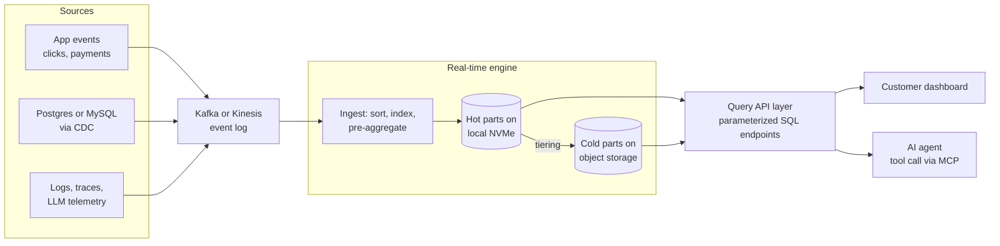
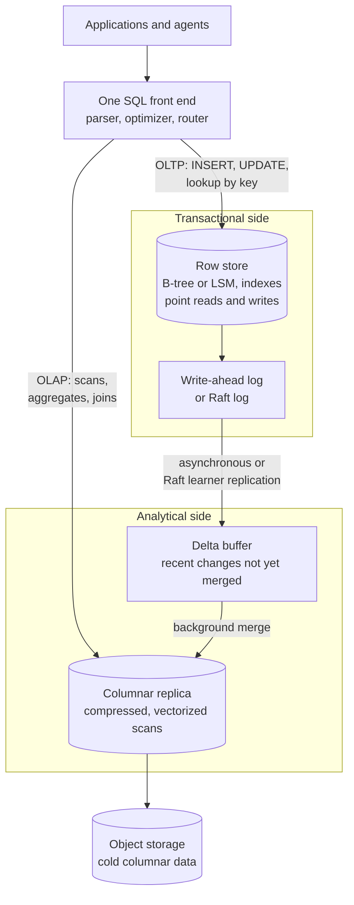
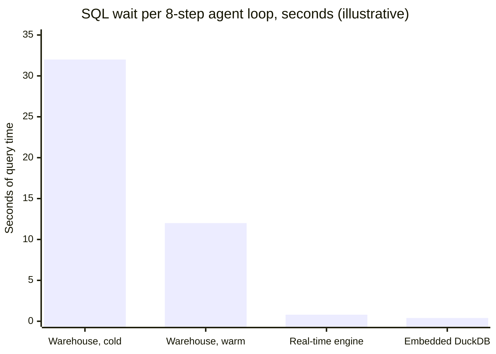
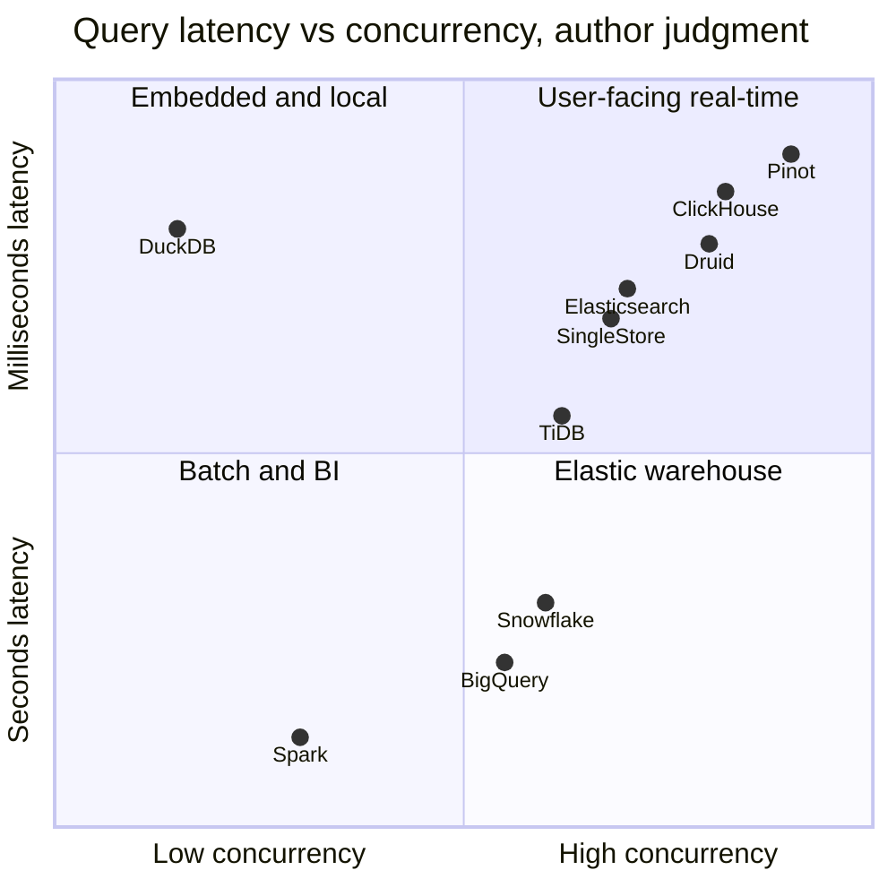
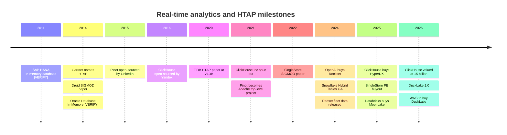

# 23. Real-Time Analytics and HTAP
> **Depth:** L2 · **Reading time:** ~15 min · **Last verified:** 2026-11-01 · **Prerequisites:** [Ch 5 — Analytical engines](../01-data-systems-foundations/ch05-analytical-engines.md)

## TL;DR

- **[Real-time analytics](../glossary.md#real-time-analytics)** means sub-second queries over data that is seconds old, served to thousands of concurrent callers. The callers are customer-facing dashboards, observability consoles, ad-tech bidders and, increasingly, AI agents. A warehouse BI query takes seconds to minutes and serves tens of analysts. Different jobs, different engines.
- The leading engines (ClickHouse, Apache Druid, Apache Pinot) get their speed by **doing work at write time**: sorting, pre-aggregating and indexing data as it lands, so that each read touches only a few kilobytes to megabytes. ClickHouse reported **>$250M ARR** (company-stated, May 2026) and a **$15B** valuation (press-reported, January 2026).[^ch-arr][^ch-seriesd]
- **[HTAP](../glossary.md#htap)** (hybrid transactional/analytical processing) puts transactions and analytics in one system, usually as a row store for writes plus a continuously replicated column store for scans behind one SQL front end. SingleStore, TiDB, Oracle Database In-Memory, SAP HANA, AlloyDB, Snowflake Hybrid Tables and now DuckDB-inside-Postgres all take versions of this approach.
- **Most queries are small.** MotherDuck's reading of Amazon's published Redshift fleet data found that only about 0.03% of queries scan more than 10 TB.[^md-redshift][^redset] That is the case for in-process engines like DuckDB, which AWS agreed to buy the company behind in August 2026.[^aws-duck]
- Agents make latency and per-query cost matter more. An agent that issues eight dependent queries pays the engine's latency eight times, and agents generate traffic at machine rates. That favors engines priced and built for many cheap queries over engines built for few expensive ones.

## Why this matters (business + Everpure lens)

The analytics market has split by workload shape. The cloud warehouses ([Ch 5](../01-data-systems-foundations/ch05-analytical-engines.md), [Ch 26](../04-company-deep-dives/ch26-snowflake.md)) are optimized for flexible queries by a small number of humans. A second market has grown up around **[user-facing analytics](../glossary.md#user-facing-analytics)**: the "who viewed your profile" panel, the merchant dashboard inside a payments app, the log search box in an observability tool. Those products put an analytical query behind every page load. ClickHouse's revenue trajectory is the clearest financial signal of that split. It said it passed $250M ARR in May 2026, more than tripling year over year and adding over 1,000 customers since its January Series D (company-stated).[^ch-arr] Its valuation rose from $6.35B in May 2025 to $15B eight months later (both press-reported).[^ch-seriesc][^ch-seriesd]

AI agents add a third consumer. When an agent answers "why did churn rise in the Northeast last week?", it issues a chain of SQL tool calls, each depending on the last ([Ch 22](ch22-agents-and-data.md)). The engine behind those calls needs warehouse-grade SQL with real-time-grade latency and cost. That is why ClickHouse launched Claude-powered agents at its May 2026 conference, and why Databricks, Snowflake and AWS have all bought Postgres or embedded-analytics assets since 2025.[^ch-arr][^mooncake][^aws-duck]

For Everpure, the storage profile of these engines is distinctive. They are **latency-bound, not just throughput-bound**: the hot set sits on local NVMe for millisecond reads, while the bulk sits on object storage (ClickHouse Cloud's SharedMergeTree keeps all table data in shared object storage).[^ch-smt] Options a strategy team might evaluate, based on public information, include validating S3-compatible on-premises object storage as the shared tier for self-managed ClickHouse, Druid or Pinot clusters, and positioning fast flash as the cache tier those engines depend on.

## How it works

### Two very different query budgets

A warehouse BI query and a real-time query differ on four axes at once. That is why one engine rarely serves both well.

| Dimension | Warehouse BI | Real-time analytics |
|---|---|---|
| Latency target | Seconds to minutes | 10–500 ms, judged at p99 |
| Concurrency | Tens of analysts | Thousands of users or agents, hundreds to thousands of queries per second |
| Data freshness | Hourly or daily batch loads | Seconds after the event |
| Query shape | Ad hoc, wide joins, exploratory | Known patterns, filters on a few keys, aggregates over a time window |

*Figure 23.1 — A real-time query is not a faster warehouse query; it is a different contract (author's characterization of typical targets).*

The key word is **p99**. A user-facing product is judged by its slowest common query, its **[tail latency](../glossary.md#tail-latency)**. A dashboard that averages 80 ms but spikes to 4 seconds when a cold cache is hit feels broken. Real-time engines are engineered to keep the tail tight under load.

### The pipeline: from event to API

*Figure 23.2 — A typical real-time analytics pipeline: events stream through Kafka, the engine indexes them on arrival, and a thin API layer serves both apps and agents.*

Events arrive through a log such as Kafka ([Ch 11](../02-pipelines-and-governance/ch11-streaming-and-event-platforms.md)) or through **[change data capture](../glossary.md#change-data-capture)** from an operational database. ClickHouse bought PeerDB in July 2024 for exactly this Postgres-to-ClickHouse path.[^ch-peerdb] The engine ingests continuously and makes new rows queryable within seconds. In front of it sits an API layer that turns approved SQL queries into endpoints. That is Tinybird's whole product, built on managed ClickHouse.[^tinybird] The same endpoints that feed a dashboard can be exposed to agents as tools.

### How ClickHouse gets to sub-second: MergeTree

ClickHouse began inside Yandex as the engine for a web-analytics product and became an independent company in 2021.[^ch-paper][^ch-inc] Its core table engine, **[MergeTree](../glossary.md#mergetree)**, borrows the write path of an **[LSM-tree](../glossary.md#lsm-tree)**. Each insert batch is written as an immutable, sorted, columnar "part." Background threads merge small parts into larger ones, just as LSM compaction does.

The read path rests on a **[sparse primary index](../glossary.md#sparse-primary-index)**. Rows in a part are sorted by the table's ordering key, for example `(customer_id, event_time)`. Instead of indexing every row, ClickHouse records the key value at the start of each **[granule](../glossary.md#granule)**, a block of 8,192 rows by default.[^ch-sparse] A billion-row table needs only about 122,000 index entries, small enough to sit in RAM. A query for one customer's last hour binary-searches that index, reads the handful of granules that can match, and decompresses only the needed columns with vectorized code ([Ch 5](../01-data-systems-foundations/ch05-analytical-engines.md)).

Two more devices complete the picture. **[Materialized views](../glossary.md#materialized-view)** in ClickHouse are insert triggers: as rows arrive they are aggregated into a second, much smaller table, so "revenue per merchant per minute" is computed once at write time rather than on every page load. **Skipping indexes** (min/max, set and bloom filters per block of granules) let queries on non-key columns skip data as well.

> **Going deeper (L3).** The ClickHouse VLDB 2024 paper describes the full stack: part merges, the sparse index, projections (alternative sort orders stored alongside a table), and the vectorized executor.[^ch-paper] In ClickHouse Cloud, **[SharedMergeTree](../glossary.md#sharedmergetree)** replaces replica-to-replica copying. All parts live in object storage, metadata is coordinated through ClickHouse Keeper, and the docs say a table can have hundreds of stateless replicas without sharding.[^ch-smt]

> **Bridge: in-line metrology.** A fab does not wait for end-of-line electrical test to discover a drifting etch step. It measures critical dimensions in-line, during the process, so it can correct the next lot. Warehouse BI is end-of-line test: accurate, comprehensive, and too late to fix this lot. Real-time analytics is in-line metrology: a narrower set of pre-chosen measurements, taken while the process runs, cheap enough to do on every wafer.

### Segment engines: Druid and Pinot

Apache Druid came from Metamarkets for ad-tech reporting. Its SIGMOD 2014 paper describes real-time nodes that index streaming data immediately and historical nodes that serve immutable **[segments](../glossary.md#segment)** loaded from deep storage.[^druid-paper] Apache Pinot was built at LinkedIn for member-facing features, open-sourced in 2015 and later adopted by Uber. It became an Apache top-level project in 2021.[^pinot-tlp] Both engines time-partition data into segments, build bitmap and inverted indexes on every dimension, and push segments to object storage as the durable copy. Pinot's signature **[star-tree index](../glossary.md#star-tree-index)** precomputes aggregates for chosen dimension combinations, trading storage for very predictable latency. The commercial vendors are Imply (Druid), which repositioned around an "observability warehouse" called Lumi in September 2025, and StarTree (Pinot), whose last disclosed priced round was a $47M Series B in 2022.[^imply-lumi][^startree]

Rockset took a third route, **[converged indexing](../glossary.md#converged-index)**. Every field of every document was stored three ways, in a row index, a column index and a search index, on RocksDB with SST files offloaded to S3.[^rockset-arch] The design bought query flexibility at the price of write amplification. OpenAI announced the Rockset acquisition on June 21, 2024 to power its retrieval infrastructure, and month-to-month customers had to leave the service by September 30, 2024.[^rockset] For buyers, the lesson is concrete: a real-time engine can vanish into an acquirer, and open source is an exit option.

### HTAP: one system, two engines

The HTAP idea, named by Gartner in 2014,[^htap-gartner] removes the pipeline altogether: run analytics on the transactional database itself, on data that is milliseconds old. In practice every successful HTAP design keeps **two physical formats** under one logical database.

*Figure 23.3 — Generic HTAP architecture: the optimizer routes point operations to a row store and scans to a continuously replicated column store, so both see nearly the same data without a separate pipeline.*

The variants differ in where the column copy lives and how fresh it is:

- **SingleStore** keeps an in-memory row store and a disk-based column store in the same engine. Its SIGMOD 2022 paper describes a "universal storage" table that serves both patterns.[^s2-paper] Vector Capital agreed to a growth buyout of SingleStore in September 2025 (terms undisclosed; Bloomberg cited roughly $500M, press-reported).[^singlestore]
- **TiDB** (PingCAP) stores rows in TiKV, a Raft-replicated key-value store, and adds **TiFlash** columnar replicas that join each Raft group as non-voting learners. Analytics therefore read a consistent, near-current snapshot without slowing the write quorum.[^tidb-paper]
- **Oracle Database In-Memory** and **SAP HANA** brought dual-format, in-memory columnar processing to the enterprise incumbents in the early 2010s [VERIFY: Oracle In-Memory GA 2014; HANA GA 2011].
- **AlloyDB** (Google's Postgres-compatible service) adds a columnar engine, an in-memory column cache populated automatically from row tables. Google states speedups of up to 100× on analytical queries (vendor-stated, TPC-H-like tests).[^alloydb]
- **Snowflake Hybrid Tables** (the Unistore feature) come at HTAP from the warehouse side, adding a row store for point operations. They reached GA on AWS in November 2024.[^sf-hybrid]
- **Postgres plus an embedded column engine** is the 2025–26 pattern. pg_duckdb (from MotherDuck, Hydra and DuckDB Labs, beta October 2024) runs DuckDB inside the Postgres process.[^pgduckdb] Databricks acquired Mooncake Labs, the team behind pg_mooncake's Postgres-to-columnar mirroring, in October 2025 for Lakebase.[^mooncake] AWS shipped DuckDB-powered analytics inside Aurora PostgreSQL in autumn 2026, so one query can join live tables with Iceberg and Parquet data in S3.[^aurora-duck]

The honest assessment is that "true" HTAP, one storage format for both workloads, has mostly lost. What won is **HTAP as managed replication**: two formats, one product, with the vendor hiding the replication lag ([Ch 1](../01-data-systems-foundations/ch01-data-stack-map.md) calls the cross-product version zero-ETL).

> **Bridge: unified memory.** Discrete GPUs sit across PCIe from the CPU, so data must be copied before the accelerator can work on it. That is ETL in hardware terms. Unified-memory parts (Apple's M-series, AMD's MI300A, NVIDIA's coherent Grace-Hopper link) let CPU and GPU address the same memory, removing the copy but forcing the two to share bandwidth. HTAP makes the same trade. The copy step goes away, but OLTP and OLAP now compete for one system's memory, CPU and I/O, and a heavy scan can raise the p99 of a payment write. Vendors answer the way chip designers do, with partitioning and quality-of-service controls.

### DuckDB and the small-data thesis

DuckDB is an **[in-process database](../glossary.md#in-process-database)**: a library linked into the application, like SQLite, but with a vectorized columnar engine ([Ch 5](../01-data-systems-foundations/ch05-analytical-engines.md)). There is no server, no network hop and no cluster. Its premise is that most analytical data fits on one machine, an idea MotherDuck has made its brand.

The evidence is better than anecdote. Amazon's VLDB 2024 paper on the Redshift fleet released "Redset," three months of query statistics from 200 provisioned and 200 serverless clusters. It found that queries are highly repetitive, that their properties follow long-tailed distributions, and that they touch fewer tables than TPC-DS assumes.[^redset] MotherDuck's analysis of Redset found that only about 0.03% of queries scan more than 10 TB. Even against tables larger than 10 TB, the average query read about 0.5% of the table.[^md-redshift] The caveats matter. Redset is one vendor's fleet, the bytes are those scanned after pruning, and the few big queries still consume a disproportionate share of compute. MotherDuck's own reading puts it at about 6% of execution time, from a vendor with an interest in the answer. Even so, **"[small data](../glossary.md#small-data)" describes the median query**, and the median query is what agents and dashboards generate.

Commercially, the DuckDB ecosystem moved fast. MotherDuck, the managed DuckDB service, raised a $52.5M Series B at a reported $400M post-money valuation in September 2023.[^motherduck] DuckLake, a table format that keeps lake metadata in a SQL database, reached 1.0 in April 2026.[^ducklake] Then, on August 26, 2026, Amazon signed a definitive agreement to acquire DuckLabs, the company behind DuckDB (terms undisclosed). The project itself stays MIT-licensed under the independent DuckDB Foundation.[^aws-duck]

> **Bridge: embedded accelerator.** A warehouse is a separate appliance: data travels over a link to a big shared engine and results come back. DuckDB is the accelerator block integrated on the die: smaller, but with zero transfer cost and no queue in front of it. For workloads that fit in local memory, an on-die block beats a faster chip across the bus, because interconnect and scheduling latency dominate.

### Why agents change the economics

Agents raise both latency and cost stakes.

**Latency multiplies.** An agent's tool calls are usually sequential, because each query depends on the previous answer. The worked example below is illustrative, not a benchmark.

*Figure 23.4 — With eight dependent tool calls, per-query latency of 4 s, 1.5 s, 100 ms and 50 ms (author's assumptions) becomes 32 s, 12 s, 0.8 s and 0.4 s of pure waiting before any model reasoning time is added.*

If model reasoning adds, say, 1.5 s per step (assumption), the warm-warehouse loop takes 24 s end to end and the real-time loop about 13 s. The model, not the database, becomes the bottleneck, which is where it should be.

**Cost per query decides who can afford agent traffic.** Assume, for illustration, a SaaS product exposing analytics to 1,000 concurrent users and agents generating about 167 queries per second, roughly 433 million queries a month. Price compute at a notional $1 per node-hour. A warehouse query that runs 2 s on an 8-node cluster consumes 16 node-seconds, about $0.0044. A real-time engine that answers in 50 ms on 2 nodes, because the sparse index pruned to a few granules, consumes 0.1 node-seconds, about $0.00003. Monthly, that is roughly **$1.9M versus $12K**, a ratio of about 160×. Result caches, warm pools and minimum billing increments move real numbers a lot. The direction does not change: engines that prune by index and pre-aggregate at write time win when queries are many, small and repetitive, which is exactly what Redset says real workloads look like.[^redset]

## Design choices and trade-offs

The real-time triangle is **freshness, query speed and cost: pick two**, and choose where to pay.

| Choice | What you gain | What you pay | Steelman of the alternative |
|---|---|---|---|
| Index and pre-aggregate at write time | Millisecond reads, low cost per query | Ingest CPU, storage for rollups, rigid query patterns | A warehouse answers questions nobody anticipated |
| **[Denormalization](../glossary.md#denormalization)** into wide tables | No joins at read time; predictable p99 | Re-processing when dimensions change; data duplication | Star schemas keep one version of each dimension; modern engines join well |
| Append-only columnar parts | Fast ingest, great compression | **[Upserts](../glossary.md#upsert)** and deletes are expensive: rows are rewritten or masked until merge | Row stores update in place; HTAP keeps a row store for exactly this |
| Merge-on-read updates (ReplacingMergeTree, Pinot upsert tables, Druid reindexing) | Accepts updates without rewriting data at write time | Queries see duplicates until merge, or pay `FINAL`-style deduplication at read time | Lightweight deletes and **[deletion vectors](../glossary.md#deletion-vector)** narrow the gap ([Ch 7](../01-data-systems-foundations/ch07-open-table-formats.md)) |
| HTAP in one product | No pipeline; freshest data | OLTP and OLAP contend for resources; usually smaller scale than a dedicated warehouse | Separate systems isolate failure and scale independently |
| Local NVMe hot tier | Lowest tail latency | Rebalancing on resize; capacity tied to compute | Object storage plus cache gives elasticity at slightly higher p99 |

*Figure 23.5 — Every real-time design moves work from read time to write time; the question is which writes and which updates you can afford.*

Upserts deserve emphasis because they are where real-time projects stall. Columnar parts are immutable, so an update to one row means writing a new version and reconciling later. ClickHouse's ReplacingMergeTree keeps the latest version only after a background merge. Before then, a query must deduplicate at read time or tolerate duplicates. ClickHouse Cloud has since added lightweight updates.[^ch-smt-blog] Teams with heavy update traffic, such as order status or inventory, often keep that state in Postgres and stream changes into the analytical engine, which is HTAP by pipeline.

### Engine comparison

| Engine | Architecture | Latency target | Concurrency | Update support | Open source / license | Commercial vendor and status |
|---|---|---|---|---|---|---|
| ClickHouse | Columnar MergeTree, sparse index, vectorized; SharedMergeTree on object storage in cloud | Tens to hundreds of ms | High (hundreds+ QPS per cluster) | Append-first; Replacing/Collapsing engines, lightweight deletes and updates | Yes, Apache 2.0 | ClickHouse Inc.; $15B (press-reported, Jan 2026); >$250M ARR (company-stated, May 2026)[^ch-seriesd][^ch-arr] |
| Apache Druid | Time-partitioned segments, bitmap indexes, deep storage | Sub-second | High | Batch reindexing; limited streaming upserts | Yes, Apache 2.0 | Imply; pivoted to Lumi observability warehouse (Sep 2025)[^imply-lumi] |
| Apache Pinot | Segments with inverted and star-tree indexes | Tens of ms at p99 | Very high (user-facing) | Upsert tables on primary key | Yes, Apache 2.0 | StarTree; $47M Series B (2022)[^startree] |
| Rockset | Converged row, column and search indexes on RocksDB-Cloud | Sub-second | High | Native document updates | No | Acquired by OpenAI (Jun 2024); external service wound down Sep 2024[^rockset] |
| Tinybird | API layer on managed ClickHouse | Sub-second | High | As ClickHouse | CLI and tools open; service proprietary | $30M Series B (Jun 2024)[^tinybird] |
| Elasticsearch / OpenSearch | Lucene inverted indexes, near-real-time refresh | Sub-second for search and filters | High | Document updates (reindex internally) | Elastic: multiple licenses; OpenSearch: Apache 2.0 | Elastic (public); OpenSearch under the Linux Foundation |
| SingleStore | HTAP: in-memory row store plus columnar universal storage | Ms (OLTP) to sub-second (OLAP) | High | Full transactional updates | No (source-available tools) | Vector Capital growth buyout (Sep 2025)[^singlestore] |
| TiDB | HTAP: TiKV row store plus TiFlash Raft-learner column replicas | Ms (OLTP), seconds (OLAP) | High | Full ACID | Yes, Apache 2.0 | PingCAP [VERIFY: latest funding] |
| Snowflake Hybrid Tables | Row store inside a warehouse | Ms point lookups; warehouse for scans | Moderate | Full ACID with indexes | No | Snowflake (public); GA on AWS Nov 2024[^sf-hybrid] |
| DuckDB / MotherDuck | In-process vectorized columnar; MotherDuck runs it as a service | Ms to seconds, single node | Per process (one app or one user) | Full ACID within one database file | Yes, MIT (DuckDB Foundation) | DuckLabs to be acquired by AWS (Aug 2026); MotherDuck $400M post (2023)[^aws-duck][^motherduck] |

*Figure 23.6 — Real-time engines buy speed with write-time indexing; HTAP engines buy freshness with dual formats; DuckDB buys simplicity by removing the server.*

### Positioning map

*Figure 23.7 — Author's placement of typical deployments, not benchmark results: real-time engines own the top right, DuckDB owns low-concurrency speed, and warehouses scale concurrency by adding clusters at seconds-level latency.*

## Who's who

- **Real-time OLAP:** ClickHouse is the scale leader. It is building a broader platform through acquisitions: PeerDB for Postgres CDC (July 2024), HyperDX for its ClickStack observability UI (March 2025) and Langfuse for LLM observability (January 2026).[^ch-peerdb][^ch-hyperdx][^ch-langfuse] Aggregators also list LibreChat (November 2025) and RunReveal (September 2026) [VERIFY: ClickHouse–LibreChat and –RunReveal deals]. Imply (Druid) and StarTree (Pinot) are smaller specialists. Tinybird sells the developer API layer. Firebolt targets low-latency analytics with its own engine (see [Ch 31](../04-company-deep-dives/ch31-analytical-engine-challengers-legacy.md)).
- **Search-shaped analytics:** Elastic and OpenSearch dominate log and security analytics, and they are now contested by columnar engines (ClickStack, Imply Lumi) arguing that logs are just wide tables.
- **HTAP:** SingleStore (PE-owned since 2025), PingCAP/TiDB, Oracle, SAP, Google AlloyDB, Snowflake Unistore.
- **Postgres-centred analytics:** Databricks Lakebase with Mooncake, Snowflake Postgres (Crunchy Data), AWS Aurora with embedded DuckDB, pg_duckdb.[^mooncake][^aurora-duck][^pgduckdb]
- **In-process:** DuckDB (DuckDB Foundation; DuckLabs heading to AWS), MotherDuck, and the DataFusion- and Polars-based alternatives.
- **Exited:** Rockset (to OpenAI, 2024).[^rockset]

## History and trajectory

*Figure 23.8 — The arc runs from in-memory HTAP appliances, to open-source real-time engines, to a 2025–26 consolidation in which platforms buy embedded analytics and Postgres assets.*

Three phases stand out. **2010–2015:** HTAP was an incumbent story, with SAP and Oracle using large DRAM footprints to run analytics on transactional data, and Gartner gave it a name.[^htap-gartner] **2015–2022:** internet companies open-sourced the engines they had built for user-facing analytics (Druid, Pinot, ClickHouse), and venture-backed vendors formed around them.[^druid-paper][^pinot-tlp][^ch-paper] **2023–2026:** consolidation and convergence. Rockset was absorbed, SingleStore went to private equity, ClickHouse raised at a growth multiple, and the hyperscalers and lakehouse vendors bought their way into embedded analytics.[^rockset][^singlestore][^ch-seriesd][^aws-duck]

The trajectory points toward **analytics as a feature of every operational database**: a columnar engine embedded in Postgres, mirrored to an open table format on object storage. The bear case for standalone real-time vendors is that "good enough" analytics inside Postgres and the lakehouse covers most needs. The bull case is that agent traffic is precisely the high-concurrency, latency-critical workload where specialists still win by 10× or more on cost.

## Numbers that matter

| Metric | Value | Basis | Source/date |
|---|---|---|---|
| ClickHouse ARR | >$250M, more than tripled YoY; >4,000 customers | Company-stated | Business Wire, 2026-05-27[^ch-arr] |
| ClickHouse valuation | $15B ($400M Series D) | Press-reported | Bloomberg, 2026-01-16[^ch-seriesd] |
| ClickHouse prior valuation | $6.35B (May 2025) | Press-reported | Bloomberg, 2025-05-29[^ch-seriesc] |
| ClickHouse default granule size | 8,192 rows per index entry | Documentation | ClickHouse docs, n.d.[^ch-sparse] |
| Queries scanning >10 TB in Redset | ~0.03% | Vendor analysis of public dataset | MotherDuck, 2024[^md-redshift] |
| Redset scope | 200 provisioned + 200 serverless clusters, 3 months | Paper (Amazon authors) | PVLDB 17(11), 2024[^redset] |
| MotherDuck Series B | $52.5M at ~$400M post-money | Press-reported | The Register, 2023-09-21[^motherduck] |
| AlloyDB columnar speedup | Up to 100× vs standard Postgres on analytical queries | Vendor-stated benchmark | Google Cloud, 2022[^alloydb] |
| Rockset off-boarding deadline | 2024-09-30 for month-to-month customers | Company-stated | Rockset, 2024-06-21[^rockset] |
| Illustrative agent-loop SQL wait | 32 s (cold warehouse) vs 0.8 s (real-time engine), 8 steps | Estimate (author assumptions) | This chapter, Figure 23.4 |
| Illustrative monthly compute, 167 QPS | ~$1.9M vs ~$12K | Estimate (author assumptions) | This chapter, worked example |

## Storage bridge

> **Storage bridge.** Real-time engines are the most latency-sensitive analytical tenants of storage. They want **local NVMe** for hot parts and indexes, so p99 stays in milliseconds, and **object storage** for the durable bulk, as in ClickHouse Cloud's SharedMergeTree or Druid and Pinot deep storage.[^ch-smt] Tiering policy and cache hit rate, not raw throughput, decide user-visible latency. See [Ch 24](ch24-data-meets-compute-and-storage.md) and the companion *Everpure Tech Atlas* for the flash and object-protocol detail.

## Conversation playbook

**Questions for product managers**

1. "What share of your query volume is user-facing or agent-generated versus analyst-generated, and how has that mix moved in the last year?"
2. "How do you price a workload with 500 queries per second of 20 ms queries? Is the unit compute time, queries or data scanned, and what does a customer pay per million queries?"
3. "When customers need updates or deletes (GDPR, order status), what is the supported pattern, and how often does it drive them to keep a separate Postgres?"

**Questions for engineers**

1. "What is your p99 at peak concurrency, not your median on an idle cluster? What happens to it during merges or ingest spikes?"
2. "What fraction of reads hit local NVMe versus object storage, and what is the latency penalty on a cache miss?"
3. "For HTAP: what is the replication lag from row store to column store at p99, and how do you stop a heavy scan from affecting OLTP latency?"

**What good answers sound like:** concrete percentile numbers under named load, a clear statement of which query patterns are fast (keyed filters, time windows) and which are not (ad hoc many-way joins), and a candid update story. A good HTAP answer quantifies lag and describes resource isolation. It does not just claim "real-time."

**Don't say this**

- "Snowflake or Databricks can just do real-time." They can serve some low-latency workloads, but their cost and concurrency model is built for fewer, larger queries. Ask for a p99 at hundreds of queries per second.
- "HTAP means one copy of the data." Nearly every production HTAP system keeps a row copy and a column copy; the product hides the replication.
- "Columnar stores can't do updates." They can, through merge-on-read, lightweight deletes and row-store side tables, but updates cost more than appends and fresh results can show duplicates.
- "Rockset showed real-time analytics is a dead end." It showed that a closed-source vendor can be acqui-hired out from under its customers. The category kept growing (ClickHouse ARR).[^ch-arr]
- "DuckDB is a toy for laptops." It is an embedded engine now inside Postgres services and backed by an AWS acquisition agreement.[^aws-duck][^aurora-duck]

## Going deeper

> **Going deeper (L3).** Read the ClickHouse VLDB 2024 paper for the MergeTree and sparse-index design, the TiDB VLDB 2020 paper for Raft-learner columnar replicas, and the SingleStore SIGMOD 2022 paper for a single-engine dual-format design.[^ch-paper][^tidb-paper][^s2-paper] For the small-data debate, download Redset and reproduce the scan-size distribution yourself, then compare it with MotherDuck's reading.[^redset][^md-redshift]

## Key terms

- [Real-time analytics](../glossary.md#real-time-analytics) — sub-second analytical queries over seconds-fresh data at high concurrency.
- [User-facing analytics](../glossary.md#user-facing-analytics) — analytics embedded in a product and queried by its end users, not by internal analysts.
- [Tail latency](../glossary.md#tail-latency) — the latency of the slowest requests (for example p99), which governs perceived responsiveness.
- [HTAP](../glossary.md#htap) — one system serving transactional and analytical workloads on fresh data.
- [Columnar replica](../glossary.md#columnar-replica) — a column-format copy of row-store data, kept current by replication, used for analytical reads.
- [MergeTree](../glossary.md#mergetree) — ClickHouse's table engine of sorted immutable columnar parts merged in the background.
- [Sparse primary index](../glossary.md#sparse-primary-index) — an index with one entry per block of rows rather than per row.
- [Granule](../glossary.md#granule) — ClickHouse's smallest unit of data read, 8,192 rows by default.
- [SharedMergeTree](../glossary.md#sharedmergetree) — ClickHouse Cloud's MergeTree variant that keeps all data on shared object storage.
- [Materialized view](../glossary.md#materialized-view) — a stored query result kept up to date as source data changes.
- [Segment](../glossary.md#segment) — a time-partitioned, immutable, indexed data file in Druid or Pinot.
- [Star-tree index](../glossary.md#star-tree-index) — Pinot's pre-aggregation index over chosen dimension combinations.
- [Converged index](../glossary.md#converged-index) — Rockset's approach of storing every field in row, column and search indexes.
- [In-process database](../glossary.md#in-process-database) — a database engine that runs as a library inside the application process.
- [Small data](../glossary.md#small-data) — the thesis that most analytical queries touch data that fits on one machine.
- [Upsert](../glossary.md#upsert) — insert a row, or update it if a row with the same key exists.
- [Denormalization](../glossary.md#denormalization) — storing pre-joined, redundant data to avoid joins at read time.
- [Change data capture](../glossary.md#change-data-capture) — emitting committed database changes as an event stream.
- [LSM-tree](../glossary.md#lsm-tree) — a write-optimized structure that buffers writes and merges sorted runs in the background.
- [Deletion vector](../glossary.md#deletion-vector) — a bitmap marking deleted rows so files need not be rewritten immediately.

## Sources

[^ch-arr]: ClickHouse via Business Wire, "ClickHouse Tops $250M ARR and 4,000 Customers, Launches Claude-Powered Agents at Open House 2026," https://www.businesswire.com/news/home/20260527813115/en/ (also https://clickhouse.com/blog/clickhouse-tops-250m-arr-and-4000-customers), published 2026-05-27; retrieved 2026-11-01. Company-stated ARR. Sacra's estimate of ~$350M ARR for August 2026 is a third-party estimate and is not used.
[^ch-seriesd]: Bloomberg, "ClickHouse Lands $15 Billion Valuation in AI Database Race," https://bloomberg.com/news/articles/2026-01-16/clickhouse-lands-15-billion-valuation-in-ai-database-race, published 2026-01-16; Business Wire release via https://www.standard-journal.com/ap/business/article_fc7656bf-059e-533c-9dae-7646b95fb9eb.html, 2026-01-16; retrieved 2026-11-01 (via `data/private_funding.csv`).
[^ch-seriesc]: Bloomberg, "Khosla-Led Deal Values Data Startup ClickHouse at $6.35 Billion," https://bloomberg.com/news/articles/2025-05-29/khosla-led-deal-values-data-startup-clickhouse-at-6-35-billion, published 2025-05-29; retrieved 2026-11-01 (via `data/private_funding.csv`).
[^ch-smt]: ClickHouse documentation, "SharedMergeTree," https://clickhouse.com/docs/cloud/reference/shared-merge-tree, n.d.; retrieved 2026-11-01.
[^ch-smt-blog]: ClickHouse blog, "ClickHouse Cloud boosts performance with SharedMergeTree and lightweight updates," https://clickhouse.com/blog/clickhouse-cloud-boosts-performance-with-sharedmergetree-and-lightweight-updates, published 2023 [VERIFY: exact date]; retrieved 2026-11-01.
[^ch-sparse]: ClickHouse documentation, "A practical introduction to primary indexes in ClickHouse," https://clickhouse.com/docs/guides/best-practices/sparse-primary-indexes, n.d.; retrieved 2026-11-01. Default `index_granularity` = 8,192.
[^ch-paper]: R. Schulze, T. Schreiber, I. Yatsishin, R. Dahimene, A. Milovidov, "ClickHouse — Lightning Fast Analytics for Everyone," PVLDB 17(12): 3731–3744, https://www.vldb.org/pvldb/vol17/p3731-schulze.pdf, published 2024; retrieved 2026-11-01.
[^ch-inc]: ClickHouse via Business Wire, "ClickHouse, Inc. Announces Incorporation, Along With $50M In Series A Funding," https://businesswire.com/news/home/20210920005219/en/, published 2021-09-20; retrieved 2026-11-01.
[^ch-peerdb]: TechCrunch, "Real-time database startup ClickHouse acquires PeerDB to expand its Postgres support," https://techcrunch.com/2024/07/30/real-time-database-startup-clickhouse-acquires-peerdb-to-expand-its-postgres-support, published 2024-07-30; retrieved 2026-11-01 (via `data/ma_deals.csv`).
[^ch-hyperdx]: ClickHouse blog, "ClickHouse acquires HyperDX: the future of open-source observability," https://clickhouse.com/blog/clickhouse-acquires-hyperdx-the-future-of-open-source-observability, published 2025-03-13; retrieved 2026-11-01 (via `data/ma_deals.csv`).
[^ch-langfuse]: ClickHouse blog, "ClickHouse acquires Langfuse," https://clickhouse.com/blog/clickhouse-acquires-langfuse-open-source-llm-observability, published 2026-01-16; retrieved 2026-11-01 (via `data/ma_deals.csv`).
[^tinybird]: TechCrunch, "Tinybird raises another $30 million to transform data into real-time APIs," https://techcrunch.com/2024/06/17/tinybird-raises-another-30-million-to-transform-data-into-real-time-apis, published 2024-06-17; Tinybird blog, "Announcing Tinybird Series B," https://www.tinybird.co/blog/announcing-tinybird-series-b, 2024-06-17; retrieved 2026-11-01. TechCrunch's ~$240M valuation rests on one unnamed source (press-reported).
[^druid-paper]: F. Yang, E. Tschetter, X. Léauté, N. Ray, G. Merlino, D. Ganguli, "Druid: A Real-time Analytical Data Store," SIGMOD 2014, http://static.druid.io/docs/druid.pdf (DOI 10.1145/2588555.2595631), published 2014-06; retrieved 2026-11-01.
[^pinot-tlp]: Apache Software Foundation, "The Apache Software Foundation Announces Apache Pinot as a Top-Level Project," https://news.apache.org/?p=3676, published 2021 [VERIFY: month; sources give August or December 2021]; LinkedIn Engineering, "Pinot joins Apache Incubator," https://engineering.linkedin.com/blog/2019/03/pinot-joins-apache-incubator, 2019-03; retrieved 2026-11-01.
[^imply-lumi]: Imply via Business Wire, "Imply Launches Imply Lumi: The Industry's First Observability Warehouse," https://www.businesswire.com/news/home/20250908960771/en, published 2025-09-08; retrieved 2026-11-01. "First" is the company's claim.
[^startree]: StarTree, "StarTree lands $47 million in Series B funding," https://startree.ai/blog/startree-lands-47-million-in-series-b-funding-to-accelerate-adoption-of-real-time, published 2022-08; BigDATAwire, "StarTree uncorks $47 million for Pinot," https://www.hpcwire.com/bigdatawire/2022/08/29/startree-uncorks-47-million-for-pinot/, 2022-08-29; retrieved 2026-11-01.
[^rockset-arch]: Rockset, "Rockset: The design and implementation of a data system for low-latency queries for search and analytics," Strata Data Conference 2019 presentation, https://conferences.oreilly.com/strata/strata-ca-2019/ (PDF in event assets), published 2019-03; M. Heller, "Rockset review: Real-time SQL for operational data," InfoWorld, https://www.infoworld.com/article/3446026/rockset-review-real-time-sql-for-operational-data.html, 2019; retrieved 2026-11-01.
[^rockset]: Rockset blog, "OpenAI Acquires Rockset," https://rockset.com/blog/openai-acquires-rockset, published 2024-06-21; TechCrunch, "OpenAI buys Rockset to bolster its enterprise AI," https://techcrunch.com/2024/06/21/openai-buys-rockset-to-bolster-its-enterprise-ai, 2024-06-21; retrieved 2026-11-01. Off-boarding deadline per Rockset customer FAQ as summarized in search results; terms undisclosed.
[^htap-gartner]: Gartner, "Hybrid Transaction/Analytical Processing Will Foster Opportunities for Dramatic Business Innovation" (M. Pezzini, D. Feinberg, N. Rayner, R. Edjlali), published 2014-01-28 (paywalled; cited via Wikipedia, https://en.wikipedia.org/wiki/Hybrid_transactional/analytical_processing); retrieved 2026-11-01. Secondary source.
[^s2-paper]: A. Prout et al., "Cloud-Native Transactions and Analytics in SingleStore," SIGMOD 2022, https://dl.acm.org/doi/10.1145/3514221.3526055, published 2022-06; retrieved 2026-11-01.
[^singlestore]: SingleStore via Business Wire, "SingleStore Announces Growth Buyout Led by Vector Capital," https://www.businesswire.com/news/home/20250910281594/fr (English original dated 2025-09-10), published 2025-09-10; Bloomberg, "Google- and Dell-Backed SingleStore Nears Sale to Vector Capital," https://www.bloomberg.com/news/articles/2025-09-10/google-and-dell-backed-singlestore-nears-sale-to-vector-capital, 2025-09-10; retrieved 2026-11-01. ~$500M is press-reported (Bloomberg sources); close reported October 2025 by secondary sources [VERIFY].
[^tidb-paper]: D. Huang et al., "TiDB: A Raft-based HTAP Database," PVLDB 13(12): 3072–3084, https://www.vldb.org/pvldb/vol13/p3072-huang.pdf, published 2020; retrieved 2026-11-01.
[^alloydb]: Google Cloud blog, "AlloyDB for PostgreSQL under the hood: Columnar engine," https://cloud.google.com/blog/products/databases/alloydb-for-postgresql-columnar-engine, published 2022 [VERIFY: exact date]; AlloyDB Omni Installation Guide, https://cloud.google.com/alloydb/docs/omni/pdfs/AlloyDB_Omni_Installation_Guide.pdf, n.d.; retrieved 2026-11-01. Speedup is vendor-stated.
[^sf-hybrid]: Snowflake press release, "Snowflake's Unistore Unifies Transactional and Analytical Data with the General Availability of Hybrid Tables," https://www.businesswire.com/news/home/20241112313046/en/, published 2024-11-12; retrieved 2026-11-01.
[^pgduckdb]: BigDATAwire, "MotherDuck Launches Beta Extension to Enhance PostgreSQL with DuckDB Analytics," https://www.hpcwire.com/bigdatawire/2024/10/28/motherduck-launches-beta-extension-to-enhance-postgresql-with-duckdb-analytics/, published 2024-10-28; retrieved 2026-11-01. 1.0 release reported around September 2025 [VERIFY: date via github.com/duckdb/pg_duckdb releases].
[^mooncake]: Databricks blog, "Mooncake Labs joins Databricks to accelerate the vision of Lakebase," https://www.databricks.com/blog/mooncake-labs-joins-databricks-accelerate-vision-lakebase, published 2025-10-01; retrieved 2026-11-01 (via `data/ma_deals.csv`).
[^aurora-duck]: AWS documentation, "How Aurora PostgreSQL analytics works," https://docs.aws.amazon.com/AmazonRDS/latest/AuroraUserGuide/aurora-analytics-how-it-works.html, n.d.; AWS News Blog, "Amazon Aurora PostgreSQL now supports direct querying of Apache Iceberg and Parquet data in your data lake," https://aws.amazon.com/blogs/aws/amazon-aurora-postgresql-now-supports-direct-querying-of-apache-iceberg-and-parquet-data-in-your-data-lake/, 2026 [VERIFY: date]; SiliconANGLE report, https://siliconangle.com/?p=848849, 2026-09-30; retrieved 2026-11-01.
[^aws-duck]: Amazon, "AWS to acquire DuckLabs, the Amsterdam-based company behind DuckDB," https://www.aboutamazon.com/news/company-news/aws-ducklabs, published 2026-08-26; The Register, "AWS buys DuckLabs, the people behind the popular in-process OLAP database," https://www.theregister.com/databases/2026/08/26/aws-buys-ducklabs-the-people-behind-the-popular-in-process-olap-database/5292590, 2026-08-26; retrieved 2026-11-01. Terms undisclosed; closing status not confirmed by a primary source [VERIFY].
[^ducklake]: DuckDB blog, "DuckLake 1.0," https://duckdb.org/2026/04/13/ducklake-10.html, published 2026-04-13; retrieved 2026-11-01 (via `meta/research-briefing.md`).
[^motherduck]: The Register, "MotherDuck funding," https://theregister.com/2023/09/21/motherduck_funding/, published 2023-09-21; retrieved 2026-11-01. $400M post-money is press-reported.
[^redset]: A. van Renen, D. Horn, P. Pfeil et al., "Why TPC Is Not Enough: An Analysis of the Amazon Redshift Fleet," PVLDB 17(11), https://vldb.org/pvldb/vol17/p3694-saxena.pdf, published 2024; dataset at https://github.com/amazon-science/redset; retrieved 2026-11-01.
[^md-redshift]: MotherDuck blog, "Redshift Files: The Hunt for Big Data," https://motherduck.com/blog/redshift-files-hunt-for-big-data/, published 2024 [VERIFY: exact date]; retrieved 2026-11-01. Vendor analysis of the public Redset data; figures as summarized by search results.
