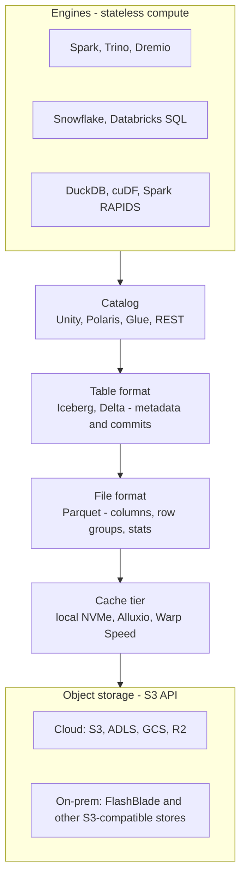
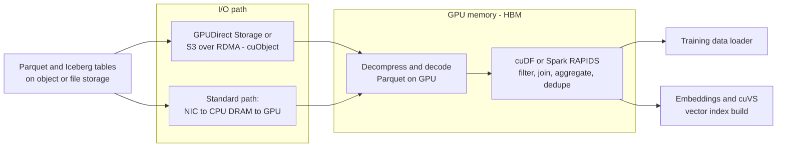
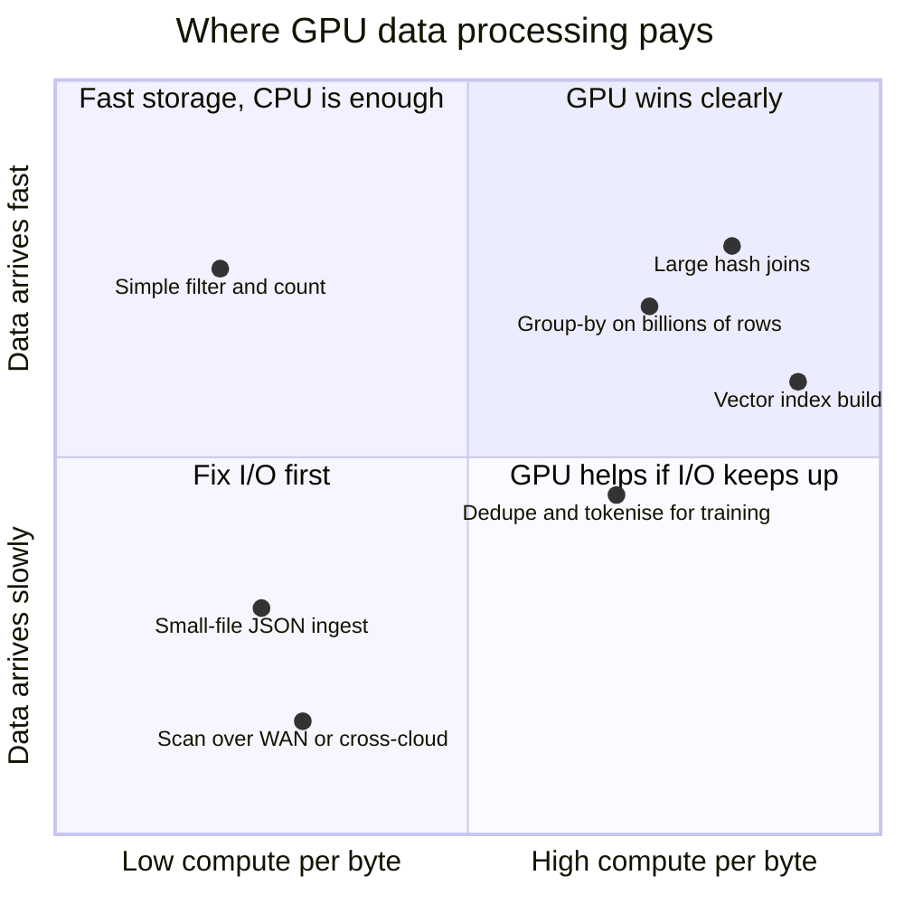
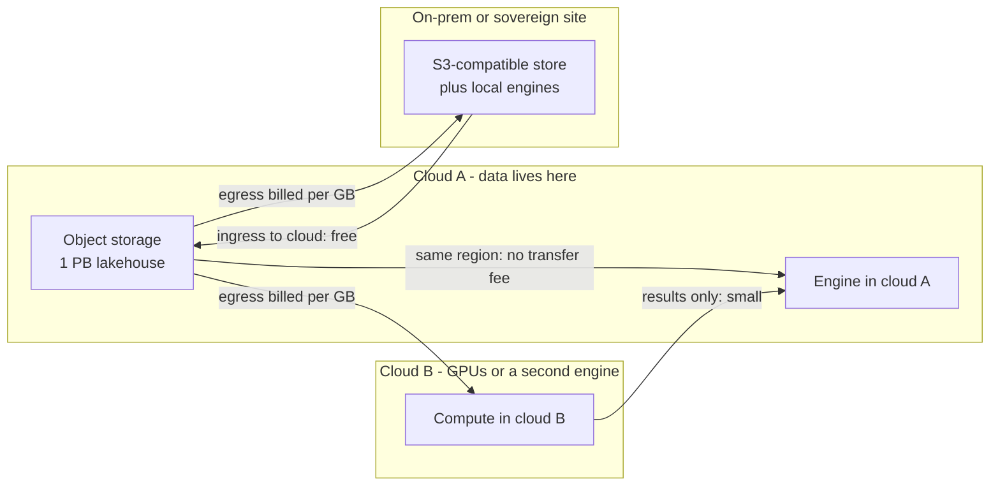
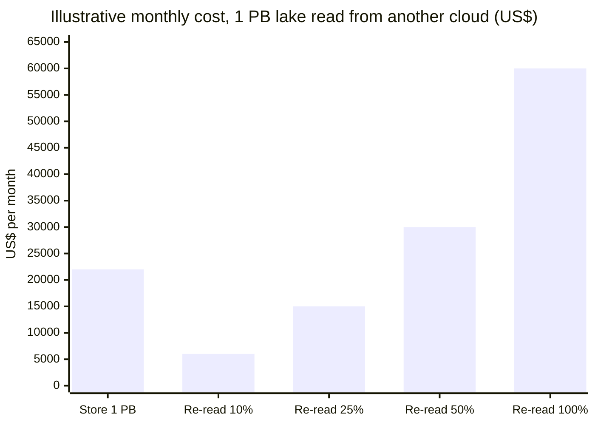
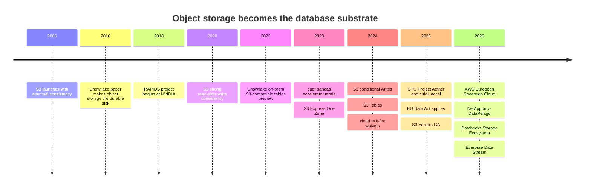

# 24. Where the Data Stack Meets Compute and Storage
> **Depth:** L2 · **Reading time:** ~16 min · **Last verified:** 2026-11-01 · **Prerequisites:** [Ch 5 — Analytical engines](../01-data-systems-foundations/ch05-analytical-engines.md), [Ch 7 — Open table formats](../01-data-systems-foundations/ch07-open-table-formats.md)

## TL;DR

- Every modern data platform is a stack of software layers (engine, catalog, table format, file format, cache) sitting on **object storage**. The storage layer is invisible in vendor diagrams, but its semantics (consistency, conditional writes, request pricing, LIST speed) decide whether the layers above are correct and affordable.
- **GPUs are moving into data processing**, not just model training. NVIDIA's RAPIDS libraries (cuDF, cuML, cuVS) and the RAPIDS Accelerator for Apache Spark run dataframes, SQL and vector-index builds on GPUs, mostly without code changes. GPUs win on large joins, aggregations and index builds. They lose when the job is waiting on storage or network, which is common.
- S3's API has gained database features in five years: strong read-after-write consistency (December 2020), create-if-absent and compare-and-swap writes (August and November 2024), a low-latency tier (S3 Express One Zone), managed Iceberg (S3 Tables) and native vectors (S3 Vectors, GA December 2025). Any S3-compatible store, on-prem included, is now judged against that bar.
- **Data gravity is priced.** Internet egress lists at about $0.09/GB in AWS's first tier.[^s3-pricing] Re-reading a large fraction of a lake from another cloud each month can cost more than storing it. Regulators have chipped at this (exit-fee waivers in 2024, EU Data Act-driven multicloud cuts in 2025), but steady-state cross-cloud reads are still billed.
- The strategic answer is to **bring compute to the data**: federation, zero-copy sharing, caches, and engines that run where the data already sits, including on-prem Iceberg lakehouses. That is the opening for S3-compatible on-prem platforms such as Everpure's FlashBlade, and the reason storage vendors (NetApp–DataPelago, Everpure–Data Stream) are now buying or building compute next to their arrays.

## Why this matters (business + Everpure lens)

Part 1 of this atlas described the data stack from the top down: engines ([Ch 5](../01-data-systems-foundations/ch05-analytical-engines.md)), file formats, table formats ([Ch 7](../01-data-systems-foundations/ch07-open-table-formats.md)) and catalogs. This chapter looks from the bottom up. It asks what those layers demand of the hardware beneath them, and where the money moves when they meet.

Three changes make this interface commercially important in 2026. First, separating storage from compute made object storage the system of record for analytics, so the storage API is now part of the database. Second, AI workloads have put GPUs next to data pipelines. A GPU cluster that waits on ETL wastes the most expensive capital in the datacenter. Third, egress pricing, sovereignty rules and repatriation interest mean that *where* data sits is a strategic decision again, not a default.

For Everpure (formerly Pure Storage; NYSE: P, formerly PSTG), this is the layer where a storage company can either be a commodity bucket or a participant in the data platform. Everpure's public moves point to the second path. These include FlashBlade reference architectures with Dremio and Starburst, launch-partner status in the Databricks Storage Ecosystem (June 2026), and Data Stream, a vectorisation pipeline on FlashBlade plus NVIDIA GPUs.[^dremio-pure][^starburst-ep][^storage-eco][^data-stream] Later sections frame the options a strategy team might evaluate, based on public information.

## How it works

### The lakehouse is a stack on object storage

A [lakehouse](../glossary.md#lakehouse) query passes through six layers before it touches a disk. Each layer adds a different kind of load on storage.

*Figure 24.1 — Every engine reaches the same bytes through a catalog, a table format and a file format. Storage sees two very different traffic types: small, latency-sensitive metadata calls from the catalog and table layers, and large parallel range reads from the file layer.*

The split in traffic matters. A single Iceberg query first reads a metadata JSON file, a manifest list and several manifests: small objects, read serially, where latency dominates. It then fans out into thousands of parallel byte-range GETs against Parquet files, where aggregate throughput dominates. A commit adds a conditional write. Maintenance jobs (compaction, snapshot expiry) add bursts of LIST and DELETE calls. A storage system tuned only for big sequential streams will look fast in a benchmark and slow in a lakehouse.

### What the S3 API now promises

S3 started in 2006 as a simple key-value store with eventual consistency. Table formats had to work around it: Delta Lake on S3 originally needed an external DynamoDB lock to commit safely. Four changes since 2020 turned the API into something a database can build on.

1. **Strong read-after-write consistency** (December 2020). A successful write is immediately visible to every subsequent read and LIST, at no extra cost.[^s3-consistency] This removed a class of "file not found" and stale-listing bugs in Spark and Hive jobs.
2. **Conditional writes.** In August 2024, S3 added `If-None-Match` (create only if absent). In November 2024 it added `If-Match`, a write that succeeds only if the object's ETag is unchanged.[^s3-cond][^s3-ifmatch] Together they give a [compare-and-swap](../glossary.md#compare-and-swap) primitive in the storage API itself. A Delta log entry or a catalog pointer file can now be committed safely without a separate lock service, which makes "catalog-less" or storage-native commits practical.
3. **A low-latency tier.** S3 Express One Zone (November 2023) stores data in a single Availability Zone in "directory buckets", with AWS-claimed single-digit-millisecond access.[^s3-express] AWS cut its prices in April 2025: storage by 31%, PUTs by 55% and GETs by 85%.[^s3-express-cut] It is effectively a managed cache tier for hot tables and training shards.
4. **Table- and vector-aware storage.** S3 Tables (December 2024) is managed Iceberg with automatic compaction. S3 Vectors (GA December 2025) stores up to 2 billion vectors per index, with AWS-stated queries of about 100 ms and a vendor claim of up to 90% lower cost than alternatives.[^s3tables][^s3-vectors]

> **Bridge: semiconductors.** S3's evolution resembles an instruction-set architecture gaining atomics. Early multiprocessors had loads and stores, and software built locks on top at great cost. Adding compare-and-swap to the ISA made lock-free structures cheap. Conditional writes are S3's CAS instruction. Every "S3-compatible" store now has to implement it correctly, under contention, or table commits will corrupt silently.

### Request pricing: why small files are expensive

Object storage bills per request as well as per byte. That changes how data engineers design pipelines. On S3 Standard, storage lists at about $0.023/GB-month for the first 50 TB. PUT and LIST requests cost $0.005 per 1,000 and GETs $0.0004 per 1,000.[^s3-pricing] S3 returns at most 1,000 keys per LIST call and supports about 3,500 writes and 5,500 reads per second per prefix.[^s3-list][^s3-perf]

**Worked example (estimate).** A streaming job writes 4 KB micro-batch files: one billion of them a month, about 4 TB. Storing 4 TB costs about $92/month. Writing one billion objects costs about $5,000 in PUT fees alone, more than 50 times the storage bill. Reading them back costs another $400 in GETs. Planning a query over them requires a million LIST pages. The same 4 TB written as 512 MB Parquet files (about 8,000 objects) costs pennies in requests. This is why the small-files problem from [Ch 7](../01-data-systems-foundations/ch07-open-table-formats.md) is a finance problem as well as a performance one. On-prem object stores usually do not bill per request, but they pay the same cost in metadata IOPS and CPU.

### GPU-accelerated data processing

GPUs entered the data stack from the AI side. A training or embedding pipeline spends a large share of wall-clock time on ETL: decoding Parquet, filtering, joining with metadata, deduplicating, tokenising. If that runs on CPUs while the GPUs wait, the most expensive asset in the datacenter idles. NVIDIA's answer is RAPIDS, a family of CUDA libraries that mirror popular Python and JVM data APIs.

- **[cuDF](../glossary.md#cudf)** is a GPU dataframe built on the Arrow columnar layout. Its **pandas accelerator mode** (`cudf.pandas`, RAPIDS 23.10, November 2023) intercepts pandas calls, runs what it can on the GPU and falls back to the CPU for the rest. NVIDIA's launch claim of "nearly 150x" came from a 5 GB benchmark on a Grace Hopper system, so treat it as a best case. The mode is now listed as generally available.[^cudf-pandas][^cudf-ga]
- **cuML** brings the same zero-code-change approach to scikit-learn, UMAP and HDBSCAN. It was released as a beta in cuML 25.02 and shown at GTC in March 2025, with vendor-reported speedups of up to 50x for scikit-learn algorithms.[^cuml-accel]
- **RAPIDS Accelerator for Apache Spark** is a plugin that swaps Spark SQL and DataFrame operators for GPU versions, with no change to user code. At GTC 2025, NVIDIA added **Project Aether**, tooling that qualifies, tests and tunes Spark jobs for GPUs. NVIDIA cites customer results such as Commonwealth Bank of Australia (over 80% cost reduction) and FINRA (14x speedup and 90% cost savings on one workload, shown at AWS re:Invent 2025). All of these are vendor- or customer-stated for selected workloads.[^aether][^finra]
- **[cuVS](../glossary.md#cuvs)** is the GPU vector-search library (CAGRA graph indexes, IVF-PQ and others). It is integrated into Faiss, Milvus, Weaviate and OpenSearch. OpenSearch's own benchmark (10M vectors, 768 dimensions) cut index build time from about 274 minutes to 29, roughly 9.4x.[^cuvs] This is where GPU data processing meets [Ch 18](ch18-embeddings-and-vector-search.md): building the index is a bulk compute job, while serving queries often stays on CPUs.
- **Engines with GPU back ends.** IBM and NVIDIA have added a cuDF back end to **Velox**, Meta's C++ execution engine that sits under Presto C++ and, through Apache **Gluten**, under Spark. NVIDIA reports about 12x faster TPC-H-style queries on one DGX B200 node, and IBM cites a Nestlé result of 5x faster at 83% lower cost (vendor-stated).[^velox-gpu] Presto began shipping nightly GPU images in June 2026.[^presto-gpu] This route matters because existing engines gain GPU execution without users moving to a new product.

The data path for a GPU pipeline looks like this:

*Figure 24.2 — GPU data processing only pays if bytes reach HBM fast enough. GPUDirect Storage and S3-over-RDMA skip the CPU bounce buffer; without them the CPU, its DRAM and PCIe become the bottleneck before the GPU does.*

[GPUDirect Storage](../glossary.md#gpudirect-storage) moves data by DMA from NVMe or a network file system straight into GPU memory, skipping a copy through host DRAM. In 2026 NVIDIA extended the idea to object storage with **cuObject**. It keeps the S3 control path on HTTP but moves payloads over RDMA, and it needs changes in both the client SDK and the storage server.[^cuobject] For storage vendors this is a new certification bar: "S3-compatible" may soon also mean "S3-over-RDMA-compatible".

### When GPUs help and when they do not

The useful test is [arithmetic intensity](../glossary.md#arithmetic-intensity): how much work the job does per byte it reads.

*Figure 24.3 — GPUs pay when jobs do many operations per byte and storage can feed them. A filter-and-count over remote data is I/O-bound: a faster processor only waits faster.*

A worked example shows why (illustrative assumptions).[^assump] Suppose a GPU node has two 400 Gb/s network ports, so it can pull at most about 100 GB/s from storage. A 10 TB scan therefore needs at least 100 seconds just to arrive. If the query is a simple filter and sum, a CPU cluster with the same network bandwidth finishes in roughly the same time, because neither is compute-bound. If the query joins three large tables, shuffles and aggregates, it touches each byte many times in memory, and the GPU's memory bandwidth (several terabytes per second of HBM) separates it from the CPU. The vendor speedups quoted above come from the second kind of job. Most dashboard queries are the first kind.

Three further limits apply. GPU memory is small relative to data, so large jobs spill to host memory or disk. Operator coverage is incomplete, and an unsupported function forces a CPU fallback that can erase the gain. And GPUs are scarce: a GPU-hour spent on ETL is a GPU-hour not spent on training or inference, which is why the economics often favour GPUs for ETL that sits *next to* AI work.

> **Bridge: memory wall.** This is the roofline model you know from chip design. Performance is capped by the lower of peak compute and memory bandwidth times arithmetic intensity. Analytics on CPUs hit the bandwidth roof, which is why columnar formats and vectorized execution exist ([Ch 5](../01-data-systems-foundations/ch05-analytical-engines.md)). Moving to GPUs raises both roofs, but only for data already in HBM. The industry moves a workload to an accelerator once it becomes bandwidth-bound in memory, and then has to rebuild the I/O path so storage does not become the new roof.

### Caching layers: the SRAM in front of the object store

Separated compute and storage means every scan crosses a network. Caches close the gap.

| Cache | Where it sits | What it holds | Key behaviour |
|---|---|---|---|
| Databricks disk cache | Local SSDs on each worker | Copies of remote Parquet/Delta files | On by default where SSDs exist; uses at most half the local SSD; lost when a worker is removed[^dbx-cache] |
| Snowflake warehouse cache | Local SSD/memory of a virtual warehouse | Table data read by recent queries | Dropped when the warehouse suspends, so auto-suspend trades credits for cache warmth[^sf-cache] |
| Starburst Warp Speed | SSDs on Trino workers | Indexes (bitmap, tree, Lucene text) and cached column data | Autonomous; vendor-stated up to 7x faster queries, 40% average gain in preview[^warp] |
| Alluxio | Distributed layer across compute-node NVMe | Hot files from object stores, for analytics and AI training | Read-through cache across clouds and on-prem; used to keep GPUs fed during training[^alluxio] |
| S3 Express One Zone | Single-AZ directory buckets | Hot objects chosen by the application | Managed, request-priced tier; not automatic[^s3-express-cut] |

*Figure 24.4 — Caches sit at every level, from per-node SSD to managed storage tiers. Their hit rate, not the object store's raw speed, often decides interactive query latency.*

> **Bridge: memory hierarchy.** Local NVMe caches are to object storage what SRAM caches are to DRAM, and what HBM is to host memory in a GPU. They hold a small working set close to the compute. They hide latency when hit rates are high and add nothing when access is random. When compute is elastic they also go "cold": a Snowflake warehouse that suspends loses its cache, like a core that powers down and loses its L2.

### Data gravity and egress

[Data gravity](../glossary.md#data-gravity) is the tendency of large datasets to pull compute and applications toward them. Cloud pricing makes this tendency explicit. Ingress is free and storage is cheap, but moving data out (to the internet or another cloud) is metered. AWS lists internet egress at about $0.09/GB in its first tier, with the first 100 GB a month free since 2021.[^s3-pricing][^aws-100gb]

*Figure 24.5 — Egress is asymmetric: bytes flow into a cloud for free and out for a fee. Running compute where the data sits, and moving only results, avoids the meter.*

*Figure 24.6 — On these assumptions, re-reading about a third of a lake each month from another cloud costs as much as storing it. Estimates: storage at a blended ~$0.022/GB-month, egress at a blended ~$0.06/GB after volume tiers; not a quote.*[^assump][^s3-pricing]

The egress meter has softened in two ways, but it has not gone away. First, **exit waivers**. After regulatory pressure, Google (January 2024), AWS (March 2024) and Microsoft waived egress fees for customers moving *all* their data out. These waivers help a one-time migration, not a steady multicloud architecture.[^aws-exit][^eu-egress] Second, the **EU Data Act**, whose main obligations have applied since September 2025, requires switching charges to fall to zero by January 2027.[^eu-data-act] Ahead of it, Google launched no-cost "Data Transfer Essentials" for qualifying multicloud traffic in the EU and UK (September 2025). Microsoft moved to at-cost EU transfer pricing, and AWS let EU customers request reduced rates for eligible cases.[^eu-egress] Outside those programmes, Cloudflare R2 built a business on charging nothing for egress ($0.015/GB-month storage, no bandwidth fees), which caps what hyperscalers can charge for read-heavy, multi-consumer data.[^r2]

> **Bridge: memory wall, at datacenter scale.** In chips, moving a byte from DRAM costs far more energy than an arithmetic operation on it. In clouds, moving a byte across a provider boundary costs more than storing it for weeks. The engineering response is the same in both cases: keep the working set local, move results rather than inputs, and put compute next to memory.

### Bringing compute to the data

Four patterns avoid moving bytes:

- **Query federation** pushes a query down to the system that holds the data and returns only results (Trino/Starburst connectors, Databricks Lakehouse Federation, BigQuery Omni-style cross-cloud engines).
- **Zero-copy sharing** grants access to tables in place (Snowflake sharing, Delta Sharing/OpenSharing), so the consumer pays compute but no copy is made ([Ch 9](../02-pipelines-and-governance/ch09-pipeline-patterns.md)).
- **Engines that run where the data lives.** Open table formats let Trino, Spark, Dremio or DuckDB run on-prem against Iceberg on S3-compatible storage, with the same tables visible to cloud engines through a REST catalog.
- **Compute inside the storage tier.** Storage vendors are adding processing next to the array. NetApp bought DataPelago (July 2026, terms undisclosed), whose Nucleus engine runs CPU/GPU processing on data in place, with vendor-claimed cost reductions of up to 80%.[^datapelago] Everpure's Data Stream vectorises data on FlashBlade with NVIDIA GPUs, on the NVIDIA AI Data Platform reference design.[^data-stream][^aidp]

### On-prem and sovereign lakehouses

Three forces have revived on-prem analytics. **Sovereignty**: AWS launched its European Sovereign Cloud in Brandenburg in January 2026, operated by EU-resident staff. This shows that even hyperscalers now sell locality as a feature.[^aws-esc] **AI factories**: enterprises building GPU clusters on-prem want their training and retrieval data on the same fabric, not across a WAN. **Repatriation**: a vendor-commissioned Cloudera survey (August 2026) found 66% of respondents had moved some AI workloads from public cloud to on-prem or private cloud in the previous 12 months. Treat it as directional, given who paid for it.[^cloudera-survey]

The on-prem lakehouse now uses the same parts as the cloud one: Iceberg tables, Parquet files, an Iceberg REST catalog (Polaris, Nessie or a vendor catalog), and Trino, Starburst, Dremio or Spark as engines, all on S3-compatible object storage. Cloudera sells this pattern as a hybrid data platform. SAP's acquisition of Dremio (announced May 2026, closed around July 2026) brought one of the main on-prem Iceberg engines inside an application giant.[^sap-dremio] Cloud warehouses have adapted at the edges. Snowflake has supported external tables on S3-compatible on-prem storage since a 2022 preview, with a public test suite vendors use to self-certify. Databricks' June 2026 Storage Ecosystem lets workspaces query Delta and Iceberg tables in place on partner storage through OpenSharing.[^sf-onprem][^sf-s3compat][^storage-eco]

### What a lakehouse demands of object storage

The table below lists requirements, not product claims. It is a checklist for evaluating any object store, cloud or on-prem, as a lakehouse substrate.

| Requirement | Why it matters to the data stack | How to evaluate |
|---|---|---|
| Throughput per client and in aggregate | Scans fan out across hundreds of workers; the slowest stream sets query time | Measure GB/s per client and cluster-wide with Spark/Trino reading Parquet via range GETs, not just synthetic sequential reads |
| Small-object and HEAD/GET latency | Iceberg planning reads metadata JSON and manifests serially before any scan starts | p50/p99 latency for 4–64 KB GETs and HEADs under concurrent load |
| LIST performance at scale | Maintenance jobs, orphan-file cleanup and Hive-style tables list millions of keys | Time to list 10M keys in one prefix, with concurrent writes, and with 1,000-key pages |
| Strong consistency | Commits and readers must see the latest metadata immediately | Read-after-write and list-after-write tests under concurrency, including overwrites and deletes |
| Conditional writes | `If-None-Match` and `If-Match` enable lock-free commits for Delta, Iceberg and catalogs | Run concurrent commit tests; confirm exactly one winner and correct 412 responses |
| Metadata operations and deletes | Snapshot expiry and compaction delete and rewrite files in bulk | Bulk DELETE rate, multipart-upload behaviour, metadata scaling separate from capacity |
| Multi-tenancy and isolation | Many engines and teams share one bucket estate | Noisy-neighbour tests, per-tenant QoS, bucket policies and scoped credentials compatible with catalog credential vending |
| API compatibility depth | Engines use S3 SDK features beyond GET/PUT | Run vendor test suites (for example Snowflake's S3-compatible suite) and engine certifications |
| Data-efficiency at scale | Lakes grow to petabytes of mostly cold Parquet | Erasure-coding overhead, effective cost per usable TB, rebuild impact on scan throughput |
| GPU data path | AI pipelines read the same tables into GPUs | GPUDirect Storage or S3-over-RDMA support and measured GB/s into GPU memory |

*Figure 24.7 — A lakehouse stresses object storage on ten axes at once. Most of them involve metadata, latency and correctness rather than peak throughput.*

## Design choices and trade-offs

| Option | How it works | Strength | Weakness | When it fits |
|---|---|---|---|---|
| Move the data (copy or ETL) | Replicate into the compute's home cloud | Simple; local performance | Egress, duplicate storage, stale copies, governance drift | One-time migration or small hot subsets |
| Federate the query | Push queries to the source; return results | No copy; fresh | Slow joins across sources; depends on source capability | Occasional cross-system queries |
| Zero-copy sharing | Grant table access in place | No copy; governed | Same-region economics; cross-region reintroduces replication | Partner data exchange, multi-engine access |
| Cache near compute | Keep hot working set on local NVMe | Fast; transparent | Cold starts, invalidation, wasted capacity on random access | Interactive BI on repeated datasets |
| Compute at the data (on-prem or in-storage) | Run engines or GPU processing where tables live | No egress; sovereignty; GPU locality | Operational burden; fewer managed services | Regulated data, on-prem AI factories, very large lakes |
| GPU-accelerate the engine | Swap CPU operators for GPU ones | Large gains on joins and aggregations | GPU cost and scarcity; I/O-bound jobs gain little | ETL feeding AI, large batch transforms, vector index builds |

*Figure 24.8 — There is no free way to combine distant data with compute. Each option trades egress, freshness, operational effort and GPU spend differently.*

The strongest case against on-prem and in-storage compute is operational. Managed cloud services handle upgrades, scaling, catalog operations and table maintenance. Most enterprises underestimate that work, and S3 Tables now automates compaction. The strongest case against GPU acceleration is that most enterprise SQL is I/O-bound or small. A well-tuned CPU engine with good file layout often matches a GPU for less money.

## Who's who

| Tool or vendor | What it does | Status (2026) | Note |
|---|---|---|---|
| NVIDIA RAPIDS cuDF / `cudf.pandas` | GPU dataframes; pandas acceleration with CPU fallback | Open source; accelerator mode GA[^cudf-ga] | Also a Polars GPU engine back end |
| NVIDIA cuML (`cuml.accel`) | GPU scikit-learn, UMAP, HDBSCAN | Zero-code-change mode since 25.02 (beta at launch)[^cuml-accel] | Coverage varies by algorithm |
| RAPIDS Accelerator for Apache Spark | GPU plugin for Spark SQL/DataFrames | Shipping; Project Aether migration tooling (application-only)[^aether] | Runs on EMR, Dataproc, Databricks and on-prem Spark |
| NVIDIA cuVS | GPU vector index build and search | In Faiss, Milvus, Weaviate, OpenSearch[^cuvs] | Biggest wins in index build |
| Velox + cuDF; Gluten | GPU back end for Presto C++ and Spark via Velox | Mainline Velox; Presto GPU nightlies from June 2026[^velox-gpu][^presto-gpu] | Accelerates existing engines in place |
| Voltron Data Theseus | Distributed GPU SQL engine | Accenture investment Feb 2025[^voltron]; [VERIFY: Voltron Data operating status in 2026] | Little public news since 2025 |
| HEAVY.AI (HeavyDB) | GPU-native SQL database (formerly MapD/OmniSci) | Reported acquired by NVIDIA in 2025; docs now on NVIDIA's site[^heavy] [VERIFY: NVIDIA–HEAVY.AI deal terms and date] | Niche: geospatial and visual analytics |
| NetApp DataPelago (Nucleus) | CPU/GPU data processing at the storage layer | Acquired by NetApp, July 2026[^datapelago] | Direct storage-vendor precedent |
| Alluxio, Starburst Warp Speed | Caching and indexing layers | Commercial[^alluxio][^warp] | Hide object-storage latency |
| AWS S3 / Express / Tables / Vectors | Reference object API and its database-like extensions | GA[^s3tables][^s3-vectors][^s3-express-cut] | Sets the compatibility bar |
| Cloudflare R2 | S3-compatible storage with zero egress | GA[^r2] | Pricing pressure on egress |
| Everpure FlashBlade | On-prem unified file and S3 object platform | Dremio and Starburst reference architectures; Databricks Storage Ecosystem launch partner; Data Stream on NVIDIA[^dremio-pure][^starburst-ep][^storage-eco][^data-stream] | See Storage bridge |

*Figure 24.9 — GPU data tools now span dataframes, Spark, vector search and existing SQL engines. The quieter trend is storage vendors adding compute of their own.*

## History and trajectory

*Figure 24.10 — In twenty years the object store went from a dumb bucket to a component with transactions, tables, vectors and GPU data paths. The 2024–2026 burst moved database features into the storage API.*

The RAPIDS start date of 2018 reflects NVIDIA's open-sourcing of the project in October 2018 [VERIFY: RAPIDS launch date, Oct 2018]. The trajectory points one way. Storage APIs absorb more database work: commits, tables, vectors, credential vending. Compute moves closer to storage, both by GPU-accelerating engines and by storage vendors embedding engines. The open question is who owns the layer in between. The catalog vendors (Databricks, Snowflake, AWS) want it, and storage vendors are bidding for it ([Ch 45](../06-history-and-future/ch45-storage-moving-up-the-stack.md)).

## Numbers that matter

| Metric | Value | Basis | Source / date |
|---|---|---|---|
| S3 Standard storage (first 50 TB) | ~$0.023/GB-month | List price, US East | AWS pricing, 2026[^s3-pricing] |
| S3 PUT/LIST and GET requests | $0.005 and $0.0004 per 1,000 | List price, US East | AWS pricing[^s3-pricing] |
| AWS internet egress, first tier | ~$0.09/GB; first 100 GB/month free | List price | AWS pricing; AWS 2021-11[^s3-pricing][^aws-100gb] |
| Cloudflare R2 storage / egress | $0.015/GB-month / $0 | List price | Cloudflare docs, 2026[^r2] |
| S3 Express One Zone price cut | Storage −31%, PUT −55%, GET −85% | Vendor-announced | AWS, 2025-04-10[^s3-express-cut] |
| S3 per-prefix request rate | 3,500 writes/s, 5,500 reads/s | AWS-stated | AWS docs[^s3-perf] |
| S3 Vectors scale | Up to 2B vectors per index, ~100 ms queries | AWS-stated | re:Invent 2025[^s3-vectors] |
| `cudf.pandas` launch speedup | Up to ~150x (5 GB benchmark) | Vendor claim, best case | NVIDIA, 2023-11[^cudf-pandas] |
| GPU Velox TPC-H-style speedup | ~12x on one DGX B200 | Vendor claim | NVIDIA, 2025[^velox-gpu] |
| FINRA Spark on GPUs | 14x faster, 90% cost savings, one workload | Customer/vendor-stated | re:Invent 2025[^finra] |
| OpenSearch GPU index build | ~274 → 29 min (10M × 768-d) | Project benchmark | OpenSearch, 2025[^cuvs] |
| DataPelago claimed benefit | Up to 80% lower cost, up to 10x faster | Vendor claim | NetApp, 2026-07[^datapelago] |
| AI workloads repatriated (12 months) | 66% of respondents | Vendor-commissioned survey | Cloudera, 2026-08[^cloudera-survey] |

*Figure 24.11 — The prices are list prices and the speedups are vendor claims. Both are starting points for a negotiation or a proof of concept, not results to plan on.*

## Storage bridge

> **Storage bridge.** Lakehouses use an on-prem S3-compatible store such as FlashBlade as the durable layer under Iceberg or Delta tables. Engines (Dremio, Starburst/Trino, Spark) read Parquet through range GETs and commit through the catalog. Everpure's public materials show a Dremio joint solution for hybrid Iceberg lakehouses (2024 brief; Dremio is now SAP-owned) and a Starburst "Scalable Lakehouse Analytics" reference architecture.[^dremio-pure][^starburst-ep][^sap-dremio] Pure and Snowflake announced a 2022 joint solution for on-prem data via S3-compatible external tables.[^sf-onprem] Everpure is a launch partner of the Databricks Storage Ecosystem, with an OpenSharing connector in private preview from June 2026.[^storage-eco][^everpure-os] FlashBlade also hosts Data Stream on the NVIDIA AI Data Platform design.[^data-stream][^aidp] Options a strategy team might evaluate, based on public information: (1) publish independent results against the requirements table above, with engine partners; (2) add table-aware services (REST catalog, maintenance) as S3 Tables does; (3) certify S3-over-RDMA (cuObject) paths so GPU ETL reads lakehouse tables directly; (4) compare the DataPelago precedent with partnering for in-storage compute. See the companion *Everpure Tech Atlas* for protocol and hardware detail.

## Conversation playbook

**Questions for a PM**

1. "Which engines and catalogs do your on-prem customers run against S3-compatible storage today, and which certifications (Snowflake test suite, Databricks Storage Ecosystem, Starburst, Dremio) do they ask for first?"
2. "Where do customers' GPU clusters sit relative to their lakehouse tables, and how much egress or copy cost do they report when the two are in different places?"
3. "How has the EU Data Act and the 2024 exit-fee waivers changed customers' multicloud plans? Are you seeing steady-state cross-cloud reads or only migrations?"

**Questions for an engineer**

1. "Show me p99 latency for 16 KB GETs and HEADs at 10,000 requests per second while a 100 GB/s scan runs. What happens to Iceberg planning time?"
2. "How do you implement `If-Match` and `If-None-Match` under contention across nodes, and how did you test that exactly one commit wins?"
3. "For a Spark RAPIDS or cuDF job, what fraction of runtime is I/O versus compute, and does GPUDirect Storage or S3-over-RDMA change it?"

**What good answers sound like.** They separate metadata performance from throughput and quote both. They talk about conditional-write correctness tests, not just API coverage. On GPUs, they show a profile that splits I/O from compute and admit which jobs did not speed up. On egress, they name the specific programme (exit waiver, EU at-cost pricing) and its conditions.

**Don't say this**

- "GPUs make every query faster." I/O-bound scans and small queries gain little; vendor speedups come from join- and aggregation-heavy jobs.
- "S3-compatible means compatible." Conditional writes, consistency under concurrency, LIST behaviour and multipart edge cases vary widely.
- "Egress fees are gone." Exit waivers cover leaving a cloud, and EU programmes cover qualifying traffic. Steady-state cross-cloud reads are still billed in most cases.
- "Caching solves object-storage latency." Only for repeated working sets; elastic compute loses its cache on scale-down or suspend.
- "Databricks and Snowflake run on-prem." They do not. They can read on-prem data through S3-compatible tables, OpenSharing or federation.

## Going deeper

- NVIDIA RAPIDS documentation for cuDF, `cudf.pandas` and the Spark RAPIDS qualification and profiling tools.[^cudf-ga][^aether]
- The Velox GPU work and the Presto GPU blog for how existing engines gain GPU operators.[^velox-gpu][^presto-gpu]
- AWS's S3 performance guide and conditional-write announcements for the API contract a lakehouse depends on.[^s3-perf][^s3-cond][^s3-ifmatch]
- NVIDIA's cuObject documentation for the S3-over-RDMA design and what it requires of storage servers.[^cuobject]
- [Ch 16](ch16-ai-data-lifecycle.md) for the AI data lifecycle that feeds GPUs, and [Ch 40](../05-business-and-economics/ch40-gtm-partnerships.md) for how storage–platform partnerships are sold.

## Key terms

- [Object storage](../glossary.md#object-storage) — flat, HTTP-accessed storage of immutable objects by key, such as S3.
- [Lakehouse](../glossary.md#lakehouse) — warehouse-grade management over open table and file formats on object storage.
- [Read-after-write consistency](../glossary.md#read-after-write-consistency) — a guarantee that a successful write is immediately visible to later reads and listings.
- [Conditional write](../glossary.md#conditional-write) — an object write that succeeds only if a precondition holds, such as absence or an unchanged ETag.
- [Compare-and-swap](../glossary.md#compare-and-swap) — atomic "update only if unchanged" operation underlying table commits.
- [S3 Express One Zone](../glossary.md#s3-express-one-zone) — AWS's single-AZ, low-latency S3 storage class using directory buckets.
- [Request pricing](../glossary.md#request-pricing) — per-call charges for object-storage operations such as PUT, GET and LIST.
- [RAPIDS](../glossary.md#rapids) — NVIDIA's open-source suite of GPU libraries for data science and data processing.
- [cuDF](../glossary.md#cudf) — RAPIDS GPU dataframe library, including the pandas accelerator mode.
- [cuVS](../glossary.md#cuvs) — RAPIDS library for GPU vector index building and search.
- [RAPIDS Accelerator for Apache Spark](../glossary.md#rapids-accelerator-for-apache-spark) — plugin that runs Spark SQL and DataFrame operators on GPUs.
- [GPUDirect Storage](../glossary.md#gpudirect-storage) — NVIDIA technology that moves data from storage directly into GPU memory, bypassing host DRAM.
- [Arithmetic intensity](../glossary.md#arithmetic-intensity) — operations performed per byte moved; determines whether a job is compute- or bandwidth-bound.
- [Cache tier](../glossary.md#cache-tier) — fast local storage holding a hot working set in front of slower object storage.
- [Data gravity](../glossary.md#data-gravity) — the pull that large datasets exert on compute and applications.
- [Egress fee](../glossary.md#egress-fee) — a cloud provider's per-GB charge for data leaving its network or region.
- [Query federation](../glossary.md#query-federation) — querying data in place in other systems by pushing work down to them.
- [Zero-copy data sharing](../glossary.md#zero-copy-data-sharing) — granting access to data in place without duplicating it.
- [Data sovereignty](../glossary.md#data-sovereignty) — legal requirements that data stay and be processed within a jurisdiction.
- [Sovereign cloud](../glossary.md#sovereign-cloud) — a cloud region operated under local jurisdiction and staffing to meet sovereignty rules.
- [Cloud repatriation](../glossary.md#cloud-repatriation) — moving workloads or data from public cloud back to on-prem or private infrastructure.
- [Erasure coding](../glossary.md#erasure-coding) — storing data as fragments plus parity so it survives failures with less overhead than replication.
- [OpenSharing](../glossary.md#opensharing) — the open protocol, from the Delta Sharing lineage, for sharing tables in place.

## Sources

[^s3-consistency]: AWS, "Amazon S3 now delivers strong read-after-write consistency automatically for all applications," https://aws.amazon.com/about-aws/whats-new/2020/12/amazon-s3-now-delivers-strong-read-after-write-consistency-automatically-for-all-applications/, published 2020-12-01; retrieved 2026-11-01.
[^s3-cond]: AWS, "Amazon S3 now supports conditional writes," https://aws.amazon.com/about-aws/whats-new/2024/08/amazon-s3-conditional-writes/, published 2024-08-20; retrieved 2026-11-01.
[^s3-ifmatch]: AWS, "Amazon S3 adds new functionality for conditional writes," https://aws.amazon.com/about-aws/whats-new/2024/11/amazon-s3-functionality-conditional-writes, published 2024-11-25; retrieved 2026-11-01. See also S. Willison, https://simonwillison.net/2024/Nov/26/s3-conditional-writes, 2024-11-26.
[^s3-express]: AWS News Blog, "New Amazon S3 Express One Zone high performance storage class," https://aws.amazon.com/blogs/aws/new-amazon-s3-express-one-zone-high-performance-storage-class/, published 2023-11-28; retrieved 2026-11-01. Latency is vendor-stated.
[^s3-express-cut]: AWS, "Amazon S3 Express One Zone reduces storage and request prices," https://aws.amazon.com/about-aws/whats-new/2025/04/amazon-s3-express-one-zone-reduces-storage-request-prices/, published 2025-04-10; AWS News Blog, "Up to 85% price reductions for Amazon S3 Express One Zone," https://aws.amazon.com/blogs/aws/up-to-85-price-reductions-for-amazon-s3-express-one-zone/, 2025-04; retrieved 2026-11-01.
[^s3tables]: AWS News Blog, "New Amazon S3 Tables: Storage optimized for analytics workloads," https://aws.amazon.com/blogs/aws/new-amazon-s3-tables-storage-optimized-for-analytics-workloads/, published 2024-12-03; retrieved 2026-11-01.
[^s3-vectors]: AWS News Blog, "Top announcements of AWS re:Invent 2025," https://aws.amazon.com/blogs/aws/top-announcements-of-aws-reinvent-2025, published 2025-12; Blocks & Files, "AWS piles on S3 upgrades from vector search to 50 TB objects," https://www.blocksandfiles.com/ai-ml/2025/12/03/aws-piles-on-s3-upgrades-from-vector-search-to-50-tb-objects/1704690, 2025-12-03; retrieved 2026-11-01 (via `meta/research-briefing.md`). Figures are vendor-stated.
[^s3-list]: AWS, "ListObjectsV2 — Amazon S3 API Reference" (MaxKeys up to 1,000), https://docs.aws.amazon.com/AmazonS3/latest/API/API_ListObjectsV2.html, living document; retrieved 2026-11-01.
[^s3-perf]: AWS, "Best practices design patterns: optimizing Amazon S3 performance," https://docs.aws.amazon.com/AmazonS3/latest/userguide/optimizing-performance.html, living document; retrieved 2026-11-01.
[^s3-pricing]: AWS, "Amazon S3 pricing" (S3 Standard storage, requests and data transfer, US East), https://aws.amazon.com/s3/pricing/, living document; retrieved 2026-11-01. Storage and egress tiers cross-checked against 2026 third-party guides (e.g., CloudForecast, https://www.cloudforecast.io/blog/amazon-s3-pricing-and-optimization-guide/, 2026). [VERIFY: request prices of $0.005 per 1,000 PUT/LIST and $0.0004 per 1,000 GET not re-confirmed on the live AWS page]
[^aws-100gb]: AWS, "AWS price reduction for data transfers out to the internet," https://aws.amazon.com/about-aws/whats-new/2021/11/aws-price-reduction-data-transfers-internet, published 2021-11; retrieved 2026-11-01.
[^aws-exit]: AWS News Blog, "Free data transfer out to internet when moving out of AWS," https://aws.amazon.com/blogs/aws/free-data-transfer-out-to-internet-when-moving-out-of-aws/, published 2024-03-05 (updated 2025-09); InfoQ, https://www.infoq.com/news/2024/03/aws-egress-fees/, 2024-03; retrieved 2026-11-01. Google's waiver (January 2024) per The Register, cited below.
[^eu-egress]: The Register, "Big clouds scramble as EU Data Act brings new data transfer rules," https://www.theregister.com/2025/09/10/big_clouds_scramble_over_eu/, published 2025-09-10; DatacenterDynamics, "Google axes some data transfer costs in preparation for EU Data Act," https://www.datacenterdynamics.com/en/news/google-axes-some-data-transfer-costs-in-preparation-for-eu-data-act/, 2025-09; retrieved 2026-11-01.
[^eu-data-act]: `meta/research-briefing.md` section F (EU Data Act application from 2025-09-12; switching charges to zero by 2027-01-12). [VERIFY: Data Act dates not re-checked against EUR-Lex in this session]
[^r2]: Cloudflare, "R2 pricing," https://developers.cloudflare.com/r2/pricing/, living document; retrieved 2026-11-01.
[^dbx-cache]: Databricks documentation, "Optimize performance with caching on Databricks" (disk cache), https://docs.databricks.com/gcp/en/optimizations/disk-cache, living document; retrieved 2026-11-01.
[^sf-cache]: Snowflake documentation, "Optimizing the warehouse cache," https://docs.snowflake.com/en/user-guide/performance-query-warehouse-cache, living document; retrieved 2026-11-01.
[^warp]: Starburst, "Announcing the public preview of Warp Speed in Starburst Galaxy," https://www.starburst.io/blog/announcing-warp-speed-starburst-galaxy/, 2023; InfoWorld, "Starburst adds low-code and Warp Speed capabilities…," https://www.infoworld.com/article/2337952/starburst-adds-low-code-and-warp-speed-capabilities-to-enterprise-and-galaxy-offerings.html, 2023-02; retrieved 2026-11-01. Speedups are vendor claims.
[^alluxio]: Oracle Cloud Infrastructure blog on Alluxio as a distributed cache alongside OCI GPU compute, https://blogs.oracle.com/cloud-infrastructure/?p=18122, 2026; NVIDIA Technical Blog, "Accelerating analytics and AI with Alluxio and NVIDIA GPUs," https://developer.nvidia.com/blog/accelerating-analytics-and-ai-with-alluxio-and-nvidia-gpus, n.d.; retrieved 2026-11-01.
[^cudf-pandas]: NVIDIA Technical Blog, "RAPIDS cuDF Accelerates pandas Nearly 150x with Zero Code Changes," https://developer.nvidia.com/blog/rapids-cudf-accelerates-pandas-nearly-150x-with-zero-code-changes, published 2023-11; BigDATAwire, "Pandas on GPU runs 150x faster, Nvidia says," https://bigdatawire.com/2023/11/08/pandas-on-gpu-runs-150x-faster-nvidia-says, 2023-11-08; retrieved 2026-11-01. Vendor benchmark.
[^cudf-ga]: RAPIDS, "cuDF pandas Accelerator Mode," https://rapids.ai/cudf-pandas/, living document; retrieved 2026-11-01.
[^cuml-accel]: NVIDIA Technical Blog, "NVIDIA cuML Brings Zero Code Change Acceleration to scikit-learn," https://developer.nvidia.com/blog/nvidia-cuml-brings-zero-code-change-acceleration-to-scikit-learn/, published 2025-03; retrieved 2026-11-01. Speedups vendor-reported.
[^aether]: BigDATAwire, "NVIDIA Pushes Boundaries of Apache Spark With RAPIDS and Project Aether," https://bigdatawire.com/2025/03/21/nvidia-pushes-boundaries-of-apache-spark-with-rapids-and-project-aether, published 2025-03-21; NVIDIA blog, "Project Aether accelerates Apache Spark," https://blogs.nvidia.com/blog/project-aether-accelerates-apache-spark, 2025-03; NVIDIA, "RAPIDS Accelerator for Apache Spark overview," https://docs.nvidia.com/cudf-spark/25.08/overview.html; retrieved 2026-11-01. CBA result is customer/vendor-stated.
[^finra]: DEV Community summary of AWS re:Invent 2025 session AIM279, "FINRA: accelerate massive data processing with NVIDIA on AWS EMR," https://dev.to/kazuya_dev/aws-reinvent-2025-finra-accelerate-massive-data-processing-with-nvidia-on-aws-emr-aim279-4cae, 2025-12; retrieved 2026-11-01. Secondary summary of a vendor session; single workload.
[^cuvs]: NVIDIA Technical Blog, "Optimizing Vector Search for Indexing and Real-Time Retrieval with NVIDIA cuVS," https://developer.nvidia.com/blog/optimizing-vector-search-for-indexing-and-real-time-retrieval-with-nvidia-cuvs/, 2025; OpenSearch, "GPU-accelerated vector search in OpenSearch: A new frontier," https://opensearch.org/blog/gpu-accelerated-vector-search-opensearch-new-frontier, 2025; NVIDIA cuVS integrations, https://docs.nvidia.com/cuvs/getting-started/integrations; retrieved 2026-11-01.
[^velox-gpu]: NVIDIA Technical Blog, "Accelerating Large-Scale Data Analytics with GPU-Native Velox and NVIDIA cuDF," https://developer.nvidia.com/blog/accelerating-large-scale-data-analytics-with-gpu-native-velox-and-nvidia-cudf, 2025; IBM Community, "Accelerating data analytics: GPU, Velox and NVIDIA," https://community.ibm.com/community/user/blogs/ali-leclerc/2025/10/07/accelerating-data-analytics-gpu-velox-nvidia, 2025-10-07; retrieved 2026-11-01. Performance figures vendor-stated.
[^presto-gpu]: Presto Foundation blog, "GPU-Accelerated Presto C++ is Here: Nightly Images for NVIDIA GPUs," https://prestodb.io/blog/2026/06/24/gpu-accelerated-presto-c/, published 2026-06-24; retrieved 2026-11-01.
[^voltron]: Accenture newsroom, "Accenture invests in Voltron Data to help organizations use GPU technology to simplify large-scale data processing," https://newsroom.accenture.com/news/2025/accenture-invests-in-voltron-data-to-help-organizations-use-gpu-technology-to-simplify-large-scale-data-processing, published 2025-02-20; Help Net Security, "Voltron Data Theseus…," https://www.helpnetsecurity.com/2023/12/01/voltron-data-theseus/, 2023-12-01; retrieved 2026-11-01.
[^heavy]: PitchBook, "HEAVY.AI company profile," https://pitchbook.com/profiles/company/98344-09, n.d.; NEA portfolio, https://www.nea.com/portfolio/heavy-ai, n.d.; NVIDIA-hosted HeavyDB docs, https://docs.nvidia.com/heavyai/installation-and-configuration/system-requirements/hardware, n.d.; retrieved 2026-11-01. No primary NVIDIA announcement found.
[^datapelago]: NetApp press release, "NetApp Acquires DataPelago, Making Data AI-Ready at the Infrastructure Layer," https://www.netapp.com/en/newsroom/press-releases/news-rel-20260716-210092/, published 2026-07-16; Blocks & Files, https://blocksandfiles.com/ai-ml/2026/07/17/netapp-buys-datapelago-to-become-full-stack-ai-data-infrastructure-provider/5274250, 2026-07-17; retrieved 2026-11-01. Terms undisclosed; benefits vendor-claimed.
[^cuobject]: NVIDIA, "NVIDIA cuObject: Accelerated CUDA libraries for Object Storage," release r1.16, https://docs.nvidia.com/gpudirect-storage/cuobject/index.html, dated 2026-01-12; retrieved 2026-11-01.
[^aidp]: StorageNewsletter, "NVIDIA GTC 2025: Pure Storage Integrates NVIDIA AI Data Platform into FlashBlade," https://www.storagenewsletter.com/2025/03/19/nvidia-gtc-2025-pure-storage-integrates-nvidia-ai-data-platform-into-flashblade/, published 2025-03-19; retrieved 2026-11-01.
[^data-stream]: Everpure via PR Newswire, "Everpure Unveils Data-Primacy Architecture for the AI Era," https://www.prnewswire.com/news-releases/everpure-unveils-data-primacy-architecture-for-the-ai-era-302803097.html, published 2026-06-17; Everpure newsroom, https://www.everpuredata.com/company/newsroom/press-releases/everpure-announces-data-stream.html, 2026-06-17; retrieved 2026-11-01 (via `meta/research-briefing.md`).
[^dremio-pure]: Dremio partner page, https://www.dremio.com/partners/pure-storage/, n.d.; Pure Storage/Dremio solution brief, https://dremio.com/wp-content/uploads/2024/10/Dremio-Pure-Storage-Solutions-Brief-1.pdf, 2024-10; retrieved 2026-11-01 (via `meta/research-briefing.md`).
[^starburst-ep]: Everpure partner page, "Starburst," https://www.everpuredata.com/la/partners/technology-alliance-partners/starburst.html, n.d.; retrieved 2026-11-01 (via `meta/research-briefing.md`).
[^sap-dremio]: Dremio newsroom, "SAP to Acquire Dremio…," https://www.dremio.com/newsroom/sap-to-acquire-dremio-to-unify-sap-and-non-sap-data-to-power-agentic-ai/, published 2026-05-04; retrieved 2026-11-01 (via `meta/research-briefing.md`; close around July 2026 per the same file).
[^storage-eco]: Databricks blog, "Announcing the Databricks Storage Ecosystem: Governing the Enterprise Data Estate Wherever It Lives," https://www.databricks.com/blog/announcing-databricks-storage-ecosystem-governing-enterprise-data-estate-wherever-it-lives, published 2026-06-10; retrieved 2026-11-01 (as cited in Ch 25).
[^everpure-os]: Everpure blog, "Everpure OpenSharing Connector," https://blog.everpuredata.com/products/everpure-opensharing-connector/, published 2026-06; retrieved 2026-11-01 (as cited in Ch 25). Vendor-stated; private preview from 2026-06-09.
[^sf-onprem]: Snowflake blog, "Now in Private Preview: Using On-Premises Data in Place with Snowflake," https://www.snowflake.com/en/blog/external-tables-on-prem/, published 2022-06; Pure Storage blog on the joint FlashBlade–Snowflake solution, https://blog.purestorage.com/?p=105573, 2022; retrieved 2026-11-01.
[^sf-s3compat]: Snowflake documentation, "Working with Amazon S3-compatible storage," https://docs.snowflake.com/en/user-guide/tables-external-s3-compatible, living document; retrieved 2026-11-01.
[^aws-esc]: Amazon press release, "AWS Launches AWS European Sovereign Cloud and Announces Expansion Across Europe," https://press.aboutamazon.com/2026/1/aws-launches-aws-european-sovereign-cloud-and-announces-expansion-across-europe, published 2026-01-14 (Business Wire, https://www.businesswire.com/news/home/20260114444935/en/); retrieved 2026-11-01.
[^cloudera-survey]: Virtualization Review, "Cloudera survey: 66 percent repatriated AI workloads from public cloud," https://virtualizationreview.com/articles/2026/08/12/cloudera-survey-66-percent-repatriated-ai-workloads-from-public-cloud.aspx, published 2026-08-12; retrieved 2026-11-01. Vendor-commissioned survey.
[^assump]: Illustrative assumptions by the author (estimates, not vendor data): two 400 Gb/s ports ≈ 100 GB/s maximum ingest per node; 1 PB = 1,000,000 GB; blended S3 Standard storage ≈ $0.022/GB-month across the 50 TB / 450 TB / 500 TB+ tiers; blended internet egress ≈ $0.06/GB after volume discounts (first tier list ≈ $0.09/GB). Small-files example: 1B objects × $0.005/1,000 PUTs = $5,000; 4,000 GB × $0.023 ≈ $92.
