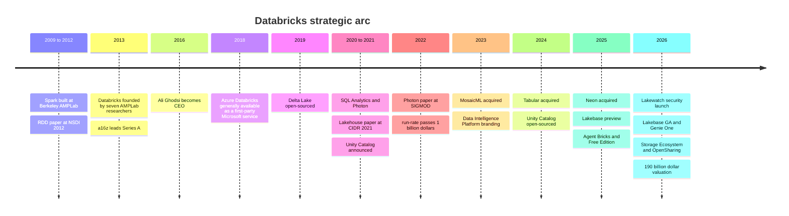
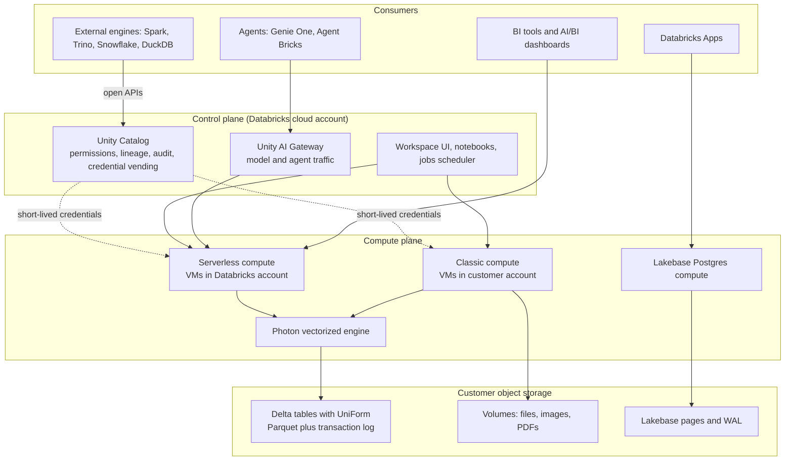
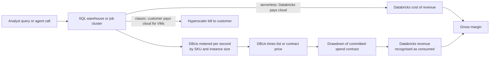
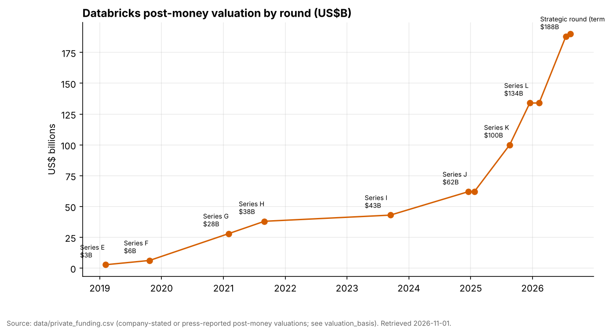
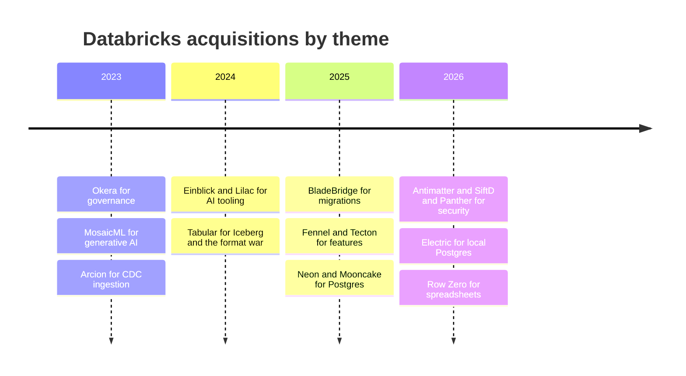
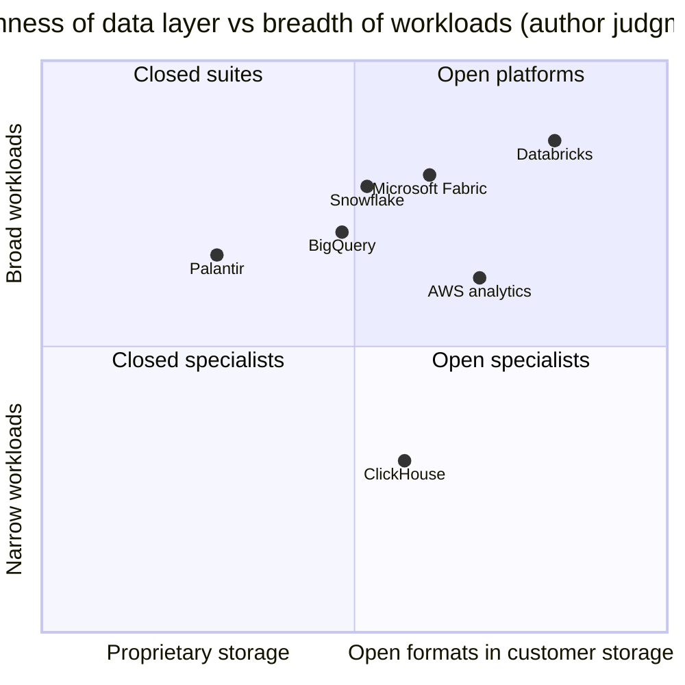

# 25. Databricks
> **Status:** private · **HQ:** San Francisco, CA · **Founded:** 2013 · **Latest valuation/market cap:** $190B post-money (company-stated, round closed 2026-08-13) · **Last verified:** 2026-11-01

## TL;DR

- **What it is.** Databricks sells a managed data and AI platform built on open formats that sit in the customer's own cloud object storage. It started as "hosted Apache Spark" and is now a warehouse, ETL tool, governance catalog, ML/agent platform and, since 2025, an operational Postgres database (Lakebase). Its [Lakehouse](../glossary.md#lakehouse) pitch is one copy of data, many engines, one governance layer.
- **Scale.** The company says it passed a **$7B revenue run-rate with >80% YoY growth** in its fiscal Q2 (May–Jul 2026). It also cites data warehousing above $1.5B, AI products above $1.4B (as of Jan 2026), Lakebase above $100M and net retention above 140%. All of these are **company-stated, unaudited run-rates**. Databricks is private and publishes no GAAP statements.[^db-7b][^db-54]
- **Valuation.** A $5B round closed on 2026-08-13 at **$190B post-money**, about **27x** the stated run-rate. Snowflake trades at **16.9x EV/NTM revenue** (2026-10-30). The two multiples are **not like-for-like**: Databricks' is a private post-money *equity* value over an unaudited, company-defined *run-rate*, while Snowflake's is public *enterprise value* over guidance-derived GAAP revenue (see the valuation bridge below). Databricks has gone from $62B to $190B in 20 months.[^db-7b][^comps-sf]
- **The control point is Unity Catalog, not the file format.** Databricks bought Tabular (the Iceberg creators' company, ~$2B press-reported) in 2024, which defused the format war. It now competes on governance, serverless compute and AI agents layered over open data. That also means it competes with every hyperscaler that resells it.[^tabular]
- **Everpure angle.** Databricks is mostly cloud-only, but in June 2026 it launched a **Storage Ecosystem** built on the [OpenSharing](../glossary.md#opensharing) protocol so it can govern and query on-prem object data. **Everpure was named a launch partner**, with an OpenSharing connector for FlashBlade/FlashArray object storage in private preview. That is the most concrete public bridge between the two companies to date.[^storage-eco][^everpure-os]

## Snapshot table

| Item | Value | Basis / date |
|---|---|---|
| Founders | Ali Ghodsi, Andy Konwinski, Ion Stoica, Matei Zaharia, Patrick Wendell, Reynold Xin, Arsalan Tavakoli-Shiraji (seven co-founders from UC Berkeley's AMPLab) | Public record[^wiki] |
| CEO | Ali Ghodsi (CEO since 2016; previously VP Engineering) | Public record[^wiki]; no change found as of 2026-11-01 |
| HQ / founded | San Francisco, CA / 2013 | Public record[^wiki] |
| Fiscal year | Ends Jan 31 (Q4 = Nov–Jan; Q2 = May–Jul) | Company-stated[^db-j] |
| Revenue run-rate | **>$7B**, >80% YoY (fiscal Q2, May–Jul 2026) | Company-stated run-rate, unaudited[^db-7b] |
| Last full-year revenue disclosed | ~$2.6B (FY ended Jan 2025) | Company-stated, press-reported via CNBC[^cnbc-25] |
| Segment run-rates | Data warehousing >$1.5B (Jul 2026); AI products >$1.4B (Jan 2026); Lakebase >$100M (Jul 2026) | Company-stated run-rate[^db-7b][^db-54][^constellation] |
| Net retention | >140% (stated in each 2025–26 update) | Company-stated KPI, definition not disclosed[^db-54] |
| Large customers | >800 at >$1M run-rate; >70 at >$10M (Jan 2026) | Company-stated[^db-54] |
| Customers | >20,000 organizations; >60% of the Fortune 500 | Company-stated (website)[^cust] |
| Profitability | Adjusted FCF positive on a trailing-12-month basis (since Q4 ended Jan 2025; reaffirmed Aug 2026) | Company-stated, non-GAAP ("adjusted"), no dollar figure[^db-j][^db-54][^db-7b] |
| Gross margin | Non-GAAP subscription gross margin >80% (Oct 2024 quarter) | Company-stated, non-GAAP[^db-j] |
| Employees | ~10,000–12,000 | Estimate from LinkedIn/Wikipedia; not company-stated [VERIFY: company-stated headcount][^wiki] |
| Equity raised | ~$25B cumulative across Series A to the Aug 2026 round, plus ~$5.25B debt (Jan 2025) and ~$2B debt capacity (Feb 2026) | Our sum of `data/private_funding.csv` rows; a large share funded employee liquidity |
| Latest valuation | $190B post-money (Aug 13, 2026; Coatue-led) | Company-stated[^db-7b] |
| Notable investors | a16z, NEA, Thrive, Insight, Coatue, T. Rowe Price, Franklin Templeton, GIC, MGX, Blackstone; strategics Microsoft, AWS, CapitalG, Salesforce Ventures, NVIDIA, Meta | `data/private_funding.csv` (participant lists partly [VERIFY])[^funding] |

*Figure 25.1 — Every headline Databricks metric is a company-stated floor ("surpassed $X") on an undisclosed run-rate definition. Read them as directionally reliable but not audited.*

## Origin story and strategic arc

**The Berkeley years.** Apache [Spark](../glossary.md#apache-spark) began around 2009 as Matei Zaharia's PhD project at UC Berkeley's AMPLab. It was a faster, in-memory successor to Hadoop MapReduce. The core idea was the resilient distributed dataset (RDD): keep intermediate results in cluster memory and record the lineage of transformations, so a lost partition can be recomputed instead of replicated. The 2012 NSDI paper on RDDs won best paper.[^nsdi] Seven AMPLab researchers, including Zaharia's advisor Ion Stoica and the researcher Ali Ghodsi, founded Databricks in 2013 to commercialize Spark. Andreessen Horowitz led the ~$14M Series A.[^wiki][^funding] Stoica was the first CEO. Ghodsi took over in 2016 and still runs the company.

**Act 1: Spark-as-a-service (2013–2018).** The first product was a hosted notebook and cluster manager for Spark on AWS. It was a convenience business: open-source Spark was free, and Databricks charged to run it well. The strategic insight was to **never sell a distribution** the way Cloudera and Hortonworks sold Hadoop. Databricks ran only as a cloud service, which made usage measurable and billable. The 2017–18 deal that made Azure Databricks a first-party Microsoft service sold and billed by Microsoft gave the company an enterprise channel it could not have built alone.[^wiki]

**Act 2: Delta Lake and the lakehouse thesis (2019–2021).** Data lakes on S3 were cheap but unreliable. There were no transactions, so a failed job left half-written files, and there was no schema enforcement. [Delta Lake](../glossary.md#delta-lake) fixed that by adding a transaction log of JSON commits beside Parquet files, which gives ACID transactions on object storage. Databricks described it in a VLDB 2020 paper and open-sourced it in 2019.[^delta-vldb] The CIDR 2021 paper "Lakehouse" by Armbrust, Ghodsi, Xin and Zaharia then argued that warehouses would be replaced by open-format lakes plus a metadata layer, caching and a fast engine. It showed a Parquet-based prototype competitive with cloud warehouses on TPC-DS.[^cidr] That paper is the intellectual charter for everything since, and the basis of the long rivalry with Snowflake (see [Ch 27](ch27-databricks-vs-snowflake.md)).

**Act 3: Become a warehouse (2020–2023).** A thesis needs an engine. Databricks SQL (launched 2020 as "SQL Analytics") gave BI users a SQL endpoint. **Photon**, a vectorized C++ execution engine, made it fast. The SIGMOD 2022 Photon paper reported ~3x average and >10x maximum speedups over the prior Spark-based runtime and won the conference's best industry paper award.[^photon][^sigmod-award] Databricks SQL passed a $100M ARR in April 2023 (press-reported).[^bbg-2023] By the quarter ended Jul 2026 the company called data warehousing a business above $1.5B run-rate.[^constellation]

**Act 4: Own governance (2021–2024).** [Unity Catalog](../glossary.md#unity-catalog) was announced in 2021. It centralised permissions, lineage and auditing across workspaces, and later governed files, ML models and functions. In June 2024 Databricks open-sourced it (now under the Linux Foundation) and bought Tabular, the company founded by Apache Iceberg's creators.[^uc-oss][^tabular] Together these moves signalled that format choice (Delta vs. [Iceberg](../glossary.md#apache-iceberg)) would no longer lock customers in, so the contest moved up to the catalog (see [Ch 7](../01-data-systems-foundations/ch07-open-table-formats.md) and [Ch 8](../01-data-systems-foundations/ch08-catalogs-and-metastores.md)).

**Act 5: Data intelligence and agents (2023–2026).** The $1.3B MosaicML acquisition (2023) brought model-training know-how and became Mosaic AI.[^mosaic] In December 2023 the platform was renamed the **Data Intelligence Platform**, meaning AI that understands an organisation's own data and semantics.[^dip] Data + AI Summit (DAIS) 2025 added **Lakebase** (serverless Postgres from the ~$1B Neon deal), **Agent Bricks** (build-and-evaluate agents), **Databricks One** (a business-user front end), **Lakeflow Designer** (no-code ETL) and a Free Edition.[^dais25][^neon] DAIS 2026 (San Francisco, June 15–18) centred on agents. It reported Lakebase GA and launched **Genie One**, an "agentic coworker" grown out of AI/BI Genie. It also added **Unity AI Gateway** for governing model and agent traffic, a real-time engine branded **Lakehouse//RT**, the announced-but-not-shipped **LTAP** (operational and analytical data on one copy) and **OpenSharing**, a Linux Foundation successor to Delta Sharing that extends to models, agent skills and unstructured data.[^dais26][^uc-dais26][^opensharing]

*Figure 25.2 — Each act widened the set of workloads that run against the same open-format data: Spark jobs, then SQL, then governance, then models, then operational databases and agents.*

## Product and technology

### The architecture in one picture

Databricks splits its system into a **[control plane](../glossary.md#control-plane)** and a **[compute plane](../glossary.md#compute-plane)**. The control plane runs in Databricks' own cloud account. It holds the web UI, notebooks, job scheduler, cluster manager, query optimizer services and the Unity Catalog metadata service. The compute plane is where data is actually processed, and it comes in two flavours.[^arch-docs]

- **Classic compute** runs virtual machines in the **customer's** cloud account (their VPC or VNet). The customer pays AWS, Azure or Google for those VMs directly and pays Databricks a separate software fee. Data never leaves the customer's network perimeter, which is why banks liked it.
- **[Serverless compute](../glossary.md#serverless-compute)** runs in a compute plane inside **Databricks'** cloud account, in the same region, connected to the customer's storage over secure networking. Databricks keeps pools of warm machines, so startup takes seconds rather than minutes. It bills one all-in price.

Underneath both, the data sits in the customer's **object storage** (S3, ADLS, GCS, and Cloudflare R2 as an officially documented [external location](../glossary.md#external-location)) as Parquet files plus Delta transaction logs.[^extloc] **UniForm** writes Iceberg-compatible metadata alongside the Delta log, so Iceberg engines can read the same files without a copy. Unity Catalog sits in the middle. Every engine that touches a table, whether Databricks' own or an external one reading through Unity Catalog's open APIs, asks it for permission and receives short-lived credentials scoped to the files it may read.

*Figure 25.3 — The lakehouse architecture: Databricks hosts the brains (control plane, Unity Catalog), compute runs either in the customer's account (classic) or Databricks' (serverless), and the data itself stays as open files in the customer's object storage.*

> **Bridge: unified memory.** A classic two-tier stack (data lake plus a separate warehouse) is like a CPU and a discrete GPU with separate memory. Every job pays a PCIe-style copy across the boundary, and the two copies drift out of sync. The lakehouse is the unified-memory design, as in Apple M-series or NVIDIA Grace Hopper. One physical copy in object storage, many processors (SQL, Spark, ML, agents) addressing it, and coherence handled by the table format's transaction log rather than by copying. The catch is the same as with unified memory: you trade peak performance on any single workload (a tuned proprietary warehouse format) for less movement and one source of truth.

### How the pieces work (L2)

**Delta Lake and UniForm.** A Delta table is a folder of Parquet data files plus a `_delta_log` folder of numbered JSON commit files with periodic checkpoints. A writer commits by atomically creating the next log entry. Readers reconstruct the table state from the log, which gives snapshot isolation and "time travel" to old versions. UniForm generates Iceberg metadata from the same commits, so one physical table serves both ecosystems.[^delta-vldb] [Ch 7](../01-data-systems-foundations/ch07-open-table-formats.md) explains the metadata trees in depth.

**Photon.** Spark's original engine ran on the Java Virtual Machine and processed rows one at a time through generated code. Photon is a C++ engine that processes **columnar batches** with tight loops the CPU can vectorize (SIMD). It plugs in underneath Spark's optimizer, so unsupported operators fall back to the old path.[^photon] [Ch 5](../01-data-systems-foundations/ch05-analytical-engines.md) covers [vectorized execution](../glossary.md#vectorized-execution) generally. Photon carries a higher DBU rate where it is optional, which makes performance a pricing lever as well.

**Unity Catalog.** It uses a three-level namespace (`catalog.schema.table`) and governs tables, views, volumes (files), ML models and functions. It records column-level lineage automatically from queries run on Databricks and vends temporary cloud credentials to engines. The open-source version speaks the Iceberg REST catalog protocol, so non-Databricks engines can use it. At DAIS 2026 Databricks added Domains and the Unity AI Gateway, which extends the same permission model to LLM calls and agent tool use.[^uc-dais26] Strategically, this is the product that matters most. Whoever holds permissions, lineage and semantics holds the account.

**Lakebase.** Neon's design splits Postgres into stateless compute nodes and a storage service. Write-ahead log (WAL) records go to a quorum of "safekeepers", and "pageservers" materialise pages and tier them into object storage. That makes databases cheap to create, scale to zero and branch (copy-on-write), which suits AI agents that spin up throwaway databases.[^neon] Databricks' bet is that operational data written in Lakebase can show up in the lakehouse without a separate change-data-capture pipeline, and the 2026 LTAP announcement is the end state of that bet.[^dais26]

> **Going deeper (L3).** On a Lakebase write, Postgres compute streams WAL to safekeepers (a Paxos-style quorum), acknowledges the commit once a quorum persists it, and pageservers later replay WAL into page images that are uploaded to object storage as immutable layer files. Because history is retained as layers, a "branch" is just a new timeline pointer at an LSN (log sequence number), with no data copied. Mooncake Labs (acquired 2025) adds columnar mirroring of Postgres tables into Iceberg/Delta, the bridge LTAP builds on.[^mooncake]

**The rest of the surface.** **Lakeflow** covers ingestion (Lakeflow Connect, including the CDC technology bought with Arcion), declarative pipelines (formerly Delta Live Tables) and orchestration (Jobs). **Mosaic AI** and **Agent Bricks** cover model serving, fine-tuning, vector search, evaluation and agent building. **Genie** turns natural-language questions into governed SQL over Unity Catalog metadata. **Databricks Apps** hosts internal data applications. **Lakewatch** (2026) and Panther repackage the lakehouse as a security analytics store, a SIEM.[^lakewatch][^panther] [Ch 22](../03-ai-data-stack/ch22-agents-and-data.md) explains why agents raise the value of the catalog and the operational database.

## How it makes money

### The DBU

Databricks charges in **[Databricks Units (DBUs)](../glossary.md#dbu)**, a normalised unit of processing capacity consumed per hour and billed per second. Each instance type burns a fixed number of DBUs per hour, so a bigger VM burns more. Each **SKU** (workload type) has a different dollar price per DBU. Representative 2026 US list prices on AWS, compiled by third parties, are roughly **$0.15/DBU for Jobs compute**, **~$0.55 for All-Purpose (interactive) compute** and **~$0.70 for Serverless SQL**. Azure lists Premium Jobs at $0.30 and All-Purpose at $0.55 per DBU-hour, before VM costs.[^pricing] Negotiated enterprise contracts are typically multi-year committed-spend agreements drawn down by consumption, so list prices are a ceiling. The SKU ladder rewards moving work from interactive notebooks (expensive) into scheduled jobs (cheap). It also charges a premium for convenience: serverless, and SQL for BI concurrency.

### How a query becomes revenue

*Figure 25.4 — Revenue tracks consumption, not seats. The same query generates a thin Databricks fee plus a separate cloud bill under classic compute, or a larger all-in Databricks fee with cloud cost inside Databricks' COGS under serverless.*

**Worked example (illustrative, list prices).** Consider a nightly ETL job that burns 60 DBUs. On classic Jobs compute, Databricks bills about 60 × $0.15 = **$9**, and the customer separately pays AWS for the EC2 hours. Now run comparable work as Serverless SQL at ~$0.70/DBU: 60 DBUs cost about **$42**, and that one invoice covers both the software and the virtual machines Databricks rented from AWS on the customer's behalf. The serverless DBU price is higher because the infrastructure is inside it. Revenue per workload goes up. Gross margin percentage goes down, because Databricks now carries the EC2 cost in COGS. Gross profit dollars can still rise, since Databricks bin-packs many customers onto warm pools and keeps the utilisation spread.

> **Bridge: semiconductors and royalties.** Under classic compute the DBU behaves like an **Arm royalty**. The customer "fabs" the compute by buying its own cloud VMs, and Databricks collects a per-unit fee on every DBU of work its software orchestrates, at very high gross margin. Serverless turns Databricks partly into a **foundry-plus-IP vendor**. It now buys the "wafers" (cloud VMs) and resells finished capacity. Revenue per unit rises, margin percentage falls, and success depends on fleet utilisation, just as a foundry's does. An analyst should ask the question a semis investor asks about any royalty-to-product transition: is the mix shift adding gross-profit dollars faster than it dilutes margin percentage?

### Gross margin and channel economics

The only company-stated margin data point is a **non-GAAP subscription gross margin above 80%** in the quarter ended Oct 2024.[^db-j] PitchBook's valuation work (republished by Morningstar) treats 80% as the *optimistic* steady-state case, implying a base case below it.[^ms] Snowflake, which has always run all compute in its own cloud accounts, reports a ~75% non-GAAP product gross margin (Q2 FY2027).[^sf-q2] That is a useful reference point for where an all-serverless Databricks could land. Two further margin drivers:

- **Hyperscaler marketplaces and first-party resale.** Azure Databricks is sold and billed by Microsoft. On AWS and Google Cloud, Databricks transacts heavily through cloud marketplaces, so purchases burn down customers' cloud commitments. That co-sell motion speeds deals but costs a revenue share and makes each hyperscaler a channel partner and a competitor at once (see [Ch 40](../05-business-and-economics/ch40-gtm-partnerships.md)).
- **Free migration tools as customer-acquisition cost.** After buying BladeBridge (2025), Databricks made its warehouse-migration tooling (Lakebridge) free for moves onto Databricks SQL.[^bladebridge] That is a subsidy to win Teradata, Redshift and Snowflake workloads.

[Ch 35](../05-business-and-economics/ch35-business-models.md) compares consumption against subscription models more broadly.

## Financials

Databricks is private, so **there are no GAAP financial statements**. Every figure below is a **company-stated run-rate** (usually phrased as "surpassed $X"), a company-stated fiscal-year revenue relayed by the press, or a projection the company gave investors. The run-rate methodology (whether quarterly revenue × 4 or exit-month × 12, and how committed but unconsumed spend is treated) has not been disclosed. The fiscal year ends Jan 31.[^db-j]

*Figure 25.5 — Run-rate rose roughly 12x in five years, and growth re-accelerated from ~50% (mid-2025) to >80% (mid-2026). Run-rates are floors on an undisclosed definition, and two points are forward projections. Source: `data/ch25_databricks_runrate.csv`.*

| Period end | Disclosure | Value | Growth stated | Basis | Source |
|---|---|---|---|---|---|
| ~Aug 2021 | ARR | ~$600M | n/a | Press-reported | [^tc-2023] |
| Aug 2022 | Revenue run-rate | >$1B | n/a | Company-stated | [^tc-2023] |
| Jan 2023 (FY) | Fiscal-year revenue | ~$1B | ~60% | Company-stated, press-reported | [^bbg-2023] |
| Jan 2024 (FY) | Fiscal-year revenue | $1.6B | >50% | Company-stated, press-reported | [^cnbc-24] |
| Jul 2024 | Run-rate (projection) | $2.4B | ~60% | Company projection, press-reported | [^cnbc-24] |
| Jan 2025 | Run-rate (projection) and FY revenue | >$3B; FY ~$2.6B | >60% (Q3) | Company-stated projection; FY press-reported | [^db-j][^cnbc-25] |
| Jul 2025 | Run-rate | >$4B; AI >$1B | >50% | Company-stated | [^db-4b] |
| Oct 2025 | Run-rate | >$4.8B; DW >$1B; AI >$1B | >55% | Company-stated | [^db-48] |
| Jan 2026 | Run-rate | >$5.4B; AI >$1.4B | >65% | Company-stated | [^db-54] |
| Jul 2026 | Run-rate | >$7B; DW >$1.5B; Lakebase >$100M | >80% | Company-stated | [^db-7b][^constellation] |

*Figure 25.6 — Disclosure history. The cadence of disclosures tracks fundraising: almost every new number arrived alongside a new round.*

**Do the numbers reconcile?** Roughly, yes. A >80% growth rate on >$7B implies a year-earlier base of no more than ~$3.9B, consistent with the ">$4B" stated for the same quarter of 2025 if both figures sit somewhat above their floors. Likewise >65% on $5.4B implies ≤$3.3B a year earlier, consistent with the ">$3B" projection for Jan 2025. The internal arithmetic holds together, which is a good sign. It is still not an audit. CNBC's report of ~$2.6B fiscal-year revenue for the year ended Jan 2025 sits well below the ~$3B exit run-rate. That gap is normal for a business growing ~60%, because full-year revenue lags the exit rate.[^cnbc-25]

**Other stated metrics.** Net retention has been ">140%" in every 2025–26 update. That is a cohort measure (this year's spend from last year's customers ÷ their spend last year), and Databricks does not disclose its definition or whether it counts dollars or DBUs.[^db-54] Snowflake reports 126% on a disclosed trailing-12-month product-revenue definition.[^sf-q2] More than 800 customers ran at >$1M and more than 70 at >$10M as of Jan 2026, against Snowflake's 828 customers above $1M trailing-12-month product revenue in Jul 2026, so the large-account bases are now similar in size. The definitions differ: Databricks counts customers at a >$1M annualised *run-rate*, while Snowflake counts *trailing* twelve-month GAAP product revenue. For fast-growing accounts a run-rate threshold is easier to clear than a trailing one, so Databricks' count is flattered relative to Snowflake's.[^db-54][^sf-q2] Free cash flow has been positive on a trailing-12-month basis since the quarter ended Jan 2025, but no dollar amount has been given.[^db-j]

**Funding and valuation.** From 2013 to Aug 2026 Databricks raised roughly $25B of equity, by our sum of `data/private_funding.csv`, plus debt. The rounds since 2024 were explicitly meant in part to give employees liquidity and pay RSU withholding taxes, a substitute for an IPO.[^db-j][^db-48]

*Figure 25.7 — Valuation went sideways for two years after the 2021 peak (Series H $38B → Series I $43B), then tripled from $62B to $190B in 20 months as growth re-accelerated and AI demand arrived. Source: `data/private_funding.csv`.*

| Date | Round | Amount | Post-money | Lead(s) | Source |
|---|---|---|---|---|---|
| Sep 2013 | Series A | ~$14M | n/d | Andreessen Horowitz | [^funding] |
| Feb 2019 | Series E | $250M | $2.75B | Andreessen Horowitz | [^funding] |
| Oct 2019 | Series F | $400M | $6.2B | Andreessen Horowitz | [^funding] |
| Feb 2021 | Series G | $1B | $28B | Franklin Templeton | [^funding] |
| Aug 2021 | Series H | $1.6B | $38B | Morgan Stanley Counterpoint Global | [^funding] |
| Sep 2023 | Series I | >$500M | $43B | T. Rowe Price | [^funding] |
| Dec 2024–Jan 2025 | Series J (+$5.25B debt) | $10B equity | $62B | Thrive Capital | [^db-j][^db-j-close] |
| Aug–Sep 2025 | Series K | $1B | >$100B | a16z, Insight, MGX, Thrive, WCM | [^db-4b] |
| Dec 2025–Feb 2026 | Series L (+~$2B debt capacity) | ~$5B | $134B | Insight, Fidelity, J.P. Morgan AM | [^db-48][^db-54] |
| Aug 2026 | Strategic round | $5B | $190B | Coatue | [^db-7b] |

*Figure 25.8 — Funding history (selected rounds; Series B–D omitted for space). Every round since Series J was large relative to the company's needs, because liquidity for employees was a stated purpose.*

> **Bridge: valuation.** At $190B on a >$7B run-rate, Databricks is priced at **~27x current run-rate**. Snowflake trades at **16.9x EV/NTM revenue** (EV $106.31B ÷ NTM revenue $6.30B, as of 2026-10-30, NTM from FY2027 guidance), or ~17x its Q2 FY2027 total revenue annualised ($1.55B × 4).[^comps-sf][^sf-q2] To compare like with like, roll Databricks forward. If run-rate grows 50% over the next year, from $7B to $10.5B, next-twelve-month revenue is roughly the midpoint, ~$8.75B, and the multiple is **~22x NTM** (our estimate). Per point of growth, Databricks costs ~0.34x (27 ÷ 80) against Snowflake's ~0.48x (16.9 ÷ 35). On that crude growth-adjusted basis the private mark is *not* expensive relative to Snowflake. Three adjustments cut the other way. (1) $190B is a **post-money equity value**, not EV, and it is set by preferred shares that usually carry liquidation preferences, so it overstates the value of common stock. (2) Run-rate flatters a fast grower against trailing figures. (3) Debt (a $2.75B term loan plus a revolver and later capacity) is not netted. Palantir, at ~70x EV/TTM revenue (70.3x; TTM basis, not NTM) with ~79% TTM growth (2026-10-30), shows public markets will pay far more for comparable growth when the AI narrative is strong.[^comps-pltr]

## Customers and go-to-market

Databricks says more than 20,000 organisations use it, including more than 60% of the Fortune 500.[^cust] Revenue is concentrated in large enterprises: >800 customers spend at >$1M run-rate and >70 at >$10M.[^db-54] The classic buyer was the **data engineering and data science** team, not the BI team. That is the historic mirror image of Snowflake, which entered through SQL analysts and finance. Each company has spent five years invading the other's home buyer.

**Go-to-market mechanics.** The motion is enterprise field sales with committed-spend contracts, layered on a land-and-expand consumption model. The company's revenue grows when customers run more workloads, not when it signs more seats, so customer success and solution architects ("field engineering", the function co-founder Arsalan Tavakoli-Shiraji historically led) work like a sales function. The hyperscaler channel is unusual. On Azure, Microsoft sells and bills Databricks as a first-party service. On AWS and Google Cloud, marketplace transactions let customers burn down cloud commitments. A large systems-integrator ecosystem (Accenture, Deloitte and many Databricks-specialist boutiques) handles migrations from Hadoop, Teradata and on-prem warehouses.

**The free-tier and developer funnel** widened in 2025–26. Free Edition passed 500,000 users by DAIS 2026 and now includes Lakebase, Agent Bricks and serverless GPUs (company-stated via event recaps).[^dais26] Lakebase is aimed at a new buyer, the application developer, and the Electric (PGlite) acquisition pushes the funnel into local development and agent sandboxes.[^electric] Data + AI Summit itself drew roughly 30,000 attendees in 2026 (press-reported), which makes it a major sales event.[^dais26]

## M&A and investments

Databricks is the most active serial acquirer in the data-platform market. `data/ma_deals.csv` lists 16 deals, five of them in 2026 alone. Almost all were undisclosed tuck-ins, each filling one gap in the platform, and they were paid for largely with private stock whose value kept rising. That currency advantage has been one of the company's quiet strategic weapons. For the wider deal landscape see [Ch 39](../05-business-and-economics/ch39-ma-history.md).

| Date | Target | Value | Rationale | Integration outcome |
|---|---|---|---|---|
| May 2023 | Okera | n/d | AI-centric data access governance | Absorbed into Unity Catalog[^okera] |
| Jun 2023 | MosaicML | $1.3B (incl. retention; mostly stock) | Generative-AI training platform and team | Became Mosaic AI; built DBRX model (2024); brand now folding into Agent Bricks [VERIFY: Mosaic AI brand status][^mosaic] |
| Oct 2023 | Arcion | ~$100M | CDC replication from operational databases | Folded into Lakeflow Connect[^arcion] |
| Jan–Mar 2024 | Einblick, Lilac | n/d | AI notebook and unstructured-data curation teams | Assistant/notebooks; Mosaic AI[^einblick][^lilac] |
| Jun 2024 | Tabular | ~$2B (press-reported; WSJ said $1–2B) | Iceberg creators; end the format war | Iceberg/Delta convergence; UniForm; Iceberg v3 work[^tabular] |
| Feb 2025 | BladeBridge | n/d | Warehouse code conversion | Free migration tooling (Lakebridge)[^bladebridge] |
| Apr 2025 | Fennel | n/d | Incremental feature engineering | Team joined engineering[^fennel] |
| May 2025 | Neon | ~$1B (press-reported) | Serverless Postgres for agents | Basis of Lakebase (GA 2026; >$100M run-rate)[^neon][^db-7b] |
| Aug 2025 | Tecton | n/d (asset acquisition) | Real-time feature serving for agents | Into Mosaic AI / Agent Bricks feature serving[^tecton] |
| Oct 2025 | Mooncake Labs | n/d | Postgres-to-columnar mirroring | Absorbed into Lakebase / LTAP[^mooncake] |
| Mar 2026 | Antimatter, SiftD.ai | n/d | Security and security-AI teams | Lakewatch agentic SIEM[^lakewatch] |
| Jun 2026 | Panther | n/d | Cloud SIEM | "Security lakehouse"; completion reported ~Aug 2026[^panther] |
| Aug 2026 | Electric (PGlite) | n/d | Embedded/local Postgres and sync | Announced; completion not yet reported[^electric] |
| Sep 2026 | Row Zero | n/d | Cloud spreadsheet front end | Closed; company says it is scouting more deals[^rowzero] |

*Figure 25.9 — Deal table. The pattern is buy-not-build for every adjacent workload, with Unity Catalog as the common integration point.*

*Figure 25.10 — The acquisition sequence moved from AI talent (2023) to format control (2024) to operational databases (2025) and security and end-user surfaces (2026).*

**What worked.** MosaicML and Neon are the clearest successes. The first turned into an AI-products line that the company says passed a $1.4B run-rate by Jan 2026, though that figure covers all AI products, not Mosaic-derived revenue alone.[^db-54] The second became Lakebase, which passed a $100M run-rate about 14 months after the deal was announced.[^db-7b] Tabular is the most strategic deal. Paying ~$2B for a company with ~$37M raised was a defensive purchase of option value: it stopped Snowflake (which announced the Polaris catalog the same week) from rallying the Iceberg community against Delta.[^tabular] Antimatter, SiftD, Panther and Electric are too recent to judge.

**Investments.** Databricks Ventures takes minority stakes across its ecosystem; for example it participated in Sigma Computing's 2026 Series E.[^funding] The company has also become a strategic investee itself. Microsoft, NVIDIA and Meta all hold stakes, which aligns three of its most important suppliers and channels with its success.[^funding]

## Competitive position

Databricks competes on four fronts at once. **Snowflake** is the head-to-head rival for the analytics and AI platform budget. The **hyperscalers** both resell Databricks and build substitutes. **Palantir** competes for the "AI on enterprise data" executive narrative and budget. **Specialist engines** such as ClickHouse attack specific workloads where they are faster or cheaper.

| Dimension | Databricks | Snowflake | Microsoft Fabric | Google BigQuery | AWS (Redshift, SageMaker, S3 Tables) | Palantir | ClickHouse |
|---|---|---|---|---|---|---|---|
| Home buyer | Data engineering, ML | SQL analysts, finance | Microsoft 365 / Power BI estate | GCP-native analytics teams | AWS builders | C-suite, operations, government | Real-time / observability engineers |
| Storage model | Delta + UniForm in customer object storage | Managed proprietary format; Iceberg tables GA | OneLake (Delta-based), shortcuts to other stores | Managed storage; BigLake/Iceberg | S3 Tables (managed Iceberg) | Ontology over connected sources | MergeTree; object-storage tiering |
| Catalog / control point | Unity Catalog (OSS) | Horizon; Apache Polaris (donated) | OneLake catalog; Purview | Knowledge Catalog (ex-Dataplex) | Glue / SageMaker Catalog | Ontology | Minimal |
| Pricing unit | DBU by SKU (consumption) | Credits (consumption) | Capacity units (reserved) | Slots or bytes scanned | Instance-hours / serverless RPU | Large enterprise contracts | Cloud consumption / OSS |
| Operational DB | Lakebase (Neon) | Snowflake Postgres (Crunchy) | Fabric SQL DB, Cosmos DB | AlloyDB, Spanner | Aurora, DSQL | n/a | n/a |
| Agent / AI story | Agent Bricks, Genie One, AI Gateway | CoWork (ex-Snowflake Intelligence), Cortex | Fabric IQ, Copilot | Gemini Enterprise, data agents | Bedrock, SageMaker | AIP | MCP / Langfuse |
| Latest scale marker | >$7B run-rate, >80% growth (company-stated) | $1.55B Q2 FY2027 revenue, +35% (GAAP) | Inside Microsoft; not broken out | Inside Google Cloud; not broken out | Inside AWS; not broken out | ~$6.2B TTM revenue, ~79% growth (GAAP) | $15B valuation (Jan 2026, press-reported) |
| *Comparability note* | *Run-rate (company-defined, unaudited)* | *Quarterly GAAP total revenue* | | | | *TTM GAAP revenue* | *Private valuation, not revenue* |

*Figure 25.11 — Competitive matrix. Sources: Snowflake Q2 FY2027 release; `data/public_comps.csv`; hyperscaler event summaries; Bloomberg on ClickHouse.[^sf-q2][^comps-pltr][^ignite][^next26][^reinvent][^clickhouse]*

*Figure 25.12 — Positioning (author judgment, not measured data). Everyone is moving toward the upper right, which is why open formats alone no longer differentiate Databricks.*

**Versus Snowflake.** Snowflake is more profitable and fully public: GAAP revenue +35% in Q2 FY2027, ~75% non-GAAP product gross margin, 126% NRR.[^sf-q2] Databricks is growing more than twice as fast on its own stated basis, has the stronger ML and engineering franchise, and now claims a warehousing business above $1.5B. Snowflake has answered almost every move: Iceberg tables and the Polaris catalog against Unity Catalog, Crunchy Data and Snowflake Postgres against Neon and Lakebase, Openflow against Lakeflow, and CoWork against Genie. [Ch 26](ch26-snowflake.md) and [Ch 27](ch27-databricks-vs-snowflake.md) carry the full comparison.

**Versus the hyperscalers.** This is the structural risk. Microsoft sells Azure Databricks as a first-party service, invested in the Feb 2026 close, and also pushes **Fabric**: OneLake as the single store, Fabric databases GA, and Fabric IQ semantics in preview.[^funding][^ignite] Fabric is bundled into the Power BI estate that most enterprises already own. Google's **BigQuery** added cross-cloud lakehouse queries and native replication from Spanner, AlloyDB and Cloud SQL at Next '26.[^next26] AWS made **S3 Tables** (managed Iceberg) and S3 Vectors native storage features, which takes the "open table on object storage" layer into the storage service itself.[^reinvent] Databricks' defence is multi-cloud neutrality plus a faster product cadence. Each hyperscaler would rather capture the margin itself, but each also earns the underlying compute and storage either way.

**Versus Palantir and specialists.** Palantir (~$6.2B TTM revenue, ~79% TTM growth, ~70x EV/TTM revenue as of 2026-10-30) sells an ontology and operational AI applications to executives. It overlaps with Genie and Agent Bricks at the application layer more than with the warehouse.[^comps-pltr] ClickHouse ($15B valuation, Jan 2026) wins real-time and observability workloads on price-performance, a niche that Lakehouse//RT and the Panther/Lakewatch security push are clearly aimed at.[^clickhouse][^dais26]

## Why it's winning / bull case

1. **Growth is accelerating at scale.** Reported growth went from ~50% at $4B (mid-2025) to >80% at $7B (mid-2026).[^db-4b][^db-7b] Very few software companies have ever re-accelerated above $5B. If the figures are anywhere near right, the AI-workload tailwind is real and showing up in consumption.
2. **It owns the AI-data control point.** Unity Catalog governs tables, files, models, functions and, since 2026, AI gateway traffic. Agents need governed context and permissions, and the company that already holds lineage and access policies is the natural place to enforce them. That makes AI a second leg of growth rather than a substitute for the platform.
3. **Open formats reduce sales friction.** "Your data stays in your bucket in open formats" wins security reviews and lowers perceived lock-in, which shortens enterprise sales cycles. Lock-in moves to the catalog, the pipelines and the skills of the team, where it is stickier but less visible.
4. **Platform breadth compounds net retention.** Each new product (SQL, Lakeflow, Lakebase, Apps, Lakewatch) is another meter on the same contract. Net retention >140% at this scale implies that existing customers alone add ~40% a year.[^db-54]
5. **The capital and currency advantage.** A $190B private currency, with no quarterly scrutiny, funds a buy-not-build strategy (16 deals) and talent retention through tenders. Public rivals cannot match that without diluting holders in full view.
6. **Valuation is defensible on growth-adjusted terms.** At ~0.34x post-money-value/run-rate per point of growth against Snowflake's ~0.48x EV/NTM per point (different numerators and denominators, so indicative only), and with Palantir trading near 70x EV/TTM revenue, a bull can argue that $190B already discounts heavy deceleration (see the valuation bridge above).

## Risks / bear case and open questions

1. **The multiple assumes growth and margin that are not audited.** At ~27x run-rate, the price needs years of 40%+ growth *and* mature-software margins. PitchBook's analysis (republished by Morningstar) estimated operating value nearer **$68.7B**, a 64% discount, and found that even its optimistic 80%-gross-margin case reached only ~$182B.[^ms] Run-rate definitions are undisclosed, and an S-1 could restate the picture.
2. **Serverless dilutes gross margin.** As workloads move to serverless, cloud infrastructure costs enter COGS. Snowflake's ~75% non-GAAP product gross margin is the realistic destination for a platform that runs all compute itself, and it sits below the >80% subscription margin Databricks cited in 2024.[^db-j][^sf-q2] Price competition on SQL with Snowflake, BigQuery and Fabric adds further pressure.
3. **Open formats cut both ways.** The same openness that wins deals makes switching engines cheaper. If a customer's tables are Iceberg-readable and governed in an open catalog, Snowflake, Trino, DuckDB or a hyperscaler engine can bid for each workload. Databricks bought Tabular partly to manage this risk, and AWS S3 Tables shows a hyperscaler can commoditise the table layer from below.[^reinvent]
4. **Microsoft is partner and rival.** Azure Databricks is a major channel, yet Fabric is bundled into an installed base Databricks cannot match. A shift in Microsoft's sales-compensation emphasis could quietly redirect pipeline. No public data shows the Azure share of Databricks revenue [VERIFY: Azure share of revenue].
5. **Liquidity overhang and stock-based compensation.** Successive rounds funded employee tenders and RSU tax withholding.[^db-j][^db-48] That is a sign of heavy SBC, which the "FCF positive" claim does not net out. Any IPO would bring lock-up expiries on a very large employee float. Ghodsi called 2026 a "terrible year to go public" (press-reported), and the earliest window he has signalled is 2027. No confidential S-1 had been reported as of the Morningstar piece.[^ipo][^ms]
6. **Integration breadth and focus.** Five deals in 2026 across security, Postgres and spreadsheets stretch the product. Lakewatch puts Databricks against Splunk/Cisco, CrowdStrike and Palo Alto, all far deeper in security.
7. **Open questions to track.** What is the exact run-rate definition? What is the serverless share of DBUs, and what is the serverless gross margin? What share of revenue comes through Azure? Does LTAP ship, and does Lakebase cannibalise external Postgres or grow new workloads? When does the S-1 arrive?

## Relevance to Everpure

> **Storage bridge.** Databricks treats object storage as a commodity substrate: Delta/Iceberg files on an S3-compatible API, with Unity Catalog deciding who may read them. Performance comes from Photon, caching and file layout, not from the array, so the storage vendor's leverage lies in where data *lives* (on-prem, sovereign, near GPUs) and in metadata, not in raw throughput for Databricks SQL. See the companion *Everpure Tech Atlas* for S3 semantics and FlashBlade object performance.

**Does Databricks run on-prem?** Not as a product. Databricks is a cloud service on AWS, Azure and Google Cloud. Its official external-location documentation covers cloud object stores and Cloudflare R2, and community threads describe pointing Unity Catalog at on-prem S3-compatible stores such as MinIO as working but not officially supported.[^extloc] Hybrid access has historically meant pairing (for example a 2023 Dell ECS integration) or federation.[^dell-ecs] That changed in June 2026. Databricks launched a **Storage Ecosystem** in which storage vendors run a managed **OpenSharing** server next to their object stores. Databricks workspaces can then discover, govern and query Delta and Iceberg tables in place on-prem, without replication. Launch partners were **Everpure, MinIO and Qumulo**. Cohesity, Commvault, HPE, NetApp, Nutanix, Rubrik and VAST Data were named as coming later.[^storage-eco] Everpure's own blog describes an **OpenSharing connector** in **private preview from June 9, 2026**. It points at buckets on FlashBlade or FlashArray object storage and gives Databricks gated access to Iceberg and Delta tables there.[^everpure-os] Sources differ on maturity: Databricks' page lists it as a launch-partner service, while Everpure's blog says preview. We found no general-availability announcement [VERIFY: Everpure OpenSharing connector GA status].

**Options a strategy team might evaluate, based on public information:**

| Option | What it would mean | Why it could matter | Watch-outs |
|---|---|---|---|
| Take the OpenSharing connector to GA and co-sell it | Make "keep regulated data on Everpure, govern and query it from Databricks" a supported, jointly marketed pattern | Converts Databricks' sovereign/hybrid gap into Everpure pull-through; first-mover among 10 storage vendors | Low switching cost between storage partners; differentiation must come from performance, data services and support |
| Integrate Data Intelligence (1touch) with Unity Catalog | Push Everpure discovery and classification tags into Unity Catalog, and pull Unity Catalog policies back | Everpure's 1touch-based Data Intelligence already lists Databricks as a connector target, so a two-way metadata link deepens it[^1touch] | Unity Catalog adds its own classification features; risk of overlap rather than complement |
| Position FlashBlade as the on-prem landing zone for lakehouse tables near GPUs | Iceberg/Delta tables on FlashBlade feeding Data Stream and Databricks via OpenSharing | Aligns with Everpure's "data primacy" and NVIDIA AI Data Platform work | Databricks' growth engine is serverless in the cloud, so on-prem stays a minority use case |
| Watch Lakebase's storage layer | Neon-style Postgres tiers pages to object storage | Agent-created databases multiply object-storage footprint; a hybrid Lakebase would need on-prem object storage | No public on-prem Lakebase plan; speculative |

*Figure 25.13 — Partnership options (public information only). The compete risk is indirect: if Unity Catalog becomes the enterprise's metadata control point, storage-side "data intelligence" must interoperate with it rather than replace it.*

The broader pattern of storage vendors moving up the stack is covered in [Ch 45](../06-history-and-future/ch45-storage-moving-up-the-stack.md), and data-gravity and egress economics in [Ch 24](../03-ai-data-stack/ch24-data-meets-compute-and-storage.md).

## Conversation playbook

**Three questions for Databricks product managers or executives**

1. "What share of DBUs now run on serverless, and how does the gross margin on serverless SQL compare with classic Jobs compute?" *A good answer* gives a direction and a mechanism, such as utilisation from warm pools and Photon efficiency offsetting cloud COGS, and admits the mix shift dilutes margin percentage while adding gross-profit dollars.
2. "For OpenSharing-based storage partners, what does Unity Catalog govern on-prem: permissions, lineage, audit, or all three? And who runs the sharing server's SLA?" *A good answer* separates what the catalog enforces from what the storage partner operates, and names the supported table formats and the query path (pushdown or full scan).
3. "How do you define the revenue run-rate you disclose, and does net retention count dollars or DBUs?" *A good answer* states the arithmetic, quarterly × 4 or exit month × 12. Evasion here is itself a data point.

**Three questions for Databricks engineers or partner architects**

1. "When an external engine reads a Unity Catalog table on S3-compatible storage, how are credentials vended, and what happens on a non-AWS endpoint?" *Good:* a concrete description of temporary-credential scoping and the endpoint and signature requirements.
2. "With UniForm, which Iceberg features (deletion vectors, v3 types) are readable by third-party engines today, and what is the metadata-generation lag after a Delta commit?" *Good:* specifics on versions and asynchronous versus synchronous metadata writes.
3. "Where does Lakebase store pages and WAL, and could that storage layer sit on customer-managed object storage?" *Good:* a clear explanation of the safekeeper/pageserver split and an honest "not today" if that is the case.

**What good answers sound like.** They use the company's own units (DBUs, run-rate, SKU), separate classic from serverless, and treat Unity Catalog, not Delta, as the strategic asset. They name trade-offs, for example that serverless improves the user experience but carries COGS, instead of reciting launch names.

**Don't say this**

- "Databricks' revenue is $7B." *It is a company-stated run-rate floor, not GAAP revenue; the last disclosed fiscal-year revenue was ~$2.6B (FY ended Jan 2025).*
- "Databricks is Spark." *Spark is now one engine among several; Photon, Lakebase and serverless SQL do much of the work.*
- "Delta vs. Iceberg is the battle." *That fight was largely defused in 2024 (Tabular, UniForm); the contested layer is the catalog.*
- "Databricks runs on-prem." *It is a cloud service; on-prem data is reached via partners and OpenSharing, not an on-prem Databricks install.*
- "Everpure has no relationship with Databricks." *Everpure is a named launch partner of the June 2026 Storage Ecosystem (connector in private preview).*
- "$190B is its market cap." *It is a private post-money valuation set by preferred shares.*

## Key terms

- [Lakehouse](../glossary.md#lakehouse) — warehouse-grade management and performance on open files in object storage.
- [Delta Lake](../glossary.md#delta-lake) — Databricks' open table format: Parquet files plus a JSON transaction log.
- [UniForm](../glossary.md#uniform) — Delta feature that also writes Iceberg-compatible metadata so other engines can read the same table.
- [Apache Iceberg](../glossary.md#apache-iceberg) — open table format from Netflix; the rival standard Databricks neutralised by buying Tabular.
- [Photon](../glossary.md#photon) — Databricks' vectorized C++ query engine.
- [Vectorized execution](../glossary.md#vectorized-execution) — processing columns in batches so the CPU can use SIMD instructions.
- [Unity Catalog](../glossary.md#unity-catalog) — Databricks' governance catalog for data and AI assets (open-sourced 2024).
- [Control plane](../glossary.md#control-plane) — the vendor-hosted services that manage, schedule and govern work.
- [Compute plane](../glossary.md#compute-plane) — where data is actually processed (customer account for classic, vendor account for serverless).
- [Serverless compute](../glossary.md#serverless-compute) — vendor-managed, instantly available compute billed all-in.
- [DBU](../glossary.md#dbu) — Databricks Unit, the metered unit of processing that drives billing.
- [Revenue run-rate](../glossary.md#revenue-run-rate) — current-period revenue annualised; not audited annual revenue.
- [Net revenue retention](../glossary.md#net-revenue-retention) — this year's spend from last year's customer cohort ÷ their spend a year earlier.
- [Lakebase](../glossary.md#lakebase) — Databricks' serverless Postgres, built on Neon.
- [OpenSharing](../glossary.md#opensharing) — Linux Foundation protocol (successor to Delta Sharing) for sharing data and AI assets across platforms.
- [Delta Sharing](../glossary.md#delta-sharing) — Databricks' earlier open protocol for sharing live tables across organisations.
- [External location](../glossary.md#external-location) — a Unity Catalog object binding a storage path to a credential.
- [Apache Spark](../glossary.md#apache-spark) — distributed processing engine born at Berkeley AMPLab.
- [Agent Bricks](../glossary.md#agent-bricks) — Databricks' tooling to build, evaluate and optimise AI agents.
- [Genie](../glossary.md#genie) — Databricks' natural-language analytics agent (Genie One since 2026).
- [Lakeflow](../glossary.md#lakeflow) — Databricks' ingestion, pipeline and orchestration suite.
- [Liquidation preference](../glossary.md#liquidation-preference) — preferred shareholders' right to be repaid before common in a sale.
- [Tender offer](../glossary.md#tender-offer) — a company- or investor-run purchase of existing shares from employees and holders.

## Sources

[^db-7b]: Databricks, "Databricks Grows >80% YoY, Surpasses $7B Revenue Run-Rate, Scales Lakebase, Genie and Unity AI Gateway," https://www.databricks.com/company/newsroom/press-releases/databricks-grows-80-yoy-surpasses-7b-revenue-run-rate-scales, published 2026-08-13; cross-checked with IT Brief, https://itbrief.com.au/story/databricks-tops-usd-7-billion-run-rate-after-funding, 2026-08; retrieved 2026-11-01. Company-stated run-rate, unaudited.
[^db-54]: Databricks via Cision/AAP, "Databricks Grows >65% YoY, Surpasses $5.4 Billion Revenue Run-Rate, Doubles Down on Lakebase and Genie," https://www.aap.com.au/aapreleases/cision20260209ae83222, published 2026-02-09 (also https://databricks.com/company/newsroom/press-releases/databricks-grows-65-yoy-surpasses-5-4-billion-revenue-run-rate); retrieved 2026-11-01. Company-stated.
[^db-48]: Databricks via Cision/AAP, "Databricks Grows >55% YoY, Surpasses $4.8B Revenue Run-Rate, and is Raising >$4B Series L at $134B Valuation," https://www.aap.com.au/aapreleases/cision20251216ae48422, published 2025-12-16; Reuters via Yahoo Finance, https://finance.yahoo.com/news/data-analytics-firm-databricks-valued-133536194.html, 2025-12-16; retrieved 2026-11-01.
[^db-4b]: Databricks, "Databricks Surpasses $4B Revenue Run-Rate, Exceeding $1B AI Revenue Run-Rate," https://www.databricks.com/company/newsroom/press-releases/databricks-surpasses-4b-revenue-run-rate-exceeding-1b-ai-revenue, published 2025-09-08; retrieved 2026-11-01.
[^db-j]: Databricks via Cision/AAP, "Databricks is Raising $10B Series J Investment at $62B Valuation," https://www.aap.com.au/aapreleases/cision20241217ae81438, published 2024-12-17; retrieved 2026-11-01. Source for fiscal year ending Jan 31, >60% growth in quarter ended 2024-10-31, >80% non-GAAP subscription gross margin, and expected FCF-positive Q4.
[^db-j-close]: TechCrunch, "Databricks closes $15.3B financing at $62B valuation, Meta joins as strategic investor," https://techcrunch.com/2025/01/22/databricks-closes-15-3b-financing-at-62b-valuation-meta-joins-as-strategic-investor, published 2025-01-22; retrieved 2026-11-01.
[^cnbc-24]: CNBC (syndicated by NBC DFW), "Databricks tells investors annualized revenue will reach $2.4 billion at midway point of year," https://www.nbcdfw.com/news/business/money-report/databricks-tells-investors-annualized-revenue-will-reach-2-4-billion-at-midway-point-of-year/3566774/, published 2024-06; retrieved 2026-11-01. Press-reported company statements.
[^cnbc-25]: CNBC (syndicated by NBC San Diego), "Databricks says annualized revenue will reach $3.7 billion by next month," https://www.nbcsandiego.com/news/business/money-report/databricks-says-annualized-revenue-will-reach-3-7-billion-by-next-month/3845982/, published 2025-06; retrieved 2026-11-01. Press-reported.
[^tc-2023]: TechCrunch, "Databricks is proof that strong unicorns can grow their way out of a market correction," https://techcrunch.com/2023/06/21/databricks-is-proof-that-strong-unicorns-can-grow-their-way-out-of-a-market-correction, published 2023-06-21; retrieved 2026-11-01. Press-reported ARR timeline.
[^bbg-2023]: Bloomberg Law, "Databricks Says Annual Revenue Jumped 60% to Top $1 Billion," https://news.bloomberglaw.com/capital-markets/databricks-says-annual-revenue-jumped-60-to-top-1-billion, published 2023 (mid-year; exact date not captured); SiliconANGLE, https://siliconangle.com/2023/06/13/databricks-hits-1b-revenue-milestone-doubles-ai/, 2023-06-13; retrieved 2026-11-01.
[^constellation]: Constellation Research, "Databricks hits $7 billion revenue run rate in Q2, $190 billion valuation," https://www.constellationr.com/insights/news/databricks-hits-7-billion-revenue-run-rate-q2-190-billion-valuation, published 2026-08; The Next Web, https://thenextweb.com/news/databricks-closes-5-billion-round-at-190-billion-valuation, 2026-08; retrieved 2026-11-01.
[^ms]: Morningstar (republishing PitchBook analysis by Harrison Rolfes), "Ahead of an IPO, the Math Behind Databricks' $190 Billion Valuation Doesn't Add Up," https://www.morningstar.com/stocks/ahead-an-ipo-math-behind-databricks-190-billion-valuation-doesnt-add-up, published 2026 (after 2026-08-13; exact date not captured); retrieved 2026-11-01. Figures taken from search summaries of the article.
[^ipo]: Let's Data Science (summarising Bloomberg Television interview), "Databricks CEO Says Company Won't Go Public This Year," https://letsdatascience.com/news/databricks-ceo-says-company-wont-go-public-this-year-e4312233, published 2026-06; retrieved 2026-11-01. Secondary source [VERIFY: primary Bloomberg TV clip].
[^funding]: AI Data Atlas dataset `data/private_funding.csv` (16 Databricks rows; per-row sources include Databricks press releases, VentureBeat 2019-10-22, Global Venturing 2021-08, Kirkland & Ellis 2025-12, FinSMEs 2026-08, TechCrunch 2026-07-17), as_of 2026-11-01.
[^comps-sf]: AI Data Atlas dataset `data/public_comps.csv`, Snowflake row (EV $106.31B, NTM revenue $6.30B, 16.9x; stockanalysis.com and Snowflake Q2 FY2027 release), as of 2026-10-30; retrieved 2026-11-01.
[^comps-pltr]: AI Data Atlas dataset `data/public_comps.csv`, Palantir row (EV $433.23B, TTM revenue $6.16B, 70.3x, 79% TTM growth; stockanalysis.com), as of 2026-10-30; retrieved 2026-11-01.
[^sf-q2]: Snowflake via Business Wire, "Snowflake Reports Financial Results for the Second Quarter of Fiscal 2027," https://secure.businesswire.com/news/home/20260902386235/en/Snowflake-Reports-Financial-Results-for-the-Second-Quarter-of-Fiscal-2027, published 2026-09-02; retrieved 2026-11-01. GAAP revenue; non-GAAP product gross margin; NRR company KPI. FY2027 = Feb 2026–Jan 2027.
[^cust]: Databricks, "Customers," https://www.databricks.com/customers, n.d.; retrieved 2026-11-01. Company-stated.
[^wiki]: Wikipedia, "Databricks," https://en.wikipedia.org/wiki/Databricks, accessed 2026-11-01 (founders, founding year, CEO history; employee figure ~10,000 for 2026 and 12.3K LinkedIn count Sep 2025 are estimates); retrieved 2026-11-01.
[^nsdi]: Zaharia et al., "Resilient Distributed Datasets: A Fault-Tolerant Abstraction for In-Memory Cluster Computing," USENIX NSDI 2012, https://www.usenix.org/conference/nsdi12/technical-sessions/presentation/zaharia, published 2012-04; retrieved 2026-11-01.
[^delta-vldb]: Armbrust et al., "Delta Lake: High-Performance ACID Table Storage over Cloud Object Stores," PVLDB 13(12), https://www.vldb.org/pvldb/vol13/p3411-armbrust.pdf, published 2020-08; retrieved 2026-11-01.
[^cidr]: Armbrust, Ghodsi, Xin, Zaharia, "Lakehouse: A New Generation of Open Platforms that Unify Data Warehousing and Advanced Analytics," CIDR 2021, https://www.cidrdb.org/cidr2021/papers/cidr2021_paper17.pdf, published 2021-01; retrieved 2026-11-01.
[^photon]: Behm et al., "Photon: A Fast Query Engine for Lakehouse Systems," SIGMOD 2022, https://www.databricks.com/wp-content/uploads/2022/07/Photon-A-Fast-Query-Engine-for-Lakehouse-Systems.pdf, published 2022-06; retrieved 2026-11-01.
[^sigmod-award]: BigDATAwire, "Databricks Scores ACM SIGMOD Awards for Spark and Photon," https://www.bigdatawire.com/2022/06/30/databricks-scores-acm-sigmod-awards-for-spark-and-photon, published 2022-06-30; retrieved 2026-11-01.
[^uc-oss]: Databricks, "Open Sourcing Unity Catalog" (Data + AI Summit 2024 session deck), https://microsites.databricks.com/sites/default/files/dais/2024/D245274B_%5BFINAL%5D%20Open%20Sourcing%20Unity%20Catalog_1718322467076001AcxH.pdf, published 2024-06; retrieved 2026-11-01.
[^tabular]: TechCrunch, "Databricks reportedly paid $2 billion in Tabular acquisition," https://techcrunch.com/2024/08/14/databricks-reportedly-paid-2-billion-in-tabular-acquisition, published 2024-08-14; retrieved 2026-11-01. Press-reported; WSJ range $1–2B per `data/ma_deals.csv`.
[^mosaic]: Databricks, "Databricks Completes Acquisition of MosaicML," https://www.databricks.com/company/newsroom/press-releases/databricks-completes-acquisition-mosaicml, published 2023-07-19; retrieved 2026-11-01.
[^dip]: Databricks blog, "Welcome to the data intelligence era," https://www.databricks.com/blog/welcome-data-intelligence-era, published 2023-12; retrieved 2026-11-01.
[^dais25]: Databricks, "Data + AI Summit 2025 announcements," https://www.databricks.com/kr/events/dataaisummit-2025-announcements, published 2025-06; retrieved 2026-11-01.
[^dais26]: Flexera, "Databricks Data + AI Summit 2026 recap: Genie One, LTAP, Lakehouse RT and every major launch," https://www.flexera.com/blog/perspectives/databricks-data-ai-summit-2026-recap-genie-one-ltap-lakehouse-rt-and-every-major-launche/, published 2026-06; Atlan, https://atlan.com/know/ai-agent/databricks/databricks-data-ai-summit-2026-announcements/, 2026-06; retrieved 2026-11-01. Secondary recaps; GA statuses per these recaps.
[^uc-dais26]: Databricks blog, "What's new with Unity Catalog at Data + AI Summit 2026," https://www.databricks.com/blog/whats-new-unity-catalog-data-ai-summit-2026, published 2026-06; retrieved 2026-11-01.
[^opensharing]: Databricks, "Databricks Announces OpenSharing," https://www.databricks.com/company/newsroom/press-releases/databricks-announces-opensharing, published 2026-06; The New Stack, https://thenewstack.io/databricks-opensharing-ai-agents/, 2026-06; retrieved 2026-11-01.
[^storage-eco]: Databricks blog, "Announcing the Databricks Storage Ecosystem: Governing the Enterprise Data Estate Wherever It Lives," https://www.databricks.com/blog/announcing-databricks-storage-ecosystem-governing-enterprise-data-estate-wherever-it-lives, published 2026-06-10; StorageNewsletter, https://www.storagenewsletter.com/2026/06/24/announcing-the-databricks-storage-ecosystem-governing-the-enterprise-data-estate-wherever-it-lives/, 2026-06-24; retrieved 2026-11-01.
[^everpure-os]: Everpure blog, "Everpure OpenSharing Connector," https://blog.everpuredata.com/products/everpure-opensharing-connector/, published 2026-06; retrieved 2026-11-01. Vendor-stated; private preview from 2026-06-09.
[^extloc]: Databricks documentation, "Create an external location to connect cloud storage to Databricks," https://docs.databricks.com/aws/en/connect/unity-catalog/external-locations, n.d.; Databricks Community, "Setup Unity Catalog external location to MinIO," https://community.databricks.com/t5/administration-architecture/setup-unity-catalog-external-location-to-minio/m-p/65125, n.d.; retrieved 2026-11-01.
[^dell-ecs]: Databricks blog, "Hybrid cloud solutions: Databricks and Dell ECS storage," https://databricks.com/blog/hybrid-cloud-solutions-databricks-and-dell-ecs-storage, published 2023; retrieved 2026-11-01.
[^arch-docs]: Databricks documentation, "Databricks architecture overview" (control plane, classic and serverless compute planes), https://docs.databricks.com/aws/en/getting-started/overview, n.d.; retrieved 2026-11-01.
[^pricing]: CloudForecast, "Databricks Pricing Guide (2026): DBU Costs, Tiers & How to Cut Your Bill," https://www.cloudforecast.io/guides/databricks-pricing-costs-guide/, published 2026; Espresso AI, "Databricks Pricing Explained: DBUs, SKUs, and What You Pay," https://espresso.ai/guides/databricks-pricing-explained, 2026; retrieved 2026-11-01. Third-party compilations of list prices; authoritative source is https://www.databricks.com/product/pricing.
[^neon]: TechRepublic, "Databricks to Acquire Neon in $1 Billion Deal," https://www.techrepublic.com/article/news-databricks-neon-acquisition/, published 2025-05-15; retrieved 2026-11-01. Press-reported value.
[^mooncake]: Databricks blog, "Mooncake Labs joins Databricks to accelerate vision for Lakebase," https://www.databricks.com/blog/mooncake-labs-joins-databricks-accelerate-vision-lakebase, published 2025-10-01; retrieved 2026-11-01.
[^arcion]: TechCrunch, "After $43B valuation, Databricks acquires data replication startup Arcion for $100M," https://techcrunch.com/2023/10/23/after-43b-valuation-databricks-acquires-data-replication-startup-arcion-for-100m, published 2023-10-23; retrieved 2026-11-01.
[^okera]: Futurum Group, "Databricks Acquires Okera," https://futurumgroup.com/insights/databricks-acquires-okera, published 2023-05; retrieved 2026-11-01.
[^einblick]: BigDATAwire, "Databricks acquires team behind AI startup Einblick," https://bigdatawire.com/2024/01/31/databricks-aquiresteam-behind-ai-startup-einblick, published 2024-01-31; retrieved 2026-11-01.
[^lilac]: InfoWorld, "Databricks acquires Lilac AI," https://www.infoworld.com/article/3714681/databricks-acquires-lilac-ai-to-boost-data-quality-for-llm-training.html, published 2024-03; retrieved 2026-11-01.
[^bladebridge]: Databricks, "Databricks Acquires BladeBridge Technology and Talent," https://www.databricks.com/company/newsroom/press-releases/databricks-acquires-bladebridge-technology-and-talent, published 2025-02; retrieved 2026-11-01.
[^fennel]: SiliconANGLE, "Databricks buys feature engineering startup Fennel," https://siliconangle.com/2025/04/17/databricks-buys-feature-engineering-startup-fennel-enhance-ai-model-development/, published 2025-04-17; retrieved 2026-11-01.
[^tecton]: Fenwick, "Fenwick Represents Databricks in Acquisition of the Assets of Tecton," https://www.fenwick.com/insights/experience/fenwick-represents-databricks-in-acquisition-of-the-assets-of-tecton, published 2025-08/09; Reuters via TradingView, https://tr.tradingview.com/news/reuters.com,2025:newsml_L6N3UE0R1:0-databricks-to-buy-sequoia-backed-tecton-in-ai-agent-push, 2025-08; retrieved 2026-11-01.
[^lakewatch]: SiliconANGLE, "Databricks introduces Lakewatch SIEM, acquires two cybersecurity startups," https://siliconangle.com/2026/03/24/databricks-introduces-lakewatch-siem-acquires-two-cybersecurity-startups/, published 2026-03-24; TechCrunch, https://techcrunch.com/2026/03/24/databricks-buys-two-startups-lakewatch-antimatter-siftd-ai-security/, 2026-03-24; retrieved 2026-11-01.
[^panther]: Databricks, "Databricks Agrees to Acquire Panther, Further Establishing Security…," https://www.databricks.com/company/newsroom/press-releases/databricks-agrees-acquire-panther-further-establishing-security, published 2026-06-16; retrieved 2026-11-01.
[^electric]: InfoWorld, "Databricks acquires Electric to bring local Postgres databases to agentic apps," https://www.infoworld.com/article/4209184/databricks-acquires-electric-to-bring-local-postgres-databases-to-agentic-apps.html, published 2026-08-11; retrieved 2026-11-01.
[^rowzero]: TechCrunch, "Databricks buys Row Zero and is scouting for more startups to acquire," https://techcrunch.com/2026/09/24/databricks-buys-row-zero-and-is-scouting-for-more-startups-to-acquire/, published 2026-09-24; retrieved 2026-11-01.
[^clickhouse]: Bloomberg, "ClickHouse Lands $15 Billion Valuation in AI Database Race," https://bloomberg.com/news/articles/2026-01-16/clickhouse-lands-15-billion-valuation-in-ai-database-race, published 2026-01-16; retrieved 2026-11-01. Press-reported.
[^ignite]: Microsoft Azure blog, "Azure at Microsoft Ignite 2025: all the intelligent cloud news explained," https://azure.microsoft.com/en-us/blog/azure-at-microsoft-ignite-2025-all-the-intelligent-cloud-news-explained/, published 2025-11; retrieved 2026-11-01.
[^next26]: G-gen, "Next '26: What's new in BigQuery," https://blog.g-gen.co.jp/entry/next-26-whats-new-in-bigquery, published 2026-04; retrieved 2026-11-01. Secondary (Google Cloud partner).
[^reinvent]: AWS News Blog, "Top announcements of AWS re:Invent 2025," https://aws.amazon.com/blogs/aws/top-announcements-of-aws-reinvent-2025, published 2025-12; retrieved 2026-11-01.
[^1touch]: Techzine, "Stop vectorizing garbage: inside Everpure's smart AI data pipeline," https://www.techzine.eu/blogs/infrastructure/144105/stop-vectorizing-garbage-inside-everpures-smart-ai-data-pipeline/, published 2026-06; Computer Weekly, https://www.computerweekly.com/news/366644438/Everpure-aims-to-bridge-AI-data-gap-with-Universal-Data-Intelligence, 2026-06; retrieved 2026-11-01.
