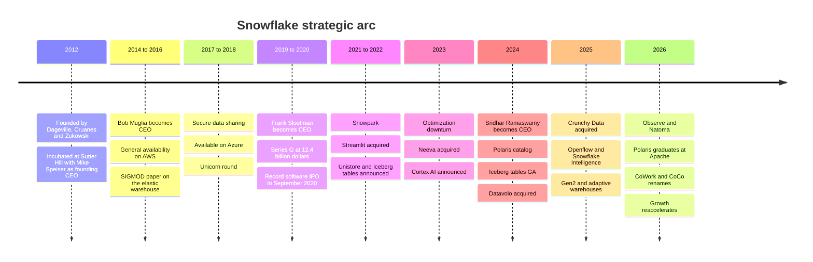
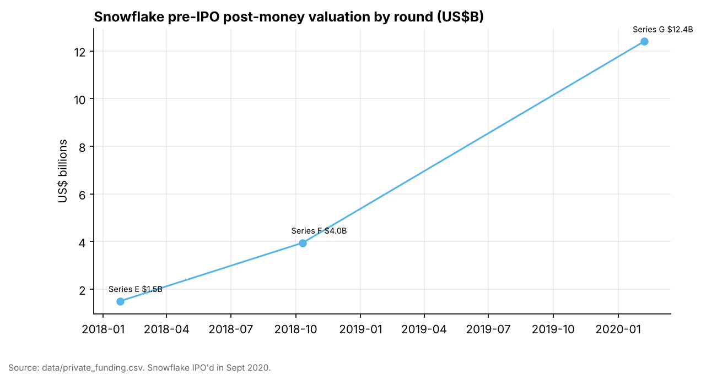
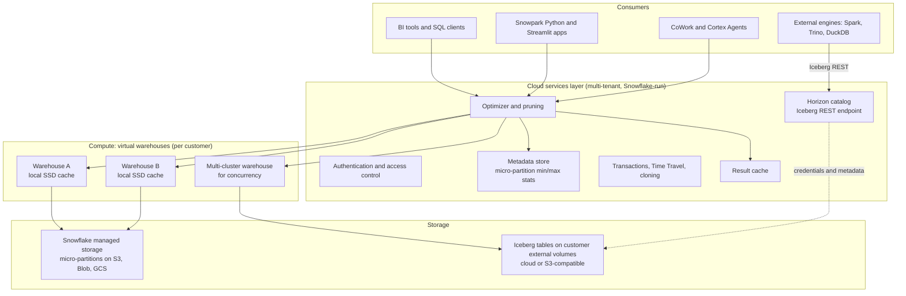
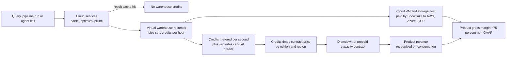
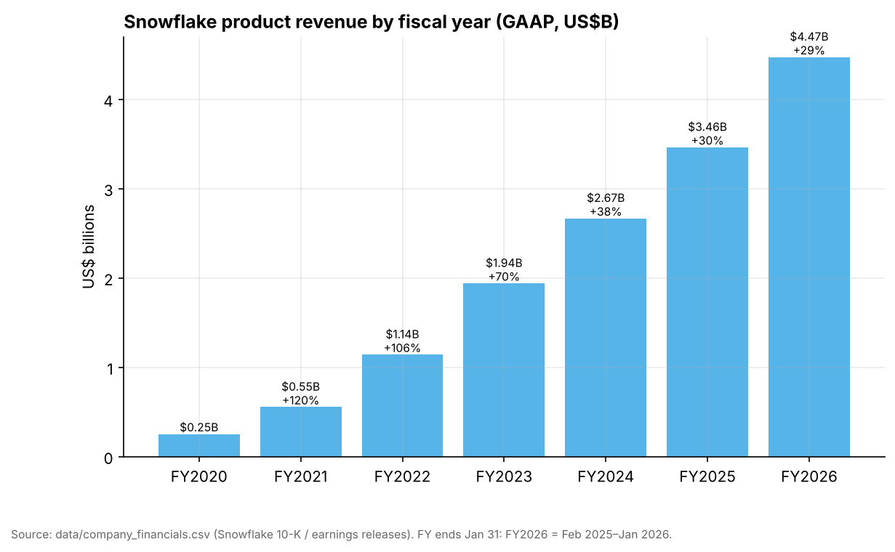
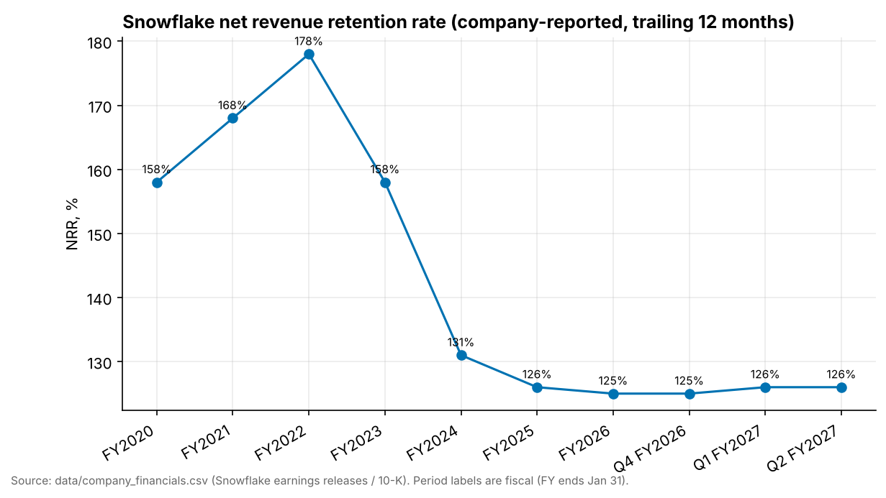
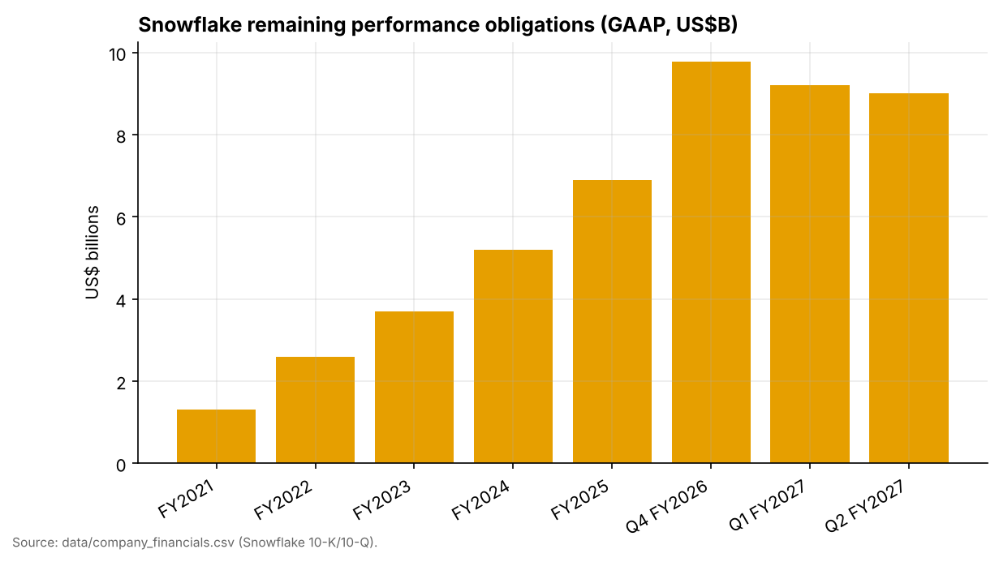
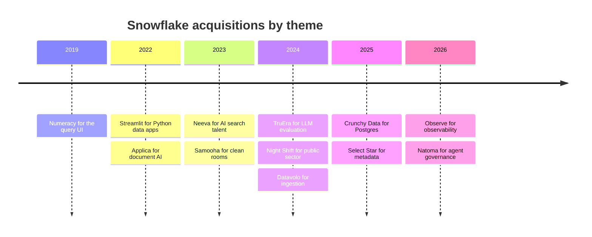

# 26. Snowflake
> **Status:** public (NYSE: SNOW) · **HQ:** no formal headquarters; principal executive office in Bozeman, MT (per SEC filings); main engineering hub in the San Francisco Bay Area · **Founded:** 2012 · **Latest valuation/market cap:** ~$107.9B market cap, ~$106.3B enterprise value, **16.9x EV/NTM revenue** (close 2026-10-30; NTM from FY2027 guidance) · **Last verified:** 2026-11-01

## TL;DR

- **What it is.** Snowflake sells a fully managed cloud data platform. It began as a SQL data warehouse that separated storage from compute on public-cloud object storage. It now pitches itself as the "AI Data Cloud": warehouse, data sharing and marketplace, Python and app runtime, Iceberg lakehouse, Postgres, ingestion, observability and AI agents, all billed through one consumption meter, the **credit**.
- **Scale and momentum.** Product revenue was **~$1.49B in Q2 FY2027** (May–Jul 2026), **up 37% YoY**. That is the third straight quarter of acceleration, from 29% for FY2026 (GAAP). Net revenue retention is **126%**, and **828 customers** spend more than $1M a year (company-stated). FY2027 product-revenue guidance has been raised twice, to **$6.07B (+36%)**.[^sf-q2][^sf-q1]
- **The profitability debate is about stock comp.** Non-GAAP operating margin was **15.3%** in Q2 FY2027, but GAAP operating margin was **−17.0%**. Stock-based compensation was **34% of revenue in FY2026**, which exceeds the year's ~$1.19B adjusted free cash flow.[^sf-q2][^sf-10k26]
- **The strategic pivot is from "own the storage" to "own the compute and the governance".** Snowflake's original moat was its proprietary managed storage. Iceberg tables, the Polaris catalog it donated to Apache, and Horizon's Iceberg REST endpoint now let customers keep data in open formats. Snowflake is betting that winning more workloads, AI above all, more than offsets the storage revenue and lock-in it gives up.[^polaris-tlp][^horizon-irc]
- **Everpure angle.** Snowflake compute runs only in the public cloud, but it can read and write data on **S3-compatible storage** outside AWS, Azure and GCP through external stages and Iceberg external volumes. That makes on-premises object storage a supported, if niche, data source. The more strategic overlap is metadata: Everpure's Data Intelligence (1touch) lists Snowflake as a connector target, and Snowflake's Horizon catalog wants to be the place classification tags live.[^sf-s3compat][^1touch]

## Snapshot table

| Item | Value | Basis / date |
|---|---|---|
| Founders | Benoît Dageville, Thierry Cruanes (both ex-Oracle), Marcin Żukowski (co-author of the MonetDB/X100 paper, co-founder of Vectorwise) | Public record[^snowflake16][^x100] |
| CEO | Sridhar Ramaswamy (since Feb 2024; previously led Snowflake AI after the Neeva deal; earlier ran Google's ads business) | Company-stated[^sf-ceo] |
| Prior CEOs | Mike Speiser (founding CEO, Sutter Hill, 2012–2014); Bob Muglia (2014–2019); Frank Slootman (2019–2024) | Public record[^sf-ceo] [VERIFY: exact handover dates] |
| CFO | Brian Robins succeeded long-time CFO Mike Scarpelli in 2025 | [VERIFY: appointment date and Scarpelli's advisory role, against 8-K] |
| Fiscal year | Ends Jan 31. FY2027 = Feb 2026–Jan 2027; Q2 FY2027 = May–Jul 2026 | Company filings[^sf-10k26] |
| Latest quarter | Product revenue ~$1.49B (+37%); total revenue $1,546.8M (+35%) | GAAP, Q2 FY2027[^sf-q2] |
| Last full year | Product revenue $4,472.3M (+29%); total revenue $4,683.9M | GAAP, FY2026[^sf-q4] |
| Guidance | FY2027 product revenue $6.07B (+36%); Q3 FY2027 $1,588–1,593M (+37–38%) | Company guidance, 2026-09-02[^sf-q2] |
| Net revenue retention | 126% (trailing 12 months) | Company-stated KPI, Q2 FY2027[^sf-q2] |
| Customers >$1M TTM product revenue | 828 (+27% YoY) | Company-stated KPI, Q2 FY2027[^sf-q2] |
| RPO | ~$9.0B (down from $9.77B at FY2026 year-end) | GAAP, Q2 FY2027[^sf-q2][^sf-q4] |
| Product gross margin | 74.7% non-GAAP; 70.9% GAAP; FY2027 non-GAAP guide 74% | Q2 FY2027[^sf-q2] |
| Operating margin | 15.3% non-GAAP; −17.0% GAAP | Q2 FY2027[^sf-q2] |
| Free cash flow | 25.5% adjusted FCF margin (~$1.19B) in FY2026; FY2027 guide 23% | Non-GAAP[^sf-q4][^comps-sf] |
| Stock-based compensation | $1,599.5M in FY2026 (34% of revenue) | GAAP, 10-K[^sf-10k26] |
| Employees | ~7,800 full-time at Jan 31, 2025 | 10-K FY2025 [VERIFY: FY2026 10-K headcount] |
| Pre-IPO funding | ~$1.4B across Series A–G; last private mark $12.4B (Feb 2020) | `data/private_funding.csv`[^funding] |
| Notable investors | Sutter Hill (founding), Redpoint, Altimeter, ICONIQ, Madrona, Dragoneer, Salesforce Ventures; Berkshire Hathaway and Salesforce bought shares alongside the IPO | `data/private_funding.csv`; IPO prospectus[^funding][^sf-ipo] |
| Market value | Market cap ~$107.9B; EV ~$106.3B; EV/NTM revenue 16.9x | Close 2026-10-30, stockanalysis.com via `data/public_comps.csv`[^comps-sf] |

*Figure 26.1 — Snapshot. Unlike Databricks, nearly every Snowflake figure is audited GAAP or a defined KPI. The open questions are about direction (open formats, AI margins, stock comp), not about what the numbers mean.*

## Origin story and strategic arc

**The founding insight (2012).** In 2012 two Oracle database architects, Benoît Dageville and Thierry Cruanes, teamed up with Marcin Żukowski. Żukowski had co-written the MonetDB/X100 paper that introduced vectorized execution and had co-founded Vectorwise.[^x100] Their bet was that a data warehouse built for the cloud should look nothing like Teradata or Oracle Exadata. Those systems tied data to the disks inside each node, the "shared-nothing" design. Snowflake would instead keep the durable copy of every table in cloud object storage (Amazon S3 first) and spin up compute clusters on demand to query it. The company was incubated at **Sutter Hill Ventures**, whose partner **Mike Speiser** served as founding CEO. Sutter Hill had used the same incubate-and-install-a-CEO model a few years earlier with Pure Storage, now Everpure [VERIFY: Speiser's founding role at Pure Storage].[^funding] Sutter Hill led the ~$5M Series A in August 2012.[^funding]

**Act 1: Build the elastic warehouse (2012–2018).** The product came out of stealth in 2014 under **Bob Muglia**, the former head of Microsoft's server and tools business, and reached general availability on AWS in 2015.[^snowflake16] The SIGMOD 2016 paper "The Snowflake Elastic Data Warehouse" set out the design described in the next section. It argued that the cloud's elasticity, not raw speed, was the point.[^snowflake16] Two features defined the early franchise. **Secure data sharing** (2017) let one Snowflake account query another's tables live, without copying files.[^sf-sharing-2017] Availability on **Microsoft Azure** (2018) and later **Google Cloud** made Snowflake the multi-cloud warehouse, a position no hyperscaler could credibly claim. Funding followed the traction: $263M at a $1.5B valuation in January 2018, $450M at ~$3.95B nine months later.[^funding]

**Act 2: The Slootman scale-up and the record IPO (2019–2021).** In 2019 the board replaced Muglia with **Frank Slootman**, who had run Data Domain (deduplication storage, sold to EMC) and ServiceNow. Slootman brought a sales-execution culture and, soon after, CFO Mike Scarpelli from ServiceNow.[^sf-ceo] A $479M Series G in February 2020 valued the company at $12.4B.[^funding] Snowflake listed on the NYSE in **September 2020**, pricing at **$120 per share**, above an already-raised range, and raising about **$3.4B**. It was the largest software IPO on record. Berkshire Hathaway and Salesforce each bought $250M of stock in concurrent private placements. The shares opened near $245 on day one.[^sf-ipo] Product revenue more than doubled in each of FY2021 and FY2022 (GAAP), and net revenue retention peaked at **178%** in FY2022.[^sf-10k-hist]

**Act 3: Become a platform (2020–2023).** A warehouse that only runs SQL caps its share of the data budget. Snowflake therefore added **Snowpark** (2020; Python support later) so data engineers could run DataFrame code inside Snowflake, then bought **Streamlit** ($800M, March 2022) for Python data apps, then launched the **Native App Framework** so third parties could sell applications that run inside a customer's account. **Unistore / Hybrid Tables** (announced 2022) added a row store for light transactional work.[^streamlit] The 2022–2023 "optimization" downturn tested the model. Customers cut consumption during the rate shock, and annual product-revenue growth fell from 106% (FY2022) to 38% (FY2024). NRR fell from 178% to 131%.[^sf-10k-hist]

**Act 4: The AI Data Cloud and open formats (2023–2026).** In May 2023 Snowflake bought **Neeva**, an AI search start-up, for $185.4M in cash. In February 2024 Neeva's founder, **Sridhar Ramaswamy**, replaced Slootman as CEO.[^neeva][^sf-ceo] The CEO change signalled that AI would be the next growth engine. Under Ramaswamy, Snowflake shipped **Cortex AI** (LLM functions, search and agents inside the platform), made **Iceberg tables** generally available and launched the **Polaris** catalog (June 2024). It then bought its way into adjacent workloads: **Datavolo** (ingestion, 2024), **Crunchy Data** (Postgres, 2025), **Select Star** (metadata, 2025), **Observe** (observability, 2026) and **Natoma** (agent governance, 2026).[^sf-polaris][^datavolo][^crunchy][^sf-observe][^natoma] At Summit on 2026-06-02, Snowflake renamed its agent product **Snowflake Intelligence** as **Snowflake CoWork** and its coding agent **Cortex Code** as **CoCo**.[^sf-cowork] Growth has re-accelerated for three quarters, to 37% in Q2 FY2027.[^sf-q2]

*Figure 26.2 — Each act widened the meter. Snowflake moved from SQL analytics to sharing, Python and apps, then AI, Postgres, ingestion and observability, all billed in the same credits.*

*Figure 26.3 — Private marks roughly tripled in each of the last two rounds before the September 2020 IPO. The IPO priced the company at more than twice the Series G mark, and the first trade was about double the IPO price. Source: `data/private_funding.csv`.*

> **Bridge: valuation.** The IPO is a lesson in entry price. An investor who bought at the $120 offer price and held to $306 (2026-10-30) has earned about 2.6x, roughly 17% a year (author arithmetic). An investor who bought at the ~$245 first-day open has earned about 1.25x in six years, roughly 4% a year. The business compounded product revenue about 8x between FY2021 and FY2026. The stock went sideways because the IPO-day multiple already discounted most of that growth.[^sf-ipo][^comps-sf][^sf-10k-hist]

## Product and technology

### The architecture in one picture (SV-5)

The SIGMOD 2016 paper describes three layers, and the design still holds a decade later.[^snowflake16]

1. **Storage.** All table data lives in the cloud provider's object store (S3, Azure Blob, Google Cloud Storage) in Snowflake's proprietary columnar format. Tables are split into immutable **[micro-partitions](../glossary.md#micro-partition)**, each holding 50–500 MB of uncompressed data, stored column by column and compressed. For every micro-partition, Snowflake records the minimum and maximum value of each column, the count of distinct values and other statistics.[^sf-mp]
2. **Compute.** A **[virtual warehouse](../glossary.md#virtual-warehouse)** is a cluster of cloud virtual machines that Snowflake provisions for one customer. It sizes in "T-shirt" steps, each step doubling the nodes and the credits burned per hour. Warehouses are stateless with respect to durable data. They cache table files on local SSD, they can be suspended in seconds when idle, and a warehouse can be "multi-cluster" (adding identical clusters as concurrency rises). Each team can have its own warehouse on the same data, so the finance team's month-end close no longer slows down the data-science team.
3. **Cloud services.** A shared, multi-tenant layer that Snowflake runs once per region. It handles authentication and access control, the query optimizer, transaction management and, above all, the **metadata**. The SIGMOD paper describes this metadata store as built on FoundationDB, a transactional key-value store. Because the services layer knows every micro-partition's statistics, it can plan a query and decide which files to read before a warehouse touches storage.[^snowflake16]

*Figure 26.4 — Snowflake's storage/compute separation. The services layer holds the metadata and does the planning, warehouses do the scanning on demand, and data sits either in Snowflake-managed object storage or, since 2024, in open Iceberg tables on the customer's own volumes.*

### How a query actually runs (L2)

Take an analyst who asks for July 2026 sales by region. The query reaches the cloud services layer, which parses and optimizes it. First it checks the **result cache**: if an identical query ran recently and the underlying data has not changed, Snowflake returns the stored result without starting a warehouse. Persisted results are kept for 24 hours, and the clock resets each time a result is reused.[^sf-cache] Otherwise the optimizer consults the micro-partition metadata. Any micro-partition whose date range does not overlap July 2026 is **pruned**, meaning it is never read. On a well-clustered table, a selective filter can skip the vast majority of files. The surviving file list goes to a warehouse. Each node is assigned files by consistent hashing, so the same node tends to see the same files and its **local SSD cache** stays warm. Idle nodes "steal" files from slow ones to even out the load.[^snowflake16] The engine itself is columnar and vectorized, Żukowski's X100 lineage, which is covered in [Ch 5](../01-data-systems-foundations/ch05-analytical-engines.md).

> **Bridge: semiconductors (cache tags and zone maps).** Micro-partition pruning is a CPU cache's **tag check** applied to a data lake. A processor never fetches a cache line from DRAM without first comparing the address against a small, fast tag array. Snowflake never fetches a micro-partition from S3 without first comparing the query's predicate against the min/max metadata held in the services layer. The memory hierarchy maps cleanly: the metadata store is the tag array, the warehouse's local SSD is the L2/L3 cache, and S3 is DRAM backed by NAND, cheap and vast but with high latency. As in chip design, most of the performance comes from the hit rate and from not fetching, not from a faster backing store. The general technique, called **[zone maps](../glossary.md#zone-map)**, is covered in [Ch 5](../01-data-systems-foundations/ch05-analytical-engines.md).

### Features that fall out of immutability

Because micro-partitions are never modified in place, a table version is simply a list of micro-partition pointers in the metadata store. Three signature features follow almost for free.

- **[Time Travel](../glossary.md#time-travel).** Old micro-partitions are kept for a retention window: one day by default, up to 90 days on Enterprise edition and above. A user can query a table "as of" an earlier timestamp or restore a dropped table. A further seven-day **Fail-safe** period lets Snowflake support recover data after Time Travel expires.[^sf-tt]
- **[Zero-copy cloning](../glossary.md#zero-copy-cloning).** `CREATE TABLE dev CLONE prod` copies only the pointer list. The clone shares the original's micro-partitions until either side writes, at which point new micro-partitions are created (copy-on-write). A 100 TB production database can be cloned for testing in seconds at no extra storage cost until the clone diverges.[^sf-tt]
- **[Secure data sharing](../glossary.md#zero-copy-data-sharing).** A provider grants another account read access to specific objects. The consumer queries them with its own warehouse and pays for its own compute, and no files are copied within a region. Cross-region and cross-cloud sharing requires replication, which Snowflake automates for Marketplace listings.[^sf-sharing] This turned into the **Snowflake Marketplace**, where data providers (weather, financial and consumer data) sell live datasets, and into **data clean rooms** (the Samooha acquisition).[^samooha]

> **Storage bridge.** Snowflake's managed storage is itself a log-structured, copy-on-write design on object storage, close to the snapshot and clone mechanisms storage engineers know from arrays. The difference is that the "array controller" is a multi-tenant metadata service and the "media" is S3. See the companion *Everpure Tech Atlas* for how array snapshots and object storage differ in durability and performance.

### From warehouse to "AI Data Cloud": what was added and why

| Layer | Product (status as of Nov 2026) | What it does | Strategic purpose |
|---|---|---|---|
| Programmability | **Snowpark** (Python, Java, Scala); **Streamlit in Snowflake**; **Native App Framework** | Runs DataFrame code, ML and apps inside Snowflake's governance boundary | Capture data-engineering and app workloads that used to run on Spark |
| Transactional | **Hybrid Tables** (Unistore); **Snowflake Postgres** (from Crunchy Data; GA at Summit 2026) with Postgres-to-Snowflake mirroring | Row-store and full Postgres for operational data | Answer Databricks Lakebase; own the system of record for agent-built apps[^sf-summit26][^sf-pg-mirror] |
| Open formats | **Iceberg tables** (managed or externally catalogued; Iceberg v3 GA May 2026); **Horizon Catalog** with an Iceberg REST endpoint; **Apache Polaris** (donated; Apache top-level project 2026) | Lets Snowflake and other engines read and write the same open tables | Neutralise the lakehouse "lock-in" objection[^iceberg-v3][^horizon-irc][^polaris-tlp] |
| Ingestion | **Openflow** (from Datavolo, Apache NiFi-based; GA 2025, second-generation runtimes GA Sep 2026); Snowpipe Streaming | Batch, streaming and unstructured ingestion, including bring-your-own-VPC | Stop paying a toll to Fivetran-style tools on every byte that arrives[^openflow-ga][^datavolo] |
| AI | **Cortex AI** functions and **AISQL** (LLM calls inside SQL); Cortex Search; **Cortex Agents**; **Snowflake CoWork** (ex-Snowflake Intelligence); **CoCo** (ex-Cortex Code) | Runs hosted LLMs next to governed data; agents answer business questions | Make AI spend flow through credits rather than around Snowflake[^sf-cowork][^sf-summit25] |
| Semantics | **Semantic views** (DDL objects); **Open Semantic Interchange (OSI)** spec, co-founded with Salesforce, dbt Labs and others | Encodes metric definitions that agents and BI tools reuse | Make Snowflake the place where business meaning lives ([Ch 14](../02-pipelines-and-governance/ch14-semantic-layers-and-bi.md))[^sf-sv][^osi-launch][^osi-v1] |
| Compute | **Gen2 warehouses** (vendor-claimed ~2.1x faster on core analytics); **Adaptive warehouses** (automatic sizing per query, preview 2025) | Faster hardware and automatic right-sizing | Better price-performance against Databricks SQL and BigQuery, at the cost of near-term revenue[^sf-summit25] |
| Observability | **Observe** (closed Feb 2026) | Logs, metrics and traces stored on Snowflake | Telemetry is just more data, and a very large volume of it[^sf-observe] |

*Figure 26.5 — Product map. Each addition pulls a workload that used to run elsewhere onto the credit meter. Status per Snowflake documentation and Summit recaps; GA claims from secondary recaps are noted in the sources.*

**The open-format pivot, explained.** Until 2022 the bargain was simple. Load data into Snowflake's storage, and Snowflake makes it fast, governed and shareable. The lakehouse argument from Databricks ([Ch 25](ch25-databricks.md)) attacked exactly that bargain: why put your data in one vendor's format? Snowflake's answer came in three steps. First, **Iceberg tables**, where data is written as Parquet plus Iceberg metadata to an "external volume" in the customer's own bucket. Second, the **Polaris** catalog, announced in June 2024 and donated to Apache, where it graduated to a top-level project in early 2026 (ASF announcement 2026-03-05). Third, **Horizon** exposing an Iceberg REST endpoint so outside engines can read Snowflake-governed tables, with request billing of 0.5 credits per million calls planned for 2026.[^sf-polaris][^polaris-tlp][^horizon-irc] [Ch 7](../01-data-systems-foundations/ch07-open-table-formats.md) and [Ch 8](../01-data-systems-foundations/ch08-catalogs-and-metastores.md) explain the formats and catalogs.

The revenue logic is a trade. Storage on Snowflake was always a low-margin pass-through (see below), so losing it costs little gross profit. What is really at stake is **lock-in**. Data stored in Snowflake's format can only be queried by Snowflake's compute, while data stored in Iceberg can be queried by anyone's. Snowflake is wagering that it wins more compute by saying "yes" to open data than it loses to engines that can now read the same tables. The early evidence (re-accelerating product revenue, stable 126% NRR) supports the wager. It is not proof, because AI workloads arrived at the same time and muddy the attribution.[^sf-q2]

> **Going deeper (L3).** For a Snowflake-managed Iceberg table, Snowflake acts as the catalog. It writes Parquet data files and Iceberg metadata (metadata JSON, manifest lists, manifests) to the external volume and commits by updating its own pointer. Outside engines read through the Horizon Iceberg REST endpoint, which vends scoped storage credentials. For an externally managed table (for example one catalogued in Polaris or AWS Glue), Snowflake is a reader that refreshes its view of the metadata. Writes from both sides require a single catalog of record, which is why catalog choice, not file format, is the real design decision ([Ch 8](../01-data-systems-foundations/ch08-catalogs-and-metastores.md)).[^horizon-irc]

## How it makes money

### Credits, storage and transfer

Snowflake bills three things.[^sf-cost]

1. **Compute, in credits.** A warehouse burns credits per hour by size: X-Small 1, Small 2, Medium 4, Large 8, doubling at each step up to 6X-Large at 512. Billing is per second with a 60-second minimum each time a warehouse resumes. Serverless features (Snowpipe ingestion, automatic clustering, search optimization, materialized-view maintenance, Openflow, Cortex AI functions) also bill in credits at feature-specific rates. Cortex AI functions are priced per million tokens and converted into credits. The cloud services layer is free up to 10% of the day's warehouse credits and billed beyond that.
2. **Storage, per terabyte per month,** at a flat rate close to the cloud provider's own object-storage price, with a discount for pre-purchased capacity. Snowflake makes little on storage. It is the bait that keeps data next to the compute meter.
3. **Data transfer,** per byte, when data leaves a region or cloud (replication, cross-region sharing, unloading to another cloud).

The **price per credit** depends on **edition** (Standard, Enterprise, Business Critical, Virtual Private Snowflake), cloud and region. US list prices on demand have long been about $2, $3 and $4 per credit for the first three editions [VERIFY: current list prices by region].[^sf-cost] Higher editions buy features rather than speed: longer Time Travel, multi-cluster warehouses, column masking and row access policies, customer-managed keys, private connectivity. That makes the edition ladder a governance and compliance upsell.

| Warehouse size | Credits per hour | Illustrative cost per hour at $3/credit (Enterprise, list) | Typical use |
|---|---|---|---|
| X-Small | 1 | $3 | Development, light dashboards |
| Medium | 4 | $12 | Departmental BI |
| Large | 8 | $24 | Heavy transformation (ELT) jobs |
| 2X-Large | 32 | $96 | Large joins, backfills |
| 6X-Large | 512 | $1,536 | Rare; very large batch |

*Figure 26.6 — The credit ladder (list-price illustration, author arithmetic; negotiated prices are lower). Each size doubles nodes and credits, so a well-parallelised query that finishes twice as fast on the next size costs the same. The customer buys time, not capacity.*

### How a query becomes revenue

*Figure 26.7 — Revenue is recognised when credits are consumed, not when contracts are signed. Every query that hits the result cache or prunes well is revenue Snowflake chose not to earn, which is why efficiency is both a selling point and a headwind.*

**Contracts and recognition.** Most large customers sign **capacity contracts**: a commitment to buy a dollar amount of credits over one to several years, often invoiced annually in advance. Others pay on demand in arrears. Snowflake recognises product revenue only as credits are consumed, not as cash arrives. Under some contracts, unused capacity can **roll over** into a renewal if the customer buys more.[^sf-10k26] Signed but unconsumed commitments sit in **[remaining performance obligations (RPO)](../glossary.md#remaining-performance-obligations)**. So RPO measures commitment and product revenue measures usage, and the gap between them reveals customer behaviour.

> **Bridge: finance (prepaid utility and royalty).** A capacity contract works like a **take-or-pay utility tariff** with banked kilowatt-hours. The customer prepays for a block of energy at a negotiated rate, the utility books revenue only as the meter turns, and unused energy can be carried forward if the customer renews at a larger size. For an analyst, product revenue behaves like a **usage royalty** on the customer's own analytics activity. It is more volatile than seat-based SaaS on the way down (2022–2023) and steeper on the way up, because there is no seat count to cap it. Model it like a utility: installed base × usage intensity × price, not new bookings.

### Gross margin and the cloud bill

Snowflake runs every warehouse in its own accounts at AWS, Azure and Google. Cloud infrastructure is therefore its largest cost of revenue, and it negotiates multi-year committed-spend agreements with each provider [VERIFY: current cloud purchase commitments in 10-K notes].[^sf-10k26] Non-GAAP product gross margin was **74.7%** in Q2 FY2027, down from 76.4% a year earlier. GAAP product gross margin was 70.9%. Management guided FY2027 to **74%**, lower than earlier in the year, citing the mix shift toward AI workloads. Those workloads carry higher GPU and third-party model costs.[^sf-q2] The margin drivers are scale discounts from the clouds, warehouse utilisation (idle time is a customer cost, but the services layer is Snowflake's), engine efficiency, and the AI mix.

### The efficiency headwind

Snowflake repeatedly ships improvements that make customers' existing queries cheaper. Faster engines, better pruning, compression gains and newer cloud instances all cut the credits each query burns. **Gen2 warehouses** (2025) are the latest example, with a vendor claim of roughly 2.1x faster core analytics.[^sf-summit25] In the short run every such gain reduces revenue from an unchanged workload. Snowflake has said as much in the past, quantifying expected revenue headwinds from performance improvements in FY2023 guidance [VERIFY: the ~$97M FY2023 figure management cited in March 2022]. During the **2022–2023 optimization cycle**, customers went further on their own. They shortened data retention, set aggressive auto-suspend, right-sized warehouses and moved some transformations elsewhere. Combined with the macro slowdown, annual product-revenue growth fell from 106% to 38% in two years.[^sf-10k-hist]

> **Bridge: Moore's law and price elasticity.** DRAM and NAND cost per bit has fallen for decades, yet memory revenue has grown, because cheaper bits unlock new uses: demand is price-elastic. Snowflake's efficiency gains are the same bet. If a query costs half as much, do customers run more than twice as many queries, keep more history, and point AI agents at the data? Elasticity above 1 means efficiency grows revenue with a lag; below 1, it shrinks it. The 2022–2023 period showed the lag. The 2025–2026 re-acceleration, as AI agents and new workloads arrived, is the first strong evidence that elasticity is above 1 at Snowflake's current price points. Agents that issue many machine-generated queries are the highest-elasticity customer imaginable.

## Financials

All figures are GAAP unless labelled non-GAAP or company-stated KPI. Snowflake reports **product revenue** (consumption, about 96% of total in Q2 FY2027) separately from **professional services and other revenue**. Product revenue is the line investors model.[^sf-q2]

*Figure 26.8 — Product revenue grew about 18x from FY2020 to FY2026 (GAAP). Growth decelerated from triple digits to ~30% by FY2025, then held there. FY ends Jan 31; FY2026 = Feb 2025–Jan 2026. Source: `data/company_financials.csv`.*

**The re-acceleration.** Quarterly product-revenue growth went from ~30% (Q4 FY2026, Nov 2025–Jan 2026) to 34% (Q1 FY2027) and **37%** (Q2 FY2027). Guidance for Q3 calls for 37–38%.[^sf-q4][^sf-q1][^sf-q2] FY2027 product-revenue guidance has moved from $5.66B (February) to $5.84B (May) to **$6.07B** (September), +36%. The guide implies H2 product revenue of about $3.25B, so Q4 FY2027 lands near $1.66B after the Q3 midpoint of $1.59B. That would be ~35% growth on Q4 FY2026's ~$1.23B, a deceleration that looks conservative given the trend (author arithmetic).[^sf-q2][^sf-q4] Snowflake's guidance has historically been built from consumption trends observed in the quarter, so it tends to be beaten when consumption is accelerating.

*Figure 26.9 — Net revenue retention peaked at 178% (FY2022), fell sharply during the 2022–2023 optimization cycle and has been stable at 125–126% for two years. NRR is a company-stated trailing-12-month KPI. Source: `data/company_financials.csv`.*

**Reading NRR as cohort analysis.** Snowflake defines NRR as trailing-12-month product revenue from customers who were customers a year earlier, divided by those same customers' product revenue in the prior 12 months. It is a dollar-based cohort ratio, and because it is trailing it moves slowly. Stable 126% NRR alongside accelerating growth means one of two things, or both. New customers contribute more (new-logo revenue) and/or the most recent quarters of expansion have not yet worked through the trailing window. The chart below compares product-revenue growth with NRR minus 100. In FY2021–FY2022, new customers added roughly 30–50 points on top of expansion. From FY2024 to Q4 FY2026 the gap narrowed to 4–7 points. In Q2 FY2027 it widened again to about 11 points, the clearest sign that new workloads and new logos are driving the acceleration (author arithmetic).[^sf-q2]

*Figure 26.10 — Growth tracks retention. Since FY2024, existing-customer expansion (NRR − 100) has explained most of Snowflake's growth, and the 2026 acceleration has opened a wider gap above it, consistent with new workloads and new logos. Source: `data/company_financials.csv` (author chart).*

*Figure 26.11 — RPO grew about 7.5x from FY2021 to FY2026 and then eased for two quarters while consumption accelerated. Customers are burning down large commitments faster than they are signing new ones, which is bullish for near-term revenue and a renewal-cycle question for later. Note that the "FY2026" and "Q4 FY2026" bars are the same data point. Source: `data/company_financials.csv`.*

**RPO and cRPO.** The FY2026 year-end RPO of $9.77B included what management described as the largest contract in company history, so the sequential declines to $9.21B (Q1) and ~$9.0B (Q2) partly reflect a tough comparison.[^sf-q1][^sf-q2] At ~$9.0B, RPO covers about 1.4 years of NTM revenue ($6.3B, author arithmetic). Snowflake also discloses the share of RPO it expects to recognise within 12 months, the current RPO or cRPO, which is the cleaner leading indicator [VERIFY: Q2 FY2027 cRPO share or amount]. The pattern to watch is whether large customers renew early and larger when they exhaust commitments. That happened in FY2021–FY2022, and its absence in FY2023–FY2024 was the first sign of optimization.

**GAAP vs. non-GAAP.** Snowflake is solidly profitable on a non-GAAP basis and still loss-making on GAAP. The difference is almost entirely **stock-based compensation (SBC)**, plus amortisation of acquired intangibles and employer payroll taxes on equity awards.

*Figure 26.12 — The GAAP-to-non-GAAP operating-margin gap was about 41 points in FY2026 and 32 points in Q2 FY2027, and stock comp is most of it. SBC is falling as a share of revenue (40.8% → 34.1%) because revenue grows faster than SBC (+29% vs. +8%), but it still exceeds annual free cash flow. Source: `data/company_financials.csv` (author chart).*

The numbers that matter:

- **SBC:** $1,479.3M in FY2025 (40.8% of revenue) and $1,599.5M in FY2026 (34.1%).[^sf-10k26]
- **Free cash flow:** non-GAAP adjusted FCF of ~$1,192.7M in FY2026 (25.5% margin). Cash flow is seasonal because annual invoices are collected in Q4 (61% FCF margin) and Q1, while Q2 FY2027 was only 6.0% ($92.3M). The FY2027 guide is 23%.[^sf-q4][^sf-q2][^comps-sf]
- **FCF minus SBC:** about **−$0.4B** in FY2026 ($1,192.7M − $1,599.5M, author arithmetic). On an owner-earnings basis that treats SBC as a real cost, Snowflake has not yet generated positive cash for shareholders.
- **Dilution and buybacks:** Snowflake has repurchased stock under multi-billion-dollar authorisations since 2023, largely to offset SBC dilution, and issued ~$2.3B of convertible notes in 2024 [VERIFY: authorisation sizes, FY2026 repurchase amount, convertible terms against the 10-K]. Buybacks that only offset dilution are better read as a cash cost of compensation than as a return of capital.

> **Bridge: valuation.** At **16.9x EV/NTM revenue** (EV $106.31B ÷ $6.30B, 2026-10-30, NTM proxied by FY2027 guidance), Snowflake costs ~0.48x per point of growth (16.9 ÷ 35). Databricks' private mark costs ~0.34x on its own stated basis ([Ch 25](ch25-databricks.md)), but that figure is post-money *equity* value over an unaudited, company-defined *run-rate*, whereas Snowflake's is *enterprise value* over guidance-derived GAAP revenue, so the comparison is indicative, not like-for-like. The NTM denominator here is the FY2027 guide (Feb 2026–Jan 2027), a proxy that understates true forward revenue and so slightly overstates the multiple. On FCF, the FY2027 guide (23% of ~$6.3B ≈ $1.45B) puts EV/FCF near **73x**, or infinite on an SBC-adjusted basis (author estimates).[^comps-sf][^sf-q2] The bull case therefore depends on margin expansion as SBC intensity falls. Every 5 points of revenue that SBC gives back is worth about $0.3B a year at FY2027 scale.

## Customers and go-to-market

**Who buys.** Snowflake's customers are concentrated in large enterprises. **828** spent more than $1M in trailing-12-month product revenue at Q2 FY2027 (+27% YoY), up from 77 at FY2021 year-end (company-stated KPI).[^sf-q2][^sf-10k-hist] The company also reports the number of Forbes Global 2000 companies among its customers each quarter, and has said these customers account for a large share of revenue [VERIFY: Q2 FY2027 Forbes Global 2000 count and total customer count]. The home buyer has historically been the **SQL analytics and finance/BI** organisation, the mirror image of Databricks' data-engineering and data-science base. Each company spent the 2020s invading the other's buyer ([Ch 27](ch27-databricks-vs-snowflake.md)).

**Consumption-aligned selling.** Because revenue is recognised on consumption, the sales force's job does not end at signature. Snowflake shifted sales compensation toward consumption, paying reps on usage rather than bookings alone, and built a large solutions-engineering function to "land workloads" (migrate a data mart, stand up a pipeline, launch an agent) [VERIFY: timing and structure of the compensation change]. The trade-off is that bookings-based upside (multi-year mega-deals) matters less to reps, so RPO can lag revenue, as it did in 2026.

**Hyperscaler channel.** Snowflake is listed on the AWS, Azure and Google Cloud marketplaces. Purchases through a marketplace count against a customer's committed cloud spend, which removes a budget objection. AWS is the dominant underlying cloud for Snowflake revenue [VERIFY: share of revenue by cloud from 10-K]. The hyperscalers are therefore Snowflake's suppliers (cloud COGS), channel (marketplace), and competitors (BigQuery, Redshift, Fabric) all at once ([Ch 28](ch28-hyperscaler-data-platforms.md), [Ch 40](../05-business-and-economics/ch40-gtm-partnerships.md)).

**Partner ecosystem.** System integrators (the large global SIs plus Snowflake-specialist boutiques) run migrations from Teradata, Oracle and Hadoop. Modern-data-stack vendors (Fivetran, dbt Labs, Sigma, Hex, Coalesce) grew up on Snowflake. **Snowflake Ventures** invests in many of them, for example in Coalesce's Series B (2024) and Hex's Series C (2025).[^coalesce][^hex] The Marketplace and Native Apps let ISVs sell inside a customer's Snowflake account, so the platform also takes a share of partners' revenue. Openflow, Snowflake Postgres and dbt Projects on Snowflake show Snowflake now absorbs some functions its partners used to sell.[^openflow-ga][^dbt-sf]

**Events and TAM.** The annual Summit (June, San Francisco) doubles as the product launch and the Investor Day. At Investor Day 2026 management reportedly sized its addressable market at ~$225B today, growing to more than $460B (company-stated, from a weak transcript summary) [VERIFY: figures on Snowflake IR deck].[^tam]

## M&A and investments

Snowflake's M&A has been smaller and more talent- and feature-driven than Databricks'. It has bought one large brand (Streamlit) and a string of tuck-ins that each add a meter to the platform. Note the **reported-vs-filed gap** on two recent deals. The 10-Q and 10-K figures are the purchase-accounting consideration and are lower than press reports.

| Date | Target | Value | Rationale | Integration outcome |
|---|---|---|---|---|
| Mar 2019 | Numeracy | n/d | SQL query UI | Basis of the Snowsight interface[^numeracy] |
| Mar 2022 | Streamlit | $800M (disclosed; mostly stock) | Open-source Python data-app framework | Streamlit in Snowflake; still open source[^streamlit] |
| Aug 2022 | Applica | n/d | Document-understanding AI team | Underpins Document AI[^applica] |
| May 2023 | Neeva | $185.4M cash (10-Q) | AI search talent | Founder Ramaswamy became CEO in Feb 2024[^neeva] |
| Dec 2023 | Samooha | n/d | Cross-cloud data clean rooms | Snowflake Data Clean Rooms[^samooha] |
| May 2024 | TruEra | n/d | LLM/ML evaluation and observability (TruLens) | Cortex AI observability [VERIFY: deal date][^truera] |
| Sep 2024 | Night Shift Development | n/d | US public-sector analytics | Dedicated public-sector unit[^nightshift] |
| Nov 2024 | Datavolo | n/d | Apache NiFi-based multimodal ingestion | Became Openflow[^datavolo] |
| Jun 2025 | Crunchy Data | $164.5M (10-Q) vs ~$250M press-reported (WSJ) | Enterprise Postgres | Snowflake Postgres, GA 2026[^crunchy][^crunchy-tc] |
| Nov 2025 | Select Star | n/d | Metadata discovery and lineage | Folded into Horizon[^selectstar] |
| Jan 2026 | Observe | $596.2M preliminary consideration (10-K) vs ~$1B press-reported | Observability on Snowflake storage; Snowflake held a prior stake | Closed 2026-02-02; Observe CEO Jeremy Burton left Snowflake's board[^sf-observe] |
| May 2026 | Natoma Labs | ~$110M stated consideration, mostly stock (10-Q) | Enterprise MCP gateway for agent tool access | Announced; close not confirmed [VERIFY][^natoma] |

*Figure 26.13 — Deal table. Snowflake's pattern is to buy a capability and re-meter it in credits. Filed purchase considerations (10-Q/10-K) are the GAAP numbers; press figures are often higher because they include retention, earn-outs or headline enterprise values.*

*Figure 26.14 — The deal sequence moved from user experience (2019–2022) to AI talent and collaboration (2023) to new data workloads (2024–2026). Each deal answers a Databricks move almost one for one.*

**What worked.** **Neeva** is the most consequential deal in the company's history for its talent rather than its technology. It delivered the current CEO and the AI agenda. **Streamlit** gave Snowflake a credible developer surface and remains a widely used open-source project. **Datavolo → Openflow** went from acquisition to a GA product within about six months, a fast integration.[^datavolo][^openflow-ga] **Crunchy Data** produced Snowflake Postgres GA within a year, plus a mirroring pipeline into analytical tables.[^sf-pg-mirror] **Observe** is the largest recent bet. It turns telemetry, the fastest-growing data type, into Snowflake storage and compute, but it pits Snowflake against Datadog, Splunk/Cisco and ClickHouse in a market with entrenched buyers. Too early to judge.

**Investments.** Snowflake Ventures holds minority stakes across its ecosystem (the Atlas funding dataset records Coalesce and Hex rounds).[^coalesce][^hex] Most large investments go into companies whose products drive Snowflake consumption.

## Competitive position

Snowflake competes on four fronts. **Databricks** is the head-to-head rival for the enterprise analytics and AI platform budget ([Ch 25](ch25-databricks.md), [Ch 27](ch27-databricks-vs-snowflake.md)). The **hyperscalers** (BigQuery, Redshift, Microsoft Fabric) bundle substitutes into the cloud bill. **Specialist engines** such as ClickHouse win real-time and observability workloads on price-performance. **Open engines** (Trino, DuckDB, Spark) gain leverage whenever data sits in Iceberg.

| Dimension | Snowflake | Databricks | Google BigQuery | AWS Redshift | Microsoft Fabric | ClickHouse |
|---|---|---|---|---|---|---|
| Home buyer | SQL analysts, finance, BI | Data engineering, ML | GCP-native analytics teams | AWS-centric builders | Microsoft 365 / Power BI estate | Real-time and observability engineers |
| Storage model | Managed proprietary format; Iceberg tables GA | Delta + UniForm in customer storage | Managed storage; BigLake Iceberg | Managed storage (RA3); S3 Tables for Iceberg | OneLake (Delta-based) | MergeTree; object-storage tiering |
| Catalog / control point | Horizon; Apache Polaris (donated) | Unity Catalog (OSS) | Knowledge Catalog (ex-Dataplex) | Glue / SageMaker Catalog | OneLake catalog; Purview | Minimal |
| Pricing unit | Credits (consumption) | DBUs by SKU | Slots or bytes scanned | Node-hours or serverless RPU | Capacity units (reserved) | Cloud consumption; open source |
| Multi-cloud | AWS, Azure, GCP | AWS, Azure, GCP | GCP (cross-cloud via Omni) | AWS only | Azure only | All three (cloud service) |
| Operational DB | Snowflake Postgres; Hybrid Tables | Lakebase (Neon) | AlloyDB, Spanner | Aurora, DSQL | Fabric SQL DB | n/a |
| Agent / AI story | CoWork, Cortex Agents, CoCo | Agent Bricks, Genie One | Gemini, data agents | Bedrock, SageMaker | Copilot, Fabric IQ | MCP, Langfuse |
| Latest scale marker | $1.55B Q2 FY2027 revenue, +35% (GAAP) | >$7B run-rate, >80% (company-stated) | Not broken out | Not broken out | Not broken out | $15B valuation (Jan 2026, press-reported) |
| *Comparability note* | *Quarterly GAAP total revenue (×4 ≈ $6.2B)* | *Annualised run-rate, company-defined, unaudited; not comparable to GAAP revenue* | | | | *Private valuation, not revenue* |

*Figure 26.15 — Competitive matrix. Snowflake's distinctive assets are multi-cloud neutrality, the sharing network and ease of operation. Its distinctive gap is that it does not live in the customer's own storage by default. Sources: Snowflake and Databricks releases; hyperscaler event summaries; Bloomberg on ClickHouse.[^sf-q2][^db-7b][^next26][^reinvent][^ignite][^clickhouse]*

**Versus Databricks.** The fight has converged. Each now offers a warehouse, an open table format with a governing catalog, Postgres, ingestion, agents and a semantic layer. Snowflake's edge is operational simplicity (no clusters to tune), a large SQL-analyst installed base, the sharing network, and audited profitability. Databricks' edge is growth (more than double Snowflake's on its stated basis), the data-engineering and ML franchise, and a "your bucket, open formats" story that Snowflake adopted later. The large-account bases are now similar: 828 Snowflake customers above $1M trailing-12-month product revenue (Jul 2026) against Databricks' ">800" above a $1M annualised run-rate (Jan 2026). The definitions differ, and a run-rate threshold is easier to clear for fast-growing accounts, so the Databricks count is flattered relative to Snowflake's.[^sf-q2][^db-54] Many large enterprises run both, and the real competition is over **which platform the next workload lands on**.

**Versus the hyperscalers.** BigQuery is Snowflake's most direct architectural peer (serverless, separated storage and compute) and is bundled into Google Cloud commitments. Redshift competes mainly inside AWS-centric accounts, and AWS has pushed the open-table layer into storage itself with **S3 Tables** (managed Iceberg).[^s3tables][^reinvent] **Microsoft Fabric** is the bundling threat: OneLake plus Power BI capacity licensing that many enterprises already own.[^ignite] Snowflake's defence is neutrality. A multinational on two or three clouds gets one governance and sharing plane. That defence weakens if open formats let each cloud's native engine query the same Iceberg tables cheaply.

**Versus specialists.** ClickHouse ($15B valuation, Jan 2026, press-reported) wins sub-second, high-concurrency and observability workloads where Snowflake's warehouse model is expensive.[^clickhouse] The Observe deal and Snowpipe Streaming are Snowflake's response. DuckDB and other embedded engines are the long-tail threat: small and medium workloads that no longer need a cloud warehouse at all.

## Why it's winning / bull case

1. **Growth is re-accelerating at scale.** Product revenue growth went from 29% (FY2026) to 37% (Q2 FY2027) on a ~$6B base, with guidance raised twice. Very few software companies re-accelerate above $5B of revenue. AI workloads, Postgres and new data types appear to be adding volume on top of a stable 126% NRR.[^sf-q2]
2. **AI makes the data platform more valuable, not less.** Agents need governed, well-modelled data, a semantic layer and access control. Snowflake already holds those for its customers' most important structured data, so CoWork and Cortex Agents turn existing data into more queries, and more queries are more credits.
3. **The open-format pivot is working.** By embracing Iceberg and donating Polaris, Snowflake removed the strongest objection in competitive deals. The early evidence (accelerating revenue) suggests it gained more compute than it lost storage.
4. **Operating leverage is real and visible.** Non-GAAP operating margin rose from 10.5% (FY2026) to 15.3% (Q2 FY2027). SBC fell from 41% to 34% of revenue in a year. If SBC keeps falling toward 20–25% while gross margin holds in the mid-70s, GAAP profitability follows within a few years (author judgment).[^sf-q2][^sf-10k26]
5. **Valuation is not demanding relative to growth.** At ~17x EV/NTM revenue (2026-10-30) for 35%+ growth, Snowflake trades well below Databricks' ~27x private mark on a headline basis and far below Palantir (70.3x EV/*TTM* revenue, 2026-10-30), and its numbers are audited. On a growth-adjusted basis it is *not* cheaper than Databricks (~0.48x vs ~0.34x per point of growth, on non-comparable bases), so the bull case rests on audited quality and durability, not on a discount.[^comps-sf][^comps-pltr]

## Risks / bear case and open questions

1. **Open formats let customers bring their own engines.** Once a customer's data sits in Iceberg in its own bucket, governed by a neutral catalog, every workload is up for bid. Trino, DuckDB, Spark, Databricks and each hyperscaler can query the same tables. Snowflake's historical lock-in was storage. Its future lock-in has to come from Horizon governance, semantic views and agents, which are stickier but easier for a determined buyer to replicate. The full effect will only show at the next round of large renewals.
2. **AI growth costs gross margin.** The FY2027 non-GAAP product gross margin guide was cut to 74% because of AI workload mix.[^sf-q2] AI inference carries GPU and third-party model costs that Snowflake does not control. If AI becomes a third of consumption at a much lower margin, the blended margin keeps sliding, and gross-profit growth will lag revenue growth.
3. **Stock-based compensation is a real cost.** At $1.6B, SBC exceeded FY2026 adjusted free cash flow. GAAP operating margin is still −17%. Bulls point to the falling ratio. Bears point out that buybacks to offset dilution consume much of the free cash flow, so per-share value creation is smaller than the non-GAAP numbers imply.[^sf-10k26]
4. **The efficiency headwind can return.** Gen2 and adaptive warehouses are designed to cut credits per query. If AI-driven demand stalls, efficiency gains will show up as revenue declines, as in 2022–2023.
5. **Hyperscaler squeeze.** Snowflake buys its compute from the companies that sell BigQuery, Redshift and Fabric. Those rivals can bundle and subsidise, and they set Snowflake's largest input cost.
6. **Databricks' momentum.** A private competitor growing more than twice as fast, with a $190B currency for acquisitions, is bidding for the same platform budget ([Ch 25](ch25-databricks.md)).
7. **Open questions.** What share of consumption is AI, and what is its gross margin? How much of the re-acceleration comes from a few very large customers? Will cRPO re-accelerate as the record FY2026 contract burns down? How quickly does Observe contribute? What is the leadership bench after the 2025–2026 executive changes [VERIFY: CRO and product-leadership changes]?

## Relevance to Everpure

> **Storage bridge.** Snowflake treats storage as a commodity under its metadata layer. Managed storage is cloud object storage that Snowflake operates, and Iceberg tables sit on "external volumes" pointing to a bucket the customer owns. Performance comes from pruning and warehouse SSD caches, not from the storage array, so a storage vendor's leverage is location (on-prem, sovereign, near GPUs) and metadata, not raw throughput. See the companion *Everpure Tech Atlas* for S3 semantics and FlashBlade object performance.

**Can Snowflake use on-prem storage?** Snowflake compute runs only in AWS, Azure and Google Cloud regions, and there is no on-prem Snowflake. It can, however, reach **S3-compatible storage** outside those clouds. Snowflake documents external stages and external tables over S3-compatible endpoints, and Snowflake's Iceberg external volumes can also point at S3-compatible storage [VERIFY: GA status and supported-vendor list for S3-compatible external volumes].[^sf-s3compat][^sf-extvol] In practice, a Snowflake warehouse in a cloud region reads Iceberg or Parquet data held on an on-prem object store over the network. That suits data that must stay on-prem for sovereignty or cost reasons but still needs occasional cloud analytics. Latency, bandwidth and egress economics limit it to selective queries rather than heavy scans. Storage vendors including Pure Storage were reported among Snowflake's S3-compatible partners when the capability was announced in 2022 [VERIFY: Pure Storage–Snowflake 2022 announcement and current certification status]. Unlike Databricks' June 2026 Storage Ecosystem, in which Everpure is a named launch partner, this sweep found no 2026 Snowflake–Everpure joint announcement ([Ch 25](ch25-databricks.md)).

**Where the two companies meet.** Everpure's **Data Intelligence** (the productised 1touch technology, launched June 2026) lists Snowflake among its connector targets for discovery and classification.[^1touch] Snowflake's **Horizon** catalog, with Select Star's discovery and tag-based policies, wants to be the place where classification lives. That is partnership and competition at once. If Everpure's classifications feed Horizon tags, Snowflake enforces them. If both classify independently, customers get two sources of truth.

**Options a strategy team might evaluate, based on public information:**

| Option | What it would mean | Why it could matter | Watch-outs |
|---|---|---|---|
| Certify FlashBlade as an S3-compatible external volume for Snowflake Iceberg tables | Publish a tested reference architecture for "Iceberg on FlashBlade, queried by Snowflake" | Gives regulated customers a sovereign landing zone that Snowflake, Databricks (via OpenSharing), Starburst and Dremio/SAP can all read: storage as the neutral layer | Snowflake compute stays in the cloud; network and egress limit heavy use; low switching cost between storage vendors |
| Integrate Data Intelligence with Horizon tags | Push Everpure classifications into Horizon (and Unity Catalog), and pull policies back | Makes Everpure the classification source of record across platforms, not a competing console | Horizon and Select Star add native classification; must prove better coverage of unstructured and on-prem data |
| Position on-prem Iceberg as the multi-engine "neutral zone" | Market one Iceberg copy on Everpure, governed by Polaris or another open catalog, queried by any engine | Aligns with Snowflake's own open-format messaging and with data-sovereignty demand | Snowflake earns most when data sits in its managed storage, so co-marketing appetite may be limited |
| Explore telemetry and observability | Everpure array telemetry exported to Observe-on-Snowflake, or to customers' own Snowflake accounts | Snowflake is building an observability business on its storage; infrastructure telemetry is a natural source | Speculative; no public signal of interest from either side |

*Figure 26.16 — Partnership options (public information only). The realistic path is interoperability (external volumes, catalog tags) rather than a deep co-sell. Snowflake's economics favour data in its managed storage, and Databricks has moved faster to court storage vendors.*

The broader storage-moves-up-the-stack pattern is covered in [Ch 45](../06-history-and-future/ch45-storage-moving-up-the-stack.md), and data gravity and egress in [Ch 24](../03-ai-data-stack/ch24-data-meets-compute-and-storage.md).

## Conversation playbook

**Three questions for Snowflake product managers, executives or partner teams**

1. "What share of credits now comes from AI (Cortex functions, agents, CoWork), and what is the gross margin on that consumption compared with SQL warehouses?" *A good answer* gives a direction and a mechanism, such as model-hosting costs, GPU utilisation and the mix of first-party versus third-party models, and admits that AI dilutes margin percentage while adding gross-profit dollars.
2. "When a customer moves tables from managed storage to Iceberg on its own volumes, what happens to their consumption a year later?" *A good answer* cites cohort evidence (compute up, storage revenue down) rather than asserting that openness wins.
3. "How do you decide whether to ship a performance improvement like Gen2 that cuts a customer's bill?" *A good answer* talks about price elasticity, competitive win rates and workload migration, not just customer goodwill.

**Three questions for Snowflake engineers or solution architects**

1. "For Iceberg tables on an S3-compatible external volume outside AWS, Azure and GCP, which operations are supported (read, write, Snowflake-managed catalog), and what endpoint, TLS and signature requirements apply?" *Good:* concrete support status and a named list of tested storage vendors.
2. "How does pruning work on Iceberg tables compared with native micro-partitions: does Snowflake use Iceberg manifest statistics, its own metadata, or both?" *Good:* a clear description of where statistics live and how clustering and compaction are maintained.
3. "When an external engine reads a Horizon-governed table through the Iceberg REST endpoint, are masking and row-access policies enforced, or only table-level grants?" *Good:* an honest answer about which policies travel to third-party engines and which do not.

**What good answers sound like.** They use Snowflake's own units (credits, warehouse sizes, editions, product revenue, NRR, RPO). They separate managed storage from Iceberg, and the catalog (Horizon, Polaris) from the format. They treat efficiency as a pricing decision with a revenue trade-off. They distinguish GAAP from non-GAAP without prompting.

**Don't say this**

- "Snowflake's revenue is subscription." *It is consumption revenue recognised as credits are used; capacity contracts are commitments, not subscriptions.*
- "Snowflake is profitable." *Only on a non-GAAP basis (15.3% operating margin, Q2 FY2027); GAAP operating margin is −17%.*
- "Snowflake makes its money on storage." *Storage is near pass-through; compute credits are the business.*
- "Polaris is Snowflake's catalog." *Polaris is an Apache top-level project; Snowflake's proprietary catalog is Horizon.*
- "Snowflake Intelligence" or "Cortex Code" as current names. *Since 2026-06-02 they are Snowflake CoWork and CoCo.*
- "Snowflake runs on-prem." *It doesn't; it can read S3-compatible on-prem storage from cloud regions.*
- "Snowflake paid $1B for Observe." *The press figure; the 10-K shows $596.2M preliminary consideration.*

## Key terms

- [Separation of storage and compute](../glossary.md#separation-of-storage-and-compute) — durable data in object storage, with independent, elastic compute clusters reading it.
- [Virtual warehouse](../glossary.md#virtual-warehouse) — a Snowflake compute cluster, sized in doubling steps and billed in credits per second.
- [Cloud services layer](../glossary.md#cloud-services-layer) — Snowflake's shared layer for metadata, optimization, security and transactions.
- [Micro-partition](../glossary.md#micro-partition) — Snowflake's immutable 50–500 MB columnar storage unit with per-column min/max metadata.
- [Pruning](../glossary.md#pruning) — skipping data files whose metadata shows they cannot match a query's filter.
- [Zone map](../glossary.md#zone-map) — per-block min/max summaries used to skip data; the general form of micro-partition metadata.
- [Result cache](../glossary.md#result-cache) — Snowflake's store of recent query results, reused without compute when data has not changed.
- [Time travel](../glossary.md#time-travel) — querying or restoring a table as it existed at an earlier point.
- [Fail-safe](../glossary.md#fail-safe) — Snowflake's seven-day, support-only recovery period after Time Travel expires.
- [Zero-copy cloning](../glossary.md#zero-copy-cloning) — creating a copy of a table or database by copying metadata pointers, not data.
- [Zero-copy data sharing](../glossary.md#zero-copy-data-sharing) — granting another account live query access to data without copying it.
- [Data clean room](../glossary.md#data-clean-room) — an environment where parties analyse combined data without seeing each other's raw records.
- [Snowflake credit](../glossary.md#snowflake-credit) — Snowflake's unit of compute consumption; price per credit depends on edition and region.
- [Capacity contract](../glossary.md#capacity-contract) — a prepaid commitment to consume a dollar amount of credits over a term.
- [Remaining performance obligations](../glossary.md#remaining-performance-obligations) — contracted revenue not yet recognised; for Snowflake, unconsumed capacity commitments.
- [Net revenue retention](../glossary.md#net-revenue-retention) — this year's spend from last year's customer cohort ÷ their spend a year earlier.
- [Efficiency headwind](../glossary.md#efficiency-headwind) — revenue lost when a consumption vendor's performance gains cut customers' bills for the same work.
- [Stock-based compensation](../glossary.md#stock-based-compensation) — employee pay in equity, expensed under GAAP and excluded from non-GAAP results.
- [Snowpark](../glossary.md#snowpark) — Snowflake's runtime for Python, Java and Scala code inside the platform.
- [Hybrid table](../glossary.md#hybrid-table) — Snowflake's row-oriented table type for low-latency transactional access (Unistore).
- [Apache Iceberg](../glossary.md#apache-iceberg) — the open table format Snowflake supports through Iceberg tables.
- [External volume](../glossary.md#external-volume) — a Snowflake object pointing Iceberg tables at customer-owned object storage.
- [Apache Polaris](../glossary.md#apache-polaris) — the open-source Iceberg REST catalog Snowflake created and donated to Apache.
- [Horizon Catalog](../glossary.md#horizon-catalog) — Snowflake's proprietary governance, discovery and catalog layer.
- [Iceberg REST catalog](../glossary.md#iceberg-rest-catalog) — the standard API engines use to find and commit Iceberg tables.
- [Cortex AI](../glossary.md#cortex-ai) — Snowflake's hosted LLM functions, search and agent services.
- [Snowflake CoWork](../glossary.md#snowflake-cowork) — Snowflake's agent assistant for business users (formerly Snowflake Intelligence).
- [Openflow](../glossary.md#openflow) — Snowflake's Apache NiFi-based ingestion service, from the Datavolo acquisition.
- [Gen2 warehouse](../glossary.md#gen2-warehouse) — Snowflake's newer warehouse generation with faster hardware and software.
- [Semantic view](../glossary.md#semantic-view) — a database object holding business metric and dimension definitions.
- [Open Semantic Interchange](../glossary.md#open-semantic-interchange) — a multi-vendor spec for exchanging semantic-layer definitions.

## Sources

[^sf-q2]: Snowflake via Business Wire, "Snowflake Reports Financial Results for the Second Quarter of Fiscal 2027," https://secure.businesswire.com/news/home/20260902386235/en/Snowflake-Reports-Financial-Results-for-the-Second-Quarter-of-Fiscal-2027, published 2026-09-02 (also Nasdaq syndication, https://www.nasdaq.com/press-release/snowflake-reports-financial-results-second-quarter-fiscal-2027-2026-09-02); cross-checked with Pulse 2.0, https://pulse2.com/snowflake-q2-fiscal-2027-revenue-rises-35-to-1-55-billion-as-product-revenue-guidance-is-raised/, 2026-09; retrieved 2026-11-01 (search-result excerpts; via `data/company_financials.csv`). GAAP revenue and margins; non-GAAP product gross margin, operating margin and adjusted FCF; NRR and $1M customers are company KPIs; guidance company-stated. FY2027 = Feb 2026–Jan 2027.
[^sf-q1]: Snowflake via Business Wire, "Snowflake Reports Financial Results for the First Quarter of Fiscal 2027," https://www.businesswire.com/news/home/20260527027931/en/Snowflake-Reports-Financial-Results-for-the-First-Quarter-of-Fiscal-2027, published 2026-05-27; retrieved 2026-11-01 (via `data/company_financials.csv` and `meta/research-notes-financials.md`).
[^sf-q4]: Snowflake Inc., Form 8-K Exhibit 99.1, Q4 and FY2026 results, https://www.sec.gov/Archives/edgar/data/1640147/000162828026011631/fy2026q4earnings.htm, published 2026-02-25; retrieved 2026-11-01 (via `data/company_financials.csv`). GAAP and non-GAAP as labelled.
[^sf-10k26]: Snowflake Inc., Form 10-K for the fiscal year ended January 31, 2026 (SBC, revenue recognition and capacity rollover, purchase commitments, Observe purchase accounting), https://www.sec.gov/Archives/edgar/data/1640147/000164014726000008/snow-20260131.htm, published 2026-03; retrieved 2026-11-01 (via `data/company_financials.csv`).
[^sf-10k-hist]: Snowflake Inc., Forms 10-K for FY2020–FY2025 and Q4 FY2025 release, SEC EDGAR filing index, https://www.sec.gov/cgi-bin/browse-edgar?action=getcompany&CIK=0001640147&type=10-K, and https://www.sec.gov/Archives/edgar/data/1640147/000164014725000016/fy2025q4earnings.htm (published 2025-02-26); retrieved 2026-11-01. FY2020–FY2024 values carried in `data/company_financials.csv` from analyst records and not re-read this session [VERIFY].
[^sf-ipo]: Snowflake Inc., Prospectus (Form 424B4) and Form S-1, SEC EDGAR filing index, https://www.sec.gov/cgi-bin/browse-edgar?action=getcompany&CIK=0001640147&type=424B4, published 2020-09-16; retrieved 2026-11-01. IPO price, proceeds, concurrent private placements (Berkshire Hathaway, Salesforce) and first-day trading are from pre-2025 records; filing not re-opened this session (web fetch unavailable) [VERIFY].
[^comps-sf]: AI Data Atlas dataset `data/public_comps.csv`, Snowflake row (market cap $107.88B, EV $106.31B, NTM revenue $6.30B from FY2027 guidance, 16.9x; FY2026 adjusted FCF $1,192.7M; stockanalysis.com close 2026-10-30, $306.08/share), https://stockanalysis.com/stocks/snow/statistics/, as of 2026-10-30; retrieved 2026-11-01. companiesmarketcap.com showed ~$119.9B on 2026-10-28; sources diverge.
[^funding]: AI Data Atlas dataset `data/private_funding.csv`, Snowflake rows, citing Crunchbase News, https://news.crunchbase.com/venture/snowflake-gets-479m-reaches-decacorn-status-with-12-4b-valuation (2020-02); GeekWire, https://www.geekwire.com/2020/cloud-data-platform-giant-snowflake-raises-479m-12-4b-valuation-partners-salesforce/ (2020-02-07); SiliconANGLE, https://siliconangle.com/2018/01/25/snowflake-lands-massive-263m-funding-round-expand-cloud-data-warehouse/ (2018-01-25); Global Venturing, https://globalventuring.com/blog/2018/10/11/snowflake-packs-in-450m (2018-10-11); Fortune, https://dc.fortune.com/2017/04/05/snowflake-funding (2017-04-05); retrieved 2026-11-01. Series C amount conflicts ($45M vs $79M) [VERIFY].
[^snowflake16]: B. Dageville et al., "The Snowflake Elastic Data Warehouse," SIGMOD 2016, https://www.snowflake.com/resource/sigmod-2016-paper-snowflake-elastic-data-warehouse/ (copy: https://www.cs.purdue.edu/homes/csjgwang/CloudNativeDB/SnowflakeSIGMOD16.pdf), published 2016-06; retrieved 2026-11-01.
[^x100]: P. Boncz, M. Zukowski, N. Nes, "MonetDB/X100: Hyper-Pipelining Query Execution," CIDR 2005, https://event.cwi.nl/lsde/papers/vectorwise.pdf, published 2005-01; retrieved 2026-11-01.
[^sf-ceo]: BIIA (reposting), "Frank Slootman Steps Down as Snowflake CEO, AI Lead Sridhar Ramaswamy Steps Up," https://www.biia.com/?p=111893, published 2024-02; retrieved 2026-11-01. Earlier CEO tenures (Speiser, Muglia, Slootman) and Slootman's prior roles are from public record not re-verified this session.
[^neeva]: Snowflake Inc., Form 10-Q for the quarter ended 2023-07-31 (Neeva, $185.4M cash total preliminary consideration), https://www.sec.gov/Archives/edgar/data/1640147/000164014723000199/snow-20230731.htm, published 2023-08/09; retrieved 2026-11-01 (via `data/ma_deals.csv`).
[^streamlit]: TechCrunch, "Snowflake acquires Streamlit for $800M to help customers build data-based apps," https://techcrunch.com/2022/03/02/snowflake-acquires-streamlit-for-800m-to-help-customers-build-data-based-apps/, published 2022-03-02; retrieved 2026-11-01. Product launch years for Snowpark, Native Apps and Unistore are from pre-2025 records [VERIFY].
[^numeracy]: Snowflake blog, "Numeracy: investing in our query UI," https://snowflake.com/blog/numeracy-investing-in-our-query-ui/, published 2019-03-26; retrieved 2026-11-01 (via `data/ma_deals.csv`).
[^applica]: Snowflake blog, "Snowflake to Acquire Applica," https://www.snowflake.com/en/blog/snowflake-to-acquire-applica/, published 2022-08-24; retrieved 2026-11-01.
[^samooha]: TechCrunch, "Snowflake goes all in on data clean rooms with Samooha acquisition," https://techcrunch.com/2023/12/18/snowflake-goes-all-in-on-data-clean-rooms-with-samooha-acquisition, published 2023-12-18; retrieved 2026-11-01.
[^truera]: btw.media, "Snowflake acquires TruEra," https://btw.media/en/snowflake-acquires-truera, published 2024-05; retrieved 2026-11-01 (weak secondary source; date per `data/ma_deals.csv` [VERIFY]).
[^nightshift]: Intelligence Community News, "Snowflake acquires Night Shift Development," https://intelligencecommunitynews.com/snowflake-acquires-night-shift-development/, published 2024-09; retrieved 2026-11-01.
[^datavolo]: Snowflake, "Snowflake Agrees to Acquire Open Data Integration Platform, Datavolo," press release, https://www.snowflake.com/news/snowflake-agrees-to-acquire-open-data-integration-platform-datavolo/, published 2024-11-20; retrieved 2026-11-01.
[^crunchy]: Snowflake Inc., Form 10-Q for the quarter ended 2025-10-31 (Crunchy Data acquisition, closed 2025-06-06, $164.5M), https://www.sec.gov/Archives/edgar/data/1640147/000164014725000211/snow-20251031.htm, published 2025-12; retrieved 2026-11-01.
[^crunchy-tc]: TechCrunch, "Snowflake to acquire database startup Crunchy Data," https://www.techcrunch.com/2025/06/02/snowflake-to-acquire-database-startup-crunchy-data/, published 2025-06-02; retrieved 2026-11-01. ~$250M figure press-reported (WSJ), single source.
[^selectstar]: Snowflake blog, "Snowflake to Acquire Select Star," https://www.snowflake.com/en/blog/snowflake-acquire-select-star/, published 2025-11-24; retrieved 2026-11-01.
[^sf-observe]: Snowflake via Business Wire, "Snowflake Announces Intent to Acquire Observe to Deliver AI Powered Observability at Enterprise Scale," https://www.businesswire.com/news/home/20260108681865/en/, published 2026-01-08; Snowflake Form 10-K FY2026 ($596.2M preliminary consideration), https://www.sec.gov/Archives/edgar/data/1640147/000164014726000008/snow-20260131.htm; TechCrunch, https://techcrunch.com/2026/01/08/snowflake-announces-its-intent-to-buy-observability-platform-observe, published 2026-01-08; StockTitan (8-K summary: close 2026-02-02; Burton board resignation), https://www.stocktitan.net/sec-filings/SNOW/8-k-snowflake-inc-reports-material-event-a0896c05ace0.html, 2026; retrieved 2026-11-01.
[^natoma]: Snowflake Inc., Form 10-Q for the quarter ended 2026-04-30 (Natoma Labs, ~$110M stated consideration), https://www.sec.gov/Archives/edgar/data/0001640147/000164014726000030/snow-20260430.htm, published 2026-05/06; retrieved 2026-11-01 (via `data/ma_deals.csv`).
[^sf-polaris]: Snowflake, "Snowflake Unveils Polaris Catalog and Emphasizes Commitment to Interoperability with AWS, Google Cloud, Microsoft Azure, Salesforce, and More," press release, https://www.businesswire.com/news/home/20240603483144/en/, published 2024-06-03; retrieved 2026-11-01.
[^polaris-tlp]: Apache Polaris blog, "Apache Polaris graduates to top-level project," https://polaris.apache.org/blog/2026/02/19/apache-polaris-graduates-to-top-level-project/, published 2026-02-19; ASF, "The Apache Software Foundation Graduates Two Open Source Projects from Incubator," https://news.apache.org/foundation/entry/the-apache-software-foundation-graduates-two-open-source-projects-from-incubator, published 2026-03-05; retrieved 2026-11-01.
[^horizon-irc]: Snowflake documentation, "Access Apache Iceberg tables with an external engine through Snowflake Horizon Catalog," https://docs.snowflake.com/en/user-guide/tables-iceberg-access-using-external-query-engine-snowflake-horizon, n.d.; retrieved 2026-11-01. Request billing of 0.5 credits per million calls planned for 2026 (list price, subject to change).
[^iceberg-v3]: Atlan, "Apache Iceberg v3: What Snowflake Data Teams Need to Know," https://atlan.com/know/snowflake/apache-iceberg-v3/, 2026; retrieved 2026-11-01. Secondary source for Snowflake Iceberg v3 GA (2026-05-07).
[^sf-mp]: Snowflake documentation, "Micro-partitions & Data Clustering," https://docs.snowflake.com/en/user-guide/tables-clustering-micropartitions, n.d.; retrieved 2026-11-01.
[^sf-cache]: Snowflake documentation, "Using persisted query results," https://docs.snowflake.com/en/user-guide/querying-persisted-results, n.d.; cited from documentation known before this session; page not re-opened on 2026-11-01 (web fetch unavailable) [VERIFY].
[^sf-tt]: Snowflake documentation, "Understanding & using Time Travel," https://docs.snowflake.com/en/user-guide/data-time-travel, and "Cloning considerations," https://docs.snowflake.com/en/user-guide/object-clone, n.d.; cited from documentation known before this session; pages not re-opened on 2026-11-01 [VERIFY].
[^sf-sharing]: Snowflake documentation, "About Secure Data Sharing," https://docs.snowflake.com/en/user-guide/data-sharing-intro, living document; retrieved 2026-11-01.
[^sf-sharing-2017]: Snowflake, "Data Sharing" white paper, https://www.snowflake.com/wp-content/uploads/2017/06/Snowflake_DataSharing_WP_06222017.pdf, published 2017-06-22; DBTA, "Snowflake Introduces Data Sharing," https://www.dbta.com/Editorial/News-Flashes/Snowflake-Introduces-Data-Sharing-119015.aspx, published 2017; retrieved 2026-11-01.
[^sf-cost]: Snowflake documentation, "Understanding compute cost," https://docs.snowflake.com/en/user-guide/cost-understanding-compute, and "Overview of warehouses," https://docs.snowflake.com/en/user-guide/warehouses-overview; Snowflake pricing page, https://www.snowflake.com/en/pricing-options/; n.d.; cited from documentation known before this session; pages not re-opened on 2026-11-01 (web fetch unavailable). List prices vary by edition, cloud and region [VERIFY].
[^sf-cowork]: IT Brief Australia, "Snowflake renames AI tools amid broader platform push," https://itbrief.com.au/story/snowflake-renames-ai-tools-amid-broader-platform-push, published 2026-06; Snowflake documentation, "Getting started with Snowflake CoWork," https://docs.snowflake.com/en/user-guide/snowflake-cortex/snowflake-cowork/getting-started; retrieved 2026-11-01. Renames announced at Summit, 2026-06-02.
[^sf-summit26]: Flexera, "Snowflake Summit 2026 recap: rebrands, acquisition and 25+ announcements," https://www.flexera.com/blog/perspectives/snowflake-summit-2026/, published 2026-06; SELECT, https://select.dev/posts/snowflake-summit-2026-product-announcement-recap, 2026-06; retrieved 2026-11-01. Secondary recaps; GA statuses per these recaps.
[^sf-summit25]: Constellation Research, "Snowflake Summit 2025: Everything you need to know," https://www.constellationr.com/insights/news/snowflake-summit-2025-everything-you-need-know, published 2025-06; BigDATAwire, https://www.bigdatawire.com/2025/06/03/snowflake-widens-analytics-and-ai-reach-at-summit-25, published 2025-06-03; retrieved 2026-11-01. Gen2 performance figure is a vendor claim.
[^sf-pg-mirror]: Snowflake engineering blog, "How we pushed CDC into Postgres, and turned replication into clockwork," https://www.snowflake.com/en/blog/engineering/postgres-to-snowflake-replication-mirroring/, published 2026-10-20; retrieved 2026-11-01.
[^openflow-ga]: Snowflake documentation release notes, "May 30, 2025: Snowflake Openflow (General Availability)," https://docs.snowflake.com/release-notes/2025/other/2025-05-30-openflow; "Sep 08, 2026: Second generation Openflow deployments and runtimes (General availability)," https://docs.snowflake.com/en/release-notes/2026/other/2026-09-08-openflow-gen2-deployment-runtime-ga; retrieved 2026-11-01.
[^sf-sv]: Snowflake documentation, "Summit announcements: June 02–05, 2025" (semantic views), https://docs.snowflake.com/en/release-notes/2025/june-summit, published 2025-06; retrieved 2026-11-01.
[^osi-launch]: Snowflake press release, "Snowflake, Salesforce, dbt Labs, and More, Revolutionize Data Readiness for AI with Open Semantic Interchange Initiative," https://snowflake.com/en/news/press-releases/snowflake-salesforce-dbt-labs-and-more-revolutionize-data-readiness-for-ai-with-open-semantic-interchange-initiative, published 2025-09-23; retrieved 2026-11-01.
[^osi-v1]: Snowflake blog, "Open Semantic Interchange's specs finalized," https://www.snowflake.com/en/blog/open-semantic-interchanges-specs-finalized/, published 2026-01-27; retrieved 2026-11-01. Databricks joined OSI in Jan 2026 (integrator note).
[^dbt-sf]: Snowflake release notes, "Nov 06, 2025: dbt Projects on Snowflake (General availability)," https://docs.snowflake.com/en/release-notes/2025/other/2025-11-06-dbt-projects-on-snowflake-ga, published 2025-11-06; retrieved 2026-11-01.
[^coalesce]: TechCrunch, "Coalesce raises more cash to transform data for Snowflake customers," https://techcrunch.com/2024/04/04/coalesce-raises-more-cash-to-transform-data-for-snowflake-customers/, published 2024-04-04; retrieved 2026-11-01 (Snowflake Ventures participation per `data/private_funding.csv`).
[^hex]: Yahoo Finance, "Exclusive: Hex raises $70 million," https://finance.yahoo.com/news/exclusive-hex-raises-70-million-110500797.html, published 2025-05; retrieved 2026-11-01 (Snowflake Ventures participation per `data/private_funding.csv`).
[^tam]: Platform Aeronaut transcript summary, "Summit and welcome to Investor Day 2026-06-02 SNOW," https://transcripts.platformaeronaut.com/summaries/summit-and-welcome-to-investor-day-2026-06-02-SNOW, published 2026-06-02; retrieved 2026-11-01 (AI-generated summary; weak source; via `data/market_sizes.csv`).
[^db-7b]: Databricks, "Databricks Grows >80% YoY, Surpasses $7B Revenue Run-Rate, Scales Lakebase, Genie and Unity AI Gateway," https://www.databricks.com/company/newsroom/press-releases/databricks-grows-80-yoy-surpasses-7b-revenue-run-rate-scales, published 2026-08-13; retrieved 2026-11-01. Company-stated run-rate, unaudited.
[^db-54]: Databricks via Cision/AAP, "Databricks Grows >65% YoY, Surpasses $5.4 Billion Revenue Run-Rate, Doubles Down on Lakebase and Genie," https://www.aap.com.au/aapreleases/cision20260209ae83222, published 2026-02-09; retrieved 2026-11-01. Company-stated (>800 customers above $1M run-rate).
[^comps-pltr]: AI Data Atlas dataset `data/public_comps.csv`, Palantir row (EV $433.23B, TTM revenue $6.16B, 70.3x EV/TTM revenue; stockanalysis.com), as of 2026-10-30; retrieved 2026-11-01. TTM basis, not NTM.
[^clickhouse]: Bloomberg, "ClickHouse Lands $15 Billion Valuation in AI Database Race," https://bloomberg.com/news/articles/2026-01-16/clickhouse-lands-15-billion-valuation-in-ai-database-race, published 2026-01-16; retrieved 2026-11-01. Press-reported.
[^ignite]: Microsoft Azure blog, "Azure at Microsoft Ignite 2025: all the intelligent cloud news explained," https://azure.microsoft.com/en-us/blog/azure-at-microsoft-ignite-2025-all-the-intelligent-cloud-news-explained/, published 2025-11; retrieved 2026-11-01.
[^next26]: G-gen, "Next '26: What's new in BigQuery," https://blog.g-gen.co.jp/entry/next-26-whats-new-in-bigquery, published 2026-04; retrieved 2026-11-01. Secondary (Google Cloud partner).
[^reinvent]: AWS News Blog, "Top announcements of AWS re:Invent 2025," https://aws.amazon.com/blogs/aws/top-announcements-of-aws-reinvent-2025, published 2025-12; retrieved 2026-11-01.
[^s3tables]: AWS News Blog, "New Amazon S3 Tables: Storage optimized for analytics workloads," https://aws.amazon.com/blogs/aws/new-amazon-s3-tables-storage-optimized-for-analytics-workloads/, published 2024-12-03; retrieved 2026-11-01.
[^sf-s3compat]: Snowflake documentation, "Working with Amazon S3-compatible storage," https://docs.snowflake.com/en/user-guide/data-load-s3-compatible-storage, n.d.; cited from documentation known before this session; page not re-opened on 2026-11-01 (web fetch unavailable) [VERIFY].
[^sf-extvol]: Snowflake documentation, "Configure an external volume for S3-compatible storage" (Iceberg tables), https://docs.snowflake.com/en/user-guide/tables-iceberg-configure-external-volume-s3-compatible, n.d.; URL and GA status not re-verified this session [VERIFY].
[^1touch]: Techzine, "Stop vectorizing garbage: inside Everpure's smart AI data pipeline," https://www.techzine.eu/blogs/infrastructure/144105/stop-vectorizing-garbage-inside-everpures-smart-ai-data-pipeline/, published 2026-06; Computer Weekly, "Everpure aims to bridge AI data gap with Universal Data Intelligence," https://www.computerweekly.com/news/366644438/Everpure-aims-to-bridge-AI-data-gap-with-Universal-Data-Intelligence, published 2026-06; retrieved 2026-11-01.
