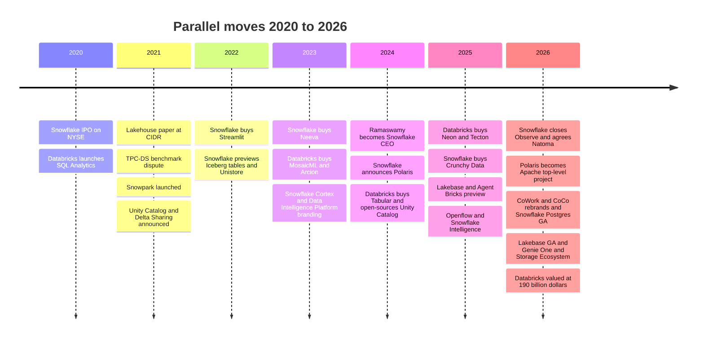
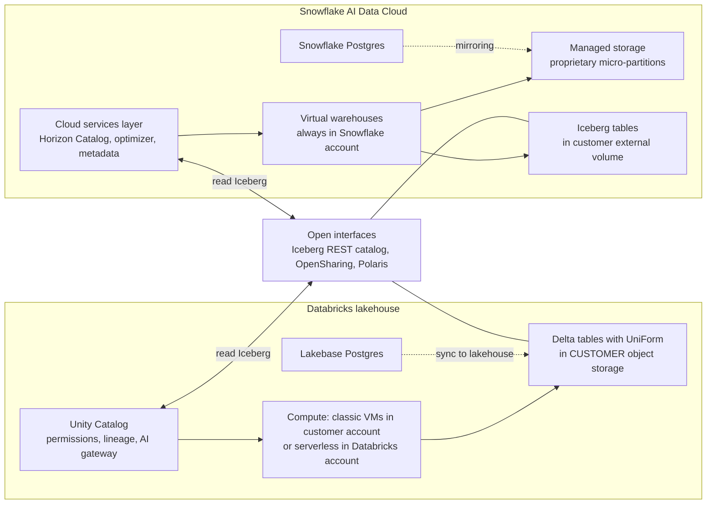
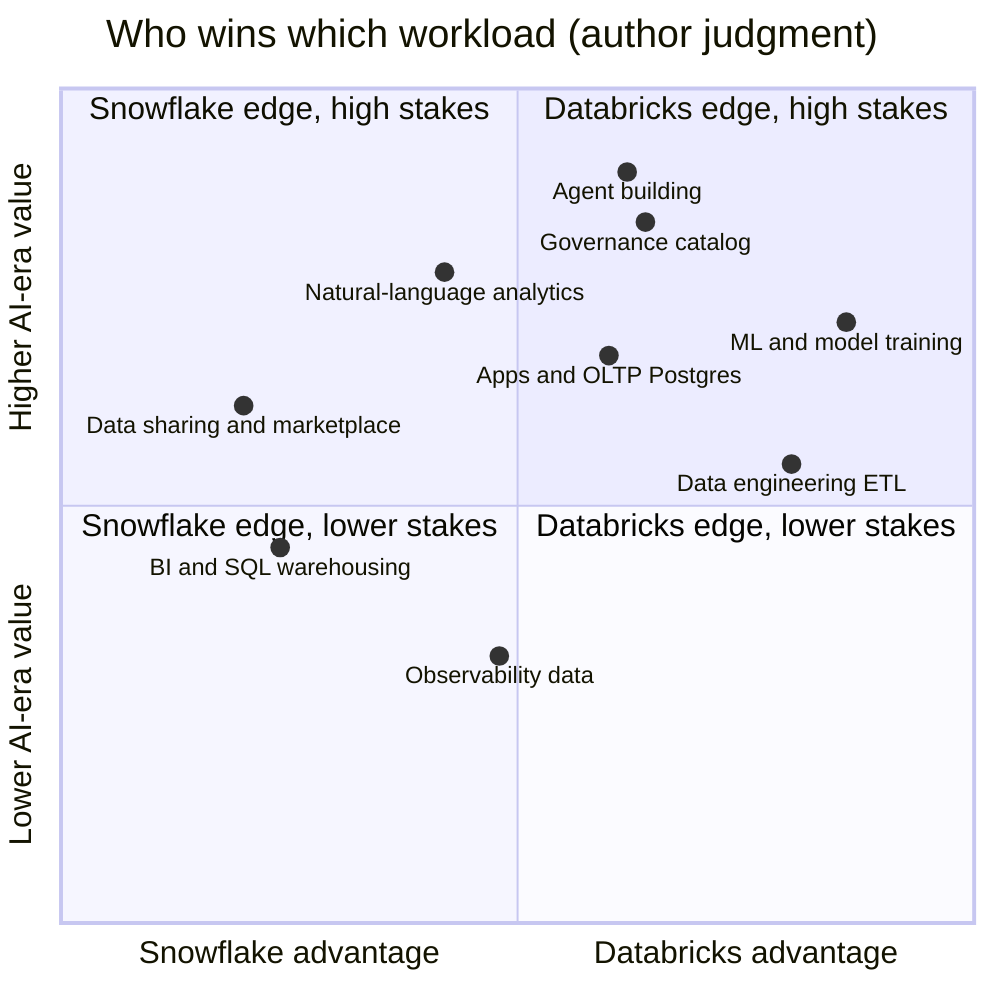

# 27. Databricks vs. Snowflake: Head-to-Head
> **Status:** Databricks private · Snowflake public (NYSE: SNOW) · **HQ:** San Francisco, CA (Databricks) / Bozeman, MT per SEC filings (Snowflake) · **Founded:** 2013 / 2012 · **Latest valuation/market cap:** Databricks $190B post-money (company-stated, 2026-08-13); Snowflake market cap $107.88B, EV $106.31B (2026-10-30) · **Last verified:** 2026-11-01

## TL;DR

- **Two starting points, one destination.** Databricks began as hosted Spark for data engineers and pushed "up" into SQL warehousing. Snowflake began as a managed SQL warehouse for analysts and pushed "out" into engineering, ML and apps. By 2026 the two product maps are nearly identical: open-table support, a governance catalog, serverless compute, a Postgres database and an agent layer. They still differ on **where the data lives by default** and **who holds the metadata**. Databricks defaults to open Delta/Iceberg files in the customer's bucket. Snowflake defaults to its own managed storage and now offers Iceberg tables as a first-class option.[^cidr][^sigmod16]
- **Scale is now similar; the reported growth rates are not comparable.** Databricks states a **>$7B revenue run-rate growing >80%** (company-stated, unaudited, fiscal Q2 May–Jul 2026). Snowflake reported **$1.49B of product revenue, +37%** (GAAP) for the same three months, which is ~$5.96B annualised.[^db-7b][^sf-q2] The two figures differ in basis (run-rate vs. recognised revenue), in scope, and in what one "dollar of revenue" contains. On classic compute, Databricks revenue excludes the customer's cloud VM bill. Snowflake revenue always includes the infrastructure.
- **Pricing units differ, and the list prices are converging.** Databricks sells **DBUs** priced by workload SKU. Snowflake sells **credits** priced by edition. In our illustrative list-price example, the smallest serverless SQL unit on each platform costs about **$3 per hour**. The real cost differences come from runtime, auto-suspend behaviour and negotiated discounts, not from the unit price.[^pricing][^sf-pricing]
- **Valuation gap.** Databricks' $190B mark is about **27x run-rate**. Snowflake trades at **16.9x EV/NTM revenue** (2026-10-30). Adjusted for growth, Databricks is *cheaper* (~0.34x per point of growth against ~0.48x), but only on its own unaudited run-rate and growth figures. The numerators differ too: a private post-money *equity* mark set by preferred stock is not the same object as a public *enterprise value*, and a company-defined run-rate is not GAAP revenue.[^comps-sf][^db-7b]
- **Everpure angle.** Everpure is a named **launch partner of the Databricks Storage Ecosystem** (2026-06-10), with an OpenSharing connector in private preview. We found no equivalent Snowflake *program* in this session's research. Snowflake reaches on-prem object stores through its S3-compatible storage support [VERIFY: current Snowflake S3-compatible partner list and whether Everpure/Pure is listed]. A dual-platform, format-neutral posture is the obvious option to evaluate.[^storage-eco][^everpure-os][^sf-s3compat]

## Snapshot table

| Item | Databricks | Snowflake | Basis / source |
|---|---|---|---|
| Ownership | Private; no GAAP filings | Public since Sep 2020 (NYSE: SNOW) | Public record[^funding][^sf-10k] |
| Founders | Seven UC Berkeley AMPLab researchers incl. Ali Ghodsi, Matei Zaharia, Ion Stoica | Benoit Dageville, Thierry Cruanes, Marcin Żukowski (ex-Oracle / Vectorwise) | Public record[^sigmod16] |
| CEO | Ali Ghodsi (since 2016) | Sridhar Ramaswamy (since Feb 2024) | Public record[^ceo-sf] |
| Fiscal year | Ends Jan 31 | Ends Jan 31 (FY2027 = Feb 2026–Jan 2027) | Company-stated[^db-7b][^sf-q2] |
| Latest scale | **>$7B** revenue run-rate (Q2, May–Jul 2026) | **$1,546.8M** total revenue, **$1.49B** product revenue (Q2 FY2027, May–Jul 2026) | Company-stated run-rate / GAAP[^db-7b][^sf-q2] |
| Growth | **>80%** YoY (run-rate) | **+35%** total, **+37%** product (YoY) | Company-stated / GAAP[^db-7b][^sf-q2] |
| Full-year marker | ~$2.6B revenue (FY ended Jan 2025) | $4,472.3M product, $4,683.9M total (FY2026 = Feb 2025–Jan 2026) | Press-reported / GAAP[^cnbc-25][^sf-10k] |
| Forward guide | None published | FY2027 product revenue **$6.07B** (+36%) | Company guidance[^sf-q2] |
| Net retention | >140% (definition undisclosed) | 126% (trailing-12-month product revenue) | Company-stated KPIs[^db-54][^sf-q2] |
| $1M+ customers | >800 at >$1M run-rate (Jan 2026) | 828 at >$1M TTM product revenue (Jul 2026) | Company-stated KPIs[^db-54][^sf-q2] |
| Gross margin | >80% non-GAAP subscription GM (Oct 2024 quarter) | 74.7% non-GAAP product GM; 70.9% GAAP (Q2 FY2027) | Non-GAAP / GAAP[^db-j][^sf-q2] |
| Profitability | Adjusted FCF positive on a trailing-12-month basis (no $ disclosed; company-stated, non-GAAP) | GAAP operating margin −17.0%, non-GAAP +15.3% (Q2 FY2027); FY2026 non-GAAP FCF margin 25.5% | Company-stated / GAAP / non-GAAP[^db-54][^sf-q2][^sf-fin] |
| Value | $190B post-money (2026-08-13) | Market cap $107.88B; EV $106.31B (2026-10-30) | Company-stated / market data[^db-7b][^comps-sf] |
| Disclosed or reported M&A spend (sum of deals with values) | ~$4.4B (MosaicML, Tabular, Neon, Arcion) | ~$1.86B (Streamlit, Neeva, Crunchy Data, Observe, Natoma) on filed figures; ~$2.35B using the ~$250M (Crunchy) and ~$1B (Observe) press figures | Our sum of `data/ma_deals.csv`. Bases differ: Databricks' Tabular and Neon values are press-reported; Snowflake's Crunchy, Observe, Neeva and Natoma are 10-Q/10-K purchase consideration (Observe preliminary)[^ma] |

*Figure 27.1 — Snapshot. The bases differ row by row: Databricks figures are company-stated and unaudited, Snowflake's are GAAP or defined KPIs. The two fiscal calendars happen to align (both end Jan 31), so "Q2" covers the same May–Jul 2026 quarter for both.*

## The head-to-head at a glance

| # | Dimension | Databricks | Snowflake | Edge (author judgment) |
|---|---|---|---|---|
| 1 | Origin and home buyer | Spark for data engineers and data scientists | SQL warehouse for analysts and finance | Different doors, same building |
| 2 | Founding paper | Lakehouse, CIDR 2021 | Elastic Data Warehouse, SIGMOD 2016 | n/a |
| 3 | Default storage | Delta tables (Parquet + log) in **customer** object storage | **Snowflake-managed** storage (proprietary micro-partitions) | Databricks on openness; Snowflake on simplicity |
| 4 | Open-format stance | Delta + UniForm writes Iceberg metadata; bought Tabular (2024) | Iceberg tables in customer "external volumes"; Iceberg v3 GA (May 2026, secondary source) | Converged |
| 5 | Catalog | Unity Catalog (open-sourced 2024; Linux Foundation) | Horizon Catalog (internal); donated Apache Polaris (ASF top-level project, 2026) | Databricks (breadth of governed assets) |
| 6 | Where compute runs | Classic VMs in customer account, or serverless in Databricks account | Always in Snowflake's account (virtual warehouses) | Converging on serverless |
| 7 | Pricing unit | DBU, priced per SKU (Jobs, All-Purpose, SQL, serverless) | Credit, priced per edition (Standard / Enterprise / Business Critical) | Snowflake simpler to forecast |
| 8 | SQL / BI | Databricks SQL, Photon; >$1.5B run-rate | Core franchise; Gen2 and Adaptive warehouses | Snowflake |
| 9 | Data engineering / ingestion | Spark, Lakeflow (Connect, Spark Declarative Pipelines, Jobs) | Snowpark, Dynamic Tables, Openflow (GA May 2025; second-generation runtimes GA Sep 2026) | Databricks |
| 10 | ML / model training | Mosaic AI, GPUs, notebooks | Snowpark ML, Cortex Training (2026) | Databricks |
| 11 | Business-user AI | Genie One (agentic coworker) | Snowflake CoWork (ex-Snowflake Intelligence) | Contested |
| 12 | Developer AI / agents | Agent Bricks, Unity AI Gateway, Omnigent | Cortex Agents, CoCo (ex-Cortex Code), Natoma (MCP gateway) | Contested; Databricks deeper for builders |
| 13 | Operational database | Lakebase (Neon), GA 2026, >$100M run-rate | Snowflake Postgres (Crunchy Data), GA Jun 2026 | Databricks (earlier, measurable) |
| 14 | Data sharing / marketplace | Delta Sharing → OpenSharing (Linux Foundation); Marketplace; Clean Rooms | Secure Data Sharing, Marketplace, Data Clean Rooms (Samooha) | Snowflake (network maturity) |
| 15 | Observability / security data | Lakewatch SIEM; Panther | Observe (closed Feb 2026) | Too early |
| 16 | Hyperscaler channel | Azure Databricks is a first-party Microsoft service | Marketplace co-sell on AWS, Azure, Google Cloud | Databricks (Azure) |
| 17 | On-prem / storage partners | Storage Ecosystem via OpenSharing (Jun 2026; Everpure a launch partner) | S3-compatible external stages/tables [VERIFY] | Databricks (formal program) |
| 18 | Disclosure quality | Company-stated floors; no audit | SEC filings, guidance | Snowflake |
| 19 | Capital currency for M&A | Private stock at rising marks | Public stock and cash | Databricks |

*Figure 27.2 — SV-13: the multi-dimension comparison. On most product rows the honest answer is "converged". The real differences are default data location, catalog breadth, disclosure quality and acquisition currency. Sources: Ch 25 and Ch 26 sources, footnotes in this chapter.[^dais26][^summit26][^polaris][^iceberg-v3]*

## Origin story and strategic arc

**Snowflake built the integrated warehouse first.** Its SIGMOD 2016 paper described a design that separated storage from compute. Data sat in the cloud provider's object storage in a proprietary columnar format of immutable micro-partitions. Independent "virtual warehouses" of compute read it, and a cloud-services layer handled metadata, optimisation, security and transactions.[^sigmod16] Customers never touched a cluster. They resized a warehouse, paid per second and got near-zero administration. That simplicity, plus cross-account data sharing, made Snowflake one of the fastest-growing enterprise software companies of its era. It listed in September 2020.[^sf-10k]

**Databricks answered with an open thesis.** The CIDR 2021 Lakehouse paper argued that a proprietary warehouse beside a data lake was a costly two-copy design. It proposed instead that open Parquet files in the customer's bucket, plus a transaction log, caching and a vectorised engine, could match warehouse performance on one copy.[^cidr] In November 2021 the rivalry went public in a dispute over a TPC-DS benchmark. Databricks claimed an official record, and Snowflake's founders replied with a blog on "competing with integrity" [VERIFY: both blog URLs; pre-2025 knowledge, not re-opened this session].[^tpcds]

**Then each copied the other's strengths.** Snowflake added Snowpark (Python and Java code in the warehouse), bought Streamlit (2022) for apps, Neeva (2023) for AI talent, and Datavolo (2024) for ingestion. It also embraced Iceberg and donated the Polaris catalog. Databricks built Databricks SQL and Photon to win BI, open-sourced Unity Catalog, and bought Tabular to defuse the format war.[^ma][^tabular][^uc-oss] From 2025 the race moved to Postgres and agents: Neon and Crunchy Data within a month of each other, then Lakebase against Snowflake Postgres, and Genie One against CoWork.[^neon][^ma][^summit26][^dais26]

*Figure 27.3 — Parallel moves. Almost every launch on one side has a counterpart within 12 months on the other. The pairs are Polaris and Unity Catalog OSS (2024), Crunchy and Neon (2025), and CoWork and Genie One (2026). Sources: `data/ma_deals.csv`; Ch 25; Summit and DAIS recaps.[^ma][^summit26][^dais26][^polaris]*

> **Bridge: x86 vs. Arm, and Intel vs. AMD.** Snowflake began like an integrated device manufacturer: it owned the format, the engine and the service, and sold a finished product with high margins and little customer choice. Databricks began closer to the Arm model. It seeded open standards (Spark, Delta, Unity Catalog OSS), let an ecosystem build around them, and monetised the best implementation. Once both speak **Iceberg**, the situation looks more like Intel vs. AMD on a shared x86 instruction set. Compatibility makes switching thinkable, so the fight moves to microarchitecture (price-performance per credit or DBU) and to the platform around the core (the catalog, the way a chipset and its software ecosystem lock in a CPU socket). Shared instruction sets do not end lock-in; they relocate it.

## Product and technology

### Architecture side by side

*Figure 27.4 — Side-by-side architecture. Both separate storage from compute and put a catalog/metadata service in charge. The difference is the default: Databricks' tables live in the customer's bucket unless told otherwise, while Snowflake's live in managed storage unless the customer chooses Iceberg. The open interfaces in the middle are where the two now meet.[^arch-docs][^sigmod16][^uc-dais26]*

**Storage and formats.** Databricks writes Delta tables, and **UniForm** emits Iceberg metadata from the same commit, so one physical table serves both ecosystems.[^cidr] Snowflake's native tables use its own micro-partition format, which it controls end to end. That is one reason its optimiser, caching and governance features have been so tight. Snowflake **Iceberg tables** keep Parquet data and Iceberg metadata in the customer's own storage (an "external volume"). Snowflake can manage them as the catalog, or read them from an external catalog.[^iceberg-v3] The convergence is real but asymmetric. For Databricks openness is the default, and for Snowflake it is an option. Most of Snowflake's installed base still sits in managed storage.

**Catalogs: the actual battleground.** Unity Catalog governs tables, files, ML models, functions and, since 2026, model and agent traffic through the Unity AI Gateway. Its open-source version speaks the Iceberg REST protocol.[^uc-dais26] Snowflake answered in two layers. **Horizon Catalog** is the governance layer inside Snowflake. **Apache Polaris** is an open Iceberg REST catalog that Snowflake donated in 2024; it became an Apache top-level project in early 2026 (ASF announced 2026-03-05).[^polaris] The tactical difference is that Databricks put its *main* catalog into open source, while Snowflake open-sourced a *second* catalog and kept Horizon proprietary [VERIFY: current extent of Horizon's Iceberg REST interoperability].

**AI strategy.** Both companies tell the same story: agents need governed data, semantics and permissions, and the platform that already holds them should host the agents. Databricks leads with builders. It offers Mosaic AI for serving and fine-tuning, **Agent Bricks** for building and evaluating agents, **Genie One** for business users, and **Lakebase** as the transactional store agents write to. Its AI products passed a $1.4B run-rate by Jan 2026 (company-stated).[^db-54][^dais26] Snowflake leads with business users and SQL. It offers **Cortex** AI functions inside SQL, **Cortex Agents**, **Snowflake CoWork** (renamed from Snowflake Intelligence in June 2026), **CoCo** for developers (formerly Cortex Code), **Cortex Training** for fine-tuning open-weight models, and **Snowflake Postgres** (GA June 2026).[^summit26] Snowflake lowered its FY2027 non-GAAP product gross-margin guide to 74%, citing AI workload mix. AI demand carries a GPU cost on both P&Ls.[^sf-fin]

## How it makes money

Both companies sell **consumption**: customers sign multi-year committed-spend contracts and draw them down as they use compute. Revenue is recognised on consumption, not at signing. The units differ, though, and so does what each unit contains.

| Feature | Databricks DBU | Snowflake credit |
|---|---|---|
| What it meters | Processing capacity per hour, scaled by instance type or warehouse size | Warehouse size × time (XS = 1 credit/hour, doubling per size) [VERIFY] |
| What sets the $ per unit | Workload SKU: Jobs (cheapest), All-Purpose, SQL, serverless variants; plus cloud and tier | Edition: Standard, Enterprise, Business Critical; plus cloud and region |
| Representative US list price | ~$0.15/DBU Jobs (classic); ~$0.55 All-Purpose; ~$0.70 Serverless SQL (AWS, 2026 third-party compilations) | $2 / $3 / $4 per credit Standard / Enterprise / Business Critical, AWS US East on-demand [VERIFY: pre-2025 list prices] |
| Cloud infrastructure included? | Classic: **no** (customer pays VM bill separately). Serverless: yes | **Always yes** |
| Storage | Customer pays cloud provider directly for object storage | Billed by Snowflake per TB-month (pass-through-like), or customer pays for Iceberg storage directly |
| Discounts | Committed-spend contracts; hyperscaler marketplace burn-down | Capacity contracts; marketplace burn-down |
| Efficiency lever | Photon (higher DBU rate, fewer hours), serverless warm pools | Gen2 and Adaptive warehouses, auto-suspend, query acceleration |

*Figure 27.5 — Pricing units compared. Sources: Databricks pricing compilations (Ch 25); Snowflake pricing page and credit consumption table [VERIFY: list prices not re-opened this session].[^pricing][^sf-pricing][^dbsql-sizes]*

> **Bridge: two royalty schedules on different units.** Think of two IP licensors. One charges per die and the other per wafer, and each sets both the price per unit *and* how many units a given chip consumes. Comparing "$0.70 per DBU" with "$3 per credit" is like comparing a $0.70 per-die royalty with a $3 per-wafer royalty without knowing the die size. The only meaningful number is **cost per finished workload**, which you get from a benchmark or a proof-of-concept on your own queries. A vendor also controls both levers. When it ships a faster engine, it can keep the unit price and let customers' bills fall (deflation it hopes elasticity offsets), or charge more units per hour for the faster tier.

### Worked example: price two workloads at list (illustrative only)

The figures below use list prices on AWS US East, from the sources and dates footnoted above. They ignore negotiated discounts, which for large customers are usually substantial, and they make **assumptions** about sizing that a real proof-of-concept would replace. Treat them as an illustration of the mechanics, not a price comparison.

**Workload A: nightly ETL, 2 hours, 30 nights a month.**

- *Snowflake (Enterprise edition):* a Medium warehouse burns 4 credits/hour. 2 hours × 4 credits × $3 = **$24 a night**, about **$720 a month**, infrastructure included.[^sf-pricing]
- *Databricks classic Jobs compute:* assume a cluster that burns 18 DBUs/hour (a driver plus eight workers at ~2 DBUs each; our assumption). 36 DBUs × $0.15 = **$5.40 a night** of Databricks fees. Add the EC2 bill, assumed at $0.50 per instance-hour for nine instances (an assumption, not a quote): 9 × $0.50 × 2 = **$9.00**. The total is about **$14.40 a night**, or **$432 a month**, and only ~38% of it is Databricks revenue.[^pricing]

**Workload B: a BI dashboard used through the business day, 10 hours a day, 22 days a month.**

- *Snowflake:* a Small warehouse at 2 credits/hour × $3 = $6/hour. 10 hours = **$60 a day**, about **$1,320 a month**, before any multi-cluster scale-out at peaks.
- *Databricks Serverless SQL:* a Small warehouse burns 12 DBUs/hour [VERIFY] × $0.70 = $8.40/hour. 10 hours = **$84 a day**, about **$1,848 a month**, infrastructure included.[^dbsql-sizes]

| Smallest serverless SQL unit (list) | Units per hour | $ per unit | $ per hour |
|---|---|---|---|
| Snowflake X-Small, Enterprise edition | 1 credit | $3.00 | **$3.00** |
| Databricks Serverless SQL 2X-Small | 4 DBUs [VERIFY] | ~$0.70 | **~$2.80** |

*Figure 27.6 — Entry-level serverless SQL costs about the same hourly list price on both platforms. "Small" on one size ladder is not the same amount of compute as "Small" on the other, so workload B compares labels, not work.*

**What the example teaches.** First, the classic Databricks model looks cheap for scheduled batch partly because most of the bill goes to AWS, not to Databricks. That is a revenue-accounting point as much as a price point. Second, once both run serverless, list prices per hour converge. The bill then depends on how long the warehouse stays awake (auto-suspend and auto-stop settings), how much work each hour does (engine efficiency), and the discount. Third, serverless shifts make Databricks' revenue per workload *rise* even when the customer's total spend does not, which matters for the growth comparison below.

## Financials

*Figure 27.7 — Databricks' stated run-rate overtook Snowflake's annualised product revenue around 2025, but the lines are drawn on different bases and should not be read as market share. Sources: `data/ch25_databricks_runrate.csv`; `data/company_financials.csv`.[^db-7b][^sf-fin]*

### Why ">80%" and "+37%" are not comparable

The headline gap, >80% against 37%, mixes four effects. It does not show Databricks winning twice as fast.

1. **Run-rate vs. recognised revenue.** Databricks' figure is an annualised snapshot ("surpassed $7B") with an undisclosed method, such as last quarter × 4 or exit month × 12, and the number is a floor. Snowflake's $1.49B is GAAP revenue recognised in the quarter. Annualising Snowflake's quarter gives ~$5.96B of product revenue, or ~$6.19B of total revenue ($1,546.8M × 4).[^sf-q2] That is the closest like-for-like construction, and it is still ours, not the company's.
2. **What a revenue dollar contains.** Snowflake revenue always includes the cloud infrastructure it runs. Databricks revenue on classic compute does not, because the customer pays AWS, Azure or Google directly. As customers move to serverless, the same workload produces *more* Databricks revenue. So part of Databricks' growth is a change in the unit of account, not new demand. Databricks does not disclose its serverless share, so the effect cannot be sized [VERIFY: serverless share of DBUs].
3. **Scope.** Snowflake's product revenue excludes professional services; its total revenue includes them. Databricks has not said whether its run-rate includes services or training.
4. **Inorganic and new lines.** Lakebase (>$100M) and AI products (>$1.4B, Jan 2026) are counted inside Databricks' total. Snowflake's Observe deal (closed Feb 2026) adds to its figures from Q1 FY2027.[^db-7b][^db-54][^ma]

Even after these adjustments, **Databricks is very likely growing faster**. The internal arithmetic of its disclosures holds together (>80% on >$7B implies a base ≤ ~$3.9B a year earlier, against the ">$4B" stated then), and its data-warehousing line alone grew from >$1B to >$1.5B in three quarters.[^db-48][^constellation] The more interesting fact is that **both are accelerating**. Snowflake's product growth went from 30% (Q4 FY2026) to 34% (Q1 FY2027) to 37% (Q2 FY2027). An AI-era rising tide is lifting both rather than one taking share from the other.[^sf-fin]

### Valuation gap: private mark vs. public EV

| Measure | Databricks | Snowflake | Notes |
|---|---|---|---|
| Value | $190B post-money equity (2026-08-13) | EV $106.31B (market cap $107.88B), 2026-10-30 | Different objects (see text) |
| Revenue basis | >$7B run-rate (company-stated) | NTM $6.30B (guidance-derived estimate); Q2 total × 4 = $6.19B | |
| Multiple | **~27x** run-rate; ~22x NTM (our estimate, Ch 25) | **16.9x** EV/NTM; ~17.2x EV/run-rate | |
| Growth used | >80% | 35% (total revenue, GAAP) | |
| Growth-adjusted (multiple ÷ growth) | **~0.34x** | **~0.48x** | Crude; ignores margins and durability |
| Snowflake valued at Databricks' 27x | n/a | ~$168B (27.1 × $6.19B) | Illustrative |
| Databricks valued at Snowflake's ~17x run-rate | ~$120B | n/a | Illustrative |
| Databricks at Snowflake's growth-adjusted 0.48x | ~38x → ~$269B | n/a | Illustrative |

*Figure 27.8 — Same company, three answers. Depending on whether you anchor on absolute or growth-adjusted multiples, Snowflake's public pricing implies Databricks is worth anywhere from ~$120B to ~$270B. Sources: `data/public_comps.csv`; Databricks press release; our arithmetic.[^comps-sf][^db-7b]*

> **Bridge: private-round marks vs. public EV.** A public **enterprise value** is market cap plus debt minus cash, priced daily by the marginal buyer of a liquid common share. A private **post-money valuation** is the price per share of the *latest preferred* round multiplied by all fully diluted shares. Preferred shares usually carry a **liquidation preference** (paid back first in a sale), sometimes plus other protections. The headline therefore overstates what a common share is worth. Databricks has not disclosed its preference terms. There is no daily market, holders cannot sell freely (an illiquidity discount applies, and practitioners often use 10–30% as an estimate), and the mark is two-and-a-half months older than Snowflake's price. Debt is not netted: Databricks carries a term loan and revolver from Jan 2025, plus added capacity from Feb 2026.[^funding] Against that, Databricks' growth is far higher, and the growth-adjusted ratio favours it. PitchBook's analysis, republished by Morningstar, put Databricks' operating value far lower, near $68.7B. That shows how wide the plausible range is.[^ms]

**What a CFA would conclude.** The gap between ~27x and ~17x is narrower than it looks once you adjust for growth, and wider than it looks once you adjust for structure and disclosure. Snowflake trades at a discount for its slower growth, heavy stock-based compensation ($1,599.5M in FY2026, about 34% of revenue) and GAAP operating losses (−30.6% FY2026 GAAP operating margin). Databricks trades at a premium for growth, and its own SBC and GAAP losses are simply not visible.[^sf-fin] An eventual Databricks S-1 is the event that collapses the two bases into one.

## Customers and go-to-market

**Most large enterprises run both.** The large-account bases are now about the same size: >800 Databricks customers at a >$1M run-rate (Jan 2026) and 828 Snowflake customers above $1M of trailing product revenue (Jul 2026).[^db-54][^sf-q2] Databricks says it serves more than 60% of the Fortune 500.[^cust] We could not retrieve a primary survey that measures the overlap directly in this session [VERIFY: analyst or survey data, e.g., ETR or Gartner Peer Insights, on the share of enterprises using both]. The typical pattern is easy to describe, though. Data engineering and ML teams land on Databricks. Finance and BI teams land on Snowflake. The two are connected by pipelines, Delta Sharing/OpenSharing or, increasingly, shared Iceberg tables. Each vendor's field team then works to move the other's workloads across. Databricks gives away migration tooling (Lakebridge, from BladeBridge) to pull warehouse workloads onto Databricks SQL.[^bladebridge]

**Go-to-market differences.** Databricks has the stronger hyperscaler channel through Azure Databricks, which Microsoft sells and bills as a first-party service. That channel comes with Microsoft Fabric as a bundled competitor. Snowflake relies on marketplace co-selling across all three clouds and is more neutral, but has no equivalent first-party status. Snowflake's **Marketplace and data-sharing network** is the older and denser of the two. Data providers publish once and consumers query in place, so every new participant raises the value for the others. Databricks' answer is to make sharing an *open protocol* (OpenSharing, now under the Linux Foundation) rather than a network inside one platform.[^opensharing]

## M&A and investments

| Theme | Databricks | Snowflake | Read-across |
|---|---|---|---|
| AI talent and models | MosaicML, $1.3B (2023) | Neeva, $185.4M (2023); Applica (2022); TruEra (2024) | Databricks bought a training platform; Snowflake bought search talent, and its CEO came with Neeva |
| Open formats and catalog | Tabular, ~$2B press-reported (2024) | Built and donated Polaris (2024); Select Star for Horizon (2025) | Databricks bought the Iceberg founders; Snowflake chose open-sourcing over acquiring |
| Postgres / OLTP | Neon, ~$1B press-reported (2025); Mooncake (2025); Electric (2026, announced) | Crunchy Data, $164.5M per 10-Q purchase accounting (~$250M press-reported) (2025) | Same thesis, one month apart; Databricks paid ~6x more on Snowflake's filed figure, ~4x against the press figure (Neon value itself press-reported) |
| Ingestion / CDC | Arcion, ~$100M (2023) | Datavolo (2024), now Openflow | Parity |
| Agent governance | Built Unity AI Gateway | Natoma, ~$110M stated (2026, announced) | Buy vs. build |
| Observability / security | Antimatter, SiftD.ai (2026); Panther (2026) | Observe, $596.2M preliminary consideration per 10-K (~$1B press-reported; closed 2026-02-02) | Both moving into machine data |
| Apps and front ends | Row Zero (2026) | Streamlit, $800M (2022); Numeracy (2019) | Snowflake earlier |
| Migration | BladeBridge (2025) | — | Databricks subsidises switching |
| Clean rooms | — | Samooha (2023) | Snowflake's sharing moat |

*Figure 27.9 — M&A compared. Databricks spent more and bought platform pillars (MosaicML, Tabular, Neon). Snowflake bought cheaper capabilities and used open-sourcing (Polaris) where Databricks used its chequebook. Values: disclosed per SEC filings for Snowflake; press-reported for Tabular and Neon. Source: `data/ma_deals.csv`.[^ma][^tabular][^neon]*

The strategic difference is **currency**. Databricks pays mostly in private stock whose mark tripled in 20 months, so each deal has cost proportionally less dilution than it appeared. Snowflake pays with public stock and cash, at a multiple that has compressed since 2021, under quarterly scrutiny of dilution. That helps explain why Snowflake's largest deals since Streamlit cost hundreds of millions, not billions.

## Competitive position

*Figure 27.10 — Workload positioning (author judgment, not measured data). Databricks holds the builder-heavy workloads. Snowflake holds SQL and the sharing network. The highest-stakes AI-era workloads (agents, catalog, natural-language analytics) sit near the middle, which is where the fight is.*

| Workload | Likely winner today | Why | What would flip it |
|---|---|---|---|
| Data engineering / ETL at scale | **Databricks** | Spark heritage, Lakeflow, cheap Jobs SKU, open files | Snowflake Openflow and Dynamic Tables maturing; price cuts |
| ML and model training | **Databricks** | Mosaic AI, notebooks, GPU serving, data-science buyer | Cortex Training adoption; customers moving fine-tuning to model labs |
| BI / SQL warehousing | **Snowflake** | Incumbency, simplicity, concurrency, finance-team trust | Databricks SQL (>$1.5B run-rate) keeps winning migrations |
| Data sharing / marketplace / clean rooms | **Snowflake** | Network effects; Samooha clean rooms | OpenSharing becomes the cross-platform default |
| Apps / OLTP (Postgres) | **Databricks, narrowly** | Lakebase GA first, >$100M run-rate | Snowflake Postgres plus mirroring wins Snowflake-centric shops |
| Governance / catalog | **Databricks, narrowly** | Unity Catalog governs more asset types, open-sourced | Horizon plus Polaris interoperability; hyperscaler catalogs |
| Business-user agents (CoWork vs. Genie One) | **Contested** | Snowflake has the analyst seat; Databricks has the semantics in Unity Catalog | Whichever owns the semantic layer that agents trust |
| Developer agents / AI gateway | **Databricks, narrowly** | Agent Bricks, AI Gateway, builder audience | Natoma-based MCP governance inside Snowflake |

*Figure 27.11 — Workload-winner table (author judgment from public product information; see the sources in this chapter and Ch 25).*

The wider field matters as much as the duel. Microsoft Fabric, Google BigQuery and AWS (S3 Tables, Redshift, SageMaker) bundle substitutes into budgets the customer has already committed. Palantir competes for the executive "AI on enterprise data" narrative. ClickHouse wins on real-time price-performance. See [Ch 25](ch25-databricks.md) for the full competitive matrix, [Ch 26](ch26-snowflake.md) for Snowflake's view, and [Ch 28](ch28-hyperscaler-data-platforms.md) for the hyperscalers.

## Why it's winning / bull case

### Databricks

1. **Growth at scale, re-accelerating.** Growth went from >50% at $4B to >80% at $7B, with sub-lines (SQL, AI, Lakebase) each large enough to matter.[^db-4b][^db-7b]
2. **The catalog is the AI control point.** Unity Catalog already governs data, models and agent traffic. Agents raise the value of the system that holds permissions and lineage.[^uc-dais26]
3. **Open defaults win security reviews.** "Your data stays in your bucket" shortens enterprise sales cycles, and lock-in moves to the catalog and pipelines, where it is stickier.
4. **Currency and cadence.** A $190B private currency funds a buy-not-build strategy that public rivals cannot match without visible dilution.

### Snowflake

1. **Accelerating on a GAAP basis.** Product growth rose from 30% to 37% over three quarters, and FY2027 guidance was raised to $6.07B. That is audited demand, not a stated floor.[^sf-q2][^sf-fin]
2. **Simplicity and the BI seat.** For SQL-centric organisations Snowflake is still the lowest-operations path. The analyst seat is also where business-user agents (CoWork) get distribution.
3. **Data-sharing network effects.** Marketplace and clean rooms are a network that open protocols must displace, not merely match.
4. **Valuation support.** At 16.9x EV/NTM (2026-10-30) with positive non-GAAP FCF (25.5% FY2026 margin), Snowflake is priced well below Databricks' ~27x mark on a headline basis (though not on a growth-adjusted one). Any Databricks IPO could re-rate the category upward.[^comps-sf][^sf-fin]

## Risks / bear case and open questions

### Databricks

1. **Unaudited numbers and a full price.** At ~27x run-rate with undisclosed definitions, an S-1 could reset the picture. PitchBook's analysis (via Morningstar) put operating value near $68.7B.[^ms]
2. **Serverless dilutes margin.** Moving infrastructure into COGS pushes gross margin toward Snowflake's ~75%.[^sf-q2]
3. **Openness cuts both ways.** Iceberg-readable tables in an open catalog let Snowflake, hyperscalers or DuckDB bid for each workload.
4. **Microsoft as partner and rival.** Fabric is bundled into an estate Databricks sells through.

### Snowflake

1. **Managed storage is a declining moat.** Every Iceberg table a customer creates in its own bucket is data that any engine can read. Snowflake's best defence is to be the fastest engine on open data, a harder business than owning the format.
2. **Margin pressure from AI mix.** The FY2027 product gross-margin guide was cut to 74% on AI workloads, and GAAP operating margin remains deeply negative (−17.0% in Q2 FY2027).[^sf-fin]
3. **SBC and dilution.** SBC was $1,599.5M in FY2026 (~34% of revenue), which limits how much M&A it can fund with stock.[^sf-fin]
4. **Playing catch-up in builder workloads.** Postgres, training and agents all launched after Databricks' equivalents.

**Open questions.** What is Databricks' run-rate method and serverless share? How fast are Snowflake customers moving data from managed storage into Iceberg tables? Does Horizon fully interoperate with external Iceberg REST catalogs? Will either company publish a primary, sourced figure on customer overlap?

## Relevance to Everpure

> **Storage bridge.** Both platforms treat object storage as an S3-compatible substrate. Databricks reads Delta/Iceberg tables governed by Unity Catalog. Snowflake reads Iceberg tables or external stages through external volumes and stages. Neither depends on array-level performance features for SQL; they win on engine, caching and file layout. A storage vendor's leverage is therefore *where* the data lives (on-prem, sovereign, near GPUs) and the metadata it can contribute. See the companion *Everpure Tech Atlas* for S3 semantics and FlashBlade object performance.

**Where Everpure stands, from public information.** On the Databricks side there is a formal program. Everpure was named a **launch partner of the Databricks Storage Ecosystem** (announced 2026-06-10, alongside MinIO and Qumulo), and Everpure's blog describes an **OpenSharing connector** for FlashBlade/FlashArray object storage in **private preview from 2026-06-09**.[^storage-eco][^everpure-os] On the Snowflake side we found **no comparable named storage-partner program** in this session's research. Snowflake supports reading from **S3-compatible storage** (external stages and tables) through its documented interface. Pre-2025 public material indicated that on-prem object vendors, reportedly including Pure Storage, were validated for it [VERIFY: Snowflake's current S3-compatible vendor list, and whether Iceberg tables on S3-compatible external volumes are GA].[^sf-s3compat] Everpure's Data Intelligence (1touch-based) lists both Databricks and Snowflake among its connector targets. These are integrations, not partnerships.[^1touch]

**Options a strategy team might evaluate, based on public information:**

| Option | What it would mean | Why it could matter | Watch-outs |
|---|---|---|---|
| Format-neutral "both platforms" positioning | Iceberg/Delta tables on FlashBlade readable by Databricks (OpenSharing) and Snowflake (S3-compatible / Iceberg) | Most large customers run both platforms, and storage that serves both avoids picking a winner | Snowflake path depends on S3-compatible Iceberg support maturity [VERIFY] |
| Take the Databricks OpenSharing connector to GA | A supported, co-marketed "govern on-prem data from Databricks" pattern | First-mover among ~10 named storage partners | Low switching cost between storage partners |
| Seek a launch slot if Snowflake builds an equivalent program | Pre-position engineering for Polaris/Horizon interoperability on on-prem Iceberg | Would mirror the Databricks win on the other platform | No public signal that Snowflake plans one |
| Feed Data Intelligence tags into both catalogs | Push classification and sensitivity labels into Unity Catalog and Horizon | The catalogs are the control points, and contributing metadata keeps Everpure relevant above the array | Both catalogs are adding native classification, so overlap is possible |
| Watch Postgres-for-agents storage | Lakebase and Snowflake Postgres both tier data to object storage in the cloud | Agent-created databases multiply object-storage footprint | Neither has announced an on-prem deployment |

*Figure 27.12 — Everpure options (public information only). The asymmetry is the finding: Databricks has a named storage program with Everpure in it, and Snowflake does not appear to have one yet.*

See [Ch 45](../06-history-and-future/ch45-storage-moving-up-the-stack.md) for the storage-moves-up-the-stack frame and [Ch 8](../01-data-systems-foundations/ch08-catalogs-and-metastores.md) for catalogs.

## Conversation playbook

**Three questions for product leaders or partner managers at either company**

1. "What share of your customers' new tables are open format (Iceberg/Delta in customer storage) versus managed storage, and how is that trending?" *Good answer:* a direction and a number. For Snowflake, it acknowledges that managed storage is still the majority. For Databricks, it says how much data UniForm actually exposes to other engines.
2. "When a customer runs both platforms, which catalog governs the shared Iceberg tables, and how do permissions flow across?" *Good answer:* names the catalog of record (Unity Catalog, Horizon, Polaris), the Iceberg REST interaction and the limits, such as write access and row-level policies.
3. "For an on-prem object store partner, what do you certify, and is there a formal program?" *Good answer:* from Databricks, the OpenSharing Storage Ecosystem specifics. From Snowflake, a clear statement on S3-compatible support levels and any roadmap.

**Three questions for engineers or solution architects**

1. "Price this workload on your platform: our nightly 2-hour ETL and a 10-hour BI dashboard. What size, what auto-suspend setting, and what does a proof-of-concept show per finished job?" *Good:* cost per workload, not per unit.
2. "With Iceberg v3 deletion vectors, can the other platform's engine read your writes today?" *Good:* specific versions and features, plus known gaps.
3. "How do your agents (Genie One or CoWork) resolve business definitions? Through a semantic layer, the catalog, or prompt context?" *Good:* a named semantic object model and how it is governed.

**What good answers sound like.** They separate list price from cost per workload, and run-rate from GAAP revenue. They treat the catalog, not the file format, as the strategic asset, and they admit where the other vendor is ahead.

**Don't say this**

- "Databricks is growing twice as fast as Snowflake." *The bases differ (run-rate floor vs. GAAP; infrastructure excluded vs. included). Databricks is probably faster, but not by a measurable 2x.*
- "Databricks is bigger than Snowflake." *Its stated run-rate is higher, but it is not audited revenue; the last disclosed full year was ~$2.6B (FY ended Jan 2025).*
- "Snowflake is a closed system." *It supports Iceberg tables in customer storage and donated Polaris; its default is managed storage.*
- "A DBU costs less than a credit, so Databricks is cheaper." *The units measure different amounts of work; compare cost per workload.*
- "Databricks is worth 27x, Snowflake 17x, so Databricks is overvalued." *Growth-adjusted, and on its own unaudited run-rate, Databricks is cheaper; also adjust for equity-vs-EV, run-rate-vs-GAAP, preferences and illiquidity before concluding.*
- "Customers pick one." *Most large enterprises run both and connect them.*

## Key terms

- [Lakehouse](../glossary.md#lakehouse) — warehouse-grade management and performance on open files in object storage.
- [Separation of storage and compute](../glossary.md#separation-of-storage-and-compute) — scaling and paying for storage and processing independently.
- [Virtual warehouse](../glossary.md#virtual-warehouse) — Snowflake's independently sized compute cluster.
- [Micro-partition](../glossary.md#micro-partition) — Snowflake's immutable columnar storage unit in managed storage.
- [Managed storage](../glossary.md#managed-storage) — storage the vendor operates and bills for, in its own format.
- [UniForm](../glossary.md#uniform) — Delta feature that also writes Iceberg metadata.
- [Apache Iceberg](../glossary.md#apache-iceberg) — open table format both platforms now support.
- [Iceberg REST catalog](../glossary.md#iceberg-rest-catalog) — the open API through which engines find and commit Iceberg tables.
- [Unity Catalog](../glossary.md#unity-catalog) — Databricks' governance catalog, open-sourced in 2024.
- [Horizon Catalog](../glossary.md#horizon-catalog) — Snowflake's built-in governance and discovery layer.
- [Apache Polaris](../glossary.md#apache-polaris) — open Iceberg REST catalog donated by Snowflake; Apache top-level project since 2026.
- [DBU](../glossary.md#dbu) — Databricks Unit, priced per workload SKU.
- [Snowflake credit](../glossary.md#snowflake-credit) — Snowflake's unit of compute consumption, priced per edition.
- [Serverless compute](../glossary.md#serverless-compute) — vendor-managed compute billed all-in.
- [Zero-copy data sharing](../glossary.md#zero-copy-data-sharing) — granting another account live access to data without copying it.
- [Data clean room](../glossary.md#data-clean-room) — a governed space where parties analyse combined data without exposing raw records.
- [OpenSharing](../glossary.md#opensharing) — Linux Foundation protocol (successor to Delta Sharing) for sharing data and AI assets.
- [Lakebase](../glossary.md#lakebase) — Databricks' serverless Postgres, built on Neon.
- [Snowflake Postgres](../glossary.md#snowflake-postgres) — Snowflake's managed Postgres, built on Crunchy Data.
- [Snowflake CoWork](../glossary.md#snowflake-cowork) — Snowflake's business-user AI assistant, renamed from Snowflake Intelligence in 2026.
- [Genie](../glossary.md#genie) — Databricks' natural-language analytics agent (Genie One since 2026).
- [Revenue run-rate](../glossary.md#revenue-run-rate) — current-period revenue annualised; not audited revenue.
- [Enterprise value](../glossary.md#enterprise-value) — market cap plus debt minus cash.
- [EV to NTM revenue](../glossary.md#ev-to-ntm-revenue) — enterprise value divided by next-twelve-month revenue.
- [Growth-adjusted multiple](../glossary.md#growth-adjusted-multiple) — a valuation multiple divided by the growth rate.
- [Post-money valuation](../glossary.md#post-money-valuation) — latest round price per share times fully diluted shares.
- [Liquidation preference](../glossary.md#liquidation-preference) — preferred holders' right to be repaid before common.
- [Illiquidity discount](../glossary.md#illiquidity-discount) — the price reduction for shares that cannot be sold freely.

## Sources

[^db-7b]: Databricks, "Databricks Grows >80% YoY, Surpasses $7B Revenue Run-Rate, Scales Lakebase, Genie and Unity AI Gateway," https://www.databricks.com/company/newsroom/press-releases/databricks-grows-80-yoy-surpasses-7b-revenue-run-rate-scales, published 2026-08-13; retrieved 2026-11-01. Company-stated run-rate, unaudited; $5B round at $190B post-money.
[^db-54]: Databricks via Cision/AAP, "Databricks Grows >65% YoY, Surpasses $5.4 Billion Revenue Run-Rate, Doubles Down on Lakebase and Genie," https://www.aap.com.au/aapreleases/cision20260209ae83222, published 2026-02-09; retrieved 2026-11-01. Company-stated (NRR >140%, >800 customers >$1M, AI products >$1.4B, FCF positive TTM).
[^db-48]: Databricks via Cision/AAP, "Databricks Grows >55% YoY, Surpasses $4.8B Revenue Run-Rate, and is Raising >$4B Series L at $134B Valuation," https://www.aap.com.au/aapreleases/cision20251216ae48422, published 2025-12-16; retrieved 2026-11-01.
[^db-4b]: Databricks, "Databricks Surpasses $4B Revenue Run-Rate, Exceeding $1B AI Revenue Run-Rate," https://www.databricks.com/company/newsroom/press-releases/databricks-surpasses-4b-revenue-run-rate-exceeding-1b-ai-revenue, published 2025-09-08; retrieved 2026-11-01.
[^db-j]: Databricks via Cision/AAP, "Databricks is Raising $10B Series J Investment at $62B Valuation," https://www.aap.com.au/aapreleases/cision20241217ae81438, published 2024-12-17; retrieved 2026-11-01. Source for >80% non-GAAP subscription gross margin.
[^cnbc-25]: CNBC (syndicated by NBC San Diego), "Databricks says annualized revenue will reach $3.7 billion by next month," https://www.nbcsandiego.com/news/business/money-report/databricks-says-annualized-revenue-will-reach-3-7-billion-by-next-month/3845982/, published 2025-06; retrieved 2026-11-01. Press-reported.
[^constellation]: Constellation Research, "Databricks hits $7 billion revenue run rate in Q2, $190 billion valuation," https://www.constellationr.com/insights/news/databricks-hits-7-billion-revenue-run-rate-q2-190-billion-valuation, published 2026-08; retrieved 2026-11-01. Data warehousing >$1.5B run-rate.
[^ms]: Morningstar (republishing PitchBook analysis), "Ahead of an IPO, the Math Behind Databricks' $190 Billion Valuation Doesn't Add Up," https://www.morningstar.com/stocks/ahead-an-ipo-math-behind-databricks-190-billion-valuation-doesnt-add-up, published 2026 (after 2026-08-13); retrieved 2026-11-01. Estimate.
[^funding]: AI Data Atlas dataset `data/private_funding.csv` (Databricks rows incl. Series J debt facility and Feb 2026 debt capacity), as_of 2026-11-01.
[^cust]: Databricks, "Customers," https://www.databricks.com/customers, n.d.; retrieved 2026-11-01. Company-stated.
[^sf-q2]: Snowflake via Business Wire, "Snowflake Reports Financial Results for the Second Quarter of Fiscal 2027," https://secure.businesswire.com/news/home/20260902386235/en/Snowflake-Reports-Financial-Results-for-the-Second-Quarter-of-Fiscal-2027, published 2026-09-02; retrieved 2026-11-01. GAAP revenue; non-GAAP product gross margin; NRR and $1M-customer KPIs. FY2027 = Feb 2026–Jan 2027.
[^sf-10k]: Snowflake Inc., Q4 and full-year FY2026 earnings release (8-K exhibit), https://www.sec.gov/Archives/edgar/data/1640147/000162828026011631/fy2026q4earnings.htm, published 2026-02-25; and Form 10-K filings index, https://www.sec.gov/cgi-bin/browse-edgar?action=getcompany&CIK=0001640147&type=10-K; retrieved 2026-11-01. GAAP; FY2026 = Feb 2025–Jan 2026. IPO year and principal office address from SEC filings (pre-2025 knowledge for the address).
[^sf-fin]: AI Data Atlas dataset `data/company_financials.csv`, Snowflake rows (quarterly product revenue and growth Q4 FY2026–Q2 FY2027; FY2026 SBC $1,599.5M, GAAP operating margin −30.6%, non-GAAP FCF margin 25.5%; FY2027 guidance incl. 74% non-GAAP product GM "lowered on AI workload mix"), sources Snowflake SEC filings and earnings releases (2026-02-25, 2026-05-27, 2026-09-02); retrieved 2026-11-01.
[^comps-sf]: AI Data Atlas dataset `data/public_comps.csv`, Snowflake row (market cap $107.88B, EV $106.31B, NTM revenue $6.30B guidance-derived estimate, EV/NTM 16.9x, growth 35%), as of 2026-10-30; underlying sources https://stockanalysis.com/stocks/snow/statistics/ and the Q2 FY2027 release; retrieved 2026-11-01.
[^ceo-sf]: BIIA (reposting Snowflake announcement), "Frank Slootman Steps Down as Snowflake CEO, AI Lead Sridhar Ramaswamy Steps Up," https://www.biia.com/?p=111893, published 2024-02; retrieved 2026-11-01.
[^ma]: AI Data Atlas dataset `data/ma_deals.csv` (Databricks and Snowflake rows; per-row sources incl. Snowflake 10-Q/10-K for Neeva $185.4M, Crunchy Data $164.5M, Observe $596.2M, Natoma ~$110M; TechCrunch for Streamlit $800M), as_of 2026-11-01. Natoma close not verified.
[^summit26]: Flexera, "Snowflake Summit 2026 recap: rebrands, acquisition and 25+ announcements," https://www.flexera.com/blog/perspectives/snowflake-summit-2026/, published 2026-06; IT Brief Australia, "Snowflake renames AI tools amid broader platform push," https://itbrief.com.au/story/snowflake-renames-ai-tools-amid-broader-platform-push, published 2026-06; retrieved 2026-11-01. Secondary recaps (CoWork, CoCo, Cortex Training, Openflow GA, Snowflake Postgres GA).
[^polaris]: Apache Polaris blog, "Apache Polaris graduates to top-level project," https://polaris.apache.org/blog/2026/02/19/apache-polaris-graduates-to-top-level-project/, published 2026-02-19; ASF, https://news.apache.org/foundation/entry/the-apache-software-foundation-graduates-two-open-source-projects-from-incubator, published 2026-03-05; retrieved 2026-11-01.
[^iceberg-v3]: Atlan, "Apache Iceberg v3: What Snowflake Data Teams Need to Know," https://atlan.com/know/snowflake/apache-iceberg-v3/, published 2026; retrieved 2026-11-01. Secondary source for Iceberg v3 GA on Snowflake (2026-05-07) and external-volume model.
[^sigmod16]: Dageville et al., "The Snowflake Elastic Data Warehouse," ACM SIGMOD 2016, https://dl.acm.org/doi/10.1145/2882903.2903741, published 2016-06; retrieved 2026-11-01 (pre-2025 knowledge; not re-opened this session).
[^cidr]: Armbrust, Ghodsi, Xin, Zaharia, "Lakehouse: A New Generation of Open Platforms that Unify Data Warehousing and Advanced Analytics," CIDR 2021, https://www.cidrdb.org/cidr2021/papers/cidr2021_paper17.pdf, published 2021-01; retrieved 2026-11-01.
[^tpcds]: Databricks blog, "Databricks Sets Official Data Warehousing Performance Record," https://www.databricks.com/blog/2021/11/02/databricks-sets-official-data-warehousing-performance-record.html, published 2021-11-02; Snowflake blog, "Industry Benchmarks and Competing with Integrity," https://www.snowflake.com/blog/industry-benchmarks-and-competing-with-integrity/, published 2021-11; retrieved 2026-11-01 [VERIFY: URLs from pre-2025 knowledge, not re-opened].
[^tabular]: TechCrunch, "Databricks reportedly paid $2 billion in Tabular acquisition," https://techcrunch.com/2024/08/14/databricks-reportedly-paid-2-billion-in-tabular-acquisition, published 2024-08-14; retrieved 2026-11-01. Press-reported.
[^uc-oss]: Databricks, "Open Sourcing Unity Catalog" (Data + AI Summit 2024 session deck), https://microsites.databricks.com/sites/default/files/dais/2024/D245274B_%5BFINAL%5D%20Open%20Sourcing%20Unity%20Catalog_1718322467076001AcxH.pdf, published 2024-06; retrieved 2026-11-01.
[^neon]: TechRepublic, "Databricks to Acquire Neon in $1 Billion Deal," https://www.techrepublic.com/article/news-databricks-neon-acquisition/, published 2025-05-15; retrieved 2026-11-01. Press-reported value.
[^dais26]: Flexera, "Databricks Data + AI Summit 2026 recap: Genie One, LTAP, Lakehouse RT and every major launch," https://www.flexera.com/blog/perspectives/databricks-data-ai-summit-2026-recap-genie-one-ltap-lakehouse-rt-and-every-major-launche/, published 2026-06; retrieved 2026-11-01. Secondary recap.
[^uc-dais26]: Databricks blog, "What's new with Unity Catalog at Data + AI Summit 2026," https://www.databricks.com/blog/whats-new-unity-catalog-data-ai-summit-2026, published 2026-06; retrieved 2026-11-01.
[^opensharing]: Databricks, "Databricks Announces OpenSharing," https://www.databricks.com/company/newsroom/press-releases/databricks-announces-opensharing, published 2026-06; retrieved 2026-11-01.
[^arch-docs]: Databricks documentation, "Databricks architecture overview," https://docs.databricks.com/aws/en/getting-started/overview, n.d.; retrieved 2026-11-01.
[^pricing]: CloudForecast, "Databricks Pricing Guide (2026): DBU Costs, Tiers & How to Cut Your Bill," https://www.cloudforecast.io/guides/databricks-pricing-costs-guide/, published 2026; Espresso AI, "Databricks Pricing Explained: DBUs, SKUs, and What You Pay," https://espresso.ai/guides/databricks-pricing-explained, published 2026; retrieved 2026-11-01. Third-party compilations of AWS US list prices; authoritative source https://www.databricks.com/product/pricing.
[^dbsql-sizes]: Databricks documentation, "SQL warehouse sizing, scaling, and queuing behavior," https://docs.databricks.com/aws/en/compute/sql-warehouse/warehouse-behavior, n.d.; retrieved 2026-11-01 [VERIFY: DBU-per-hour by warehouse size (2X-Small 4, Small 12) from pre-2025 knowledge, not re-opened].
[^sf-pricing]: Snowflake, "Pricing Options," https://www.snowflake.com/en/pricing-options/, and "Snowflake Service Consumption Table," https://www.snowflake.com/legal-files/CreditConsumptionTable.pdf, n.d.; retrieved 2026-11-01 [VERIFY: $2/$3/$4 per credit by edition (AWS US East, on-demand) and 1/2/4/8 credits per hour for XS/S/M/L are pre-2025 list prices, not re-opened this session].
[^sf-s3compat]: Snowflake documentation, "Working with Amazon S3-compatible storage," https://docs.snowflake.com/en/user-guide/data-load-s3-compatible-storage, n.d.; retrieved 2026-11-01 [VERIFY: current vendor list and Iceberg external-volume support; Pure Storage's inclusion is pre-2025 recollection].
[^storage-eco]: Databricks blog, "Announcing the Databricks Storage Ecosystem: Governing the Enterprise Data Estate Wherever It Lives," https://www.databricks.com/blog/announcing-databricks-storage-ecosystem-governing-enterprise-data-estate-wherever-it-lives, published 2026-06-10; retrieved 2026-11-01.
[^everpure-os]: Everpure blog, "Everpure OpenSharing Connector," https://blog.everpuredata.com/products/everpure-opensharing-connector/, published 2026-06; retrieved 2026-11-01. Vendor-stated; private preview from 2026-06-09.
[^1touch]: Techzine, "Stop vectorizing garbage: inside Everpure's smart AI data pipeline," https://www.techzine.eu/blogs/infrastructure/144105/stop-vectorizing-garbage-inside-everpures-smart-ai-data-pipeline/, published 2026-06; retrieved 2026-11-01.
[^bladebridge]: Databricks, "Databricks Acquires BladeBridge Technology and Talent," https://www.databricks.com/company/newsroom/press-releases/databricks-acquires-bladebridge-technology-and-talent, published 2025-02; retrieved 2026-11-01.
