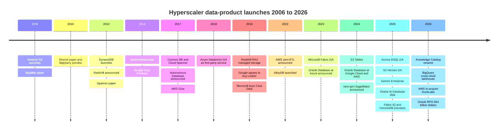
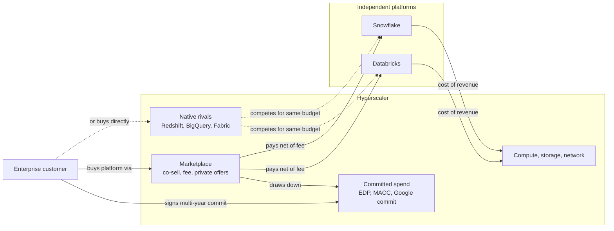

# 28. Hyperscaler Data Platforms: AWS, Google, Microsoft and Oracle
> **Status:** public (four groups): AWS (Amazon, NASDAQ: AMZN) · Google Cloud (Alphabet, NASDAQ: GOOGL) · Microsoft (NASDAQ: MSFT) · Oracle (NYSE: ORCL) · **HQ:** Seattle; Mountain View; Redmond; Austin · **Founded:** Amazon 1994 (AWS 2006); Google 1998; Microsoft 1975; Oracle 1977 · **Latest market cap:** ~$2.6T / ~$3.44T / ~$3.88T / ~$382B (stockanalysis.com, 2026-10-23 to 2026-10-30) · **Last verified:** 2026-11-01

## TL;DR

- **The hyperscalers are the largest database vendors.** AWS, Microsoft, Oracle and Google sit at the top of Gartner's database market-share rankings, in a market Gartner sized at **$119.7B in 2024, up 13.4%** (analyst estimate).[^gartner-dbms] None of the four reports database or analytics revenue separately. Their data products sit inside cloud segments whose growth is now driven mostly by AI infrastructure.
- **The latest quarter shows sharp acceleration, mostly from AI compute rather than data products.** Google Cloud grew **103% to $30.7B** in Q3 2026 (GAAP segment revenue, including TPU system sales).[^goog-q3] Azure grew **48%** in Microsoft's Q1 FY2027 (Jul–Sep 2026; press-reported, ~$33.2B).[^msft-q1] Oracle's cloud infrastructure (OCI) grew **121%** in its Q1 FY2027 (Jun–Aug 2026), and its remaining performance obligations reached **$664B**.[^orcl-q1] AWS's latest quarter could not be checked for this chapter [VERIFY: AWS Q3 2026 segment sales and growth].
- **Each cloud now ships a full data stack, and gives away the parts that create lock-in.** Object storage, an open table format (Iceberg or Delta), a catalog, a warehouse, operational databases, a vector/RAG layer and BI are all offered natively. Catalogs and [zero-ETL](../glossary.md#zero-etl) replication are cheap or free because they pull data and workloads onto the cloud's meters.
- **They compete with Databricks and Snowflake and profit from them at the same time.** Both rent hyperscaler infrastructure as cost of revenue. Both sell through cloud marketplaces that let customers burn down committed-spend contracts. Azure Databricks is a first-party Microsoft service. Meanwhile Redshift, BigQuery, Fabric and Oracle's Autonomous AI Lakehouse go after the same budget.
- **Everpure angle.** The hyperscalers compete with Everpure for the default object-storage tier (S3 is the de facto [lakehouse](../glossary.md#lakehouse) substrate). They are also channels: Everpure Cloud runs natively on Azure. The counter-trend that helps Everpure is sovereign and on-prem demand, which even the hyperscalers are now serving with in-region and on-premises variants.[^ep-acc26]

## Snapshot table

| Item | AWS (Amazon) | Google Cloud (Alphabet) | Microsoft (Azure, Fabric) | Oracle (OCI, Database) |
|---|---|---|---|---|
| Parent market cap | ~$2.6T (2026-10-30) | ~$3.44T (2026-10-30) | ~$3.88T (2026-10-30) | ~$382B; EV ~$515B (2026-10-23) |
| Fiscal year | Calendar | Calendar | Ends Jun 30 (Q1 FY2027 = Jul–Sep 2026) | Ends May 31 (Q1 FY2027 = Jun–Aug 2026) |
| Latest cloud revenue | Last compiled: $33.0B, +20% (Q3 2025, GAAP segment) [VERIFY: Q3 2026] | $30.7B, +103% (Q3 2026, GAAP segment) | Azure ~$33.2B, +48% (Q1 FY2027, press-reported); Microsoft Cloud $63.9B, +30% | OCI ~$7.4B, +121%; total revenue ~$19.35B (Q1 FY2027, press-reported) |
| Backlog signal | n/a in this chapter | n/a in this chapter | n/a in this chapter | RPO $664B, +$209B YoY |
| Cash-flow signal | n/a | Q3 2026 capex $51.4B | n/a | TTM FCF **–$28.7B** (OCF $46.9B less capex $75.7B; non-GAAP) |
| Flagship data products | S3, S3 Tables, Redshift, Aurora, DynamoDB, SageMaker | BigQuery, Spanner, AlloyDB, Looker | Fabric/OneLake, Power BI, Azure SQL, Cosmos DB | Oracle AI Database 26ai, Exadata, Autonomous DB |
| Databricks/Snowflake stance | Host, marketplace, competitor; acquiring DuckLabs | Host, marketplace, competitor | First-party Azure Databricks; Fabric competes | Database@ partner on all three clouds |

*Figure 28.1 — Snapshot. Sources: `data/public_comps.csv` and `data/company_financials.csv` (stockanalysis.com snapshots), Alphabet 8-K, press coverage of the Microsoft and Oracle releases.[^comps][^goog-q3][^msft-q1][^orcl-q1][^orcl-fcf] Segment definitions differ, so the revenue row is not like-for-like.*

## Origin story and strategic arc

### AWS: storage first, everything else on top

Amazon launched S3 in March 2006, before EC2.[^history] Two decades later that ordering still explains AWS's data strategy. S3 became the default place where companies put files, and every later analytics product was built to read from it. DynamoDB (2012) came out of Amazon's 2007 Dynamo paper on its own shopping-cart store.[^dynamo][^history] Redshift (announced November 2012) undercut on-premises warehouses on price, with AWS claiming under $1,000 per TB per year on reserved pricing.[^redshift-2012] Aurora (2014) separated the database engine from a shared, log-structured storage service.[^aurora] Glue and Athena (2016–17) made S3 queryable without loading it anywhere.[^glue-ga]

The 2019 RA3 nodes gave Redshift [separation of storage and compute](../glossary.md#separation-of-storage-and-compute) on top of S3-backed managed storage. That was a direct response to Snowflake.[^ra3-launch] Since 2022 the arc has been about removing pipelines and putting tables *inside* storage. Zero-ETL integrations replicate Aurora and DynamoDB into Redshift.[^zetl-2022][^zetl-ga] S3 Tables (December 2024) made managed Apache Iceberg a native S3 bucket type.[^s3tables] S3 Vectors reached GA at re:Invent 2025.[^reinvent25] In August 2026 AWS agreed to acquire **DuckLabs**, the company behind DuckDB, for an undisclosed sum. DuckDB stays MIT-licensed under the independent DuckDB Foundation, and AWS positions it for agents and in-place analytics on S3.[^ducklabs]

### Google: the research lab that productised its papers

Google's data products are commercial versions of internal systems it first described in research papers: Bigtable (2006), Dremel (2010) and Spanner (2012).[^bigtable][^dremel][^spanner] BigQuery, the public face of Dremel, launched around 2010–2011. It was serverless from day one, so customers never sized a cluster. Its weakness was go-to-market, not technology. Google therefore bought Looker ($2.6B, closed February 2020) for a semantic layer, and Dataform (2020) for SQL transformation.[^looker-acq][^dataform] BigLake and BigQuery Omni then extended BigQuery to open formats and other clouds. The 2025–26 phase is about agents. Agentspace was renamed **Gemini Enterprise** in October 2025, Dataplex Universal Catalog became **Knowledge Catalog** in 2026, and Vertex AI was renamed **Gemini Enterprise Agent Platform** in April 2026.[^gemini-ent][^gcp-kc][^vertex-rename]

### Microsoft: from SQL Server to a SaaS lake

Microsoft's data franchise rests on SQL Server and Excel, and later Power BI. Azure SQL Database and Cosmos DB (2017) moved that franchise to the cloud.[^history] The decisive partnership came in 2017–18. Microsoft made **Azure Databricks** a first-party service, sold, billed and supported by Microsoft, instead of building its own Spark platform.[^adb-ga] Azure Synapse (2019) was a weaker attempt at its own unified analytics. **Microsoft Fabric**, announced in May 2023 and generally available in November 2023, replaced Synapse as the strategic bet. It is a SaaS analytics suite on a single tenant-wide lake, **OneLake**, priced through the same capacity model as Power BI Premium.[^fabric-launch] At Ignite 2025 Microsoft made Fabric's operational databases GA, previewed the **Fabric IQ** semantic layer, and previewed **Azure HorizonDB**, a scale-out PostgreSQL service.[^ignite25]

### Oracle: the incumbent turned AI landlord

Oracle sold the first commercial SQL database in 1979 and still holds the deepest mission-critical OLTP installed base. Its hardware strategy (Exadata, 2008) and the **Autonomous Database** (announced 2017) aimed to keep that base on Oracle-engineered infrastructure.[^history] OCI's "Gen 2" cloud arrived late. Oracle then made two pivots. First, it stopped insisting that customers move to OCI and put Oracle Database hardware *inside* rival clouds: **Oracle Database@Azure** (announced 2023), **@Google Cloud** and **@AWS** (2024).[^history][^oracle-dbazure] Second, it became a capacity landlord for AI labs. That turned OCI into the fastest-growing cloud line in this chapter and filled its backlog. The October 2025 rebrand to **Oracle AI Database 26ai** puts vectors, agents and lakehouse access in the core database.[^oracle-aiworld]

*Figure 28.2 — Twenty years of launches. Each cloud moved from storage and single databases (2006–2014) to managed warehouses (2012–2019), then to open tables inside storage, zero-ETL and agents (2022–2026).*

## Product and technology

### The four stacks side by side

All four clouds now offer every layer of the data stack described in [Ch 1](../01-data-systems-foundations/ch01-data-stack-map.md). The differences lie in *which layer each treats as the anchor*. AWS anchors on storage: S3 is the system of record and everything else reads from it. Google anchors on the query engine, because BigQuery is the product customers come for. Microsoft anchors on the SaaS workspace and the Office/Power BI user. Oracle anchors on the database itself and takes it to whichever cloud the customer prefers.

```mermaid
flowchart LR
    subgraph AWS["AWS: storage-anchored"]
        direction TB
        A1["S3 plus S3 Tables<br/>managed Iceberg"] --> A2["Glue Data Catalog<br/>SageMaker Catalog"]
        A2 --> A3["Redshift, Athena, EMR"]
        A3 --> A4["Aurora, DSQL, DynamoDB"]
        A4 --> A5["Bedrock KBs, S3 Vectors"]
        A5 --> A6["QuickSight"]
    end
    subgraph GCP["Google Cloud: engine-anchored"]
        direction TB
        G1["Cloud Storage plus BigLake<br/>Iceberg"] --> G2["Knowledge Catalog<br/>ex-Dataplex"]
        G2 --> G3["BigQuery<br/>Dremel heritage"]
        G3 --> G4["Spanner, AlloyDB, Bigtable"]
        G4 --> G5["Gemini Enterprise<br/>Agent Platform"]
        G5 --> G6["Looker"]
    end
    subgraph MS["Microsoft: workspace-anchored"]
        direction TB
        M1["ADLS plus OneLake<br/>Delta and Parquet"] --> M2["OneLake catalog<br/>Purview"]
        M2 --> M3["Fabric Warehouse<br/>Azure Databricks"]
        M3 --> M4["Azure SQL, Cosmos DB<br/>Postgres, HorizonDB"]
        M4 --> M5["Microsoft Foundry<br/>Fabric IQ"]
        M5 --> M6["Power BI"]
    end
    subgraph ORA["Oracle: database-anchored"]
        direction TB
        O1["OCI Object Storage<br/>Exadata storage"] --> O2["Data Catalog<br/>Iceberg access"]
        O2 --> O3["Autonomous AI Lakehouse"]
        O3 --> O4["AI Database 26ai<br/>Exadata, Database at clouds"]
        O4 --> O5["AI Vector Search<br/>in-database agents"]
        O5 --> O6["Analytics Cloud"]
    end
```

*Figure 28.3 — Four stacks, top (storage) to bottom (BI). The layers line up, but the centre of gravity differs: S3 for AWS, BigQuery for Google, the Fabric workspace for Microsoft, and the database engine for Oracle.*

| Capability | AWS | Google Cloud | Microsoft | Oracle |
|---|---|---|---|---|
| Object storage | S3 (50 TB max object since re:Invent 2025) | Cloud Storage | Azure Blob / ADLS Gen2; OneLake as logical layer | OCI Object Storage |
| Managed open table | S3 Tables (Iceberg; v3 support) | BigLake Iceberg tables | OneLake Delta (Iceberg via table APIs and metadata virtualisation) | Autonomous AI Lakehouse (Iceberg read/write) [VERIFY: write support] |
| Catalog / governance | Glue Data Catalog, Lake Formation, SageMaker Catalog | Knowledge Catalog (formerly Dataplex Universal Catalog); BigLake metastore (Iceberg REST) | OneLake catalog, Microsoft Purview | OCI Data Catalog; Data Safe |
| Warehouse / SQL analytics | Redshift (RA3, Serverless), Athena | BigQuery | Fabric Data Warehouse; Synapse legacy | Autonomous Data Warehouse |
| Spark / lake processing | EMR, Glue | Dataproc, BigQuery Spark | Fabric Spark; Azure Databricks (first-party) | OCI Data Flow |
| Relational OLTP | Aurora (Postgres/MySQL), RDS | AlloyDB, Cloud SQL | Azure SQL, SQL Server 2025, Azure Database for PostgreSQL | Oracle AI Database 26ai, Exadata, MySQL HeatWave |
| Distributed SQL | Aurora DSQL (GA May 2025) | Spanner | HorizonDB (preview), Cosmos DB for PostgreSQL | Globally Distributed Database |
| NoSQL / key-value | DynamoDB | Bigtable, Firestore | Cosmos DB | Oracle NoSQL; JSON in core DB |
| Zero-ETL / mirroring | Aurora, RDS, DynamoDB to Redshift; apps to S3 Tables | Spanner, AlloyDB, Cloud SQL to BigQuery (GA, Next '26) | Fabric mirroring (Azure SQL, Cosmos DB, Snowflake, others) | GoldenGate; in-database lakehouse |
| Vectors / RAG | S3 Vectors; Bedrock Knowledge Bases; OpenSearch | BigQuery vector search; AlloyDB ScaNN | Azure AI Search; vectors in SQL Server 2025 and Cosmos DB | AI Vector Search in core DB |
| AI / agent platform | Bedrock, SageMaker Unified Studio | Gemini Enterprise Agent Platform (ex-Vertex AI); Gemini Enterprise | Microsoft Foundry; Copilot; Fabric IQ (preview) | OCI Generative AI; in-database agents |
| BI | QuickSight | Looker, Looker Studio | Power BI | Oracle Analytics Cloud |
| Cross-cloud reach | Database Savings Plans; limited | BigQuery cross-cloud lakehouse on AWS/Azure data | OneLake shortcuts to S3, GCS and others | Database@AWS, @Azure, @Google Cloud |
| Third-party lakehouse | Databricks and Snowflake via Marketplace | Databricks and Snowflake via Marketplace | Azure Databricks first-party; Snowflake via Marketplace | Multicloud database partner, not a lakehouse host |

*Figure 28.4 — Product mapping, 14 capabilities by four clouds. Sources: re:Invent 2025, Next '26, Ignite 2025 and Oracle AI World summaries; product documentation.[^reinvent25][^aws-analytics25][^next26][^ignite25][^oracle-aiworld][^onelake-irc][^biglake-irc] Names change often; check current names before using any in a meeting.*

### AWS

**S3 as the substrate.** Almost every lakehouse engine, including Databricks, Snowflake external tables, Trino, DuckDB and ClickHouse, treats the S3 API as the storage interface. AWS's strategy is to move features that used to sit in engines *down into S3*. **S3 Tables** store Iceberg tables in a "table bucket" and run compaction and snapshot clean-up as a managed service. That removes the [small-files problem](../glossary.md#small-files-problem) from the customer's to-do list and makes the table, not the object, the billable unit.[^s3tables] At re:Invent 2025 AWS added an Intelligent-Tiering class and replication for S3 Tables, Iceberg v3 support across EMR, Glue and S3 Tables, and GA of **S3 Vectors**. S3 Vectors offers up to 2B vectors per index at roughly 100 ms query latency, and AWS claims up to 90% lower cost than alternatives (a company claim).[^reinvent25][^aws-analytics25]

**Engines and the unification layer.** Redshift is the warehouse (RA3 managed storage; Serverless billed in RPU-hours). Athena and EMR are the serverless SQL and Spark options. The 2024–25 "next generation of SageMaker" turns SageMaker from an ML tool into the umbrella product. **SageMaker Unified Studio** is a single workspace over Redshift, Athena, EMR, Glue and Bedrock. **SageMaker Lakehouse** exposes S3 and Redshift data through one Iceberg-compatible catalog.[^sm-lakehouse][^aws-analytics25] Glue Data Catalog and Lake Formation remain the permission and metadata engine underneath. The catalog speaks the [Iceberg REST catalog](../glossary.md#iceberg-rest-catalog) protocol, so third-party engines can use it too.[^glue-irc]

**Operational databases.** Aurora is AWS's largest relational franchise (Postgres- and MySQL-compatible, log-structured shared storage). **Aurora DSQL**, GA on 27 May 2025, is a serverless distributed SQL database with multi-Region strong consistency. AWS's availability design targets are 99.99% single-Region and 99.999% multi-Region (company-stated).[^dsql-ga] DynamoDB is the key-value workhorse. **Bedrock Knowledge Bases** packages retrieval-augmented generation: it chunks, embeds and stores documents in a vector store and retrieves them for Bedrock models.[^bedrock-kb] DuckLabs, once integrated, gives AWS an in-process engine that can run inside other services. The Register reports DuckDB-powered analytics already shipping in Aurora PostgreSQL.[^ducklabs]

### Google Cloud

**BigQuery is the product.** BigQuery splits storage (the Colossus file system, in a proprietary columnar format), compute (Dremel "slots") and a distributed in-memory shuffle tier, all joined by Google's datacenter network. Customers pay either per TB scanned (on-demand) or for reserved slot capacity.[^dremel20] Because it was serverless before the term was popular, there is no cluster to size and no idle warehouse to forget, and that is still its main advantage over provisioned rivals. **BigLake** extends BigQuery governance to Iceberg tables in Cloud Storage. Its metastore exposes an Iceberg REST endpoint so Spark and other engines share the same tables.[^biglake-irc] BigQuery ML and Gemini in BigQuery let analysts train models and generate SQL or Python inside the warehouse.

**Next '26 changes.** Real-time replication from Spanner, AlloyDB and Cloud SQL into BigQuery is now GA, with replication to Iceberg tables in preview. A **cross-cloud lakehouse** lets BigQuery query data held in AWS or Azure without moving it. A remote [MCP](../glossary.md#model-context-protocol) server for BigQuery is GA.[^next26] **Knowledge Catalog** (the former Dataplex Universal Catalog; the API names are unchanged) is the governance and semantic-metadata layer. Google pitches it as context for agents, not only as a data inventory.[^gcp-kc]

**Operational databases.** Spanner is the globally distributed SQL database built on [TrueTime](../glossary.md#truetime) (see [Ch 4](../01-data-systems-foundations/ch04-distributed-databases.md)). **AlloyDB** is Google's PostgreSQL-compatible service with a disaggregated storage layer, an in-memory **columnar engine** for analytical queries and **ScaNN**-based vector indexes, Google's own approximate-nearest-neighbour library.[^alloydb] Bigtable (wide-column) and Firestore (document, from the Firebase acquisition) cover the NoSQL end. At the top, **Gemini Enterprise** (formerly Agentspace) is the employee-facing agent product. It searches across enterprise sources and connects to BigQuery and Looker semantics.[^gemini-ent]

### Microsoft

**Fabric and OneLake.** Fabric is a SaaS suite of data engineering (Spark), Data Factory pipelines, a warehouse, real-time intelligence, data science and Power BI. All of it sits on **OneLake**, one logical lake per tenant. OneLake stores tables as Delta Lake (Parquet plus a transaction log) and can expose them to Iceberg readers.[^onelake-irc] Two mechanisms make it "one copy". **Shortcuts** are pointers that mount data in ADLS, S3, Google Cloud Storage and other stores into OneLake without copying it. **Mirroring** continuously replicates operational databases such as Azure SQL, Cosmos DB and Snowflake into OneLake Delta tables. Mirroring compute is free, and each purchased capacity unit includes free mirror storage.[^fabric-mirror] Ignite 2025 made **Fabric databases** (SQL database and Cosmos DB inside Fabric) GA and put **Fabric IQ**, a semantic "ontology" layer for agents, into preview alongside Work IQ and Foundry IQ.[^ignite25]

**Databases and AI.** Azure SQL and **SQL Server 2025** carry the relational franchise. SQL Server 2025 adds a native vector type and vector search [VERIFY: SQL Server 2025 GA date and feature list]. Cosmos DB is the multi-model NoSQL service. Azure Database for PostgreSQL is joined by **Azure HorizonDB** (preview), a scale-out Postgres-compatible service for which Microsoft claims up to 3x the throughput of open-source Postgres (company claim).[^ignite25] **Microsoft Purview** handles classification, lineage and data-loss prevention across Microsoft 365 and Azure (see [Ch 15](../02-pipelines-and-governance/ch15-governance-security-privacy.md)).[^purview] **Microsoft Foundry** (formerly Azure AI Foundry) is the model and agent platform. **Power BI** is the distribution engine that puts Fabric in front of millions of existing users.

### Oracle

**The database is the platform.** **Oracle AI Database 26ai** (October 2025) builds vector search, JSON/relational duality, graph and agent features into the core engine. The pitch is that AI should go to the data rather than data being copied out to AI services.[^oracle-aiworld] **Exadata** is Oracle's engineered system: database servers plus storage servers that run SQL filtering ("smart scan") close to the data, connected by RDMA. Exadata Database Service on **Exascale**, a multi-tenant pooled version, and the **Autonomous AI Lakehouse**, which queries Iceberg data in object stores, were declared GA at Oracle AI World.[^oracle-aiworld] **MySQL HeatWave** adds an in-memory analytics engine to MySQL.

**Database@ every cloud.** Oracle installs Exadata hardware in Microsoft, Google and AWS datacenters and runs Oracle Database there as a service. Customers buy it through the host cloud's marketplace and draw down their commitment with that cloud. As of October 2025 Database@Azure ran in 28 regions and Database@Google Cloud in 8, with 9 more planned. Oracle Database@AWS was expanding, but we found no official region count.[^oracle-dbazure][^oracle-aiworld] This is the clearest case of coopetition in the chapter: three rivals host Oracle's hardware because their customers' most important databases run on it.

> **Going deeper (L3).** BigQuery's speed comes from three disaggregated tiers, not from one clever index. Storage sits on Colossus in a columnar format, with encoding and statistics that let the engine skip data. Compute is a pool of Dremel workers ("slots") assigned per query stage. Intermediate results pass through a separate remote-memory **shuffle** service, so stages scale independently and a failed worker does not lose shuffle data. The 2020 VLDB retrospective by Melnik et al. walks through how serverless scheduling, disaggregated shuffle and columnar storage evolved from the 2010 design.[^dremel20] AWS Redshift RA3 and Snowflake reached a similar separation by caching hot data on local SSD in front of object storage.

## How it makes money

### Pricing units and where the margin sits

Hyperscalers price data products in infrastructure-like units: GB-month of storage, requests, TB scanned (Athena, BigQuery on-demand), slot-hours or RPU-hours (BigQuery editions, Redshift Serverless), DynamoDB read/write units, and **capacity units** (Fabric and Power BI Premium, a reserved pool shared by every Fabric workload; see [capacity-based pricing](../glossary.md#capacity-based-pricing)). The data product rarely needs to earn its keep on its own. It earns its return through the compute, storage and network it pulls through. A BigQuery customer also buys Cloud Storage, Dataflow, Vertex/Gemini tokens and egress. A Fabric customer has usually already paid for Microsoft 365 and Power BI seats.

That is why the parts that create stickiness are cheap or free:

- **Catalogs.** Glue Data Catalog charges small per-object and per-request fees. Google bundles core Knowledge Catalog metadata with BigQuery, and Microsoft folds the OneLake catalog into Fabric capacity. A free catalog is a customer-acquisition cost for the layer that decides which engine can read the data (see [Ch 8](../01-data-systems-foundations/ch08-catalogs-and-metastores.md)).
- **[Zero-ETL](../glossary.md#zero-etl) and mirroring.** AWS does not charge separately for the replication of Aurora-to-Redshift zero-ETL (the customer pays for the source and target), and Fabric mirroring compute is free.[^zetl-ga][^fabric-mirror] Removing the pipeline removes a reason to use Fivetran, Informatica or Databricks Lakeflow. It also removes a reason to keep the analytical copy anywhere but the same cloud. Zero-ETL works like a moving company that unpacks your boxes for free, but only into its own house. See [Ch 9](../02-pipelines-and-governance/ch09-pipeline-patterns.md).
- **Free migration and credits.** Database migration tools and migration-funding credits work the same way: the cloud pays the switching cost once and earns the run-rate for years.

### Committed spend: the hyperscaler's take-or-pay

Large customers sign multi-year **committed-spend agreements**. AWS's has historically been called the Enterprise Discount Program (EDP; now generally a private pricing agreement), Microsoft's is the **Microsoft Azure Consumption Commitment (MACC)**, and Google has equivalent commit contracts. The customer promises to spend, say, $100M over three years in exchange for a discount. Any shortfall is still billed. Purchases of eligible third-party software through the cloud's **marketplace** count toward the commitment. Microsoft documents that eligible Azure Marketplace purchases count toward MACC.[^macc] AWS and Google have comparable marketplace-drawdown rules, with contract-specific limits [VERIFY: current AWS and Google rules on what share of marketplace spend counts toward commits].

> **Bridge: take-or-pay supply agreements.** A MACC or EDP is the cloud equivalent of a **take-or-pay wafer or memory supply agreement**. The buyer commits to a volume and pays for the shortfall, and the supplier gets the visibility it needs to build capacity, here datacenters. Marketplace drawdown is the clever twist. It is as if TSMC let a customer's committed wafer volume be spent on a *third party's* chips, provided the order flowed through TSMC's books. Databricks and Snowflake sell more because customers spend money already committed. The hyperscaler keeps the commit intact, earns a marketplace fee and also hosts the workload. Oracle's $664B of RPO is the supplier-side mirror image: take-or-pay capacity contracts signed *by* AI labs *with* the landlord.[^orcl-q1]

### Group-level economics

Data products sit inside very different segment economics. Google Cloud's operating income rose to **$11.1B in Q3 2026, from $3.6B a year earlier**, on $30.7B of revenue (GAAP).[^goog-q3] Oracle is in the opposite phase. Its trailing-twelve-month capex of **$75.7B** exceeded operating cash flow of **$46.9B**, leaving free cash flow of **–$28.7B** (non-GAAP, OCF less capex, as of 2026-10-20). Oracle also sold **$20B of common stock** to help fund the build.[^orcl-fcf][^comps] Database licences and support (Oracle's legacy high-margin franchise) are effectively funding an AI-infrastructure build whose returns depend on a few large tenants.

## Financials

None of the four reports a "data platform" line. The best public proxies are the cloud segments in Figure 28.5. These mix data products with general compute and, increasingly, AI accelerators.

*Figure 28.5 — Cloud growth roughly doubled to tripled between 2025 and 2026 for Google, Microsoft and Oracle, driven by AI capacity. AWS is shown only through Q3 2025 because its latest quarter could not be verified for this chapter. Source: `data/ch28_cloud_segments.csv`.[^segments]*

| Provider | Latest period | Cloud revenue | YoY growth | Basis | What drove it |
|---|---|---|---|---|---|
| AWS | Q3 2025 (last compiled) | $33.0B | +20% | GAAP segment (drafter-compiled) | Re-acceleration from 17% as AI capacity came online [VERIFY: Q3 2026 figures][^segments] |
| Google Cloud | Q3 2026 | $30.7B | +103% | GAAP segment | TPU system sales and AI infrastructure; operating income $11.1B[^goog-q3] |
| Microsoft Azure | Q1 FY2027 (Jul–Sep 2026) | ~$33.2B | +48% | Press-reported (first Azure dollar figure) | AI capacity; beat 44–45% constant-currency guide[^msft-q1] |
| Oracle OCI | Q1 FY2027 (Jun–Aug 2026) | ~$7.4B | +121% | Press-reported | CPU/GPU infrastructure ~$6.5B, +151%; Q2 cloud guide +65–71%[^orcl-q1] |

*Figure 28.6 — Latest cloud segment figures. Segment definitions differ: Google Cloud includes Workspace; Microsoft reports "Azure and other cloud services"; OCI is Oracle's infrastructure line only.*

**AWS.** In the last quarter we could verify, AWS grew 20% to $33.0B (Q3 2025). That was a re-acceleration from 17–17.5% in the first half of 2025.[^segments] It remains the largest cloud by revenue, but in 2024–25 it grew slowest of the four. Amazon's market cap was about $2.6T on 2026-10-30.[^comps] The latest AWS print (Q3 2026, reported in late October 2026) must be added before this chapter is published [VERIFY: AWS Q3 2026 segment sales, growth and operating income from Amazon's 8-K].

**Google Cloud.** The 103% growth is real but needs careful reading. Coverage of the 8-K notes that TPU system sales contributed, meaning Google is now selling AI accelerator systems, not just renting them.[^goog-q3][^comps] Alphabet's Q3 2026 capex was **$51.4B**. Shares fell more than 8% after the report (press-reported), which suggests investors weighed the capex against the growth.[^comps] For data-platform analysis, BigQuery's share of this revenue is not disclosed.

**Microsoft.** Total revenue was $92.3B in Q1 FY2027 (press-reported), and the Microsoft Cloud reached $63.9B, up 30%.[^msft-q1] Microsoft disclosed Azure's dollar revenue for the first time that quarter, at about $33.2B. That puts Azure roughly level with AWS's last compiled quarter, though the two are defined differently [VERIFY vs Microsoft IR]. Fabric revenue is not broken out.

**Oracle.** Q1 FY2027 total revenue was about $19.35B (GAAP, press-reported). OCI made up ~$7.4B of it, and RPO reached **$664B, up $209B year over year**.[^orcl-q1] An increase of $209B implies about $455B a year earlier, consistent with the jump Oracle reported in September 2025. Press reports attributed most of that earlier jump to a multi-year compute contract with **OpenAI**, reported by the *Wall Street Journal* at roughly **$300B over about five years** from 2027 (press-reported; Oracle did not name the counterparty in its release).[^openai-oracle] Oracle guides FY2027 revenue to at least $90B, and EV/NTM revenue was ~5.7x as of 2026-10-23, with EV well above market cap because of net debt.[^comps] Bulls see the backlog as AI-era revenue visibility. Bears note that it is concentrated, back-loaded and funded with debt and equity while FCF is negative.

## Customers and go-to-market

### Coopetition with Databricks and Snowflake

The relationship between the hyperscalers and the independent data platforms is the most important commercial dynamic in this market. Every Databricks or Snowflake dollar produces hyperscaler revenue *three* ways: infrastructure the platform buys as cost of revenue, marketplace fees, and drawdown of the customer's commitment. It also *displaces* a dollar the customer might have spent on Redshift, BigQuery or Fabric.

*Figure 28.7 — Coopetition. Solid arrows are money flows; dotted arrows are competition. The hyperscaler wins on infrastructure and the commitment whichever platform the customer picks, which is why it co-sells its competitors.*

**Microsoft's version is the deepest.** Azure Databricks has been a first-party Azure service since its March 2018 GA. Microsoft sells it, bills it and supports it at the first tier, and its consumption counts toward MACC like any Azure service.[^adb-ga] Microsoft has also been a Databricks investor since at least the 2019 Series E.[^funding] Yet Fabric is Microsoft's own product for the same buyers, and Fabric mirroring can replicate Snowflake and Azure Databricks data into OneLake.[^fabric-mirror] Microsoft wins either way, but its field sales incentives decide which way. That makes the Microsoft relationship Databricks' biggest single channel risk (see [Ch 25](ch25-databricks.md)).

**AWS and Google run the marketplace version.** Databricks and Snowflake both sell through AWS Marketplace and Google Cloud Marketplace, and on AWS they are among the most significant sellers by volume. We could not confirm a current company-stated marketplace sales figure for either [VERIFY: company-stated AWS Marketplace sales for Snowflake and Databricks]. On the supply side, Snowflake's filings describe large multi-year capacity commitments to its cloud providers, chiefly AWS [VERIFY: the current amount and term of Snowflake's AWS purchase commitment from its latest 10-K]. Databricks' serverless products move cloud cost into its own cost of revenue in the same way (see [Ch 25](ch25-databricks.md) and [Ch 26](ch26-snowflake.md)).

> **Bridge: IDMs and fabless chip companies.** The hyperscalers are **integrated device manufacturers (IDMs)**: they own the fabs (datacenters), design their own chips (Graviton, TPU, Maia) and sell finished products (Redshift, BigQuery, Fabric). Databricks and Snowflake are **fabless**: they design the product and rent fab capacity from the IDMs, so infrastructure sits in their cost of revenue. Snowflake's ~75% non-GAAP product gross margin (Q2 FY2027) is the fabless margin after paying its foundry.[^sf-q2] As in semiconductors, fabless firms often out-execute the IDM's in-house design team. The IDM is happy to sell them capacity, but it controls pricing, roadmap timing and the customer relationship at contract renewal. The IDM's best weapon is not a better chip. It is bundling, as Intel's platform discounts once showed. Fabric bundled with Power BI, and zero-ETL bundled with Aurora, play that role here.

### Fabric adoption and market share

Microsoft said at FabCon 2025 that Fabric had more than **19,000 paying customers** (company-stated, via a secondary recap).[^fabric-cust] Later earnings calls cited higher counts, which we could not verify for this chapter [VERIFY: latest company-stated Fabric paid-customer count and revenue growth]. A paying customer can be a small capacity purchase, so the count says more about reach than depth. Fabric's real advantage is distribution. Every Power BI Premium tenant already has capacity that can run Fabric workloads.

On market share, Gartner's DBMS research puts the total market at **$119.7B in 2024** (analyst estimate, +13.4%) and has for several years ranked Microsoft, AWS, Oracle and Google as the four largest DBMS vendors by revenue, ahead of Databricks and Snowflake.[^gartner-dbms] The vendor order and shares in the latest edition sit behind Gartner's paywall [VERIFY: 2024 or 2025 vendor ranking and shares from a public Gartner summary]. Cloud DBMS made up a majority of the market by 2024 (estimated from Gartner abstracts; see `data/market_sizes.csv`).[^gartner-dbms]

## M&A and investments

Hyperscalers mostly build data products rather than buy them. When they do buy, they buy a missing layer or a developer community, not revenue.

| Date | Acquirer | Target | Value | Rationale | Outcome |
|---|---|---|---|---|---|
| Oct 2014 | Google | Firebase | Undisclosed | Mobile backend-as-a-service | Became Firestore and Google's app platform[^ma] |
| Jan 2019 | Microsoft | Citus Data | Undisclosed | Distributed Postgres | Azure Cosmos DB for PostgreSQL; feeds the Postgres strategy behind HorizonDB[^ma] |
| Feb 2019 | Google | Alooma | Undisclosed | Pipelines into BigQuery | Folded into migration tooling[^ma] |
| Jun 2019 (closed Feb 2020) | Google | Looker | $2.6B (disclosed) | Semantic layer and BI | Google Cloud's BI and semantic layer[^looker-acq] |
| Dec 2020 | Google | Dataform | Undisclosed | SQL transformation | Free inside BigQuery[^dataform] |
| Aug 2026 | AWS | DuckLabs (DuckDB) | Undisclosed | In-process analytics for agents and S3 | Announced; DuckDB stays MIT under the DuckDB Foundation; close not confirmed [VERIFY][^ducklabs] |
| 2009 | Oracle | GoldenGate | Undisclosed | Log-based replication | Still Oracle's replication and CDC product[^goldengate] |

*Figure 28.8 — Selected data-layer deals. Most hyperscaler data M&A is a tuck-in. The strategic money goes into capex and minority stakes instead.*

The larger "investments" are stakes in the independents. Microsoft, AWS and Google's CapitalG appear in Databricks' funding history.[^funding] A strategic stake in a company you also compete with is a hedge: it keeps the partner aligned and pays off if the partner wins.

## Competitive position

| Dimension | AWS | Google Cloud | Microsoft | Oracle | Databricks | Snowflake |
|---|---|---|---|---|---|---|
| Anchor asset | S3 | BigQuery | Fabric workspace and Power BI estate | Oracle Database and Exadata | Unity Catalog and lakehouse | Managed warehouse and Horizon |
| Open-format stance | Iceberg in S3 Tables | Iceberg via BigLake | Delta-native, Iceberg-readable | Iceberg via Autonomous AI Lakehouse | Delta plus UniForm (Iceberg) | Iceberg tables GA; Polaris |
| Multi-cloud reach | Weak | Medium (cross-cloud lakehouse) | Medium (shortcuts) | Strong (Database@ three clouds) | Strong (three clouds) | Strong (three clouds) |
| Operational DB depth | Very high | High | High | Very high (mission-critical) | Emerging (Lakebase) | Emerging (Snowflake Postgres) |
| BI distribution | Weak (QuickSight) | Medium (Looker) | Very high (Power BI) | Low | Medium (AI/BI) | Low |
| Agent story | Bedrock, SageMaker | Gemini Enterprise and Agent Platform | Foundry, Copilot, Fabric IQ | In-database agents | Agent Bricks, Genie One | CoWork, Cortex |
| Scale marker | ~$33B a quarter (last compiled) | $30.7B a quarter, +103% | Azure ~$33.2B a quarter, +48% | OCI ~$7.4B, +121%; RPO $664B | >$7B run-rate (company-stated) | $1.55B a quarter, +35% (GAAP) |

*Figure 28.9 — Competitive matrix (author judgment on the qualitative rows). Sources: Figures 28.4–28.6; Databricks and Snowflake releases.[^db-7b][^sf-q2] Scale markers are not like-for-like.*

The matrix shows why no cloud has displaced the independents. Each hyperscaler is strongest *inside* its own cloud, but large enterprises run two or three clouds and want one governance and analytics layer across them. Databricks and Snowflake are the neutral option. Oracle has made itself neutral at the database layer by taking Exadata into every cloud. Google's cross-cloud lakehouse and Microsoft's OneLake shortcuts are each an attempt to reach into rivals' storage without asking customers to move data.

## Why it's winning / bull case

1. **Distribution and bundling beat features.** Fabric reaches every Power BI tenant. Zero-ETL reaches every Aurora customer. BigQuery reaches every Google Workspace and Google Ads analytics team. Even "good enough" products win when they come pre-installed and draw down an existing commitment.
2. **Storage gravity.** Most enterprise lakehouse data already lives in S3, ADLS or Cloud Storage. S3 Tables and S3 Vectors move table and vector management into the storage service, so the hyperscaler owns the layer that independent engines depend on.[^s3tables][^reinvent25]
3. **They profit from their competitors.** Infrastructure, marketplace fees and commitment drawdown mean a Databricks or Snowflake win is still a hyperscaler win. That is a hedge no independent vendor has.
4. **Operational databases are the moat.** Aurora, DynamoDB, Spanner, Azure SQL, Cosmos DB and Oracle Database hold the systems of record. Zero-ETL from those systems to the cloud's own warehouse is the shortest path to analytics.
5. **AI demand is filling the capacity.** Triple-digit growth at Google Cloud and OCI, and 48% at Azure, show that AI workloads are landing on hyperscaler infrastructure, and data products ride along.[^goog-q3][^msft-q1][^orcl-q1]

## Risks / bear case and open questions

1. **Data products are a rounding error inside AI-capex stories.** Growth is now driven by GPU and TPU capacity. If AI demand slows, the capex (Alphabet $51.4B in one quarter; Oracle $75.7B TTM) becomes a depreciation burden, and data products cannot fill the gap.[^comps][^orcl-fcf]
2. **Oracle's concentration and funding risk.** A $664B backlog sits on top of negative FCF, heavy net debt and a $20B stock sale. Much of it is reportedly tied to one counterparty whose own financing depends on capital markets.[^orcl-q1][^openai-oracle]
3. **Open formats erode lock-in.** Iceberg and Delta on customer-owned storage, governed by an open catalog, let any engine bid for any workload. The hyperscalers helped standardise those formats, and in doing so lowered the cost of leaving their own warehouses.
4. **Product sprawl and renames.** Agentspace became Gemini Enterprise, Dataplex became Knowledge Catalog, Vertex AI became the Agent Platform, and Azure AI Foundry became Microsoft Foundry. Constant renaming signals strategic churn and confuses buyers. The independents' single-platform story is easier to sell.
5. **Regulation and sovereignty.** EU Data Act switching rules and sovereign-cloud requirements raise the cost of the hyperscalers' bundling tactics and favour in-country or on-prem options.
6. **Open questions.** What share of cloud revenue is data and analytics? How much Databricks and Snowflake consumption flows through marketplaces? Does Fabric's customer growth turn into a large share of warehouse spend? What will AWS do with DuckDB?

## Relevance to Everpure

**Compete.** The hyperscalers' object stores are the default home of lakehouse and AI data, and AWS is now building tables (S3 Tables) and vectors (S3 Vectors) into the storage service.[^s3tables][^reinvent25] That raises the bar for any on-prem object platform: it needs Iceberg-aware management and vector-ready pipelines, not just S3 API compatibility.

**Partner.** Everpure Cloud supports Azure-native VMs (GA announced at Accelerate 2026). Everpure's Data Intelligence connectors cover object stores, Databricks, Snowflake, SQL Server and Oracle.[^ep-acc26][^ep-di] Everpure is also a launch partner in the Databricks Storage Ecosystem, so Databricks workspaces running on the hyperscalers can govern and query tables held on Everpure storage through OpenSharing.[^storage-eco][^everpure-os]

**The counter-trend.** Sovereignty and AI-data gravity are pushing some data back toward customer-controlled infrastructure. The hyperscalers themselves concede the point with Oracle Database@ deployments, sovereign-cloud regions and on-premises variants (Azure Local, Google Distributed Cloud, Oracle Cloud@Customer) [VERIFY: current status of AWS European Sovereign Cloud].[^oracle-dbazure]

> **Storage bridge.** For a hyperscaler, storage is a loss-leader-adjacent substrate whose real value is the compute it attracts. S3 Tables and S3 Vectors push table maintenance and vector search into that substrate. An on-prem object platform competes on where data must live and on the metadata it exposes, not on raw throughput. See the companion *Everpure Tech Atlas* for S3 semantics and object performance.

**Options a strategy team might evaluate, based on public information:**

| Option | What it would mean | Why it could matter | Watch-outs |
|---|---|---|---|
| Marketplace listings that draw down MACC/EDP | Sell Everpure Cloud and Evergreen subscriptions through Azure and AWS marketplaces | Customers can spend committed cloud budgets on Everpure; co-sell access | Marketplace fees; the hyperscaler controls the shelf |
| Iceberg-aware on-prem object tier | Offer S3 Tables-like managed Iceberg maintenance on FlashBlade | Matches the hyperscaler feature set for sovereign lakehouses | Requires catalog interoperability (Polaris, Unity, Glue REST) |
| Sovereign AI-data positioning | Target regulated customers who cannot use public-cloud storage for AI data | Aligns with Data Stream and Data Intelligence | Hyperscaler sovereign regions narrow the gap |
| Data Intelligence as the cross-cloud classifier | Classify data across S3, ADLS, OneLake and on-prem stores | Neutral layer that no single cloud provides | Purview and Knowledge Catalog are bundled and free-ish |

*Figure 28.10 — Options (public information only).*

See [Ch 24](../03-ai-data-stack/ch24-data-meets-compute-and-storage.md) for data-gravity and egress economics and [Ch 40](../05-business-and-economics/ch40-gtm-partnerships.md) for marketplace co-sell mechanics.

## Conversation playbook

**Three questions for hyperscaler product leaders or partner managers**

1. "What share of your data and analytics consumption comes through third-party platforms on the marketplace versus native services, and how is the field compensated for each?" *A good answer* admits that both count toward quota and commitment, and explains where native products get extra incentives.
2. "Which marketplace purchases count toward a customer's commitment, and at what percentage?" *A good answer* names the eligibility rules and any caps, and separates private offers from list purchases.
3. "Is the catalog (Glue, Knowledge Catalog, OneLake catalog) meant to govern data that other engines read, or only your own engines?" *A good answer* names the Iceberg REST endpoints, credential vending and which external engines are supported.

**Three questions for engineers or partner architects**

1. "When an S3 Tables or BigLake Iceberg table is written by your engine, can Databricks or Snowflake write to it safely too?" *Good:* specifics on catalog-mediated commits and which engines are certified for writes, not just reads.
2. "How does zero-ETL or mirroring handle schema changes and deletes, and what is the end-to-end lag?" *Good:* a clear description of the CDC path, its limits, and what happens on a source schema change.
3. "With Database@Azure or @AWS, where does the Exadata hardware sit, who operates it, and how does networking to the host cloud work?" *Good:* Oracle-operated hardware in the host's datacenter, a low-latency private interconnect, and billing through the host cloud.

**What good answers sound like.** They separate *storage*, *catalog* and *engine*, and say which layer creates lock-in. They use the vendors' own units (slots, RPUs, capacity units) and acknowledge that marketplace co-sell means the hyperscaler often wins whichever product the customer picks.

**Don't say this**

- "Google Cloud's 103% growth shows BigQuery is beating Snowflake." *The growth is mostly AI infrastructure, including TPU system sales; BigQuery revenue is not disclosed.*
- "Oracle has $664B of revenue coming." *RPO is contracted backlog, heavily back-loaded, concentrated and subject to the counterparty's ability to pay.*
- "Azure Databricks is a Microsoft product." *It is Databricks' platform sold and billed by Microsoft as a first-party service; Microsoft's own product is Fabric.*
- "Fabric stores data in a proprietary format." *OneLake stores Delta/Parquet and exposes Iceberg-compatible metadata.*
- "Hyperscalers want to kill Databricks and Snowflake." *They profit from both through infrastructure, marketplace fees and commitment drawdown.*
- "Dataplex" or "Agentspace" as current names. *They are now Knowledge Catalog and Gemini Enterprise.*

## Key terms

- [Hyperscaler](../glossary.md#hyperscaler) — a cloud provider operating at global datacenter scale (AWS, Microsoft Azure, Google Cloud; often Oracle OCI).
- [Committed spend](../glossary.md#committed-spend) — a multi-year contract to spend a minimum amount with a cloud in exchange for discounts.
- [MACC](../glossary.md#macc) — Microsoft Azure Consumption Commitment, Microsoft's committed-spend contract.
- [EDP](../glossary.md#edp) — AWS Enterprise Discount Program, AWS's historical committed-spend contract.
- [Cloud marketplace](../glossary.md#cloud-marketplace) — a hyperscaler storefront where third-party software is bought on the cloud bill.
- [Marketplace drawdown](../glossary.md#marketplace-drawdown) — counting marketplace purchases against a customer's cloud commitment.
- [First-party service](../glossary.md#first-party-service) — a partner product sold, billed and supported by the cloud provider itself, such as Azure Databricks.
- [Coopetition](../glossary.md#coopetition) — competing and cooperating with the same company at the same time.
- [S3 Tables](../glossary.md#s3-tables) — AWS's managed Apache Iceberg tables stored in S3 table buckets.
- [S3 Vectors](../glossary.md#s3-vectors) — AWS's vector storage and query capability built into S3.
- [OneLake](../glossary.md#onelake) — Microsoft Fabric's single tenant-wide logical data lake.
- [OneLake shortcut](../glossary.md#onelake-shortcut) — a pointer that mounts external data into OneLake without copying it.
- [Microsoft Fabric](../glossary.md#microsoft-fabric) — Microsoft's SaaS analytics suite built on OneLake and Power BI capacity.
- [BigQuery](../glossary.md#bigquery) — Google's serverless data warehouse descended from Dremel.
- [Slot](../glossary.md#slot) — BigQuery's unit of query compute capacity.
- [Knowledge Catalog](../glossary.md#knowledge-catalog) — Google Cloud's governance and metadata catalog, formerly Dataplex Universal Catalog.
- [Exadata](../glossary.md#exadata) — Oracle's engineered database hardware that pushes SQL filtering into storage servers.
- [Database at hyperscaler](../glossary.md#database-at-hyperscaler) — Oracle's model of running Exadata-based Oracle Database inside Azure, Google Cloud and AWS datacenters.
- [Remaining performance obligations](../glossary.md#remaining-performance-obligations) — contracted revenue not yet recognised (backlog).
- [Take-or-pay](../glossary.md#take-or-pay) — a contract in which the buyer pays for committed volume whether or not it uses it.
- [Zero-ETL](../glossary.md#zero-etl) — managed replication that makes operational data queryable in analytics without a customer-built pipeline.
- [Data mirroring](../glossary.md#data-mirroring) — continuously replicating a source database into another platform's storage.
- [Iceberg REST catalog](../glossary.md#iceberg-rest-catalog) — the open HTTP protocol through which engines read and commit Iceberg tables.
- [Capacity-based pricing](../glossary.md#capacity-based-pricing) — paying for a reserved pool of compute rather than per query.
- [Separation of storage and compute](../glossary.md#separation-of-storage-and-compute) — scaling storage and query compute independently.
- [Lakehouse](../glossary.md#lakehouse) — warehouse-grade management and performance on open files in object storage.
- [Data sovereignty](../glossary.md#data-sovereignty) — the requirement that data stay under a given jurisdiction's laws and control.
- [Integrated device manufacturer](../glossary.md#integrated-device-manufacturer) — a chip company that both designs and fabricates its chips; used here as the hyperscaler analogy.
- [Fabless](../glossary.md#fabless) — a chip company that designs but rents manufacturing; used here as the Databricks/Snowflake analogy.

## Sources

[^gartner-dbms]: Gartner, "Market Share: Database Management Systems, Worldwide" (abstracts), https://www.gartner.com/en/documents/6494271 and https://www.gartner.com/en/documents/5441963, published 2025; The Register, "Gartner DBMS chart," https://www.theregister.com/2026/04/21/gartner_bamboozling_dbms_chart_shows/, published 2026-04-21; via AI Data Atlas `data/market_sizes.csv` (2024 = $119.7B, +13.4%); retrieved 2026-11-01. Analyst estimate; vendor ranking not re-verified [VERIFY].
[^goog-q3]: Alphabet Inc., Form 8-K Exhibit 99.1, "Alphabet Announces Third Quarter 2026 Results," https://www.sec.gov/Archives/edgar/data/0001652044/000165204426000080/googexhibit991q32026.htm, published 2026-10-28; via `data/public_comps.csv`; retrieved 2026-11-01. GAAP.
[^msft-q1]: Runtime Wire, "Microsoft revenue hits $92.3 billion as Azure growth accelerates to 48%," https://runtimewire.com/article/microsoft-revenue-hits-92-3-billion-as-azure-growth-accelerates-to-48, published 2026-10; via `data/public_comps.csv`; retrieved 2026-11-01. Press-reported; FY2027 Q1 = Jul–Sep 2026 [VERIFY vs Microsoft IR].
[^orcl-q1]: StorageNewsletter, "Oracle fiscal 1Q27 financial results," https://storagenewsletter.com/2026/09/23/oracle-fiscal-1q27-financial-results, published 2026-09-23; via `data/public_comps.csv`; retrieved 2026-11-01. Press-reported summary of Oracle's release; FY2027 Q1 = Jun–Aug 2026.
[^orcl-fcf]: AI Data Atlas `data/company_financials.csv`, Oracle TTM operating cash flow $46,940M, capex –$75,660M, FCF –$28,720M (stockanalysis.com, https://stockanalysis.com/stocks/orcl/statistics/), as of 2026-10-20; retrieved 2026-11-01. GAAP inputs; FCF non-GAAP.
[^comps]: AI Data Atlas `data/public_comps.csv`, rows for Amazon, Alphabet, Microsoft and Oracle (stockanalysis.com market-cap and statistics pages, https://stockanalysis.com/stocks/amzn/market-cap/ etc.), as of 2026-10-23 to 2026-10-30; retrieved 2026-11-01.
[^segments]: AI Data Atlas `data/ch28_cloud_segments.csv` (Amazon, Alphabet, Microsoft and Oracle quarterly releases; 2024–2025 rows drafter-compiled from company releases and not re-fetched this session [VERIFY]); retrieved 2026-11-01.
[^history]: Company announcements compiled by the drafter, not re-fetched this session [VERIFY URLs]: AWS, "Announcing Amazon S3," https://aws.amazon.com/about-aws/whats-new/2006/03/13/announcing-amazon-s3---simple-storage-service/, 2006-03-14; W. Vogels, "Amazon DynamoDB," https://www.allthingsdistributed.com/2012/01/amazon-dynamodb.html, 2012-01-18; Microsoft Azure blog (Cosmos DB, Build 2017), 2017-05; Oracle (Exadata, 2008; Autonomous Database, OpenWorld 2017; Database@Google Cloud, 2024-06; Database@AWS, 2024-09); retrieved 2026-11-01.
[^dynamo]: G. DeCandia et al., "Dynamo: Amazon's Highly Available Key-value Store," SOSP 2007, https://www.allthingsdistributed.com/files/amazon-dynamo-sosp2007.pdf, published 2007-10; retrieved 2026-11-01.
[^redshift-2012]: Computerworld, "Amazon introduces data warehouse service," https://www.computerworld.com/article/1401411/amazon-introduces-data-warehouse-service.html, published 2012-11-28; retrieved 2026-11-01. AWS pricing claim.
[^aurora]: A. Verbitski et al., "Amazon Aurora: Design Considerations for High Throughput Cloud-Native Relational Databases," SIGMOD 2017, https://pdos.csail.mit.edu/6.824/papers/aurora.pdf, published 2017-05; W. Vogels, "Amazon Aurora ascendant," https://www.allthingsdistributed.com/2019/03/amazon-aurora-design-cloud-native-relational-database.html, published 2019-03; retrieved 2026-11-01.
[^glue-ga]: AWS What's New, "Amazon Athena now integrates with AWS Glue," https://aws.amazon.com/about-aws/whats-new/2017/08/amazon-athena-now-integrates-with-aws-glue, published 2017-08-14; retrieved 2026-11-01.
[^ra3-launch]: AWS What's New, "Amazon Redshift introduces RA3 nodes with managed storage enabling independent compute and storage scaling," https://aws.amazon.com/about-aws/whats-new/2019/12/amazon-redshift-announces-ra3-nodes-managed-storage/, published 2019-12; retrieved 2026-11-01.
[^zetl-2022]: Amazon, "AWS Announces Two New Capabilities to Move Toward a Zero-ETL Future on AWS," https://press.aboutamazon.com/2022/11/aws-announces-two-new-capabilities-to-move-toward-a-zero-etl-future-on-aws, published 2022-11-29; retrieved 2026-11-01.
[^zetl-ga]: AWS What's New, "AWS announces general availability of Amazon Aurora MySQL zero-ETL integration with Amazon Redshift," https://aws.amazon.com/about-aws/whats-new/2023/11/aws-general-availability-amazon-aurora-mysql-zero-etl-integration-redshift/, published 2023-11-07; retrieved 2026-11-01.
[^s3tables]: AWS News Blog, "New Amazon S3 Tables: Storage optimized for analytics workloads," https://aws.amazon.com/blogs/aws/new-amazon-s3-tables-storage-optimized-for-analytics-workloads/, published 2024-12-03; retrieved 2026-11-01. Performance figures are vendor claims.
[^reinvent25]: AWS News Blog, "Top announcements of AWS re:Invent 2025," https://aws.amazon.com/blogs/aws/top-announcements-of-aws-reinvent-2025, published 2025-12; Blocks & Files, "AWS piles on S3 upgrades from vector search to 50 TB objects," https://www.blocksandfiles.com/ai-ml/2025/12/03/aws-piles-on-s3-upgrades-from-vector-search-to-50-tb-objects/1704690, published 2025-12-03; retrieved 2026-11-01.
[^aws-analytics25]: AWS Big Data Blog, "AWS analytics at re:Invent 2025: unifying data, AI and governance at scale," https://aws.amazon.com/blogs/big-data/aws-analytics-at-reinvent-2025-unifying-data-ai-and-governance-at-scale, published 2025-12; retrieved 2026-11-01.
[^sm-lakehouse]: AWS News Blog, "Amazon S3 Tables integration with Amazon SageMaker Lakehouse is now generally available," https://aws.amazon.com/blogs/aws/amazon-s3-tables-integration-with-amazon-sagemaker-lakehouse-is-now-generally-available, published 2025-03-13; retrieved 2026-11-01.
[^glue-irc]: AWS Storage Blog, "Access data in Amazon S3 Tables using PyIceberg through the AWS Glue Iceberg REST endpoint," https://aws.amazon.com/blogs/storage/access-data-in-amazon-s3-tables-using-pyiceberg-through-the-aws-glue-iceberg-rest-endpoint/, n.d.; retrieved 2026-11-01.
[^dsql-ga]: AWS What's New, "Amazon Aurora DSQL is now generally available," https://aws.amazon.com/about-aws/whats-new/2025/05/amazon-aurora-dsql-generally-available, published 2025-05-27; Business Wire, https://www.businesswire.com/news/home/20250527678337/en, 2025-05-27; retrieved 2026-11-01. Company-stated design targets.
[^bedrock-kb]: AWS, "Retrieve data and generate AI responses with Amazon Bedrock Knowledge Bases," Amazon Bedrock User Guide, https://docs.aws.amazon.com/bedrock/latest/userguide/knowledge-base.html, living document; retrieved 2026-11-01 [VERIFY: page not re-fetched; product naming as of 2026].
[^ducklabs]: Amazon, "AWS to acquire DuckLabs," https://www.aboutamazon.com/news/company-news/aws-ducklabs, published ~2026-08-25/26; The Register, "AWS buys DuckLabs, the people behind the popular in-process OLAP database," https://www.theregister.com/databases/2026/08/26/aws-buys-ducklabs-the-people-behind-the-popular-in-process-olap-database/5292590, published 2026-08-26; via `data/ma_deals.csv` and integrator note; retrieved 2026-11-01. Terms undisclosed.
[^bigtable]: F. Chang et al., "Bigtable: A Distributed Storage System for Structured Data," OSDI 2006, https://research.google/pubs/bigtable-a-distributed-storage-system-for-structured-data/, published 2006-11; retrieved 2026-11-01.
[^dremel]: S. Melnik et al., "Dremel: Interactive Analysis of Web-Scale Datasets," PVLDB 3(1), https://research.google/pubs/pub36632/, published 2010; retrieved 2026-11-01.
[^dremel20]: S. Melnik et al., "Dremel: A Decade of Interactive SQL Analysis at Web Scale," PVLDB 13(12), https://www.vldb.org/pvldb/vol13/p3461-melnik.pdf, published 2020; retrieved 2026-11-01.
[^spanner]: J. C. Corbett et al., "Spanner: Google's Globally-Distributed Database," OSDI 2012, https://www.usenix.org/conference/osdi12/technical-sessions/presentation/corbett, published 2012-10; retrieved 2026-11-01.
[^looker-acq]: Alphabet Investor Relations, "Google to Acquire Looker," https://abc.xyz/investor/news/news-details/2019/Google-to-Acquire-Looker-06-06-2019/default.aspx, published 2019-06-06; TechCrunch, "Google closes $2.6B Looker acquisition," https://techcrunch.com/2020/02/13/google-closes-2-6b-looker-acquisition/, published 2020-02-13; retrieved 2026-11-01.
[^dataform]: Google Cloud blog, "Welcoming Dataform to BigQuery," https://cloud.google.com/blog/products/data-analytics/welcoming-dataform-to-bigquery, published 2020-12-08; retrieved 2026-11-01.
[^gemini-ent]: Atlan, "Gemini Enterprise (Formerly Agentspace)," https://atlan.com/know/ai-agent/ai-agent-applications/google-agentspace/, published 2026; retrieved 2026-11-01. Secondary source; rename dated 2025-10-09.
[^gcp-kc]: Google Cloud documentation, "Knowledge Catalog (formerly Dataplex) overview," https://docs.cloud.google.com/dataplex/docs/overview, accessed 2026-11-01; Atlan, "Google Knowledge Catalog," https://atlan.com/know/ai-agent/gcp/google-knowledge-catalog/, published 2026; retrieved 2026-11-01.
[^vertex-rename]: HPCwire, report on Google Cloud Next '26 renaming Vertex AI to Gemini Enterprise Agent Platform, published 2026-04-23 (via integrator note; URL not captured [VERIFY: URL]); retrieved 2026-11-01.
[^next26]: G-gen, "Next '26: What's new in BigQuery," https://blog.g-gen.co.jp/entry/next-26-whats-new-in-bigquery, published 2026-04; retrieved 2026-11-01. Secondary (Google Cloud partner).
[^biglake-irc]: Google Cloud blog, "BigLake metastore now supports Iceberg REST Catalog," https://cloud.google.com/blog/products/data-analytics/biglake-metastore-now-supports-iceberg-rest-catalog/, published 2025-11-19; retrieved 2026-11-01.
[^alloydb]: Google Cloud documentation, "AlloyDB for PostgreSQL overview" (columnar engine; ScaNN vector index), https://cloud.google.com/alloydb/docs/overview, living document; retrieved 2026-11-01 [VERIFY: page not re-fetched this session].
[^adb-ga]: Microsoft Azure blog, "Azure Databricks, industry-leading analytics platform powered by Apache Spark, now generally available," https://azure.microsoft.com/en-us/blog/azure-databricks-industry-leading-analytics-platform-powered-by-apache-spark/, published 2018-03-22; retrieved 2026-11-01 [VERIFY: URL not re-fetched].
[^fabric-launch]: Microsoft Azure blog, "Introducing Microsoft Fabric: Data analytics for the era of AI," https://azure.microsoft.com/en-us/blog/introducing-microsoft-fabric-data-analytics-for-the-era-of-ai/, published 2023-05-23; GA announced at Ignite, 2023-11-15; retrieved 2026-11-01 [VERIFY: URLs not re-fetched].
[^ignite25]: Microsoft Azure blog, "Azure at Microsoft Ignite 2025: all the intelligent cloud news explained," https://azure.microsoft.com/en-us/blog/azure-at-microsoft-ignite-2025-all-the-intelligent-cloud-news-explained/, published 2025-11; Redmond Magazine, https://redmondmag.com/articles/2025/11/18/big-data-platform-changes-emerge-at-ignite-as-microsoft-broadens-its-azure-focus.aspx, published 2025-11-18; retrieved 2026-11-01.
[^onelake-irc]: Microsoft Learn, "OneLake table APIs for Iceberg," https://learn.microsoft.com/en-us/fabric/onelake/table-apis/onelake-iceberg-table-apis, n.d.; retrieved 2026-11-01.
[^fabric-mirror]: Microsoft Learn, "Open mirroring in Microsoft Fabric" and "Cost of mirroring," https://learn.microsoft.com/en-ie/fabric/database/mirrored-database/open-mirroring, living document; retrieved 2026-11-01.
[^purview]: Microsoft Learn, "Data lineage in classic Data Catalog" (Microsoft Purview), https://learn.microsoft.com/en-us/purview/concept-data-lineage, accessed 2026-11-01; retrieved 2026-11-01.
[^fabric-cust]: Theobald Software, "SAP Meets Microsoft Fabric: Key Takeaways from FabCon 2025," https://theobald-software.com/en/blog/fabcon-2025, published 2025-04; retrieved 2026-11-01. Company-stated figure via secondary recap.
[^oracle-aiworld]: Oracle, "Oracle Database@Google Cloud adds new Oracle AI Database services…," https://www.oracle.com/news/announcement/ai-world-oracle-database-at-google-cloud-adds-new-oracle-ai-database-services-2025-10-14/, published 2025-10-14; retrieved 2026-11-01.
[^oracle-dbazure]: Oracle, "Oracle Database@Azure powers cloud migrations for organizations across the world," https://www.oracle.com/news/announcement/ai-world-oracle-database-at-azure-powers-cloud-migrations-for-organizations-across-the-world-2025-10-14/, published 2025-10-14; retrieved 2026-11-01.
[^openai-oracle]: The Wall Street Journal, "OpenAI, Oracle Sign $300 Billion Computing Deal, Among Biggest in History," published 2025-09-10 (paywalled; URL not re-fetched this session [VERIFY: URL and terms]); retrieved 2026-11-01. Press-reported.
[^macc]: Microsoft Learn, "Azure consumption commitment benefit" (Microsoft commercial marketplace), https://learn.microsoft.com/en-us/marketplace/azure-consumption-commitment-benefit, living document; retrieved 2026-11-01 [VERIFY: page not re-fetched this session].
[^funding]: AI Data Atlas `data/private_funding.csv`, Databricks rows (Series E 2019-02-05 lists Microsoft; Series G 2021-02-01 lists AWS and CapitalG [VERIFY participant list]), as of 2026-11-01.
[^sf-q2]: Snowflake via Business Wire, "Snowflake Reports Financial Results for the Second Quarter of Fiscal 2027," https://secure.businesswire.com/news/home/20260902386235/en/Snowflake-Reports-Financial-Results-for-the-Second-Quarter-of-Fiscal-2027, published 2026-09-02; retrieved 2026-11-01. GAAP revenue; non-GAAP product gross margin; FY2027 = Feb 2026–Jan 2027.
[^db-7b]: Databricks, "Databricks Grows >80% YoY, Surpasses $7B Revenue Run-Rate…," https://www.databricks.com/company/newsroom/press-releases/databricks-grows-80-yoy-surpasses-7b-revenue-run-rate-scales, published 2026-08-13; retrieved 2026-11-01. Company-stated run-rate, unaudited.
[^ma]: AI Data Atlas `data/ma_deals.csv` rows for Google–Firebase (Bloomberg, 2014-10-21), Microsoft–Citus Data (Microsoft blog, 2019-01-24) and Google–Alooma (TechCrunch, 2019-02-19), as of 2026-11-01.
[^goldengate]: Visual Studio Magazine, "Oracle Acquires GoldenGate Software," https://visualstudiomagazine.com/Articles/2009/07/23/Oracle-Acquires-GoldenGate-Software.aspx, published 2009-07-23; retrieved 2026-11-01.
[^ep-acc26]: TechTarget, "7 highlights from Pure Accelerate 2026," https://www.techtarget.com/it-infrastructure/opinion/7-highlights-from-Pure-Accelerate-2026, published 2026-06; retrieved 2026-11-01.
[^ep-di]: Techzine, "Stop vectorizing garbage: inside Everpure's smart AI data pipeline," https://www.techzine.eu/blogs/infrastructure/144105/stop-vectorizing-garbage-inside-everpures-smart-ai-data-pipeline/, published 2026-06; retrieved 2026-11-01. Connector list as reported; integrations, not announced partnerships.
[^storage-eco]: Databricks blog, "Announcing the Databricks Storage Ecosystem: Governing the Enterprise Data Estate Wherever It Lives," https://www.databricks.com/blog/announcing-databricks-storage-ecosystem-governing-enterprise-data-estate-wherever-it-lives, published 2026-06-10; retrieved 2026-11-01.
[^everpure-os]: Everpure blog, "Everpure OpenSharing Connector," https://blog.everpuredata.com/products/everpure-opensharing-connector/, published 2026-06; retrieved 2026-11-01. Vendor-stated; private preview from 2026-06-09.
