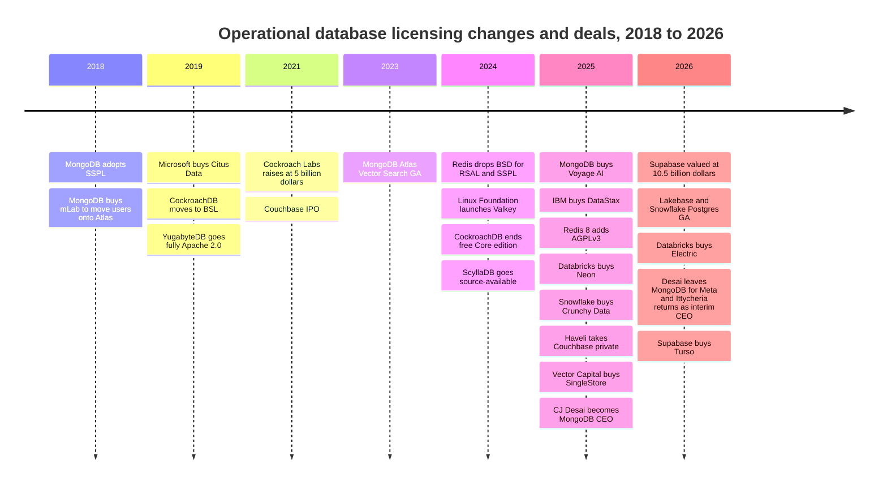
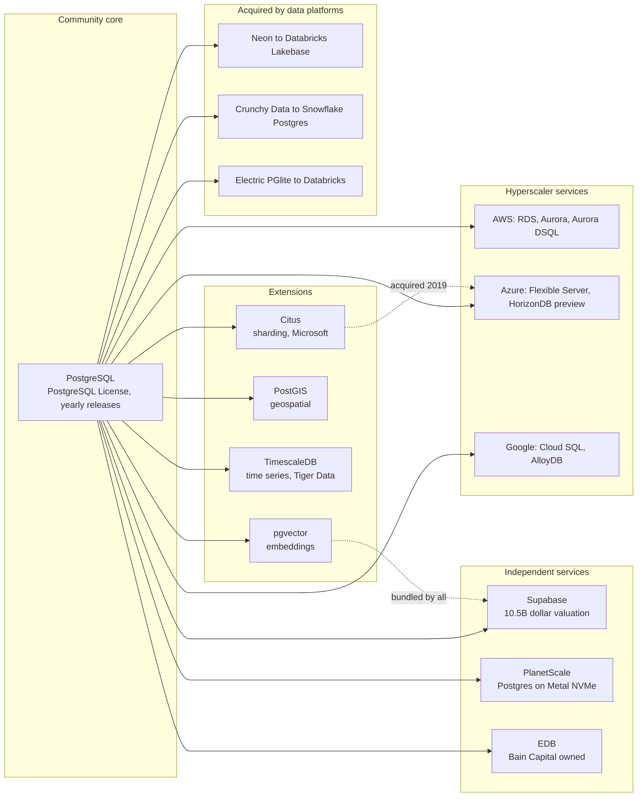
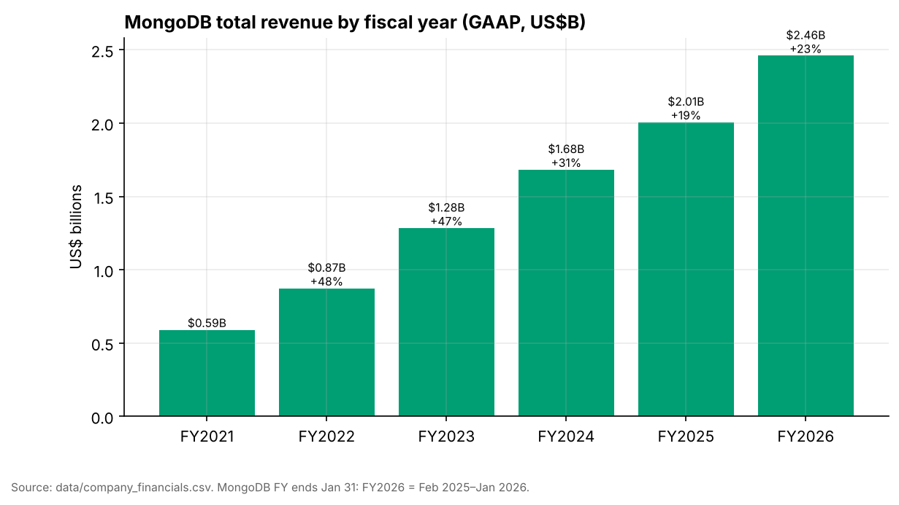
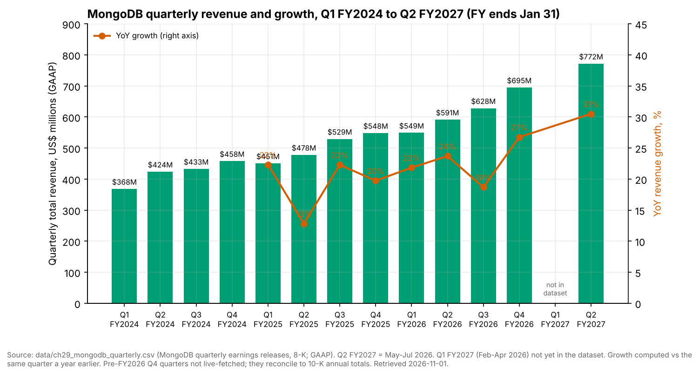
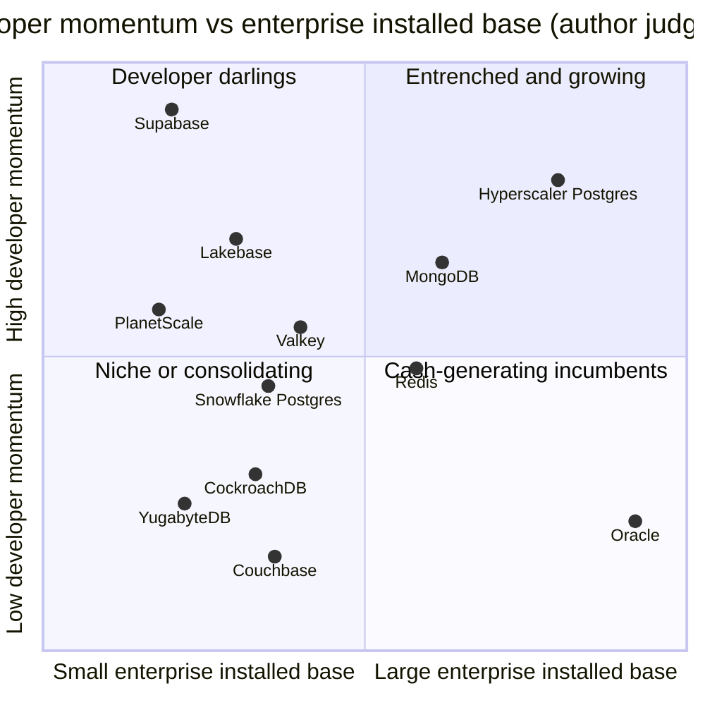

# 29. Operational Database Vendors
> **Status:** mixed public/private · **HQ:** various (Oracle: Austin, TX; MongoDB: New York, NY; most challengers: San Francisco Bay Area) · **Founded:** 1977 (Oracle) to 2021 (Neon) · **Latest valuation/market cap:** Oracle $382.45B market cap (2026-10-23); MongoDB $29.5B market cap, $27.14B EV, 9.0x EV/NTM revenue (2026-10-20); Supabase $10.5B post-money (press-reported, Jun 2026) · **Last verified:** 2026-11-01

## TL;DR

- **The market.** Operational databases ([OLTP](../glossary.md#oltp)) record the business: orders, payments, accounts, sessions. They sit inside a database management system (DBMS) market that Gartner sized at **$119.7B in 2024, up 13.4%** (analyst estimate). Hyperscalers and Oracle take most of that revenue, while PostgreSQL has become the default engine for new applications.[^gartner][^so25]
- **Two incumbents, one standard.** Oracle earns its database money mainly from support on a decades-old installed base, which behaves like an annuity. MongoDB is the only scaled, independent, public pure play in the category. It reported **$771.8M of Q2 FY2027 revenue (May–Jul 2026), up 30% (GAAP)**, re-accelerating from about 24% a year earlier (Q2 FY2026) and a 19% trough in Q3 FY2026. It is also between permanent CEOs: CJ Desai, CEO from November 2025, left for Meta in September 2026, and former CEO Dev Ittycheria returned as interim CEO. Everyone else either runs on Postgres or competes against it.[^mdb-q2][^mdb-qtr]
- **The Postgres land grab.** In 2025–26 the analytical platforms bought their way into OLTP. Databricks bought Neon (~$1B, press-reported) and turned it into Lakebase. Snowflake bought Crunchy Data ($164.5M purchase consideration per its 10-Q, against ~$250M press-reported) and launched Snowflake Postgres. Supabase reached a **$10.5B** valuation (press-reported, Jun 2026) on the back of developers and AI coding agents creating databases.[^neon-deal][^crunchy][^supabase-f]
- **Licensing is a pricing lever, not a moral question.** MongoDB (2018), Cockroach Labs (2019, 2024), Redis (2024) and ScyllaDB (2024) all tightened their licences to stop cloud providers reselling their work. Redis partly reversed course in 2025 by adding AGPLv3, after AWS and Google backed the **Valkey** fork. The independents that survived without a cloud of their own were mostly sold: DataStax to IBM, Couchbase to Haveli, SingleStore to Vector Capital.[^redis][^valkey][^datastax][^couchbase][^singlestore]
- **Everpure angle.** Operational databases are the classic block-storage workload on FlashArray. The move to cloud-managed and serverless Postgres, with storage rebuilt as a log service over object storage (Aurora, Neon/Lakebase), shifts where durability lives. That creates both a risk to on-prem block demand and options around Kubernetes data services (Portworx), fast database cloning and object-backed database storage.[^neon-arch]

## Snapshot table

| Company | Ownership / status | CEO (as found) | Scale marker | Basis / date | Valuation / market cap |
|---|---|---|---|---|---|
| Oracle | Public (NYSE: ORCL); FY ends May 31 | Co-CEOs Clay Magouyrk and Mike Sicilia [VERIFY] | Q1 FY2027 (Jun–Aug 2026) revenue ~$19.35B; OCI +121%; RPO $664B | GAAP; press-reported via StorageNewsletter[^comps-orcl] | $382.45B market cap, $514.52B EV, 5.7x EV/NTM (2026-10-23)[^comps-orcl] |
| MongoDB | Public (Nasdaq: MDB); FY ends Jan 31 | Dev Ittycheria, **interim** President & CEO (since Sep 2026, after CJ Desai, CEO from 2025-11-10, left for Meta); permanent-CEO search under way[^mdb-ceo] | Q2 FY2027 revenue $771.8M, +30%; FY2027 guide $2.99–3.03B | GAAP; company guidance[^mdb-q2] | $29.5B market cap, $27.14B EV, 9.0x EV/NTM (2026-10-20)[^comps-mdb] |
| Supabase | Private, VC-backed | Paul Copplestone (co-founder) | No revenue disclosed | n/d | $10.5B post-money (Jun 2026); $150M extension Oct 2026 at a reported $10.65B (single source)[^supabase-f][^supabase-turso] |
| Neon → Databricks Lakebase | Acquired by Databricks (announced May 2025) | n/a (inside Databricks) | Lakebase >$100M run-rate (Jul 2026) | Company-stated run-rate[^db-7b] | ~$1B deal (press-reported)[^neon-deal] |
| Crunchy Data → Snowflake Postgres | Acquired by Snowflake (Jun 2025) | n/a (inside Snowflake) | Snowflake Postgres GA (Jun 2026) | Company-stated[^sf-pg] | $164.5M purchase consideration (10-Q); ~$250M press-reported (WSJ)[^crunchy] |
| Redis Inc. | Private, VC-backed | Rowan Trollope [VERIFY] | No revenue disclosed | n/d | >$2B (Series G, Apr 2021; press-reported) [VERIFY][^redis-g] |
| Couchbase | Private (Haveli take-private closed Sep 2025) | n/d | Last public FY revenue ~$200M [VERIFY] | GAAP, pre-delisting | ~$1.5B equity value at $24.50/share[^couchbase] |
| Cockroach Labs | Private, VC-backed | Spencer Kimball (co-founder) | No revenue disclosed | n/d | $5B (Series F, Dec 2021; press-reported)[^crdb-f] |
| SingleStore | Private (Vector Capital control buyout, Sep 2025) | n/d | No revenue disclosed | n/d | ~$500M equity (Bloomberg sources, not company-stated)[^singlestore] |
| DataStax | Acquired by IBM (closed May 2025) | n/a | n/d | n/d | Undisclosed deal value[^datastax] |

*Figure 29.1 — Snapshot. Only Oracle and MongoDB publish audited numbers. Every private valuation here is a 2021 mark, a press-reported figure or a deal price, so read them as indicators, not fair values.*

## Origin story and strategic arc

### Market structure in four layers

The operational database market has a simple shape once you strip out the brand names.

**Layer 1: the commercial relational incumbents.** Oracle Database, Microsoft SQL Server and IBM Db2 still run most of the world's systems of record: ERP, core banking, billing, telecom. Their revenue is mostly maintenance and support on licences sold years ago, plus a migration path into each vendor's own cloud. DB-Engines' popularity ranking, which counts web mentions, jobs and search interest rather than revenue, still lists Oracle, MySQL (also owned by Oracle) and SQL Server as the top three, with PostgreSQL fourth and MongoDB fifth (July 2026, secondary report).[^dbe-jul]

**Layer 2: the hyperscalers' managed databases.** Amazon RDS and Aurora, Azure SQL and Azure Database for PostgreSQL, Google Cloud SQL, AlloyDB and Spanner, plus DynamoDB and Cosmos DB. These are now the largest channel for new OLTP capacity. Gartner's public abstracts put cloud DBMS at roughly three-fifths of the market, though that share is a derived, indicative figure.[^gartner-cloud] [Ch 28](ch28-hyperscaler-data-platforms.md) covers the hyperscalers in depth.

**Layer 3: the independents.** MongoDB is the scaled survivor. Around it sits a ring of venture-backed specialists: distributed SQL (Cockroach Labs, Yugabyte, PingCAP), in-memory and key-value (Redis, Aerospike), wide-column (ScyllaDB, DataStax), and multi-model or HTAP engines (Couchbase, SingleStore). Most raised at 2021 valuations and have since been sold, taken private or left without a new priced round.

**Layer 4: the Postgres ecosystem.** PostgreSQL itself is a community project under a permissive licence that no company controls. Commercial value comes from what you wrap around it: managed services (Supabase, Neon, Crunchy, PlanetScale, EDB, plus every hyperscaler) and extensions (pgvector, PostGIS, TimescaleDB, Citus). Developer surveys show the result. In Stack Overflow's survey, PostgreSQL usage rose from 48.7% of respondents in 2024 to a press-reported 55.6% in 2025, the highest of any database. In H1 2026 PostgreSQL gained the most DB-Engines score of any system.[^so24][^so25][^dbe-h1]

### The strategic arc, 2018–2026

The arc since 2018 has three movements. **First, the open-source vendors tried to defend themselves from the clouds** by changing licences. Amazon, Microsoft and Google were selling managed versions of MongoDB, Redis and Elasticsearch without paying the projects' sponsors. **Second, the hyperscalers answered with forks and in-house engines**: DocumentDB, and later Valkey. **Third, from 2025, AI changed the buyer.** Coding agents and "vibe-coding" tools started creating databases by the thousand. Analytical platforms then decided that whoever owns the operational database owns the new applications, and bought Postgres companies to get one.

*Figure 29.2 — Licensing changes cluster in 2018–2019 and 2024; acquisitions cluster in 2025–2026. The first wave was about defending against cloud resellers. The second is about owning the database that AI-built applications start on.*[^mdb-sspl][^crdb-license][^yb-license][^redis-2024][^valkey][^scylla][^redis][^neon-deal][^crunchy][^couchbase][^singlestore][^electric][^supabase-turso]

> **Bridge: relicensing as a royalty-schedule change.** A licence switch from Apache or BSD to SSPL, BSL or RSAL is economically like an IP licensor rewriting its royalty schedule for one class of licensee. End users who self-host keep paying nothing. The class that monetises the IP at scale, a cloud provider offering the database as a service, is now told to pay or to open-source its entire service stack, which no hyperscaler will do. As in semiconductor IP, the licensor's leverage depends on switching cost. When the licensee can fund a compatible alternative (Valkey for Redis, DocumentDB for MongoDB's API), the schedule change pushes the largest licensee out of the ecosystem instead of raising royalties.

## Product and technology

### Oracle: the converged incumbent

Oracle Database is the reference relational engine: row store, [MVCC](../glossary.md#mvcc) via undo segments, Real Application Clusters for shared-disk scale-out, and Exadata engineered systems that push SQL filtering down into storage servers. Oracle's product strategy is **convergence**. One engine handles relational, JSON, graph, spatial and vector data, so customers never need a second database. At Oracle AI World in October 2025 the flagship became **Oracle AI Database 26ai** (successor to 23ai), with vector search and AI features inside the engine.[^orcl-aiworld] The other strategic move is **multicloud**. Oracle now runs Exadata hardware inside other clouds' datacenters, as Oracle Database@Azure (28 regions), Database@Google Cloud (8 regions, 9 more planned) and Database@AWS.[^orcl-aiworld][^orcl-azure] That design keeps databases on Oracle's own infrastructure and licences while letting the application move to another cloud. It also explains why Oracle's cloud numbers now include database revenue that used to be on-prem support. [Ch 28](ch28-hyperscaler-data-platforms.md) covers OCI and the AI-infrastructure build-out.

### MongoDB: the document model as a business

MongoDB stores [documents](../glossary.md#document-database): self-contained JSON-like records (BSON on disk) whose shape matches the objects in application code. A customer order with its line items and shipping address is one document, read and written in one operation, with no joins. The schema lives in the application, which lets developers ship without migrations. The cost comes when many-to-many relationships dominate. Since version 4.0 (2018) MongoDB has offered multi-document ACID transactions, which removed the main objection from enterprise architects.[^mdb-10k] Horizontal scale comes from sharding on a shard key, with replica sets for high availability.

The product is sold three ways:

- **Atlas**, the managed cloud service on AWS, Azure and Google Cloud. Launched in 2016, it was **73% of FY2026 revenue** (Feb 2025–Jan 2026), up from 70% in FY2025 (company-stated).[^mdb-ars]
- **Enterprise Advanced (EA)**, a self-managed subscription with management tooling, security features and support, used by banks and governments that keep data on-premises or in their own cloud accounts.
- **Community Edition**, free under the [SSPL](../glossary.md#sspl), which is the top of the funnel.

The AI layer was built in three steps. **Atlas Vector Search** reached GA in December 2023. It stores embeddings beside the operational documents and searches them with an approximate-nearest-neighbour index.[^mdb-vs] The **Voyage AI** acquisition ($220M, February 2025) added embedding and reranking models, so MongoDB can generate the vectors as well as store them. That gives it some say over retrieval quality, not only storage.[^voyage] In June 2026 vector search and full-text search reached GA in the free self-managed Community Edition, which pushes AI retrieval down the funnel to developers who never touch Atlas.[^mdb-vs]

### The Postgres ecosystem: a standard with an extension bus

PostgreSQL's commercial advantage is architectural. Its **extension** mechanism lets third parties add data types, index methods, functions and even storage behaviour without forking the core. That is why one engine now covers JSON documents (JSONB, since 2014), vectors (pgvector), geospatial (PostGIS), time series (TimescaleDB) and sharding (Citus).[^pg-jsonb][^pgvector] PostgreSQL 18 (September 2025) added an asynchronous I/O subsystem, a sign that the core still improves on its own yearly release cycle.[^pg18]

*Figure 29.3 — The Postgres ecosystem: one community core, an extension layer that adds AI and other data types, and three tiers of managed services. The 2025–26 acquisitions moved the most innovative independent tier into Databricks and Snowflake.*[^citus][^horizondb][^dsql-ga][^planetscale][^neon-deal][^crunchy][^electric]

> **Bridge: extensions as a chiplet ecosystem.** Postgres extensions work like chiplets around a standard die-to-die interface such as UCIe. The core engine is the base die. The extension API (hooks, custom types, index access methods, table access methods) is the interface specification. Third parties build specialised "chiplets", such as a vector index or a geospatial type, that drop into any compliant package without a new tape-out of the core. As with UCIe, the standard interface shifts value to whoever assembles the package (the managed service) and whoever builds the most-demanded chiplet (pgvector, Citus). It also commoditises the base die: nobody can charge a premium for PostgreSQL itself.

**The managed-service designs differ in where storage lives.** Classic managed Postgres (RDS, Cloud SQL, Supabase, Crunchy) runs the stock engine on a VM with network block storage. **Aurora** (2017) and **Neon** (2021) disaggregate the engine. Compute ships only its [write-ahead log](../glossary.md#write-ahead-log) to a storage service, which rebuilds pages and, in Neon's case, tiers them into object storage.[^neon-arch] That design enables [database branching](../glossary.md#database-branching) (a copy-on-write clone at a log position) and [scale to zero](../glossary.md#scale-to-zero). Both matter when software agents create thousands of short-lived databases. **PlanetScale** went the other way. Its "Metal" offering runs Postgres and MySQL on locally attached NVMe instead of network block storage and gets durability from replication, trading elasticity for latency.[^planetscale] PlanetScale's MySQL business rests on **Vitess**, the sharding layer built at YouTube and graduated by the CNCF in 2019.[^vitess]

### The specialists

- **Redis** is an in-memory data-structure server used as a cache, session store, rate limiter and message broker. Redis 8 (May 2025) folded the former modules (JSON, search, time series, probabilistic structures) into the core and added vector sets, so it now competes for semantic caching and [agent memory](../glossary.md#agent-memory).[^redis]
- **Valkey** is the Linux Foundation fork of Redis 7.2.4, launched in March 2024 with backing from AWS, Google Cloud, Oracle and others. AWS and Google now offer Valkey-based managed caches.[^valkey]
- **CockroachDB, YugabyteDB and TiDB** are distributed SQL ([NewSQL](../glossary.md#newsql)) engines built on Raft consensus. CockroachDB and YugabyteDB speak the Postgres wire protocol, TiDB speaks MySQL's. [Ch 4](../01-data-systems-foundations/ch04-distributed-databases.md) explains the mechanics.
- **Couchbase** is a JSON document database with a memory-first architecture, a SQL-like query language (SQL++) and mobile sync. **SingleStore** is an [HTAP](../glossary.md#htap) engine combining an in-memory rowstore with a disk columnstore. **ScyllaDB** is a C++ rewrite of Apache Cassandra. **DataStax** commercialised Cassandra as Astra DB and owned the Langflow agent-building tool. **Aerospike** is a flash-optimised key-value and document store used in ad tech, fraud and telecom.

## How it makes money

The category runs on four revenue models, and each one implies different margins and different exposure to AI.

| Model | Pricing unit | Revenue recognition | Gross margin driver | Examples |
|---|---|---|---|---|
| Perpetual licence + annual support | Per processor core (with a core factor) or named user; support priced as a percentage of the licence | Licence upfront; support ratably | Near-100% on support; no infrastructure cost | Oracle, SQL Server, Db2 |
| Term subscription (self-managed) | Annual or multi-year subscription per server or core | Licence portion recognised upfront under ASC 606, support ratably, so revenue is lumpy | High; no infrastructure cost | MongoDB Enterprise Advanced, Couchbase, EDB, Redis Enterprise software |
| Consumption cloud service | Instance-hours, storage, I/O, data transfer; commit-and-draw-down contracts | As consumed | Cloud infrastructure sits in COGS; margin depends on utilisation | MongoDB Atlas, Supabase, Neon/Lakebase, Redis Cloud, CockroachDB Cloud |
| Hyperscaler bundled service | Instance-hours or serverless request units | As consumed | Captured by the cloud provider, not the engine's author | RDS, Aurora, AlloyDB, ElastiCache for Valkey |

*Figure 29.4 — Business models. The independents' long-run problem is the bottom row. When a cloud provider bundles a compatible engine, the database's author captures none of the margin.*

### Oracle: the support annuity

Oracle's database economics rest on support. Customers buy a perpetual licence, typically priced per processor core, and then pay annual support historically set at about **22% of the net licence fee**, rising with inflation clauses.[^orcl-sig] Support renews at very high rates because migrating a core banking or ERP database is a multi-year, high-risk project. Oracle does not break out database revenue alone. Its "cloud services and license support" line, which mixes database and application support with cloud, was about **$44.0B of FY2025's $57.4B total revenue** (FY ended May 31, 2025; GAAP) [VERIFY].[^orcl-fy25]

> **Bridge: semiconductor IP maintenance.** Oracle's support stream behaves like the maintenance and royalty tail of a semiconductor IP portfolio. Once a design is taped out on a given CPU core or interface IP, the customer keeps paying for as long as the chip ships, because re-spinning onto different IP is expensive and risky. Valuation follows the same logic. Price it as a declining annuity with high renewal (low churn), modest price escalators, and a terminal value that depends on how fast the installed base migrates elsewhere. Database@Azure, Google and AWS are Oracle's way of keeping the annuity alive when the application tier leaves for another cloud.

### MongoDB: consumption plus lumpy term licences

**Atlas** bills by cluster tier (instance size, memory, storage), I/O and data transfer, metered hourly. Large customers sign annual commitments that they draw down. Revenue tracks usage, so a quarter's Atlas growth reflects how hard existing applications are working and how many new ones went live, not how many contracts were signed. **Enterprise Advanced** is a term licence. Under ASC 606 the licence portion of a multi-year deal is recognised when the term starts, so a large EA renewal can swing a quarter's revenue. That is why Q4, when big EA deals concentrate, can show a lower Atlas share (72% in Q4 FY2026, company-stated on the earnings call) than the full year (73%).[^mdb-call][^mdb-ars]

Atlas carries lower gross margin than EA because MongoDB pays AWS, Azure and Google for the underlying machines. That is the same royalty-to-foundry shift described for Databricks serverless in [Ch 25](ch25-databricks.md). The blended result was a **74% GAAP and 76% non-GAAP gross margin** in Q2 FY2027.[^mdb-q2]

### The Postgres services: who gets paid

Because the engine is free, Postgres vendors are paid for operations, developer experience and adjacency. Supabase bundles Postgres with authentication, file storage, realtime subscriptions and edge functions, and charges per project plus usage. Neon (now Lakebase) charges for compute-hours and storage, and scale-to-zero means an idle database costs almost nothing. That is what made it cheap enough for agents to create databases by the thousand. EDB sells enterprise Postgres subscriptions and Oracle-compatibility tooling to firms leaving Oracle. The hyperscalers earn the most from Postgres, through RDS, Aurora, Azure and Cloud SQL instance-hours, without owning the project.

## Financials

### Oracle (context only)

Oracle's consolidated numbers are now driven by AI infrastructure, not databases. In Q1 FY2027 (Jun–Aug 2026) total revenue was about $19.35B (GAAP), OCI revenue grew 121%, and remaining performance obligations reached $664B. Oracle guided FY2027 revenue to at least $90B. Trailing free cash flow was about −$28.7B because capex exceeded operating cash flow.[^comps-orcl] At 5.7x EV/NTM revenue (as of 2026-10-23, NTM from the guidance floor), the market is valuing a leveraged AI-capacity build with a database annuity underneath. It is not valuing a database company.[^comps-orcl]

### MongoDB

*Figure 29.5 — MongoDB annual revenue (GAAP). Revenue roughly quadrupled from FY2021 to FY2026, but growth slowed from ~48% to ~19% (FY2025) before re-accelerating to ~23% in FY2026 (Feb 2025–Jan 2026). Source: `data/company_financials.csv`.*

*Figure 29.6 — Quarterly view. Growth troughed at 13% in Q2 FY2025 and 19% in Q3 FY2026, then re-accelerated to 27% and ~30%. Q1 FY2027 is not yet in the dataset. Source: `data/ch29_mongodb_quarterly.csv`; quarters before Q4 FY2026 are not live-verified but reconcile to 10-K annual totals.*[^mdb-qtr]

| Metric | Value | Period | Basis | Source |
|---|---|---|---|---|
| Total revenue | $771.8M, +30% YoY | Q2 FY2027 (May–Jul 2026) | GAAP | [^mdb-q2] |
| Subscription / services revenue | $747.1M / $24.6M | Q2 FY2027 | GAAP | [^mdb-q2] |
| Atlas revenue growth | +29% YoY | Q2 FY2027 | Company-stated | [^mdb-q2] |
| Atlas share of revenue | ~73% Q2 FY2027 (~$565.9M, third-party breakdown); 73% FY2026; 70% FY2025 | As stated | Company-stated (Q2 dollar split third-party) | [^mdb-ars][^mdb-q2] |
| Enterprise Advanced and other | +36% YoY | Q2 FY2027 | Company-stated | [^mdb-q2] |
| Gross margin | 74% GAAP / 76% non-GAAP | Q2 FY2027 | GAAP / non-GAAP | [^mdb-q2] |
| Operating margin | 24% (vs 15% a year earlier) | Q2 FY2027 | Non-GAAP | [^mdb-q2] |
| Net income | $40.9M | Q2 FY2027 | GAAP | [^mdb-q2] |
| Customers | >65,200 total (FY2026 year-end); Atlas customers >69,300 at Q2 FY2027 per a search summary of the release [VERIFY: Atlas vs total customer count] | As stated | Company-stated KPI | [^mdb-q4][^mdb-q2] |
| FY2027 revenue guidance | $2.99–3.03B (midpoint $3.01B), Atlas growth ~27%; Q3 FY2027 guide $756–761M | FY2027 (Feb 2026–Jan 2027) | Company guidance | [^mdb-q2] |
| EV / NTM revenue | 9.0x (EV $27.14B ÷ $3.01B guide midpoint) | 2026-10-20 | Market data; NTM proxy | [^comps-mdb] |

*Figure 29.7 — MongoDB key figures. Q2 FY2027 Atlas share, operating margin, net income and EA growth per the integrator's live check of the release (`meta/verified-facts.md` item 7). Note the Q3 guide ($756–761M) sits below Q2's $771.8M: Q2 included lumpy upfront Enterprise Advanced licence revenue (EA +36%), so a sequential dip is a recognition effect, not necessarily slowing demand.*

**Why growth re-accelerated.** Three forces combined, in roughly this order of importance:

1. **Atlas consumption recovered.** In FY2024–25, customers optimised cloud spending and new workloads ramped slowly, so Atlas growth drifted down into the mid-20s [VERIFY: quarterly Atlas growth, FY2025–FY2026]. By Q2 FY2027 Atlas was growing 29% on a much larger base, and management guided to about 27% for the year.[^mdb-q2] On roughly a three-quarters Atlas mix, Atlas alone contributes about 21 points of total growth (0.73 × 29%, our arithmetic).
2. **Enterprise Advanced stopped being a drag.** FY2025 carried tough comparisons from unusually large multi-year EA deals recognised upfront the year before, which management flagged as a headwind [VERIFY: size of the FY2025 multi-year licence headwind]. That is visible in Q2 FY2025's 13% growth in Figure 29.6. Once those comparisons passed, the non-Atlas quarter of the business stopped subtracting from growth, and Q4 FY2026 (+27%) shows EA contributing again.
3. **New AI-era workloads.** MongoDB argues that AI applications need flexible schemas and vector retrieval next to operational data, and that Voyage's models improve retrieval quality.[^voyage][^mdb-vs] The cleaner evidence is Atlas's acceleration. No AI-specific revenue figure is disclosed, so treat attribution to AI as management narrative plus correlation.

**Leadership.** Dev Ittycheria, CEO since 2014, handed over to **Chirantan "CJ" Desai**, previously president of product and engineering at Cloudflare. MongoDB announced the change on 2025-11-03, effective 2025-11-10. Desai's tenure was short: in **September 2026 he stepped down to join Meta**, and **Ittycheria was appointed interim President and CEO** while the board searches for a permanent successor.[^mdb-ceo] Re-acceleration began in the quarters around the first transition, so it rests mainly on go-to-market changes made under Ittycheria, who is now back in charge. For an analyst the issue is execution risk and the length of the search, not a change of strategy: the interim CEO built the current Atlas-first model. A CEO departure after ten months is still a governance yellow flag worth probing.

**Valuation.** At 9.0x EV/NTM revenue (2026-10-20; NTM proxied by the FY2027 guide midpoint), MongoDB trades at about half Snowflake's 16.9x (2026-10-30, same guide-proxy method) despite similar ~30% growth. Gross margin does not explain the gap: MongoDB's 76% non-GAAP margin is close to Snowflake's ~75% non-GAAP product margin. The discount reflects two other things. The market doubts that ~30% growth will last after several years in the high teens and low twenties (the FY2027 guide midpoint implies ~22% for the year), it is pricing leadership uncertainty after the September 2026 CEO departure, and it sees operational databases as more exposed to free, hyperscaler-run Postgres than analytical platforms are. Stock-based compensation, which non-GAAP figures exclude, weighs on both companies.[^comps-mdb][^comps-sf]

### The private Postgres and NoSQL companies

No private vendor in this chapter publishes audited revenue. The valuation marks tell the story instead. Supabase went from $2B (April 2025) to $5B (October 2025) to $10.5B (June 2026), with investors explicitly buying "agentic infrastructure".[^supabase-e][^supabase-f] Cockroach Labs' $5B mark dates from December 2021 with no later priced round found.[^crdb-f] Couchbase, SingleStore and DataStax exited through private equity or a strategic buyer, at prices that by most accounts sat below their 2021 peaks [VERIFY: DataStax and SingleStore 2021–22 marks].

## Customers and go-to-market

**Oracle** sells top-down to CIOs, through enterprise licence agreements and audits. Licence compliance reviews are a well-known lever for converting audit exposure into cloud commitments. Its customers are the Global 2000's systems of record, where the database is a cost to minimise, not a platform to build on.

**MongoDB** runs a two-speed motion. A self-serve developer funnel (Community Edition, the Atlas free tier, university programmes) feeds an enterprise field sales force selling Atlas commitments and EA. MongoDB had more than 65,200 customers at the end of FY2026.[^mdb-q4] The hyperscaler marketplaces are partners too: Atlas is sold through AWS, Azure and Google marketplaces, so customers can burn down cloud commitments.

**The Postgres challengers** are developer-led, and increasingly agent-led. Supabase is the default backend for AI app builders such as Lovable and Bolt (company and press statements [VERIFY]). Neon said, when Databricks bought it, that more than 80% of the databases created on its platform were provisioned automatically by AI agents (company-stated, press-reported).[^neon-deal] That one statistic explains most of the 2025–26 deal flow. If agents create databases, the platform that agents default to captures the new workload without a sales call.

## M&A and investments

| Date | Acquirer | Target | Value | Rationale | Outcome |
|---|---|---|---|---|---|
| Oct 2018 | MongoDB | mLab | $68M (disclosed) | Buy the largest third-party MongoDB host | Users migrated to Atlas; mLab retired[^mlab] |
| Jan 2019 | Microsoft | Citus Data | Undisclosed | Distributed Postgres for Azure | Became Azure Cosmos DB for PostgreSQL; extension stays open source[^citus] |
| Feb 2025 | MongoDB | Voyage AI | $220M (disclosed; cash and stock) | Embedding and reranking models | Integrated into Atlas Vector Search[^voyage] |
| Feb–May 2025 | IBM | DataStax | Undisclosed | Astra DB vector/NoSQL and Langflow for watsonx | Closed 2025-05-28[^datastax] |
| May 2025 | Databricks | Neon | ~$1B (press-reported) | Serverless Postgres for agents | Lakebase; >$100M run-rate by Jul 2026[^neon-deal][^db-7b] |
| Jun 2025 | Snowflake | Crunchy Data | $164.5M (10-Q; ~$250M press-reported) | Enterprise Postgres | Snowflake Postgres GA Jun 2026; mirroring into Snowflake[^crunchy][^sf-pg] |
| Jun–Sep 2025 | Haveli Investments | Couchbase | ~$1.5B ($24.50/share cash) | PE take-private of a slower-growth NoSQL vendor | Closed 2025-09-24; delisted[^couchbase] |
| Sep 2025 | Vector Capital | SingleStore | ~$500M equity (Bloomberg sources) | Control buyout | Completion not confirmed [VERIFY][^singlestore] |
| Oct 2025 | Databricks | Mooncake Labs | Undisclosed | Postgres-to-columnar mirroring | Absorbed into Lakebase[^mooncake] |
| Aug 2026 | Databricks | Electric (PGlite) | Undisclosed | Embedded/local Postgres for agent sandboxes | Announced; completion not reported[^electric] |
| Oct 2026 | Supabase | Turso | Undisclosed | SQLite-based agent database | Announced with a $150M raise[^supabase-turso] |

*Figure 29.8 — Deals. Two patterns stand out. Analytical platforms are buying Postgres (Neon, Crunchy, Mooncake, Electric), and private equity or strategic buyers are absorbing NoSQL vendors that lacked a cloud of their own (Couchbase, SingleStore, DataStax). Source: `data/ma_deals.csv`, `data/private_funding.csv`.*

**Integration outcomes so far.** Neon is the clearest success. Lakebase passed a company-stated $100M run-rate about 14 months after the deal was announced.[^db-7b] Crunchy's price is a lesson in reading press reports: the 10-Q shows $164.5M of cash against ~$250M reported at announcement.[^crunchy] MongoDB's buy-the-host pattern (mLab, 2018) was repeated across the industry, and Voyage is a newer "buy the model" variant. IBM's DataStax purchase is a bet that Langflow and vector search pull watsonx into AI application builds. Its success is not yet visible in IBM's disclosures.

## Competitive position

### Vendor matrix

| Vendor | Data model | License | Deployment | Owner / status | Latest valuation / market cap (date) | Revenue / growth (labelled) | AI features |
|---|---|---|---|---|---|---|---|
| Oracle Database | Converged relational (JSON, graph, vector) | Proprietary | On-prem, Exadata, OCI, Database@Azure/Google/AWS | Public (ORCL) | $382.45B mkt cap (2026-10-23) | Q1 FY2027 ~$19.35B total, OCI +121% (GAAP, all Oracle) | AI Database 26ai: in-database vectors and agents |
| MongoDB | Document | SSPL (Community); commercial (EA, Atlas) | Atlas on 3 clouds; self-managed | Public (MDB) | $29.5B mkt cap (2026-10-20) | Q2 FY2027 $771.8M, +30% (GAAP) | Atlas Vector Search; Voyage embeddings; Community vector search |
| PostgreSQL (community) | Relational + extensions | PostgreSQL License (permissive) | Anywhere | Community project | n/a | n/a | pgvector |
| Supabase | Postgres backend platform | Apache 2.0 / MIT components | Cloud; self-host | Private | $10.5B post-money (Jun 2026) | n/d | Default backend for AI app builders; Turso (announced) |
| Neon / Lakebase | Serverless Postgres | Apache 2.0 (Neon) | Databricks cloud | Databricks | ~$1B deal (May 2025) | Lakebase >$100M run-rate (company-stated, Jul 2026) | Agent-created databases; branching |
| Crunchy / Snowflake Postgres | Postgres | Postgres License | Snowflake cloud | Snowflake | $164.5M deal (Jun 2025) | n/d | Mirroring into Snowflake AI stack |
| PlanetScale | MySQL (Vitess) and Postgres | Vitess Apache 2.0; service proprietary | Cloud; Metal NVMe | Private | Last disclosed round Series C, 2021 [VERIFY] | n/d | n/d |
| EDB | Enterprise Postgres | Postgres License + proprietary tools | On-prem, cloud | Bain Capital [VERIFY] | n/d | n/d | EDB Postgres AI [VERIFY] |
| Redis | In-memory key-value, vectors | RSALv2 / SSPLv1 / AGPLv3 (Redis 8) | Redis Cloud; software | Private | >$2B (Apr 2021, press-reported) [VERIFY] | n/d | Vector sets; semantic caching; agent memory |
| Valkey | In-memory key-value | BSD-3 | AWS, Google, self-host | Linux Foundation | n/a | n/a | Vector search work in progress [VERIFY] |
| Couchbase | Document, memory-first | BSL (server) [VERIFY] | Capella cloud; self-managed; mobile | Haveli (private) | ~$1.5B take-private (Sep 2025) | n/d since delisting | Capella AI services [VERIFY] |
| CockroachDB | Distributed SQL (Postgres wire) | Proprietary enterprise licence (free under $10M revenue) | Self-hosted; Cockroach Cloud | Private | $5B (Dec 2021) | n/d | Vector indexing [VERIFY] |
| YugabyteDB | Distributed SQL (Postgres-compatible) | Apache 2.0 | Self-hosted; managed | Private | $1.3B (Oct 2021) [VERIFY] | n/d | pgvector compatibility [VERIFY] |
| TiDB (PingCAP) | Distributed SQL (MySQL-compatible), HTAP | Apache 2.0 | Self-hosted; TiDB Cloud | Private | n/d | n/d | Vector search in TiDB Cloud [VERIFY] |
| SingleStore | HTAP (row + column) | Proprietary | Cloud; self-managed | Vector Capital (private) | ~$500M equity (Sep 2025, Bloomberg) | n/d | Vector functions |
| ScyllaDB | Wide-column (Cassandra-compatible) | Source-available since Dec 2024 | Cloud; self-managed | Private | n/d | n/d | Vector search [VERIFY] |
| DataStax | Wide-column (Cassandra), vector | Apache 2.0 (Cassandra); service proprietary | Astra DB cloud | IBM | Undisclosed (May 2025) | n/d | Astra vector; Langflow |
| Aerospike | Key-value / document, flash-optimised | Proprietary enterprise; community edition | Self-managed; cloud | Private | Series E $109M (Apr 2024) [VERIFY] | n/d | Vector search [VERIFY] |

*Figure 29.9 — Vendor matrix (18 vendors × 7 dimensions). "n/d" = not disclosed. Revenue exists only for the two public companies. AI features are mostly vector search, which makes them table stakes rather than differentiators. Sources: `data/public_comps.csv`, `data/private_funding.csv`, `data/ma_deals.csv`, and the footnotes in this chapter.*

### Positioning

*Figure 29.10 — Positioning (author judgment, not measured data). Momentum has moved to managed Postgres. MongoDB is the one independent that combines a large enterprise base with developer pull. Oracle's quadrant is profitable but shrinking in relative terms.*

**MongoDB vs. hyperscaler Postgres.** This is the decisive contest. Every major cloud now offers Postgres with JSONB and pgvector, so "documents plus vectors" is no longer unique to MongoDB. MongoDB's defence is developer ergonomics, a single API across three clouds and on-prem, and retrieval quality from Voyage. Its exposure is architects who decide "one Postgres for everything".

**Oracle vs. everyone.** Oracle rarely loses existing systems of record quickly, but it rarely wins new applications either. Its answer is to sell database capacity inside the clouds where applications are moving, and to bundle AI so that "keep the data where it is" becomes the AI story.

**Data platforms vs. the independents.** Lakebase and Snowflake Postgres are not trying to beat Supabase on developer experience. They are trying to make operational data land in the lakehouse or warehouse without a separate pipeline, through [data mirroring](../glossary.md#data-mirroring). That is a threat to the change-data-capture vendors in [Ch 30](ch30-data-movement-streaming-companies.md) as much as to the database vendors.

## Why it's winning / bull case

1. **MongoDB re-accelerated at $3B scale.** Growth went from 19% (Q3 FY2026) to ~30% (Q2 FY2027), with Atlas at 29% and full-year guidance raised to $2.99–3.03B.[^mdb-q2][^mdb-qtr] Few infrastructure software companies re-accelerate at this size. At 9.0x NTM, a bull argues the market has not priced in durability.
2. **AI multiplies the number of databases.** Agents and AI app builders create databases programmatically. Neon's >80% agent-created statistic and Supabase's 5x valuation step-up in 14 months are the evidence.[^neon-deal][^supabase-f] More applications mean more operational databases, and operational data is what AI agents need as fresh context.
3. **Oracle's annuity is extremely durable.** Support on mission-critical databases renews through recessions, and multicloud lets Oracle keep it even as customers move to Azure or AWS.[^orcl-aiworld]
4. **Vector search pulled AI into the operational tier.** Storing embeddings beside the transactional record removes a sync pipeline to a separate vector database. That favours the incumbents with the data (Oracle, MongoDB, Postgres services) over standalone vector databases (see [Ch 32](ch32-ai-native-data-companies.md)).

## Risks / bear case and open questions

1. **Postgres commoditises the engine.** When the engine is free and every cloud runs it, margin flows to the platform (AWS, Databricks, Snowflake), not to engine specialists. MongoDB's discount to Snowflake partly prices this in.[^comps-mdb]
2. **The independents' exit record is weak.** DataStax, Couchbase and SingleStore all sold to strategic or PE buyers. Cockroach Labs has no priced round since 2021. Licence tightening did not produce a second MongoDB.[^datastax][^couchbase][^singlestore][^crdb-f]
3. **Relicensing invites forks.** Redis's 2024 switch produced Valkey, which AWS and Google now sell, and Redis added AGPLv3 within 14 months.[^valkey][^redis] Any vendor that tightens terms must assume the largest cloud will fund a fork.
4. **Agent-created databases may be low-value.** Thousands of throwaway databases on scale-to-zero pricing may produce little revenue each. Whether agent volume converts into durable paid workloads is unproven. Lakebase's $100M run-rate is the best public data point.[^db-7b]
5. **Oracle's balance sheet now carries the AI build.** With EV of ~$515B against a ~$382B market cap and negative trailing FCF, the database annuity is funding, and exposed to, an AI-capacity bet.[^comps-orcl]
6. **Open questions.** What share of MongoDB's Atlas growth comes from AI workloads? Does Supabase disclose revenue before an IPO? Does Snowflake Postgres gain traction against Lakebase? Who becomes MongoDB's permanent CEO after Desai's September 2026 exit, and does the search change priorities or delay decisions?

## Relevance to Everpure

> **Storage bridge.** OLTP databases are the archetypal block workload: small random I/O, latency-sensitive commits (each one waits for a write-ahead-log flush), and snapshots and clones used for backup and test/dev. That is the core FlashArray business. Disaggregated designs such as Aurora and Neon move durability, replication and page materialisation into the database vendor's own log-and-page service, often backed by object storage. Local-NVMe designs such as PlanetScale Metal bypass shared storage entirely. See the companion *Everpure Tech Atlas* for block protocols and snapshot mechanics.

**What changes.** Three shifts reduce the classic "database on a SAN array" footprint over time. First, new applications default to cloud-managed Postgres, where the hyperscaler supplies storage. Second, Oracle's multicloud model places Exadata, with its own storage servers, inside Azure, Google and AWS, so even Oracle workloads that leave the customer datacenter do not land on customer-owned arrays.[^orcl-azure] Third, serverless Postgres turns database storage into a WAL service plus object storage.[^neon-arch] The counterweight is that the installed base of Oracle, SQL Server and self-managed Postgres in enterprise datacenters is enormous and migrates slowly, and regulated industries keep systems of record on-premises.

**Options a strategy team might evaluate, based on public information:**

| Option | What it would mean | Why it could matter | Watch-outs |
|---|---|---|---|
| Make FlashArray clones the on-prem answer to "database branching" | Package instant, space-efficient database clones for Oracle, SQL Server and Postgres as a developer and agent self-service feature | Branching is a headline feature of Neon/Lakebase; array snapshots already deliver it at the storage layer | Needs database-aware tooling and APIs that agents can call, not just array snapshots |
| Use Portworx for Postgres on Kubernetes | Position Portworx (acquired 2020, ~$370M) as the data layer for self-managed Postgres operators and Data Services | Many enterprises run Postgres on Kubernetes to avoid hyperscaler lock-in[^portworx] | Hyperscaler managed Postgres is simpler for most teams |
| Support object-backed database storage on FlashBlade | Validate Neon-style (open-source) page servers and lakehouse mirroring targets on FlashBlade's S3 interface | If serverless Postgres goes hybrid or sovereign, it needs fast on-prem object storage | No public on-prem Lakebase plan; speculative |
| Partner with independent database vendors on-prem | Joint reference architectures with EDB, MongoDB EA, Couchbase or Redis Enterprise software | These vendors' self-managed customers are exactly the on-prem buyers | Each vendor's growth is cloud-first |
| Extend Data Intelligence to operational databases | Use the 1touch-based discovery and classification on database estates, including Oracle and SQL Server connectors | Everpure's Data Intelligence already lists SQL Server and Oracle connectors[^everpure-di] | Database vendors and catalogs (Unity Catalog, Horizon) add their own classification |

*Figure 29.11 — Options (public information only). The compete risk is gradual: each new application born on cloud-managed Postgres is one that never reaches an on-prem array.*

See [Ch 24](../03-ai-data-stack/ch24-data-meets-compute-and-storage.md) for data gravity and [Ch 45](../06-history-and-future/ch45-storage-moving-up-the-stack.md) for storage vendors moving up the stack.

## Conversation playbook

**Three questions for vendor PMs or executives**

1. (MongoDB) "How much of Atlas's re-acceleration comes from new workloads versus consumption growth in existing ones, and how do you identify AI workloads in your telemetry?" *A good answer* separates new-workload and existing-workload growth, gives a definition of an "AI workload" (for example, vector index usage), and admits attribution is approximate.
2. (Postgres platforms) "What share of databases created on your platform are created by agents, how many survive 30 days, and what is the revenue per surviving database?" *A good answer* gives cohort survival and conversion, not just creation counts.
3. (Oracle) "For Database@Azure deals, how are licence, support and infrastructure revenue split between Oracle and Microsoft, and does BYOL support continue?" *A good answer* explains bring-your-own-licence versus licence-included, and who books which revenue.

**Three questions for engineers or partner architects**

1. "Where does durability live in your Postgres service: on network block storage, on local NVMe with replication, or in a WAL service over object storage? What is the commit latency at p99?" *Good:* a specific architecture and a measured number, plus failure-mode behaviour.
2. "How do you branch a 5 TB production database for testing, and how long does it take?" *Good:* copy-on-write at a log position or a storage snapshot, in seconds, with a clear story for masking sensitive data.
3. "Which vector index types do you support (HNSW, IVF, DiskANN), and do vector queries respect the same transactions and access controls as the rest of the data?" *Good:* named index types, honest recall/latency trade-offs, and yes on transactional consistency.

**What good answers sound like.** They distinguish engine from service, separate consumption from term-licence revenue, label run-rates versus GAAP, and treat vector search as table stakes rather than a moat.

**Don't say this**

- "MongoDB doesn't do transactions." *Multi-document ACID transactions have existed since version 4.0 (2018).*
- "Redis is closed source now." *Redis 8 added AGPLv3, an OSI-approved licence, alongside RSALv2 and SSPLv1; Valkey remains BSD.*
- "Postgres is owned by [vendor]." *No company owns PostgreSQL; vendors own services, extensions and forks.*
- "Oracle is a legacy database company." *Its valuation is now driven by OCI and AI infrastructure (RPO $664B); the database is the annuity underneath.*
- "CJ Desai is MongoDB's CEO." *Desai left for Meta in September 2026; Dev Ittycheria is interim President and CEO while a permanent successor is sought.*
- "Snowflake paid $250M for Crunchy." *That was press-reported; the 10-Q shows $164.5M cash consideration.*
- "Supabase revenue is $X." *Supabase does not disclose revenue; only valuations are public.*

## Key terms

- [OLTP](../glossary.md#oltp) — online transaction processing: many small, fast, correct reads and writes.
- [Document database](../glossary.md#document-database) — stores self-contained JSON-like records, such as MongoDB.
- [Key-value store](../glossary.md#key-value-store) — retrieves an opaque value by its key, such as Redis or Valkey.
- [Valkey](../glossary.md#valkey) — the Linux Foundation's BSD-licensed fork of Redis 7.2.4 (2024).
- [NewSQL](../glossary.md#newsql) — distributed SQL databases with ACID transactions at horizontal scale.
- [HTAP](../glossary.md#htap) — one system serving transactional and analytical workloads on fresh data.
- [MVCC](../glossary.md#mvcc) — keeping several row versions so readers and writers do not block each other.
- [Write-ahead log](../glossary.md#write-ahead-log) — the durable change log written before a transaction commits.
- [Data mirroring](../glossary.md#data-mirroring) — vendor-managed continuous replication of an operational database into an analytics platform.
- [SSPL](../glossary.md#sspl) — MongoDB's Server Side Public License, which requires a provider offering the software as a service to open-source its whole service stack.
- [AGPL](../glossary.md#agpl) — the GNU Affero General Public License, an OSI-approved copyleft licence that extends source-sharing duties to network use.
- [Business Source License](../glossary.md#business-source-license) — a source-available licence that restricts production use for a period before converting to open source.
- [Source-available license](../glossary.md#source-available-license) — a licence that publishes source code but restricts use, typically against competing hosted services.
- [Postgres extension](../glossary.md#postgres-extension) — an add-on module that adds types, indexes or functions to PostgreSQL without forking it.
- [pgvector](../glossary.md#pgvector) — the open-source Postgres extension for storing and searching embeddings.
- [Database branching](../glossary.md#database-branching) — creating an instant copy-on-write clone of a database at a point in its history.
- [Scale to zero](../glossary.md#scale-to-zero) — shutting a database's compute down when idle so it costs almost nothing.
- [Term license](../glossary.md#term-license) — a time-limited software licence whose licence portion is recognised upfront under ASC 606.
- [Agent memory](../glossary.md#agent-memory) — persistent state an AI agent stores and retrieves across sessions.
- [Support annuity](../glossary.md#support-annuity) — recurring maintenance revenue on an installed base of perpetual licences.
- [Embedding](../glossary.md#embedding) — a numeric vector representing meaning, so similar items sit close together.

## Sources

[^gartner]: AI Data Atlas dataset `data/market_sizes.csv`, DBMS 2024 row ($119.7B, +13.4%), sourced to Gartner market-share abstract, https://www.gartner.com/en/documents/6494271, published 2025-05; retrieved 2026-11-01. Analyst estimate; full report paywalled.
[^gartner-cloud]: AI Data Atlas dataset `data/market_sizes.csv`, cloud DBMS 2024 row (derived: 61% cloud share × $119.7B), Gartner abstract https://www.gartner.com/en/documents/5441963, published 2025; retrieved 2026-11-01. Derived and indicative only [VERIFY].
[^so24]: Stack Overflow, "2024 Developer Survey — Technology: Databases," https://survey.stackoverflow.co/2024/technology#1-databases, published 2024-07; figure (48.7% all respondents) as reported by DevClass, https://www.devclass.com/development/2024/08/02/little-sign-of-migration-from-c-or-c-to-rust-in-latest-dev-survey-but-postgresql-is-winning-against-mysql/1622783, published 2024-08-02; retrieved 2026-11-01.
[^so25]: Stack Overflow, "2025 Developer Survey — Technology: Databases," https://survey.stackoverflow.co/2025/technology#1-databases, published 2025-07; 55.6% (all respondents) as reported by Vonng, https://blog.vonng.com/en/pg/so2025-pg/, published 2025; press-reported [VERIFY against survey page]; retrieved 2026-11-01.
[^dbe-h1]: Redgate, "DB-Engines: PostgreSQL leads H1 2026 database growth as data platforms gain momentum," https://www.red-gate.com/our-company/newsroom/press-releases/db-engines-postgresql-leads-h1-2026-database-growth-as-data-platforms-gain-momentum/, published 2026-06; retrieved 2026-11-01.
[^dbe-jul]: HelloGitHub, report of the DB-Engines July 2026 ranking, https://hellogithub.com/report/db-engines, published 2026-07; secondary report of https://db-engines.com/en/ranking [VERIFY current positions]; retrieved 2026-11-01.
[^mdb-q2]: MongoDB, Inc., "MongoDB, Inc. Announces Second Quarter Fiscal 2027 Financial Results," https://investors.mongodb.com/news-releases/news-release-details/mongodb-inc-announces-second-quarter-fiscal-2027-financial, published 2026-09-01; retrieved 2026-11-01 (values per `data/company_financials.csv` and `meta/verified-facts.md` item 7: Atlas +29% and ~73% of revenue, EA/other +36%, net income $40.9M GAAP, non-GAAP operating margin 24% vs 15%, Q3 guide $756–761M; Atlas customer count per search summary only [VERIFY]). FY2027 = Feb 2026–Jan 2027.
[^mdb-q4]: MongoDB, Inc., Form 8-K Exhibit 99.1, Q4 and FY2026 results, https://www.sec.gov/Archives/edgar/data/1441816/000162828026013199/mdb-13126xex991xrelease.htm, published 2026-03-02; retrieved 2026-11-01. GAAP; customer count company-stated.
[^mdb-ars]: MongoDB, Inc., Annual Report to Shareholders FY2026, SEC EDGAR, https://www.sec.gov/Archives/edgar/data/0001441816/000162828026036431/ars.htm, published 2026 [VERIFY date]; retrieved 2026-11-01. Atlas share of revenue 73% (FY2026) and 70% (FY2025), company-stated.
[^mdb-call]: The Motley Fool, "MongoDB (MDB) Q4 2026 Earnings Call Transcript," https://www.fool.com/earnings/call-transcripts/2026/03/02/mongodb-mdb-q4-2026-earnings-call-transcript/, published 2026-03-02; retrieved 2026-11-01. Atlas 72% of Q4 revenue, company-stated.
[^mdb-qtr]: AI Data Atlas dataset `data/ch29_mongodb_quarterly.csv` (MongoDB quarterly earnings releases filed as 8-K exhibits, SEC EDGAR, https://www.sec.gov/cgi-bin/browse-edgar?action=getcompany&CIK=0001441816&type=8-K), as_of 2026-11-01. GAAP. Quarters before Q4 FY2026 were not live-fetched this session; they reconcile to the 10-K annual totals in `data/company_financials.csv` [VERIFY each quarter].
[^mdb-10k]: MongoDB, Inc., annual reports on Form 10-K (business description: Atlas, Enterprise Advanced, Community; history including Atlas launch 2016 and multi-document transactions in 4.0), SEC EDGAR, https://www.sec.gov/cgi-bin/browse-edgar?action=getcompany&CIK=0001441816&type=10-K; retrieved 2026-11-01 (canonical citation, not live-fetched).
[^mdb-ceo]: MongoDB, Inc., "MongoDB Announces Leadership Transition," https://www.mongodb.com/press/mongodb-announces-leadership-transition (also https://investors.mongodb.com), published 2025-11-03 (Desai named President & CEO effective 2025-11-10); StorageNewsletter, "MongoDB Announces CEO Transition," published 2026-09 (Desai departs for Meta; Ittycheria appointed interim President & CEO; permanent search under way); both per `meta/verified-facts.md` item 9 (live-verified by the integrator 2026-11-01); retrieved 2026-11-01. Company-stated.
[^mdb-vs]: Constellation Research, "MongoDB Atlas Vector Search, Atlas Search Nodes generally available," https://www.constellationr.com/insights/news/mongodb-atlas-vector-search-atlas-search-nodes-generally-available, published 2023-12-04; MongoDB, "Now GA: MongoDB Search and Vector Search for Community Edition," https://www.mongodb.com/products/updates/now-ga-mongodb-search-and-vector-search-for-community-edition/, published 2026-06-30; retrieved 2026-11-01.
[^mdb-sspl]: MongoDB, "Server Side Public License FAQ," https://www.mongodb.com/legal/licensing/server-side-public-license/faq, published 2018-10 (SSPL announced 2018-10-16); retrieved 2026-11-01 (canonical citation, not live-fetched).
[^voyage]: Seeking Alpha, "MongoDB acquires Voyage AI for $220M to boost AI search," https://seekingalpha.com/news/4412466-mongodb-acquires-voyage-ai-for-220m-to-boost-ai-search, published 2025-02-24; retrieved 2026-11-01 (matches `data/ma_deals.csv`).
[^mlab]: VentureBeat, "MongoDB to acquire cloud database provider mLab for $68 million," https://venturebeat.com/ai/mongodb-to-acquire-cloud-database-provider-mlab-for-68-million, published 2018-10-09; retrieved 2026-11-01.
[^comps-mdb]: AI Data Atlas dataset `data/public_comps.csv`, MongoDB row (market cap $29.5B, EV $27.14B, NTM revenue $3.01B from FY2027 guide midpoint, 9.0x), stockanalysis.com close 2026-10-20 and MongoDB Q2 FY2027 release; retrieved 2026-11-01.
[^comps-sf]: AI Data Atlas dataset `data/public_comps.csv`, Snowflake row (EV $106.31B, NTM revenue $6.30B, 16.9x), as of 2026-10-30; Snowflake Q2 FY2027 release via Business Wire, https://secure.businesswire.com/news/home/20260902386235/en/Snowflake-Reports-Financial-Results-for-the-Second-Quarter-of-Fiscal-2027, published 2026-09-02; retrieved 2026-11-01.
[^comps-orcl]: AI Data Atlas dataset `data/public_comps.csv`, Oracle row (market cap $382.45B, EV $514.52B, 5.7x EV/NTM on "at least $90B" FY2027 guide; Q1 FY2027 revenue ~$19.35B, OCI +121%, RPO $664B; TTM FCF −$28.72B), stockanalysis.com 2026-10-23 and StorageNewsletter, "Oracle fiscal 1Q27 financial results," https://storagenewsletter.com/2026/09/23/oracle-fiscal-1q27-financial-results, published 2026-09-23; retrieved 2026-11-01. Oracle FY ends May 31.
[^orcl-fy25]: Oracle Corporation, Q4 and fiscal year 2025 results press release, Oracle Investor Relations, https://investor.oracle.com/, published 2025-06 (FY2025 = Jun 2024–May 2025); retrieved 2026-11-01. Figures recalled from the release, not live-fetched [VERIFY $44.0B cloud services and license support and $57.4B total revenue].
[^orcl-sig]: Oracle, "Software Investment Guide" and "Technical Support Policies," https://www.oracle.com/support/policies.html, n.d.; retrieved 2026-11-01. The ~22% annual support rate is widely documented industry practice, not taken from a live-fetched Oracle page [VERIFY].
[^orcl-aiworld]: Oracle, "Oracle Database@Google Cloud adds new Oracle AI Database services," https://www.oracle.com/news/announcement/ai-world-oracle-database-at-google-cloud-adds-new-oracle-ai-database-services-2025-10-14/, published 2025-10-14; retrieved 2026-11-01 (via `meta/research-briefing.md`).
[^orcl-azure]: Oracle, "Oracle Database@Azure powers cloud migrations for organizations across the world," https://www.oracle.com/news/announcement/ai-world-oracle-database-at-azure-powers-cloud-migrations-for-organizations-across-the-world-2025-10-14/, published 2025-10-14; retrieved 2026-11-01.
[^neon-deal]: TechRepublic, "Databricks to Acquire Neon in $1 Billion Deal," https://www.techrepublic.com/article/news-databricks-neon-acquisition/, published 2025-05-15; retrieved 2026-11-01. ~$1B press-reported. The ">80% of databases created by AI agents" figure is a company-stated Neon telemetry claim made at announcement [VERIFY exact wording in the Databricks press release].
[^neon-arch]: Neon, "Neon architecture" (docs), https://neon.tech/docs/introduction/architecture-overview, n.d.; Neon blog, "Get page at LSN," https://neon.com/blog/get-page-at-lsn, n.d.; retrieved 2026-11-01.
[^db-7b]: Databricks, "Databricks Grows >80% YoY, Surpasses $7B Revenue Run-Rate, Scales Lakebase, Genie and Unity AI Gateway," https://www.databricks.com/company/newsroom/press-releases/databricks-grows-80-yoy-surpasses-7b-revenue-run-rate-scales, published 2026-08-13; retrieved 2026-11-01. Company-stated run-rate, unaudited.
[^crunchy]: Snowflake Inc., Form 10-Q for the quarter ended 2025-10-31 (Crunchy Data consideration $164.5M), https://www.sec.gov/Archives/edgar/data/1640147/000164014725000211/snow-20251031.htm, published 2025-12; TechCrunch, "Snowflake to acquire database startup Crunchy Data," https://www.techcrunch.com/2025/06/02/snowflake-to-acquire-database-startup-crunchy-data/, published 2025-06-02; retrieved 2026-11-01.
[^sf-pg]: Flexera, "Snowflake Summit 2026 recap," https://www.flexera.com/blog/perspectives/snowflake-summit-2026/, published 2026-06; Snowflake engineering blog, "How we pushed CDC into Postgres, and turned replication into clockwork," https://www.snowflake.com/en/blog/engineering/postgres-to-snowflake-replication-mirroring/, published 2026-10-20; retrieved 2026-11-01.
[^electric]: InfoWorld, "Databricks acquires Electric to bring local Postgres databases to agentic apps," https://www.infoworld.com/article/4209184/databricks-acquires-electric-to-bring-local-postgres-databases-to-agentic-apps.html, published 2026-08-11; retrieved 2026-11-01.
[^mooncake]: Databricks, "Mooncake Labs joins Databricks to accelerate vision for Lakebase," https://www.databricks.com/blog/mooncake-labs-joins-databricks-accelerate-vision-lakebase, published 2025-10; retrieved 2026-11-01.
[^supabase-e]: TechCrunch, "Supabase nabs $5B valuation four months after hitting $2B," https://techcrunch.com/2025/10/03/supabase-nabs-5b-valuation-four-months-after-hitting-2b/, published 2025-10-03; retrieved 2026-11-01. Press-reported.
[^supabase-f]: Orrick, "Supabase Raises $500 Million at $10.5 Billion Valuation to Accelerate Lead in Agentic Infrastructure," https://www.orrick.com/en/News/2026/06/Supabase-Raises-500-Million-at-10-5-Billion-Valuation-to-Accelerate-Lead-in-Agentic-Infrastructure, published 2026-06; retrieved 2026-11-01. Press-reported (counsel announcement).
[^supabase-turso]: SiliconANGLE, "Database startup Supabase raises $150M, acquires Turso," https://siliconangle.com/2026/10/02/database-startup-supabase-raises-150m-acquires-turso/, published 2026-10-02; NBR, "Supabase raises another US$150m," https://www.nbr.co.nz/tech/supabase-raises-another-us150m/, published 2026-10-03 ($10.65B valuation, single source [VERIFY]); retrieved 2026-11-01.
[^planetscale]: PlanetScale, "PlanetScale for Postgres is now GA," https://planetscale.com/blog/planetscale-for-postgres-is-generally-available, published 2025; InfoQ, "PlanetScale Metal Postgres," https://infoq.com/news/2025/10/planetscale-metal-postgres, published 2025-10; retrieved 2026-11-01.
[^vitess]: Cloud Native Computing Foundation, "CNCF announces Vitess graduation," https://www.cncf.io/announcements/2019/11/05/cloud-native-computing-foundation-announces-vitess-graduation/, published 2019-11-05; retrieved 2026-11-01.
[^citus]: Microsoft, "Microsoft acquires Citus Data, re-affirming its commitment to open source and accelerating Azure PostgreSQL performance and scale," https://blogs.microsoft.com/blog/2019/01/24/microsoft-acquires-citus-data-re-affirming-its-commitment-to-open-source-and-accelerating-azure-postgresql-performance-and-scale/, published 2019-01-24; retrieved 2026-11-01.
[^horizondb]: Microsoft Azure blog, "Azure at Microsoft Ignite 2025: all the intelligent cloud news explained," https://azure.microsoft.com/en-us/blog/azure-at-microsoft-ignite-2025-all-the-intelligent-cloud-news-explained/, published 2025-11; retrieved 2026-11-01 (Azure HorizonDB preview).
[^dsql-ga]: AWS, "Amazon Aurora DSQL is now generally available," https://aws.amazon.com/about-aws/whats-new/2025/05/amazon-aurora-dsql-generally-available, published 2025-05-27; retrieved 2026-11-01.
[^pg-jsonb]: PostgreSQL Global Development Group, "PostgreSQL 9.4 release notes," https://www.postgresql.org/docs/release/9.4.0/, published 2014-12-18; retrieved 2026-11-01 (canonical citation).
[^pgvector]: PostgreSQL Global Development Group, "pgvector 0.8.0 Released!," https://www.postgresql.org/about/news/pgvector-080-released-2952/, published 2024-11; retrieved 2026-11-01.
[^pg18]: PostgreSQL Global Development Group, "PostgreSQL 18 Released!," https://www.postgresql.org/about/news/postgresql-18-released-3142/, published 2025-09-25; retrieved 2026-11-01.
[^redis]: Phoronix, "Redis 8.0 Released: Now Tri-Licensed With AGPLv3," https://www.phoronix.com/news/Redis-8.0-Goes-AGPLv3, published 2025-05-01; SD Times, "Open source wins again! Redis adds GNU AGPL license to its offering," https://sdtimes.com/os/open-source-wins-again-redis-adds-gnu-agpl-license-to-its-offering/, published 2025-05; retrieved 2026-11-01.
[^redis-2024]: Redis, "Redis Adopts Dual Source-Available Licensing," https://redis.io/blog/redis-adopts-dual-source-available-licensing/, published 2024-03-20; retrieved 2026-11-01 (canonical citation, not live-fetched).
[^redis-g]: Redis (then Redis Labs) Series G, $110M at a >$2B valuation, April 2021, press-reported. Recalled from training knowledge (pre-mid-2025); no URL retrieved this session [VERIFY: primary press release and lead investor]; retrieved 2026-11-01.
[^valkey]: Linux Foundation, "Linux Foundation Launches Open Source Valkey Community," https://www.linuxfoundation.org/press/linux-foundation-launches-open-source-valkey-community, published 2024-03-28; retrieved 2026-11-01 (canonical citation, not live-fetched; list of backers per the announcement).
[^scylla]: ScyllaDB, "Why We're Moving to a Source Available License," https://www.scylladb.com/2024/12/18/why-were-moving-to-a-source-available-license/, published 2024-12-18; retrieved 2026-11-01 (canonical citation, not live-fetched [VERIFY]).
[^crdb-license]: Cockroach Labs, "Enterprise license update," https://cockroachlabs.com/enterprise-license-update, published 2024-08-15; SiliconANGLE, https://siliconangle.com/2024/08/15/cockroach-labs-changes-self-hosting-license-single-enterprise-model/, published 2024-08-15; retrieved 2026-11-01.
[^crdb-f]: CNBC, "Software start-up Cockroach Labs doubles valuation in latest funding," https://www.cnbc.com/2021/12/16/software-start-up-cockroach-labs-doubles-valuation-in-latest-funding.html, published 2021-12-16; retrieved 2026-11-01 (matches `data/private_funding.csv`).
[^yb-license]: Yugabyte, "Why We Changed YugabyteDB Licensing to 100% Open Source," https://www.yugabyte.com/blog/why-we-changed-yugabyte-db-licensing-to-100-open-source/, published 2019-07; retrieved 2026-11-01.
[^couchbase]: Couchbase, "Haveli Investments Completes Acquisition of Couchbase," https://www.couchbase.com/press-releases/haveli-investments-completes-acquisition-of-couchbase/, published 2025-09-24; retrieved 2026-11-01. $24.50/share cash; ~$1.5B equity value (disclosed). Announcement date (2025-06-20) per `data/ma_deals.csv` [VERIFY].
[^datastax]: DBTA, "IBM Officially Closes Acquisition of DataStax," https://www.dbta.com/Editorial/News-Flashes/IBM-Officially-Closes-Acquisition-of-DataStax-169711.aspx, published 2025-05/06; retrieved 2026-11-01. Announced 2025-02-25, closed 2025-05-28; value undisclosed.
[^singlestore]: Bloomberg, "Google and Dell-backed SingleStore nears sale to Vector Capital," https://www.bloomberg.com/news/articles/2025-09-10/google-and-dell-backed-singlestore-nears-sale-to-vector-capital, published 2025-09-10; retrieved 2026-11-01. ~$500M equity per people familiar (press-reported, not company-stated); completion [VERIFY].
[^portworx]: AI Data Atlas dataset `data/ma_deals.csv`, Pure Storage (now Everpure)–Portworx row (2020-09-16, ~$370M, company announcement; training knowledge, not re-verified [VERIFY]); retrieved 2026-11-01.
[^everpure-di]: Techzine, "Stop vectorizing garbage: inside Everpure's smart AI data pipeline," https://www.techzine.eu/blogs/infrastructure/144105/stop-vectorizing-garbage-inside-everpures-smart-ai-data-pipeline/, published 2026-06; Computer Weekly, "Everpure aims to bridge AI data gap with Universal Data Intelligence," https://www.computerweekly.com/news/366644438/Everpure-aims-to-bridge-AI-data-gap-with-Universal-Data-Intelligence, published 2026-06; retrieved 2026-11-01.
