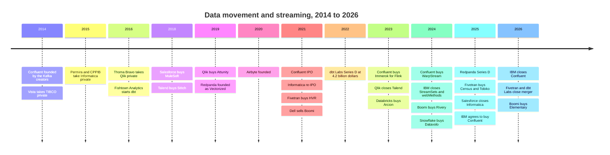
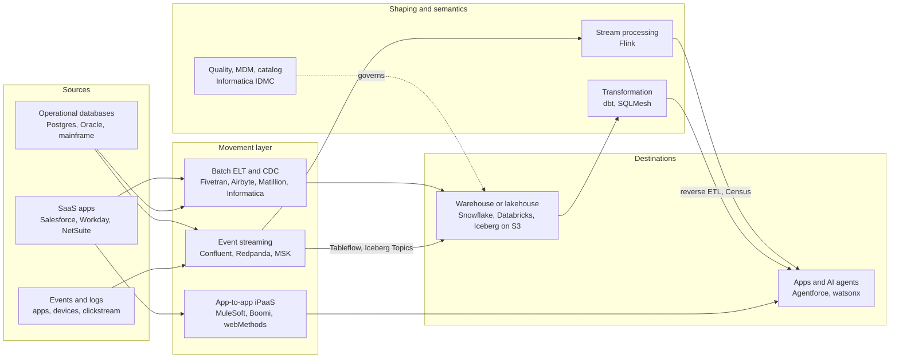
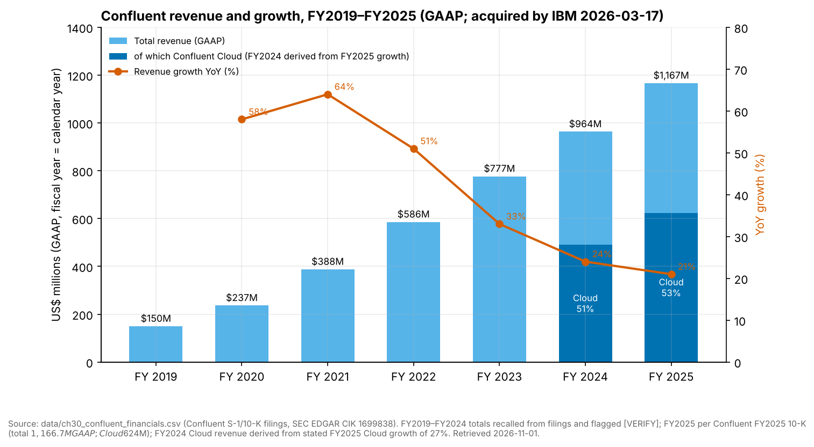
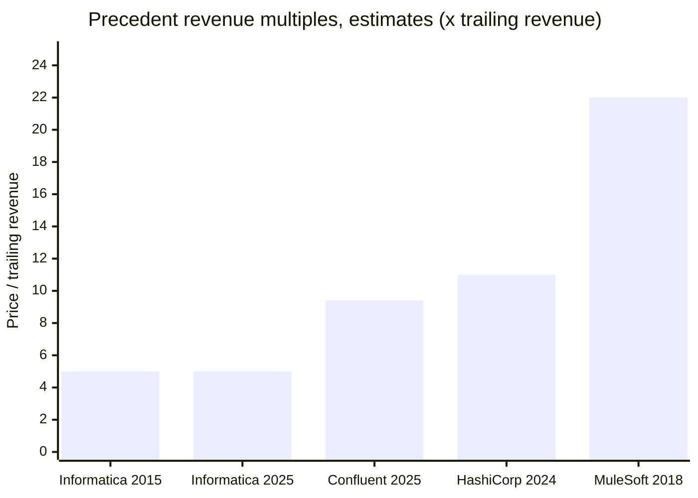
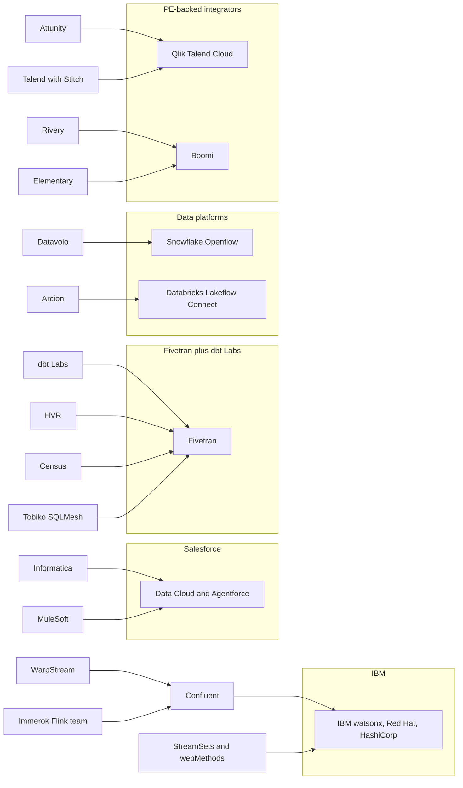

# 30. Data Movement and Streaming Companies
> **Status:** mixed: acquired / private · **HQ:** various (US, UK) · **Founded:** 1993–2020 · **Latest valuation/market cap:** IBM–Confluent ~$11B EV (announced deal value, closed 2026-03-17); Salesforce–Informatica ~$8B equity value (closed 2025-11-18); Fivetran + dbt Labs not priced (all-stock merger, closed 2026-06-01) · **Last verified:** 2026-11-01

## TL;DR

- **The layer was sold off in 18 months.** Between May 2025 and June 2026 the three best-known independent data-movement businesses changed hands or merged. Salesforce bought Informatica (~$8B equity value), IBM bought Confluent (~$11B enterprise value) and Fivetran merged with dbt Labs in an all-stock deal. The surviving independents (Airbyte, Redpanda, Matillion, Estuary) are much smaller.[^infa-close][^ibm-close][^ft-dbt-close]
- **Confluent is the reference precedent.** IBM paid about **9.4x** Confluent's FY2025 GAAP revenue of $1,167M, which grew 21%. Confluent Cloud made up $624M of that, or 53%. Growth had slowed from 64% in FY2021. Read the price as a fair growth-adjusted multiple for a category leader whose growth was fading, not a scarcity premium.[^comps-cflt][^cflt-fin]
- **The buyers wanted context for AI agents, not pipes.** Salesforce wants governed, matched master data under Data Cloud and Agentforce. IBM wants a real-time event layer under watsonx, beside Red Hat and HashiCorp. Fivetran + dbt Labs wants to be the neutral ingestion-to-semantics layer between customers and Snowflake, Databricks and the hyperscalers.
- **Why consolidation hit this layer.** Platforms now bundle good-enough connectors. Pricing is under pressure from per-connection meters and diskless Kafka designs. Agents need integrated, governed context. Buyers are tired of stitching ten tools together. And 2021-vintage private marks needed an exit.
- **Everpure angle (public information only).** Streaming retention is moving onto object storage, and data movement decides where lakehouse tables land. Both trends make S3-compatible on-prem storage a possible landing zone. The practical options are certifications with diskless-Kafka engines, landing-zone designs with self-hostable ingestion, and watching IBM, which is both a partner prospect and a storage rival.

## Snapshot table

| Company | Founded / HQ | Leader (latest public) | Owner / status (2026-11-01) | Scale marker (labelled) | Last price (basis, date) |
|---|---|---|---|---|---|
| Confluent | 2014 / Mountain View, CA | Jay Kreps (co-founder, CEO at close) | IBM subsidiary since 2026-03-17 | $1,167M FY2025 revenue, +21% (GAAP); >6,500 customers (company-stated) | ~$11B EV, $31/share cash (announced deal value, 2025-12-08)[^ibm-close][^comps-cflt] |
| Informatica | 1993 / Redwood City, CA | Amit Walia (CEO at close) [VERIFY: post-close role] | Salesforce subsidiary since 2025-11-18 | ~$1.6B FY2024 revenue (GAAP) [VERIFY] | ~$8B equity value, $25/share cash (2025-05-27)[^infa-close][^infa-fin] |
| Fivetran + dbt Labs | 2012 (Fivetran, Oakland) and 2016 (dbt Labs, Philadelphia) | George Fraser (CEO), Tristan Handy (president) | Private; merger closed 2026-06-01 | ARR "approaching $600M" combined (company-stated) | Not priced (all-stock). Last rounds $5.6B (Fivetran, 2021) and $4.2B (dbt Labs, 2022), company-stated[^ft-dbt-close][^funding] |
| Airbyte | 2020 / San Francisco | Michel Tricot (co-founder, CEO) | Private | 700+ connectors (company-stated); revenue not disclosed | $1.5B post-money, $150M Series B (company-stated, 2021-12-17)[^ab-seriesb] |
| Redpanda | 2019 / San Francisco | Alex Gallego (founder, CEO) | Private | Revenue not disclosed | $1B post-money, $100M Series D led by GV (company-stated, 2025-04)[^rp-fund] |
| Matillion | 2011 / Manchester, UK and Denver | Matthew Scullion (founder, CEO) [VERIFY] | Private | Revenue not disclosed | $1.5B, $150M Series E (press-reported, 2021) [VERIFY][^matillion-e] |
| Estuary | Not verified this sweep | Not verified this sweep | Private | 200+ systems connected (company-stated) | $17M Series A, M13-led (company-stated, 2025-10-21; $14M per SiliconANGLE) [VERIFY][^estuary] |

*Figure 30.1 — Snapshot. Of the three companies that reached ~$1B or more of revenue or ARR, two now sit inside larger groups and the third merged to get there. The independents left are venture-scale, and most of their last priced rounds date from 2021.*

## Origin story and strategic arc

Two lineages run through this chapter. The **ETL lineage** (Informatica, then Talend, Matillion, Fivetran, Airbyte) grew up moving data in batches from applications into warehouses. The mechanics are in [Ch 10](../02-pipelines-and-governance/ch10-ingestion-and-integration.md). The **log lineage** (Kafka, Confluent, Redpanda) grew up moving events continuously between systems. Its mechanics are in [Ch 11](../02-pipelines-and-governance/ch11-streaming-and-event-platforms.md). Both reached the same end point in 2025–26: acquired, merged or under pressure from platforms that bundle the same function.

*Figure 30.2 — Consolidation timeline. Private equity bought the first generation (2014–2016), the 2021 IPO window gave Confluent and Informatica public currencies, and strategic buyers took both out within five years. Sources: `data/ma_deals.csv`, `data/private_funding.csv` and the footnotes below.*

### Confluent

Jay Kreps, Neha Narkhede and Jun Rao built Kafka at LinkedIn and left to found Confluent in 2014.[^cflt-10k] The plan was a classic open-core one. Apache Kafka stayed free under the Apache license, and Confluent sold an enterprise distribution (Confluent Platform) with connectors, a schema registry, security and support. A managed service, Confluent Cloud, followed. The company listed on Nasdaq in June 2021 at the top of the post-COVID software market.[^cflt-ipo]

The strategic arc after the IPO had three moves. **First, shift the revenue mix to cloud.** Confluent Cloud passed half of revenue by FY2024 on our derived figure and reached 53% in FY2025.[^cflt-fin] **Second, add processing.** It bought Immerok, a team of Apache Flink committers, for $54.9M in cash in January 2023, and Flink became the company's stream-processing engine.[^ma-csv] **Third, answer the cost attack.** WarpStream showed in 2023 that a Kafka-compatible engine writing straight to S3 could undercut classic Kafka on cross-zone network fees. Confluent bought it in September 2024 for $135.1M of preliminary consideration, launched its own direct-to-object-storage Freight clusters, and shipped Tableflow, which writes topics out as Iceberg tables (GA March 2025).[^ma-csv][^tableflow][^freight] Each move is explained technically in [Ch 11](../02-pipelines-and-governance/ch11-streaming-and-event-platforms.md). The business point is that each one widened the product and lowered its cost floor, but none of them restored 30%+ growth.

### Informatica

Gaurav Dhillon and Diaz Nesamoney founded Informatica in 1993. It became the default enterprise ETL server (PowerCenter) and went public in 1999.[^infa-hist] By 2015 growth had stalled and activists were involved, and Permira and the Canada Pension Plan Investment Board took it private for $5.3B.[^infa-pe] The private-equity plan was to rebuild the company as a subscription and cloud business. That rebuild became the Intelligent Data Management Cloud (IDMC). IDMC is one consumption-priced platform covering integration, data quality, master data management (MDM), catalog and governance, sold in pooled Informatica Processing Units (IPUs).[^infa-ipu] Informatica returned to the public market in October 2021.[^infa-fin] Its cloud business grew quickly, but the maintenance base was migrating or shrinking underneath it, so total growth stayed in single digits. Its multiple never recovered to cloud-software levels.

Salesforce was reported to be in talks to buy Informatica in April 2024, and those talks collapsed (press-reported).[^infa-2024] Thirteen months later it agreed to pay $25 a share in cash, about $8B of equity value, and the deal closed on 18 November 2025.[^infa-close]

### Fivetran and dbt Labs

George Fraser and Taylor Brown founded Fivetran in 2012 and built it into the leading managed ELT service, priced on [monthly active rows](../glossary.md#monthly-active-rows) (MAR).[^ft-300m] In September 2021 it raised $565M at a $5.6B valuation and bought HVR, an enterprise [change data capture](../glossary.md#change-data-capture) vendor, for $700M.[^hvr][^funding] It passed $300M ARR in September 2024 (company-stated).[^ft-300m]

dbt began in 2016 inside Fishtown Analytics, Tristan Handy's consultancy. It made SQL transformation code version-controlled and testable, and created the "analytics engineer" job title (see [Ch 12](../02-pipelines-and-governance/ch12-transformation-and-orchestration.md)). The company renamed itself dbt Labs in 2021 and raised a $222M Series D at $4.2B in February 2022.[^funding] It monetized through dbt Cloud, a hosted development environment, scheduler and semantic layer, while dbt Core stayed open source. It passed $100M ARR with more than 5,000 dbt Cloud customers in February 2025 (company-stated).[^dbt-100m]

Fivetran then assembled a full stack by acquisition. It bought **Census** for reverse ETL (announced May 2025), **Tobiko Data** for SQLMesh, dbt's most credible challenger (September 2025), and then agreed an all-stock merger with **dbt Labs** (announced 13 October 2025, closed 1 June 2026). In May 2026 it also took over stewardship of the Great Expectations open-source project.[^census][^tobiko][^ft-dbt-close][^ma-csv] Fraser is CEO and Handy is president.

### Airbyte and Redpanda

**Airbyte** was founded in 2020 by Michel Tricot and John Lafleur as the open-source answer to Fivetran. It is free to self-host, has a community-built long tail of connectors, and offers a paid cloud. It raised a $150M Series B at $1.5B in December 2021, at the peak of the modern-data-stack cycle.[^ab-seriesb] **Redpanda** was founded in 2019 (as Vectorized) by Alex Gallego. It rewrote the Kafka broker in C++ with a thread-per-core design and no JVM or ZooKeeper, kept Kafka API compatibility, and sold performance, simplicity and a bring-your-own-cloud deployment model. It raised $100M at a $1B valuation, led by GV, in April 2025.[^rp-fund]

## Product and technology

This section maps products to business positions. The mechanisms (logs, partitions, MAR metering, CDC) are explained in Chapters [10](../02-pipelines-and-governance/ch10-ingestion-and-integration.md) and [11](../02-pipelines-and-governance/ch11-streaming-and-event-platforms.md).

*Figure 30.3 — The movement layer and its neighbours. Every buyer in this chapter bought one box and some of the arrows next to it: IBM the streaming box plus processing, Salesforce governance plus integration, Fivetran ingestion plus transformation plus reverse ETL.*

### Confluent

Confluent's portfolio has four layers. (1) **Kafka itself**, as Confluent Platform (self-managed, term licence) or Confluent Cloud (managed, running on its Kora engine). (2) **Freight clusters and WarpStream**, the object-storage tiers for latency-tolerant, high-volume data. WarpStream runs in a bring-your-own-cloud model, with the data plane in the customer's account. (3) **Flink** for stream processing, plus the "Streaming Agents" and "Real-Time Context Engine" features launched in late 2025 to feed AI agents.[^confluent-intel] (4) **Tableflow** and connectors that land topics as Iceberg or Delta tables. A broad portfolio is the bull point. The bear point is that layers 2 and 4 cannibalize revenue from layer 1: the cheaper tier and the table hand-off both reduce what a customer pays per gigabyte.

### Redpanda

Redpanda is a single binary that speaks the Kafka protocol. Its pitch is lower tail latency and fewer machines for the same throughput (vendor claims). Business-wise, the more important product decision was **BYOC**. Redpanda runs the control plane, and the data plane and data stay in the customer's cloud account, which helps with security reviews and lets customers burn down cloud commitments. Iceberg Topics (GA April 2025) and the object-storage "Cloud Topics" tier mirror Confluent's Tableflow and Freight.[^rp-iceberg][^rp-streamfest] Redpanda bought Benthos in 2024 to add a connector and stream-processing framework (Redpanda Connect) [VERIFY: deal date and terms].[^rp-benthos]

### Fivetran + dbt Labs

The merged product spans four steps: connectors, including HVR-based database CDC and a Connector SDK for custom sources; transformation through dbt (Core, the Fusion engine and the dbt platform, formerly dbt Cloud) and SQLMesh; a semantic layer (MetricFlow, open-sourced in October 2025); and activation through Census reverse ETL.[^ft-sdk][^metricflow][^census] The pitch is **neutrality**: one governed pipeline from source to metric definition that works on Snowflake, Databricks, BigQuery and Fabric alike. That is the one thing those platforms cannot credibly offer each other's customers.

### Informatica

IDMC is the broadest suite here. It covers integration (batch, CDC, API and application integration), data quality, MDM, a data catalog and governance, all under the CLAIRE AI layer. MDM is the strategic gem. Matching "Acme Corp", "ACME Corporation" and "Acme Inc." into one golden customer record is hard, sticky work that ingestion tools do not do. That capability is what Salesforce needs to give Agentforce a single trustworthy customer view.

### Airbyte, Matillion and the iPaaS vendors (brief)

- **Airbyte** sells three things: open source under the Elastic License (ELv2), a cloud service priced in credits or capacity ("Data Workers"), and self-managed enterprise licences. Its AI strategy has two halves. One is cheaper connectors, through an AI-assisted Connector Builder that drafts a connector from API documentation (2024). The other is positioning connectors as data access for agents, via PyAirbyte and agent-facing tooling [VERIFY: current agent-product names].[^ab-ai][^ab-license][^ab-pricing]
- **Matillion** offers visual ELT that pushes work down into Snowflake, Databricks and Redshift, priced in credits. It has added "Maia" AI agents for pipeline building [VERIFY: launch date].[^matillion]
- **Qlik Talend** is the Thoma Bravo-owned roll-up of Qlik, Attunity (CDC replication) and Talend with Stitch. It is strong in enterprise CDC.[^qlik-talend]
- **Boomi** is an iPaaS that Dell sold to Francisco Partners and TPG in 2021 [VERIFY: $4B]. It added ELT and CDC through Rivery (~$100M, press-reported, December 2024) and observability through Elementary (October 2026).[^boomi-dell][^rivery][^elementary]
- **MuleSoft** is Salesforce's API-led application integration business, bought for $6.5B in 2018. It now sits beside Informatica inside Salesforce.[^mulesoft]

## How it makes money

| Vendor | Primary pricing unit | Revenue recognition dynamic | Margin driver |
|---|---|---|---|
| Confluent Cloud | Consumption: cluster capacity units (eCKUs), networking per GB, storage, Flink compute units [VERIFY: current unit names] | Recognized as consumed; volatile with customer optimization | Cloud infrastructure in COGS; cross-zone network fees |
| Confluent Platform | Subscription, per node or core [VERIFY] | Licence portion recognized up front under ASC 606, so revenue is lumpy | High (software licence) |
| Redpanda | BYOC, dedicated and serverless cloud tiers; enterprise licence for self-managed | Consumption or subscription | BYOC keeps infrastructure off Redpanda's COGS |
| Fivetran | MAR per connection, with a $5 base charge for small connections since January 2026 | Consumption against annual commitments | Long-tail connections pay the highest per-row rates |
| dbt platform | Developer seats plus a usage meter on models built [VERIFY: 2026 pricing] | Subscription with a usage overlay | Software margins; warehouse compute is paid by the customer |
| Informatica IDMC | Pre-paid, pooled IPUs | Subscription commitment drawn down by consumption | Migration of the PowerCenter base sets the growth rate |
| Airbyte | Credits (Standard) or capacity (Pro, Enterprise Flex); OSS free | Consumption or capacity | Community maintains much of the long tail |

*Figure 30.4 — Pricing units. Every vendor meters something different: rows, capacity units, IPUs, seats. That makes bills hard to compare and gives procurement a reason to consolidate vendors. Sources: Ch 10 pricing table and vendor pricing pages.[^ft-pricing][^ft-2026][^infa-ipu][^ab-pricing]*

**The consumption shift cost Confluent reported growth.** When a customer moves from Confluent Platform to Confluent Cloud, revenue recognition changes shape. A three-year term licence recognizes a large licence component up front. Cloud consumption recognizes revenue month by month as the customer uses it. For a few years, migrations depress reported growth even if the customer's lifetime value rises. Consumption also passes the customer's cost-optimization cycles straight into revenue. The 2023 cloud "optimization" wave and, later, customers moving latency-tolerant workloads to cheaper tiers both hit Confluent this way.

**The Fivetran meter taxes the long tail.** [Ch 10](../02-pipelines-and-governance/ch10-ingestion-and-integration.md) works through MAR pricing in detail. The business implication is that Fivetran's highest-margin rows come from small SaaS connections, the same long tail that platform-bundled connectors and AI-generated connectors attack. Per-connection tiering (March 2025) and the base charge (January 2026) raised effective prices for exactly those connections.[^ft-2025][^ft-2026] That helps revenue now and hands competitors an argument.

> **Bridge: semiconductors (IP blocks).** A connector catalog is a library of **IP blocks**. Each block (a USB PHY, a DDR controller, a Salesforce connector) is unglamorous, must be revalidated whenever the standard or API changes, and is worth more inside a qualified portfolio than alone. EDA vendors spent two decades buying IP-block and point-tool companies until customers bought a validated flow rather than parts. The Fivetran–dbt merger and Boomi's tuck-ins follow the same logic. The bundle earns its premium by carrying the requalification burden, and a startup with one better block finds it hard to get designed in.

## Financials

### Confluent (GAAP, fiscal year = calendar year)

*Figure 30.5 — Confluent's revenue grew about 7.8x in six years, but growth fell every year after FY2021. Cloud passed half of revenue in FY2024 (our figure, derived from FY2025 growth). FY2019–FY2024 totals are recalled from filings and flagged for re-check. Source: `data/ch30_confluent_financials.csv`.[^cflt-fin]*

Revenue went from $149.8M (FY2019) to $1,167M (FY2025). Growth peaked at 64% in FY2021 and then decelerated to 51%, 33%, 24% and 21%.[^cflt-fin] Confluent Cloud grew 27% in FY2025, faster than the total, so the self-managed Platform business was growing in the low teens on our arithmetic: ($1,167M − $624M) ÷ ($963.6M − $491M) ≈ 15% (estimate).[^comps-cflt] The company reported GAAP operating losses throughout its public life, driven largely by stock-based compensation, and reached non-GAAP operating profitability only late [VERIFY: first non-GAAP profitable quarter].[^cflt-10k]

### Deal multiples

| Deal (announced) | Price | Revenue basis | Multiple | Label |
|---|---|---|---|---|
| IBM–Confluent (2025-12) | ~$11.0B EV (IBM recorded $11.6B purchase price) | FY2025 revenue $1,167M (GAAP), +21% | **~9.4x** EV/trailing revenue (~9.9x on recorded price) | Estimate from disclosed figures[^comps-cflt][^ibm-10q] |
| Salesforce–Informatica (2025-05) | ~$8B equity value | FY2024 revenue ~$1.6B (GAAP) [VERIFY] | **~5x** equity value/trailing revenue; EV/revenue higher by net debt [VERIFY] | Estimate[^infa-close][^infa-fin] |
| Permira/CPPIB–Informatica (2015-04) | $5.3B | FY2014 revenue ~$1.05B (GAAP) [VERIFY] | **~5x** | Estimate[^infa-pe][^infa-hist] |
| Salesforce–MuleSoft (2018-03) | $6.5B | FY2017 revenue ~$297M (GAAP) [VERIFY] | **~22x** | Estimate[^mulesoft] |
| IBM–HashiCorp (2024-04; context) | ~$6.4B | FY2024 (to Jan 2024) revenue ~$583M (GAAP) [VERIFY] | **~11x** | Estimate[^hashicorp] |
| Fivetran–HVR (2021-09) | $700M | Not disclosed | n/a | Disclosed price[^hvr] |
| Confluent–WarpStream (2024-09) | $135.1M preliminary (+ up to $76.2M holdbacks) | Not disclosed | n/a | GAAP disclosure (10-Q)[^ma-csv] |
| IBM–StreamSets and webMethods (2023-12) | €2.13B (~$2.3B) | Not disclosed | n/a | Disclosed price[^ibm-ss] |
| Boomi–Rivery (2024-12) | ~$100M | Not disclosed | n/a | Press-reported[^rivery] |
| Fivetran–dbt Labs (2025-10) | All-stock, no price | ~$600M combined ARR (company-stated) | n/a | Company-stated[^ft-dbt-close] |

*Figure 30.6 — Deal multiples. The growth assets (MuleSoft 2018, Confluent) fetched about 9–22x revenue. The mature suite (Informatica) cleared at about 5x twice, ten years apart.*

*Figure 30.7 — Informatica's multiple did not move in ten years, despite a cloud rebuild. Confluent's sits between the mature suite and the high-growth integration precedent. All bars are estimates from the table above; four of the five revenue bases are flagged [VERIFY].*

> **Bridge: valuation.** Divide the multiple by growth. Confluent cleared at ~9.4x for 21% growth, about **0.45x per point of growth**. Snowflake traded at 16.9x EV/NTM revenue on 35% growth on 2026-10-30, about 0.48x per point.[^comps-sf] On that crude basis IBM paid a market price, not a takeover premium over fundamentals. The premium was over Confluent's depressed pre-announcement share price. Strip out the cloud-mix and margin differences and the takeaway holds: in 2025–26, buyers paid for growth and margins, not for category leadership.

### Fivetran + dbt Labs, Airbyte and Redpanda (private)

The merged company discloses only ARR "approaching $600M" (company-stated, June 2026), across more than 10,000 customers at announcement.[^ft-dbt-close][^merger-ann] Subtracting dbt Labs' last stated figure (>$100M ARR, February 2025) implies Fivetran plus Census and Tobiko contributed roughly $450–500M. That is our estimate, and it assumes dbt grew 20–40% in the interim. Airbyte and Redpanda do not disclose revenue.

## Customers and go-to-market

- **Confluent** sold to platform-engineering teams through a direct field force, with cloud-marketplace co-sell and a partner ecosystem of more than 120 pre-built connectors [VERIFY: connector count]. It cited more than 6,500 customers and about 40% of the Fortune 500 at the time of the IBM close (company-stated, press-reported).[^ibm-close] Under IBM the go-to-market changes: IBM Consulting, the IBM Z mainframe base (where much transactional data originates) and Red Hat OpenShift become new channels.
- **Informatica** sells to chief data officers in the Global 2000 through enterprise agreements and systems integrators. Under Salesforce the open question is neutrality. Informatica's customers also integrate SAP, Oracle, Workday and Snowflake, and some will worry about roadmap priority.
- **Fivetran + dbt Labs** runs product-led acquisition (Fivetran's free tier and dbt Core's open-source community) into enterprise sales, with heavy co-selling through the Snowflake and Databricks marketplaces.
- **Airbyte** relies on an open-source funnel. **Redpanda** sells BYOC to latency-sensitive and regulated buyers through cloud marketplaces.

## M&A and investments

*Figure 30.8 — Where each acquired asset landed. Streaming went to an infrastructure conglomerate, governance and MDM went to an application vendor, CDC tooling went to the data platforms, and the modern-data-stack tools merged with each other. Source: `data/ma_deals.csv`.*

### IBM–Confluent: why IBM bought it

IBM's software strategy since 2019 reads as a stack of acquisitions. **Red Hat** ($34B, 2019) supplies the hybrid-cloud runtime (RHEL, OpenShift). **HashiCorp** (~$6.4B, closed February 2025) supplies infrastructure automation (Terraform, Vault). **StreamSets and webMethods** (€2.13B, closed July 2024) supply ingestion and application integration. **DataStax** (closed May 2025) supplies vector and NoSQL data. **watsonx** sits on top as the AI and data platform.[^ma-csv][^hashicorp][^ibm-ss] What was missing was the real-time event layer that every one of those products touches. Confluent fills it, and it brings the commercial stewardship of the de facto protocol for moving events.

The integration logic follows. OpenShift becomes a natural deployment target for Confluent Platform in hybrid estates. Terraform already provisions Confluent Cloud resources. Mainframe CDC from IBM Z can feed Kafka topics. And watsonx agents get a subscription feed of business events instead of nightly batches. IBM also gains a consumption-priced cloud business, which it lacks at scale. Early evidence: IBM reported its **Data** software line up **19%** in Q3 2026, a figure that includes Confluent (inorganic).[^comps-ibm]

> **Bridge: infrastructure (protocol standard-bearers).** IBM buying Confluent resembles an infrastructure conglomerate buying the **commercial standard-bearer of a protocol**, as when Broadcom bought Brocade, the Fibre Channel switching leader. The protocol (Kafka, Fibre Channel) is open or standardized and no one can own it outright. What can be bought is the company that writes most of the code, runs the conformance ecosystem and supports the largest installed base. The buyer gets account control and roadmap influence, not exclusivity. Rivals (Redpanda, MSK, AutoMQ) still speak the same protocol, just as other switch makers spoke Fibre Channel.

### Salesforce–Informatica: why Salesforce bought it

Salesforce's agent strategy needs clean, unified, governed data. Agentforce answers are only as good as the customer records under them. Data Cloud already offered zero-copy access to Snowflake and Databricks, and MuleSoft already offered APIs. What Salesforce lacked was the **industrial-grade data-management toolkit**: MDM to resolve entities, data quality to fix records, a catalog and lineage to show where data came from, and bulk integration from non-Salesforce systems.[^infa-close] Informatica is the most complete supplier of exactly that toolkit to the Global 2000.

> **Bridge: semiconductors (supply security).** Salesforce buying Informatica resembles a **system vendor buying a key component supplier** to secure supply, as when NVIDIA bought Mellanox. NVIDIA's GPUs were the product, but performance at datacenter scale depended on an interconnect it did not control. Agentforce is the product, but agent quality depends on the data-management "interconnect" that Informatica supplied to Salesforce's customers and to its rivals. Owning it secures the input and lets Salesforce co-design the two. As with Mellanox, the risk is that customers of the rivals (SAP, Oracle, ServiceNow) start sourcing elsewhere.

**What happened post-close.** Public detail is thin. This sweep found no separately disclosed Informatica revenue line inside Salesforce's results, and no confirmed changes to IDMC pricing or third-party connector support [VERIFY: Salesforce FY2027 segment disclosure, leadership changes and integration milestones]. On the market side, Salesforce's enterprise value exceeded its market capitalization at 2026-10-30, reflecting net debt after the cash deal, and its market cap was down about 21% year on year (stockanalysis, 2026-10-30).[^comps-crm] That decline reflects broader worries about AI's effect on application seats as much as the deal.

### Fivetran: merger rationale and the IPO question

Fivetran's rationale is scope instead of price cuts. Ingestion alone is being bundled away by the platforms. Ingestion plus transformation plus semantics plus activation is a "data control plane" the platforms cannot bundle neutrally across each other. The all-stock structure avoided a fresh valuation at a time when both companies' 2021–22 marks ($5.6B and $4.2B) were probably above what a priced round would show.[^funding] IPO speculation followed the announcement, but no filing or timetable had been reported as of 2026-11-01 [VERIFY: any confidential S-1 report].[^merger-ann] The open risks are licence anxiety in the dbt community (the Fusion engine is proprietary; dbt Core v2 is Apache 2.0) and a roll-up's integration burden (see [Ch 12](../02-pipelines-and-governance/ch12-transformation-and-orchestration.md)).[^core-v2]

## Why consolidation hit this layer

Five forces arrived together, and each one alone would have pressured a standalone movement vendor.

1. **Platforms bundled the head of the distribution.** Databricks turned Arcion into Lakeflow Connect, Snowflake turned Datavolo into Openflow, and the hyperscalers shipped zero-ETL integrations and managed Kafka.[^lakeflow][^openflow] The highest-volume sources (Salesforce, Postgres, SQL Server) now come "free" on a meter the customer already pays. Independents keep the long tail and the multi-platform buyer, a smaller and slower market.
2. **Pricing pressure came from both ends.** In batch ingestion, per-connection MAR tiering raised effective prices and invited churn to bundled or open-source options.[^ft-2025] In streaming, object-storage designs cut the network bill for latency-tolerant workloads by orders of magnitude (see the worked example in [Ch 11](../02-pipelines-and-governance/ch11-streaming-and-event-platforms.md)). That puts a ceiling on revenue per gigabyte.
3. **AI agents need integrated context, not separate tools.** An agent answering a customer question needs fresh events, resolved entities and agreed metric definitions at once. Buyers with an agent platform to feed (Salesforce, IBM) decided to own those inputs. Fivetran + dbt Labs merged to offer them as one neutral package.
4. **Buyers are tired of stitching tools together.** The 2020–21 "modern data stack" asked customers to assemble ingestion, transformation, orchestration, quality, catalog and reverse ETL from separate vendors. Procurement and platform teams now consolidate vendors, which rewards suites and punishes point tools.
5. **The 2021 vintage needed an exit.** Confluent and Informatica listed in 2021, and Fivetran, dbt Labs, Airbyte and Matillion all priced rounds in 2021–22. As growth slowed, public multiples compressed and private marks went stale. A strategic sale (Confluent, Informatica) or a stock-for-stock merger (Fivetran–dbt Labs) settled the question without a down round. Private equity did the same job a decade earlier for TIBCO, Informatica and Qlik.[^infa-pe][^ma-csv]

## Competitive position

| Dimension | Confluent (IBM) | Redpanda | Fivetran + dbt Labs | Informatica (Salesforce) | Airbyte | Matillion | Qlik Talend | Boomi | MuleSoft |
|---|---|---|---|---|---|---|---|---|---|
| Owner / status | IBM (closed 2026-03-17) | Private, VC | Private, VC (merged 2026-06-01) | Salesforce (closed 2025-11-18) | Private, VC | Private, VC | Thoma Bravo | Francisco Partners, TPG | Salesforce (2018) |
| Core function | Event streaming plus Flink | Kafka-API streaming | ELT, transformation, reverse ETL | Data management suite, MDM | Open-source ELT | Visual ELT | CDC plus ETL | iPaaS plus ELT | API integration |
| Last valuation or deal value (basis, date) | ~$11B EV (announced, 2025-12) | $1B post (company-stated, 2025-04) | $5.6B and $4.2B pre-merger marks (2021, 2022) | ~$8B equity (2025-05) | $1.5B post (2021-12) | $1.5B (press-reported, 2021) [VERIFY] | Talend price undisclosed (2023) | ~$4B (2021) [VERIFY] | $6.5B (2018) |
| Revenue / ARR (labelled) | $1,167M FY2025 (GAAP) | n/d | ~$600M ARR (company-stated) | ~$1.6B FY2024 (GAAP) [VERIFY] | n/d | n/d | n/d | n/d | Not broken out |
| Pricing unit | eCKU consumption; Platform subscription | BYOC, cloud tiers, licence | MAR per connection; seats plus usage | IPUs | Credits or capacity; OSS free | Credits | Subscription or capacity | Subscription tiers | Subscription or capacity |
| Deployment | Cloud, self-managed, BYOC (WarpStream) | BYOC, cloud, self-managed | SaaS, hybrid agent | SaaS, hybrid | Cloud, self-managed, OSS | SaaS, hybrid agents | SaaS, on-prem | SaaS, runtime agents | SaaS, on-prem |
| Iceberg / lakehouse path | Tableflow | Iceberg Topics | Data-lake destinations, Unity and Polaris registration | IDMC to lakehouses | Iceberg and S3 destinations | Push-down to platforms | Qlik Open Lakehouse [VERIFY] | Rivery ELT | Indirect |
| Neutrality risk | IBM priorities | Low | Low (core pitch) | Salesforce priorities | Low | Low | Low | Low | Salesforce priorities |

*Figure 30.9 — Vendor matrix (nine companies × eight dimensions). The two largest assets now carry an owner's agenda, and that is the independents' best sales argument. Sources: snapshot table footnotes, `data/ma_deals.csv`, `data/private_funding.csv`.[^ma-csv][^funding]*

**Platforms are the real competitor.** Databricks Lakeflow Connect (built on Arcion) and Snowflake Openflow (built on Datavolo/NiFi) put ingestion on the platform's own meter, while AWS, Google and Microsoft bundle zero-ETL, Datastream and Fabric copy jobs.[^lakeflow][^openflow] In streaming, Amazon MSK, Google's managed Kafka and Azure Event Hubs win by default inside their clouds. Diskless designs such as AutoMQ, Bufstream and StreamNative Ursa compete on price, and Apache Kafka's own accepted KIP-1150 will bring object-storage topics to free Kafka.[^kip1150] Redpanda's distinct edge is latency plus BYOC. Airbyte's is open source plus the long tail.

## Why it's winning / bull case

1. **Agents raise the value of fresh, governed context.** Event streams (Confluent), matched master data (Informatica) and semantic definitions (dbt) are precisely the inputs agents need, which is why strategic buyers paid strategic prices.
2. **Distribution transforms the acquired assets.** IBM Consulting, the IBM Z base and the Salesforce customer base are channels neither Confluent nor Informatica could build alone.
3. **Neutrality is scarcer after consolidation.** With Informatica inside Salesforce and Confluent inside IBM, Fivetran + dbt Labs, Redpanda and Airbyte can sell "no platform agenda" to multi-platform enterprises.
4. **The protocol moat holds.** Kafka's API is the industry's common interface, and Confluent still employs much of its core contributor base, which keeps influence over the roadmap.

## Risks / bear case and open questions

1. **Bundling compresses the standalone business.** Each platform connector or zero-ETL integration removes a high-volume source from independent meters, leaving the long tail, where AI-generated connectors attack next.
2. **Cheaper architectures shrink revenue per GB.** Freight, WarpStream, Tableflow and KIP-1150 move streaming toward object-storage economics. That is good for customers and hard on revenue per gigabyte for every streaming vendor, including Confluent under IBM.
3. **Conglomerate gravity.** IBM's and Salesforce's histories include acquired products that slowed after integration. Engineers leaving after retention cliffs, and customers worrying about neutrality, are the usual failure modes [VERIFY: post-close attrition reports].
4. **Roll-up execution at Fivetran + dbt Labs.** The company must merge two cultures, two pricing models and an open-source community wary of relicensing, while still growing into 2021-vintage valuations.
5. **Stale private marks.** Airbyte ($1.5B) and Matillion ($1.5B, [VERIFY]) last priced in 2021. A flat or down exit is a real possibility, which keeps private equity and the platforms as likely buyers.
6. **Open questions.** What Confluent revenue does IBM disclose by FY2026 year-end? Does Salesforce keep Informatica connectors and pricing neutral toward SAP and Snowflake? Does Fivetran + dbt Labs file for an IPO, and at what multiple of ~$600M ARR?

## Relevance to Everpure

> **Storage bridge.** Diskless Kafka and Iceberg-from-topics turn streaming retention into an object-storage workload: large sequential PUTs, replay bursts and weeks of history. Ingestion tools that write open formats to any S3-compatible endpoint can land lakehouse tables on-prem. See the companion *Everpure Tech Atlas* for object-store performance detail and [Ch 11](../02-pipelines-and-governance/ch11-streaming-and-event-platforms.md) for the cost arithmetic.

**Compete or partner?** None of these companies sells storage, so the relationship is mostly partner-or-ignore. The exception is IBM, which owns Confluent and also sells storage (IBM Storage Scale and FlashSystem), so it is both a channel prospect and a rival. Everpure's own moves (1touch, now Data Intelligence; Data Stream on FlashBlade) sit next to this layer rather than in it. Data Intelligence classifies data in place, and Data Stream prepares data for AI pipelines.[^everpure-ds][^1touch]

**Options a strategy team might evaluate, based on public information:**

| Option | What it would mean | Why it could matter | Watch-outs |
|---|---|---|---|
| Certify FlashBlade as a backend for object-native streaming | Validated designs with WarpStream BYOC, Redpanda tiered and Cloud Topics, AutoMQ or Bufstream on S3-compatible on-prem storage [VERIFY: each vendor's S3-compatible support] | Streaming retention moves bytes from broker disks to object storage, and on-prem regulated streaming needs a home | Latency profile, request rates and metadata-service behaviour must be tested; IBM may steer Confluent toward its own storage |
| Landing-zone reference designs for data movement | Fivetran's hybrid deployment option [VERIFY: S3-compatible destination support], Airbyte self-managed, dlt or Openflow BYOC writing Iceberg to FlashBlade | Movement tools decide where tables land; self-hostable ones keep that decision open | Managed SaaS tools default to cloud destinations; demand may be niche |
| Data Stream as a streaming consumer | Feed Data Stream's vectorization from Kafka or CDC topics so AI indexes stay fresh | Aligns Everpure with the "real-time context for agents" story every buyer here told | Needs connector work; overlaps with Confluent's own agent features |
| Watch partner neutrality shifts | Track whether Informatica (Salesforce) and Confluent (IBM) stay storage-neutral | Changes in certification programmes could open or close doors | Public information only; no signal yet |

*Figure 30.10 — Options matrix (public information only). The highest-leverage lever is the object-storage shift in streaming, because it changes where the bytes physically live.*

## Conversation playbook

**Three questions for product leaders or executives at these companies**

1. *To Confluent/IBM:* "What share of new Confluent workloads land on Freight or WarpStream rather than standard clusters, and what happens to revenue per GB?" **Good answer:** a mix trend plus a story about volume growth outrunning the per-GB decline, with honest numbers for cannibalization.
2. *To Fivetran + dbt Labs:* "What share of the ~$600M ARR comes from customers buying both ingestion and dbt, and how has net retention moved since the merger?" **Good answer:** a cross-sell attach rate and a cohort view, not just logo counts.
3. *To Informatica/Salesforce:* "Which non-Salesforce destinations and sources get first-class roadmap priority in IDMC through 2027?" **Good answer:** named commitments (SAP, Snowflake, Databricks) and contractual neutrality, not "we remain open".

**Three questions for partner architects or engineers**

1. "Which S3-compatible on-prem stores are certified for WarpStream, Tableflow or Redpanda Cloud Topics, and what request rate and latency did you test at?"
2. "When Fivetran or Airbyte writes Iceberg to a customer bucket, which catalogs can it register to, and does it support non-AWS endpoints?"
3. "How does Confluent's Real-Time Context Engine or Streaming Agents expose topics to agents: MCP, REST or Flink SQL?"

**What good answers sound like.** They separate list price from effective price and protocol from product. They give configuration-specific latency and cost numbers. And they admit where platforms now win.

**Don't say this**

- "IBM overpaid for Confluent." On a growth-adjusted basis (~0.45x per point of growth) the price was in line with public comps.
- "Fivetran acquired dbt Labs." It was an all-stock merger with joint leadership.
- "Informatica is legacy on-prem ETL." Most new business had moved to IDMC cloud consumption before the sale.
- "Kafka belongs to IBM now." Apache Kafka is an Apache Software Foundation project; IBM owns Confluent.
- "Airbyte's connectors are free, so it costs nothing." The software is free; operating it is not ([Ch 10](../02-pipelines-and-governance/ch10-ingestion-and-integration.md)).

## Key terms

- [Monthly active rows](../glossary.md#monthly-active-rows) — Fivetran's billing unit: distinct rows changed per month per connection.
- [Change data capture](../glossary.md#change-data-capture) — reading a database's log to stream inserts, updates and deletes.
- [Reverse ETL](../glossary.md#reverse-etl) — syncing modeled warehouse data back into operational apps.
- [iPaaS](../glossary.md#ipaas) — integration platform as a service for application-to-application integration.
- [Informatica Processing Unit](../glossary.md#informatica-processing-unit) — Informatica's pre-paid, pooled consumption unit for IDMC services.
- [Bring your own cloud](../glossary.md#bring-your-own-cloud) — the vendor's data plane runs in the customer's cloud account.
- [Diskless Kafka](../glossary.md#diskless-kafka) — Kafka-compatible designs whose primary store is object storage.
- [Master data management](../glossary.md#master-data-management) — resolving duplicate records into one trusted "golden record" per entity.
- [Tableflow](../glossary.md#tableflow) — Confluent feature that materializes Kafka topics as Iceberg or Delta tables.
- [Take-private](../glossary.md#take-private) — a buyout that delists a public company, typically by private equity.
- [All-stock merger](../glossary.md#all-stock-merger) — a combination paid in shares, with no cash price set.
- [Precedent transaction](../glossary.md#precedent-transaction) — a past deal used as a valuation benchmark via its multiples.
- [Open core](../glossary.md#open-core) — a model that gives away an open-source core and sells proprietary features or hosting.

## Sources

[^ibm-close]: IBM, "IBM Completes Acquisition of Confluent," via Stock Titan, https://www.stocktitan.net/news/IBM/ibm-completes-acquisition-of-confluent-making-real-time-data-the-lbuwdbharsqe.html, published 2026-03-17; ChannelWeb UK, "IBM completes $11bn Confluent acquisition," https://www.channelweb.co.uk/news-network/2026/ibm-completes-11bn-confluent-acquisition, published 2026-03; retrieved 2026-11-01. Customer counts company-stated, press-reported.
[^ibm-10q]: IBM, Form 10-Q for the quarter ended 2026-03-31 (Confluent purchase price $11,602M), SEC EDGAR, https://www.sec.gov/Archives/edgar/data/0000051143/000005114326000038/ibm-20260331.htm, published 2026-04; retrieved 2026-11-01.
[^comps-cflt]: AI Data Atlas dataset `data/public_comps.csv`, Confluent row (EV ~$11.0B; FY2025 revenue $1,167M, +21%; Confluent Cloud $624M, +27%; 9.4x EV/trailing revenue), as of 2026-03-17; sources: IBM 10-Q (above) and Confluent Form 10-K FY2025, https://www.sec.gov/Archives/edgar/data/1699838/000169983826000006/cflt-20251231.htm, published 2026; retrieved 2026-11-01. FY2025 figures via a secondary summary of the Q4 release [VERIFY vs 10-K].
[^cflt-fin]: AI Data Atlas dataset `data/ch30_confluent_financials.csv` (Confluent GAAP revenue FY2019–FY2025 and Confluent Cloud revenue FY2024–FY2025), compiled from Confluent S-1 and Form 10-K filings, SEC EDGAR, https://www.sec.gov/cgi-bin/browse-edgar?action=getcompany&CIK=0001699838&type=10-K; retrieved 2026-11-01. FY2019–FY2024 values recalled from filings and not re-opened in this session [VERIFY]; FY2024 Cloud revenue derived (estimate).
[^cflt-10k]: Confluent, Inc., Form 10-K for fiscal year ended 2025-12-31 (company history, founders, GAAP operating results), SEC EDGAR, https://www.sec.gov/Archives/edgar/data/1699838/000169983826000006/cflt-20251231.htm, published 2026; retrieved 2026-11-01.
[^cflt-ipo]: Confluent, Inc., Form S-1 and Rule 424(b) prospectus (Nasdaq: CFLT, June 2021), SEC EDGAR, https://www.sec.gov/cgi-bin/browse-edgar?action=getcompany&CIK=0001699838&type=424B4, published 2021-06; retrieved 2026-11-01. IPO pricing details not re-opened in this session [VERIFY].
[^comps-sf]: AI Data Atlas dataset `data/public_comps.csv`, Snowflake row (16.9x EV/NTM revenue, as of 2026-10-30); growth from Snowflake Q2 FY2027 release (GAAP revenue +35%), https://secure.businesswire.com/news/home/20260902386235/en/Snowflake-Reports-Financial-Results-for-the-Second-Quarter-of-Fiscal-2027, published 2026-09-02; retrieved 2026-11-01.
[^comps-ibm]: AI Data Atlas dataset `data/public_comps.csv`, IBM row (Q3 2026, Jul–Sep 2026: Data +19%, includes Confluent, inorganic), source IBM Q3 2026 earnings exhibit, https://www.sec.gov/Archives/edgar/data/0000051143/000005114326000093/ibm-20261021xex991.htm, published 2026-10-21; retrieved 2026-11-01. GAAP segment growth.
[^comps-crm]: AI Data Atlas dataset `data/public_comps.csv`, Salesforce row (market cap $188.61B, EV $219.58B; market cap down ~21% YoY), stockanalysis.com, https://stockanalysis.com/stocks/crm/market-cap/, as of 2026-10-30; retrieved 2026-11-01.
[^infa-close]: Salesforce via Business Wire (FinancialContent), "Salesforce Completes Acquisition of Informatica," https://markets.financialcontent.com/clarkebroadcasting.mymotherlode/article/bizwire-2025-11-18-salesforce-completes-acquisition-of-informatica, published 2025-11-18; Bloomberg Law, "Salesforce Agrees to Buy Informatica in Deal Worth $8 Billion," https://news.bloomberglaw.com/tech-and-telecom-law/salesforce-agrees-to-buy-informatica-in-deal-worth-8-billion, published 2025-05-27; retrieved 2026-11-01.
[^infa-fin]: Informatica Inc., Form 10-K for fiscal year ended 2024-12-31 and IPO prospectus (NYSE: INFA, October 2021), SEC EDGAR full-text search, https://www.sec.gov/edgar/search/#/q=%22Informatica%20Inc.%22, published 2025-02 and 2021-10; retrieved 2026-11-01. FY2024 revenue (~$1.6B, GAAP), IPO date and CEO not re-opened in this session [VERIFY].
[^infa-hist]: Informatica Corporation, historical Form 10-K filings (founding 1993; 1999 IPO; FY2014 revenue ~$1.05B, GAAP), SEC EDGAR full-text search, https://www.sec.gov/edgar/search/#/q=%22Informatica%20Corporation%22, n.d.; retrieved 2026-11-01. Recalled; not re-opened in this session [VERIFY].
[^infa-pe]: Permira, "Informatica announces agreement to be acquired by the Permira funds and Canada Pension Plan Investment Board," https://www.permira.com/news-and-insights/news/informatica-announces-agreement-to-be-acquired-by-the-permira-funds-and-canada-pension-plan-investment-board/, published 2015-04-07; retrieved 2026-11-01.
[^infa-2024]: Press reports (Wall Street Journal, Reuters) of Salesforce–Informatica talks and their collapse, April 2024; not re-retrieved in this session [VERIFY: primary article URLs and dates]. Press-reported.
[^infa-ipu]: Informatica blog, "Announcing Consumption Pricing for Informatica Intelligent Data Management Cloud," https://www.informatica.com/blogs/announcing-consumption-pricing-for-informatica-intelligent-data-management-cloud.html, n.d.; retrieved 2026-11-01.
[^ft-dbt-close]: Fivetran, "Fivetran & dbt Labs Complete Merger to Create the Data Infrastructure for Trusted AI Agents," https://www.fivetran.com/press/fivetran-dbt-labs-complete-merger-to-create-the-data-infrastructure-for-trusted-ai-agents, published 2026-06-01; announcement: Business Wire, https://www.businesswire.com/news/home/20251013172495/en, published 2025-10-13; retrieved 2026-11-01. Combined ARR company-stated.
[^merger-ann]: dbt Labs blog, "dbt Labs and Fivetran merge announcement," https://www.getdbt.com/blog/dbt-labs-and-fivetran-merge-announcement, published 2025-10-13; Reuters via TradingView, "a16z-backed data firms Fivetran, dbt Labs to merge in all-stock deal," https://de.tradingview.com/news/reuters.com%2C2025%3Anewsml_L6N3VU00K%3A0-a16z-backed-data-firms-fivetran-dbt-labs-to-merge-in-all-stock-deal, published 2025-10-13; retrieved 2026-11-01. >10,000 customers company-stated.
[^ft-300m]: Fivetran, "Fivetran Surpasses $300M ARR, Driven by Growing AI and Data Movement Demand," https://www.fivetran.com/press/fivetran-surpasses-300m-arr-driven-by-growing-ai-and-data-movement-demand, published 2024-09-27; retrieved 2026-11-01. Company-stated.
[^hvr]: Fivetran, "Fivetran to Acquire HVR; Announces $565 Million in Series D Funding," https://www.fivetran.com/press/fivetran-to-acquire-hvr-announces-565-million-in-series-d-funding, published 2021-09-20; retrieved 2026-11-01.
[^dbt-100m]: dbt Labs blog, "dbt Labs surpasses $100M ARR," https://getdbt.com/blog/dbt-labs-100m-arr-milestone, published 2025-02-05; retrieved 2026-11-01. Company-stated.
[^census]: Business Wire, "Fivetran Signs Agreement to Acquire Census," https://www.businesswire.com/news/home/20250501266140/en, published 2025-05-01; retrieved 2026-11-01. Closing not separately confirmed.
[^tobiko]: Fivetran, "Fivetran Acquires Tobiko Data…," https://www.fivetran.com/press/fivetran-acquires-tobiko-data-to-power-the-next-generation-of-advanced-ai-ready-data-transformation, published 2025-09-03; retrieved 2026-11-01.
[^ft-sdk]: Fivetran blog, "Fivetran Connector SDK: Unlocking every data source," https://www.fivetran.com/blog/fivetran-connector-sdk-unlocking-every-data-source, published 2025-06-02; retrieved 2026-11-01.
[^metricflow]: dbt Labs, "dbt Labs Affirms Commitment to Open Semantic Interchange by Open Sourcing MetricFlow," https://www.getdbt.com/blog/dbt-labs-affirms-commitment-to-open-semantic-interchange-by-open-sourcing-metricflow, published 2025-10-14; retrieved 2026-11-01.
[^core-v2]: dbt Labs developer blog, "dbt Core v2 is here," https://docs.getdbt.com/blog/dbt-core-v2-is-here, 2026 (exact date unverified); retrieved 2026-11-01.
[^ft-pricing]: Fivetran, "Pricing," https://www.fivetran.com/pricing, living document; retrieved 2026-11-01. List prices.
[^ft-2025]: Fivetran Docs, "Usage-Based Pricing Updates 2025," https://fivetran.com/docs/usage-based-pricing/2025-pricing-faq, published 2025; retrieved 2026-11-01.
[^ft-2026]: Fivetran Docs, "Usage-Based Pricing Updates 2026," https://fivetran.com/docs/core-concepts/usage-based-pricing/pricing-updates/2026-pricing-updates, published 2025-12/2026; retrieved 2026-11-01.
[^funding]: AI Data Atlas dataset `data/private_funding.csv` (Fivetran Series D 2021-09-20, $565M at $5.6B; dbt Labs Series D 2022-02-24, $222M at $4.2B; both company-stated, via Sacra https://sacra.com/c/fivetran/ and https://sacra.com/c/dbt/), as of 2026-11-01; retrieved 2026-11-01.
[^ab-seriesb]: Airbyte via Business Wire, "Airbyte Closes $150 Million Series B Funding Round Led by Altimeter Capital and Coatue Management," https://www.businesswire.com/news/home/20211217005648/en/, published 2021-12-17; retrieved 2026-11-01. Company-stated valuation.
[^ab-ai]: Airbyte via Business Wire, Airbyte 1.0 launch with AI Assistant for Connector Builder, https://www.businesswire.com/news/home/20240924140740/en, published 2024-09-24; retrieved 2026-11-01.
[^ab-license]: Airbyte Docs, "Licenses," https://docs.airbyte.com/community/licenses/, living document; retrieved 2026-11-01.
[^ab-pricing]: Airbyte, "Pricing," https://www.airbyte.com/pricing, living document; retrieved 2026-11-01.
[^rp-fund]: Redpanda, "Redpanda Raises $100M Series D," https://www.redpanda.com/press/redpanda-raises-100m-launches-enterprise-agentic-ai-platform, published 2025-04; Bloomberg Law, "GV, Lightspeed Funding Lifts Redpanda to Unicorn Valuation," https://news.bloomberglaw.com/ip-law/gv-lightspeed-funding-deal-lifts-redpanda-to-unicorn-valuation, published 2025-04; retrieved 2026-11-01.
[^rp-iceberg]: Redpanda, "Redpanda 25.1: Iceberg Topics now generally available," https://redpanda.com/blog/redpanda-25-1-iceberg-topics-ga, published 2025-04-07; retrieved 2026-11-01.
[^rp-streamfest]: Redpanda, "Streamfest day 2: Smarter streaming in the cloud and the future of Kafka," https://www.redpanda.com/blog/redpanda-streamfest-2025-day-2, published 2025; retrieved 2026-11-01.
[^rp-benthos]: Redpanda acquisition of Benthos (Redpanda Connect), 2024; recalled, not retrieved in this session [VERIFY: primary announcement URL, date and terms].
[^matillion-e]: Matillion Series E announcement ($150M, 2021, ~$1.5B valuation as press-reported); recalled, not retrieved in this session [VERIFY: primary URL and terms].
[^matillion]: Matillion, "Pricing," https://matillion.com/pricing, living document; retrieved 2026-11-01. Maia launch date not confirmed [VERIFY].
[^estuary]: Estuary Series A release via Venture Capital Access Online, https://www.vcaonline.com/news/2025102107/estuary-raises-17m-series-a-to-power-ai-for-enterprises-with-right-time-data-movement/, published 2025-10-21; SiliconANGLE, https://siliconangle.com/2025/10/21/estuary-raises-14m-try-solve-one-hardest-problems-data-movement/, published 2025-10-21; retrieved 2026-11-01.
[^qlik-talend]: Qlik, "Qlik Acquires Talend," https://www.qlik.com/us/news/company/press-room/press-releases/qlik-acquires-talend, published 2023-05-16; retrieved 2026-11-01. Terms undisclosed.
[^boomi-dell]: Dell Technologies sale of Boomi to Francisco Partners and TPG (announced 2021-05, ~$4B as reported); recalled, not retrieved in this session [VERIFY: Dell 8-K or press release URL].
[^rivery]: Boomi via Business Wire, "Boomi Boosts Data Management Capabilities with Acquisition of Modern Data Integration Provider Rivery," https://www.businesswire.com/news/home/20241212909154/en, published 2024-12-12; Calcalist (~$100M, press-reported), https://www.calcalistech.com/ctechnews/article/h1eodtavjl, 2024-12; retrieved 2026-11-01.
[^elementary]: iTWire/Business Wire, "Boomi acquires Elementary Data…," https://itwire.com/it-industry-news/deals/boomi-acquires-elementary-data-to-bring-trusted-governed-data-to-the-ai-era, published 2026-10-19; retrieved 2026-11-01.
[^mulesoft]: Salesforce, "Salesforce Signs Definitive Agreement to Acquire MuleSoft," https://investor.salesforce.com/news/news-details/2018/Salesforce-Signs-Definitive-Agreement-to-Acquire-MuleSoft/default.aspx, published 2018-03-20; retrieved 2026-11-01. MuleSoft FY2017 revenue (~$297M, GAAP) recalled from its 10-K, not re-opened [VERIFY].
[^hashicorp]: IBM–HashiCorp acquisition (announced 2024-04, ~$6.4B; closed 2025-02) and HashiCorp FY2024 revenue (~$583M, GAAP, fiscal year ended 2024-01-31), SEC EDGAR full-text search, https://www.sec.gov/edgar/search/#/q=%22HashiCorp%22, n.d.; retrieved 2026-11-01. Recalled; not re-opened in this session [VERIFY].
[^ibm-ss]: IBM Newsroom, "IBM Completes Acquisition of StreamSets and webMethods," https://newsroom.ibm.com/2024-07-01-IBM-Completes-Acquisition-of-StreamSets-and-webMethods,-Bolstering-its-Automation,-Data-and-AI-Portfolios, published 2024-07-01; retrieved 2026-11-01.
[^ma-csv]: AI Data Atlas dataset `data/ma_deals.csv` (rows: IBM–Red Hat; Confluent–Immerok, $54.9M cash per 10-Q; Confluent–WarpStream, $135.1M per 10-Q Q3 2024 https://www.sec.gov/Archives/edgar/data/1699838/000095017024119042/cflt-20240930.htm; IBM–DataStax, closed 2025-05-28; Fivetran–GX Core stewardship, 2026-05-13), as of 2026-11-01; retrieved 2026-11-01.
[^tableflow]: Confluent, "Confluent Announces the General Availability of Tableflow," Business Wire, https://www.businesswire.com/news/home/20250318342911/en/confluent-announces-the-general-availability-of-tableflow, published 2025-03-18; retrieved 2026-11-01.
[^freight]: Confluent, "Freight Clusters Are Generally Available," https://www.confluent.io/blog/freight-clusters-are-generally-available/, published 2025; retrieved 2026-11-01. Company claims.
[^confluent-intel]: Confluent, "Introducing Real-Time Context Engine," https://www.confluent.io/blog/introducing-real-time-context-engine-ai/, published 2025-10; retrieved 2026-11-01.
[^kip1150]: Aiven, "KIP-1150 accepted and the road ahead," https://aiven.io/blog/kip-1150-accepted-and-the-road-ahead, published 2026-03-12; retrieved 2026-11-01.
[^lakeflow]: Databricks Docs, "Managed connectors in Lakeflow Connect," https://docs.databricks.com/aws/en/ingestion/lakeflow-connect/, living document; retrieved 2026-11-01.
[^openflow]: Snowflake, "Snowflake Agrees to Acquire Open Data Integration Platform, Datavolo," https://www.snowflake.com/news/snowflake-agrees-to-acquire-open-data-integration-platform-datavolo/, published 2024-11-20; retrieved 2026-11-01.
[^everpure-ds]: Everpure, "Everpure Announces Data Stream," https://www.everpuredata.com/company/newsroom/press-releases/everpure-announces-data-stream.html, published 2026-06-17; retrieved 2026-11-01.
[^1touch]: Computer Weekly, "Everpure aims to bridge AI data gap with Universal Data Intelligence," https://www.computerweekly.com/news/366644438/Everpure-aims-to-bridge-AI-data-gap-with-Universal-Data-Intelligence, published 2026-06; retrieved 2026-11-01.
