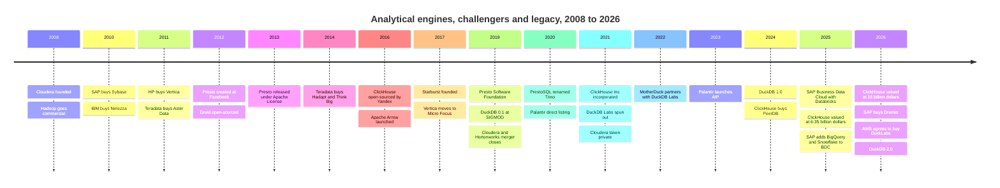
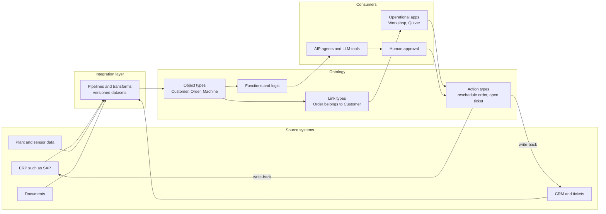
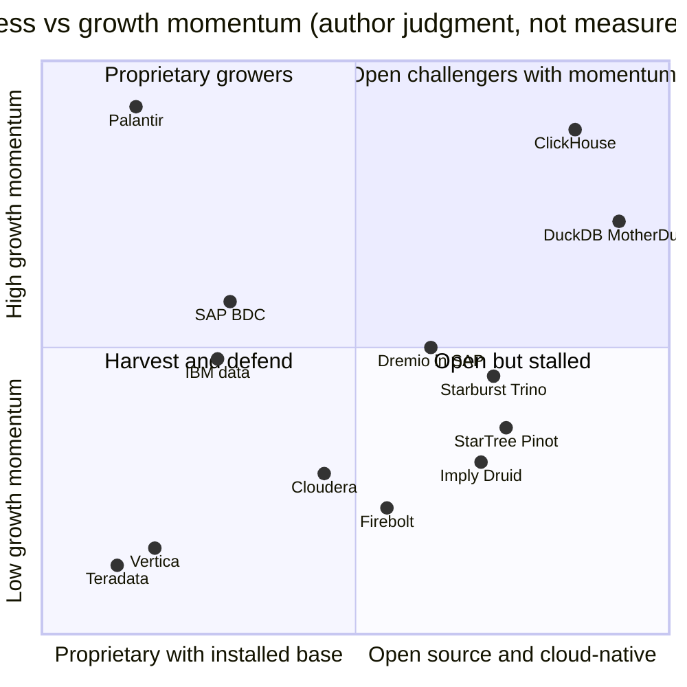

# 31. Analytical Engine Challengers and Legacy Platforms
> **Status:** mixed public/private · **HQ:** various (see snapshot table) · **Founded:** various (see snapshot table) · **Latest valuation/market cap:** ClickHouse $15B post-money (press-reported, Jan 2026); Palantir $442B and Teradata $3.2B market cap (2026-10-30 / 2026-10-28) · **Last verified:** 2026-11-01

## TL;DR

- **Two groups, one fight.** Open-source challengers (ClickHouse, DuckDB and MotherDuck, Trino and Starburst, Dremio, Firebolt, Druid and Pinot vendors) attack specific workloads on price-performance. Incumbents (Teradata, Cloudera, SAP, IBM, Vertica under OpenText) defend large installed bases with long contracts. Both are squeezed by Databricks, Snowflake and the hyperscalers ([Ch 25](ch25-databricks.md), [Ch 26](ch26-snowflake.md), [Ch 28](ch28-hyperscaler-data-platforms.md)).
- **ClickHouse is the breakout challenger.** It raised $400M at a **$15B** valuation in January 2026 (press-reported), 2.4x its May 2025 mark, and says it passed **$250M ARR with more than 4,000 customers** in May 2026 (company-stated). Observability and AI-agent telemetry are the growth engines.[^ch-seriesd][^ch-arr]
- **The independents are being absorbed.** SAP agreed to buy **Dremio** (announced May 4, 2026; closed around July 2026; terms undisclosed). AWS agreed to buy **DuckLabs**, the company behind DuckDB (announced August 26, 2026), while DuckDB itself stays MIT-licensed under the DuckDB Foundation.[^sap-dremio][^aws-duck] Starburst is now the largest independent Trino vendor, and its last priced round dates from 2022.
- **Legacy is cheap for a reason.** Teradata trades at about **1.7x EV/TTM revenue** with flat revenue, while **Palantir** trades at about **70x EV/TTM revenue** on ~79% trailing growth, or ~53x EV/NTM on the FY2026 guidance basis per `data/public_comps.csv` (stockanalysis, 2026-10-28/30). Palantir's Foundry [ontology](../glossary.md#ontology) is effectively a semantic layer with operational write-back, sold to executives as an AI operating system.[^comps-tdc][^comps-pltr]
- **Everpure angle.** On-prem lakehouse engines (Starburst, Dremio, Cloudera, self-managed ClickHouse) are the natural software partners for on-prem S3 object storage. Everpure has public FlashBlade reference work with Dremio and Starburst. Dremio's move into SAP changes who sits across the table in that partnership.[^dremio-pure][^starburst-ep]

## Snapshot table

| Company | Status / owner | HQ / founded | Leader (public record) | Scale marker | Latest valuation or market cap | Key backers / owner |
|---|---|---|---|---|---|---|
| ClickHouse | Private | Spun out of Yandex; incorporated Sept 2021[^ch-inc] | Aaron Katz (CEO)† | >$250M ARR, >4,000 customers (May 2026, company-stated)[^ch-arr] | $15B post-money (Jan 2026, press-reported)[^ch-seriesd] | Dragoneer (D), Khosla (C), Index, Benchmark[^ch-seriesc][^ch-inc] |
| DuckDB / DuckLabs | MIT project; DuckLabs agreed to join AWS (Aug 2026) | Amsterdam; CWI research 2018, Labs spun out 2021[^duck-history] | Hannes Mühleisen, Mark Raasveldt (founders) | >30 staff (2026); duckdb.org >8M monthly unique visitors (company-stated)[^duck-history][^duck-40k] | Terms undisclosed[^aws-duck] | AWS (acquirer); IP held by DuckDB Foundation |
| MotherDuck | Private | Seattle; 2022† | Jordan Tigani (CEO)† | Not disclosed | ~$400M post-money (Sept 2023, press-reported)[^motherduck] | Felicis, a16z |
| Starburst | Private | Boston; 2017† | Justin Borgman (CEO)† | Not disclosed | $250M Series D at ~$3.35B (Feb 2022, press-reported)[^starburst-d] | Alkeon (lead, D) |
| Dremio | Acquired by SAP (2026) | Santa Clara; 2015† | Integrated into SAP Business Data Cloud | Not disclosed | $2B at Series E (Jan 2022, company-stated); deal terms undisclosed[^dremio-e][^sap-dremio] | SAP (owner) |
| Firebolt | Private | Tel Aviv / US; 2019† | Eldad Farkash (CEO)† | Not disclosed | $100M Series C at ~$1.4B (Jan 2022, press-reported)[^firebolt] | n/a |
| Teradata (TDC) | Public, NYSE | San Diego; 1979† | Steve McMillan (CEO)† | ~$1.69B TTM revenue (GAAP)[^fin-tdc] | $3.19B market cap, $2.88B EV (2026-10-28)[^comps-tdc] | Public float |
| Cloudera | Private (KKR, CD&R since 2021) | Santa Clara; 2008† | Charles Sansbury (CEO)† | No audited figures since going private | $5.3B take-private equity value (2021)[^ma-cloudera] | KKR, Clayton Dubilier & Rice |
| Palantir (PLTR) | Public, Nasdaq | Denver; 2003† | Alex Karp (CEO)† | $6.16B TTM revenue to Q2 2026, ~79% YoY (GAAP)[^fin-pltr] | $442B market cap, $433B EV (2026-10-30)[^comps-pltr] | Public float |
| SAP (SAP) | Public, NYSE / Xetra | Walldorf; 1972† | Christian Klein (CEO)† | Q3 2026 revenue €10.27B, cloud +26% (IFRS)[^comps-sap] | $274B market cap (2026-10-30)[^comps-sap] | Public float |
| IBM (IBM) | Public, NYSE | Armonk; 1911† | Arvind Krishna (CEO)† | Q3 2026 revenue $17.1B; Data +19% incl. Confluent (GAAP)[^comps-ibm] | $244B market cap (2026-10-30)[^comps-ibm] | Public float |

*Figure 31.1 — Snapshot. Cells marked † (HQ, founding year, CEO) are settled background knowledge checked by the reviewer; HQs and founding years are stable, but CEOs are confirmed only as of mid-2025 [VERIFY: any leadership change after mid-2025]; everything else is footnoted. The challengers disclose almost nothing audited; only ClickHouse publishes a recent ARR floor. The public incumbents span two orders of magnitude in value, which tells you more about growth expectations than about installed base.*

## Origin story and strategic arc

The companies in this chapter come from three waves. Each wave began with an engine that a large internet company or research lab built for its own needs. Each ended with incumbents buying the survivors.

**Wave 1: MPP appliances (1980s–2011).** Teradata sold shared-nothing [massively parallel processing](../glossary.md#massively-parallel-processing) warehouses as hardware-plus-software appliances to banks, retailers and telecoms. The column-store and appliance startups of the 2000s mostly sold out within about a year of each other: SAP bought Sybase ($5.8B, 2010), IBM bought Netezza ($1.7B, 2010), HP bought Vertica (2011) and Teradata bought the rest of Aster Data ($263M, 2011).[^ma-sybase][^ma-netezza][^ma-vertica][^ma-aster] [Ch 5](../01-data-systems-foundations/ch05-analytical-engines.md) explains the columnar and vectorized execution that these engines pioneered. This chapter does not repeat it.

**Wave 2: Hadoop and SQL-on-Hadoop (2008–2021).** Cloudera (founded 2008) and Hortonworks commercialized Apache Hadoop. Facebook engineers created **Presto** in 2012 to run interactive SQL over the company's Hadoop warehouse, and released it under the Apache License in 2013.[^trino-rename][^presto-psf] Teradata responded by buying SQL-on-Hadoop teams (Hadapt, 2014) and a Hadoop consultancy (Think Big, 2014).[^ma-hadapt][^ma-thinkbig] The Hadoop distributors never built a cloud service in time. Cloudera and Hortonworks merged in an all-stock deal valued at a combined $5.2B (closed January 2019), MapR's assets went to HPE in 2019, and KKR and CD&R took Cloudera private for about $5.3B in 2021.[^ma-hortonworks][^ma-mapr][^ma-cloudera]

**Wave 3: Open engines for the cloud and the laptop (2016–2026).** Yandex open-sourced ClickHouse, the engine behind its Metrica web-analytics product, in June 2016.[^ch-history] Presto's creators left Facebook, set up the Presto Software Foundation in January 2019, and renamed their fork **Trino** in December 2020 after Facebook trademarked the Presto name under the Linux Foundation.[^trino-rename] DuckDB began at CWI Amsterdam in 2018 and was demonstrated at SIGMOD 2019.[^duck-history] ClickHouse, Inc. was incorporated with a $50M Series A in September 2021, and DuckDB Labs spun out of CWI in July 2021.[^ch-inc][^duck-history] The 2026 consolidation round then began: SAP–Dremio and AWS–DuckLabs.[^sap-dremio][^aws-duck]

Palantir sits outside these waves. It was founded in 2003 for intelligence analysis, built Foundry for commercial customers, listed directly on the NYSE in September 2020 (it moved its listing to Nasdaq in November 2024) and launched its Artificial Intelligence Platform (AIP) in 2023. These dates are settled background knowledge. Its "data platform" is an application-layer construct, the ontology, rather than a query engine.

*Figure 31.2 — Three waves: appliances bought by systems vendors (2010–11), Hadoop distributions consolidated and taken private (2019–21), and open engines raising venture money, then being absorbed (2026). Dates are from the cited sources; Druid 2012, Starburst 2017 and Palantir AIP 2023 rest on settled background knowledge, and SAP Business Data Cloud (February 2025) is confirmed by SAP's later partner announcements.[^sap-snow]*

## Product and technology

### ClickHouse

ClickHouse is a vectorized column store whose core table engine, [MergeTree](../glossary.md#mergetree), writes each insert as a sorted, immutable "part" and merges parts in the background. A sparse primary index points to blocks of 8,192 rows, so a query on a time range reads only the blocks it needs. That design came from Yandex Metrica, which needed sub-second custom reports over raw events rather than pre-aggregated cubes. Yandex documents a 374-server cluster holding over 20 trillion rows for that product.[^ch-history][^ch-paper] The VLDB 2024 paper by the core team is the best single description.[^ch-paper]

ClickHouse Cloud runs a variant called SharedMergeTree, which keeps all table data in shared object storage and makes compute replicas stateless.[^ch-smt] Self-managed ClickHouse still runs well on local NVMe, which is why it shows up in on-prem observability stacks. The product strategy since 2024 has been to add the pieces around the engine: Postgres change-data capture (PeerDB), an observability UI (HyperDX, now ClickStack) and LLM tracing (Langfuse).[^ch-peerdb][^ch-hyperdx][^ch-langfuse] The thesis is simple. Logs, traces and agent telemetry are wide, append-heavy event tables, and ClickHouse is the cheapest fast engine for wide, append-heavy event tables.

### DuckDB and MotherDuck

DuckDB is an [in-process database](../glossary.md#in-process-database): a library that runs inside a Python notebook, an application or a browser, with no server. It brings a vectorized engine to the place where an analyst already works. It reads Parquet, CSV, Iceberg and Delta files directly, including files on S3.[^duck-history] The commercial argument is that most analytical queries are small. MotherDuck's analysis of Amazon's public Redshift fleet dataset found only about 0.03% of queries scanned more than 10 TB (vendor analysis).[^md-redshift][^redset] DuckDB 2.0 (October 21, 2026) added a client-server protocol called Quack, asynchronous I/O and a VARIANT type.[^duck-200] That moves DuckDB beyond the "single process" box for the first time.

The organization is unusual. The **DuckDB Foundation** owns the intellectual property and keeps it under the MIT license. **DuckLabs** (renamed from DuckDB Labs in 2026) employs the core engineers. **MotherDuck** runs the managed cloud service and contracts with DuckLabs for engineering under a partnership announced in November 2022.[^duck-history] DuckLake, the team's table format that keeps lake metadata in a SQL database, reached 1.0 in April 2026 ([Ch 7](../01-data-systems-foundations/ch07-open-table-formats.md)).[^duck-history]

On August 26, 2026, AWS signed a definitive agreement to acquire DuckLabs; terms were not disclosed. The team stays in Amsterdam, and DuckDB, DuckLake and Quack stay MIT-licensed under the Foundation, which is adding a Technical Advisory Board.[^aws-duck][^duck-aws-blog] AWS frames DuckDB as agent-friendly and good at analyzing data in place on S3. By September–October 2026 it had shipped DuckDB-powered analytics inside Aurora PostgreSQL (per `data/ma_deals.csv`).[^aws-duck][^aurora-duck] [Ch 23](../03-ai-data-stack/ch23-real-time-analytics-htap.md) covers the technical side.

**What it means for MotherDuck.** The bull reading is that the engine MotherDuck depends on is now funded by the deepest pocket in cloud computing, and the license cannot be withdrawn. The bear reading is that MotherDuck's engineering partner now works for the hyperscaler most likely to build a competing serverless DuckDB service on S3. MotherDuck has not publicly disclosed a priced round since its 2023 Series B (~$400M post-money, press-reported).[^motherduck] The questions to ask are whether the DuckLabs engineering contract survives the deal, and whether MotherDuck's differentiation (hybrid local-plus-cloud execution, sharing, a managed catalog) is enough without privileged access to the core team.

### Trino and Starburst

Trino is a distributed SQL engine with **no storage of its own**. A coordinator plans the query and workers pull data through connectors: Hive and Iceberg tables on object storage, plus relational databases, Kafka and many others. That makes it the standard engine for [query federation](../glossary.md#query-federation), meaning one SQL statement that joins data across systems without first copying it into a warehouse. Starburst, founded by former Teradata engineers who had maintained Presto there, sells Starburst Enterprise (self-managed) and Starburst Galaxy (SaaS). It markets the "Icehouse" pattern, its name for Trino plus Iceberg on object storage, and adds Warp Speed, which caches and indexes column data on worker SSDs (vendor-claimed speedups).[^warp] Dell's Data Lakehouse appliance (launched 2024) is built on Starburst's engine under an OEM arrangement [VERIFY: current status of the Dell–Starburst OEM product]. Everpure publishes a "Scalable Lakehouse Analytics" reference architecture with FlashBlade, Iceberg and Starburst.[^starburst-ep]

### Dremio

Dremio built an Iceberg-native lakehouse engine on [Apache Arrow](../glossary.md#apache-arrow), the in-memory columnar standard it co-created in 2016.[^arrow-tlp] It added a Git-like catalog (Project Nessie, sold as Arctic) and later backed **Apache Polaris**, the Iceberg REST catalog that graduated to an Apache top-level project in 2026.[^polaris] Its pitch was self-service SQL on data lakes with reflections (materialized acceleration structures) instead of copies, deployable in any cloud or on-prem. That on-prem reach is why Everpure built a joint FlashBlade–Dremio solution for hybrid Iceberg lakehouses.[^dremio-pure] SAP bought Dremio to query non-SAP data alongside SAP data inside its Business Data Cloud, with agentic AI as the stated aim.[^sap-dremio]

### Real-time and other challengers (brief)

- **Firebolt** launched in 2020 as a cloud warehouse built for low-latency, high-concurrency analytics on sparse indexes. Its last priced round we can place is a $100M Series C at a reported ~$1.4B in January 2022 [VERIFY: any later round, product or ownership change].[^firebolt]
- **Imply** (Apache Druid) and **StarTree** (Apache Pinot) sell segment-based engines for user-facing, sub-second dashboards. Imply repositioned around Lumi, an "observability warehouse", in September 2025. StarTree's last disclosed round was a $47M Series B in 2022.[^imply-lumi][^startree][^druid-paper]

### Legacy platforms

- **Teradata Vantage** is the shared-nothing MPP warehouse, now sold on-prem, as VantageCloud Enterprise on the hyperscalers and as VantageCloud Lake on object storage [VERIFY: current product naming]. ClearScape Analytics provides in-database analytics and ML. Its strength is mixed workload management for thousands of concurrent queries in large banks and telecoms.
- **Cloudera** sells a hybrid data platform: the old Hadoop-era stack (Spark, Hive, Impala, NiFi, Kafka) re-centred on Iceberg tables, the same software on-prem and in public clouds, plus a "private AI" pitch for running models next to regulated data. Since going private it has bought Verta (model management, 2024), Octopai (lineage, 2024) and Taikun (Kubernetes management, 2025) [VERIFY: all three dates and terms].
- **SAP** runs **HANA**, its in-memory column store, under S/4HANA. Datasphere is its data-warehouse service, and **Business Data Cloud** (BDC), launched in February 2025 with a Databricks partnership ("SAP Databricks"), is the umbrella that exposes SAP application data as governed data products [VERIFY: Databricks partnership commercial terms].[^sap-bdc] SAP then added Google BigQuery (October 2025) and, on 4 November 2025, Snowflake: **SAP Snowflake** (an SAP-managed Snowflake inside BDC, GA planned Q1 2026) and **SAP BDC Connect for Snowflake** (zero-copy sharing, planned H1 2026) [VERIFY: 2026 ship status of both].[^sap-snow] Dremio now becomes SAP's own engine for non-SAP data in that umbrella, alongside three partner platforms.
- **IBM** sells Db2, Netezza Performance Server (the revived appliance) and **watsonx.data**, a lakehouse that launched (2023) on Presto and Spark over Iceberg [VERIFY: current engine mix]. IBM's 2025–26 deals for DataStax and Confluent show it buying the data layer for watsonx rather than building it.[^ibm-datastax][^ibm-confluent]
- **Vertica**, a column store from the C-Store research line, passed from HP to HPE to Micro Focus (2017) and, through OpenText's purchase of Micro Focus (closed January 2023), to OpenText [VERIFY: any 2025–26 divestment].[^ma-vertica]

### Palantir's ontology

Palantir is not an analytical engine, but it competes for the same executive budget: "make our data useful for AI." Foundry integrates data from source systems through pipelines, then maps it into an **ontology**. The ontology has **object types** (Customer, Aircraft, Purchase Order) with properties, **link types** between objects, and **action types**, which are governed operations that change data and can write back to source systems.[^palantir-ontology] Applications, analysts and since 2023 AIP agents work against objects and actions rather than tables and SQL.

*Figure 31.4 — Palantir's ontology model (redrawn concept, not Palantir's diagram). Data flows in through pipelines, becomes typed objects and links, and leaves as governed actions that write back to source systems. The write-back loop is what separates it from a read-only semantic layer.*

> **Bridge: digital twin.** An ontology is a digital twin of the enterprise rather than of a jet engine. In a fab, the twin mirrors each tool, lot and recipe, and the manufacturing execution system can push a recipe change back to the tool. Palantir does the same for orders, shipments and machines: objects mirror the real things, links mirror their relationships, and actions are the controlled "recipe changes" that flow back to ERP. A plain [semantic layer](../glossary.md#semantic-layer) ([Ch 14](../02-pipelines-and-governance/ch14-semantic-layers-and-bi.md)) is a read-only twin. It defines what "revenue" means but cannot change an order.

### Vendor comparison

| Vendor | Engine type | Storage model | Deployment | License / openness | Sweet-spot workload | Table formats | Ownership trend |
|---|---|---|---|---|---|---|---|
| ClickHouse | Vectorized columnar, MergeTree | Local NVMe or object storage (SharedMergeTree) | Self-managed, ClickHouse Cloud | Apache 2.0 core | Real-time, observability, AI telemetry | Native; reads Iceberg and Delta | Independent, $15B |
| DuckDB / MotherDuck | In-process vectorized | Files; DuckLake; MotherDuck service | Library, browser, managed cloud | MIT (Foundation) | Single-node analytics, embedded, agents | Parquet, Iceberg, Delta, DuckLake | DuckLabs to AWS |
| Trino / Starburst | Distributed SQL, no storage | Any lake or federated source | Self-managed, Galaxy SaaS, OEM | Apache 2.0 Trino; proprietary add-ons | Federation, Iceberg lakehouse | Iceberg, Delta, Hudi, Hive | Independent |
| Dremio | Arrow-based lakehouse engine | Iceberg on object storage | Cloud, on-prem | Open-core | Self-service lakehouse SQL | Iceberg first | Owned by SAP |
| Firebolt | Cloud warehouse with sparse indexes | Managed storage | SaaS | Proprietary [VERIFY] | High-concurrency dashboards | Managed | Independent |
| Druid / Imply, Pinot / StarTree | Segment-based with indexes | Local segments plus deep storage | Self-managed, SaaS | Apache 2.0 cores | User-facing sub-second analytics | Native segments | Independent |
| Teradata Vantage | Shared-nothing MPP | Local or object storage (Lake) | On-prem, hyperscaler clouds | Proprietary | Mixed workloads at high concurrency | Native; Iceberg support [VERIFY] | Public, low multiple |
| Cloudera | Spark, Impala, Hive, NiFi | HDFS or object storage | On-prem, public cloud, hybrid | Open-source components, subscription | Hybrid lakehouse, regulated data | Iceberg | PE-owned |
| SAP HANA / BDC | In-memory column store plus lake | In-memory; object storage in BDC | SAP cloud, on-prem HANA | Proprietary | SAP application analytics | Delta via Databricks; Iceberg via Dremio and Snowflake; BigQuery connector | Buying in and partnering |
| IBM Db2 / Netezza / watsonx.data | Row and MPP; Presto and Spark | Local; Iceberg on object storage | On-prem, IBM Cloud, hybrid | Proprietary plus open engines | Mainframe-adjacent and regulated | Iceberg | Buying in |
| Vertica (OpenText) | Columnar MPP | Local or object storage (Eon mode) | On-prem, cloud | Proprietary | Telecom, ad-tech analytics | Native; Parquet external | Portfolio asset |
| Palantir Foundry | Ontology over integrated data | Foundry datasets plus connected sources | Cloud, on-prem, classified | Proprietary | Operational decisions, AI agents | Iceberg-compatible datasets [VERIFY] | Public, ~70x EV/TTM (~53x EV/NTM, FY2026 guide) |

*Figure 31.3 — Vendor table (12 vendors × 8 dimensions). The open engines differ mainly in where they sit (laptop, cluster, federation layer). The incumbents differ mainly in whose installed base they monetize.*

## How it makes money

**Open core plus cloud.** ClickHouse, Starburst and Dremio follow the [open core](../glossary.md#open-core) playbook: the engine is free, and the company charges for a managed service (compute and storage consumption) or an enterprise edition with security, governance and support. ClickHouse Cloud bills compute and storage separately on consumption. Starburst sells both Galaxy consumption and Enterprise subscriptions. The economics depend on converting a small share of a very large open-source user base. That works only when running the engine well at scale is hard, which it is for distributed ClickHouse and Trino and much less so for single-node DuckDB.

**The DuckDB exception.** DuckDB is easy to run, so there is little to monetize in operations. DuckLabs earned money from support and engineering contracts, MotherDuck sells collaboration and hybrid execution, and AWS can monetize DuckDB indirectly through S3 and Aurora consumption.[^duck-history][^aurora-duck] That is why a hyperscaler was the natural buyer.

**Legacy maintenance annuities.** Teradata, Cloudera, IBM and Vertica earn recurring subscription and maintenance revenue from long-installed customers. The revenue behaves like a bond with slow amortization: high gross margin, low growth, renewal risk concentrated in a few hundred large accounts. Teradata's strategic metric is cloud ARR growing fast enough to offset on-prem attrition.

**Palantir's large-contract model.** Palantir sells enterprise and government contracts, often after short paid "bootcamps" that build a working use case in days [VERIFY: bootcamp program details]. Its GAAP gross margin was about 85% on a trailing basis.[^comps-pltr] Revenue scales with the number of use cases built on the ontology, which makes net expansion the key driver.

> **Bridge: royalties and installed bases.** An open-source engine is like an open instruction set: free to adopt, so it spreads, but the owner earns only on what it adds on top. Teradata is the opposite, closer to a legacy fab running a mature node. Its customers are sticky because requalifying a process is expensive, volumes shrink slowly, margins on the remaining wafers are good, and the strategic question is whether to reinvest or harvest.

## Financials

Only the public companies publish audited numbers. Private figures below are company-stated or press-reported.

- **ClickHouse.** More than $250M ARR and more than 4,000 customers as of May 27, 2026, with ARR more than tripled year on year (company-stated).[^ch-arr] At the $15B January 2026 valuation, that implies roughly **60x** trailing ARR, before any growth since May (our arithmetic, estimate).[^ch-seriesd]
- **Teradata** (fiscal year = calendar year). Trailing-twelve-month revenue of about **$1.69B** (GAAP), up about 1% (stockanalysis TTM, 2026-10-23/28). Market cap $3.19B, enterprise value $2.88B (net cash), so about **1.7x EV/TTM revenue**.[^fin-tdc][^comps-tdc] Total ARR and public cloud ARR for Q3 2026 were not verified this session [VERIFY: Q3 2026 total ARR, cloud ARR and FY2026 guidance].
- **Palantir** (fiscal year = calendar year). FY2025 revenue **$4.48B** (GAAP). TTM revenue to Q2 2026 **$6.16B**, about 79% higher year on year (GAAP). Market cap $442.4B and EV $433.2B, or about **70x EV/TTM revenue**, as of 2026-10-30. Q3 2026 results had not been released as of the data date.[^fin-pltr][^comps-pltr] US commercial growth, the segment investors watch most, is not in our data files [VERIFY: Q2 2026 US commercial revenue growth].
- **SAP** (FY = calendar year). Q3 2026 total revenue **€10.27B** (IFRS), cloud revenue +26%, current cloud backlog €24.14B (+28%). Market cap about $274B (2026-10-30).[^comps-sap]
- **IBM** (FY = calendar year). Q3 2026 revenue **$17.1B** (GAAP, +6% constant currency), with the Data line up 19%, inflated by the Confluent acquisition (closed March 17, 2026).[^comps-ibm][^ibm-confluent]

*Figure 31.5 — Latest valuation or market cap, mixed bases. ClickHouse, a private challenger, is valued at about 5x Teradata's market cap with roughly one-seventh of its revenue (company-stated ARR versus Teradata's GAAP TTM revenue, so the bases differ). Starburst (~$3.35B) and Firebolt (~$1.4B) have only press-reported 2022 marks, not yet in the chart's data file; StarTree has no disclosed valuation. Source: `scripts/charts/ch31_valuations.py` from `data/private_funding.csv` and `data/public_comps.csv`.*

**Why Palantir is an outlier, worked example.** At 70x EV/TTM revenue, suppose Palantir's EV stayed at $433B and the market eventually paid a still-generous 15x revenue. Revenue would have to reach about $28.9B, or 4.7x the $6.16B TTM base. At 50% annual growth that takes about 3.8 years, and at 30% about 5.9 years (our arithmetic; illustrative, not a forecast). Snowflake, by contrast, trades at about 16.9x EV/NTM revenue (2026-10-30; see [Ch 26](ch26-snowflake.md)). The market is paying for Palantir's growth to stay high for years, plus operating leverage. It is not paying for a database. Note that the 70x figure in `data/public_comps.csv` is an EV/TTM proxy, not EV/NTM; on forward revenue the multiple would be lower.

## Customers and go-to-market

**Bottom-up versus top-down.** The open engines win developers first. ClickHouse is chosen by platform engineers building observability or customer-facing analytics. DuckDB enters through a `pip install` in a notebook, and its website drew more than 8 million unique visitors a month in mid-2026 (company-stated).[^duck-40k] Trino enters through data-platform teams that need to query many systems at once. The commercial motion follows adoption, which keeps acquisition cost low but makes conversion uncertain.

**Incumbents sell to the CIO.** Teradata, IBM, SAP and Cloudera sell multi-year contracts to central IT in regulated industries. Their customers prize workload management, security certifications and support more than list price per query. SAP's go-to-market advantage is unique: it owns the application whose data everyone wants, so Business Data Cloud and Dremio can be sold as the native way to use SAP data with AI.[^sap-dremio]

**Palantir sells to the operator.** Palantir sells to the COO, the plant manager or the defense program office, usually with a use case and a deadline. Its partner ecosystem now includes the data platforms it once bypassed. It is a consumer of warehouse data as much as a competitor.

**OEM and embedding.** Starburst's Dell relationship, DuckDB inside Aurora and pg_duckdb inside Postgres show the open engines spreading through other vendors' products.[^aurora-duck] For a storage vendor, OEM is the important route. An engine embedded in an appliance or a storage platform reaches customers without a separate sales cycle.

## M&A and investments

| Date | Acquirer | Target | Value | What it bought | Outcome |
|---|---|---|---|---|---|
| 2010-05 | SAP | Sybase | $5.8B (disclosed) | ASE and IQ databases | IQ lived on beside HANA[^ma-sybase] |
| 2010-09 | IBM | Netezza | $1.7B (disclosed) | Warehouse appliance | Rebranded, then revived as Netezza Performance Server[^ma-netezza] |
| 2011-02 | HP | Vertica | Undisclosed | Column store | Moved to Micro Focus (2017), then OpenText (2023)[^ma-vertica] |
| 2011-03 | Teradata | Aster Data (remaining 89%) | $263M (disclosed) | MapReduce-style analytics | Folded into Vantage[^ma-aster] |
| 2014 | Teradata | Hadapt assets; Think Big | Undisclosed | SQL-on-Hadoop team; Hadoop services | Hadoop pivot did not stick[^ma-hadapt][^ma-thinkbig] |
| 2018-10 | Cloudera | Hortonworks | $5.2B combined equity (all-stock) | End of Hadoop price war | Growth stalled; taken private[^ma-hortonworks] |
| 2021-06 | KKR and CD&R | Cloudera | ~$5.3B ($16/share) | Take-private | Private since Oct 2021[^ma-cloudera] |
| 2024-07 | ClickHouse | PeerDB | Undisclosed | Postgres CDC | Shipped in ClickPipes[^ch-peerdb] |
| 2025-03 | ClickHouse | HyperDX | Undisclosed | Observability UI | Became ClickStack's UI[^ch-hyperdx] |
| 2026-01 | ClickHouse | Langfuse | Undisclosed | LLM observability | Announced with the $400M raise[^ch-langfuse] |
| 2026-05 | SAP | Dremio | Undisclosed | Iceberg lakehouse engine | Closed around Jul 2026; into Business Data Cloud[^sap-dremio] |
| 2026-08 | AWS | DuckLabs | Undisclosed | DuckDB core team | Projects stay MIT under Foundation; close [VERIFY][^aws-duck] |

*Figure 31.6 — Deal table. The buyer types repeat: application and systems vendors buy engines (2010–11 and again in 2026), private equity buys slowing platforms, and the one well-funded challenger (ClickHouse) buys adjacent tools to become a platform. Aggregators also list ClickHouse purchases of LibreChat (2025) and RunReveal (2026) [VERIFY].*

**Why SAP bought Dremio.** SAP's customers want to combine SAP data with everything else for AI agents. The Databricks, BigQuery and Snowflake partnerships gave SAP lakehouse reach but put powerful partners between SAP and the customer's non-SAP data.[^sap-snow] Owning an Iceberg engine and a Polaris-aligned catalog gives SAP its own control point for that "everything else". Forrester described the move as SAP targeting the AI data control plane.[^sap-dremio] The integration risk is cultural. Dremio's value came from being neutral and deployable anywhere, and an SAP-owned Dremio will be judged on whether it stays that way.

**Why AWS bought DuckLabs.** DuckDB had become the default local engine for data scientists and, increasingly, for AI agents that need to analyze a file quickly. AWS gets the core team, a way to put fast analytics into every service that touches S3, and an answer to the "small data" argument that eats into Redshift and EMR. It paid with a governance promise: the code stays MIT under an independent Foundation.[^duck-aws-blog]

## Competitive position

*Figure 31.7 — Positioning (author judgment). Openness does not by itself produce momentum: ClickHouse and DuckDB have it, Druid and Pinot vendors largely do not. Palantir is the proprietary exception. Momentum for private companies is inferred from disclosed ARR, funding and deal activity; for public companies from reported growth.*

**ClickHouse vs. Databricks and Snowflake.** ClickHouse wins latency-sensitive, high-concurrency event analytics on cost. Databricks is building a real-time engine and buying security analytics, and Snowflake bought Observe, both aimed at ClickHouse's observability beachhead ([Ch 25](ch25-databricks.md), [Ch 26](ch26-snowflake.md)). ClickHouse's defence is price-performance and an open-source base the platforms cannot replicate.

**Starburst vs. Dremio vs. the platforms.** Both sold "query the lake where it lives, including on-prem". Dremio's sale to SAP leaves Starburst as the main independent federation and Iceberg engine vendor for hybrid estates. Starburst published commentary on the deal soon after it was announced.[^starburst-dremio] The structural threat to both is that Databricks, Snowflake and the clouds now all read Iceberg, and catalog federation ([Ch 8](../01-data-systems-foundations/ch08-catalogs-and-metastores.md)) erodes the federation niche.

**Teradata and Cloudera vs. migration tools.** The main competitor to Teradata is the migration project. Databricks bought BladeBridge in 2025 and made its code-conversion tools free for migrations, explicitly including Teradata.[^bladebridge] Every reduction in migration cost raises Teradata's churn risk.

**Palantir vs. everyone and no one.** Palantir competes with Databricks' and Snowflake's agent products for the "AI on enterprise data" narrative, yet often runs on top of their data. Its moat is the ontology plus forward-deployed engineering, not storage or compute.

## Why it's winning / bull case

1. **ClickHouse has a growth engine the platforms underrate.** Observability data is growing faster than business data, and AI agents add traces and evaluations. ARR more than tripling to over $250M (company-stated) suggests the pull is real.[^ch-arr]
2. **Open engines are becoming infrastructure.** DuckDB inside AWS, Trino inside Dell's appliance and IBM's watsonx.data, and Arrow everywhere mean these engines will be around for decades regardless of which companies capture the profit.[^aurora-duck]
3. **On-prem and sovereign demand favours the hybrid vendors.** A vendor-commissioned Cloudera survey reported that 66% of respondents had repatriated AI workloads from public cloud in the prior 12 months, and AWS itself launched a European Sovereign Cloud in January 2026.[^cloudera-survey][^aws-esc] Cloudera, Teradata, Starburst and SAP-Dremio all sell software that runs where the data must stay.
4. **Legacy cash flows are cheap.** At about 1.7x EV/TTM revenue with net cash, Teradata is priced for decline. Any stabilization of total ARR makes it a classic value or take-private candidate. We found no confirmed take-private process [VERIFY].[^comps-tdc]
5. **Palantir proves the semantic layer can be worth more than the engine.** The ontology turns data into decisions with write-back, which is where agents create value. Revenue growth near 79% on a $6B base supports the thesis.[^fin-pltr]

## Risks / bear case and open questions

1. **Challenger valuations ran ahead of revenue.** ClickHouse at roughly 60x trailing ARR needs years of very high growth. Several 2021–22 marks (Starburst, Firebolt, StarTree) have not been re-priced and likely sit above what the companies would fetch today.[^ch-seriesd]
2. **The platforms absorb niches.** Every engine feature that matters (Iceberg reads, vectorized execution, federation, real-time ingest) is now on the Databricks and Snowflake roadmaps. A challenger needs a workload where it is several times cheaper, not merely faster.
3. **Hyperscaler gravity.** AWS owning DuckDB's core team could squeeze MotherDuck and other DuckDB-based startups, as AWS services have squeezed other open-source vendors before.
4. **Legacy decline is structural.** Teradata's revenue has been roughly flat to down for years, and free migration tooling accelerates exits.[^bladebridge] Cloudera's private status hides its trajectory, and PE ownership implies a sale or relisting within a few years.
5. **Palantir's multiple has no margin of safety.** At about 70x EV/TTM revenue, a growth slowdown would compress the multiple sharply. The worked example above shows how much revenue must still arrive.
6. **Open questions.** Does the AWS–DuckLabs deal close cleanly, and does the MotherDuck engineering contract survive? Will SAP keep Dremio deployable on non-SAP, on-prem estates? What are Teradata's Q3 2026 cloud ARR and total ARR? Does Starburst raise, sell or partner next?

## Relevance to Everpure

> **Storage bridge.** Every engine in this chapter except Palantir can read Iceberg or Parquet from S3-compatible object storage. Trino, Dremio and Cloudera use the object store as the system of record and lean on SSD caches. ClickHouse uses local NVMe for hot parts and object storage for the bulk. What these engines need from an on-prem store is high aggregate throughput for range GETs, fast metadata operations and strong consistency. See the companion *Everpure Tech Atlas* for FlashBlade object performance.

The public record shows Everpure (formerly Pure Storage; NYSE: P) with a joint FlashBlade–Dremio solution brief for hybrid Iceberg lakehouses (2024) and a Starburst reference architecture on its partner pages.[^dremio-pure][^starburst-ep] It also shows Everpure moving up the stack through the 1touch acquisition, whose data discovery and classification technology became Everpure Data Intelligence.[^everpure-1touch] On-prem lakehouse engines are the software that makes on-prem S3 storage useful for analytics and AI. In practice they are the main reason an enterprise buys a large object store for analytics.

**Options a strategy team might evaluate, based on public information:**

| Option | What it would mean | Why it could matter | Watch-outs |
|---|---|---|---|
| Re-paper the Dremio partnership with SAP | Treat SAP Business Data Cloud as the partner and position FlashBlade as the on-prem landing zone for SAP and non-SAP Iceberg data | SAP's installed base is huge and regulated; on-prem SAP estates need a lake | SAP may favour hyperscaler storage; Dremio's on-prem priority inside SAP is unknown |
| Deepen the Starburst relationship | Joint Icehouse-on-FlashBlade offering, possibly OEM-style as with Dell | Starburst is now the main independent hybrid engine; neutral to Databricks and Snowflake | Starburst's funding position is opaque; Dell is a direct storage competitor already embedding Starburst |
| Certify self-managed ClickHouse on Everpure | Validated tiering of ClickHouse cold parts to on-prem S3, aimed at observability and AI telemetry | ClickHouse is the fastest-growing challenger; telemetry volume is large and sovereign-sensitive | ClickHouse's growth is mainly in its own cloud service |
| Partner with Cloudera and Teradata for hybrid AI | Reference designs for Cloudera's Iceberg lakehouse and Teradata on object storage | Both sell to regulated industries that want data on-prem; a vendor survey reports repatriation[^cloudera-survey] | Both have shrinking or opaque growth; partner value depends on their pipelines |
| Link Data Intelligence to engine catalogs | Push 1touch-derived classification tags into Polaris, Iceberg REST catalogs or Trino policies | Turns storage-side metadata into enforcement in the engines that query it | Catalog vendors are building their own classification ([Ch 8](../01-data-systems-foundations/ch08-catalogs-and-metastores.md)) |

*Figure 31.8 — Partnership options (public information only). SAP's ownership of Dremio is the biggest change: a neutral engine partner has become part of an application vendor with its own cloud and hyperscaler alliances.*

For the broader pattern of storage vendors moving up the stack, see [Ch 45](../06-history-and-future/ch45-storage-moving-up-the-stack.md). For on-prem lakehouse economics, see [Ch 24](../03-ai-data-stack/ch24-data-meets-compute-and-storage.md).

## Conversation playbook

**Three questions for product managers, executives or partners**

1. *To SAP or Dremio:* "Will Dremio remain sold and supported as a standalone, on-prem Iceberg engine for non-SAP data, and on what storage certifications?" *A good answer* names a product line, a support commitment and a partner program, rather than "everything moves into Business Data Cloud."
2. *To Starburst:* "What share of your revenue is self-managed or hybrid versus Galaxy, and how do OEM partners like Dell sit alongside storage partners?" *A good answer* gives a direction and explains channel conflict rules honestly.
3. *To ClickHouse:* "What share of your $250M-plus ARR is observability and AI telemetry, and how much runs self-managed with object-storage tiering?" *A good answer* separates Cloud from self-managed and names the tiering architecture.

**Three questions for engineers or partner architects**

1. "For Trino or Dremio on on-prem S3, what is the bottleneck at scale: GET throughput, LIST and metadata calls, or cache misses?" *Good:* specific numbers on request rates and cache hit ratios, not "it depends."
2. "In ClickHouse, how are cold parts moved to object storage, and what happens to p99 latency when a query touches them?" *Good:* a clear description of storage policies, caching and expected latency.
3. "How does a Palantir action write back to SAP, and how are failures and permissions handled?" *Good:* a description of the transaction boundary and audit trail, not a demo.

**What good answers sound like.** They separate the open-source project from the company, give revenue labels (ARR, run-rate, GAAP), and admit where the platforms now match the challenger. They treat the catalog and the deployment location as the strategic levers, not the engine benchmark.

**Don't say this**

- "DuckDB was acquired by AWS." *AWS agreed to buy DuckLabs, the company; DuckDB stays MIT-licensed under the independent DuckDB Foundation.*
- "ClickHouse makes $15B." *$15B is a press-reported post-money valuation; ARR is above $250M (company-stated).*
- "Trino and Presto are the same project." *They share an origin, but Trino is the creators' fork, renamed in December 2020; Presto continues at the Linux Foundation.*
- "Palantir trades at 70x forward revenue." *The 70x in our comps file is EV over trailing revenue.*
- "Teradata is a cloud company now." *Cloud ARR is growing, but most revenue still comes from the on-prem and hybrid installed base.*
- "Dremio is a neutral partner." *Since mid-2026 it is part of SAP.*

## Key terms

- [Ontology](../glossary.md#ontology) — a governed model of business objects, links and actions; Palantir's core abstraction.
- [Write-back](../glossary.md#write-back) — an analytical or AI application changing data in the source system, not just reading it.
- [Digital twin](../glossary.md#digital-twin) — a live software model that mirrors physical or business entities and can act on them.
- [Semantic layer](../glossary.md#semantic-layer) — shared, governed definitions of business metrics and entities.
- [MergeTree](../glossary.md#mergetree) — ClickHouse's core table engine of sorted, immutable parts merged in the background.
- [In-process database](../glossary.md#in-process-database) — a database that runs as a library inside the application, such as DuckDB.
- [Query federation](../glossary.md#query-federation) — querying data across several systems in place, without copying it first.
- [Icehouse](../glossary.md#icehouse) — Starburst's term for a lakehouse built on Trino and Iceberg.
- [Open core](../glossary.md#open-core) — a business model with a free open-source core and paid proprietary features or services.
- [Take-private](../glossary.md#take-private) — the purchase of a listed company, usually by private equity, which then delists it.
- [OEM](../glossary.md#oem) — an arrangement in which one vendor embeds another's product inside its own offering.
- [Hybrid data platform](../glossary.md#hybrid-data-platform) — one data software stack that runs both on-prem and in public clouds.
- [Massively parallel processing](../glossary.md#massively-parallel-processing) — spreading a query across many nodes that each own a slice of data.
- [Apache Arrow](../glossary.md#apache-arrow) — the standard in-memory columnar format, co-created by Dremio.
- [Lakehouse](../glossary.md#lakehouse) — warehouse-grade management and performance on open files in object storage.
- [Data sovereignty](../glossary.md#data-sovereignty) — rules requiring data to stay and be processed within a jurisdiction.

## Sources

[^ch-seriesd]: Bloomberg, "ClickHouse Lands $15 Billion Valuation in AI Database Race," https://bloomberg.com/news/articles/2026-01-16/clickhouse-lands-15-billion-valuation-in-ai-database-race, published 2026-01-16; Business Wire release via Standard-Journal, https://www.standard-journal.com/ap/business/article_fc7656bf-059e-533c-9dae-7646b95fb9eb.html, 2026-01-16; retrieved 2026-11-01 (via `data/private_funding.csv`). Press-reported valuation; $400M Series D led by Dragoneer.
[^ch-seriesc]: Bloomberg, "Khosla-Led Deal Values Data Startup ClickHouse at $6.35 Billion," https://bloomberg.com/news/articles/2025-05-29/khosla-led-deal-values-data-startup-clickhouse-at-6-35-billion, published 2025-05-29; retrieved 2026-11-01 (via `data/private_funding.csv`). Press-reported.
[^ch-arr]: ClickHouse via Business Wire, "ClickHouse Tops $250M ARR and 4,000 Customers…," https://www.businesswire.com/news/home/20260527813115/en/, published 2026-05-27; retrieved 2026-11-01 (via `data/staging/merged/ch23-company_financials.csv` and Ch 23). Company-stated ARR, a lower bound.
[^ch-inc]: ClickHouse via Business Wire, "ClickHouse, Inc. Announces Incorporation, Along With $50M In Series A Funding," https://businesswire.com/news/home/20210920005219/en/, published 2021-09-20; retrieved 2026-11-01 (via Ch 23).
[^ch-history]: ClickHouse documentation, "ClickHouse history," https://clickhouse.com/docs/about-us/history (source: github.com/ClickHouse/clickhouse-docs, docs/about-us/history.md), living document; retrieved 2026-11-01. Yandex Metrica origin and cluster figures are company-stated; the open-sourcing month is not stated there.
[^ch-paper]: R. Schulze, T. Schreiber, I. Yatsishin, R. Dahimene, A. Milovidov, "ClickHouse — Lightning Fast Analytics for Everyone," PVLDB 17(12): 3731–3744, https://www.vldb.org/pvldb/vol17/p3731-schulze.pdf, published 2024; retrieved 2026-11-01.
[^ch-smt]: ClickHouse documentation, "SharedMergeTree," https://clickhouse.com/docs/cloud/reference/shared-merge-tree, n.d.; retrieved 2026-11-01 (via Ch 23).
[^ch-peerdb]: TechCrunch, "Real-time database startup ClickHouse acquires PeerDB to expand its Postgres support," https://techcrunch.com/2024/07/30/real-time-database-startup-clickhouse-acquires-peerdb-to-expand-its-postgres-support, published 2024-07-30; retrieved 2026-11-01 (via `data/ma_deals.csv`).
[^ch-hyperdx]: ClickHouse blog, "ClickHouse acquires HyperDX: the future of open-source observability," https://clickhouse.com/blog/clickhouse-acquires-hyperdx-the-future-of-open-source-observability, published 2025-03-13; retrieved 2026-11-01 (via `data/ma_deals.csv`).
[^ch-langfuse]: ClickHouse blog, "ClickHouse acquires Langfuse," https://clickhouse.com/blog/clickhouse-acquires-langfuse-open-source-llm-observability, published 2026-01-16; retrieved 2026-11-01 (via `data/ma_deals.csv`).
[^duck-history]: DuckDB, "DuckDB and Its Ecosystem" (history page), https://duckdb.org/history/ (source: github.com/duckdb/duckdb-web, history.md), living document; retrieved 2026-11-01. Covers 2018 start at CWI, DuckDB 0.1 at SIGMOD 2019, DuckDB Labs spin-off 2021-07-14, DuckDB Foundation 2021, MotherDuck partnership 2022-11, DuckDB 1.0 on 2024-06-03, DuckLake 1.0 on 2026-04-13, DuckLabs rename and >30 staff (2026), AWS announcement 2026-08-26 and DuckDB 2.0 on 2026-10-21. Company-stated.
[^duck-aws-blog]: M. Raasveldt, H. Mühleisen, "DuckLabs to Join AWS, Projects to Remain Open Source," DuckDB blog, https://duckdb.org/2026/08/26/ducklabs-to-join-aws.html (source: github.com/duckdb/duckdb-web, _posts/2026-08-26-ducklabs-to-join-aws.md), published 2026-08-26; retrieved 2026-11-01. States expected effectiveness in early September 2026.
[^aws-duck]: Amazon, "AWS to acquire DuckLabs, the Amsterdam-based company behind DuckDB," https://www.aboutamazon.com/news/company-news/aws-ducklabs, published 2026-08-26; The Register, "AWS buys DuckLabs, the people behind the popular in-process OLAP database," https://www.theregister.com/databases/2026/08/26/aws-buys-ducklabs-the-people-behind-the-popular-in-process-olap-database/5292590, 2026-08-26; retrieved 2026-11-01 (via Ch 23 and integrator note). Terms undisclosed; close not confirmed by a primary source.
[^duck-40k]: DuckDB blog, "Thank You for 40 000 Stars on GitHub," https://duckdb.org/2026/08/05/github-40k-stars.html (source: github.com/duckdb/duckdb-web), published 2026-08-05; retrieved 2026-11-01. Visitor figures are company-stated.
[^duck-200]: DuckDB blog, "Announcing DuckDB 2.0.0 LTS," https://duckdb.org/2026/10/21/announcing-duckdb-200.html (source: github.com/duckdb/duckdb-web), published 2026-10-21; retrieved 2026-11-01.
[^motherduck]: The Register, "MotherDuck funding," https://theregister.com/2023/09/21/motherduck_funding/, published 2023-09-21; retrieved 2026-11-01 (via `data/private_funding.csv`). $52.5M Series B; ~$400M post-money is press-reported.
[^md-redshift]: MotherDuck blog, "Redshift Files: The Hunt for Big Data," https://motherduck.com/blog/redshift-files-hunt-for-big-data/, published 2024 [VERIFY: exact date]; retrieved 2026-11-01 (via Ch 23). Vendor analysis.
[^redset]: A. van Renen et al., "Why TPC Is Not Enough: An Analysis of the Amazon Redshift Fleet," PVLDB 17(11), https://vldb.org/pvldb/vol17/p3694-saxena.pdf, published 2024; retrieved 2026-11-01 (via Ch 23).
[^aurora-duck]: AWS documentation, "How Aurora PostgreSQL analytics works," https://docs.aws.amazon.com/AmazonRDS/latest/AuroraUserGuide/aurora-analytics-how-it-works.html, n.d.; retrieved 2026-11-01 (via Ch 23).
[^trino-rename]: M. Traverso, D. Sundstrom, D. Phillips, "We're rebranding PrestoSQL as Trino," Trino blog, https://trino.io/blog/2020/12/27/announcing-trino.html (source: github.com/trinodb/trino.io, _posts/2020-12-27-announcing-trino.md), published 2020-12-27; retrieved 2026-11-01. Presto created at Facebook in 2012; Presto Software Foundation January 2019; Linux Foundation Presto Foundation September 2019.
[^presto-psf]: Trino (Presto Software Foundation), "Presto Software Foundation launch," https://trino.io/blog/2019/01/31/presto-software-foundation-launch.html (source: github.com/trinodb/trino.io), published 2019-01-31; retrieved 2026-11-01. States Presto was released under the Apache License in 2013.
[^starburst-d]: StartupIntros, "Starburst Series D," https://startupintros.com/news/2022-02-01-starburst-series-d, 2022-02; retrieved 2026-11-01 (via `data/private_funding.csv`; aggregator source). ~$3.35B valuation is press-reported and reviewer-confirmed as settled pre-2025 fact; correction staged in `data/staging/review-part-4b-private_funding.csv`.
[^warp]: Starburst, "Announcing the public preview of Warp Speed in Starburst Galaxy," https://www.starburst.io/blog/announcing-warp-speed-starburst-galaxy/, 2023; retrieved 2026-11-01 (via Ch 24). Speedups are vendor claims.
[^starburst-ep]: Everpure, "Technology Alliance Partners: Starburst," https://www.everpuredata.com/la/partners/technology-alliance-partners/starburst.html, n.d.; retrieved 2026-11-01 (via `meta/research-briefing.md`).
[^starburst-dremio]: Starburst blog, "Dremio acquired by SAP," https://starburst.io/blog/dremio-acquired-by-sap/, 2026; retrieved 2026-11-01 (listed in `meta/sources.md`; page not re-read this session).
[^dremio-e]: Dremio, "Dremio raises $160M in Series E, doubles valuation to $2 billion," https://www.dremio.com/newsroom/dremio-raises-160m-in-series-e-doubles-valuation-to-2-billion, published 2022-01-25; retrieved 2026-11-01 (via `data/private_funding.csv`). Company-stated.
[^sap-dremio]: Dremio newsroom, "SAP to Acquire Dremio to Unify SAP and Non-SAP Data to Power Agentic AI," https://www.dremio.com/newsroom/sap-to-acquire-dremio-to-unify-sap-and-non-sap-data-to-power-agentic-ai/, published 2026-05-04; CIO.com, https://www.cio.com/article/4166881/sap-to-acquire-data-lakehouse-vendor-dremio.html, 2026-05; Forrester, "SAP is targeting the AI data control plane," https://www.forrester.com/blogs/sap-is-targeting-the-ai-data-control-plane/, 2026-05; retrieved 2026-11-01 (via `meta/research-briefing.md` and `meta/sources.md`). Close around July 2026 per the research briefing [VERIFY: exact close date].
[^dremio-pure]: Dremio partner page, https://www.dremio.com/partners/pure-storage/, n.d.; Pure Storage/Dremio solution brief, https://dremio.com/wp-content/uploads/2024/10/Dremio-Pure-Storage-Solutions-Brief-1.pdf, 2024-10; retrieved 2026-11-01 (via `meta/research-briefing.md`).
[^arrow-tlp]: Dremio, "The Origin and History of Apache Arrow," https://www.dremio.com/blog/origin-and-history-of-apache-arrow, n.d. (states top-level announcement 2016-02-17); retrieved 2026-11-01 (via Ch 6).
[^polaris]: Apache Software Foundation, "The Apache Software Foundation graduates two open source projects from incubator," https://news.apache.org/foundation/entry/the-apache-software-foundation-graduates-two-open-source-projects-from-incubator, published 2026-03-05; retrieved 2026-11-01 (via `meta/sources.md`).
[^firebolt]: `data/private_funding.csv`, Firebolt row (Series C, January 2022; ~$100M at ~$1.4B, press-reported), as of 2026-11-01. Reviewer-confirmed as settled pre-2025 fact; primary URL not retrieved; correction staged in `data/staging/review-part-4b-private_funding.csv`.
[^imply-lumi]: Imply via Business Wire, "Imply Launches Imply Lumi: The Industry's First Observability Warehouse," https://www.businesswire.com/news/home/20250908960771/en, published 2025-09-08; retrieved 2026-11-01 (via Ch 23). "First" is the company's claim.
[^startree]: BigDATAwire, "StarTree uncorks $47 million for Pinot," https://www.hpcwire.com/bigdatawire/2022/08/29/startree-uncorks-47-million-for-pinot/, published 2022-08-29; retrieved 2026-11-01 (via `data/private_funding.csv`).
[^druid-paper]: F. Yang et al., "Druid: A Real-time Analytical Data Store," SIGMOD 2014, http://static.druid.io/docs/druid.pdf, published 2014-06; retrieved 2026-11-01 (via Ch 23).
[^palantir-ontology]: Palantir, "Ontology overview," Foundry documentation, https://www.palantir.com/docs/foundry/ontology/overview/, living document; retrieved 2026-11-01 (via Ch 19).
[^comps-pltr]: stockanalysis.com, "Palantir market cap," https://stockanalysis.com/stocks/pltr/market-cap/, data as of 2026-10-30; retrieved 2026-11-01 (via `data/public_comps.csv`). Market cap $442.43B, EV $433.23B, EV/TTM revenue 70.3x, TTM GAAP revenue growth 79%, TTM GAAP gross margin 84.8%.
[^fin-pltr]: stockanalysis.com, Palantir revenue and statistics, https://stockanalysis.com/stocks/pltr/revenue/ and https://stockanalysis.com/stocks/pltr/statistics/, data as of 2026-10-30; retrieved 2026-11-01 (via `data/company_financials.csv`). FY2025 revenue $4.48B and TTM to Q2 2026 $6.16B, GAAP.
[^comps-tdc]: stockanalysis.com, "Teradata statistics," https://stockanalysis.com/stocks/tdc/statistics/, data as of 2026-10-28; retrieved 2026-11-01 (via `data/public_comps.csv`). Market cap $3.19B, EV $2.88B, TTM revenue $1.69B.
[^fin-tdc]: stockanalysis.com, "Teradata revenue," https://stockanalysis.com/stocks/tdc/revenue/, data as of 2026-10-23; retrieved 2026-11-01 (via `data/company_financials.csv`). TTM GAAP revenue.
[^comps-sap]: stockanalysis.com, "SAP market cap," https://stockanalysis.com/stocks/sap/market-cap/, data as of 2026-10-30; SAP SE Form 6-K, Q3 2026 quarterly statement, https://www.sec.gov/Archives/edgar/data/0001000184/000110465926118617/tm2628113d1_ex99-1.htm, published 2026-10-21; retrieved 2026-11-01 (via `data/public_comps.csv`). IFRS figures.
[^comps-ibm]: stockanalysis.com, IBM ratios, https://stockanalysis.com/stocks/ibm/financials/ratios/, data as of 2026-10-30; IBM Form 8-K Ex. 99.1 (Q3 2026), https://www.sec.gov/Archives/edgar/data/0000051143/000005114326000093/ibm-20261021xex991.htm, published 2026-10-21; retrieved 2026-11-01 (via `data/public_comps.csv`). GAAP.
[^ibm-confluent]: StockTitan (IBM press release), "IBM completes acquisition of Confluent," https://www.stocktitan.net/news/IBM/ibm-completes-acquisition-of-confluent-making-real-time-data-the-lbuwdbharsqe.html, published 2026-03-17; retrieved 2026-11-01 (via `data/ma_deals.csv`).
[^ibm-datastax]: DBTA, "IBM Officially Closes Acquisition of DataStax," https://www.dbta.com/Editorial/News-Flashes/IBM-Officially-Closes-Acquisition-of-DataStax-169711.aspx, published 2025-05; retrieved 2026-11-01 (via `data/ma_deals.csv`).
[^ma-sybase]: SAP investor release, "SAP to acquire Sybase," https://www.sap.com/investors/en/financial-news/ad-hoc-news/2010/05/934992.html, published 2010-05-12; retrieved 2026-11-01 (via `data/ma_deals.csv`).
[^ma-netezza]: WilmerHale, "Netezza to be acquired for $1.7 billion in cash," https://www.wilmerhale.com/en/insights/news/netezza-to-be-acquired-for-1-7-billion-in-cash-september-22-2010, published 2010-09-22; retrieved 2026-11-01 (via `data/ma_deals.csv`).
[^ma-vertica]: TechCrunch, "HP acquires data management and real-time analytics company Vertica," https://techcrunch.com/2011/02/14/hp-acquires-data-management-and-real-time-analytics-company-vertica/, published 2011-02-14; retrieved 2026-11-01 (via `data/ma_deals.csv`; later ownership per CSV notes; OpenText ownership via the Micro Focus purchase, closed January 2023, is settled pre-2025 fact).
[^ma-aster]: Teradata Form 8-K (Aster Data merger agreement), https://www.sec.gov/Archives/edgar/data/0000816761/000119312511054332/d8k.htm, published 2011-03-03; retrieved 2026-11-01 (via `data/ma_deals.csv`).
[^ma-hadapt]: BigDATAwire, "Teradata acquires Revelytix, Hadapt," https://bigdatawire.com/2014/07/22/teradata-acquires-revelytix-hadapt, published 2014-07-22; retrieved 2026-11-01 (via `data/ma_deals.csv`).
[^ma-thinkbig]: SiliconANGLE, "Teradata buys out the hottest Hadoop consultancy in Silicon Valley," https://siliconangle.com/2014/09/04/teradata-buys-out-the-hottest-hadoop-consultancy-in-silicon-valley/, published 2014-09-04; retrieved 2026-11-01 (via `data/ma_deals.csv`).
[^ma-hortonworks]: TechCrunch, "Cloudera and Hortonworks announce $5.2 billion merger," https://techcrunch.com/2018/10/03/cloudera-and-hortonworks-announce-5-2-billion-merger, published 2018-10-03; retrieved 2026-11-01 (via `data/ma_deals.csv`). Combined equity value, not a price paid.
[^ma-mapr]: HPE press release, "HPE advances its intelligent data platform with acquisition of MapR business assets," https://hpe.com/us/en/newsroom/press-release/2019/08/hpe-advances-its-intelligent-data-platform-with-acquisition-of-mapr-business-assets.html, published 2019-08-05; retrieved 2026-11-01 (via `data/ma_deals.csv`).
[^ma-cloudera]: `data/ma_deals.csv`, KKR and CD&R take-private of Cloudera ($5.3B, $16/share, announced 2021-06-01, closed 2021-10-08); pre-mid-2025 background knowledge, reviewer-confirmed as settled fact.
[^bladebridge]: Databricks press release, "Databricks acquires BladeBridge technology and talent," https://www.databricks.com/company/newsroom/press-releases/databricks-acquires-bladebridge-technology-and-talent, published 2025-02-05; retrieved 2026-11-01 (via `data/ma_deals.csv`).
[^cloudera-survey]: Virtualization Review, "Cloudera survey: 66 percent repatriated AI workloads from public cloud," https://virtualizationreview.com/articles/2026/08/12/cloudera-survey-66-percent-repatriated-ai-workloads-from-public-cloud.aspx, published 2026-08-12; retrieved 2026-11-01 (via Ch 24). Vendor-commissioned survey.
[^aws-esc]: Amazon press release, "AWS Launches AWS European Sovereign Cloud and Announces Expansion Across Europe," https://press.aboutamazon.com/2026/1/aws-launches-aws-european-sovereign-cloud-and-announces-expansion-across-europe, published 2026-01-14; retrieved 2026-11-01 (via Ch 24).
[^sap-bdc]: SAP SE announcement of SAP Business Data Cloud and the SAP Databricks partnership, February 2025 (date confirmed by SAP's November 2025 Snowflake release, which calls Snowflake the third such deal after SAP Databricks and Google BigQuery); primary February 2025 URL not re-retrieved [VERIFY: partnership terms]; retrieved 2026-11-01.
[^sap-snow]: SAP News, "SAP and Snowflake…" (SAP Snowflake; SAP BDC Connect for Snowflake), https://news.sap.com/2025/11/sap-snowflake-data-enterprise-ai-business-data-fabric/, published 2025-11-04; Business Wire, 2025-11-04; retrieved 2026-11-01 via `meta/verified-facts.md` #12. Planned availability dates are company-stated.
[^everpure-1touch]: World Wide Technology (reposting Pure Storage release), "Pure Storage rebrands to Everpure and announces intent to acquire 1touch," https://www.wwt.com/news/pure-storage-rebrands-to-everpure-and-announces-intent-to-acquire-1touch, published 2026-02-23; retrieved 2026-11-01 (via `meta/research-briefing.md`).
