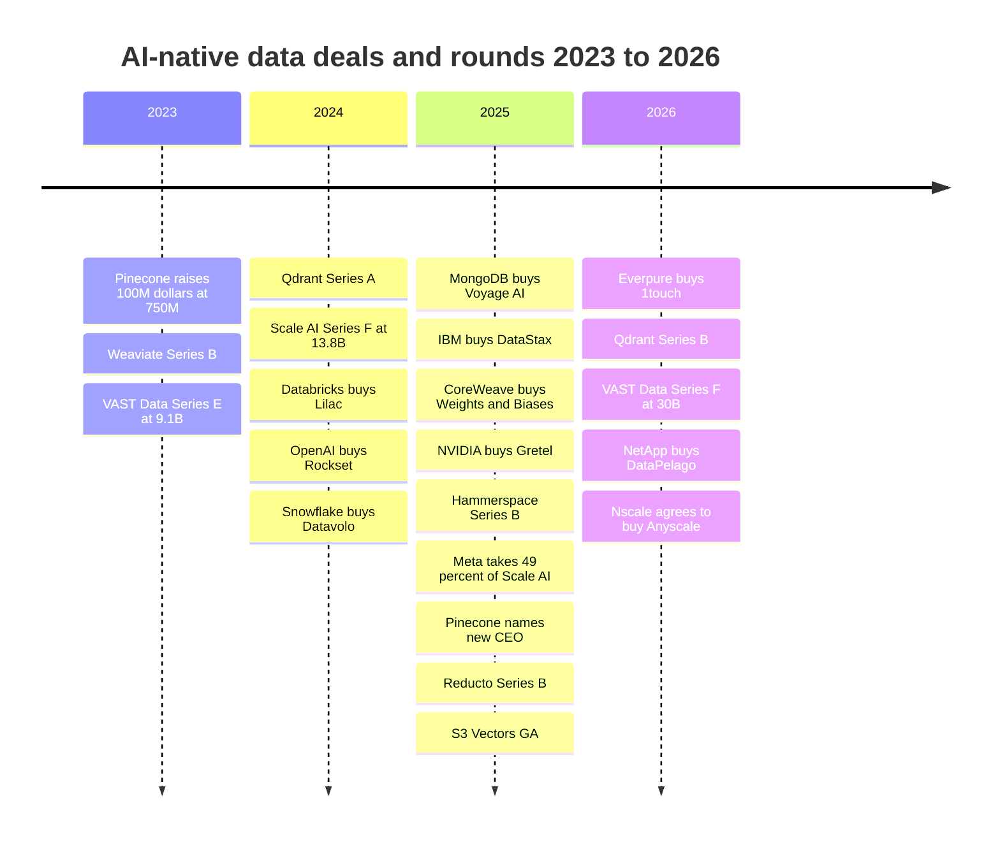
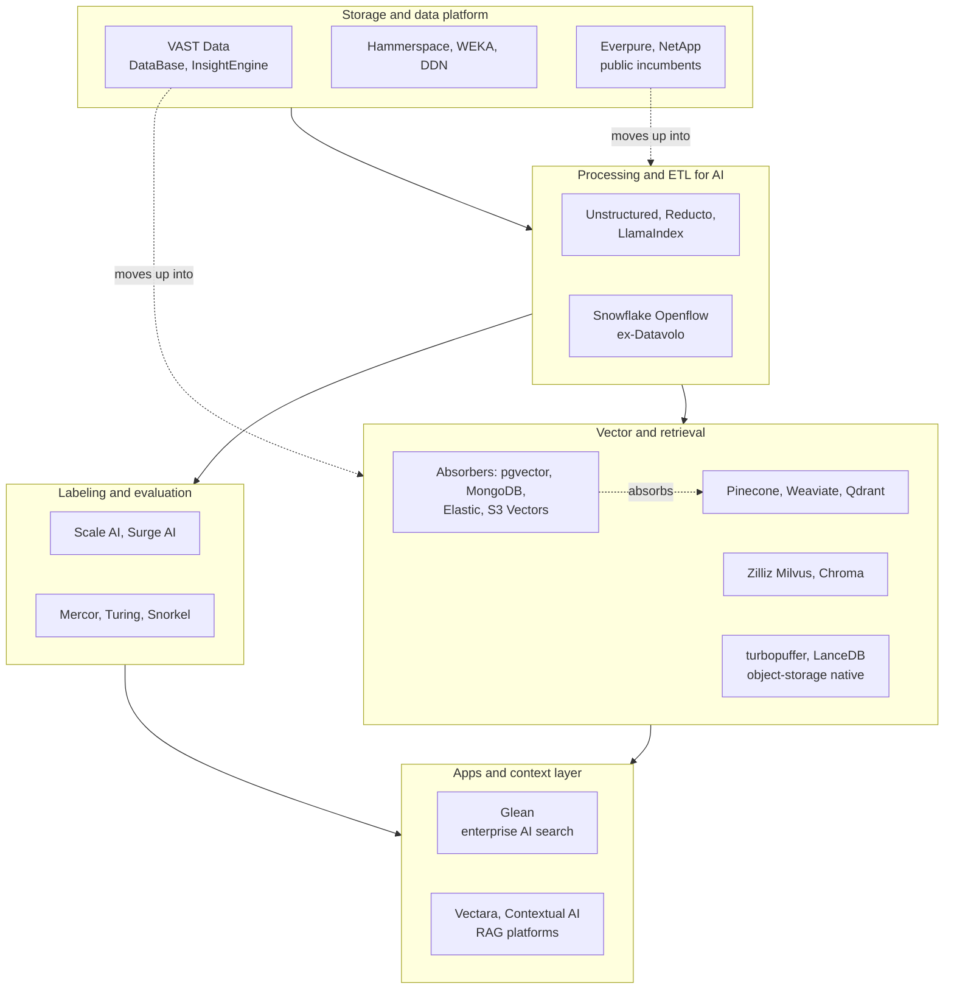
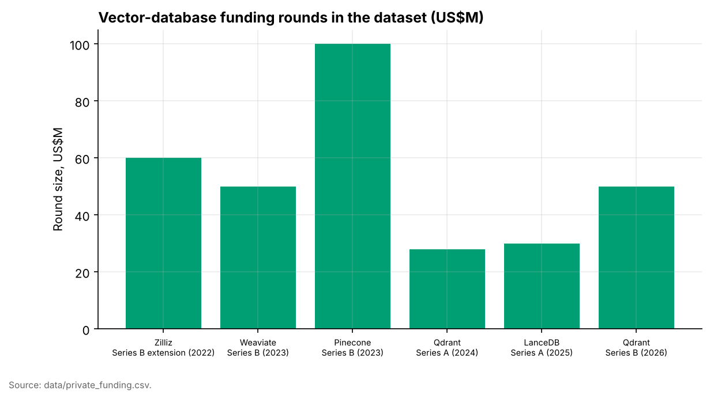
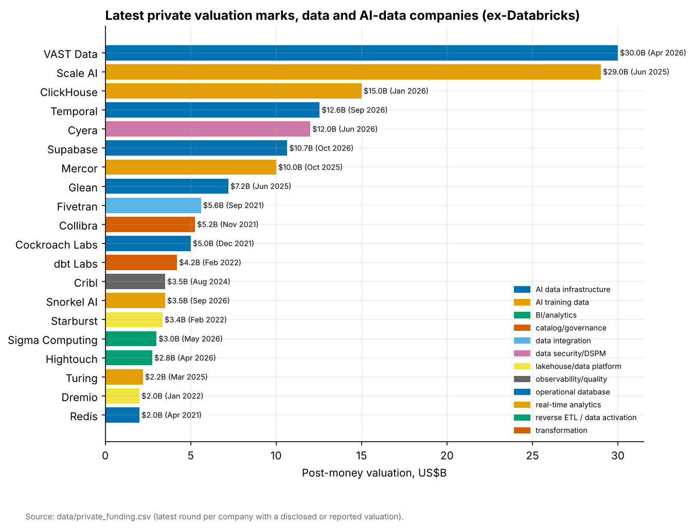
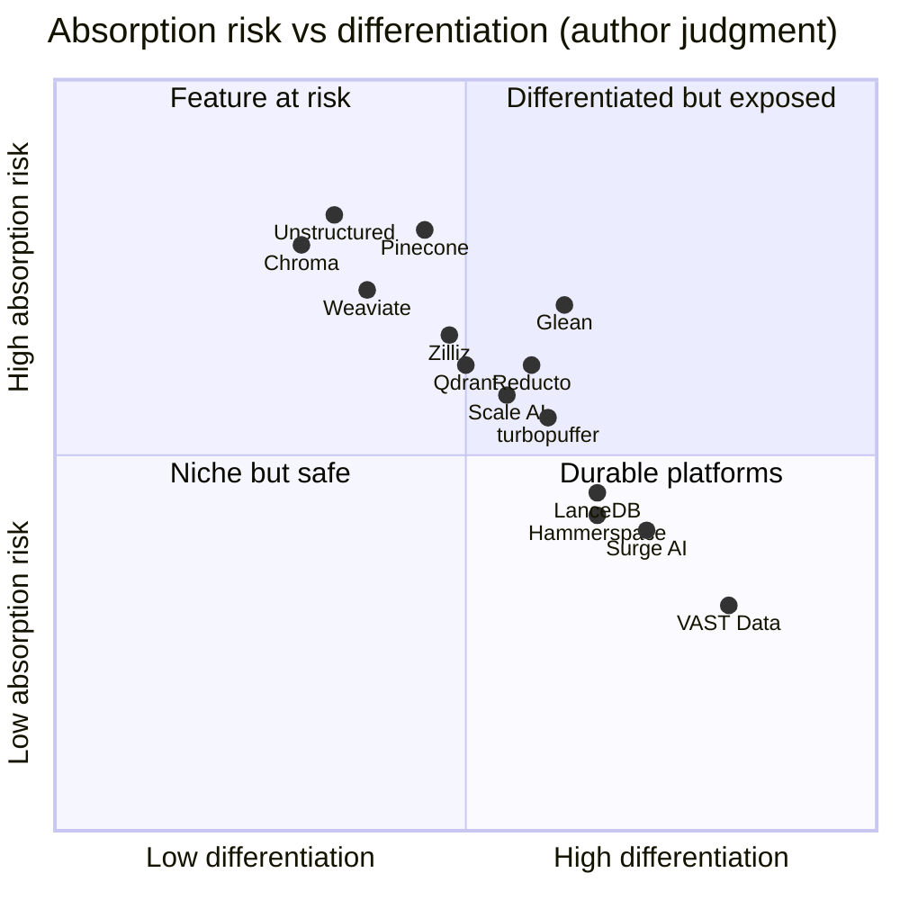

# 32. AI-Native Data Companies
> **Status:** mostly private · **HQ:** various (US, Europe, Israel) · **Founded:** 2016–2023 for most profiled companies · **Latest valuation/market cap:** from ~$0.5B (Hammerspace, Apr 2025) to $30B (VAST Data, Apr 2026), company-stated or press-reported post-money · **Last verified:** 2026-11-01

## TL;DR

- **Five groups, five different businesses.** "AI-native data company" covers (A) [vector database](../glossary.md#vector-database) vendors, (B) document-parsing and ETL-for-AI tools, (C) training-data and labeling suppliers, (D) AI data-infrastructure platforms that grew out of storage, and (E) enterprise AI search. They share a buyer, the AI team, but have very different gross margins, moats and exit paths. This chapter profiles each group; the underlying technology is in [Ch 17](../03-ai-data-stack/ch17-unstructured-data-processing.md), [Ch 18](../03-ai-data-stack/ch18-embeddings-and-vector-search.md) and [Ch 20](../03-ai-data-stack/ch20-training-data-supply-chain.md).
- **The money went to the bottom and the top of the stack, not the middle.** VAST Data raised at **$30B** (Apr 2026, company-stated, about half secondary) and Meta paid **$14.3B for 49% of Scale AI** (Jun 2025, press-reported, ~$29B implied). Pure-play vector databases raised $28M–$100M rounds, and Pinecone's last priced round (2023, $750M post-money) is now more than three years old.[^vast-f][^meta-scale][^pinecone-b]
- **[Feature absorption](../glossary.md#feature-absorption) is the defining risk.** Vector search became a feature of Postgres, MongoDB, Elastic, Databricks, Snowflake and, since December 2025, of Amazon S3 itself (S3 Vectors GA). Document parsing is being absorbed by data platforms (Snowflake bought Datavolo) and by frontier models that read PDFs directly.[^s3-vectors][^datavolo]
- **Neutrality is an asset you can sell only once.** After the Meta deal, Scale AI's CEO left for Meta and major lab customers reportedly pulled back. Rivals such as Surge AI and Mercor gained share and marks. The lesson applies to any supplier that takes equity from one customer in a concentrated market.[^meta-scale][^tk-scale-after]
- **Everpure angle.** VAST Data is the closest public comparable for "storage company moving up the stack": it now sells a database, an event/function engine and a retrieval engine on its storage. Everpure is on a parallel but different path (Enterprise Data Cloud, the 1touch acquisition, Data Stream on the NVIDIA AI Data Platform). The open question for a strategy team is how far up the stack to go alone, and where to partner.[^everpure-ds][^1touch]

## Snapshot table

| Group | Representative companies | Latest marks (basis, date) | Scale markers (labelled) | Business model | Status of the group |
|---|---|---|---|---|---|
| (A) Vector databases | Pinecone, Weaviate, Qdrant, Zilliz/Milvus, Chroma, LanceDB, turbopuffer | Pinecone $750M (press-reported, Apr 2023); Qdrant $50M Series B (Mar 2026, valuation undisclosed); LanceDB $30M Series A (Jun 2025) | No audited revenue; few public ARR claims | Usage-based serverless; open core plus managed cloud | Consolidating; prices compressing |
| (B) Unstructured / ETL for AI | Unstructured, LlamaIndex, Reducto, Datavolo (now Snowflake), Vectara, Contextual AI | Reducto $75M Series B (Oct 2025); Unstructured $40M Series B (Mar 2024); Datavolo acquired (Nov 2024, undisclosed) | No audited revenue | Per-page or per-document API pricing; enterprise platform licences | Early; platform absorption under way |
| (C) Training data / labeling | Scale AI, Surge AI, Mercor, Snorkel, Turing | Scale ~$29B implied (Meta, Jun 2025, press-reported); Surge in talks up to $25B (Jul 2025, press-reported, not confirmed closed) | Revenue concentrated in a handful of frontier labs | Services: pass-through contractor cost plus margin; marketplaces take a cut | Fast-growing, volatile, customer-concentrated |
| (D) AI data infrastructure | VAST Data, Hammerspace, WEKA, DDN, NetApp, Everpure | VAST $30B (company-stated, Apr 2026); Hammerspace >$0.5B (company-stated, Apr 2025) | VAST run-rate claims not re-verified; NetApp and Everpure are public | Software licences on commodity or own hardware; subscriptions | Well funded; racing up the stack |
| (E) Enterprise AI search / context | Glean | $7.2B (press-reported, Jun 2025) | ~$300M ARR (company-stated, May 2026) | Per-seat SaaS | Growing; squeezed by suites |

*Figure 32.1 — Group snapshot. Marks are private, often stale and set by preferred shares; none of these companies publishes audited financials. Sources: `data/private_funding.csv` and footnotes in the text.[^pf]*

## Origin story and strategic arc

The AI-native data category formed in three waves. Each one was triggered by a change in what the model needed from data.

**Wave 1: retrieval for search and recommendations (2017–2022).** Before ChatGPT, vector search was a niche used inside large consumer companies. Milvus, built by Zilliz, was released as open source in 2019 and later moved under the LF AI & Data Foundation.[^zilliz-b] Pinecone was founded in 2019 by Edo Liberty, a former research director at Amazon, and sold a managed vector index to engineering teams. Weaviate (Amsterdam) and Qdrant (Berlin, written in Rust) followed with open-source engines. VAST Data, founded in 2016, was then a pure flash-storage company. Scale AI, founded in 2016, labelled images for autonomous-vehicle programmes.[^tk-origins]

**Wave 2: the RAG boom (late 2022–2024).** [Retrieval-augmented generation](../glossary.md#retrieval-augmented-generation) made every enterprise want a vector index. Pinecone raised $100M at a $750M valuation in April 2023 and Weaviate raised a $50M Series B the same month.[^pinecone-b][^weaviate-b] Chroma raised a seed round as the default local store for LangChain-era prototypes.[^tk-chroma] A second layer appeared upstream: companies that turn messy PDFs, slides and scans into clean text chunks (Unstructured, LlamaIndex's LlamaParse, Reducto). Scale AI pivoted from images to reinforcement learning from human feedback ([RLHF](../glossary.md#reinforcement-learning-from-human-feedback)) for chat models and raised $1B at $13.8B in May 2024.[^scale-f]

**Wave 3: absorption and consolidation (2024–2026).** Incumbents started buying or copying. OpenAI bought Rockset (2024). Snowflake bought Datavolo (2024). MongoDB bought Voyage AI for $220M (2025). IBM bought DataStax (2025). CoreWeave bought Weights & Biases for ~$1.7B (press-reported, 2025).[^rockset][^datavolo][^voyage][^datastax][^cw-wb] AWS shipped S3 Vectors.[^s3-vectors] Meta's Scale AI deal (June 2025) was the largest single transaction. At the infrastructure layer the opposite happened: VAST Data's valuation more than tripled to $30B, and storage incumbents (Everpure, NetApp) bought software to move into data preparation.[^vast-f][^1touch][^datapelago]

*Figure 32.2 — The money moved from standalone retrieval (2023) to acquisitions by platforms (2024–2025) and to infrastructure-scale rounds (2026). Sources: `data/private_funding.csv`, `data/ma_deals.csv`.[^pf][^ma]*

## Product and technology

The map below places the companies by layer. Read it bottom-up: data lands on a storage and data platform, is parsed and chunked, embedded and indexed for retrieval, and separately turned into labelled training and evaluation sets. Applications such as enterprise search sit on top. The dashed arrows show who is absorbing whom.

*Figure 32.3 — The AI-data-infrastructure landscape (author's map). The pure plays sit in the middle layers; the platforms below and above are expanding into them.*

### (A) Vector databases

A vector database stores [embeddings](../glossary.md#embedding) and answers "find the k most similar items" using an [approximate nearest neighbor](../glossary.md#approximate-nearest-neighbor) index (HNSW graphs, IVF partitions, DiskANN-style flash graphs; see [Ch 18](../03-ai-data-stack/ch18-embeddings-and-vector-search.md)). The engineering contest is about three things: memory cost per stored vector, filtered-search quality (similarity plus metadata predicates), and freshness under continuous writes.

- **Pinecone** is closed-source and fully managed. Its serverless architecture, launched in early 2024, separates storage (index files on cloud object storage) from compute and bills per read unit, write unit and stored GB.[^tk-pinecone-serverless] In September 2025 Ash Ashutosh, previously founder of Actifio and an executive at Google, became CEO; founder Edo Liberty became Chief Scientist.[^pinecone-ceo] The company was press-reported to have explored a sale in 2025; we found no announced transaction.[^tk-pinecone-sale]
- **Weaviate, Qdrant and Zilliz** are open core: an Apache-licensed engine that developers run for free, plus a managed cloud, hybrid "bring your own cloud" ([BYOC](../glossary.md#bring-your-own-cloud)) deployments and enterprise features. Qdrant raised a $50M Series B in March 2026 led by AVP, taking total funding to about $88M.[^qdrant-b] Zilliz commercialises Milvus, the most widely deployed open-source engine at large scale; its last confirmed round was a $60M Series B extension in 2022.[^zilliz-b]
- **Chroma** started as an embedded, developer-first store and added a hosted service.[^tk-chroma]
- **LanceDB and turbopuffer** are the new design. Both treat object storage as the primary home of the index and cache hot data on local NVMe. LanceDB is built on the open [Lance](../glossary.md#lance) columnar format, which targets fast random access for multimodal training and retrieval data.[^lance-paper] It raised a $30M Series A in June 2025.[^lancedb-a] turbopuffer, founded in 2023, sells an object-storage-first search engine and names AI-native software companies among its users (company-stated).[^tk-turbopuffer]

> **Bridge: standalone DRAM makers vs integrated memory controllers.** In the early 2000s the memory controller sat on a separate northbridge chip, and chipset vendors made a living there. AMD (2003) and then Intel (2008) moved the controller onto the CPU die, and most independent chipset businesses disappeared. DRAM makers survived because they owned something the CPU vendor could not integrate: process technology and fab scale for the memory itself. Vector search is the memory controller of the RAG stack. The function is being integrated into every database and into S3. Standalone vendors survive only if, like the DRAM makers, they own a scale or cost advantage the integrator cannot copy. For vector databases that means the cheapest way to store and serve billions of vectors, not a better API.

### (B) Unstructured data and ETL for AI

Most enterprise knowledge sits in PDFs, slide decks, scanned forms and emails. Before any of it can be embedded, it has to be parsed (text, tables, layout, images), cleaned and split into chunks with metadata ([Ch 17](../03-ai-data-stack/ch17-unstructured-data-processing.md)). The hard part is tables and multi-column layouts, where a wrong reading order silently corrupts retrieval.

- **Unstructured** offers open-source partitioning libraries and a paid serverless pipeline with connectors to sources and vector stores. It raised a $40M Series B in March 2024; a Contrary Research estimate (not a reported figure) puts its valuation near $230M.[^unstructured-b]
- **Reducto** uses vision-language models plus layout models to parse complex documents and sells per-page API access to enterprises and AI application builders. It raised a $24.5M Series A (2025) and a $75M Series B led by Andreessen Horowitz in October 2025, about $108M in total.[^reducto-b]
- **LlamaIndex** grew from an open-source RAG framework into LlamaCloud and LlamaParse, a hosted parsing and indexing service.[^tk-llamaindex]
- **Datavolo**, founded by the creators of Apache NiFi, built multimodal ingestion pipelines. Snowflake bought it in November 2024 and relaunched it as **Openflow**.[^datavolo]
- **Vectara** and **Contextual AI** sell end-to-end RAG platforms (parse, index, retrieve, generate with grounding checks). Contextual AI's CEO, Douwe Kiela, co-authored the original 2020 RAG paper.[^tk-rag-platforms]

### (C) Training data and labeling

Frontier labs buy three kinds of data work: preference judgments for RLHF, expert-written demonstrations and reasoning traces (coding, maths, law, medicine), and evaluation sets. The industry has moved from low-cost crowd annotation to **[expert data](../glossary.md#expert-data)**, where the input is a PhD or a senior engineer paid by the hour. Ch 20 covers the supply chain; here we focus on the businesses.

- **Scale AI** combined a large contractor workforce (Remotasks/Outlier) with tooling and government work. Meta's June 2025 investment of ~$14.3B bought a 49% non-voting stake and brought founder-CEO Alexandr Wang to Meta's superintelligence effort; Jason Droege became interim CEO.[^meta-scale] Press reports said Google, OpenAI and others then reduced or ended work with Scale, and in July 2025 Scale cut about 14% of staff.[^tk-scale-after]
- **Surge AI**, bootstrapped by Edwin Chen, was press-reported to have passed $1B of revenue in 2024 and to be in talks in July 2025 to raise at up to a $25B valuation.[^surge-bbg][^tk-surge-rev]
- **Mercor** runs a marketplace that recruits and pays domain experts for labs; it raised at a $2B valuation in February 2025 and was press-reported at $10B in October 2025.[^tk-mercor]
- **Snorkel AI** moved from programmatic labeling software toward expert data services; **Turing** moved from developer staffing to coding and reasoning data for labs.[^tk-snorkel-turing]

### (D) AI data infrastructure

This group started in storage and now sells itself as the data layer for AI factories. The storage mechanics are in the companion *Everpure Tech Atlas*; the strategic question here is how far up the stack each company is going.

- **VAST Data** built its storage on a **[disaggregated shared-everything](../glossary.md#disaggregated-shared-everything)** (DASE) architecture: stateless servers ("CNodes") access all NVMe flash enclosures over an NVMe fabric, so capacity and performance scale independently. On that base VAST added the **VAST DataBase** (a tabular store inside the same system), a **DataEngine** for event triggers and functions, and an **InsightEngine** that embeds and indexes data as it lands, built with NVIDIA. In 2025 it began calling the whole stack an "AI operating system".[^tk-vast-products] It raised $118M at $9.1B in December 2023 and about $1B at $30B in April 2026, roughly half of it secondary, with NVIDIA participating.[^vast-e][^vast-f] GPU clouds are its signature customers; a large multi-year CoreWeave agreement was reported in late 2025.[^tk-vast-cw]
- **Hammerspace** sells software, not boxes. Its global data platform presents one [global namespace](../glossary.md#global-namespace) across existing storage silos and clouds and serves GPU servers through the standard Linux [parallel NFS](../glossary.md#parallel-nfs) client, so no proprietary client is needed. It raised a $100M Series B led by Altimeter in April 2025 at a valuation the company put "over $500M".[^hammerspace-b][^tk-hammerspace-tech]
- **WEKA** (parallel file system, rebranded around "NeuralMesh" in 2025) and **DDN** (EXAScaler for HPC, Infinia object store for AI) are the other private specialists. DDN took a Blackstone investment in early 2025.[^tk-weka-ddn]
- **NetApp** announced a disaggregated all-flash system (AFX) and an "AI Data Engine" in 2025, and bought DataPelago, a GPU-accelerated data-processing startup, in July 2026.[^tk-netapp-afx][^datapelago]
- **Everpure** launched Enterprise Data Cloud (June 2025), closed the $125M 1touch acquisition (May 2026), relaunched it as Data Intelligence, and shipped **Data Stream**, which vectorises data for AI pipelines on FlashBlade and NVIDIA GPUs using the NVIDIA AI Data Platform reference design (June 2026).[^edc][^1touch][^everpure-ds]

> **Bridge: a memory vendor moving into compute-in-memory.** Samsung's HBM-PIM and SK hynix's AiM put simple arithmetic units next to DRAM banks, because moving data to the processor costs more energy than the arithmetic itself. The technology works, but adoption has been slow: the host vendor (CPU or GPU) controls the programming model, and software must be rewritten to use it. VAST's DataEngine and InsightEngine, and Everpure's Data Stream, are the storage version of [compute-in-memory](../glossary.md#compute-in-memory): run embedding, filtering and triggers where the data sits. The same constraint applies. NVIDIA, Databricks and Snowflake control the AI programming model, so storage-side compute succeeds where it plugs into their frameworks (NVIDIA AI Data Platform, OpenSharing, Iceberg), not where it asks developers to adopt a new one.

### (E) Enterprise AI search and context

**Glean**, founded in 2019 by Arvind Jain (a Rubrik co-founder), indexes a company's SaaS applications, documents and chat with permission-aware connectors, and layers an assistant and agents on top. It is the leading independent "context layer" for knowledge workers. It raised $150M at a $7.2B valuation in June 2025 (press-reported) and cited ~$300M ARR in May 2026 (company-stated).[^glean]

## How it makes money

| Group | Pricing unit | What drives gross margin | Margin direction | Main pricing pressure |
|---|---|---|---|---|
| (A) Vector DBs | Read/write units and GB-stored (serverless); pods or nodes; enterprise BYOC licences | Where the index lives (RAM vs NVMe vs object storage); multi-tenant packing | Improving for object-storage-native designs | pgvector (free), S3 Vectors, bundled vector search in every database |
| (B) ETL for AI | Per page or per document; platform subscription | Model inference cost per page (vision-language models are expensive) | Pressured until model costs fall | Hyperscaler document AI services; frontier models reading files natively |
| (C) Labeling | Per task or per hour, plus margin over contractor pay | Contractor cost pass-through; utilisation of expert pools | Low and services-like | Lab insourcing; marketplaces bidding up expert pay |
| (D) AI data infra | Software licence per TB or per node; subscriptions; some appliance revenue | Software share of the bill vs hardware pass-through | High when software-only (Hammerspace) or licence-led (VAST) | NVIDIA reference designs commoditise the base layer |
| (E) Enterprise search | Per seat per month | Indexing compute and LLM inference per query | Pressured by inference cost | Microsoft Copilot, Google Gemini Enterprise and data-platform agents bundled into existing suites |

*Figure 32.4 — Unit economics by group (author synthesis from public pricing pages and filings). Only the infrastructure group has software-like margins at scale; labeling is a services business with a software multiple.*

**Vector databases: a worked example of pricing compression.** Take 100 million documents chunked and embedded at 1,024 dimensions in 32-bit floats. That is 100M × 1,024 × 4 bytes ≈ 410 GB of raw vectors before index overhead (our arithmetic). Held in RAM on cloud instances, an HNSW index of that size needs several large memory-optimised servers running all month. Held as files on object storage at S3 Standard's list price of about $0.023 per GB-month, the same 410 GB costs roughly $9 a month to store, and compute is paid only when queries arrive.[^tk-s3-price] The object-storage-native designs (Pinecone serverless, turbopuffer, LanceDB, S3 Vectors) accept higher tail latency, typically tens to ~100 ms rather than single-digit ms, in exchange for one to two orders of magnitude lower storage cost (estimate).[^s3-vectors] Once AWS sells that trade-off as a native S3 feature, a standalone vendor's price ceiling for "cheap, large, good-enough" retrieval falls to roughly what S3 charges. What remains billable is low-latency serving, filtered and [hybrid search](../glossary.md#hybrid-search) quality, multi-tenancy at scale, and operations.

**Open core vs closed serverless.** Open-core vendors (Weaviate, Qdrant, Zilliz, Chroma, LanceDB) win adoption cheaply, since developers download the engine, but they convert only a small share of users to paid cloud or enterprise plans, and a hyperscaler can host the same engine (see [Ch 38](../05-business-and-economics/ch38-open-source-strategy.md)). Closed serverless vendors (Pinecone, turbopuffer) capture every query but must win against a free default (pgvector) on every new project.

**Labeling: services revenue, software valuation.** A labeling company's revenue is mostly what it pays experts plus a margin. Gross margins therefore look like a staffing firm's, not a software firm's [VERIFY: no audited gross margin disclosed by Scale, Surge or Mercor]. Revenue is also concentrated: a few frontier labs account for most of the spend, so one lost lab can remove a large share of revenue in a quarter. The valuation case rests on growth and on the claim that the data, tooling and evaluation know-how compound into a moat.

**Infrastructure: licence-led software on someone else's hardware.** VAST and Hammerspace sell software that runs on servers built by partners, which keeps hardware pass-through off (or low in) their revenue line and supports software-like gross margins. The incumbents (Everpure, NetApp) sell integrated systems with subscriptions; Everpure's GAAP gross margin was 68.4% in Q2 FY2027 (quarter ended 2026-08-02).[^everpure-comps]

## Financials

None of the private companies here publishes audited financials. What exists is a series of private marks and company-stated run-rates, usually disclosed alongside a fundraise. The two charts below show what the dataset holds.

*Figure 32.5 — Vector-database rounds stayed small, between $28M and $100M, and no pure play has priced an up-round above Pinecone's 2023 $750M mark in the dataset. Source: `data/private_funding.csv`.*

*Figure 32.6 — The two largest private marks in the data universe excluding Databricks belong to AI-native data companies at opposite ends of the stack: VAST Data (infrastructure) and Scale AI (training data). Several 2021–2022 marks (Fivetran, Collibra, Dremio) are stale. Source: `data/private_funding.csv`.*

**Reading the marks.**

- **VAST Data, $30B (Apr 2026, company-stated).** About half the $1B round was a secondary sale by existing holders, so the new money into the company was about $500M.[^vast-f] A [secondary sale](../glossary.md#secondary-sale) at a headline price says less about primary demand than a fully primary round does. We could not re-verify VAST's latest revenue or run-rate claims live [VERIFY: VAST company-stated ARR or bookings at Series F]. As a sensitivity, the mark is 30x a hypothetical $1B run-rate and 15x a hypothetical $2B run-rate (illustration, not a reported figure). For scale, Everpure's market capitalisation was ~$43.8B on 2026-10-01 against FY2027 revenue guidance of $5.03–5.07B, about 8.5x EV/NTM revenue.[^everpure-comps] The private market is valuing VAST at roughly two-thirds of Everpure's public value.
- **Scale AI, ~$29B implied (Jun 2025, press-reported).** Meta's price was set for a non-voting minority stake that also bought a CEO. It is not a clean arm's-length mark for the remaining business, which then lost customers.[^meta-scale][^tk-scale-after]
- **Glean, $7.2B (Jun 2025, press-reported).** At ~$300M company-stated ARR in May 2026, the June 2025 mark is ~24x current ARR (our arithmetic, estimate) and probably below what a 2026 round would price if growth held.[^glean]
- **Pinecone, $750M (Apr 2023, press-reported).** No priced round followed in more than three years, during which the category's prices compressed. A sale below the last preferred price would put the [liquidation preference](../glossary.md#liquidation-preference) stack ahead of common shareholders and employees.[^pinecone-b]
- **Hammerspace, ">$500M" (Apr 2025, company-stated).** A floor rather than a precise post-money.[^hammerspace-b]

## Customers and go-to-market

**Vector databases** sell bottom-up. A developer starts on a free tier or open-source build, the project goes to production, and a platform team later negotiates an enterprise contract or BYOC deployment. Cloud marketplaces matter because they let customers burn committed cloud spend. The weakness of this motion is that the same developer can start on pgvector or MongoDB Atlas Vector Search already in the stack, and many do; MongoDB bought Voyage AI precisely to make its built-in option good enough.[^voyage]

**ETL-for-AI vendors** sell to two buyers: AI application startups that call the parsing API (high volume, price-sensitive) and enterprise data teams that need governed pipelines (smaller volume, higher price). The second buyer increasingly gets the capability inside Snowflake (Openflow, Document AI) or Databricks, so standalone vendors win where accuracy on hard documents is visibly better.[^datavolo]

**Labeling companies** sell to perhaps ten serious buyers: the frontier labs, hyperscalers and a few large enterprises and governments. Contracts are large, project-based and can be cancelled quickly. Trust is the product: labs send unreleased model outputs and evaluation plans to these vendors, so a perceived conflict (such as a competitor owning 49%) is a commercial event, not just a governance one.[^tk-scale-after]

**AI data infrastructure** sells top-down into AI factories, GPU clouds, national labs and large enterprises, usually alongside NVIDIA's reference designs. Certification in NVIDIA programmes and placement in GPU-cloud builds are the main channel. VAST also sells through server OEM partners [VERIFY: current VAST OEM partner list]. Databricks named VAST Data among storage vendors coming to its Storage Ecosystem after launch partners Everpure, MinIO and Qumulo.[^storage-eco]

**Glean** sells top-down to CIOs on a per-seat basis and competes for the same budget line as Microsoft Copilot and Google's enterprise agents.[^glean]

## M&A and investments

| Date | Acquirer / investor | Target | Value (basis) | Rationale | Outcome |
|---|---|---|---|---|---|
| 2024-03 | Databricks | Lilac | Undisclosed | Curate unstructured text for GenAI | Team joined Mosaic AI[^lilac] |
| 2024-06 | OpenAI | Rockset | Undisclosed | Real-time indexing for retrieval | External service wound down [VERIFY][^rockset] |
| 2024-11 | Snowflake | Datavolo | Undisclosed | Multimodal ingestion (NiFi) | Became Snowflake Openflow[^datavolo] |
| 2025-02 | MongoDB | Voyage AI | $220M (disclosed) | Embedding and reranking models inside Atlas | Integrated into Atlas Vector Search[^voyage] |
| 2025-02 | IBM | DataStax | Undisclosed | Astra DB vector/NoSQL plus Langflow for watsonx | Closed 2025-05-28[^datastax] |
| 2025-03 | CoreWeave | Weights & Biases | ~$1.7B (press-reported) | GPU cloud adds the ML developer layer | Closed 2025-05-05[^cw-wb] |
| 2025-03 | NVIDIA | Gretel | Undisclosed (nine figures, press-reported) | Synthetic training data | ~80 staff joined NVIDIA[^gretel] |
| 2025-06 | Meta | Scale AI (49%, non-voting) | ~$14.3B (press-reported) | Talent and data capacity for Meta's superintelligence lab | CEO left for Meta; customers pulled back[^meta-scale] |
| 2025-08 | Databricks | Tecton (assets) | Undisclosed | Real-time feature serving for agents | Asset deal[^tecton] |
| 2026-02 | Everpure | 1touch | $125M (disclosed cash) | Data discovery, classification and semantic context | Closed 2026-05-07; now Data Intelligence[^1touch] |
| 2026-07 | NetApp | DataPelago | Undisclosed | GPU-accelerated data processing at the storage layer | Runs as a subsidiary[^datapelago] |
| 2026-07 | Nscale | Anyscale | ~$1.65B (press-reported, announced) | GPU cloud adds the Ray compute layer | Announced 2026-07-30 [VERIFY: close][^anyscale] |

*Figure 32.7 — AI-data deals 2024–2026. Buyers are data platforms, databases, GPU clouds and storage vendors; no pure-play vector database has been bought by a hyperscaler. Source: `data/ma_deals.csv`.*

Three patterns stand out. First, **GPU clouds are buying the software layer above them** (CoreWeave–W&B, Nscale–Anyscale), the same logic as a foundry adding design services. Second, **database and data-platform vendors buy the retrieval and ingestion pieces** rather than the standalone vector databases: the embedding model (Voyage) and the pipeline (Datavolo) were worth more to them than another index. Third, **storage vendors are buying metadata and processing software** priced in the low hundreds of millions (1touch at $125M, DataPelago undisclosed), not $1B+ platforms.[^1touch][^datapelago]

> **Bridge: a foundry customer taking equity in a key supplier.** In 2012 Intel, TSMC and Samsung bought minority stakes in ASML to fund EUV development. ASML stayed neutral and became more valuable, for two reasons: the stakes were capped and passive, and no customer could substitute for ASML's tools.[^tk-asml] Meta–Scale fails both tests. The stake was 49%, the founder moved to the investor, and labeling is substitutable: Surge, Mercor and in-house teams could absorb the work. A supplier in a concentrated market can take strategic equity safely only when it is irreplaceable and the investor is visibly passive.

## Competitive position

| Company | Group | Founded | Latest round / valuation (date, basis) | Model | Open source? | Differentiation | Absorption risk |
|---|---|---|---|---|---|---|---|
| Pinecone | A | 2019 | $100M Series B at $750M (Apr 2023, press-reported) | Closed serverless SaaS | No | First mover; managed serverless at scale | High |
| Weaviate | A | 2019 | $50M Series B (Apr 2023, valuation undisclosed) | Open core + cloud | Yes (BSD-3) | Hybrid search, modules, BYOC | High |
| Qdrant | A | 2021 | $50M Series B (Mar 2026, undisclosed) | Open core + cloud | Yes (Apache 2.0) | Rust engine; filtering and quantisation; edge | Medium–high |
| Zilliz / Milvus | A | 2017 | $60M Series B extension (2022, undisclosed) | Open core + cloud | Yes (Apache 2.0, LF AI & Data) | Billion-scale distributed engine; GPU indexes | Medium–high |
| Chroma | A | 2022 | Seed (2023) [VERIFY] | Open source + cloud | Yes (Apache 2.0) | Developer default for prototypes | High |
| LanceDB | A | 2022 | $30M Series A (Jun 2025, undisclosed) | Open source + cloud | Yes (Apache 2.0) | Lance format for multimodal data on object storage | Medium |
| turbopuffer | A | 2023 | [VERIFY: funding] | Closed serverless | No | Object-storage-first cost structure | Medium |
| Unstructured | B | 2022 | $40M Series B (Mar 2024, ~$230M est.) | Open core + serverless API | Yes (library) | Connectors and partitioning breadth | High |
| Reducto | B | 2023 | $75M Series B (Oct 2025, undisclosed) | Per-page API | No | Accuracy on complex layouts | Medium–high |
| LlamaIndex | B | 2022 | Series A (2025) [VERIFY] | OSS framework + LlamaCloud | Yes (framework) | Developer mindshare in RAG/agents | High |
| Scale AI | C | 2016 | ~$29B implied (Jun 2025, press-reported) | Data services + government | No | Scale, tooling, defence work | Medium (insourcing) |
| Surge AI | C | 2020 | Talks up to $25B (Jul 2025, press-reported) | Expert data services | No | Quality reputation with labs | Medium |
| Mercor | C | 2023 | ~$10B (Oct 2025, press-reported) [VERIFY] | Expert marketplace | No | Recruiting engine for experts | Medium |
| VAST Data | D | 2016 | ~$1B Series F at $30B (Apr 2026, company-stated) | Software licence + subscription | No | DASE plus database and AI engines | Low–medium |
| Hammerspace | D | 2018 | $100M Series B, >$500M (Apr 2025, company-stated) | Software licence | Uses standard Linux NFS client | Global namespace over existing storage | Medium |
| Glean | E | 2019 | $150M Series F at $7.2B (Jun 2025, press-reported) | Per-seat SaaS | No | Permission-aware connectors across SaaS | Medium–high |

*Figure 32.8 — Grouped comparison of 16 AI-native data companies. Founding years and licences are from company materials and training knowledge (not all re-verified live); absorption risk is author judgment. Funding: `data/private_funding.csv`.[^pf][^tk-origins]*

*Figure 32.9 — Positioning (author judgment, not measured data). Most of the middle-layer pure plays sit in the "feature at risk" quadrant; only infrastructure with deep engineering and expert-data suppliers with a quality brand sit toward "durable".*

**Who is winning, group by group.**

- **(A) Vector DBs:** the *capability* is winning and the *category* is losing. The likely survivors are the engines with a structural cost edge (object-storage-native designs such as turbopuffer and LanceDB), the open-source standard at billion scale (Milvus), and whichever managed service ends up inside a larger platform. Likely acquirers: database vendors (MongoDB, IBM and Oracle have all bought in this area or adjacent), data platforms, observability and search vendors, and storage vendors seeking a vector-on-flash story.
- **(B) ETL for AI:** accuracy leaders (Reducto) are winning enterprise deals today. The long-run risk is that parsing becomes a model capability. Likely acquirers: Snowflake and Databricks (both buy ingestion), Fivetran–dbt, hyperscalers and storage vendors adding "AI-ready data" pipelines.
- **(C) Labeling:** quality and neutrality are winning. Surge and Mercor gained from Scale's loss of neutrality. Full acquisitions by labs are unlikely because they would recreate Scale's conflict; minority stakes and acquihires are more likely.
- **(D) AI data infrastructure:** VAST is winning the GPU-cloud segment and the valuation contest. Its scale makes an IPO a more likely path than a sale. Hammerspace and WEKA are plausible targets for storage OEMs or server makers.
- **(E) Glean:** winning among independents, but the large suites (Microsoft, Google, Salesforce, ServiceNow) and data platforms (Snowflake CoWork, Databricks Genie One) all sell an "enterprise context" story to the same CIO. Logical acquirers would be application-suite vendors; none has been reported.

## Why it's winning / bull case

1. **Data, not models, becomes the scarce input.** As model quality converges, the advantage moves to proprietary data, its preparation and its retrieval. Every group here sells a piece of that, and enterprise AI budgets are still growing.
2. **Infrastructure scale is real.** VAST's step from $9.1B to $30B in about 29 months, with NVIDIA participating, shows that GPU buyers pay for data platforms that keep accelerators busy.[^vast-e][^vast-f] Storage-born platforms own the bytes, which is the hardest thing for an upper layer to replicate.
3. **Expert data is a growing, not shrinking, market.** Reasoning models and agents need expert demonstrations and evaluations that cannot be scraped. The bidding for Surge and Mercor, and Meta's price for Scale, imply that labs see this as a multi-year spend.[^surge-bbg][^meta-scale]
4. **Object-storage-native retrieval can win on cost.** If vector search becomes a storage-cost problem, designs built on object storage can undercut RAM-based incumbents and run anywhere an S3 API exists, including on-prem flash.
5. **Acquirers are active and well funded.** Databases, data platforms, GPU clouds and storage vendors have all paid for AI-data capabilities since 2024, which supports exit values even for companies that cannot stand alone.

## Risks / bear case and open questions

1. **Absorption.** Vector search is in S3, Postgres, MongoDB and every data platform; parsing is in Snowflake, Databricks and the hyperscalers; enterprise search is in Microsoft 365 and Google Workspace. Standalone vendors must be visibly better on cost or quality every year.[^s3-vectors][^voyage][^datavolo]
2. **Stale preferred marks.** Pinecone ($750M, 2023), Weaviate and Zilliz have not priced an up-round in years. Exits below the last preferred price leave little for common holders.[^pinecone-b]
3. **Customer concentration and neutrality in labeling.** A handful of labs buy most expert data, and labs can insource. Scale's experience shows a single equity deal can move share overnight.[^tk-scale-after]
4. **NVIDIA as the standard-setter.** The NVIDIA AI Data Platform reference design gives every storage vendor the same blueprint. That helps adoption but erodes differentiation, and NVIDIA's own investments (VAST) and acquisitions (Gretel, Run:ai) show it can pick winners.[^vast-f][^gretel][^nvidia-aidp]
5. **Run-rate opacity.** The few revenue figures available are company-stated or press-reported run-rates disclosed around fundraises.
6. **Open questions.** Does Pinecone sell, and to whom? Does VAST file for an IPO, and what does its gross margin look like under audit? Does Scale stabilise under new leadership? Do frontier models make document parsing a commodity within two years? [VERIFY: Pinecone 2025–2026 strategic status; Scale AI permanent CEO]

## Relevance to Everpure

> **Storage bridge.** VAST, Hammerspace, WEKA, DDN, NetApp and Everpure all serve the same AI factories. The differences in storage architecture (DASE, parallel NFS, parallel file systems, unified file and object) are covered in the companion *Everpure Tech Atlas*. This chapter treats them only as starting points for moving up into the data layer.

**The comparable set, compared neutrally on public information.**

| Dimension | VAST Data | Hammerspace | NetApp | Everpure |
|---|---|---|---|---|
| Starting point | Software-defined all-flash (DASE) | Data orchestration over others' storage | Unified storage (ONTAP) | Flash arrays and subscription (Evergreen) |
| Up-stack moves | DataBase, DataEngine, InsightEngine, "AI operating system" | Global namespace, data placement for GPUs | AFX, AI Data Engine; DataPelago acquisition | Enterprise Data Cloud; 1touch → Data Intelligence; Data Stream |
| Build vs buy | Mostly built | Built | Built plus acquisition (2026) | Built plus acquisition (2026) |
| Works across third-party storage? | Mainly its own platform | Yes, by design | Mainly its own | Data Intelligence: yes, including third-party storage |
| NVIDIA alignment | Investor and partner | Partner | AI Data Platform partner | Data Stream on NVIDIA AI Data Platform |
| Data-platform partners | Named as coming to Databricks Storage Ecosystem | — | Named as coming to Databricks Storage Ecosystem | Databricks Storage Ecosystem launch partner |

*Figure 32.10 — Storage-born companies moving up the stack (public information only). Sources: footnotes in this chapter.[^tk-vast-products][^tk-hammerspace-tech][^tk-netapp-afx][^datapelago][^everpure-ds][^1touch][^storage-eco]*

The strategic difference is scope. VAST is trying to *become* the AI data platform, with its own database and function engine, which puts it in partial competition with Databricks and Snowflake. Everpure's public moves so far are about *understanding and preparing* data (discovery, classification, vectorisation) while partnering with the data platforms (Databricks Storage Ecosystem) and NVIDIA. Hammerspace sits closest to Everpure's Data Intelligence in one respect: both claim value across storage the customer already owns.[^everpure-ds][^storage-eco]

**Options a strategy team might evaluate, based on public information:**

| Option | What it would mean | Why it could matter | Watch-outs |
|---|---|---|---|
| Vector-on-flash partnerships | Certify object-storage-native engines (LanceDB, turbopuffer-style designs, Milvus on S3) on FlashBlade object storage | Retrieval cost is becoming a storage-cost problem; on-prem and sovereign RAG needs a fast S3 target | Partners may prefer hyperscaler S3; Data Stream overlap must be managed |
| Tuck-in in parsing or retrieval | Buy a document-parsing or vector-engine team to strengthen Data Stream | Small deals (1touch scale) fit the pattern; capabilities sit next to Data Intelligence | High absorption risk; buying a feature that platforms give away |
| Stay the neutral data layer | Deepen Databricks, Snowflake and NVIDIA integrations rather than building a database | Avoids VAST's channel conflict with data platforms | Cedes up-stack value capture to partners |
| Context-layer connectors | Expose Data Intelligence metadata to enterprise search and agent platforms (Glean-type, MCP) | Classification and permissions are what context layers need | Platforms may build their own discovery |
| Watch the private comps | Track VAST, Hammerspace and WEKA marks and any IPO filings | A VAST S-1 would be the first audited view of the "storage to AI platform" model | Marks are private, partly secondary and company-stated |

*Figure 32.11 — Options framing (public information only; not a statement of Everpure plans).*

See [Ch 24](../03-ai-data-stack/ch24-data-meets-compute-and-storage.md) for data gravity and [Ch 45](../06-history-and-future/ch45-storage-moving-up-the-stack.md) for the broader storage-moves-up-the-stack pattern.

## Conversation playbook

**Three questions for executives or PMs at these companies**

1. *To a vector-database vendor:* "What share of new workloads do you win against pgvector or S3 Vectors already in the customer's stack, and on what criterion?" *A good answer* names a measurable edge (cost per million vectors at a stated latency, filtered-recall numbers, tenant counts) and admits where the built-in option is good enough.
2. *To a labeling vendor:* "What share of revenue comes from your top three customers, and how do you prove neutrality to labs that compete with each other?" *A good answer* gives a concentration range and describes data-segregation controls and ownership structure, not just "we are independent".
3. *To VAST, Hammerspace or a storage peer:* "Which of your data services run inside NVIDIA's reference design, and which ask developers to adopt your own APIs?" *A good answer* separates standard interfaces (S3, NFS, Iceberg, NIM) from proprietary ones and says which customers use the latter in production.

**Three questions for engineers or partners**

1. "Where does the index live: RAM, local NVMe or object storage, and what is p99 latency at 1 billion vectors with a metadata filter?" *Good:* explicit tiering and real numbers with test conditions.
2. "How do you parse a scanned, multi-column PDF with nested tables, and how do you measure parsing accuracy?" *Good:* a named benchmark or internal evaluation set, and failure cases.
3. "If a customer's documents live on on-prem object storage, can your pipeline read them in place, and how are permissions carried through to retrieval?" *Good:* an S3-compatible path plus permission propagation, not "copy to our cloud first".

**What good answers sound like.** They quantify cost per stored vector or per page, separate list price from realised price, and are candid about which features platforms now give away. In labeling they talk about expert quality and customer concentration, not headcount.

**Don't say this**

- "Vector databases are a big standalone market." *The capability is everywhere; standalone vendors raised small rounds and face S3 Vectors and pgvector.*
- "Meta acquired Scale AI." *Meta bought a 49% non-voting stake; Scale remains a separate company.*
- "VAST is a storage company valued at $30B." *VAST positions itself as an AI data platform, and about half the $30B round was secondary.*
- "Glean's valuation is $7.2B today." *That was the June 2025 mark; ARR has since grown (company-stated).*
- "RAG means you need a vector database." *Many RAG systems use hybrid search in existing databases or search engines.*
- "Everpure competes with VAST on the same strategy." *Public moves differ: Everpure emphasises data intelligence and partnering with data platforms; VAST is building its own database and engine layer.*

## Key terms

- [Vector database](../glossary.md#vector-database) — a database built to store embeddings and answer similarity queries at scale.
- [Approximate nearest neighbor](../glossary.md#approximate-nearest-neighbor) — similarity search that trades a little recall for large speed gains.
- [Embedding](../glossary.md#embedding) — a numeric vector representing meaning, produced by a model.
- [Vector index](../glossary.md#vector-index) — the data structure (HNSW, IVF, DiskANN) that makes similarity search fast.
- [Hybrid search](../glossary.md#hybrid-search) — combining keyword and vector similarity in one ranked result.
- [Retrieval-augmented generation](../glossary.md#retrieval-augmented-generation) — fetching relevant content at query time and adding it to a model's prompt.
- [Feature absorption](../glossary.md#feature-absorption) — a standalone product's core function becoming a bundled feature of a larger platform.
- [Open core](../glossary.md#open-core) — free open-source engine plus paid cloud or enterprise features.
- [Bring your own cloud](../glossary.md#bring-your-own-cloud) — a vendor-managed service deployed inside the customer's own cloud account.
- [Lance](../glossary.md#lance) — LanceDB's open columnar format for multimodal and vector AI data.
- [Document parsing](../glossary.md#document-parsing) — turning PDFs, slides and scans into structured text, tables and layout.
- [Reinforcement learning from human feedback](../glossary.md#reinforcement-learning-from-human-feedback) — training a model from human preference judgments.
- [Expert data](../glossary.md#expert-data) — training and evaluation data written or judged by domain experts.
- [Disaggregated shared-everything](../glossary.md#disaggregated-shared-everything) — VAST's architecture of stateless servers sharing all flash over a fabric.
- [Global namespace](../glossary.md#global-namespace) — one file-system view spanning many storage systems and locations.
- [Parallel NFS](../glossary.md#parallel-nfs) — an NFS extension that lets clients read data from many servers in parallel.
- [Compute-in-memory](../glossary.md#compute-in-memory) — placing processing next to memory to avoid moving data.
- [Enterprise AI search](../glossary.md#enterprise-ai-search) — permission-aware search and assistants over a company's own applications and documents.
- [Secondary sale](../glossary.md#secondary-sale) — existing holders selling shares to new investors; no new money reaches the company.
- [Liquidation preference](../glossary.md#liquidation-preference) — preferred shareholders' right to be repaid before common in a sale.
- [Acquihire](../glossary.md#acquihire) — a deal whose main purpose is hiring the target's team.

## Sources

Method note: live web search was unavailable while this chapter was drafted (session search budget exhausted). Figures come from the atlas datasets and Phase 0 research notes, which cite the primary URLs below. Items from the drafter's background knowledge (pre-mid-2025) that could not be re-checked are labelled "training knowledge" and marked [VERIFY].

[^pf]: AI Data Atlas dataset `data/private_funding.csv` (rows for Pinecone, Weaviate, Qdrant, Zilliz, Chroma, LanceDB, Unstructured, Reducto, Scale AI, Hammerspace, VAST Data, Glean, Anyscale), as_of 2026-11-01; per-row sources listed in the CSV; retrieved 2026-11-01.
[^ma]: AI Data Atlas dataset `data/ma_deals.csv`, as_of 2026-11-01; per-row sources listed in the CSV; retrieved 2026-11-01.
[^pinecone-b]: Crunchbase News, "Pinecone raises $100M Series B" (vector database funding), https://news.crunchbase.com/ai-robotics/startup-venture-funding-database-pinecone, published 2023-04-27; retrieved 2026-11-01. Valuation press-reported.
[^pinecone-ceo]: Pinecone blog, "Moving Pinecone forward with Ash Ashutosh as CEO," https://pinecone.io/blog/growing-ai-ambitions, published 2025-09-08; VentureBeat, https://venturebeat.com/data-management/pinecone-founder-edo-liberty-steps-aside-as-ceo-and-appoints-googler-ash, published 2025-09; retrieved 2026-11-01.
[^tk-pinecone-sale]: Press reports (2025) that Pinecone explored a sale, as noted in `data/private_funding.csv` and `meta/research-notes-funding.md`; original article not re-opened; retrieved 2026-11-01. Press-reported [VERIFY: publisher, date, status].
[^tk-pinecone-serverless]: Pinecone, serverless architecture launch (January 2024) and usage-based pricing (read units, write units, storage); training knowledge (pre-mid-2025), not re-verified 2026-11-01 [VERIFY].
[^weaviate-b]: Clay (aggregator), "Weaviate funding," https://www.clay.com/dossier/weaviate-funding, n.d.; retrieved 2026-11-01. Low-priority source; Index Ventures lead per dataset [VERIFY: day].
[^qdrant-b]: TechTarget, "Qdrant raises $50M in funding to fuel vector database growth," https://techtarget.com/searchdatamanagement/news/366640132/Qdrant-raises-50M-in-funding-to-fuel-vector-database-growth, published 2026-03; retrieved 2026-11-01. Earlier Series A: Maginative, https://www.maginative.com/article/qdrant-secures-28m-for-open-source-vector-database-tech/, 2024-01.
[^zilliz-b]: Zilliz news, "Vector database company Zilliz Series B extension," https://zilliz.com/news/vector-database-company-zilliz-series-b-extension, published 2022-08; retrieved 2026-11-01. Milvus open-source history and LF AI & Data status from training knowledge [VERIFY: graduation date].
[^tk-chroma]: Chroma seed round (~$18M, 2023, press-reported) and Chroma Cloud launch; training knowledge (pre-mid-2025), not re-verified 2026-11-01 [VERIFY].
[^lancedb-a]: PitchBook profile, LanceDB, https://pitchbook.com/profiles/company/493221-61, n.d.; retrieved 2026-11-01. Lead investor unconfirmed.
[^lance-paper]: W. Pace et al. (LanceDB), "Lance: Efficient Random Access in Columnar Storage through Adaptive Structural Encodings," arXiv:2504.15247, https://arxiv.org/abs/2504.15247v1, published 2025-04-21; retrieved 2026-11-01.
[^tk-turbopuffer]: turbopuffer company materials (founding 2023 by Simon Eskildsen; object-storage-first architecture; customer logos); training knowledge (pre-mid-2025), not re-verified 2026-11-01 [VERIFY: funding and customer list].
[^tk-origins]: Founding years and founders (Pinecone 2019, founder Edo Liberty ex-AWS research; Weaviate 2019; Qdrant 2021; Zilliz 2017; Chroma 2022; LanceDB 2022; turbopuffer 2023; Unstructured 2022; LlamaIndex 2022; Reducto 2023; VAST Data 2016; Scale AI 2016; Surge AI 2020; Mercor 2023; Hammerspace 2018; Glean 2019, founder Arvind Jain, Rubrik co-founder) and open-source licences (Weaviate BSD-3; Qdrant, Milvus, Chroma, Lance Apache 2.0); training knowledge (pre-mid-2025), not re-verified 2026-11-01 [VERIFY].
[^unstructured-b]: Contrary Research, Unstructured profile, https://research.contrary.com/, 2025–2026; retrieved 2026-11-01. ~$230M valuation is Contrary's estimate, not reported.
[^reducto-b]: PR Newswire, "Reducto Raises $75M Series B to Define the Future of AI Document Intelligence," https://www.prnewswire.com/news-releases/reducto-raises-75m-series-b-to-define-the-future-of-ai-document-intelligence-302581462.html, published 2025-10-14; retrieved 2026-11-01. Company-stated.
[^tk-llamaindex]: LlamaIndex Series A (~$19M, 2025, press-reported) and LlamaCloud/LlamaParse products; training knowledge (pre-mid-2025), not re-verified 2026-11-01 [VERIFY].
[^datavolo]: Snowflake press release, "Snowflake Agrees to Acquire Open Data Integration Platform Datavolo," https://www.snowflake.com/news/snowflake-agrees-to-acquire-open-data-integration-platform-datavolo/, published 2024-11-20; TechCrunch, 2024-11-20; retrieved 2026-11-01.
[^tk-rag-platforms]: Vectara and Contextual AI product positioning and funding (Vectara Series A 2024; Contextual AI Series A 2024); Lewis et al., "Retrieval-Augmented Generation for Knowledge-Intensive NLP Tasks," NeurIPS 2020 (Kiela co-author); training knowledge (pre-mid-2025), not re-verified 2026-11-01 [VERIFY: round sizes].
[^scale-f]: Silicon UK (via dataset), https://www.silicon.co.uk/cloud/ai/surge-ai-funding-620404, n.d.; `data/private_funding.csv` row Scale AI Series F ($1B at $13.8B, Accel-led, company-stated), retrieved 2026-11-01 [VERIFY: day].
[^meta-scale]: TechCrunch, "Scale AI confirms 'significant' investment from Meta, says CEO Alexandr Wang is leaving," https://techcrunch.com/2025/06/13/scale-ai-confirms-significant-investment-from-meta-says-ceo-alexandr-wang-is-leaving/, published 2025-06-13; CNBC via NBC Chicago, https://www.nbcchicago.com/news/business/money-report/scale-ais-alexandr-wang-confirms-departure-for-meta-as-part-of-14-3-billion-deal/3767336/, published 2025-06; DeepLearning.AI The Batch, https://www.deeplearning.ai/the-batch/meta-invests-14-3-billion-in-scale-ai-hires-ceo-alexandr-wang, 2025-06; retrieved 2026-11-01. Press-reported.
[^tk-scale-after]: Press reports (Reuters, Bloomberg, TechCrunch, June–July 2025) that Google, OpenAI and others reduced work with Scale AI after the Meta deal, and that Scale cut ~14% of staff in July 2025; customer exits also noted in `data/private_funding.csv`; training knowledge for the layoff figure, not re-verified 2026-11-01 [VERIFY].
[^surge-bbg]: Bloomberg, "Scale rival Surge AI in talks for funding at $25 billion value," https://www.bloomberg.com/news/articles/2025-07-30/scale-rival-surge-ai-in-talks-for-funding-at-25-billion-value, published 2025-07-30; retrieved 2026-11-01. Press-reported; no close confirmed.
[^tk-surge-rev]: Press reports (2025) that Surge AI exceeded $1B revenue in 2024 while bootstrapped; training knowledge, not re-verified 2026-11-01 [VERIFY].
[^tk-mercor]: Mercor Series B (Feb 2025, $2B valuation, press-reported) and reported ~$10B valuation (Oct 2025); training knowledge, not re-verified 2026-11-01 [VERIFY].
[^tk-snorkel-turing]: Snorkel AI Series D (~$100M at ~$1.3B, May 2025) and Turing Series E (~$111M at ~$2.2B, Mar 2025), press-reported; training knowledge, not re-verified 2026-11-01 [VERIFY]. Numbers deliberately kept out of the prose.
[^tk-vast-products]: VAST Data product announcements: VAST DataBase (2023), DataEngine, InsightEngine with NVIDIA (Oct 2024) and "AI Operating System" positioning (2025); DASE architecture white paper; training knowledge (pre-mid-2025), not re-verified 2026-11-01 [VERIFY].
[^vast-e]: HPCwire (VAST Series E), https://www.hpcwire.com/?p=189419, published 2023-12; retrieved 2026-11-01. Company-stated $9.1B [VERIFY: lead].
[^vast-f]: Quartz, "Nvidia-backed VAST Data Series F at $30B," https://qz.com/nvidia-vast-data-series-f-billion-valuation-042226, published 2026-04-22; retrieved 2026-11-01. Company-stated; about half secondary.
[^tk-vast-cw]: Press reports (late 2025) of a multi-year commercial agreement between VAST Data and CoreWeave (reported ~$1.17B); training knowledge, not re-verified 2026-11-01 [VERIFY]. Amount kept out of the prose.
[^hammerspace-b]: NAND Research, "Research note: Hammerspace $100M Series B to accelerate AI infrastructure growth," https://nand-research.com/research-note-hammerspace-100m-series-b-to-accelerate-ai-infrastructure-growth/, published 2025-04; retrieved 2026-11-01. Valuation "over $500M", company-stated.
[^tk-hammerspace-tech]: Hammerspace technical materials (global data platform, Hyperscale NAS using the standard Linux pNFS v4.2 client); training knowledge (pre-mid-2025), not re-verified 2026-11-01 [VERIFY].
[^tk-weka-ddn]: WEKA Series E (May 2024) and NeuralMesh rebrand (2025); DDN Infinia and Blackstone investment (Jan 2025, ~$300M at ~$5B, press-reported); training knowledge, not re-verified 2026-11-01 [VERIFY]. Amounts kept out of the prose.
[^tk-netapp-afx]: NetApp AFX and AI Data Engine announcements (NetApp INSIGHT, Oct 2025); training knowledge, not re-verified 2026-11-01 [VERIFY].
[^datapelago]: NetApp press release, "NetApp Acquires DataPelago," https://www.netapp.com/en/newsroom/press-releases/news-rel-20260716-210092/, published 2026-07-16; retrieved 2026-11-01.
[^edc]: Blocks & Files, "Pure Storage Enterprise Data Cloud," https://blocksandfiles.com/2025/06/18/pure-storage-enterprise-data-cloud/, published 2025-06-18; retrieved 2026-11-01.
[^1touch]: Everpure, Inc., Form 10-Q (quarter ended 2026-05-03), https://www.sec.gov/Archives/edgar/data/0001474432/000147443226000061/pstg-20260503.htm, published 2026-06; Cleary Gottlieb, "Everpure Completes Acquisition of 1touch," https://www.clearygottlieb.com/news-and-insights/news-listing/everpure-completes-acquisition-of-1touch, published 2026-05-11; Computer Weekly, https://www.computerweekly.com/news/366644438/Everpure-aims-to-bridge-AI-data-gap-with-Universal-Data-Intelligence, 2026-06; retrieved 2026-11-01. $125.0M cash consideration per 10-Q.
[^everpure-ds]: Everpure via PR Newswire, "Everpure Unveils Data-Primacy Architecture for the AI Era," https://www.prnewswire.com/news-releases/everpure-unveils-data-primacy-architecture-for-the-ai-era-302803097.html, published 2026-06-17; SiliconANGLE, https://siliconangle.com/2026/06/17/everpure-accelerates-ai-workloads-data-stream-unveils-data-primacy-architectural-vision/, 2026-06-17; retrieved 2026-11-01.
[^everpure-comps]: AI Data Atlas dataset `data/public_comps.csv` (Everpure row, as_of 2026-10-01), citing stockanalysis.com and Everpure, "Everpure Announces Second Quarter Fiscal 2027 Financial Results," https://investor.everpuredata.com/news-and-events/press-releases/press-release-details/2026/Everpure-Announces-Second-Quarter-Fiscal-2027-Financial-Results/default.aspx, published 2026-08; retrieved 2026-11-01. GAAP gross margin; revenue guidance company-stated; FY2027 ≈ Feb 2026–Jan 2027.
[^nvidia-aidp]: Pure Storage via Seeking Alpha PR, "Pure Storage Integrates NVIDIA AI Data Platform into FlashBlade," https://seekingalpha.com/pr/20038454-pure-storage-integrates-nvidia-ai-data-platform-into-flashblade-to-fuel-enterprise-ai, published 2025-03; retrieved 2026-11-01.
[^storage-eco]: Databricks blog, "Announcing the Databricks Storage Ecosystem: Governing the Enterprise Data Estate Wherever It Lives," https://www.databricks.com/blog/announcing-databricks-storage-ecosystem-governing-enterprise-data-estate-wherever-it-lives, published 2026-06-10; retrieved 2026-11-01.
[^s3-vectors]: Amazon Web Services, "Top announcements of AWS re:Invent 2025," https://aws.amazon.com/blogs/aws/top-announcements-of-aws-reinvent-2025, published 2025-12; Blocks & Files, "AWS piles on S3 upgrades from vector search to 50 TB objects," https://www.blocksandfiles.com/ai-ml/2025/12/03/aws-piles-on-s3-upgrades-from-vector-search-to-50-tb-objects/1704690, published 2025-12-03; retrieved 2026-11-01. Company-stated (up to 2B vectors per index, ~100 ms queries).
[^tk-s3-price]: AWS, Amazon S3 pricing page (S3 Standard, first 50 TB, us-east-1, ~$0.023 per GB-month), https://aws.amazon.com/s3/pricing/; list price from training knowledge, not re-verified 2026-11-01 [VERIFY].
[^voyage]: Seeking Alpha, "MongoDB acquires Voyage AI for $220M to boost AI search," https://seekingalpha.com/news/4412466-mongodb-acquires-voyage-ai-for-220m-to-boost-ai-search, published 2025-02-24; retrieved 2026-11-01.
[^datastax]: DBTA, "IBM Officially Closes Acquisition of DataStax," https://www.dbta.com/Editorial/News-Flashes/IBM-Officially-Closes-Acquisition-of-DataStax-169711.aspx, published 2025-05; retrieved 2026-11-01.
[^cw-wb]: CoreWeave IR, "CoreWeave Completes Acquisition of Weights & Biases," https://investors.coreweave.com/news/news-details/2025/CoreWeave-Completes-Acquisition-of-Weights--Biases/default.aspx, published 2025-05-05; Maginative, https://www.maginative.com/article/coreweave-acquires-weights-biases-in-a-1-7-billion-ai-cloud-play/, 2025-03; retrieved 2026-11-01. ~$1.7B press-reported.
[^gretel]: TechCrunch, "Nvidia reportedly acquires synthetic data startup Gretel," https://techcrunch.com/2025/03/19/nvidia-reportedly-acquires-synthetic-data-startup-gretel, published 2025-03-19; retrieved 2026-11-01.
[^lilac]: InfoWorld, "Databricks acquires Lilac AI," https://www.infoworld.com/article/3714681/databricks-acquires-lilac-ai-to-boost-data-quality-for-llm-training.html, published 2024-03; retrieved 2026-11-01.
[^rockset]: OpenAI–Rockset acquisition (announced June 2024), per `data/ma_deals.csv` (training knowledge, not re-verified 2026-11-01) [VERIFY].
[^tecton]: Fenwick, "Fenwick Represents Databricks in Acquisition of the Assets of Tecton," https://www.fenwick.com/insights/experience/fenwick-represents-databricks-in-acquisition-of-the-assets-of-tecton, published 2025-08; retrieved 2026-11-01.
[^anyscale]: Multiples.vc (aggregator), Anyscale profile, https://multiples.vc/private-comps/anyscale, n.d.; per `data/private_funding.csv` note (Nscale agreement ~$1.65B, announced 2026-07-30); retrieved 2026-11-01. Press-reported, low-priority source [VERIFY].
[^glean]: Wikipedia, "Glean Technologies," https://en.wikipedia.org/wiki/Glean_Technologies, n.d.; per `data/private_funding.csv` (Series F $150M at $7.2B, Wellington-led, Jun 2025; ~$300M ARR May 2026, company-stated); retrieved 2026-11-01. Secondary source [VERIFY: primary press release for ARR].
[^tk-asml]: ASML Customer Co-Investment Program (2012), under which Intel, TSMC and Samsung took minority equity stakes and co-funded EUV R&D; training knowledge, not re-verified 2026-11-01 [VERIFY].
