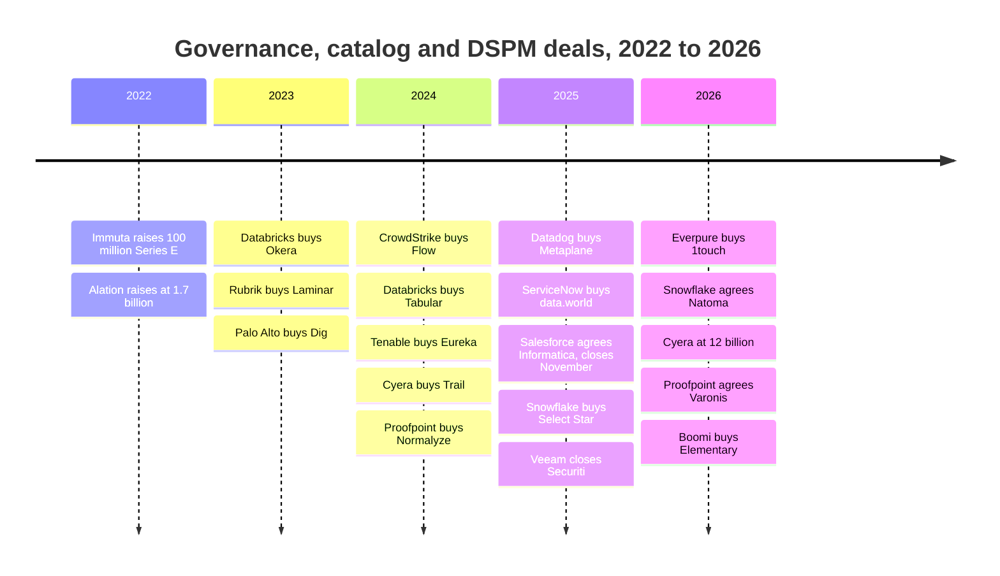
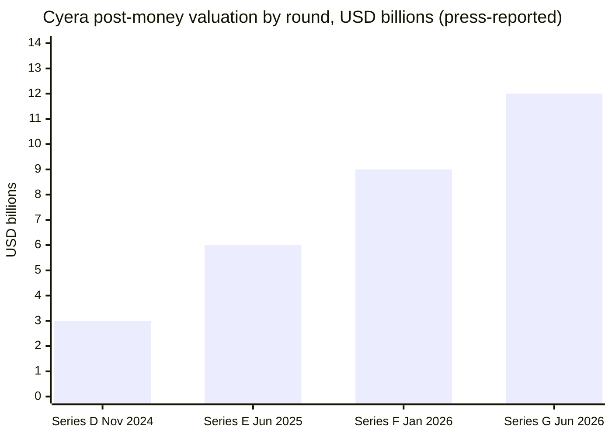
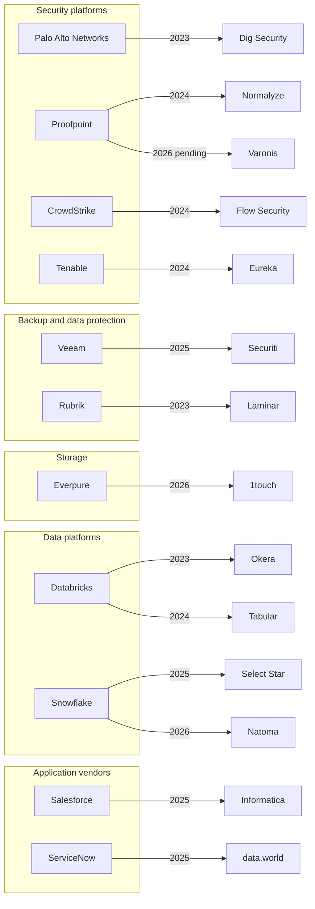
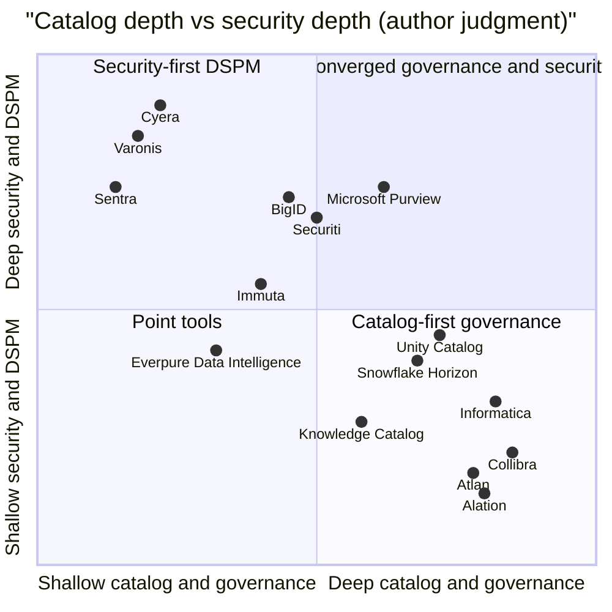

# 33. Governance, Catalog and Data-Security Companies
> **Status:** mixed public/private · **HQ:** various (US, Belgium, Israel) · **Founded:** 2005–2021 · **Latest valuation/market cap:** Cyera $12B post-money (press-reported, Jun 2026); Varonis $6.3B agreed sale to Proofpoint (disclosed, pending, Oct 2026) · **Last verified:** 2026-11-01

## TL;DR

- **Two businesses share one problem.** *Business catalogs* (Collibra, Alation, Atlan, data.world, Informatica's catalog) help people find and trust data. *Data-security* vendors, the [DSPM](../glossary.md#data-security-posture-management) (data security posture management) group of Cyera, BigID, Varonis, Securiti, Sentra and others, find sensitive data and who can reach it. Both start by discovering and classifying data. [Ch 8](../01-data-systems-foundations/ch08-catalogs-and-metastores.md) and [Ch 15](../02-pipelines-and-governance/ch15-governance-security-privacy.md) explain the mechanisms; this chapter covers the companies, their prices and who buys them.
- **Catalogs are being squeezed.** Databricks Unity Catalog, Snowflake Horizon, Microsoft Purview and Google's Knowledge Catalog (formerly Dataplex) bundle "good enough" governance into the platform bill. The independent marks are stale: Collibra $5.25B (2021), Alation $1.7B (2022), Atlan $750M (2024). Two independents were sold to application vendors: data.world to ServiceNow (2025) and Informatica to Salesforce (~$8B, closed November 2025).[^collibra][^alation][^atlan][^dataworld][^infa-close]
- **Security is being consolidated, at higher prices.** Proofpoint agreed to buy Varonis for **$6.3B** (about **8.5x** calendar-2026 revenue guidance, estimate). Veeam paid **$1.725B** for Securiti. Palo Alto bought Dig (~$400M, press-reported) and Proofpoint bought Normalyze. Cyera, the main independent left, went from $3B to **$12B** post-money in 19 months (press-reported).[^varonis-8k][^securiti][^dig][^normalyze][^cyera-g]
- **Four kinds of buyer, four different reasons.** Security platforms want data context for threat and identity products. Backup vendors want to sell "know what is in your copies." Application vendors want governed data for their own agents. Storage, the newest buyer, wants classification at the layer that holds every byte.
- **Everpure's move was small and early.** The **$125.0M** cash purchase of 1touch (announced 2026-02-23, closed 2026-05-07, GAAP per 10-Q) is about **0.3%** of Everpure's **$43.79B** market cap (2026-10-01). It is a fraction of what Veeam and Proofpoint paid, and it buys the discovery and classification core without a security sales force.[^ep-10q][^ep-comps]

## Snapshot table

| Company | Category | Founded / HQ | CEO (public record) | Status, Nov 2026 | Latest mark (basis, date) | Traction disclosed (label) |
|---|---|---|---|---|---|---|
| Collibra | Business catalog and governance | 2008 / Brussels and New York | Felix Van de Maele | Private | $5.25B post-money, Series G (press-reported, Nov 2021)[^collibra] | None found since 2021 |
| Alation | Business catalog | 2012 / Redwood City, CA | Satyen Sangani | Private | $1.7B, Series E (press-reported, Nov 2022)[^alation] | $340M total raised (press-reported) |
| Atlan | Active-metadata catalog | 2019 [VERIFY: founding year] / New York and Singapore | Prukalpa Sankar | Private | $750M, Series C (company-stated, May 2024)[^atlan] | No ARR disclosed |
| data.world | Knowledge-graph catalog | 2016 / Austin, TX | n/a | ServiceNow (announced May 2025)[^dataworld] | Undisclosed | n/a |
| Cyera | DSPM plus DLP | 2021 / New York and Tel Aviv | Yotam Segev | Private | $12B post-money, Series G (press-reported, Jun 2026)[^cyera-g] | ~80x ARR implied (press-reported, disputed by company) |
| BigID | Discovery, privacy, DSPM | 2016 / New York | Dimitri Sirota | Private | "Over $1B", Series E (company-stated, Mar 2024)[^bigid] | Not disclosed |
| Varonis (VRNS) | Data security, access governance | 2005 / New York area; IPO 2014 | Yaki Faitelson | Public; sale to Proofpoint pending | $6.3B deal, $49.75/share cash (disclosed, Oct 2026)[^varonis-8k] | Q2 2026 revenue $180.0M, +18% (GAAP); SaaS ARR $726.0M (company-stated)[^varonis-q2] |
| Securiti | Privacy ops, DSPM, AI governance | 2018–19 / San Jose, CA | Rehan Jalil (now Veeam President of Security and AI) | Veeam (closed Dec 2025) | $1.725B (disclosed)[^securiti] | ~600 employees joined Veeam (company-stated) |
| Sentra | Cloud DSPM | c. 2021 [VERIFY: founding year] / Tel Aviv and New York | n/a | Private | $50M Series B (undisclosed valuation, Apr 2025)[^sentra] | >$100M raised (company-stated) |
| Immuta | Policy enforcement (ABAC) | 2015 / Boston | n/a | Private | $100M Series E (valuation undisclosed, Jun 2022)[^immuta] | Not disclosed |
| 1touch | Discovery, classification, semantic context | n/a [VERIFY: founding year and HQ] | n/a | Everpure (closed May 2026) | $125.0M cash (GAAP, 10-Q)[^ep-10q] | Not disclosed |

*Figure 33.1 — Snapshot. The independent catalog marks are three to five years old, while the security marks are from 2025–26. That gap is the chapter's thesis in one table. Founding, HQ and CEO cells are from public company profiles and were not re-verified in this session.[^bg] [VERIFY: CEO changes since mid-2025]*

## Origin story and strategic arc

**Wave 1: compliance software (2005–2018).** Varonis started in 2005 by analysing who could open which files on Windows shares, which is the access problem in unstructured data. Collibra spun out of a Brussels university research group in 2008 to manage business glossaries and data stewardship for banks facing post-crisis regulation. Alation (2012) made the catalog a search engine that learned from query logs which tables people actually used. GDPR, applied from May 2018, then created a market for finding personal data at scale. BigID (2016) and Securiti (2018–19) were built for that job: data-subject requests, consent and erasure.[^bg]

**Wave 2: cloud sprawl and the 2021 marks (2019–2022).** Cloud migration scattered copies of data across thousands of buckets and accounts, and venture money priced governance as core infrastructure. Collibra's Series G at $5.25B in November 2021 doubled its valuation in about a year, and Alation raised at $1.7B in 2022.[^collibra][^alation] Cyera (2021) and Sentra were founded on a different premise. Instead of asking stewards to document data, they scan cloud stores directly, without agents, and rank exposures. That is the DSPM model.

**Wave 3: bundling and consolidation (2023–2026).** Three things happened at once. The platforms built governance in: Unity Catalog and Horizon became the place where permissions are enforced, so the catalog question moved to them ([Ch 8](../01-data-systems-foundations/ch08-catalogs-and-metastores.md)). Security platforms bought DSPM start-ups as features. And generative AI turned classification into a precondition for deploying agents and retrieval indexes, which lifted the prices paid for scaled security vendors.

*Figure 33.2 — Deal timeline. The small DSPM tuck-ins of 2023–24 were followed by large platform deals in 2025–26. Sources: `data/ma_deals.csv` and `data/private_funding.csv`.[^okera][^dspm-tuckins][^dig][^tabular][^cyera-trail][^normalyze][^metaplane][^dataworld][^infa-close][^select-star][^securiti][^ep-10q][^natoma][^cyera-g][^varonis-8k][^boomi]*

## Product and technology

The mechanics (classification pipelines, ABAC, credential vending, lineage) are covered in [Ch 15](../02-pipelines-and-governance/ch15-governance-security-privacy.md) and [Ch 8](../01-data-systems-foundations/ch08-catalogs-and-metastores.md). For a buyer, three product facts matter more than the algorithms.

**Where the scanner runs.** Business catalogs mostly read *metadata*: schemas, query logs, BI lineage and dbt models. They rarely open the data itself. DSPM tools open the data, at least by sampling it, because they must prove a column or file really holds card numbers. That makes DSPM heavier to run, more expensive and more valuable to security buyers. It is also why a storage vendor's scanner is interesting: it can read content where the bytes sit, without egress.

**Structured versus unstructured.** Catalogs grew up on tables. Varonis grew up on file shares, and the cloud DSPM vendors cover both. AI is shifting the value toward unstructured data, because retrieval indexes are built from PDFs, slides and email rather than warehouse tables.

**Write-back.** A tag has value only where policy is enforced. Independent tools therefore compete on how well they push classifications into Unity Catalog, Horizon, Purview or an identity system. A tool that cannot write back becomes a report.

| Vendor | Category | Owner / status | Latest valuation or deal (basis, date) | Business model | Structured / unstructured | Deployment | AI positioning |
|---|---|---|---|---|---|---|---|
| Collibra | Business catalog, governance | Independent | $5.25B (press-reported, 2021)[^collibra] | Enterprise subscription | Mainly structured | SaaS | Governance of AI use cases and models |
| Alation | Business catalog | Independent | $1.7B (press-reported, 2022)[^alation] | Enterprise subscription | Mainly structured | SaaS, some self-managed | Catalog as agent context; Numbers Station deal [VERIFY][^bg] |
| Atlan | Active-metadata catalog | Independent | $750M (company-stated, 2024)[^atlan] | Platform subscription | Mainly structured | SaaS | Metadata "context layer" for agents |
| data.world | Knowledge-graph catalog | ServiceNow | Undisclosed (announced 2025-05)[^dataworld] | Absorbed into Workflow Data Fabric | Structured | SaaS | Semantic grounding for LLM answers ([Ch 14](../02-pipelines-and-governance/ch14-semantic-layers-and-bi.md)) |
| Informatica CDGC | Catalog in data-management suite | Salesforce | ~$8B equity value (disclosed, closed 2025-11-18)[^infa-close] | Pooled consumption units (IPUs)[^infa-ipu] | Structured | SaaS, hybrid | Feeds Data Cloud and Agentforce |
| Microsoft Purview | Catalog plus data security | Microsoft | Bundled | Per-user (M365) plus usage | Both; deepest in M365 | Cloud | DSPM for AI, Copilot oversight[^purview-dspm] |
| Google Knowledge Catalog | Platform catalog | Google | Bundled | Usage-based | Mainly structured | Cloud | Context for Gemini agents[^gcp-kc] |
| Unity Catalog | Platform catalog | Databricks | Bundled in DBUs | Platform consumption | Both (tables, volumes, models) | Cloud | Unity AI Gateway for agent traffic[^uc-2026] |
| Snowflake Horizon | Platform catalog | Snowflake | Bundled in credits | Platform consumption | Mainly structured | Cloud | Select Star and Natoma deals[^select-star][^natoma] |
| Cyera | DSPM plus DLP | Independent | $12B (press-reported, 2026-06)[^cyera-g] | Subscription | Both | SaaS, agentless | DLP for AI data flows (Trail)[^cyera-trail] |
| BigID | Discovery, privacy, DSPM | Independent | "Over $1B" (company-stated, 2024)[^bigid] | Subscription | Both | SaaS or self-hosted | AI data governance |
| Varonis | Data security, access governance | Proofpoint (pending) | $6.3B (disclosed, 2026-10)[^varonis-8k] | SaaS subscription | Mostly unstructured, expanding | SaaS (converted from on-prem) | Copilot and AI-agent access risk |
| Securiti | Privacy ops, DSPM | Veeam | $1.725B (disclosed, 2025-12)[^securiti] | Subscription, now cross-sold | Both | Hybrid | AI data governance on backup data |
| Sentra | Cloud DSPM | Independent | Undisclosed ($50M Series B, 2025)[^sentra] | Subscription | Both | Cloud | AI data-exposure monitoring |
| Normalyze | Cloud DSPM | Proofpoint | Undisclosed (2024)[^normalyze] | Folded into suite | Both | Cloud | Part of Proofpoint data security |
| Dig Security | Cloud DSPM, DDR | Palo Alto Networks | ~$400M (press-reported, 2023)[^dig] | Folded into Prisma Cloud | Both | Cloud | Part of Prisma Cloud and Cortex |
| 1touch | Discovery, classification, context | Everpure | $125.0M cash (GAAP, 2026)[^ep-10q] | Now Everpure Data Intelligence | Both | Hybrid, incl. third-party storage | MCP interface (Oct 2026)[^ep-oct] |
| Immuta | Policy enforcement | Independent | Undisclosed ($100M Series E, 2022)[^immuta] | Subscription | Structured | SaaS overlay on platforms | Agent data provisioning |
| Privacera | Policy enforcement (Ranger lineage) | Independent | Undisclosed ($50M Series B, 2021)[^privacera] | Subscription | Structured | SaaS or self-hosted | AI access governance |

*Figure 33.3 — Vendor matrix. Independents survive where they span many platforms or hold content the platforms cannot see, such as unstructured data, SaaS and on-prem. "AI positioning" summarises each vendor's public messaging in the author's words, not tested capability.*

## How it makes money

**Catalogs are seat-and-scope software.** Independent catalogs sell annual subscriptions. Price rises with the number of people using the product and the number of systems or assets it connects to. That model worked while the catalog was a destination product where stewards spent their day. It weakens when the platform's own catalog already shows lineage and permissions for free, because the buyer's question becomes "what do I get above Unity Catalog?" The honest answer is cross-platform scope: one glossary and one lineage graph across Snowflake, Databricks, SAP, Salesforce and the BI tools. That sells to the largest enterprises but is harder to land in mid-market accounts that run one platform.

**DSPM is sold on volume and risk.** DSPM vendors price on the estate they scan, whether data stores, cloud accounts or data volume. The economic buyer is the CISO, whose budget is larger and less discretionary than the chief data officer's. Expansion follows data growth and new clouds, which explains the higher multiples. The cost side is scanning compute. Amazon Macie's list price of $1.00 per GB inspected implies about $1M to fully scan a petabyte, before sampling and tiering.[^macie] Independent vendors cut that cost with sampling and incremental scans. Those methods drive gross margin.

**Platforms monetise governance indirectly.** Unity Catalog and Horizon are "free" in the sense that their cost is recovered through compute (DBUs and credits). Snowflake documents a planned charge of 0.5 credits per million Iceberg REST catalog calls.[^horizon-irc] Microsoft sells Purview's data security largely through Microsoft 365 per-user licences, which is the hardest bundle for any independent to price against.

| Model | Pricing unit (typical) | Who buys | Expansion driver | Margin and risk dynamics | Basis |
|---|---|---|---|---|---|
| Independent business catalog (Collibra, Alation, Atlan) | Annual subscription by edition, scaled by users and connected sources or assets | CDO, data governance office | More domains, users and sources | High software margin; churn risk when platform catalogs are "good enough" | Not public; author's summary |
| Suite consumption (Informatica IDMC/CDGC) | Pre-paid pooled IPUs across services[^infa-ipu] | CIO, data platform team | Usage across integration, quality, catalog | Pooling eases cross-sell; usage can fall in downturns | Company blogs |
| Platform-native catalog (Unity, Horizon) | Bundled; recovered via DBUs or credits; some API metering[^horizon-irc] | Platform owner | Platform consumption | Zero marginal price to the customer: the squeeze on independents | Vendor docs |
| Hyperscaler governance (Purview, Knowledge Catalog, Macie) | Per-user M365 licences; usage-based scanning; $1.00/GB inspected for Macie[^macie][^gsdp] | CISO and CIO, often in an enterprise agreement | Seats and data scanned | Bundled into enterprise agreements | List prices where shown |
| Independent DSPM (Cyera, BigID, Sentra) | Annual subscription scaled by data stores, accounts or volume | CISO | Data growth, new clouds, DLP add-ons | Scanning compute is the main COGS lever | Not public; author's summary |
| Data-security SaaS (Varonis) | SaaS subscription; historically per-user | CISO | Conversion from on-prem, new modules | Gross margin dipped in transition (77.7% non-GAAP Q2 2026 vs 80.6%)[^varonis-q2] | Company filings |
| Bundled in backup or storage (Veeam–Securiti, Rubrik, Everpure) | Add-on SKU on protected or stored data | Infrastructure and security teams | Installed base attach | Cross-sell into existing accounts; low CAC | Not public; author's summary |

*Figure 33.4 — Business models. The pricing unit decides who signs the purchase order: catalogs sell to the data office, DSPM sells to the CISO, and the bundles sell through an existing contract. Rows marked "author's summary" reflect common public descriptions, not published price lists. [VERIFY: vendor pricing units for Collibra, Alation, Atlan, Cyera, BigID]*

## Financials

Only one company in this group still reports as an independent public company, and it is about to be taken private.

### Varonis: a SaaS transition, then a sale

Since about 2023, Varonis has been converting customers from perpetual and term licences for self-hosted software to SaaS. The conversion masks growth: when a customer moves, revenue recognised up front under term licences becomes ratable SaaS revenue. In Q2 2026 (April–June 2026; Varonis reports on a calendar year), total revenue was **$180.0M**, up 18% from $152.2M (GAAP). SaaS revenue was **$171.7M**, about 95% of the total. SaaS ARR was **$726.0M**, up 52%, but only about 25% excluding conversions (company-stated). Non-GAAP gross margin fell to **77.7%** from 80.6% a year earlier, because hosting costs moved onto Varonis's books.[^varonis-q2]

Proofpoint, which is owned by Thoma Bravo, agreed on 2026-10-15 to buy Varonis for **$49.75 per share in cash**. That is about **$6.3B** headline value and about **$5.71B** equity value, with closing expected in the first half of 2027.[^varonis-8k] On the midpoint of Varonis's calendar-2026 revenue guidance ($735–739M), the headline price is about **8.5x** revenue, and about **8.7x** SaaS ARR (both estimates). [VERIFY: reconciliation of $6.3B headline to $5.71B equity value, e.g., convertible notes]

### Cyera: the scarcity mark

Cyera's four priced rounds in 19 months trace one of the steepest valuation curves in this atlas.

*Figure 33.5 — Cyera's valuation quadrupled in 19 months, across $300M, $540M, $400M and $600M raises. All values are press-reported, and the Series E lead is unconfirmed. Source: `data/private_funding.csv`.[^cyera-d][^cyera-e][^cyera-f][^cyera-g]*

The press reported the Series G at about 80x ARR, and a Cyera spokesperson disputed that figure.[^cyera-g] Secondary sources give conflicting ARR numbers, so we state none. On our sum of the CSV rows, Cyera has raised more than $2.3B, which is more than Securiti's entire sale price. Part of that capital funded acquisitions such as Trail Security ($162M, cash and stock).[^cyera-trail]

### Precedent multiples

| Deal or mark | Date | Value | Multiple | Basis of multiple | Label |
|---|---|---|---|---|---|
| Proofpoint–Varonis | 2026-10-15 (pending) | $6.3B headline[^varonis-8k] | ~8.5x CY2026 revenue guide; ~8.7x SaaS ARR | $6.3B ÷ $737M midpoint; ÷ $726.0M SaaS ARR | Estimate (our calculation) |
| Varonis trading, post-announcement | 2026-11-01 | EV ~$5.26B[^comps] | 7.1x EV/NTM revenue | NTM proxy = FY guide midpoint | Estimate; trades on deal spread |
| Cyera Series G | 2026-06 | $12B post-money[^cyera-g] | ~80x ARR | Press-reported; disputed by company | Press-reported |
| Salesforce–Informatica | 2025-11-18 (closed) | ~$8B equity[^infa-close] | ~4.9x CY2024 revenue | $8B ÷ ~$1.64B CY2024 revenue [VERIFY: Informatica FY2024 GAAP revenue] | Estimate |
| Veeam–Securiti | 2025-12-11 (closed) | $1.725B[^securiti] | Not computable | Securiti revenue not disclosed | Disclosed value only |
| Palo Alto–Chronosphere (adjacent: observability) | 2025-11-19 | $3.35B[^chronosphere] | ~21x ARR | Press-reported (Calcalist) | Press-reported |
| Databricks–Tabular (catalog control) | 2024-06 | ~$2B[^tabular] | ~$50M per employee (~40 staff) | Price ÷ headcount; no revenue | Press-reported; estimate |
| Palo Alto–Dig | 2023-10 | ~$400M[^dig] | Not computable | Pre-revenue-scale start-up | Press-reported |
| Everpure–1touch | 2026-05-07 (closed) | $125.0M cash[^ep-10q] | ~0.3% of acquirer market cap | $125.0M ÷ $43.79B (2026-10-01) | Estimate (our calculation) |
| Tenable–Eureka | 2024-06 | $29.2M cash[^dspm-tuckins] | Not computable | Tuck-in | GAAP (10-Q) |
| Public comps for context | 2026-10 | Rubrik 16.0x, Everpure 8.5x, Commvault 5.3x EV/NTM[^comps] | — | NTM proxies per `data/public_comps.csv` | Estimate |

*Figure 33.6 — Precedent multiples. Scaled, slower-growth assets clear at 5–9x revenue (Informatica, Varonis), while scarce high-growth DSPM is priced on option value (Cyera). Most tuck-ins disclose no revenue, so their "multiple" is really a price for team and technology.*

> **Bridge: finance.** Read Varonis and Cyera as the two ends of one curve. Varonis at ~8.5x is a cash-flow buyer (a Thoma Bravo-owned platform) paying for a converted SaaS base with a company-stated SaaS renewal rate above 90%.[^varonis-q2] Cyera at a reported ~80x is a growth-equity price for the last large independent, closer to a call option on being the asset every security platform eventually needs. A strategic buyer should calibrate against Varonis, not Cyera.

## Customers and go-to-market

The two halves sell to different people. **Catalogs sell to the chief data officer** and the governance office, usually in a regulated enterprise: banks, insurers, pharma. Deals are long, involve workshops on business glossaries, and depend on systems integrators. The pitch has moved from "find your data" to "make your data usable by AI agents," because a catalog's descriptions, certifications and lineage are what an agent needs to avoid confident wrong answers ([Ch 22](../03-ai-data-stack/ch22-agents-and-data.md)).

**DSPM sells to the CISO.** It is a security purchase, often triggered by a cloud audit, a breach in the news or a board question about Copilot. Microsoft Copilot rollouts were a strong 2024–26 trigger. Before turning on an assistant that can read every SharePoint site, a security team wants to know which sites hold payroll or health data and who can open them. Varonis and Purview both lean on that use case.[^purview-dspm]

**Channels decide outcomes.** Independents increasingly sell through cloud marketplaces and alongside platform partners: catalogs as "the layer above Unity and Horizon," DSPM as "the layer across AWS, Azure, Google and SaaS." Acquired vendors gain the parent's channel overnight. Securiti now sells through Veeam's installed base, and Dig and Normalyze through Palo Alto's and Proofpoint's. That cross-sell is the main synergy acquirers cite.

## M&A and investments

### Who buys what, and why

*Figure 33.7 — Consolidation map. Security buyers take DSPM, backup and storage buyers take discovery and classification, platforms take catalog and policy technology, and application vendors take whole catalog companies. Dates are announcement years; Proofpoint–Varonis is pending.*

**Security platforms (Palo Alto, Proofpoint, CrowdStrike, Tenable, Zscaler).** These buyers want the *data* dimension of risk. A firewall alert or a phished user matters more when the system knows the user could reach, say, tens of thousands of patient files. Their deals were mostly small tuck-ins (Dig, Flow, Eureka, Normalyze) until Proofpoint–Varonis, which is a scale bet that human-centric security (email, insider risk) and data-access governance belong together.[^normalyze][^varonis-8k][^dspm-tuckins] Zscaler builds data protection into its zero-trust cloud, but we found no comparable DSPM acquisition in our dataset. [VERIFY: Zscaler DSPM acquisitions]

**Backup and data protection (Veeam, Rubrik, Cohesity, Commvault).** A backup system already holds a copy of everything, indexed and versioned. Classifying those copies lets the vendor sell "know what is in your backups," sharper ransomware triage and AI-ready data curation without touching production. Veeam's $1.725B for Securiti is the largest such bet, and Rubrik–Laminar (2023) was the first.[^securiti][^dspm-tuckins] Cohesity spent its capital on Veritas's data-protection business, a scale deal rather than a feature deal.[^cohesity] Public reports also tie Commvault to a 2025 data-security tuck-in. [VERIFY: Commvault–Satori Cyber acquisition and date]

**Storage (Everpure).** This is the backup logic applied one layer earlier, to primary data. It is covered below.

**Data platforms (Databricks, Snowflake).** The platforms buy technology to deepen their own catalogs: Okera for policy, Tabular for format control, Select Star for discovery and lineage, and Natoma for agent and MCP governance. They do not buy independent catalogs at scale, because their strategy is to make that layer free.[^okera][^tabular][^select-star][^natoma]

**Application vendors (Salesforce, ServiceNow).** These buyers want governed enterprise data feeding *their* agents, so they do not depend on Snowflake or Databricks for context. Salesforce bought the whole Informatica suite, including its catalog (CDGC), integration and master data management. ServiceNow bought data.world for its knowledge-graph catalog, two months after agreeing to buy Moveworks.[^infa-close][^dataworld] Observability deals sit next door: Datadog–Metaplane and Boomi–Elementary show data-quality tools being absorbed in the same way ([Ch 13](../02-pipelines-and-governance/ch13-data-quality-observability-lineage.md)).[^metaplane][^boomi]

> **Bridge: semiconductors.** DSPM is to data what in-line inspection and metrology are to a fab. Neither makes the product. Both tell you where the defects are before they become yield loss (or a breach). Equipment makers folded inspection into their platforms because measurement is worth more next to the process tool than as a separate box. Security platforms are buying DSPM for the same reason: detection is worth more when the platform can also enforce a fix.

> **Bridge: test and analytics.** Backup vendors buying DSPM resemble test-equipment makers adding yield analytics. The tester already sees every die, so analytics on test data is a natural, high-margin attach. The backup system already sees every copy of every file, so classification on backup data is the same kind of attach: low acquisition cost, existing installed base, and a new buyer (security) for an old asset (the copy).

### Integration outcomes so far

Dig became part of Prisma Cloud's DSPM. Okera's team was absorbed into Unity Catalog governance. Metaplane became Datadog's data observability. Securiti's founder became Veeam's President of Security and AI, which signals a product line rather than a feature. 1touch relaunched within six weeks of closing as Everpure Data Intelligence.[^dig][^okera][^metaplane][^securiti][^ep-cw] No deal in this group has yet been publicly written down. Integration risk shows up instead as slower independent roadmaps after the deal, which is hard to see from outside.

## Competitive position

*Figure 33.8 — Positioning by catalog depth and security depth (author judgment, not measured data). Microsoft Purview is the only vendor credibly in the upper right at scale. That is the competitive problem for both halves: catalogs must add security, DSPM vendors must add governance, and Microsoft bundles both.*

**Catalogs vs the platforms.** Unity Catalog and Horizon already hold the permissions, lineage and usage data that independent catalogs crawl. Each added discovery features in 2025–26: Snowflake through Select Star, Databricks through Domains and metric views.[^select-star][^uc-2026] Independents differentiate on breadth. One customer may run Snowflake and Databricks plus SAP, Salesforce and Power BI, and only a neutral catalog spans all of them. Atlan has been the growth story among independents, pitching "active metadata," meaning metadata that triggers actions (alerts, policy changes, agent context) rather than sitting in a portal. Its 2024 Series C at $750M was raised as Collibra's 2021 mark aged.[^atlan] We found no priced round for Collibra since 2021, and we could not verify press reports of headcount reductions at independent catalog vendors. [VERIFY: Collibra and Alation headcount reductions, 2023–2026]

**DSPM vs the security platforms.** Cyera competes with what Palo Alto, CrowdStrike, Proofpoint and Microsoft bundle. Its defence is depth and speed: broad coverage across clouds, SaaS and on-prem, plus DLP through Trail. BigID competes on breadth of privacy workflows and self-hosted deployment, which matters for regulated buyers. Varonis's edge has been unstructured file permissions on-prem and in Microsoft 365, the hardest data to clean up.

**The hyperscalers.** Microsoft is the most dangerous competitor for everyone in this chapter. It owns the identity system (Entra), the content (Microsoft 365), the AI assistant (Copilot) and Purview, so it can classify, enforce and audit in one licence. Google's Knowledge Catalog and AWS's Macie and Glue are narrower and tied to their own clouds.[^gcp-kc][^macie]

## Why it's winning / bull case

1. **AI made classification a gate, not a chore.** Every retrieval index and agent rollout raises the same question about what the data is and who may see it. Boards now ask it, so budgets moved from "governance someday" to "before Copilot goes live."
2. **Prices prove strategic value.** Four buyer types competed for assets in 24 months, and the 8.5x Varonis multiple came from a financial-sponsor-owned buyer, not a hype-cycle strategic.
3. **Unstructured data is the open frontier.** Platform catalogs govern tables well and documents poorly. The vendors that classify files, email and SaaS content cover the data AI consumes most.
4. **Neutrality has real demand.** Multi-platform enterprises do not want their governance owned by their warehouse vendor, which leaves room for at least one or two independent catalogs.

## Risks / bear case and open questions

1. **Bundling.** Unity Catalog, Horizon and Purview arrive at zero marginal price. The independent catalog market could shrink to the largest regulated multi-platform estates.
2. **Valuation overhang.** The 2021–22 catalog marks ($5.25B, $1.7B) probably sit above today's clearing prices, and down rounds or structured exits are plausible. Cyera's $12B prices in near-flawless execution.
3. **Feature, not company.** Most DSPM deals were tuck-ins at undisclosed prices, which suggests buyers see DSPM as a feature. Varonis is the exception because it is a scaled business with a converted SaaS base.
4. **Scanning cost and accuracy.** Content scanning at petabyte scale is expensive, and false positives erode trust. Vendors that sample aggressively miss things, and vendors that do not sample cost too much.
5. **Open questions.** Does ServiceNow keep data.world as a standalone catalog? Does Salesforce keep Informatica's catalog neutral toward Snowflake and Databricks? Does Cyera IPO, or sell to a security platform?

## Relevance to Everpure

**What Everpure said, publicly.** On 2026-02-23, the day it renamed itself, Pure Storage announced the intent to acquire 1touch. It described 1touch as data-intelligence software that discovers, classifies and adds semantic context to data, and framed the goal as moving customers from controlling their data to understanding it, so it becomes "AI-ready."[^ep-wwt] The deal closed on 2026-05-07 for $125.0M in cash (GAAP, per 10-Q).[^ep-10q] At Accelerate in June 2026 the technology relaunched as **Data Intelligence**. Trade coverage says it discovers and classifies structured and unstructured data across Everpure arrays, third-party storage, public clouds and SaaS without copying the data.[^ep-cw] An October 2026 update added a metadata-only File Edition and an MCP interface.[^ep-oct]

**Sizing the bet.** $125.0M is about 0.3% of Everpure's $43.79B market cap (2026-10-01) and about 20% of its FY2026 free cash flow of $616M (non-GAAP; FY2026 ≈ Feb 2025–Jan 2026).[^ep-comps][^ep-q4] It is about one-fourteenth of Veeam's price for Securiti and about 2% of Proofpoint's for Varonis. Everpure bought the discovery and classification core and its connectors, not a security sales force or a privacy-operations suite.

| Counterparty | Relationship today (public info) | Options a strategy team might evaluate |
|---|---|---|
| Cyera, BigID, Sentra | Overlap on discovery and classification | Partner: feed storage-side tags into their posture engines; avoid a CISO-led head-to-head |
| Varonis (Proofpoint) | Overlap on unstructured file data | Watch the Proofpoint integration; Varonis's on-prem file heritage is closest to Everpure's installed base |
| Veeam–Securiti, Rubrik, Commvault, Cohesity | Backup partners on Everpure arrays and competitors in data intelligence | Co-exist: primary-data classification vs backup-copy classification; agree whose tags win |
| Unity Catalog, Horizon, Purview, Knowledge Catalog | Enforcement points; Databricks Storage Ecosystem partnership ([Ch 25](ch25-databricks.md)) | Integrate: publish Data Intelligence tags where policy is enforced |
| Collibra, Alation, Atlan | Business-context layer above storage | Integrate: supply content-level classification that metadata crawlers cannot produce |

*Figure 33.9 — Compete and partner map for Everpure Data Intelligence. These are options based on public information only, not statements about Everpure plans.*

> **Bridge: EDA.** A business catalog is to a data estate what design-data-management tools are to a chip team: they track which version of which block went into which tapeout, who owns it and what it depends on. Those tools became valuable inside EDA suites because they sit next to the design flow. Storage-resident classification makes the same bet, that context is worth more next to the bytes than in a separate portal.

> **Storage bridge.** A primary array sees shadow copies (snapshots, clones, scratch volumes) that no catalog registered. That is the structural argument for classification in storage. The constraints are scan load on production systems and writing tags out to external catalogs. See the companion *Everpure Tech Atlas* for snapshot and metadata mechanics.

## Conversation playbook

**Three questions for governance or DSPM vendor executives or partners**

1. "What share of new ARR comes from customers already running Unity Catalog, Horizon or Purview, and what do they buy from you on top?" *A good answer* names specific capabilities, such as cross-platform lineage or unstructured coverage, and gives a win-rate or attach trend rather than "we're complementary."
2. "What is your scanning cost per terabyte classified, and how has sampling changed gross margin?" *A good answer* separates first scan from incremental scans and admits the accuracy trade-off.
3. "Which buyer type has approached you or your peers: security platform, backup vendor, storage vendor or application vendor? What did each value?" *A good answer* distinguishes channel synergy from technology value.

**Three questions for engineers or partner architects**

1. "How do your classifications get written back to the enforcement point: Unity Catalog tags, Snowflake tags, Purview labels?" *Good:* named APIs, sync latency and conflict rules.
2. "For unstructured data, do you read content in place or copy it out, and what load does a full scan put on a primary array?" *Good:* concrete throughput limits and throttling controls.
3. "How do you resolve detections to an individual for DSAR (data-subject request) and erasure, across structured and unstructured stores?" *Good:* entity-resolution method and measured precision.

**What good answers sound like.** They state the buyer (CDO or CISO), the pricing unit, and where tags are enforced. They admit that platform catalogs are "good enough" for single-platform shops and place the vendor's value in breadth or content depth.

**Don't say this**

- "Collibra is worth $5B." *That is a 2021 private mark; no priced round has been found since.*
- "Cyera trades at 80x ARR." *The ~80x figure was press-reported and disputed by the company, and Cyera is private, so it does not trade.*
- "Proofpoint is paying $5.7B for Varonis." *$6.3B is the headline value and ~$5.71B the equity value; say which basis you mean.*
- "Everpure bought a DSPM company to compete with Cyera." *Public statements frame 1touch as discovery, classification and semantic context for AI-ready data, not as a security product.*
- "Unity Catalog makes business catalogs obsolete." *It squeezes them; multi-platform enterprises still buy neutral catalogs.*

## Key terms

- [Business catalog](../glossary.md#business-catalog) — a searchable inventory of data assets with business definitions, owners and certifications.
- [Data catalog](../glossary.md#data-catalog) — the registry of data assets, owners, lineage and access policies across the stack.
- [Technical catalog](../glossary.md#technical-catalog) — the metastore on the query hot path that holds table metadata and enforces access.
- [Active metadata](../glossary.md#active-metadata) — metadata that triggers actions (alerts, policy changes, agent context) instead of only being displayed.
- [Data security posture management](../glossary.md#data-security-posture-management) — continuous discovery of sensitive data, who can reach it and where it is exposed.
- [Data classification](../glossary.md#data-classification) — labelling data by content and sensitivity so policy can act on it.
- [Data access governance](../glossary.md#data-access-governance) — analysing and right-sizing who can access which data, especially file shares and SaaS.
- [Data loss prevention](../glossary.md#data-loss-prevention) — controls that detect and block sensitive data leaving approved boundaries.
- [Data detection and response](../glossary.md#data-detection-and-response) — real-time alerting on unusual access to sensitive data.
- [Attribute-based access control](../glossary.md#attribute-based-access-control) — policy evaluated against tags on data and attributes of users.
- [Agentless scanning](../glossary.md#agentless-scanning) — scanning cloud data through provider APIs and snapshots without installing software on hosts.
- [Shadow data](../glossary.md#shadow-data) — copies of data that exist outside governed, inventoried systems.
- [Model Context Protocol](../glossary.md#model-context-protocol) — an open protocol for connecting AI agents to tools and data sources.
- [Precedent transaction](../glossary.md#precedent-transaction) — a past acquisition used as a valuation benchmark via its implied multiple.
- [Take-private](../glossary.md#take-private) — acquisition of a public company, often by a private-equity-backed buyer, that delists it.
- [Unity Catalog](../glossary.md#unity-catalog) — Databricks' governance catalog for data and AI assets.

## Sources

[^collibra]: CNBC, "Collibra doubles valuation as investors chase next cloud winner," https://www.cnbc.com/2021/11/09/collibra-doubles-valuation-as-investors-chase-next-cloud-winner.html, published 2021-11-09; retrieved 2026-11-01 (per `data/private_funding.csv`; $250M Series G at $5.25B post-money, press-reported). No later priced round found (`meta/research-notes-funding.md`).
[^alation]: Blocks & Files, "Alation E round," https://blocksandfiles.com/2022/11/03/alation-e-round/, published 2022-11-03; retrieved 2026-11-01 ($123M Series E at $1.7B, total raised $340M, press-reported).
[^atlan]: Datanami, "Atlan plants itself in the middle of the data governance map with $105M round," https://www.datanami.com/2024/05/09/atlan-plants-itself-in-the-middle-of-the-data-governance-map-with-105m-round, published 2024-05-09; retrieved 2026-11-01 ($105M Series C at $750M, GIC and Meritech; no 2025–26 round confirmed).
[^dataworld]: TechCrunch, "ServiceNow acquires data.world two months after acquiring Moveworks," https://techcrunch.com/2025/05/07/servicenow-acquires-data-world-two-months-after-acquiring-moveworks, published 2025-05-07; retrieved 2026-11-01. Terms undisclosed; closing not confirmed in our sources.
[^infa-close]: Salesforce via Business Wire (FinancialContent), "Salesforce Completes Acquisition of Informatica," https://markets.financialcontent.com/clarkebroadcasting.mymotherlode/article/bizwire-2025-11-18-salesforce-completes-acquisition-of-informatica, published 2025-11-18; Bloomberg Law, "Salesforce Reaches an $8 Billion Deal to Buy Informatica," https://news.bloomberglaw.com/tech-and-telecom-law/salesforce-agrees-to-buy-informatica-in-deal-worth-8-billion, published 2025-05-27; retrieved 2026-11-01. Informatica CY2024 revenue (~$1.64B, used for the ~4.9x estimate) is from pre-2025 knowledge and was not re-verified [VERIFY].
[^infa-ipu]: Informatica blogs, "Announcing Consumption Pricing for Informatica Intelligent Data Management Cloud," https://www.informatica.com/blogs/announcing-consumption-pricing-for-informatica-intelligent-data-management-cloud.html, publication date not captured; retrieved 2026-11-01.
[^varonis-8k]: Varonis Systems, Inc., Form 8-K Exhibit 99.1 (merger agreement with Proofpoint), SEC EDGAR, https://www.sec.gov/Archives/edgar/data/0001361113/000121390026109901/ea030861001ex99-1.htm, published 2026-10-15; SiliconANGLE, "Proofpoint agrees to buy data security company Varonis for $6.3B in cash," https://siliconangle.com/2026/10/15/proofpoint-agrees-to-buy-data-security-company-varonis-for-6-3b-in-cash/, published 2026-10-15; retrieved 2026-11-01. $49.75/share cash; ~$5.71B equity value; close expected 1H 2027. Multiples are our estimates from `data/public_comps.csv`.
[^varonis-q2]: Varonis Systems, "Varonis Announces Second Quarter 2026 Financial Results," https://s203.q4cdn.com/582009126/files/doc_news/Varonis-Announces-Second-Quarter-2026-Financial-Results-2026.pdf, published 2026-07-28; retrieved 2026-11-01. GAAP revenue; SaaS ARR and renewal rate company-stated; gross margin non-GAAP (per `data/public_comps.csv`).
[^comps]: Atlas dataset `data/public_comps.csv` (Varonis, Rubrik, Commvault, Everpure rows), citing stockanalysis.com pages dated 2026-10-01 to 2026-11-01, e.g., https://stockanalysis.com/stocks/vrns/ and https://stockanalysis.com/stocks/rbrk/market-cap/; retrieved 2026-11-01. NTM revenue is a guidance or TTM proxy (estimate).
[^securiti]: Veeam via Business Wire, "Veeam Completes Acquisition of Securiti AI to Create the Industry's First Trusted Data Platform for Accelerating Safe AI at Scale," https://www.businesswire.com/news/home/20251211040418/en/Veeam-Completes-Acquisition-of-Securiti-AI-to-Create-the-Industrys-First-Trusted-Data-Platform-for-Accelerating-Safe-AI-at-Scale, published 2025-12-11; retrieved 2026-11-01. $1.725B disclosed; ~600 employees and Rehan Jalil's role company-stated; announcement date (Oct 2025) [VERIFY].
[^dig]: Palo Alto Networks, "A Decade of Strategic Acquisitions" (Cyberpedia), https://www.paloaltonetworks.com/cyberpedia/palo-alto-networks-strategic-acquisitions, n.d.; retrieved 2026-11-01. ~$400M originally press-reported; announcement day [VERIFY].
[^normalyze]: Proofpoint, "Proofpoint Signs Definitive Agreement to Acquire Normalyze," https://www.proofpoint.com/us/newsroom/press-releases/proofpoint-signs-definitive-agreement-acquire-normalyze, published 2024-10-29; retrieved 2026-11-01. Terms undisclosed.
[^cyera-d]: SecurityWeek, Cyera funding coverage cited for the Series D row ($300M at $3B, Nov 2024, press-reported), https://www.securityweek.com/cyera-raises-400-million-at-9-billion-valuation/amp/, published 2026-01; retrieved 2026-11-01 (per `data/private_funding.csv`; day and lead [VERIFY]).
[^cyera-e]: DefiLlama pre-IPO tracker, "Cyera," https://defillama.com/pre-ipo/cyera, n.d.; retrieved 2026-11-01 ($540M at $6B, Jun 2025, press-reported; weak secondary source; lead [VERIFY]).
[^cyera-f]: StorageNewsletter, "Cyera raised $400 million at $9 billion valuation," https://www.storagenewsletter.com/2026/01/06/cyera-raised-400-million-at-9-billion-valuation/, published 2026-01-06; retrieved 2026-11-01 (Blackstone-led; total >$1.7B raised, press-reported).
[^cyera-g]: SecurityWeek, "Cyera raises $600 million at $12 billion valuation," https://www.securityweek.com/cyera-raises-600-million-at-12-billion-valuation/amp/, published 2026-06; retrieved 2026-11-01. Evolution Equity Partners lead per `data/private_funding.csv`; the ~80x ARR multiple was press-reported and disputed by a Cyera spokesperson.
[^cyera-trail]: Cyera, "Cyera acquires Trail Security for $162M, redefining AI-powered data security with comprehensive data loss prevention," https://www.cyera.com/press-releases/cyera-acquires-trail-security-for-162m-redefining-ai-powered-data-security-with-comprehensive-data-loss-prevention, published 2024-10-17; retrieved 2026-11-01.
[^bigid]: Foley & Lardner, "Foley represents Riverwood Capital as lead investor in Series E round for BigID," https://www.foley.com/news/2024/03/foley-represents-riverwood-capital-as-lead-investor-in-series-e-round-for-bigid/, published 2024-03; retrieved 2026-11-01. $60M; valued "over $1B" (company-stated).
[^sentra]: Sentra via Business Wire, Series B announcement, https://www.businesswire.com/news/home/20250422569273/en, published 2025-04-22; retrieved 2026-11-01 ($50M led by Key1 Capital; >$100M total raised, company-stated).
[^immuta]: Immuta via Business Wire, "Immuta Raises $100 Million in Series E Funding," https://www.businesswire.com/news/home/20220608005624/en, published 2022-06-08; Immuta newsroom, https://www.immuta.com/newsroom/press-releases/; retrieved 2026-11-01.
[^privacera]: Insight Partners, "Privacera Secures $50 Million Series B…," https://www.insightpartners.com/ideas/privacera-secures-50-million-series-b-advances-cloud-first-data-governance-and-security-across-global-organizations/, published 2021-03; retrieved 2026-11-01.
[^dspm-tuckins]: Tenable Holdings, Form 10-Q for the quarter ended 2024-09-30 (Eureka: $29.2M cash, net of $0.4M cash acquired), https://www.sec.gov/Archives/edgar/data/1660280/000166028024000153/tenb-20240930.htm, published 2024-11; SecurityWeek, "CrowdStrike to acquire Flow Security," https://www.securityweek.com/crowdstrike-to-acquire-flow-security, published 2024-03; Rubrik–Laminar (announced 2023-08, terms undisclosed) per deal-tracker summary https://www.privsource.com/acquisitions/deal/3ASll0 (weak) [VERIFY: Rubrik–Laminar primary release]; all retrieved 2026-11-01.
[^okera]: Futurum Group, "Databricks Acquires Okera," https://futurumgroup.com/insights/databricks-acquires-okera, published 2023-05; retrieved 2026-11-01.
[^tabular]: TechCrunch, "Databricks reportedly paid $2 billion in Tabular acquisition," https://techcrunch.com/2024/08/14/databricks-reportedly-paid-2-billion-in-tabular-acquisition, published 2024-08-14; Databricks press release (team of ~40), https://www.databricks.com/company/newsroom/press-releases/databricks-agrees-acquire-tabular-company-founded-original-creators, published 2024-06-04; retrieved 2026-11-01.
[^select-star]: Snowflake blog, "Snowflake to acquire Select Star," https://www.snowflake.com/en/blog/snowflake-acquire-select-star/, published 2025-11; retrieved 2026-11-01. Terms undisclosed.
[^natoma]: Snowflake Inc., Form 10-Q for the quarter ended 2026-04-30 (Natoma Labs, ~$110M stated consideration), https://www.sec.gov/Archives/edgar/data/0001640147/000164014726000030/snow-20260430.htm, published 2026-05/06; retrieved 2026-11-01 (per `data/ma_deals.csv`; close not verified).
[^metaplane]: Datadog, "Datadog Brings Observability to Data Teams by Acquiring Metaplane," https://www.datadoghq.com/about/latest-news/press-releases/datadog-metaplane-acquisition/, published 2025-04-23; retrieved 2026-11-01. Terms undisclosed.
[^boomi]: iTWire (Business Wire), "Boomi acquires Elementary Data to bring trusted, governed data to the AI era," https://itwire.com/it-industry-news/deals/boomi-acquires-elementary-data-to-bring-trusted-governed-data-to-the-ai-era, published 2026-10-19; Calcalist, https://www.calcalistech.com/ctechnews/article/b1zgj8mnzg, 2026-10 ($40–45M, press-reported); retrieved 2026-11-01.
[^chronosphere]: SecurityWeek, "Palo Alto Networks to acquire observability platform Chronosphere in $3.35 billion deal," https://securityweek.com/palo-alto-networks-to-acquire-observability-platform-chronosphere-in-3-35-billion-deal/, published 2025-11-19; retrieved 2026-11-01. ~21x ARR per Calcalist (press-reported, per `data/ma_deals.csv`).
[^cohesity]: Cohesity, press release on completing the Veritas data-protection combination, https://www.cohesity.com/press/, published 2024-12-10; retrieved 2026-11-01 (per `data/ma_deals.csv`; combined-company valuation >$7B is not a deal price).
[^ep-wwt]: World Wide Technology (reposting Pure Storage press release), "Pure Storage rebrands to Everpure and announces intent to acquire 1touch," https://www.wwt.com/news/pure-storage-rebrands-to-everpure-and-announces-intent-to-acquire-1touch, published 2026-02-23; retrieved 2026-11-01.
[^ep-10q]: Everpure, Inc., Form 10-Q for the quarter ended 2026-05-03 (1touch closed 2026-05-07; $125.0M stated cash consideration, subject to adjustments and escrow), SEC EDGAR, https://www.sec.gov/Archives/edgar/data/0001474432/000147443226000061/pstg-20260503.htm, published 2026-06; Cleary Gottlieb, "Everpure Completes Acquisition of 1touch," https://www.clearygottlieb.com/news-and-insights/news-listing/everpure-completes-acquisition-of-1touch, published 2026-05-11; retrieved 2026-11-01.
[^ep-cw]: Computer Weekly, "Everpure aims to bridge AI data gap with Universal Data Intelligence," https://www.computerweekly.com/news/366644438/Everpure-aims-to-bridge-AI-data-gap-with-Universal-Data-Intelligence, published 2026-06; Everpure via PR Newswire, "Everpure Unveils Data-Primacy Architecture for the AI Era," https://www.prnewswire.com/news-releases/everpure-unveils-data-primacy-architecture-for-the-ai-era-302803097.html, published 2026-06-17; retrieved 2026-11-01.
[^ep-oct]: HPCwire/AIwire, "Everpure enhances Data Intelligence to bolster customer AI projects," https://www.hpcwire.com/aiwire/2026/10/07/verpure-enhances-data-intelligence-to-bolster-customer-ai-projects/, published 2026-10-07; retrieved 2026-11-01 (trade press).
[^ep-comps]: Atlas dataset `data/public_comps.csv`, Everpure row: market cap $43.79B as of 2026-10-01, from https://stockanalysis.com/stocks/p/financials/ratios/; retrieved 2026-11-01. 0.3% = $125.0M ÷ $43.79B (estimate).
[^ep-q4]: Everpure, Q4 FY2026 earnings press release (8-K Ex. 99.1), https://www.sec.gov/Archives/edgar/data/1474432/000147443226000015/pstg-ex991q4fy2026.htm, published 2026-02-25; retrieved 2026-11-01. FY2026 free cash flow $616M (non-GAAP).
[^purview-dspm]: Microsoft Learn, "Microsoft Purview Data Security Posture Management (DSPM) for AI," https://learn.microsoft.com/en-us/purview/dspm-for-ai, living document; retrieved 2026-11-01.
[^gcp-kc]: Google Cloud docs, "Knowledge Catalog (formerly Dataplex) overview," https://docs.cloud.google.com/dataplex/docs/overview, accessed 2026-11-01; retrieved 2026-11-01.
[^uc-2026]: Databricks blog, "What's new with Unity Catalog at Data + AI Summit 2026," https://www.databricks.com/blog/whats-new-unity-catalog-data-ai-summit-2026, published 2026-06; retrieved 2026-11-01.
[^horizon-irc]: Snowflake documentation, "Access Apache Iceberg tables with an external engine through Snowflake Horizon Catalog," https://docs.snowflake.com/en/user-guide/tables-iceberg-access-using-external-query-engine-snowflake-horizon, n.d.; retrieved 2026-11-01 (0.5 credits per million calls, planned 2026, list price subject to change).
[^macie]: AWS, "Amazon Macie pricing," https://aws.amazon.com/macie/pricing/, living document; retrieved 2026-11-01. $1.00/GB inspected, US East list; $1M per PB is our arithmetic (estimate).
[^gsdp]: Google Cloud, "Sensitive Data Protection pricing," https://cloud.google.com/sensitive-data-protection/pricing, living document; retrieved 2026-11-01.
[^bg]: Founding years, headquarters and CEOs are from public company profiles and pre-2025 background knowledge, not re-fetched in this session (web search budget exhausted); Alation–Numbers Station (2025) is listed as unresearched in `meta/research-notes-ma-2020s.md` [VERIFY]. Retrieved 2026-11-01.
