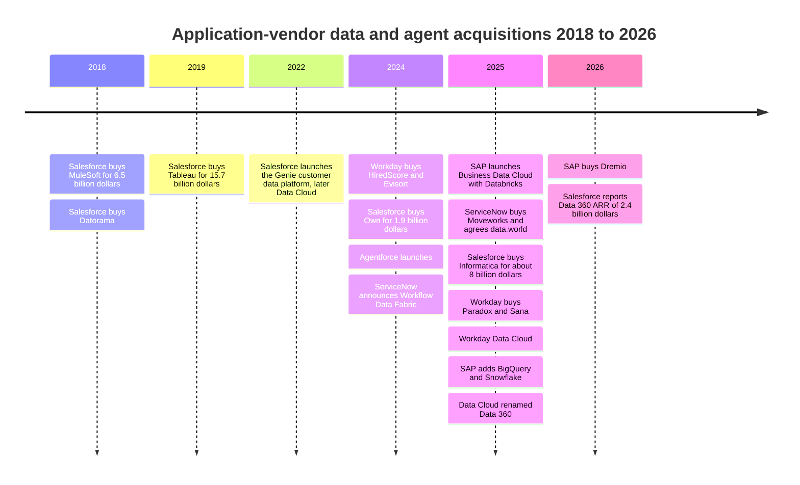
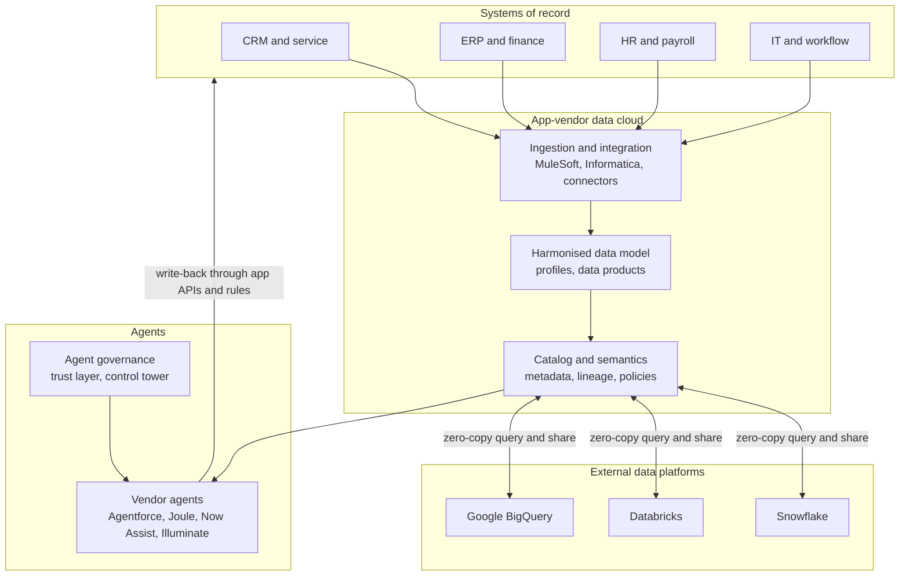
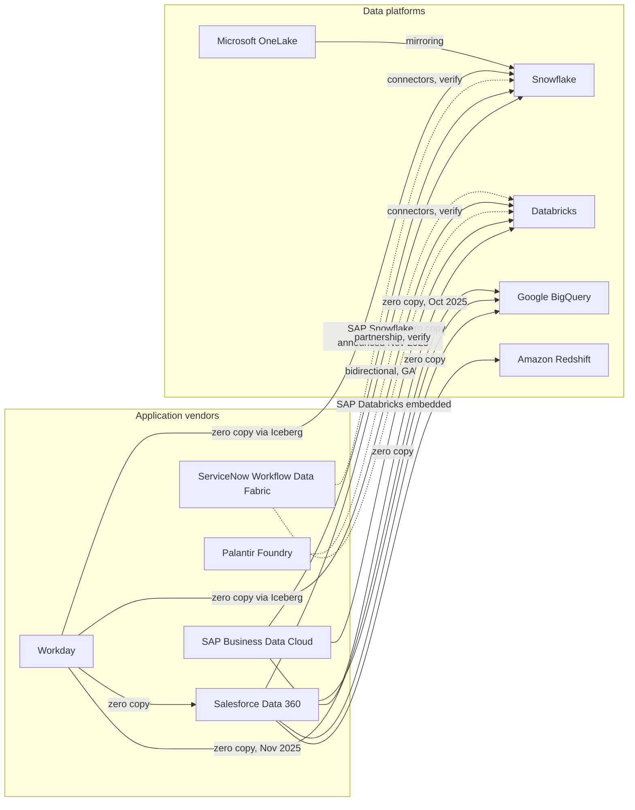
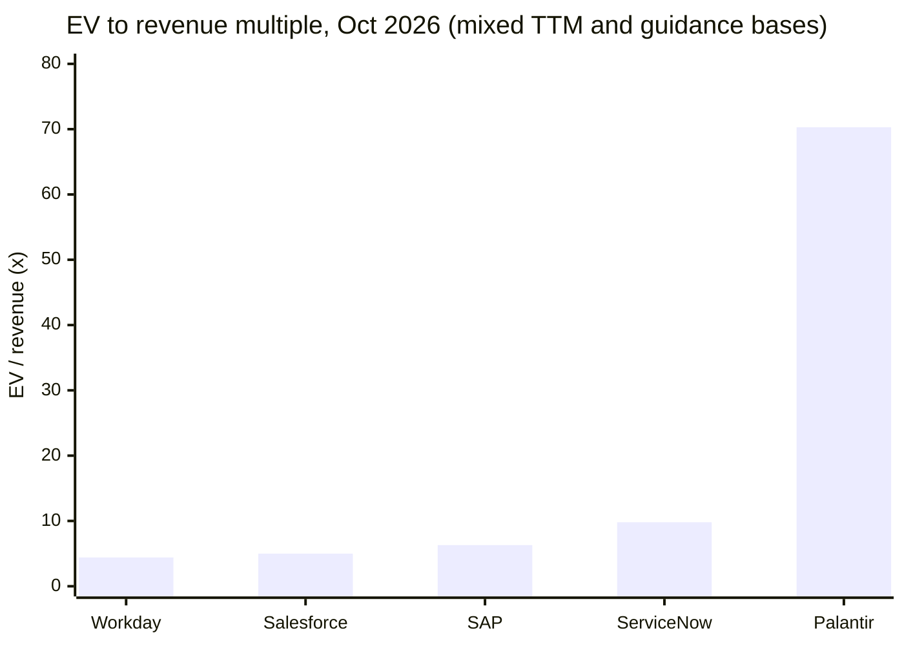
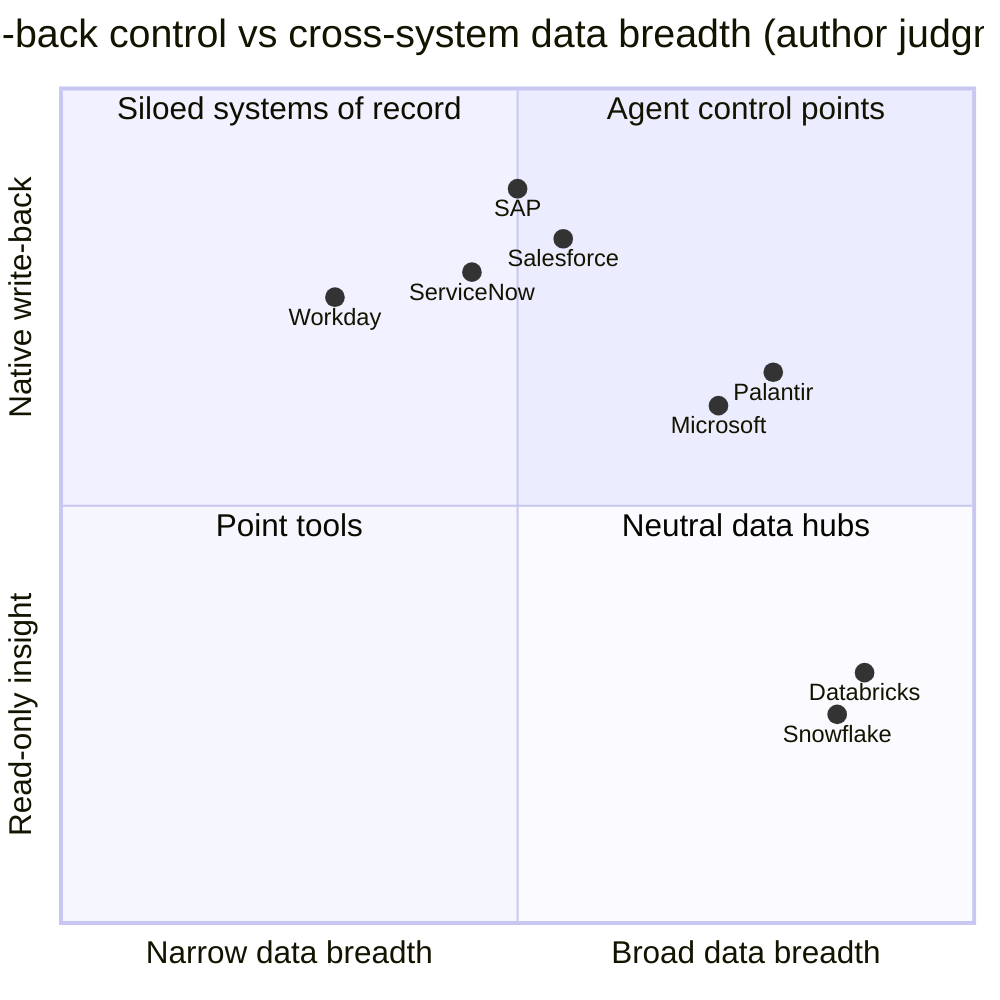

# 34. Data Platforms of the Application Giants
> **Status:** public: CRM, NOW, SAP, WDAY, PLTR · **HQ:** San Francisco (Salesforce), Santa Clara (ServiceNow), Walldorf (SAP), Pleasanton (Workday), Denver (Palantir) · **Founded:** 1999, 2004, 1972, 2005, 2003 · **Latest valuation/market cap:** $188.6B / $142.4B / $273.8B / $46.0B / $442.4B market cap (stockanalysis.com, dated 2026-10-01 to 2026-10-30; see Snapshot table) · **Last verified:** 2026-11-01

> **Research note.** The web-search budget for this session was exhausted before live verification began. Figures below come from the Atlas datasets (`data/*.csv`, verified 2026-10), `meta/research-briefing.md` and the integrator's live-verified register (`meta/verified-facts.md`, 2026-11-01), which the independent review applied to the Salesforce, SAP, Workday and ServiceNow sections. Product facts dated after mid-2025 that could still not be re-checked are marked `[VERIFY]`.

## TL;DR

- **The thesis.** Agents need two things a warehouse cannot give them alone: context that spans systems, and permission to *write back* into the system of record. The application vendors hold the write path and the business semantics (what an "opportunity", "incident" or "cost center" means). Each one is now building a data layer so that its own agents, not Databricks' or Snowflake's, become the "system of intelligence".
- **The defence.** Seat-based pricing is exposed if agents do the work humans used to do. The market has de-rated the seat model: Salesforce's market cap fell about 21% and Workday's about 27% year over year, while Palantir, an ontology-and-agents vendor, trades near **70x** trailing revenue.[^comps-crm][^comps-wday][^comps-pltr] Owning the data layer lets vendors re-price around consumption and agent actions.
- **The deals.** Salesforce paid ~$8B for Informatica (closed November 2025), on top of MuleSoft ($6.5B), Tableau ($15.7B) and Own ($1.9B). ServiceNow bought Moveworks ($2.85B, closed December 2025) and agreed to buy data.world (May 2025; no closing date found). SAP bought Dremio (2026, undisclosed).[^ma-csv][^dremio][^now-ir]
- **Zero-copy is a truce, not a merger.** App vendors and data platforms now expose tables to each other in place instead of exporting them. Salesforce runs bidirectional sharing with Snowflake, Databricks, BigQuery and Redshift. SAP embeds Databricks inside Business Data Cloud and in late 2025 added BigQuery and Snowflake. Workday launched a Data Cloud with zero-copy links to Databricks, Salesforce, Snowflake and BigQuery. Each side still wants to be the place where the agent runs.[^zcpn][^sf-snow][^sap-snow][^wday-dc]
- **Everpure angle.** These data clouds run almost entirely on hyperscalers. The on-prem openings are narrower but real: SAP now owns Dremio, an existing FlashBlade partner; sovereign deployments (SAP, Palantir, Oracle) need local infrastructure; and copies of SaaS data still need discovery and protection.[^briefing-a]

## Snapshot table

| Company | Fiscal year | Market cap / EV | Revenue basis used | EV/revenue | Growth (basis) | Data and agent products |
|---|---|---|---|---|---|---|
| Salesforce (CRM) | Ends Jan 31 (FY2027 = Feb 2026–Jan 2027) | $188.6B / $219.6B | $43.94B TTM | 5.0x TTM | 11.2% TTM (GAAP) | Data 360 (formerly Data Cloud), Agentforce, Informatica, MuleSoft, Tableau |
| ServiceNow (NOW) | Calendar | $142.4B / $144.2B | $14.73B TTM | 9.8x TTM | 24.0% Q2 2026 (GAAP) | Workflow Data Fabric, RaptorDB Pro, data.world (agreed), Moveworks, AI Control Tower |
| SAP (SAP) | Calendar | $273.8B / $273.9B | ~$43.3B TTM (from €38.19B) | 6.3x TTM | Total +13%; cloud +26% Q3 2026 (IFRS) | Business Data Cloud, Datasphere, SAP Databricks, SAP Snowflake, Dremio, Joule |
| Workday (WDAY) | Ends Jan 31 (FY2027 = Feb 2026–Jan 2027) | $46.0B / $46.4B | $10.655B FY2027 guide midpoint | 4.4x NTM proxy | Subscription +13.9% Q2 FY2027 (GAAP) | Prism Analytics, Workday Data Cloud, Illuminate agents |
| Palantir (PLTR) | Calendar | $442.4B / $433.2B | $6.16B TTM | 70.3x TTM | 79% TTM (GAAP); GM 84.8% | Foundry, Ontology, AIP |

*Figure 34.1 — Snapshot. Market data from stockanalysis.com on the dates in `data/public_comps.csv` (CRM, PLTR 2026-10-30; SAP 2026-10-30; WDAY 2026-10-16; NOW 2026-10-01). Revenue bases differ (TTM vs guidance), so multiples are indicative only.[^comps-crm][^comps-now][^comps-sap][^comps-wday][^comps-pltr]*

## Origin story and strategic arc

### Why application vendors want the data layer

For twenty years the division of labour was stable. Applications such as CRM, IT service management (ITSM), ERP and HR captured transactions. Data teams copied those records into a warehouse to analyse them. Insight then flowed back by hand or through [reverse ETL](../glossary.md#reverse-etl). Agents break that arrangement in four ways.

1. **Agents need cross-system context.** A service agent resolving a billing dispute needs the CRM case, the ERP invoice, the contract PDF and the product-usage log. Whoever assembles that context first gets to host the agent.
2. **Agents need write-back.** Answering is not enough. The agent must issue the credit, close the ticket or change the purchase order, and those writes must obey the application's business rules and approval chains. Only the system of record can enforce those rules natively. A warehouse can read a copy of the order table, but it cannot safely change an order.
3. **The semantics live in the application.** In SAP, a "material", a "company code" and a document flow mean precise things encoded in thousands of tables. Once those records are flattened into a warehouse, much of that meaning is lost. Application vendors argue that their own metadata is the best [semantic layer](../glossary.md#semantic-layer) for agents, an argument covered in [Ch 14](../02-pipelines-and-governance/ch14-semantic-layers-and-bi.md).
4. **Seats are at risk.** If an agent handles 40% of service cases, the customer needs fewer human licences. Vendors that charge per seat must move to pricing per agent action or per unit of consumption before the seat count shrinks. Owning the data layer gives them new meters (data processed, records unified, agent actions) to replace the old one.

There is a defensive motive too. Databricks and Snowflake both pitch themselves as the enterprise "system of intelligence", where agents read governed data and act through APIs ([Ch 25](ch25-databricks.md), [Ch 26](ch26-snowflake.md)). If that model wins, CRM and ERP become thin transactional back ends, valued like utilities. The application vendors' answer is to run the agents themselves and make the data platforms a peer they share data with.

> **Bridge: vertical integration in silicon.** Apple moved the Mac from Intel to its own M-series chips because the layer underneath determined battery life, performance per watt and the developer experience. Application vendors building data clouds are making the same bet: whoever controls the layer beneath the agent controls the experience and the margin. The analogy carries a warning. Apple still buys wafers from TSMC. Salesforce, SAP and Workday still rent compute and storage from AWS, Azure and Google. They are integrating the design layer (semantics, metadata, agents), not the fab.

### The arc, 2018–2026

The move happened in three waves. From 2018 to 2019 the vendors bought integration and BI: MuleSoft, Datorama and Tableau. From 2022 to 2025 they built data clouds on top: Salesforce's customer data platform became Data Cloud (renamed Data 360 in October 2025), ServiceNow launched Workflow Data Fabric (October 2024), SAP launched Datasphere and then Business Data Cloud (February 2025), and Workday launched Workday Data Cloud (September 2025). In 2025 and 2026 they bought data management and agent front ends outright: Informatica, Moveworks, data.world and Dremio.

*Figure 34.2 — The acquisition sequence moved down the stack, from BI and integration (2018–19) to catalogs, master data and agent front ends (2024–26). Values from `data/ma_deals.csv`; the 2025 Workday Data Cloud, SAP partner and Data 360 items are from `meta/verified-facts.md`; the Paradox and Sana deals remain marked [VERIFY] in the text below.[^ma-csv][^wday-dc][^sap-snow]*

## Product and technology

### The common architecture

Every vendor in this chapter is converging on the same four-layer design. The systems of record keep the transactions. A vendor-run data cloud holds harmonised copies or metadata, a catalog and the business semantics. Zero-copy links let external data platforms read those tables, and let the data cloud read the platforms' tables, without bulk export. Agents sit on top, reading through the data cloud and writing back through the application's own APIs and rules.

*Figure 34.3 — The app-vendor data layer. The decisive arrow is the last one: write-back through the application's business logic is what the data platforms cannot replicate.*

### Salesforce

Salesforce's data layer began as a customer data platform for marketing. It was relaunched at Dreamforce 2022 as "Genie" and then renamed **Data Cloud**.[^sf-dc-hist] It ingests CRM objects and external data into a lakehouse-style store, resolves identities into unified profiles, and exposes them to Agentforce, Tableau and the CRM apps. At Dreamforce in October 2025 (around 14 October) Salesforce renamed it **Data 360**, under an "Agentforce 360" umbrella.[^sf-d360]

Two features matter most. First, the **Zero Copy Partner Network** (April 2024) lets Data 360 (then Data Cloud) query Snowflake, Databricks, BigQuery and Redshift tables in place and expose its own objects back to them.[^zcpn] Snowflake describes the Snowflake link as bidirectional and generally available.[^sf-snow] Second, **Informatica** (closed 2025-11-18, ~$8B equity value) brings an enterprise catalog, master data management (MDM), data quality and integration across non-Salesforce systems.[^infa] With MuleSoft, Salesforce now owns two of the three largest enterprise integration franchises ([Ch 10](../02-pipelines-and-governance/ch10-ingestion-and-integration.md)). **Agentforce**, launched in September 2024, is the agent layer. It reasons over Data 360 context and acts through CRM flows and APIs, with a "trust layer" that masks data and logs prompts.[^af-launch]

The company-stated scale marker was **"Data Cloud and AI" annual recurring revenue (ARR)** of about **$900M, up ~120%**, at the end of FY2025 (Feb 2024–Jan 2025).[^sf-q4fy25] By **Q2 FY2027** (May–Jul 2026; reported 2026-08-26) Salesforce reported **Agentforce + Data 360 ARR of about $3.9B (up more than 210%)**, made up of Agentforce ARR above $1.5B (+>240%) and **Data 360 ARR of $2.4B (+>200%), which includes $1.1B of Informatica Cloud ARR**. It also reported 3.2B "Agentic Work Units" in the quarter (+97% quarter on quarter). Total Q2 revenue was $11.345B (+11%, GAAP), and the FY2027 revenue guide is $46.10–46.40B.[^crm-q2fy27] Three cautions apply. All ARR figures are company-stated, not GAAP revenue. Excluding Informatica, Data 360 ARR is about $1.3B (our arithmetic), so much of the triple-digit growth is acquired. And in Q2 the Agentforce ARR definition was broadened to include Slackbot and "Headless 360", so the growth rate is not like-for-like. Salesforce also co-led the Open Semantic Interchange (OSI) with Snowflake in September 2025, which signals that it would rather share semantics than fight over them.[^osi]

### ServiceNow

ServiceNow introduced **Workflow Data Fabric** on 2024-10-23. It runs on **RaptorDB Pro**, ServiceNow's high-performance database (Postgres-derived, which ServiceNow markets as faster for its platform), and adds zero-copy connectors to external platforms and a catalog. In May 2025 (Knowledge 2025) ServiceNow launched a "Workflow Data Network" of more than 100 data partners.[^now-ir][^now-wdf] The **data.world** agreement (announced May 2025, terms undisclosed) adds a knowledge-graph catalog; it is a separate asset from RaptorDB Pro. We found no explicit closing date, though later trade coverage calls it a recent acquisition.[^dataworld][^now-ir] **Moveworks** ($2.85B, closed 2025-12-15 after a US Department of Justice second request) added an enterprise-search and agent front door used by employees across IT, HR and finance.[^moveworks] **AI Control Tower**, introduced at Knowledge 2025, governs ServiceNow and third-party agents from one console [VERIFY: product status].[^now-act]

ServiceNow's angle is workflow. Its records are tickets, approvals and change requests, the steps an agent must follow to act. GAAP revenue was $3.99B in Q2 2026, up 24%, and part of that growth may come from acquisitions.[^now-fin]

### SAP

SAP announced **Business Data Cloud (BDC)** in February 2025 with Databricks as a partner.[^sap-bdc] BDC packages SAP application data as curated "data products" with SAP semantics intact. It folds in **Datasphere** (SAP's earlier data-warehouse service) and SAP Analytics Cloud. It also embeds **SAP Databricks**, a Databricks environment sold by SAP, with zero-copy sharing over Delta Sharing between the two. SAP then added Google BigQuery (October 2025) and, on 2025-11-04 at TechEd, Snowflake as a BDC solution extension: **SAP Snowflake** (an SAP-managed Snowflake inside BDC, GA planned Q1 2026) and **SAP BDC Connect for Snowflake** (zero-copy sharing, planned H1 2026). Snowflake was the third such deal after SAP Databricks and BigQuery [VERIFY: 2026 ship status of SAP Snowflake and BDC Connect].[^sap-snow] **Joule**, SAP's assistant, now hosts agents that act inside S/4HANA and SuccessFactors.

The **Dremio** acquisition (announced 2026-05-04 alongside Prior Labs, closed about July 2026, terms undisclosed) adds an Iceberg-native lakehouse engine and catalog. SAP says it will unify SAP and non-SAP data for agentic AI.[^dremio] For Everpure this is the most relevant deal in the chapter, because Dremio already had a joint hybrid-lakehouse solution with FlashBlade ([Ch 7](../01-data-systems-foundations/ch07-open-table-formats.md)).[^briefing-a] SAP reported Q3 2026 IFRS revenue of €10.27B and cloud revenue growth of 26%, with current cloud backlog of €24.14B (+28%).[^sap-q3]

### Workday

Workday's data history runs through **Platfora** (2016), which became **Prism Analytics**, a tool for blending external data with HR and finance records.[^ma-csv] In 2025 it repositioned around agents. It announced an **"Agent System of Record"** to register and govern its own and third-party agents, and agreed to buy **Paradox** (conversational recruiting) and **Sana** (AI search and learning, ~$1.1B press-reported) [VERIFY: dates and values].[^wday-agents] It had earlier bought HiredScore (February 2024) and Evisort (September 2024). At Workday Rising on 2025-09-16 it announced **Workday Data Cloud**, with zero-copy partners Databricks, Salesforce and Snowflake; Google BigQuery was added on 2025-11-19. Data Connect shares data both ways via Apache Iceberg, and Prism Analytics accepts inbound zero-copy queries. Snowflake describes the link as externally managed Iceberg tables that point to Parquet files held in Workday Data Cloud.[^wday-dc] [VERIFY: GA status by partner] Q2 FY2027 (May–Jul 2026) GAAP revenue was $2.649B, with subscription revenue up 13.9%.[^wday-q2]

### Palantir

Palantir is the outlier: an application-and-agents company with no legacy system of record of its own. Its **Ontology** maps data from other systems into business objects (a "plant", a "shipment", a "claim") with properties, relationships and *actions*, meaning governed functions that write back to source systems. **AIP** (Artificial Intelligence Platform, 2023) lets language models operate on those objects and actions.[^pltr-aip] In effect Palantir builds the semantic and write-back layers described above on top of other vendors' records. That is why the market values it at about 70x trailing revenue while the incumbents trade at 4–10x.[^comps-pltr] Palantir announced a partnership with Databricks in March 2025 [VERIFY: scope and commercial terms]. [Ch 31](ch31-analytical-engine-challengers-legacy.md) covers the Ontology in depth.

### Microsoft Dynamics and Oracle Fusion (brief)

**Microsoft** has the simplest path because it owns the data platform too. Dynamics 365 and Power Platform data in Dataverse can be linked into **Fabric**'s OneLake, which mirrors Snowflake, Azure SQL and Cosmos DB as Delta tables. Fabric IQ, a semantic layer, entered preview in November 2025.[^fabric-mirror][^ignite] **Oracle** offers Fusion Data Intelligence (prebuilt analytics over Fusion ERP and HCM) and AI Agent Studio for Fusion applications [VERIFY: current names]. It also offers its Autonomous AI Lakehouse (GA October 2025) and database services inside Azure, Google Cloud and AWS.[^oracle-aiw] Both can bundle the application, the data platform and the infrastructure, which none of the pure application vendors can.

| Vendor | Data product | Catalog / semantics | Zero-copy partners | Agent product | Pricing model (agents) | Key data acquisitions | Metric (labelled) |
|---|---|---|---|---|---|---|---|
| Salesforce | Data 360 (formerly Data Cloud) | Informatica catalog and MDM; Tableau Semantics | Snowflake, Databricks, BigQuery, Redshift | Agentforce | Per conversation, then per action (Flex Credits) | MuleSoft, Tableau, Own, Informatica | Data 360 ARR $2.4B incl. $1.1B Informatica Cloud, Q2 FY2027 (company-stated) |
| ServiceNow | Workflow Data Fabric, RaptorDB Pro | data.world knowledge graph (agreed); CMDB | Databricks, Snowflake, BigQuery; Workflow Data Network of 100+ partners [VERIFY: per-partner zero-copy status] | Now Assist agents, Moveworks, AI Control Tower | Pro Plus premium SKUs plus assist packs [VERIFY] | Moveworks, data.world | Q2 2026 revenue $3.99B, +24% (GAAP) |
| SAP | Business Data Cloud, Datasphere | SAP data products; Dremio catalog | Databricks (embedded), BigQuery (Oct 2025), Snowflake (Nov 2025; ship status [VERIFY]) | Joule agents | Capacity units and AI units [VERIFY] | Sybase (2010), Dremio | Cloud revenue +26%, Q3 2026 (IFRS) |
| Workday | Prism Analytics, Workday Data Cloud | Workday business objects | Databricks, Snowflake, Salesforce (Sep 2025); BigQuery (Nov 2025) | Illuminate agents, Agent System of Record | Subscription plus agent add-ons [VERIFY] | Platfora, Evisort, Paradox, Sana | Subscription revenue +13.9%, Q2 FY2027 (GAAP) |
| Palantir | Foundry | Ontology (objects plus actions) | Databricks [VERIFY], Snowflake [VERIFY] | AIP | Large enterprise and government contracts | None material | TTM revenue $6.16B, +79% (GAAP) |
| Microsoft | Fabric, OneLake, Dataverse | Purview; Fabric IQ (preview) | Mirrors Snowflake and others into OneLake | Copilot, Copilot Studio agents | Capacity units plus per-message agent meters [VERIFY] | Citus Data (database, 2019) | Fabric 19,000+ paying customers, 2025 (company-stated) |
| Oracle | Fusion Data Intelligence, Autonomous AI Lakehouse | Oracle semantic models [VERIFY] | Database@Azure, @Google Cloud, @AWS | AI Agent Studio [VERIFY] | Included with Fusion subscriptions [VERIFY] | BlueKai, Datalogix (both exited) | OCI revenue +121%, Q1 FY2027 (GAAP, press-reported) |

*Figure 34.4 — Seven vendors, one architecture. The differences lie in where the semantics come from (own records, acquired catalogs, or an ontology over others' records) and who owns the infrastructure underneath.[^comps-now][^comps-sap][^comps-wday][^comps-pltr][^fabric-cust][^comps-orcl]*

### The zero-copy alliance graph

"Zero-copy" in this context usually means **federated query plus metadata sharing**. One platform gets credentials and a schema for the other's tables and reads them in place, sometimes caching results. Bulk data stays put, so there is no nightly export to reconcile. It is not free: queries still cross networks, the source platform still bills compute, and latency rises.

*Figure 34.5 — Who shares data with whom. Solid lines are confirmed in Atlas sources (SAP–Snowflake is announced, with 2026 ship status unconfirmed); dashed lines were reported in 2025–26 coverage but not re-verified here. Databricks and Snowflake sit at the centre: every application vendor connects to both rather than pick a side.[^zcpn][^sf-snow][^sap-bdc][^sap-snow][^wday-dc][^fabric-mirror]*

> **Bridge: shared virtual memory.** Zero-copy sharing is the data-centre equivalent of shared virtual memory between a CPU and a GPU (CUDA unified memory, OpenCL SVM). Both devices address one virtual space, so the program passes a pointer instead of setting up a DMA copy. The IOMMU checks every access against page permissions, and the catalog's access policies play that role here. As with unified memory, the copy does not disappear. It becomes implicit: pages migrate on demand and hot data gets cached on the accessing side. Performance depends on access patterns, and the bandwidth bill (here, cloud egress and query compute) still arrives. Zero-copy removes the reconciliation problem, not the physics.

## How it makes money

The pricing shift runs from **seats** to **agent actions** and **data consumption**. Each vendor still sells seats, but adds new meters.

| Vendor | Old unit | New units (company-stated where shown) | Notes |
|---|---|---|---|
| Salesforce | Per user per month by edition | Agentforce at $2 per conversation (2024 list); Flex Credits at $0.10 per action, sold as $500 per 100,000 credits (2025); Data Cloud credits for ingestion and processing | Per-action pricing ties revenue to agent work, not headcount[^af-price] |
| ServiceNow | Per fulfiller seat, by tier | Pro Plus and Enterprise Plus tiers bundle Now Assist at a premium; assist-pack consumption | Premium-tier upsell rather than pure metering [VERIFY][^now-proplus] |
| SAP | Named users and full-use equivalents (FUE) | BDC capacity units; AI units for Joule [VERIFY] | RISE with SAP subscription is the main cloud contract |
| Workday | Per employee per year (HCM) | AI and agent add-ons; Flex Credits reported [VERIFY] | Employee-count pricing is less directly exposed to agents than service seats |
| Palantir | Enterprise and government contracts | Usage-based Foundry/AIP compute in some commercial deals | No seat base to defend |

*Figure 34.6 — Pricing units. The vendors are adding meters that grow with agent activity so revenue does not shrink with human headcount.*

**Worked example (illustrative, estimate).** A contact centre handles 1M conversations a year with 100 human agents. Assume seats cost $150 per user per month, or $180K a year. If AI agents resolve 40% of conversations (400,000) at an average of three actions each, Flex Credit pricing at $0.10 per action yields $120K. The old $2-per-conversation price would have yielded $800K. Meanwhile the customer may cut 30 seats, saving $54K. Two lessons follow. Agent pricing can more than replace lost seat revenue, but the price per unit of work is falling fast, from $2 per conversation to roughly $0.30 for the same conversation within a year. Buyers will push the price toward the underlying model and compute cost.

> **Bridge: finance.** Seat pricing is an annuity indexed to the customer's headcount. Agent pricing is a toll on transaction volume. The swap reduces exposure to headcount cuts but adds volatility, the same consumption-revenue profile that makes Snowflake's quarters harder to forecast ([Ch 35](../05-business-and-economics/ch35-business-models.md)).

## Financials

| Company | Revenue figure | Basis | Growth | EV/revenue (date) |
|---|---|---|---|---|
| Salesforce | $43.94B TTM | GAAP via stockanalysis | 11.2% TTM | 5.0x TTM (2026-10-30) |
| ServiceNow | $3.99B Q2 2026 (Apr–Jun); $14.73B TTM | GAAP | 24.0% Q2 | 9.8x TTM (2026-10-01) |
| SAP | €10.27B Q3 2026 (Jul–Sep); €38.19B TTM | IFRS | Cloud +26%; total ~13% | 6.3x TTM (2026-10-30) |
| Workday | $2.649B Q2 FY2027 (May–Jul 2026); FY2027 guide $10.65–10.66B | GAAP; company guidance | Subscription +13.9% | 4.4x NTM proxy (2026-10-16) |
| Palantir | $4.48B FY2025; $6.16B TTM | GAAP | 79% TTM | 70.3x TTM (2026-10-30) |

*Figure 34.7 — Financial snapshot from `data/public_comps.csv` and `data/company_financials.csv`. SAP FY2026 guidance covers cloud and software only (€36.3–36.8B at constant currency).[^comps-crm][^now-fin][^sap-q3][^wday-q2][^pltr-fin]*

*Figure 34.8 — The market prices the ontology-and-agents vendor at 7–16 times the multiple of the systems-of-record vendors. Source: `data/public_comps.csv`.*

The striking fact is relative scale. The four system-of-record vendors have a combined market cap of about $651B on about $113B of revenue (mixed TTM and guidance bases). Palantir alone is worth $442B on $6.16B.[^comps-pltr] By our arithmetic, investors value Palantir at about two-thirds of the four combined with about 5.5% of their revenue. A bull reads that as proof the semantic-and-agent layer is where value is moving, and that the incumbents' data clouds are a rational response. A bear reads it as a Palantir-specific premium (growth of 79%, an 84.8% GAAP gross margin, government demand) that the incumbents cannot claim by rebranding.

No vendor reports data-cloud revenue under GAAP. Salesforce's Data 360 and Agentforce ARR figures ($2.4B and >$1.5B in Q2 FY2027) are company-stated metrics with their own, recently broadened definitions, and Data 360 includes $1.1B of acquired Informatica Cloud ARR.[^crm-q2fy27] ServiceNow's Now Assist annual contract value (ACV) targets are company-stated [VERIFY: latest Now Assist ACV].[^sf-q4fy25]

## Customers and go-to-market

The go-to-market advantage is the installed base. Every Salesforce, SAP and ServiceNow customer already has a contract, an admin team and a systems integrator. The data cloud is sold as an add-on to the CRM, ERP or ITSM renewal, often with credits bundled in. That is cheaper to sell than a new data platform, and it reaches the line-of-business buyer (head of service, CFO, CHRO) rather than the chief data officer.

The weakness is the mirror image. Chief data officers have spent a decade consolidating onto Snowflake or Databricks and resist a second data platform per application. The vendors therefore sell zero-copy as a reassurance: keep the lakehouse, and let the application's data cloud federate with it. SAP's approach goes furthest by selling Databricks itself inside BDC. Systems integrators such as Accenture and Deloitte run practices for both sides, which makes them kingmakers in deciding where an enterprise's agents live.

## M&A and investments

| Date | Acquirer | Target | Value | Rationale | Outcome |
|---|---|---|---|---|---|
| 2016-07 | Workday | Platfora | n/d | Analytics on HR and finance data | Became Prism Analytics[^ma-csv] |
| 2018-03 | Salesforce | MuleSoft | $6.5B (disclosed) | API-led integration | Integration Cloud; feeds Data Cloud[^ma-csv] |
| 2018-07 | Salesforce | Datorama | ~$800M (press-reported) | Marketing data integration | Marketing Cloud Intelligence[^ma-csv] |
| 2019-06 | Salesforce | Tableau | $15.7B (disclosed, all-stock) | BI and analytics | Tableau Next on Data Cloud[^ma-csv][^tableau-next] |
| 2024-09 | Salesforce | Own Company | $1.9B (disclosed, cash) | SaaS backup, recovery, archiving | Salesforce Backup offering[^ma-csv] |
| 2025-03 | ServiceNow | Moveworks | $2.85B (disclosed) | Agent and enterprise-search front door | Closed 2025-12-15[^moveworks] |
| 2025-05 | ServiceNow | data.world | n/d | Knowledge-graph catalog | Agreed; explicit closing date not found[^dataworld] |
| 2025-05 | Salesforce | Informatica | ~$8B (disclosed, $25/share) | Catalog, MDM, quality, integration | Closed 2025-11-18[^infa] |
| 2025 | Workday | Paradox; Sana | Sana ~$1.1B (press-reported) [VERIFY] | Recruiting agents; AI search and learning | [VERIFY: closing][^wday-agents] |
| 2026-05 | SAP | Dremio (with Prior Labs) | n/d | Iceberg lakehouse engine and catalog | Closed ~July 2026; into BDC[^dremio] |

*Figure 34.9 — Deal table. Salesforce has spent more than $32B on data-layer assets since 2018 (our sum of disclosed values: MuleSoft, Tableau, Own, Informatica, plus Datorama as reported).[^ma-csv]*

The pattern is clear. Salesforce has bought its way into every layer from integration to BI to catalog and MDM. Its integration record is mixed: Tableau kept its brand but lost market momentum, while MuleSoft became connective tissue for Data 360. ServiceNow has bought smaller pieces and leaned on its single-platform engineering culture. SAP prefers partnerships (Databricks, BigQuery and, since November 2025, Snowflake) and bought Dremio for an open engine it could control. The vendors' venture arms also hedge: Salesforce Ventures has backed Snowflake, Databricks and Supabase, and ServiceNow and Workday invested in Sigma Computing.[^funding]

## Competitive position

| Dimension | App giants (Salesforce, SAP, ServiceNow, Workday) | Databricks / Snowflake | Hyperscalers (Microsoft, Google, AWS) | Palantir |
|---|---|---|---|---|
| Owns write path | Yes, natively | No; via APIs and reverse ETL | Microsoft yes (Dynamics); others no | Via ontology actions over others' systems |
| Business semantics | Deep but siloed per application | Generic; semantic views and metric views | Fabric IQ, Looker (generic) | Customer-built ontology |
| Cross-system breadth | Weak outside own apps; buying it (Informatica, Dremio) | Strong; neutral hub | Strong within own cloud | Strong; integration-heavy deployments |
| Data scale and cost | Modest; often federates out | Best price-performance at scale | Owns infrastructure margin | Moderate |
| Agent distribution | Embedded in daily workflows | Developer and analyst tools | Copilot in Office and Teams | Executive and operations users |
| Infrastructure | Hyperscalers (SAP, ServiceNow also own data centres) | Hyperscalers | Own | Any cloud, on-prem, classified |

*Figure 34.10 — Competitive matrix (author judgment from public positioning). Each camp holds one asset the others lack. The app giants hold the write path, the platforms hold scale and neutrality, the hyperscalers hold infrastructure, and Palantir holds the cross-system ontology.*

*Figure 34.11 — Positioning (author judgment, not measured data). The app vendors are moving right by acquiring breadth; the data platforms are moving up through operational databases and agent APIs. Palantir already sits near the target corner.*

## Why it's winning / bull case

1. **Write-back is a durable moat.** An agent that changes an order or a payroll record must respect approvals, audit trails and regulations that live in the application. That logic is hard to copy into a warehouse.
2. **Distribution is already paid for.** Agents embedded in screens that millions of users open every day reach adoption faster than a new platform.
3. **The acquisitions fill the gaps.** Informatica gives Salesforce cross-system MDM, and Dremio gives SAP an open Iceberg engine. Each closes the "you only see your own data" objection.
4. **Zero-copy lowers the switching argument.** Customers need not choose between the lakehouse and the application's data cloud, which reduces sales friction.
5. **Pricing can expand.** If agent meters replace seats at a higher total, as in the worked example, revenue per customer rises even as headcount falls.

## Risks / bear case and open questions

1. **The neutral hub may win.** Most enterprises have dozens of applications. An agent that needs data from all of them may live with the neutral platform, not inside one application vendor.
2. **Seat erosion may outrun agent revenue.** Unit prices fell from $2 per conversation to $0.10 per action within a year. If AI cuts seats faster than agent volume grows, revenue shrinks.
3. **Integration risk on large deals, and flattering metrics.** Informatica is Salesforce's largest data deal since Tableau. Tableau's post-deal record, and the market cap decline, temper confidence. The headline Data 360 growth (+>200%) is mostly the acquisition: about $1.1B of the $2.4B is Informatica Cloud ARR, and Agentforce ARR was redefined in Q2 FY2027. Investors cannot yet see organic data-cloud growth on a like-for-like basis.[^comps-crm][^crm-q2fy27]
4. **Margins on consumption.** Data clouds running on hyperscalers carry infrastructure cost in COGS, which dilutes gross margin the way serverless does at Databricks ([Ch 25](ch25-databricks.md)).
5. **Open questions.** What is organic Data 360 ARR growth once Informatica laps (from Q3 FY2027, November 2026 onward)? Has ServiceNow formally closed data.world? Did SAP Snowflake reach GA on schedule? What does SAP do with Dremio's open-source engine and its partner channel, including storage partners? Will Workday's data sharing stay bidirectional?

## Relevance to Everpure

> **Storage bridge.** App-vendor data clouds are multi-tenant SaaS services on hyperscaler object storage. The storage decision belongs to the vendor, not the customer. Storage leverage therefore appears only where data leaves the SaaS boundary: Iceberg/Delta tables shared out, backups, sovereign or on-prem deployments, and local copies for AI pipelines. See the companion *Everpure Tech Atlas* for object-storage and data-protection detail.

Most of this market runs on public cloud. Salesforce runs on Hyperforce (public cloud), Workday on hyperscaler infrastructure and SAP's BDC on hyperscalers [VERIFY: Workday and BDC infrastructure]. The exceptions are where Everpure-type infrastructure can matter: SAP's sovereign-cloud offerings (including Delos Cloud in Germany), ServiceNow's own data centres and self-hosted options, Palantir's on-prem and classified deployments, and Oracle's Cloud@Customer and dedicated regions [VERIFY: SAP sovereign-cloud scope 2026].

**Options a strategy team might evaluate, based on public information:**

| Option | What it would mean | Why it could matter | Watch-outs |
|---|---|---|---|
| Deepen the Dremio relationship under SAP | Keep the FlashBlade plus Dremio hybrid-Iceberg design current as Dremio joins BDC | SAP customers wanting SAP data products next to on-prem data gain a supported pattern[^briefing-a] | SAP may steer Dremio toward BDC in the cloud and narrow third-party channels |
| Target sovereign deployments | Position as infrastructure for sovereign SAP, Palantir and Oracle footprints | Sovereignty rules favour local, customer-controlled storage | Provider-led procurement; long cycles |
| Land shared-out tables on-prem | Be the S3-compatible home for Iceberg/Delta tables that zero-copy links read | Mirrors the Databricks OpenSharing play (Everpure is a launch partner)[^dbx-storage] | App vendors' zero-copy partners today are cloud platforms, not storage |
| Discover and classify SaaS-derived copies | Extend Data Intelligence (1touch) connectors to the copies of Salesforce, SAP and Workday data | Copies spread with reverse ETL and federation; classification is the governance gap[^briefing-a] | Informatica (Salesforce) and data.world (ServiceNow) now sell similar catalogs |
| SaaS data resilience | Partner on backups of SaaS data held outside the SaaS vendor | Salesforce's Own deal shows the value of SaaS data protection[^ma-csv] | Salesforce now competes directly in Salesforce backup |

*Figure 34.12 — Options (public information only). The main threat is indirect: if agents and their data live inside SaaS clouds, less enterprise data lands on customer-owned infrastructure.*

See [Ch 45](../06-history-and-future/ch45-storage-moving-up-the-stack.md) for storage vendors moving up the stack and [Ch 22](../03-ai-data-stack/ch22-agents-and-data.md) for why agents raise the value of write-back.

## Conversation playbook

**Questions for the vendors' product leaders**

1. "When an Agentforce or Joule agent needs data held in Databricks, does it query in place, cache it, or copy it, and who pays for that compute?" *Good:* a precise answer on federation versus caching, with latency and billing named.
2. "What share of agent actions write back to a system of record, as opposed to answering questions?" *Good:* a measured ratio, and an explanation of how approvals and audit apply.
3. "How do customers trade seat licences for agent consumption at renewal?" *Good:* real contract mechanics (credit pools, conversion rates), not a slogan.

**Questions for engineers and partners**

1. "Is zero-copy exposed through an open protocol (Iceberg REST, Delta Sharing, OpenSharing) or a proprietary connector?" *Good:* protocol names and where the metadata is authoritative.
2. "Where do BDC data products physically live, and can they reside on customer-managed object storage?" *Good:* a clear answer on which hyperscaler regions host them and any sovereign or on-prem options.
3. "How does the catalog reconcile application semantics with the lakehouse's own semantic layer?" *Good:* named mechanisms (OSI, metric views, ontology mappings) and an honest view of drift.

**What good answers sound like.** They separate reading from writing, name the protocol behind "zero-copy", and label metrics correctly (company-stated ARR versus GAAP revenue).

**Don't say this**

- "Zero-copy means no data moves." *Queries still move data across networks, and caches hold copies.*
- "Salesforce's Data Cloud revenue is $900M." *$900M was FY2025 "Data Cloud and AI" ARR. The latest company-stated figure is Data 360 ARR of $2.4B (Q2 FY2027), including $1.1B of Informatica; neither is GAAP revenue.*
- "SAP chose Databricks over Snowflake." *SAP embeds Databricks and added BigQuery (October 2025) and Snowflake (November 2025); it partners with all three and owns Dremio.*
- "Palantir is a database company." *It sells an ontology and applications over other systems' data.*
- "App vendors will replace the lakehouse." *They federate with it; the contest is over where agents run.*

## Key terms

- [System of record](../glossary.md#system-of-record) — the application whose data is the authoritative version of a business fact.
- [System of intelligence](../glossary.md#system-of-intelligence) — the layer that combines data across systems so analytics and agents can decide and act.
- [Write-back](../glossary.md#write-back) — an agent or tool changing data in the source application, subject to its business rules.
- [Zero-copy data sharing](../glossary.md#zero-copy-data-sharing) — granting another platform query access to data in place, without bulk duplication.
- [Data Cloud](../glossary.md#data-cloud) — Salesforce's customer-data and lakehouse layer behind Agentforce, renamed Data 360 at Dreamforce in October 2025.
- [Agentforce](../glossary.md#agentforce) — Salesforce's AI agent platform, priced per conversation and then per action.
- [Business Data Cloud](../glossary.md#business-data-cloud) — SAP's data service packaging application data as semantic data products, with Databricks embedded.
- [Workflow Data Fabric](../glossary.md#workflow-data-fabric) — ServiceNow's data layer combining RaptorDB, zero-copy connectors and a catalog.
- [Ontology](../glossary.md#ontology) — Palantir's model of business objects, relationships and actions mapped onto source data.
- [Master data management](../glossary.md#master-data-management) — maintaining one authoritative record for entities such as customers and products across systems.
- [Semantic layer](../glossary.md#semantic-layer) — shared business definitions of metrics and entities used by BI tools and agents.
- [Reverse ETL](../glossary.md#reverse-etl) — syncing modelled warehouse data back into operational applications.
- [Flex Credits](../glossary.md#flex-credits) — Salesforce's consumption currency for Agentforce actions.
- [Seat-based pricing](../glossary.md#seat-based-pricing) — charging per named user, which exposes vendors when agents replace users.

## Sources

[^comps-crm]: AI Data Atlas dataset `data/public_comps.csv`, Salesforce row (market cap $188.61B, EV $219.58B, TTM revenue $43.94B, 5.0x, 11.2% TTM growth; market cap down ~21% YoY), source https://stockanalysis.com/stocks/crm/market-cap/, as of 2026-10-30; retrieved 2026-11-01.
[^comps-now]: AI Data Atlas dataset `data/public_comps.csv`, ServiceNow row (market cap $142.4B, EV $144.2B, TTM revenue $14.73B, 9.8x), source https://stockanalysis.com/stocks/now/financials/ratios/, as of 2026-10-01; retrieved 2026-11-01.
[^comps-sap]: AI Data Atlas dataset `data/public_comps.csv`, SAP row (market cap $273.8B, EV $273.9B, TTM ~$43.3B from €38.19B at ~1.134 USD/EUR, 6.3x), source https://stockanalysis.com/stocks/sap/market-cap/, as of 2026-10-30; retrieved 2026-11-01.
[^comps-wday]: AI Data Atlas dataset `data/public_comps.csv`, Workday row (market cap $45.99B, EV $46.35B, FY2027 guide midpoint $10.655B, 4.4x; market cap down ~27% YoY), source https://stockanalysis.com/stocks/wday/market-cap/, as of 2026-10-16; retrieved 2026-11-01.
[^comps-pltr]: AI Data Atlas dataset `data/public_comps.csv`, Palantir row (market cap $442.43B, EV $433.23B, TTM revenue $6.16B, 70.3x, 79% TTM growth, 84.8% TTM GAAP gross margin), source https://stockanalysis.com/stocks/pltr/market-cap/, as of 2026-10-30; retrieved 2026-11-01.
[^comps-orcl]: AI Data Atlas dataset `data/public_comps.csv`, Oracle row (Q1 FY2027 = Jun–Aug 2026; OCI revenue +121%), sources https://stockanalysis.com/stocks/orcl/market-cap/ and https://storagenewsletter.com/2026/09/23/oracle-fiscal-1q27-financial-results, as of 2026-10-23; retrieved 2026-11-01.
[^ma-csv]: AI Data Atlas dataset `data/ma_deals.csv`, rows for Workday–Platfora (Workday blog, 2016-07-21), Salesforce–MuleSoft (Salesforce release, 2018-03-20), Salesforce–Datorama (Calcalist, 2018-07-16), Salesforce–Tableau (Cooley, 2019-06-10), Salesforce–Own (2024-09-05; training knowledge, not re-verified), ServiceNow–Moveworks, ServiceNow–data.world and Salesforce–Informatica; as of 2026-11-01.
[^infa]: Salesforce via Business Wire (FinancialContent), "Salesforce Completes Acquisition of Informatica," https://markets.financialcontent.com/clarkebroadcasting.mymotherlode/article/bizwire-2025-11-18-salesforce-completes-acquisition-of-informatica, published 2025-11-18; Bloomberg Law, "Salesforce Reaches an $8 Billion Deal to Buy Informatica," https://news.bloomberglaw.com/tech-and-telecom-law/salesforce-agrees-to-buy-informatica-in-deal-worth-8-billion, published 2025-05; retrieved 2026-11-01.
[^moveworks]: ServiceNow via Business Wire, "ServiceNow completes acquisition of Moveworks," https://www.businesswire.com/news/home/20251215128980/en/ServiceNow-completes-acquisition-of-Moveworks, published 2025-12-15; retrieved 2026-11-01.
[^dataworld]: TechCrunch, "ServiceNow acquires data.world two months after acquiring Moveworks," https://techcrunch.com/2025/05/07/servicenow-acquires-data-world-two-months-after-acquiring-moveworks, published 2025-05-07; retrieved 2026-11-01. Closing not confirmed.
[^dremio]: Dremio newsroom, "SAP to Acquire Dremio to Unify SAP and Non-SAP Data to Power Agentic AI," https://www.dremio.com/newsroom/sap-to-acquire-dremio-to-unify-sap-and-non-sap-data-to-power-agentic-ai/, published 2026-05-04; CIO.com, https://www.cio.com/article/4166881/sap-to-acquire-data-lakehouse-vendor-dremio.html, 2026-05; retrieved 2026-11-01 (via `meta/research-briefing.md`). Closing ~July 2026 per briefing.
[^briefing-a]: AI Data Atlas, `meta/research-briefing.md`, section A (Everpure Data Intelligence/1touch, FlashBlade–Dremio joint solution per https://www.dremio.com/partners/pure-storage/ and the 2024-10 solution brief), compiled 2026-11-01; retrieved 2026-11-01.
[^zcpn]: CIO.com, "Salesforce debuts Zero Copy Partner Network to ease data integration," https://www.cio.com/article/2095136/salesforce-debuts-zero-copy-partner-network-to-ease-data-integration.html, published 2024-04; retrieved 2026-11-01. Partner list at launch (Snowflake, Databricks, BigQuery, Redshift) is settled pre-2025 fact (reviewer-confirmed); later additions not re-checked.
[^sf-snow]: Snowflake blog, "Bidirectional Data Sharing Between Snowflake and Salesforce Data Cloud Is Now Generally Available," https://snowflake.com/blog/bi-directional-data-sharing-snowflake-salesforce-ga, published 2024 [VERIFY: exact date]; retrieved 2026-11-01.
[^sf-dc-hist]: Salesforce newsroom, Dreamforce 2022 announcement of the Genie customer data platform, https://www.salesforce.com/news/, published 2022-09 [VERIFY: exact URL and date]; retrieved 2026-11-01. Training knowledge, not re-fetched.
[^af-launch]: Salesforce newsroom, Agentforce general availability announcement, https://www.salesforce.com/news/, published 2024-09/10 [VERIFY: exact URL]; retrieved 2026-11-01. Training knowledge, not re-fetched.
[^af-price]: Salesforce newsroom, Agentforce pricing ($2 per conversation, 2024) and Flex Credits ($0.10 per action; $500 per 100,000 credits), https://www.salesforce.com/news/, published 2024-09 and 2025-05 [VERIFY: exact URLs and current list prices]; retrieved 2026-11-01. Company-stated list prices from training knowledge.
[^sf-q4fy25]: Salesforce, "Salesforce Announces Fourth Quarter and Fiscal 2025 Results," https://investor.salesforce.com/, published 2025-02-26 [VERIFY: exact URL]; retrieved 2026-11-01. Data Cloud and AI ARR ~$900M, ~120% YoY, company-stated; FY2025 = Feb 2024–Jan 2025. Training knowledge, not re-fetched.
[^sf-d360]: Salesforce product page and Dreamforce 2025 coverage (salesforceben.com; Tableau help) of the Data Cloud → Data 360 rename under Agentforce 360, ~2025-10-14; retrieved 2026-11-01 via `meta/verified-facts.md` #11 and `meta/research-briefing.md` integrator note.
[^crm-q2fy27]: Salesforce, Q2 FY2027 results release (investor.salesforce.com) and investor deck, https://s205.q4cdn.com/626266368/files/doc_financials/2027/q2/, published 2026-08-26; retrieved 2026-11-01 via `meta/verified-facts.md` #19. Revenue GAAP; ARR, Agentic Work Units and guidance company-stated; FY2027 = Feb 2026–Jan 2027.
[^osi]: Snowflake press release, "Snowflake, Salesforce, dbt Labs, and More, Revolutionize Data Readiness for AI with Open Semantic Interchange Initiative," https://snowflake.com/en/news/press-releases/snowflake-salesforce-dbt-labs-and-more-revolutionize-data-readiness-for-ai-with-open-semantic-interchange-initiative, published 2025-09-23; retrieved 2026-11-01.
[^tableau-next]: IT Brief UK, "Salesforce launches Tableau Next to automate data analysis," https://itbrief.co.uk/story/salesforce-launches-tableau-next-to-automate-data-analysis, published 2025-04; retrieved 2026-11-01.
[^now-wdf]: ServiceNow newsroom, Workflow Data Fabric and RaptorDB announcements, https://www.servicenow.com/company/media/press-room.html, published 2024-10-23 (date per `meta/verified-facts.md` #18) [VERIFY: exact URL and connector list]; retrieved 2026-11-01.
[^now-ir]: ServiceNow investor-relations releases on Workflow Data Fabric (2024-10-23), RaptorDB Pro and Knowledge 2025 (Workflow Data Network; data.world agreement, terms undisclosed), ServiceNow IR PDFs at s205.q4cdn.com/537566246/; Constellation Research, constellationr.com; Computer Weekly ("recent acquisition"); retrieved 2026-11-01 via `meta/verified-facts.md` #18. Company-stated.
[^now-act]: ServiceNow newsroom, Knowledge 2025 AI Control Tower announcement, https://www.servicenow.com/company/media/press-room.html, published 2025-05 [VERIFY: exact URL]; retrieved 2026-11-01. Training knowledge, not re-fetched.
[^now-proplus]: ServiceNow, Now Assist packaging in Pro Plus and Enterprise Plus tiers, https://www.servicenow.com/, published 2023–2025 [VERIFY: current packaging and pricing]; retrieved 2026-11-01. Training knowledge.
[^now-fin]: AI Data Atlas dataset `data/company_financials.csv`, ServiceNow Q2 2026 rows (total revenue $3.99B, +24.0%, GAAP via stockanalysis), source https://stockanalysis.com/stocks/now/revenue/, as of 2026-10-01; retrieved 2026-11-01.
[^sap-bdc]: SAP News Center, announcement of SAP Business Data Cloud with Databricks, https://news.sap.com/, published 2025-02-13 (February 2025 date corroborated by SAP's 2025-11-04 Snowflake release) [VERIFY: exact URL]; retrieved 2026-11-01.
[^sap-snow]: SAP News, "SAP and Snowflake…" (SAP Snowflake; SAP BDC Connect for Snowflake; third partner after SAP Databricks and Google BigQuery), https://news.sap.com/2025/11/sap-snowflake-data-enterprise-ai-business-data-fabric/, published 2025-11-04; Business Wire, 2025-11-04; retrieved 2026-11-01 via `meta/verified-facts.md` #12. Planned GA dates company-stated.
[^sap-q3]: SAP SE, Form 6-K Ex. 99.1, Q3 2026 quarterly statement, https://www.sec.gov/Archives/edgar/data/0001000184/000110465926118617/tm2628113d1_ex99-1.htm, published 2026-10-21; via `data/public_comps.csv`; retrieved 2026-11-01. IFRS; FY = calendar year.
[^wday-agents]: Workday newsroom, announcements of the Agent System of Record (2025-02) and agreements to acquire Paradox (2025-08) and Sana (2025-09, ~$1.1B press-reported), https://newsroom.workday.com/, published 2025 [VERIFY: exact URLs, values, closings]; retrieved 2026-11-01. Training knowledge, not re-fetched.
[^wday-dc]: Workday newsroom, "Workday Introduces Workday Data Cloud…," https://newsroom.workday.com/, published 2025-09-16, and BigQuery addition, Workday newsroom, published 2025-11-19; Snowflake blog on externally managed Iceberg tables over Workday Data Cloud, published 2025-10-28; retrieved 2026-11-01 via `meta/verified-facts.md` #17. Company-stated.
[^wday-q2]: Workday, "Workday Announces Fiscal 2027 Second Quarter Financial Results," https://investor.workday.com/news-and-events/press-releases/news-details/2026/Workday-Announces-Fiscal-2027-Second-Quarter-Financial-Results/default.aspx, published 2026-08-27; retrieved 2026-11-01. GAAP; FY2027 = Feb 2026–Jan 2027.
[^pltr-aip]: Palantir, "Artificial Intelligence Platform (AIP)," https://www.palantir.com/platforms/aip/, n.d.; retrieved 2026-11-01 [VERIFY: page not re-fetched].
[^pltr-fin]: AI Data Atlas dataset `data/company_financials.csv`, Palantir FY2025 total revenue $4.48B and TTM $6.16B (GAAP via stockanalysis), https://stockanalysis.com/stocks/pltr/revenue/, as of 2026-10-30; retrieved 2026-11-01.
[^fabric-mirror]: Microsoft Learn, "Mirroring in Microsoft Fabric," https://learn.microsoft.com/en-us/fabric/mirroring/overview, n.d.; cited in Ch 9; retrieved 2026-11-01.
[^ignite]: Microsoft Azure blog, "Azure at Microsoft Ignite 2025: all the intelligent cloud news explained," https://azure.microsoft.com/en-us/blog/azure-at-microsoft-ignite-2025-all-the-intelligent-cloud-news-explained/, published 2025-11; retrieved 2026-11-01.
[^fabric-cust]: Theobald Software, "SAP Meets Microsoft Fabric: Key Takeaways from FabCon 2025," https://theobald-software.com/en/blog/fabcon-2025, published 2025-04; retrieved 2026-11-01. Company-stated figure via secondary recap.
[^oracle-aiw]: Oracle press release, "Oracle Database@Google Cloud adds new Oracle AI Database services…," https://www.oracle.com/news/announcement/ai-world-oracle-database-at-google-cloud-adds-new-oracle-ai-database-services-2025-10-14/, published 2025-10-14; retrieved 2026-11-01 (via `meta/research-briefing.md`).
[^dbx-storage]: Databricks blog, "Announcing the Databricks Storage Ecosystem: Governing the Enterprise Data Estate Wherever It Lives," https://www.databricks.com/blog/announcing-databricks-storage-ecosystem-governing-enterprise-data-estate-wherever-it-lives, published 2026-06-10; retrieved 2026-11-01 (cited in Ch 25).
[^funding]: AI Data Atlas dataset `data/private_funding.csv` (Snowflake Series G 2020, Databricks Series G 2021, Supabase Series F 2026 and Sigma Computing Series E 2026 rows naming Salesforce Ventures, ServiceNow and Workday ventures), as of 2026-11-01; retrieved 2026-11-01.
