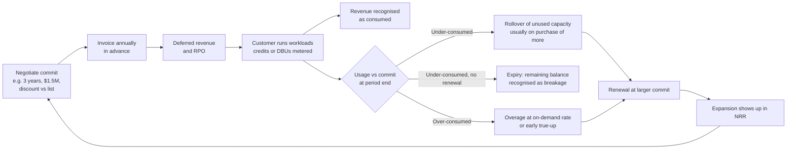
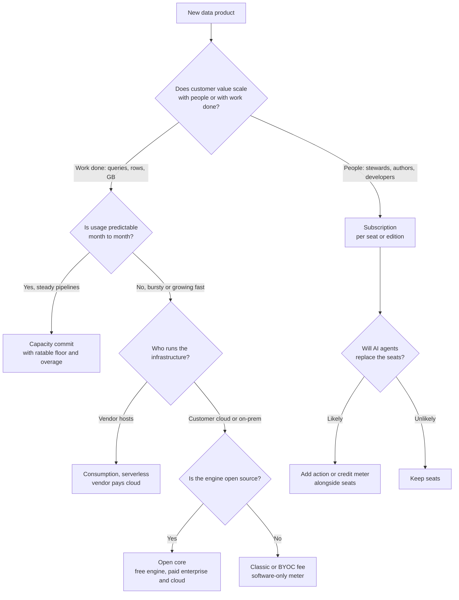
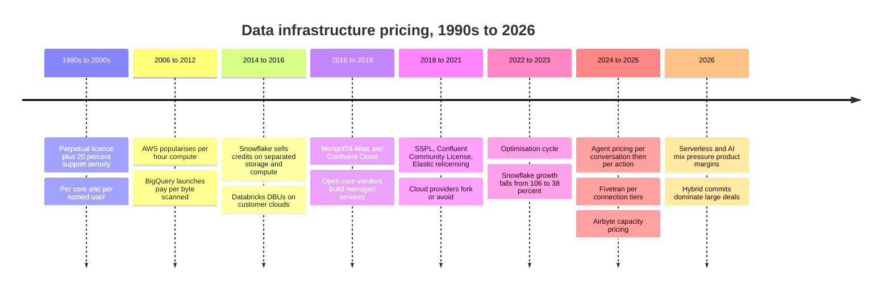

# 35. Business Models: Consumption, Subscription, Open Core and Managed Cloud
> **Depth:** L2 · **Reading time:** ~14 min · **Last verified:** 2026-11-01 · **Prerequisites:** [Ch 25 — Databricks](../04-company-deep-dives/ch25-databricks.md), [Ch 26 — Snowflake](../04-company-deep-dives/ch26-snowflake.md)

## TL;DR

- Data infrastructure is sold in four basic ways. [Consumption pricing](../glossary.md#consumption-pricing) meters work done (credits, DBUs, slots, bytes scanned). [Subscription pricing](../glossary.md#seat-based-pricing) charges per seat, node or connected source. [Open core](../glossary.md#open-core) gives away an engine and sells features, support or hosting around it. A managed cloud service runs the software for the customer and bills for both software and infrastructure. Most large contracts are now hybrids: a [capacity commitment](../glossary.md#capacity-commitment) drawn down by metered usage.
- The accounting determines how the business behaves. A subscription is recognised ratably, so revenue is smooth and visible. Consumption revenue is recognised only as the meter turns, so it tracks customer activity week by week. Snowflake's FY2026 10-K says on-demand billing was only about 1% of revenue. Even so, nearly all of its revenue is consumption-recognised, because prepaid capacity becomes revenue only when it is used.[^sf-10k26]
- Consumption revenue is elastic in both directions. Snowflake's product revenue grew 106% in FY2022 (Feb 2021–Jan 2022). Growth fell to 38% in FY2024 as customers optimised spend and the vendor's own performance gains lowered bills.[^sf-hist] Management had already guided to a ~$97M FY2023 revenue headwind from its own platform improvements.[^sf-fy22]
- Gross margin depends on who pays the cloud bill. When the customer pays AWS directly ("classic" or self-managed deployment), the vendor earns something close to a royalty, at software-like margins. When the vendor pays, as with serverless or managed services, revenue per workload rises and margin percentage falls. Snowflake runs at ~75% non-GAAP product gross margin. Seat-priced software such as GitLab runs at ~86%.[^sf-q2][^comps]
- For Everpure, Evergreen//One is already a consumption-like model: a reserve commitment billed as a floor, plus on-demand charges above it, and both feed its Subscription ARR KPI.[^ep-10k] Moving up the stack into data intelligence raises a new question: what unit to charge for. The options are per terabyte, per query or per governed asset, and each unit carries different volatility, margin and competitive exposure.

## Why this matters (business + Everpure lens)

A business model is the contract between a vendor's cost structure and its customer's budget. In data infrastructure, that contract decides three things investors care about: how volatile revenue is, how high gross margin can go, and how sales teams behave. Two companies with the same product and the same annual revenue can be worth very different amounts. One sells $500K seats renewed every year. The other sells a $500K meter that can fall 20% in a quarter when a customer's engineers tune their queries. [Ch 36](ch36-unit-economics-kpis.md) covers the metrics used to read these businesses. [Ch 37](ch37-public-comps-valuation.md) covers how the market prices them.

The models also determine competitive dynamics. Consumption pricing lets a vendor land small and expand without a procurement cycle. It also lets a hyperscaler undercut the vendor on the same unit. Open core builds adoption cheaply but invites cloud providers to host the free engine. That fear produced the 2018–2021 wave of relicensing covered in [Ch 38](ch38-open-source-strategy.md). Seat pricing is predictable, but it caps revenue at headcount, and AI agents now threaten headcount.

For Everpure the question is practical. Its Evergreen//One storage-as-a-service already behaves like a hybrid of capacity commitment and consumption: a reserve commitment, on-demand billing above it, and service-level guarantees attached.[^ep-e1] The 10-K defines Subscription ARR to include on-demand billings annualised, so part of the KPI already moves with usage.[^ep-10k] A move into data management and intelligence (1touch, now Everpure Data Intelligence) means choosing a pricing unit for software that sits above storage. Per-TB pricing aligns with the installed base but invites commoditisation. Per-query pricing aligns with value but imports Snowflake-style volatility. Per-asset or per-source governance pricing aligns with catalog vendors but sells to a different buyer. The section "Everpure lens: choosing a unit up the stack" below sets out the trade-offs as options a strategy team might evaluate, based on public information.

## How it works

### The four models in one paragraph each

**Consumption.** The vendor defines a unit of work and meters it per second or per byte. Snowflake [credits](../glossary.md#snowflake-credit) measure warehouse time by size. Databricks [DBUs](../glossary.md#dbu) measure processing capacity by instance type and workload SKU. BigQuery charges either per tebibyte scanned or per [slot](../glossary.md#slot)-hour of reserved capacity.[^bq] MongoDB Atlas bills cluster hours, storage and transfer.[^mdb-10k24] Confluent Cloud bills elastic capacity units ([eCKUs](../glossary.md#ecku)) plus networking and storage.[^cflt-pricing] Revenue is recognised as the customer consumes.

**Subscription.** The vendor sells the right to use software for a term. The price scales with a proxy for value, such as users, nodes, cores or connected sources, and revenue is recognised ratably. Business-intelligence seats, catalog vendors such as Collibra and Alation (priced by edition, users and connected sources; see [Ch 33](../04-company-deep-dives/ch33-governance-catalog-security-companies.md)) and dbt's developer seats work this way.[^dbt-pricing] Pre-cloud Informatica sold perpetual licences plus a support annuity, an older variant covered in [Ch 29](../04-company-deep-dives/ch29-operational-database-vendors.md). It has since moved to pooled [Informatica Processing Units](../glossary.md#informatica-processing-unit), a consumption unit.[^infa-ipu]

**Open core.** The core engine is free: MongoDB Community, Elasticsearch, Apache Kafka, dbt Core, Airbyte's connectors. Revenue comes from what surrounds it. That can be an enterprise edition with security and management features (Confluent Platform, MongoDB Enterprise Advanced), support, or, most profitably, a hosted service. The free tier is the marketing budget. It produces developers who already know the product before any salesperson calls.

**Managed cloud service.** The vendor operates the software in the cloud and bills for the result. This applies to the vendor's own engine (Atlas, Elastic Cloud, Confluent Cloud) and to "open source as a service" run by a hyperscaler (Amazon RDS for PostgreSQL, ElastiCache for Valkey). The managed service is where open-core economics are won or lost. Whoever runs the service owns the customer relationship and the infrastructure margin. When the hyperscaler runs it, the project's author may capture nothing.

### Pricing units: what each meter actually counts

| # | Unit | Vendor / product | What it meters | Representative list price (US, as of retrieval) | Model |
|---|---|---|---|---|---|
| 1 | Credit | Snowflake | Warehouse-hours, scaled by size (XS = 1 credit/hour, doubling per size); serverless and AI features convert to credits | Varies by edition and region; see [Ch 26](../04-company-deep-dives/ch26-snowflake.md)[^sf-cost] | Consumption |
| 2 | DBU | Databricks | Processing capacity per hour by instance type and SKU | ~$0.15 Jobs (classic) to ~$0.70 Serverless SQL per DBU (third-party compiled)[^dbx-pricing] | Consumption |
| 3 | Slot-hour | Google BigQuery editions | Reserved or autoscaled query compute | $0.04 Standard, $0.06 Enterprise, $0.10 Enterprise Plus per slot-hour[^bq] | Consumption / capacity |
| 4 | $/TiB scanned | BigQuery on-demand | Bytes processed per query | $6.25 per TiB; first 1 TiB per month free[^bq] | Consumption |
| 5 | RPU-hour | Amazon Redshift Serverless | Redshift Processing Units while queries run | $0.375 per RPU-hour (US East); 4-RPU minimum[^redshift] | Consumption |
| 6 | eCKU-hour | Confluent Cloud | Elastic Kafka cluster capacity, plus $/GB networking and storage | Confluent calculator: $0.75 Standard, $2.25 Enterprise per eCKU-hour; main pricing page implies different monthly floors[^cflt-pricing] | Consumption |
| 7 | Instance-hour + GB | MongoDB Atlas | Cluster tier (compute, memory), storage, data transfer | Tiered by cluster size; large customers commit annually[^mdb-10k24] | Consumption / managed |
| 8 | MAR | Fivetran | [Monthly active rows](../glossary.md#monthly-active-rows) changed, tiered per connection | $500 per million MAR at the first tier, falling to $1.18 above 1B[^ft-pricing] | Consumption |
| 9 | IPU | Informatica IDMC | Pooled units spent across integration, quality, catalog | Rates not public[^infa-ipu] | Prepaid consumption |
| 10 | Data Worker | Airbyte (Pro / Enterprise Flex) | Reserved parallel sync capacity | Quote-only; launched Feb 2025[^ab-capacity] | [Capacity-based](../glossary.md#capacity-based-pricing) |
| 11 | vCPU- or instance-hour | Classic compute, RDS-style managed open source | Virtual machines the customer rents | Customer's own cloud bill | Pass-through |
| 12 | Storage $/TB-month | Snowflake, Evergreen//One | Capacity stored or reserved | Evergreen//One archive tier from $0.018 per GiB-month (≈$18 per TiB-month), 500 TiB minimum, 36 months[^ep-e1] | Consumption / commit |
| 13 | Egress $/GB | AWS and peers | Data leaving a region or cloud | ~$0.09/GB for the first 10 TB per month after 100 GB free (US East)[^aws-egress] | Consumption |
| 14 | Seat | dbt platform, BI tools | Named developers or viewers | dbt Starter $100 per developer seat per month, including 15,000 successful model builds[^dbt-pricing] | Subscription + usage |
| 15 | Conversation / action | Salesforce Agentforce | Agent conversations, or actions via [Flex Credits](../glossary.md#flex-credits) | $2 per conversation (2024 list); $0.10 per action ($500 per 100,000 credits); per-user add-ons ~$125/month (third-party compiled)[^af-price] | Consumption / seat hybrid |
| 16 | Source or asset | Collibra, Alation, Atlan | Users, connected sources, governed assets | Quote-only; edition-based[^ch33] | Subscription |

*Figure 35.1 — Sixteen meters, no common denominator. Every vendor picks a unit that maps to its own cost driver (compute time, bytes, capacity) or to a proxy for customer value (seats, assets, conversations). List prices are ceilings, not what large customers pay.*

> **Bridge: consumption as a usage royalty.** A consumption contract is economically closest to **Arm's per-chip royalty**. Arm licenses its architecture once, then collects a royalty on every chip shipped, so its revenue rises and falls with its customers' unit volumes rather than with new licences signed. In FY2026 (year ended March 2026), Arm's revenue rose 23% to $4.92B. Royalties grew 21%, helped by higher per-chip rates on Armv9 designs (GAAP).[^arm-20f] Snowflake and Databricks collect a royalty on their customers' analytics activity in the same way. The analyst's model is the same: installed base × usage intensity × rate per unit. Rate-per-unit upgrades (Armv9; serverless SKUs) are a growth lever separate from volume.

### Revenue recognition: why the same dollar behaves differently

Under ASC 606 a subscription is a stand-ready obligation, so revenue is spread evenly over the term. A consumption contract is satisfied unit by unit, so revenue follows usage. Snowflake's 10-K describes two arrangements. Under **capacity** contracts, the customer commits to an amount of consumption at set prices and is usually billed annually in advance. Under **on-demand** contracts, the customer is billed monthly in arrears. Revenue under both is recognised as compute, storage and data transfer are consumed. The filing also warns that this gives Snowflake limited visibility into the timing of revenue.[^sf-10k26] Cash arrives early, but revenue does not, so the gap sits in deferred revenue and [remaining performance obligations](../glossary.md#remaining-performance-obligations) (RPO).

Open-core vendors with self-managed products add a third pattern. A term licence's software component is recognised **upfront** when the term starts, and support is recognised ratably. A large multi-year renewal of MongoDB Enterprise Advanced or Confluent Platform therefore lands in one quarter and makes reported growth lumpy. That is why investors in those companies track the cloud line (Atlas at 73% of MongoDB's FY2026 revenue; Confluent Cloud at 53% of Confluent's FY2025 revenue) as the cleaner growth signal.[^mdb-ars][^cflt-fin]

### The consumption contract lifecycle

*Figure 35.2 — A consumption contract is a prepaid account that drains as the customer works. Rollover lets the vendor turn an under-consumption problem into a larger renewal. Overage and early renewal are the expansion engine that net revenue retention measures.*

Rollover is the critical clause. Snowflake's 10-K says that in many contracts unused capacity can roll into a subsequent order, generally when the customer buys more.[^sf-10k26] That converts a customer's over-commitment, which would otherwise be a reason to shrink at renewal, into a reason to renew larger. Cloud marketplaces add one more layer. Snowflake lets capacity drawn through its own marketplace terms pay for third-party listings.[^sf-mp-terms] AWS, Azure and Google let customers retire their cloud commitments by buying vendor software through [private offers](../glossary.md#private-offer). AWS added "express" private offers in November 2025 to shorten that negotiation.[^aws-mp] Customers like these marketplace deals because they spend budget already committed to the cloud. Vendors accept a marketplace fee for faster procurement (see [Ch 40](ch40-gtm-partnerships.md)).

> **Bridge: capacity commits as take-or-pay wafer agreements.** A multi-year capacity commit is the software version of a foundry **long-term agreement (LTA)**. In 2021–22 chip designers signed take-or-pay wafer contracts with prepayments to secure supply. Cirrus Logic's 10-K describes a GlobalFoundries agreement obliging it to buy a set number of wafers each quarter, with prepayments at risk.[^gf-lta] GlobalFoundries said in 2022 that LTAs covered about $27B of future revenue backed by about $3.6B of prepayments and access fees (company-stated, press-reported via call summary).[^gf-lta] The parallel is direct. The prepayment shows up as RPO, the minimum purchase is the commitment, and the risk is what happens at renewal if the customer has over-bought. Foundries renegotiated in 2023 when demand fell. Software vendors use rollover to do the same thing more gently.

### Volatility: a worked example

The same customer, the same workload, and three contracts. Assume a mid-size enterprise whose analytics usage would cost $500K in year 1 at the vendor's prices and grows 30% a year (about 6.8% a quarter). Each fourth quarter dips 4% for the holidays. At the start of year 2 the customer's platform team runs an optimisation project (right-sizing warehouses, shortening retention, adding auto-suspend) that resets usage 20% lower, after which growth resumes. All numbers are illustrative.

- **(a) Subscription at $500K a year.** Revenue is $125K every quarter: $500K in year 1 and $500K in year 2, assuming a flat renewal. The vendor sees none of the usage growth and none of the optimisation.
- **(b) Pure consumption.** Revenue follows the meter. It runs from $113K in Y1 Q1 to $132K in Y1 Q4, then falls 11% to $118K in Y2 Q1 when the optimisation hits. Year 1 totals about $494K and year 2 about $514K. Without the optimisation, year 2 would have been about $643K, so one project cost the vendor about $129K of revenue (20%) in the year it happened.
- **(c) Capacity commit with overage.** The customer commits $480K in year 1 and renews at $500K for year 2. The commitment is recognised ratably as a floor ($120K, then $125K a quarter), and usage above the floor is billed as overage. This is the Evergreen//One structure, not Snowflake's. Year 1 totals about $502K and year 2 about $522K. The floor absorbs the optimisation quarter ($125K instead of $118K), while the vendor still captures the growth above it.

*Figure 35.3 — Illustrative only (author model, data/ch35_illustrative_revenue.csv). Over two years the three contracts produce almost identical totals ($1.00M, $1.01M, $1.02M). The quarterly paths differ: consumption gives the vendor the upside and the drawdowns, and a ratable floor removes most of the drawdown risk.*

Two lessons. First, a Snowflake-style capacity contract is closer to (b) than to (c). The commit sets cash and RPO, but revenue still follows consumption. A commit-plus-overage contract with a ratable floor (c) is a real hybrid. Second, totals over a cycle can be similar while quarterly growth rates swing widely. A public consumption company aggregates thousands of customers, which smooths idiosyncratic noise but not a correlated event such as a macro-driven optimisation wave.

### The 2022–23 optimisation cycle and the efficiency headwind

That correlated event happened in 2022–23. As interest rates rose, CFOs asked platform teams to cut cloud bills, and teams did so across the board. Snowflake's annual product revenue growth fell from 106% (FY2022) to 70% (FY2023) and 38% (FY2024). Net revenue retention fell from 178% to 131% (company-stated).[^sf-hist] MongoDB said consumption was more volatile in FY2023 than in FY2024, and that Atlas usage tracks the underlying applications' traffic.[^mdb-call24] Seat-based vendors felt the same pressure later and more gently, at renewal, through seat reductions.

The vendor's own engineering adds a second, structural headwind. In March 2022 Snowflake guided FY2023 product revenue lower to allow for about $97M of net revenue lost to its own performance improvements. Press coverage of the call described a gross impact of roughly $160M, partly offset by new workloads.[^sf-fy22] Gen2 warehouses (2025, vendor-claimed ~2.1x faster on core analytics) repeat the bet.[^sf-summit25] Under consumption pricing every efficiency gain is a price cut the vendor gives itself. The case for doing it anyway rests on price elasticity, which the Moore's law and Jevons bridge below takes up.

> **Bridge: Moore's law and the Jevons paradox.** In 1865 W. S. Jevons argued that more efficient steam engines would increase Britain's coal consumption, because cheaper energy opens new uses.[^jevons] Memory has followed the same pattern for decades: cost per bit falls, and total bits shipped grow faster. A consumption vendor that halves the credits per query is betting on the Jevons outcome. Customers keep more history, run more queries and point AI agents at the data. If elasticity is above 1, efficiency raises revenue after a lag. If it is below 1, revenue shrinks. Snowflake's re-acceleration to 37% product growth in Q2 FY2027 (May–Jul 2026), during a period of continuous efficiency releases, suggests elasticity is currently above 1.[^sf-q2]

### Forecasting and incentives

Consumption companies guide to **product revenue**, not total revenue, and build guidance from recent daily consumption trends rather than from bookings. Snowflake's FY2027 product-revenue guide was raised twice, from $5.66B to $6.07B (company guidance).[^sf-q2] That shows the method's upside. Its downside was the series of guide-downs in 2022–23. The method makes the latest weeks of usage the key data point, which is why analysts watch holiday weeks, fiscal-year-end budget freezes and large customers' migration timelines.

Sales compensation follows the model. Under subscription, reps are paid on bookings (annual contract value). Under consumption, a rep paid on bookings has an incentive to oversell a commit that the customer will not burn, which leads to unhappy renewals. Snowflake and Databricks have therefore moved quota credit toward **consumption**: reps earn on revenue actually drawn down. In practice that makes reps part-time solution architects who help customers land new workloads [VERIFY: current Snowflake and Databricks sales-compensation design; based on public commentary before 2025]. The trade-off is a slower revenue ramp per new logo, in exchange for less shelfware and better net retention.

### Gross margin: who pays the cloud bill

| Deployment | Who pays the hyperscaler | Vendor revenue per workload | Vendor gross margin | Examples |
|---|---|---|---|---|
| Self-managed software (licence or subscription) | Customer, directly or on-prem | Lowest | Highest (no infrastructure in COGS) | Confluent Platform, MongoDB Enterprise Advanced, Collibra |
| Classic compute / [bring your own cloud](../glossary.md#bring-your-own-cloud) | Customer, directly | Low (software fee only) | High; Databricks stated >80% non-GAAP subscription GM (2024)[^db-j] | Databricks classic, WarpStream |
| Vendor-hosted, serverless | Vendor, inside COGS | Highest (software + infrastructure) | Lower; Snowflake ~75% non-GAAP product GM[^sf-q2] | Snowflake, Databricks serverless, Atlas, Confluent Cloud |
| Hyperscaler-hosted open source | Hyperscaler is the vendor | Captured by hyperscaler | Hyperscaler's infrastructure margin | RDS, ElastiCache, Amazon MSK |

*Figure 35.4 — Moving down this table raises revenue per workload and lowers margin percentage. AI workloads add GPU and third-party model costs on top. Snowflake lowered its FY2027 product-margin guide to 74% for that reason.[^sf-q2]*

[Serverless compute](../glossary.md#serverless-compute) shifts more of the infrastructure cost onto the vendor. Gross profit dollars can still rise, because the vendor bin-packs many customers onto warm pools and keeps the spread. The worked DBU example in [Ch 25](../04-company-deep-dives/ch25-databricks.md) shows a nightly job billing about $9 on classic compute and about $42 on serverless. That difference is mostly a change in the unit of account. Some of Databricks' revenue growth reflects this mix shift, not new demand, and Databricks does not disclose the split.

## Design choices and trade-offs

| Dimension | Consumption | Subscription (seat / node / source) | Open core (self-managed) | Managed cloud service | Hybrid: commit + drawdown / overage |
|---|---|---|---|---|---|
| Revenue recognition | As consumed | Ratably over term | Licence upfront, support ratably | As consumed or ratably by tier | Floor ratably (if take-or-pay) or as consumed; breakage at expiry |
| Revenue volatility | High; follows usage and seasonality | Low within term; risk at renewal | Lumpy (large renewals) | Medium–high | Low–medium |
| NRR dynamics | Can exceed 150% in growth phases; compresses in optimisation cycles | Tied to seat growth and price uplifts; typically 100–120% | Driven by node and core expansion | Usage-driven, like consumption | Step-ups at renewal, overage between |
| Gross margin | 65–80% (infrastructure in COGS) | 80–90% | 85–90%+ | 60–75% | Depends on hosting |
| Sales and marketing motion | Land small, expand by workload; reps paid on consumption | Enterprise sales on bookings; renewal desk | Developer adoption converts to enterprise sales | Self-serve plus enterprise commits; marketplace | Negotiated commits, private offers |
| Examples | Snowflake, BigQuery, Fivetran MAR | Collibra, BI seats, dbt seats | Elastic self-managed, Confluent Platform, MongoDB EA, Airbyte | Atlas, Elastic Cloud, Confluent Cloud, RDS | Snowflake capacity, Databricks commits, Evergreen//One |
| Main risk | Optimisation waves; self-inflicted efficiency headwind | Seat compression from AI agents; price-increase fatigue | Cloud providers host the free engine; relicensing backlash | Hyperscaler competition on the same unit; margin dilution | Over-commitment leads to down-sized renewals |
| Valuation treatment | Premium when NRR is high, but discounted for low visibility; investors watch RPO and product-revenue guidance | Valued on ARR and FCF; stable but lower growth | Investors look through to the cloud line; lumpiness discounted | Valued on cloud growth and margin path | Valued on RPO, ARR and the on-demand share |

*Figure 35.5 — Business models compared across eight dimensions. Ranges are typical, based on the companies cited in this chapter (see "Numbers that matter"), not rules. The choice trades visibility against upside and margin percentage against revenue per customer.*

**The steelman for subscription.** Seats are easy to budget, revenue is visible and margins are the highest in software. If a product's value scales with the people using it, as with a catalog steward, a BI author or a developer, a seat is a fair proxy. The weakness is that agents do work without seats. Agentforce now offers three meters at once: per conversation, per action and per user.[^af-price] That is a seat vendor hedging against its own unit.

**The steelman for consumption.** It removes the procurement hurdle for small starts, aligns price with value delivered, and lets the best customers grow revenue at 150%+ annual net retention without a new contract. The weakness is the one shown in Figure 35.3: the vendor carries the customer's optimisation risk and its own efficiency risk.

**The steelman for open core.** Free distribution is the cheapest way to reach developers, and the community acts as an R&D and QA extension. The weakness is that the most valuable monetisation, hosting, is also the easiest to copy. MongoDB's move to the SSPL (October 2018), Confluent's Community License (December 2018) and Elastic's relicensing (January 2021) were all responses to cloud providers hosting the free engine.[^mdb-sspl][^cflt-ccl][^elastic-agpl] Elastic added the OSI-approved AGPL as an option in August 2024, partly reversing course.[^elastic-agpl] [Ch 38](ch38-open-source-strategy.md) covers the licence mechanics.

*Figure 35.6 — A decision tree for picking a model. Value driver first, then predictability, then deployment. Most mature vendors end up with two or three branches at once: Databricks sells serverless and classic, MongoDB sells Atlas and Enterprise Advanced, and Salesforce sells seats and Flex Credits.*

## Who's who

| Company | Primary model | Unit | Hybrid elements | Chapter |
|---|---|---|---|---|
| Snowflake | Consumption, vendor-hosted | Credits; storage $/TB-month; transfer | Capacity commits with rollover; marketplace drawdown | [Ch 26](../04-company-deep-dives/ch26-snowflake.md) |
| Databricks | Consumption | DBUs by SKU | Classic (customer pays cloud) and serverless; Azure prepurchase commits up to 37% off[^dbx-azure] | [Ch 25](../04-company-deep-dives/ch25-databricks.md) |
| Google BigQuery | Consumption | $/TiB scanned or slot-hours | Edition commitments | [Ch 28](../04-company-deep-dives/ch28-hyperscaler-data-platforms.md) |
| MongoDB | Open core + managed cloud | Atlas cluster hours; EA term licences | Annual Atlas commits; self-serve billed monthly in arrears | [Ch 29](../04-company-deep-dives/ch29-operational-database-vendors.md) |
| Confluent (IBM) | Open core + managed cloud | eCKUs, GB; Platform subscription | WarpStream BYOC | [Ch 30](../04-company-deep-dives/ch30-data-movement-streaming-companies.md) |
| Elastic | Open core + managed cloud | Resource-based cloud; self-managed subscription | Serverless projects; AGPL option | [Ch 31](../04-company-deep-dives/ch31-analytical-engine-challengers-legacy.md) |
| Fivetran + dbt Labs | Consumption + seats | MAR per connection; dbt seats + model builds | dbt Core open source | [Ch 10](../02-pipelines-and-governance/ch10-ingestion-and-integration.md) |
| Airbyte | Open core | Credits or Data Workers | ELv2 connectors | [Ch 10](../02-pipelines-and-governance/ch10-ingestion-and-integration.md) |
| Salesforce (Agentforce, Informatica) | Seats + consumption | Seats; conversations; Flex Credits; IPUs | Three agent meters in parallel | [Ch 34](../04-company-deep-dives/ch34-application-giants-data-platforms.md) |
| Everpure | Hardware + subscription + storage-as-a-service | Evergreen subscriptions; Evergreen//One reserve + on-demand | Subscription ARR includes annualised on-demand | [Ch 45](../06-history-and-future/ch45-storage-moving-up-the-stack.md) |

*Figure 35.7 — Almost every scaled vendor runs more than one model. The pure types are useful for analysis but rarely exist in practice.*

## History and trajectory

*Figure 35.8 — Pricing moved from owning software, to renting it, to metering it, and is now moving to metering agent actions. Each step raised revenue elasticity and lowered visibility. Dates are approximate for the earlier eras.*

The pattern is a migration of risk. Under perpetual licences the customer bore all utilisation risk: the shelfware was theirs. Subscription split it. Consumption moved it almost entirely to the vendor, which is why consumption vendors invest so heavily in customer success and workload migration. The next shift is underway in agent pricing. Salesforce went from $2 per conversation in 2024 to $0.10 per action in 2025, then added per-user add-ons, all within about a year.[^af-price] [Ch 34](../04-company-deep-dives/ch34-application-giants-data-platforms.md) works through the arithmetic. Expect data vendors to follow, with meters on tokens, agent tool calls or governed context retrievals as agents become the heaviest users of data platforms.

### Everpure lens: choosing a unit up the stack

Evergreen//One already contains the main elements of a data-platform contract. The customer sets a **reserve commitment** (for example, a 300 TiB initial commitment on the unified block-and-file tier, or 500 TiB on the archive tier). Everpure bills the reserve and charges on-demand usage above it. A 25% capacity buffer and SLAs on uptime and energy (Watts per TiB) are attached.[^ep-e1] Subscription ARR counts the annualised contract value of non-cancellable subscriptions plus the latest quarter's on-demand billings × 4. It was $1.924B at FY2026 year-end, up 16%, and about $2.1B at Q2 FY2027 (company-stated KPI).[^ep-10k][^ep-q2] Two details matter for comparison with data platforms. First, the reserve behaves like model (c) in Figure 35.3, a ratable floor with overage, not like Snowflake's drawdown, so it carries less volatility. Second, the 10-K notes that longer-term Evergreen renewals slowed ARR growth in FY2026.[^ep-10k] Contract structure moves the KPI as well as the economics.

For data-intelligence software above the array, a strategy team might evaluate three units, based on public information:

1. **Per TB under management.** This is natural for a storage vendor's sales force and its customers' budgets, and it is predictable. It ties revenue to a unit whose price falls every year, though, and it invites comparison with commodity capacity.
2. **Per query, scan or vectorised GB (consumption).** This aligns revenue with AI-pipeline activity such as Data Stream, and it captures Jevons-style upside. It also imports the optimisation and efficiency headwinds described above, and it puts Everpure in direct price comparison with Snowflake and Databricks meters.
3. **Per governed asset or data source (subscription).** This matches how catalog and data-security vendors such as Collibra and Cyera are bought ([Ch 33](../04-company-deep-dives/ch33-governance-catalog-security-companies.md)). It sells to the chief data officer or CISO rather than the storage buyer, and it is independent of where the data sits, which suits Data Intelligence's cross-vendor discovery.

A hybrid is the likely outcome: a platform subscription per source or per TB as a floor, with a consumption meter for AI-pipeline work. The analytical point is that whichever unit is chosen also determines the margin structure, the sales motion and the multiple investors will apply.

## Numbers that matter

| Metric | Value | Basis | Source / date |
|---|---|---|---|
| Snowflake product revenue as share of total, Q2 FY2027 (May–Jul 2026) | ~96% ($1.49B of $1.547B) | GAAP; author arithmetic | Snowflake, 2026-09-02[^sf-q2] |
| Snowflake on-demand revenue share, FY2026 (Feb 2025–Jan 2026) | ~1% (2% FY2025, 3% FY2024) | Company-stated, 10-K | Snowflake 10-K, 2026-03[^sf-10k26] |
| Snowflake product revenue growth, FY2022 → FY2024 | 106% → 70% → 38% | GAAP; author arithmetic from 10-Ks | `data/company_financials.csv`[^sf-hist] |
| Snowflake NRR, FY2022 → Q2 FY2027 | 178% → 131% (FY2024) → 126% | Company-stated KPI | `data/company_financials.csv`[^sf-hist][^sf-q2] |
| Snowflake FY2023 revenue headwind from own performance gains | ~$97M (net; ~$160M gross, press-reported) | Company guidance assumption | Snowflake / The Register, 2022-03[^sf-fy22] |
| Snowflake product gross margin, Q2 FY2027 | 74.7% non-GAAP; 70.9% GAAP; FY2027 guide 74% | Non-GAAP / GAAP | Snowflake, 2026-09-02[^sf-q2] |
| Databricks subscription gross margin (quarter to Oct 2024) | >80% | Company-stated, non-GAAP | Databricks, 2024-12-17[^db-j] |
| MongoDB gross margin, Q2 FY2027 | 74% GAAP; 76% non-GAAP | GAAP / non-GAAP | MongoDB, 2026-09-01[^mdb-q2] |
| MongoDB Atlas share of revenue, FY2026 | 73% (66% in FY2024) | Company-stated | MongoDB ARS and 10-K[^mdb-ars][^mdb-10k24] |
| Confluent Cloud share of revenue, FY2025 (calendar) | 53% ($624M of $1,167M) | GAAP | Confluent 10-K FY2025[^cflt-fin] |
| GitLab gross margin, Q2 FY2027 (seat-priced comparator) | 86.5% | Non-GAAP | `data/public_comps.csv`[^comps] |
| Everpure Subscription ARR, FY2026 year-end / Q2 FY2027 | $1.924B (+16%) / ~$2.1B | Company-stated KPI | Everpure 10-K; Q2 FY2027 release[^ep-10k][^ep-q2] |
| Everpure RPO, Q2 FY2027 | ~$4.1B | GAAP | Everpure, 2026-08-26[^ep-q2] |
| Everpure gross margin, Q2 FY2027 | 68.4% GAAP; 69.9% non-GAAP | GAAP / non-GAAP | Everpure, 2026-08-26[^ep-q2] |
| EV/NTM revenue: Snowflake vs MongoDB vs Elastic vs Everpure | 16.9x / 9.0x / 4.6x / 8.5x | Guidance-derived NTM proxies, Oct 2026 | `data/public_comps.csv`[^comps] |
| Arm royalty revenue growth, FY2026 (Apr 2025–Mar 2026) | +21%; total revenue $4.92B (+23%) | GAAP | Arm 20-F[^arm-20f] |

*Figure 35.9 — Consumption leaders trade at the highest multiples despite lower gross margins and lower visibility, because NRR above 120% compounds. The market pays for elasticity, as long as it points up.*

## Storage bridge

> **Storage bridge.** Storage-as-a-service brought consumption economics to hardware: the vendor owns the array, guarantees capacity and performance, and bills per unit stored with a committed floor. The difference from data platforms is the meter. Storage meters a stock (TiB reserved or used), which moves slowly. Compute platforms meter a flow (queries, scans), which can swing by 20% in a quarter. A data-intelligence product priced on flow would carry the volatility profile of Snowflake, not of Evergreen//One. See the companion *Everpure Tech Atlas* for Evergreen architecture and capacity-planning detail.

## Conversation playbook

**Questions for a PM**

1. "What share of your revenue is recognised as consumed versus ratably, and how much of the consumed part sits under committed contracts with rollover?"
2. "When you shipped your last big performance improvement, what did you assume for elasticity, and what did you see in workload growth over the next two quarters?"
3. "How are account executives paid: on bookings, on consumption, or on both? What happens to a rep whose customer over-commits?"

**Questions for an engineer**

1. "Which part of a customer's bill is your software and which part is cloud infrastructure you resell? How does that change between classic and serverless?"
2. "What telemetry do you use to forecast consumption, and how far ahead can you see a customer's optimisation project coming?"
3. "If we priced this feature per query rather than per TB, what would we need to meter, and what would stop customers from gaming the unit?"

**What good answers sound like.** They separate cash (billings, RPO) from revenue (consumption) and know the on-demand share. They quantify elasticity with evidence ("after the engine upgrade, credits per query fell 15% and query volume rose 25% within two quarters") rather than asserting it. They say who pays the hyperscaler and how serverless mix moves gross margin. They describe incentives concretely: quota on drawdown, with commits as a gating condition.

**Don't say this**

- "Consumption revenue is recurring revenue." It recurs only if usage does. Commits secure cash, not revenue timing.
- "RPO is backlog, so it's guaranteed revenue." Under consumption contracts RPO converts only as the customer consumes, and rollover can extend it.
- "Lower gross margin means a worse business." Serverless lowers margin percentage while raising gross-profit dollars per customer. Compare dollars and mix.
- "Open source means no revenue." The managed service is the revenue. The risk is who runs it.
- "Efficiency improvements are pure goodwill." They are a price cut. The question is whether elasticity pays for it.
- "Snowflake's credits and Databricks' DBUs are comparable prices." They meter different amounts of work. Compare cost per workload ([Ch 27](../04-company-deep-dives/ch27-databricks-vs-snowflake.md)).

## Going deeper

- Snowflake's FY2026 10-K, Note 2 (revenue recognition) and the risk factors on consumption visibility, for the clearest primary description of a capacity contract.[^sf-10k26]
- ASC 606's treatment of stand-ready obligations versus usage-based fees, and of breakage on unused prepaid rights. Compare how Snowflake and MongoDB describe each in their 10-K revenue notes.
- Everpure's 10-K definition of Subscription ARR and its Evergreen//One product guide, for how a reserve-plus-on-demand contract is measured.[^ep-10k][^ep-e1]
- Arm's 20-F royalty discussion, for the clearest public example of a per-unit royalty model with rate upgrades.[^arm-20f]

## Key terms

- [Consumption pricing](../glossary.md#consumption-pricing) — charging per unit of work done (credits, DBUs, bytes scanned), recognised as consumed.
- [Seat-based pricing](../glossary.md#seat-based-pricing) — charging per named user or developer for a subscription term.
- [Open core](../glossary.md#open-core) — a free open-source engine monetised through paid features, support or hosting.
- [Capacity commitment](../glossary.md#capacity-commitment) — a multi-year promise to buy a dollar amount of usage, drawn down as consumed.
- [Capacity-based pricing](../glossary.md#capacity-based-pricing) — charging for reserved throughput or compute capacity rather than volume processed.
- [Rollover](../glossary.md#rollover) — carrying unused prepaid capacity into a later contract, usually on purchase of more.
- [Overage](../glossary.md#overage) — usage above a commitment, billed at an on-demand or contracted rate.
- [Breakage](../glossary.md#breakage) — revenue recognised when prepaid capacity expires unused.
- [Ratable recognition](../glossary.md#ratable-recognition) — spreading subscription revenue evenly over the contract term.
- [Remaining performance obligations](../glossary.md#remaining-performance-obligations) — contracted revenue not yet recognised.
- [Product revenue](../glossary.md#product-revenue) — Snowflake's consumption-recognised revenue line, excluding professional services.
- [Private offer](../glossary.md#private-offer) — a negotiated price sold through a cloud marketplace, often counting toward the buyer's cloud commitment.
- [Optimization cycle](../glossary.md#optimization-cycle) — a period when customers cut usage-based bills, compressing consumption vendors' growth.
- [Efficiency headwind](../glossary.md#efficiency-headwind) — revenue lost when a consumption vendor's own performance gains cut customers' bills.
- [Jevons paradox](../glossary.md#jevons-paradox) — efficiency gains that lower unit cost can increase total consumption.
- [Snowflake credit](../glossary.md#snowflake-credit) — Snowflake's unit of compute consumption, priced per edition.
- [DBU](../glossary.md#dbu) — Databricks Unit, priced per workload SKU.
- [Slot](../glossary.md#slot) — BigQuery's unit of query compute capacity.
- [RPU](../glossary.md#rpu) — Redshift Processing Unit, Redshift Serverless's billing unit.
- [eCKU](../glossary.md#ecku) — Confluent Cloud's elastic capacity unit.
- [Monthly active rows](../glossary.md#monthly-active-rows) — Fivetran's meter of distinct rows changed per month.
- [Informatica Processing Unit](../glossary.md#informatica-processing-unit) — Informatica's pooled prepaid consumption unit.
- [Flex Credits](../glossary.md#flex-credits) — Salesforce's per-action consumption currency for Agentforce.
- [Serverless compute](../glossary.md#serverless-compute) — vendor-run compute billed per use, with infrastructure inside vendor COGS.
- [Bring your own cloud](../glossary.md#bring-your-own-cloud) — vendor software running in the customer's cloud account, so the customer pays the infrastructure.
- [Take-or-pay](../glossary.md#take-or-pay) — a contract requiring payment for a minimum volume whether or not it is used.
- [Subscription ARR](../glossary.md#subscription-arr) — Everpure's KPI: annualised subscription contract value plus annualised on-demand billings.
- [Evergreen One](../glossary.md#evergreen-one) — Everpure's storage-as-a-service offering with reserve commitments and on-demand billing.

## Sources

[^sf-10k26]: Snowflake Inc., Form 10-K for the fiscal year ended January 31, 2026 (capacity vs on-demand arrangements; on-demand ~1%/2%/3% of revenue FY2026/FY2025/FY2024; rollover of unused capacity; revenue recognised as consumed; limited visibility into timing), https://www.sec.gov/Archives/edgar/data/1640147/000164014726000008/snow-20260131.htm, published 2026-03; retrieved 2026-11-01.
[^sf-q2]: Snowflake Inc., "Snowflake Reports Financial Results for the Second Quarter of Fiscal 2027," https://www.nasdaq.com/press-release/snowflake-reports-financial-results-second-quarter-fiscal-2027-2026-09-02 (Business Wire original: https://secure.businesswire.com/news/home/20260902386235/en/), published 2026-09-02; retrieved 2026-11-01. Values per `data/company_financials.csv`: product revenue ~$1.49B (+37%), total revenue $1,546.8M, NRR 126%, non-GAAP product GM 74.7%, GAAP 70.9%, FY2027 product revenue guide $6.07B (initial $5.66B), FY2027 non-GAAP product GM guide 74%.
[^sf-hist]: Snowflake Inc., Forms 10-K FY2022–FY2026 via SEC EDGAR, https://www.sec.gov/cgi-bin/browse-edgar?action=getcompany&CIK=0001640147&type=10-K; values as recorded in AI Data Atlas dataset `data/company_financials.csv` (product revenue FY2021 $553.8M, FY2022 $1,140.5M, FY2023 $1,938.8M, FY2024 $2,666.8M; NRR 178% FY2022, 158% FY2023, 131% FY2024), as of 2026-11-01; retrieved 2026-11-01. Growth rates are author arithmetic.
[^sf-fy22]: Snowflake Inc., "Snowflake Reports Financial Results for the Fourth Quarter and Full Year of Fiscal 2022," Business Wire, https://www.businesswire.com/news/home/20220302005287/en/, published 2022-03-02; The Register, "Snowflake Q4 FY22," https://www.theregister.com/2022/03/03/snowflake_q4fy22/, published 2022-03-03; retrieved 2026-11-01. ~$97M net FY2023 headwind is a company guidance assumption; the ~$160M gross / ~$60M offset split is from a Motley Fool community summary of the call (press-reported, weak).
[^sf-cost]: Snowflake documentation, "Understanding compute cost," https://docs.snowflake.com/en/user-guide/cost-understanding-compute, living document; retrieved 2026-11-01. Credit-per-hour ladder by warehouse size; prices per credit vary by edition and region.
[^sf-summit25]: Constellation Research, "Snowflake Summit 2025: Everything you need to know," https://www.constellationr.com/insights/news/snowflake-summit-2025-everything-you-need-know, published 2025-06; retrieved 2026-11-01. Gen2 ~2.1x speed-up is a vendor claim.
[^sf-mp-terms]: Snowflake, "Snowflake Marketplace Capacity Drawdown Terms," https://www.snowflake.com/legal/snowflake-marketplace-capacity-drawdown-terms/, living document; retrieved 2026-11-01.
[^dbx-pricing]: CloudForecast, "Databricks Pricing Guide (2026)," https://www.cloudforecast.io/guides/databricks-pricing-costs-guide/, published 2026; Espresso AI, "Databricks Pricing Explained," https://espresso.ai/guides/databricks-pricing-explained, published 2026; retrieved 2026-11-01. Third-party compilations of AWS US list prices; authoritative source https://www.databricks.com/product/pricing.
[^dbx-azure]: Microsoft Learn, "Optimize Azure Databricks costs with a prepurchase" and "How Azure Databricks prepurchase discount is applied" (1- or 3-year Databricks Commit Units; pool draws down across workloads; non-cancellable), https://learn.microsoft.com/azure/cost-management-billing/reservations/prepay-databricks-reserved-capacity, living document; Microsoft Azure, "Azure Databricks pricing" (up to 37% savings vs pay-as-you-go), https://azure.microsoft.com/en-us/pricing/details/databricks/, living document; retrieved 2026-11-01.
[^db-j]: Databricks via Cision/AAP, "Databricks is Raising $10B Series J Investment at $62B Valuation," https://www.aap.com.au/aapreleases/cision20241217ae81438, published 2024-12-17; retrieved 2026-11-01. >80% non-GAAP subscription gross margin in the quarter ended 2024-10-31, company-stated.
[^bq]: Google Cloud, "BigQuery pricing," https://cloud.google.com/bigquery/pricing, living document; retrieved 2026-11-01. On-demand $6.25 per TiB with first 1 TiB/month free; editions pay-as-you-go $0.04 / $0.06 / $0.10 per slot-hour (Standard / Enterprise / Enterprise Plus, US). Rates corroborated by third-party guides (DoiT, Revefi, 2026); regional rates differ.
[^redshift]: Amazon Web Services, "Amazon Redshift pricing," https://aws.amazon.com/redshift/pricing/, living document; retrieved 2026-11-01. $0.375 per RPU-hour US East (N. Virginia), per-second billing; AWS, "Amazon Redshift Serverless now offers 4-RPU Minimum Capacity…," https://aws.amazon.com/about-aws/whats-new/2025/11/amazon-redshift-serverless-4-rpu-minimum-capacity, published 2025-11; retrieved 2026-11-01.
[^aws-egress]: Amazon Web Services, "AWS price reduction for data transfers out to the internet" (100 GB/month free), https://aws.amazon.com/about-aws/whats-new/2021/11/aws-price-reduction-data-transfers-internet, published 2021-11; CloudZero, "AWS egress costs," https://www.cloudzero.com/blog/aws-egress-costs, published 2025; retrieved 2026-11-01. $0.09/GB first-10-TB US East rate from third-party compilation; official source https://aws.amazon.com/ec2/pricing/on-demand/.
[^cflt-pricing]: Confluent, "Confluent Cloud Pricing," https://www.confluent.io/confluent-cloud/pricing/, and "Confluent Cloud cost-benefit calculator," https://confluent.io/cost-benefit-calculator/, living documents; Confluent documentation, "Billing Dimensions in Confluent Cloud," https://docs.confluent.io/cloud/current/billing/billing-dimensions.html; retrieved 2026-11-01. Per-eCKU-hour rates conflict between the calculator and the main pricing page's monthly floors; treat as indicative list prices.
[^cflt-fin]: Confluent, Inc., Form 10-K for fiscal year 2025 (calendar), https://www.sec.gov/Archives/edgar/data/1699838/000169983826000006/cflt-20251231.htm, published 2026-02; retrieved 2026-11-01. Values per `data/ch30_confluent_financials.csv` (total revenue $1,167M; Confluent Cloud $624M), flagged there for re-verification.
[^mdb-10k24]: MongoDB, Inc., Form 10-K for the fiscal year ended January 31, 2024 (Atlas 66% of revenue; self-serve Atlas billed monthly in arrears on usage), https://www.sec.gov/Archives/edgar/data/1441816/000144181624000049/mdb-20240131.htm, published 2024-03; retrieved 2026-11-01.
[^mdb-call24]: The Motley Fool, "MongoDB (MDB) Q4 2024 Earnings Call Transcript," https://www.fool.com/earnings/call-transcripts/2024/03/07/mongodb-mdb-q4-2024-earnings-call-transcript/, published 2024-03-07; retrieved 2026-11-01. Management commentary on lower consumption variability in FY2024 vs FY2023.
[^mdb-q2]: MongoDB, Inc., "MongoDB, Inc. Announces Second Quarter Fiscal 2027 Financial Results," https://investors.mongodb.com/news-releases/news-release-details/mongodb-inc-announces-second-quarter-fiscal-2027-financial, published 2026-09-01; retrieved 2026-11-01 (values per `data/company_financials.csv`).
[^mdb-ars]: MongoDB, Inc., Annual Report to Shareholders FY2026, https://www.sec.gov/Archives/edgar/data/0001441816/000162828026036431/ars.htm, published 2026; retrieved 2026-11-01. Atlas 73% of FY2026 revenue, company-stated (per `data/company_financials.csv`).
[^mdb-sspl]: MongoDB, Inc., "MongoDB Issues New Server Side Public License for MongoDB Community Server," https://investors.mongodb.com/news-releases/news-release-details/mongodb-issues-new-server-side-public-license-mongodb-community, published 2018-10-16; retrieved 2026-11-01.
[^cflt-ccl]: Data Center Knowledge, "Confluent Creates New 'Open Source' License to Stop Cloud Poaching," https://datacenterknowledge.com/cloud/confluent-creates-new-open-source-license-to-stop-cloud-poaching, published 2018-12; retrieved 2026-11-01. Covered KSQL and some components; Apache Kafka remained Apache 2.0.
[^elastic-agpl]: IT Brief UK, "Elastic adds AGPL option to Elasticsearch, Kibana licences," https://itbrief.co.uk/story/elastic-adds-agpl-option-to-elasticsearch-kibana-licences, published 2024-08; Simon Willison, "Elasticsearch is open source, again," https://feeds.simonwillison.net/2024/Aug/29/elasticsearch-is-open-source-again/, published 2024-08-29; retrieved 2026-11-01. January 2021 move to SSPL / Elastic License per the same coverage.
[^ft-pricing]: Fivetran, "Pricing" (Standard plan tiers from $500 to $1.18 per million MAR), https://www.fivetran.com/pricing, living document; retrieved 2026-11-01. List prices; see Ch 10 for the per-connection tiering worked example.
[^ab-capacity]: Airbyte, "Introducing capacity-based pricing," https://airbyte.com/blog/introducing-capacity-based-pricing, published 2025-02-11; Airbyte, "Pricing," https://www.airbyte.com/pricing, living document; retrieved 2026-11-01.
[^infa-ipu]: Informatica, "Announcing Consumption Pricing for Informatica Intelligent Data Management Cloud," https://www.informatica.com/blogs/announcing-consumption-pricing-for-informatica-intelligent-data-management-cloud.html, publication date not captured; retrieved 2026-11-01.
[^dbt-pricing]: dbt Labs, "dbt pricing," https://www.getdbt.com/pricing, living document; retrieved 2026-11-01. Starter $100 per user per month, 15,000 successful models built per month included.
[^af-price]: Salesforce newsroom, Agentforce pricing announcements, https://www.salesforce.com/news/, 2024-09 ($2 per conversation) and 2025-05 (Flex Credits, $0.10 per action, $500 per 100,000 credits); per-user add-on prices (~$125 per user per month) per third-party compilations, e.g., 11x, "Agentforce Pricing: How Much Does Agentforce Really Cost in 2026?," https://www.11x.ai/guides/agentforce-pricing, published 2026; retrieved 2026-11-01. List prices; third-party sources conflict on 2026 edition restructuring.
[^aws-mp]: Amazon Web Services, "AWS Marketplace introduces express private offers for fast personalized pricing," https://aws.amazon.com/about-aws/whats-new/2025/11/aws-marketplace-express-private-offers, published 2025-11; retrieved 2026-11-01.
[^ch33]: AI Data Atlas, [Ch 33 — Governance, catalog and security companies](../04-company-deep-dives/ch33-governance-catalog-security-companies.md), "How it makes money" (catalog pricing by edition, users and connected sources), 2026-11-01.
[^ep-10k]: Everpure, Inc. (formerly Pure Storage), Form 10-K for the fiscal year ended February 1, 2026 (Subscription ARR definition incl. on-demand billings × 4; $1,924.3M vs $1,657.8M, +16%; slower growth attributed to longer-term Evergreen renewals), https://www.sec.gov/Archives/edgar/data/1474432/000147443226000027/pstg-20260201.htm, published 2026-03; retrieved 2026-11-01.
[^ep-q2]: Everpure, Inc., "Everpure Announces Second Quarter Fiscal 2027 Financial Results," https://investor.everpuredata.com/news-and-events/press-releases/press-release-details/2026/Everpure-Announces-Second-Quarter-Fiscal-2027-Financial-Results/default.aspx, published 2026-08-26; retrieved 2026-11-01 (values per `data/company_financials.csv`: Subscription ARR ~$2.1B, RPO ~$4.1B, GAAP GM 68.4%, non-GAAP 69.9%). FY2027 ≈ Feb 2026–Jan 2027.
[^ep-e1]: Everpure (Pure Storage), "Evergreen//One pricing," https://www.purestorage.com/products/staas/evergreen/pricing.html; "Evergreen//One Product Guide," https://purestorage.com/legal/evergreen-one-product-guide.html; Evergreen//One data sheet, https://purestorage.com/products/staas/pure-as-a-service/data-sheet.html; living documents (product guide versions dated 2023–2025); retrieved 2026-11-01. Reserve commit billed with on-demand above; 25% buffer; uptime and Watts/TiB SLAs; archive tier from $0.018/GiB-month MSRP, 500 TiB / 36-month minimum; 300 TiB initial commitment on unified block-and-file tier.
[^arm-20f]: Arm Holdings plc, Form 20-F for the fiscal year ended March 31, 2026, https://www.sec.gov/Archives/edgar/data/0001973239/000197323926000097/arm-20260331.htm, published 2026-05; retrieved 2026-11-01. Revenue $4,920M (+23%); royalty revenue +$445M (+21%), GAAP.
[^gf-lta]: Cirrus Logic, Inc., Form 10-K for fiscal year 2025 (GlobalFoundries capacity reservation and wafer supply agreement; quarterly purchase obligation; prepayment risk), https://www.sec.gov/Archives/edgar/data/772406/000077240625000014/crus-20250329.htm, published 2025-05; GlobalFoundries Q1 2022 earnings call summary (36 customers under LTAs, ~$27B revenue, ~$3.6B prepayments and access fees), https://allmind.ai/earnings/event/2203020, 2022-05 (secondary summary of company remarks); retrieved 2026-11-01.
[^jevons]: W. S. Jevons, *The Coal Question* (Macmillan, 1865; 2nd ed. 1866), Library of Economics and Liberty, https://www.econlib.org/library/YPDBooks/Jevons/jvnCQ.html; retrieved 2026-11-01.
[^comps]: AI Data Atlas dataset `data/public_comps.csv` (GitLab non-GAAP GM 86.5%, Q2 FY2027; EV/NTM revenue: Snowflake 16.9x as of 2026-10-30, MongoDB 9.0x as of 2026-10-20, Elastic 4.6x as of 2026-10-12, Everpure 8.5x as of 2026-10-01; NTM from company guidance proxies), sourced from stockanalysis.com and company releases; retrieved 2026-11-01.
