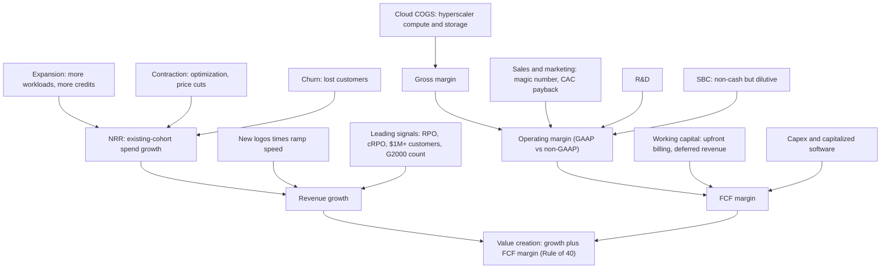
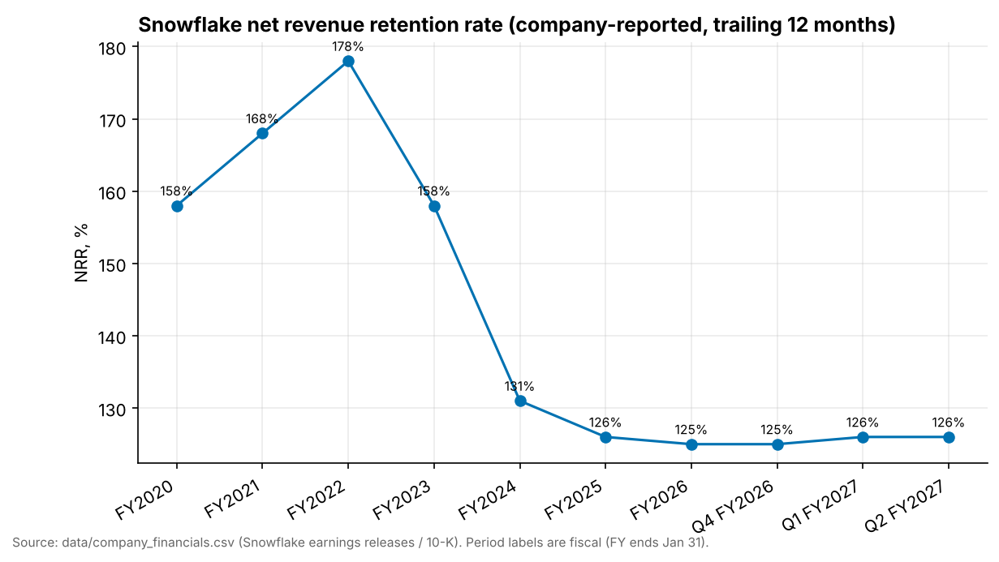
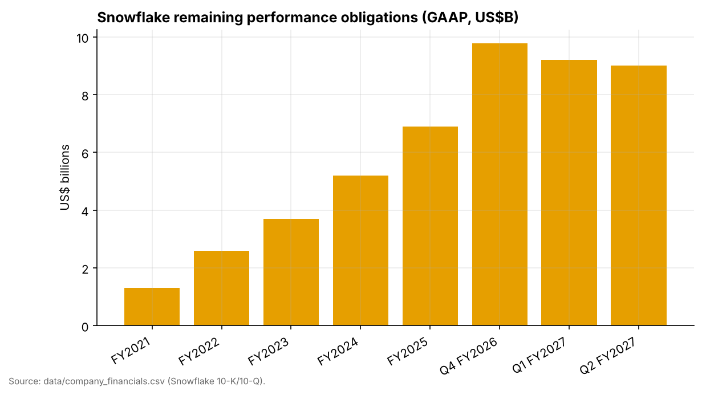
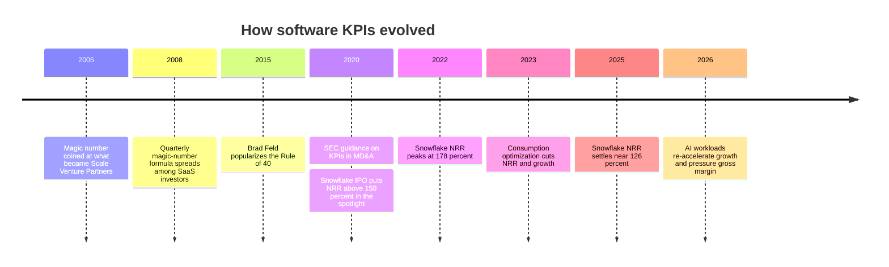

# 36. Unit Economics and KPIs
> **Depth:** L2 · **Reading time:** ~14 min · **Last verified:** 2026-11-01 · **Prerequisites:** [Ch 35. Business Models](ch35-business-models.md)

## TL;DR

- **Data-platform P&Ls are read through about ten KPIs, and most are company-defined, unaudited and non-comparable.** Snowflake's net revenue retention (NRR) and MongoDB's "net ARR expansion rate" both answer "how much more did last year's customers spend?", but they use different cohorts, different units and different windows. Always read the definition in the 10-K before comparing two numbers.
- **In a consumption model, NRR is the dominant term in the growth equation.** Snowflake's NRR fell from 178% (FY2022) to 126% (FY2025), and product revenue growth fell with it. NRR then held at 125–126% while Q2 FY2027 (May–Jul 2026) product growth re-accelerated to 37% (GAAP).[^sf-q2][^fin-csv]
- **Remaining performance obligations (RPO) is contracted backlog, not a revenue forecast.** Snowflake's RPO *fell* from $9.77B to ~$9.0B in the two quarters to July 2026 while revenue accelerated. Customers were burning down prepaid capacity faster than they signed new commitments.[^fin-csv][^sf-10q]
- **The GAAP-to-non-GAAP gap is the real story for most software companies.** In Q2 FY2027 Snowflake's GAAP operating margin was −17.0% and its non-GAAP operating margin +15.3%. The 32-point gap is mostly stock-based compensation (SBC) of ~$424M, or ~27% of revenue (press-reported). MongoDB's gap is ~20 points and Everpure's ~14.[^sf-q2][^secapi][^mdb-q2][^ep-q2]
- **The Rule of 40 is a family of formulas, not a single number.** For Snowflake the score ranges from ~18 (Q2 FY2027 growth plus GAAP operating margin) through ~20 (FY2026, FCF burdened with SBC) and ~41 (quarterly adjusted FCF) to ~58 (FY2027 adjusted-FCF guide), depending on which margin and period you use (our arithmetic). An SBC-adjusted version is the conservative CFA reading. On that basis few high-growth data companies clear 40.

## Why this matters (business + Everpure lens)

A corporate-development team prices targets, partners and competitors with these KPIs. Each one is a compressed claim about the future. NRR says the installed base will keep spending more. RPO says some of that spending is contractually committed. Gross margin says how much of each dollar survives the hyperscaler's bill. The magic number says how efficiently new revenue is bought. If you misread a definition, you misprice a deal. The classic error is comparing a trailing-two-year cohort NRR with an ARR-based expansion rate, or GAAP with non-GAAP margins.

For Everpure, the lens has two sides. **Outside-in:** every data-platform partner or target in this atlas (Snowflake, Databricks, MongoDB and the AI-native vendors in [Ch 32](../04-company-deep-dives/ch32-ai-native-data-companies.md)) reports in this vocabulary. **Inside-out:** Everpure already reports a hybrid set of KPIs: product revenue, subscription services revenue, subscription annual recurring revenue (ARR) of $2.1B (+20%) and RPO of $4.1B (+44%) as of Q2 FY2027 (quarter ended 2026-08-02).[^ep-q2] If the company moves further into data management and data services, the market will start asking for the software KPIs below, and it will judge Everpure by them. The last section of "How it works" shows what changes.

## How it works

### The KPI tree

Every metric in this chapter feeds one of two outcomes: how fast revenue grows and how much of it turns into free cash flow (FCF). The tree below is the map. The rest of the chapter walks it from left to right.

*Figure 36.1 — The KPI tree. Revenue growth is NRR plus new-logo contribution. FCF margin is operating margin adjusted for working capital and capex. SBC sits inside operating expenses under GAAP but is removed in non-GAAP, which is why the two margins diverge.*

### Net revenue retention: a cohort analysis in one number

[Net revenue retention](../glossary.md#net-revenue-retention) (NRR, also called net dollar retention or NDR) takes a fixed group of customers and divides what they spend now by what they spent a year earlier. Churned customers stay in the denominator at their old spend and count as zero in the numerator. New customers are excluded. An NRR of 126% means the cohort spent 26% more, *net* of expansion, contraction and churn.

The definitions differ in ways that matter:

- **Snowflake** uses a trailing two-year window. The cohort is the set of capacity-contract customers who used the platform at any point in the *first month* of year one. NRR is that cohort's product revenue in year two divided by its product revenue in year one. In effect it compares two consecutive trailing-12-month windows of product revenue. Recent 10-Ks state that the cohort includes end-customers buying through resellers, and history is adjusted for acquisitions and spin-offs.[^sf-10k26][^sf-10k21] Because it is a ratio of two 12-month sums, it is smooth and slow to turn.
- **MongoDB** reports a "net ARR expansion rate." It divides current ARR from customers who were also customers a year earlier by the prior-year ARR from *all* customers, including those who churned. It was ~121% at January 31, 2026, up from ~119% a year earlier. MongoDB has often described it loosely (for example, "above 120%") or as an approximate figure on earnings calls, rather than in a standing quarterly table.[^mdb-10k] It is an ARR snapshot, not a revenue flow, and Atlas consumption is annualized to get there.

**Gross revenue retention (GRR)** strips out expansion: (prior-year spend − contraction − churn) ÷ prior-year spend, capped at 100%. It measures the floor, meaning how sticky the installed base is if nobody grows. Neither Snowflake nor MongoDB reports a numeric gross retention rate in the releases reviewed for this chapter. Ask for it in diligence. An illustrative example (our numbers, not company data): a cohort spending $100M grows to $126M because expansion adds $32M, contraction removes $4M and churn removes $2M. NRR is 126% and GRR is 94%. Two companies with the same NRR can have very different GRRs, and the one with lower GRR is relying on a few large customers to expand fast enough to cover the leaks.

> **Bridge: same-store sales and cohort yield.** NRR is a software company's same-store sales (comps): it shows growth from stores that existed a year ago and ignores new openings. A fixed-income analyst would see a seasoned pool. GRR is the survival curve (one minus prepayments and defaults), and expansion is the coupon step-up. A retailer can post strong total growth on new stores while comps go negative, and a SaaS company can do the same with new logos while NRR erodes. The comps tell you whether the existing franchise is healthy.

**Why NRR leads revenue growth in consumption models.** Snowflake recognizes product revenue only when customers consume credits, so last year's customers drive most of this year's revenue. New customers start small and ramp over several quarters. Approximately, product revenue growth ≈ (NRR − 1) × (share of revenue from the cohort) + contribution from customers outside the cohort. With NRR at 126% and the cohort supplying most revenue, existing customers alone add roughly 20–26 points of growth. The remainder of Q2 FY2027's 37% product growth, about 11 points or more, came from newer customers ramping (our approximation; the windows differ because NRR is trailing-twelve-month and growth is quarterly year-over-year).[^sf-q2] Because the cohort's spend is persistent, a stable or rising NRR sets a floor under next year's growth. A falling NRR is the earliest hard evidence that the growth floor is dropping.

*Figure 36.2 — Snowflake NRR (company-stated KPI). The 2022–2024 slide from 178% to 131% came with growth falling from 106% to 38%. The plateau at 125–126% coincided with growth stabilizing near 29% and then re-accelerating to 37% in Q2 FY2027. Source: `data/company_financials.csv`.*

Read the chart as a cohort story. Product revenue growth was 106% in FY2022 (Feb 2021–Jan 2022), 38% in FY2024, and 30% and 29% in FY2025 and FY2026 (GAAP; our arithmetic from the CSV).[^fin-csv] NRR moved with it on the way down because customers optimized consumption after the 2021 boom. On the way back up the relationship loosened. Growth re-accelerated to 34% in Q1 and 37% in Q2 FY2027 with NRR flat at 126%.[^fin-csv] Because NRR is a two-window trailing ratio, it lags quarterly inflections by several quarters. Analysts therefore watch the sequential trend in NRR, together with the count of $1M+ customers, as the confirmation signal.

### RPO and cRPO: contracted backlog

[Remaining performance obligations](../glossary.md#remaining-performance-obligations) (RPO) is the dollar value of contracted revenue not yet recognized, disclosed in the revenue footnote of every 10-Q under ASC 606. Current RPO (cRPO) is the portion expected within twelve months. At July 31, 2026 Snowflake's RPO was ~$9.0B, +30% year over year. Snowflake expects ~54% of it, about $4.9B (our arithmetic), to be recognized in the next twelve months. It warns that timing depends on customer consumption, and that unused capacity can sometimes roll over past the contract term.[^sf-10q]

RPO can grow faster than revenue for a plain reason: multi-year capacity deals add the whole commitment to RPO on signature, but revenue arrives only as the customer consumes. A three-year, $300M commitment adds $300M to RPO in one quarter and perhaps $100M a year to revenue. The extreme case is Oracle. Its RPO reached $664B in Q1 FY2027 (Jun–Aug 2026) on AI-infrastructure contracts, against FY2027 revenue guidance of at least $90B.[^comps] The reverse also happens. Snowflake's RPO peaked at $9.77B at January 31, 2026, which included the largest deal in company history, then fell to $9.21B and ~$9.0B over the next two quarters while revenue accelerated.[^fin-csv] Customers were consuming prepaid capacity faster than they replaced it. That is bullish for near-term revenue and neutral to cautious for backlog coverage.

*Figure 36.3 — Snowflake RPO (GAAP disclosure). Backlog rose roughly sevenfold in five years but is lumpy. A single large multi-year deal can move it by more than a quarter's revenue, so read the trend over four quarters, not the quarter-on-quarter change. Source: `data/company_financials.csv`.*

> **Bridge: semiconductor backlog and book-to-bill.** RPO is a chipmaker's backlog with stricter rules: ASC 606 counts only enforceable contracts, while semis backlog often includes cancellable orders. cRPO ÷ next-twelve-month revenue works like book-to-bill coverage. Snowflake's cRPO (~$4.9B) covers roughly 80% of guided FY2027 product revenue ($6.07B; our estimate), and less of true next-twelve-month revenue, because half of FY2027 had already been recognized by July 31, 2026; the rest must come from on-demand use and new commitments. A falling RPO with rising revenue is a book-to-bill below 1 while shipments boom. That is fine for a quarter or two, and a warning sign if it persists.

### Billings, and why consumption companies play it down

Billings is revenue plus the change in deferred revenue: what was invoiced in the period. For seat-based SaaS and for hardware vendors that sell multi-year support, billings is a decent proxy for bookings. NetApp still leads with it: Q1 FY2027 (May–Jul 2026) billings were $2.06B, +36% (GAAP-derived).[^ntap] Consumption companies play billings down. Snowflake invoices capacity contracts, often annually in advance, so billings swing with contract length and invoice timing, while revenue follows usage. A customer who signs a larger three-year deal but is invoiced annually shows little change in billings. A customer who prepays two years at once creates a spike that says nothing about consumption. For Snowflake, RPO and NRR carry the information that billings carry for a subscription company.

### Gross margin and cloud COGS

A cloud data platform's cost of revenue is mostly the hyperscaler bill: virtual machines, object storage and network egress bought from AWS, Azure and Google Cloud to run customer queries, plus support staff and amortization of capitalized software. Snowflake reports product gross margin separately from total. In Q2 FY2027 it was 70.9% GAAP and 74.7% non-GAAP (the gap is SBC and amortization in cost of revenue). The full-year non-GAAP guide was cut to 74% because AI workloads carry more expensive compute.[^sf-q2][^fin-csv] MongoDB's total gross margin was 74% GAAP and 76% non-GAAP in the same quarter. That figure blends Atlas, which carries cloud COGS and runs at lower margin, with Enterprise Advanced, a high-margin self-managed license, and services.[^mdb-q2] As Atlas grows to ~73% of revenue (FY2026), the mix leans toward the lower-margin product.[^fin-csv]

The serverless effect, covered in [Ch 35](ch35-business-models.md) and [Ch 25](../04-company-deep-dives/ch25-databricks.md), pushes the same way. When the vendor runs compute in its own cloud account, the full VM cost moves into its COGS. Revenue per unit rises, gross margin percentage falls, and gross-profit dollars can still rise. Judge the trade in gross-profit dollars, not margin points.

> **Bridge: cloud COGS is the fabless company's wafer cost.** Snowflake buys compute from hyperscalers the way NVIDIA buys wafers from TSMC. Gross margin is the price premium over a cost the company does not control. Three levers matter: negotiating power over the input (multi-year committed-spend discounts are the cloud equivalent of wafer allocation agreements), architectural efficiency (better query engines are like better yield per wafer), and product mix (AI inference workloads behave like advanced-node, low-yield parts). A fabless firm whose foundry is also its competitor has an obvious tension. So does a data platform whose hyperscaler sells a rival warehouse.

### Sales and marketing efficiency: magic number and CAC payback

The **[magic number](../glossary.md#magic-number)** asks how much new annualized revenue each dollar of sales and marketing (S&M) bought. The term was coined in 2005 at what became Scale Venture Partners, and the quarterly formula spread from 2008.[^scale] A common version is (this quarter's revenue − last quarter's revenue) × 4 ÷ last quarter's S&M. Above ~1.0 is efficient, and ~0.7 is the usual "healthy" threshold.[^scale] **[CAC payback](../glossary.md#cac-payback)** converts the same inputs into months: 12 ÷ (magic number × gross margin). It answers how long gross profit from new revenue takes to repay the acquisition spend.

To compute both from a 10-Q, take total revenue for two consecutive quarters from the income statement, take S&M from the operating-expense lines (GAAP, so it includes SBC and amortization of acquired intangibles), and take gross margin from the same statement. The worked example below does exactly this. Two pitfalls dominate. First, consumption revenue is day-sensitive: Snowflake's Q1 (Feb–Apr) has 89 days and Q2 (May–Jul) has 92, which flatters the sequential magic number. Second, the GAAP S&M line includes non-cash SBC, while many sell-side models use non-GAAP S&M and so print a higher number.

### SBC and dilution

[Stock-based compensation](../glossary.md#stock-based-compensation) is employee pay in shares. It is expensed under GAAP but added back in non-GAAP operating income and in operating cash flow. For Snowflake it was $1,599.5M in FY2026, 34% of revenue, down from $1,479.3M (41%) in FY2025 (GAAP; our percentages).[^sf-10k26][^fin-csv] In Q2 FY2027 it was ~$424M, or 27.4% of revenue (press-reported, citing the 10-Q).[^secapi]

The CFA view is that SBC is a real expense. Paying engineers in stock instead of cash does not make the labor free. It moves the cost from the income statement to the share count. Two cross-checks keep the analysis honest. (1) **Dilution:** compare diluted share growth with buybacks. Snowflake bought back ~4.9M shares at an average $177.37 in FY2026, about $874M (our arithmetic), roughly 55% of that year's SBC expense, and ~1.7M shares for ~$300M in the first half of FY2027.[^sf-10k26][^sf-10q] (2) **Cash cost:** buybacks that offset dilution are the cash cost of SBC. They show up in financing cash flow, below the FCF line, so "FCF minus buybacks" or "FCF minus SBC" is the cleaner owner-earnings measure.

> **Bridge: SBC and the capitalized-R&D debate.** Semiconductor analysts argue about whether R&D should be capitalized, because it builds a multi-year asset. SBC raises the mirror-image question: it is an operating cost funded with equity instead of cash. Adding SBC back is like capitalizing R&D and then never amortizing it. The input still gets used up. It is just paid for with someone else's ownership.

### Rule of 40, FCF margin and customer counts

The **[Rule of 40](../glossary.md#rule-of-40)** says revenue growth plus profit margin should exceed 40%. It was popularized by Brad Feld in February 2015 for SaaS companies at scale.[^feld] The variants matter more than the rule. Growth can be total or product revenue, quarterly or annual. Margin can be FCF, adjusted FCF, non-GAAP operating, GAAP operating or EBITDA. Palantir prints a company-defined score each quarter: 155% in Q2 2026, on 93% growth and a 63% adjusted FCF margin.[^pltr] ServiceNow reports a "Rule of" figure using constant-currency subscription growth and FCF margin.[^now]

**FCF margin** is (operating cash flow − capex) ÷ revenue. Companies then "adjust" it. Snowflake's adjusted FCF adds back net cash paid on payroll-tax items tied to employee stock transactions. Other companies add back restructuring or acquisition costs. Upfront annual billing makes FCF lumpy by quarter: Snowflake's Q2 FY2027 adjusted FCF margin was 6.0%, its Q4 FY2026 margin 61%, and FY2026 as a whole 25.5% (non-GAAP).[^fin-csv] Use trailing-twelve-month or full-year figures for any Rule-of-40 work.

*Figure 36.4 — Rule of 40 across comps (latest quarter growth, GAAP; FCF margin non-GAAP on the basis shown by marker shape). Most data and infrastructure names now clear 40 on an adjusted-FCF basis. The ranking changes if you swap in a quarterly FCF margin (Snowflake falls to ~41) or deduct SBC. Source: `data/ch36_rule_of_40.csv`; Everpure's FCF margin is an estimate from guidance midpoints.*

**Customer counts** are the last leading indicator. Snowflake reports customers with more than $1M of trailing-12-month product revenue, 828 at Q2 FY2027 (+27%) against 77 at FY2021. It also reports Forbes Global 2000 customers: 829, or ~41% of the list (our arithmetic).[^sf-q2][^fin-csv][^pulse] MongoDB reports total customers (70,600+) and customers above $100K ARR (2,999).[^mdb-q2] Large-customer counts matter more than totals. In a consumption model the big accounts carry the NRR, so a slowdown in $1M+ additions often shows up before NRR moves.

### Worked example: reading Snowflake's Q2 FY2027 (May–Jul 2026)

FY2027 = February 2026–January 2027. All dollar figures are US$M. The press-reported summary cited a GAAP operating loss of ~$263M, and it reconciles exactly to the company's −17.0% GAAP operating margin.

| # | Line in release / 10-Q | Formula | Value | Label |
|---|---|---|---|---|
| 1 | Product revenue | as reported | ~$1,490 (+37% YoY) | GAAP |
| 2 | Total revenue, Q2 FY2027 | as reported | $1,546.8 (+35% vs $1,145.0) | GAAP |
| 3 | Total revenue, Q1 FY2027 | as reported | ~$1,390 | GAAP (rounded) |
| 4 | S&M expense, Q2 FY2027 | 10-Q income statement | $611.6 (+22% vs $502.0) | GAAP |
| 5 | S&M expense, Q1 FY2027 | six-month S&M (~$1,200) − row 4 | ~$590 | estimate (derived) [VERIFY] |
| 6 | Magic number (sequential) | (row 2 − row 3) × 4 ÷ row 5 | (156.8 × 4) ÷ 590 ≈ **1.06** | estimate |
| 7 | Magic number, day-adjusted | Q2 revenue scaled to Q1's 89 days: 1,546.8 × 89/92 = 1,496.4; (1,496.4 − 1,390) × 4 ÷ 590 | ≈ **0.72** | estimate |
| 8 | CAC payback | 12 ÷ (row 6 × GAAP product GM 70.9%) | ≈ **16 months** (≈ 24 day-adjusted) | estimate |
| 9 | S&M as % of revenue | row 4 ÷ row 2 | 39.5% (43.8% a year earlier) | GAAP |
| 10 | SBC | cash-flow statement | ~$424 | GAAP, press-reported |
| 11 | SBC % of revenue | row 10 ÷ row 2 | **27.4%** | GAAP, press-reported |
| 12 | GAAP operating income | as reported | ~−$263 (−17.0%) | GAAP |
| 13 | Other non-GAAP add-backs | row 14 − row 12 − row 10 | ~$76 (4.9 pts) | derived; amortization of acquired intangibles, payroll tax on equity, other [VERIFY split] |
| 14 | Non-GAAP operating income | as reported | ~$237 (15.3%) | non-GAAP |
| 15 | Adjusted FCF | as reported | $92.3 (6.0%) | non-GAAP |
| 16 | Rule of 40 (quarter) | total growth 35 + adjusted FCF margin 6.0 | **41** | mixed: GAAP growth, non-GAAP FCF |
| 17 | Rule of 40 (guide) | 35 + FY2027 adjusted FCF margin guide 23 | **58** | company guidance-derived |
| 18 | Rule of 40 (SBC-burdened, FY2026) | FY2026 growth 29.2 + (adj. FCF $1,192.7 − SBC $1,599.5) ÷ $4,683.9 | 29.2 − 8.7 ≈ **20** | estimate |

*Figure 36.5 — Worked 10-Q example. Sources: Snowflake Q2 FY2027 release and 10-Q; Q1 FY2027 release; FY2026 10-K; sec-api.io for SBC.[^sf-q2][^sf-10q][^sf-q1][^sf-10k26][^secapi] The margin bridge is −17.0% + 27.4 (SBC) + 4.9 (other) = 15.3%. The day adjustment alone removes about a third of the apparent S&M efficiency.*

The read-through: Snowflake is buying growth more efficiently than a year ago. S&M grew 22% against revenue growth of 35%, so S&M fell from 43.8% to 39.5% of revenue. On a calendar-adjusted basis the magic number of ~0.7 is healthy, not spectacular. SBC has come down from ~41% to ~27% of revenue, but it still accounts for most of the gap between a GAAP loss and a non-GAAP profit. The fair Rule-of-40 range is ~41–58 on company definitions and ~20 if SBC is treated as cash.

### MongoDB in one table, and the Everpure contrast

| Q2 FY2027 (May–Jul 2026)* | Snowflake | MongoDB | Everpure (formerly Pure Storage) |
|---|---|---|---|
| Revenue (GAAP) | $1,546.8M, +35% | $771.8M, +30% | ~$1,186M (product $687M + subscription services $499M), +38% |
| Gross margin | product 70.9% GAAP / 74.7% non-GAAP | 74% GAAP / 76% non-GAAP (total) | 68.4% GAAP / 69.9% non-GAAP (total) |
| GAAP operating margin | −17.0% (~−$263M) | 3.7% ($28.4M) | 5.3% ($63M; our arithmetic) |
| Non-GAAP operating margin | 15.3% | 24% ($185.9M) | 19.4% |
| GAAP-to-non-GAAP gap | ~32 pts | ~20 pts | ~14 pts |
| FCF in quarter (non-GAAP) | $92.3M adjusted (6.0%) | $137.6M (17.8%) | −$238M (FY2027 guide $600–800M) |
| Retention / recurring KPI | NRR 126% | net ARR expansion ~121% (Jan 31, 2026, 10-K; ~122% in Q2 FY2027, press-reported) | subscription ARR $2.1B, +20% |
| Backlog | RPO ~$9.0B, +30% | not used as a headline KPI | RPO $4.1B, +44% |
| Large-customer KPI | 828 customers >$1M TTM; 829 G2000 | 2,999 customers ≥$100K ARR | not disclosed as a headline KPI |
| Rule of 40 (our arithmetic) | 41 (quarter) / 58 (guide) | ~48 (quarter) | ~52 (guide-based estimate) |

*Figure 36.6 — Three P&Ls side by side. \*Everpure's quarter ended 2026-08-02. Snowflake and MongoDB carry cloud COGS and big SBC gaps. Everpure carries hardware COGS, a smaller SBC gap and working-capital swings from inventory. Sources: company releases.[^sf-q2][^mdb-q2][^mdb-10k][^ep-q2]*

MongoDB's quarter shows what a more mature consumption database looks like. Growth is slightly slower than Snowflake's, the GAAP-to-non-GAAP gap is narrower, and the company is already GAAP-profitable. Free cash flow nearly doubled from $69.9M a year earlier.[^mdb-q2] Its retention KPI is ARR-based and disclosed less often, so a like-for-like NRR comparison with Snowflake is not possible from public data.

**Everpure lens: what changes if a storage company adds software and data services.** A storage P&L runs on product revenue recognized at shipment, gross margin that moves with component (NAND) costs and mix, and FCF that swings with inventory and deferred revenue. The subscription business (Evergreen and storage-as-a-service) already behaves like software: recurring, measured as ARR, with a higher gross margin than product. In past quarters Everpure's non-GAAP subscription services gross margin ran in the mid-70s against the high-60s for product (press-reported).[^ep-seg] Adding data management or data-intelligence services would shift the KPI set in four ways, which a strategy team might evaluate from public information. (1) Investors would ask for a separate software or data-services ARR and a retention rate (NRR and GRR) on that line. Subscription ARR alone would not be enough. (2) Gross margin would rise if the software is self-managed, and fall if it runs as a hosted, cloud-COGS service, the same serverless trade-off described above. (3) S&M efficiency would need its own measure, because selling software to data teams is a different motion from selling arrays to infrastructure buyers. (4) SBC would likely rise as a share of revenue, since software talent markets pay in equity, which widens the GAAP-to-non-GAAP gap. Today Everpure's ~14-point gap is narrower than Snowflake's ~32 or MongoDB's ~20.

> **Storage bridge.** A storage vendor's subscription ARR and a data platform's NRR measure different things: ARR is a point-in-time annualized contract value, and NRR is the growth of a fixed cohort's spend. Everpure does not publish an NRR. Its closest analogues are subscription ARR growth (+20%) and RPO growth (+44%).[^ep-q2] See the companion *Everpure Tech Atlas* for how Evergreen subscriptions are structured.

### KPI reference card

| KPI | Definition | Formula | Where disclosed | Pitfalls |
|---|---|---|---|---|
| NRR / NDR | Growth in spend of a fixed prior-year cohort | Cohort spend (year 2) ÷ cohort spend (year 1) | 10-K "key business metrics", earnings release | Cohort and window differ by company; trailing ratios lag; not audited |
| Net ARR expansion rate (MongoDB) | ARR-based NRR | Current ARR of year-ago customers ÷ year-ago ARR of all customers | 10-K, periodic call commentary | ARR for consumption is an annualization; disclosed irregularly |
| Gross revenue retention | NRR without expansion | (Prior spend − contraction − churn) ÷ prior spend | Rarely disclosed | Hides behind strong NRR; ask in diligence |
| RPO | Contracted, unrecognized revenue | Sum of unsatisfied performance obligations | 10-Q/10-K revenue footnote (ASC 606) | Lumpy with large deals; timing depends on consumption for capacity deals |
| cRPO | RPO due within 12 months | RPO × % expected in 12 months | 10-Q footnote, some releases | Estimate based on historical consumption; compare with NTM revenue, not RPO |
| Billings | Amount invoiced | Revenue + Δ deferred revenue | Derived from statements; some releases | Distorted by invoice timing and duration; less useful for consumption models |
| Product gross margin | Margin on the core platform | (Product revenue − product COGS) ÷ product revenue | Income statement, release | GAAP vs non-GAAP (SBC, amortization); AI and serverless mix dilutes |
| Magic number | S&M efficiency | ΔQuarterly revenue × 4 ÷ prior-quarter S&M | Derived from 10-Q | Day count; GAAP vs non-GAAP S&M; one quarter is noisy |
| CAC payback | Months to recover acquisition cost | 12 ÷ (magic number × gross margin) | Derived | Inherits all magic-number noise; ignores churn |
| SBC % revenue | Equity-funded cost intensity | SBC ÷ revenue | Cash-flow statement, release reconciliation | Excluded from non-GAAP; check buybacks and diluted share growth |
| GAAP vs non-GAAP operating margin | Profitability with and without SBC and other items | Non-GAAP adds back SBC, amortization, other | Release reconciliation table | Gap size is the real signal; "other" items creep |
| FCF margin / adjusted FCF | Cash generation | (CFO − capex [− capitalized software]) ÷ revenue | Release reconciliation | Seasonal by quarter; "adjusted" definitions vary; excludes SBC cost |
| Rule of 40 | Growth vs profitability balance | Growth % + margin % | Some companies self-report | Mixing bases; quarterly FCF; ignores SBC |
| $1M+ customers / G2000 | Large-account penetration | Count above threshold (TTM revenue) | Release, 10-K | Thresholds differ ($1M TTM revenue vs $100K ARR) |

*Figure 36.7 — KPI definitions. The "Where disclosed" column shows which numbers are audited (statement lines) and which are company-defined metrics. The SEC's 2020 guidance expects a clear definition and a consistent calculation for each such metric.[^sec-kpi]*

## Design choices and trade-offs

Companies choose which KPIs to headline, and the choice tells you what they want you to look at.

| Choice | Option A | Option B | Who picks what | Steelman for the less-favored option |
|---|---|---|---|---|
| Retention metric | Revenue-based NRR (Snowflake) | ARR-based expansion rate (MongoDB) | Consumption vendors with capacity contracts lean A | ARR is forward-looking and comparable to seat SaaS |
| Backlog metric | RPO/cRPO | Billings | Consumption and cloud: A; hardware and seat SaaS: B | Billings is cash-linked and harder to flatter with long contracts |
| Profit metric | Non-GAAP operating margin | GAAP operating margin | Almost all growth software: A | GAAP charges for SBC, which the owner bears |
| Rule-of-40 margin | Adjusted FCF | Operating or SBC-burdened FCF | Most self-reporters: A | SBC-burdened is closer to owner earnings |
| Large-customer count | $1M+ TTM revenue | $100K+ ARR | Snowflake A; MongoDB, Datadog B | Lower threshold captures mid-market momentum earlier |

*Figure 36.8 — Disclosure choices. The company-favored option is usually the more flattering one. That is not a reason to reject it, but it is a reason to rebuild the other one yourself.*

The strongest defense of non-GAAP metrics is comparability. SBC is non-cash, its accounting value depends on the share price at grant, and excluding it makes companies with different equity mixes easier to compare. The strongest counter is that dilution is permanent. Owners care about value per share, and a company that never reaches GAAP profitability has never shown that its unit economics cover its full labor cost.

## Who's who

| Company | Headline KPIs it emphasizes | Notable latest value (basis, date) |
|---|---|---|
| Snowflake | NRR, product revenue, RPO, $1M+ customers, G2000 | NRR 126%; RPO ~$9.0B (Q2 FY2027)[^sf-q2] |
| MongoDB | Atlas growth and share, net ARR expansion, $100K+ customers | Atlas +29%; 2,999 ≥$100K (Q2 FY2027)[^mdb-q2] |
| Datadog | $100K+ ARR customers, FCF | ~4,720 ≥$100K; FCF $279M (Q2 2026)[^r40] |
| Palantir | Self-reported Rule of 40, adjusted FCF | 155% (Q2 2026)[^pltr] |
| ServiceNow | cRPO, subscription growth, FCF margin | cRPO $13.65B, +20.5% (Q3 2026)[^now] |
| Workday | 12-month subscription backlog | $9.034B, +14.2% (Q2 FY2027)[^comps] |
| NetApp | Billings, Public Cloud revenue | Billings $2.06B, +36% (Q1 FY2027)[^ntap] |
| Everpure | Subscription ARR, RPO, product vs subscription mix | ARR $2.1B; RPO $4.1B (Q2 FY2027)[^ep-q2] |

*Figure 36.9 — Who reports what. Each company headlines the KPI on which it looks strongest. Comparing across companies means rebuilding a common metric from the statements. For valuation multiples on these names, see [Ch 37](ch37-public-comps-valuation.md).*

## History and trajectory

*Figure 36.10 — KPI history. The vocabulary was built for seat-based SaaS. Consumption models (NRR as cohort flow, RPO as burn-down capacity) and then AI workloads (compute-heavy COGS) have tested each metric's assumptions in turn.*

The magic number came out of venture practice in the mid-2000s as a quick test of whether sales spending was "working."[^scale] The Rule of 40 followed in 2015 as a board-room heuristic for balancing growth and profit at scale.[^feld] Both were built for seat-based subscription companies with annual contracts and roughly linear revenue recognition. In January 2020 the SEC told registrants that any KPI in MD&A needs a clear definition, an explanation of why it is useful and a consistent calculation, with changes disclosed.[^sec-kpi] That is why NRR definitions now sit in 10-Ks.

The consumption era stress-tested the vocabulary. Snowflake's FY2021 10-K showed NRR of 168%. The FY2022 figure, 178%, was the peak, and the company later restated it to 177% after cohort adjustments.[^sf-10k21][^fin-csv] When customers optimized spend in 2022–2023, NRR and growth fell together, which showed that consumption revenue has no contractual floor. The 2025–2026 phase introduced a new tension. AI workloads lifted consumption and growth (Q2 FY2027 product revenue +37%) but carry more expensive compute, so the gross-margin guide moved down to 74%.[^fin-csv] The KPIs to watch next are gross-profit dollars per customer and SBC per dollar of revenue, not headline growth alone.

## Numbers that matter

| Metric | Value | Basis | Source / date |
|---|---|---|---|
| Snowflake product revenue growth, Q2 FY2027 | +37% (~$1.49B) | GAAP | Release, 2026-09-02[^sf-q2] |
| Snowflake NRR | 126% (FY2022 peak 178%) | company-stated KPI | Release; CSV[^sf-q2][^fin-csv] |
| Snowflake RPO / share due in 12 months | ~$9.0B / ~54% | GAAP disclosure | 10-Q, Jul 31, 2026[^sf-10q] |
| Snowflake product gross margin | 70.9% GAAP / 74.7% non-GAAP; FY guide 74% | GAAP / non-GAAP | Release[^sf-q2] |
| Snowflake GAAP vs non-GAAP operating margin | −17.0% vs 15.3% | GAAP / non-GAAP | Release[^sf-q2] |
| Snowflake SBC % revenue | ~27% (Q2 FY2027); 34% (FY2026) | GAAP; Q2 press-reported | sec-api.io; 10-K[^secapi][^sf-10k26] |
| Snowflake magic number, Q2 FY2027 | ~1.06 raw / ~0.72 day-adjusted | estimate | Our arithmetic from 10-Q |
| Snowflake $1M+ customers / G2000 | 828 / 829 | company-stated KPI | Release[^sf-q2][^pulse] |
| MongoDB revenue / non-GAAP op margin | $771.8M (+30%) / 24% | GAAP / non-GAAP | Release, 2026-09-01[^mdb-q2] |
| MongoDB net ARR expansion | ~121% (Jan 31, 2026); ~122% Q2 FY2027 (press-reported, Zacks) | company-stated KPI / press-reported | FY2026 10-K[^mdb-10k]; `data/public_comps.csv`[^comps] |
| Everpure non-GAAP gross / operating margin | 69.9% / 19.4% | non-GAAP | Release, 2026-08-26[^ep-q2] |
| Everpure subscription ARR / RPO | $2.1B (+20%) / $4.1B (+44%) | company-stated KPI / GAAP | Release[^ep-q2] |

## Conversation playbook

**Three questions for a data-platform PM or product-finance lead**

1. "How do you define NRR: which cohort, which window, and are reseller end-customers included?" *A good answer* states the cohort entry rule, whether the measure is revenue- or ARR-based, and how the trailing window smooths it. Bonus if they volunteer gross retention.
2. "What share of RPO is expected in the next twelve months, and how much of current revenue is on-demand rather than drawn from capacity contracts?" *A good answer* gives cRPO coverage of next-year revenue and explains rollover terms.
3. "How do AI workloads change product gross margin, and do you price them to protect gross-profit dollars per credit?" *A good answer* separates margin percentage from gross-profit dollars and names the cost driver (GPU or compute intensity).

**Three questions for an engineer or FinOps architect**

1. "What fraction of a typical query's cost is compute versus storage versus egress in your cloud bill?" *Good:* compute dominates for analytics, and storage is small. Egress matters for cross-cloud sharing.
2. "When you move a workload to serverless, what happens to utilization of the underlying VMs?" *Good:* warm pools and bin-packing raise utilization, which is how serverless can protect gross margin.
3. "Which engine-efficiency gains did you pass to customers as lower credit consumption?" *Good:* specific examples, plus an admission that efficiency gains briefly reduce revenue before elasticity brings it back.

**What good answers sound like.** They give definitions before numbers, label GAAP versus non-GAAP without being asked, and talk in gross-profit dollars and cohorts rather than headline percentages.

**Don't say this**

- "Snowflake's NRR is 126%, so it is better than MongoDB's 121%." *Different cohorts, units and windows. The two are not directly comparable.*
- "RPO is next year's revenue." *Only the cRPO portion (~54% for Snowflake) is expected within twelve months, and capacity can roll over.*
- "Snowflake is profitable." *On a non-GAAP basis, yes (15.3%). Its GAAP operating margin was −17.0% in Q2 FY2027.*
- "SBC is non-cash, so ignore it." *It is paid with dilution, and buybacks to offset it are real cash.*
- "They pass the Rule of 40." *Say which growth rate, which margin and which period. The same company can score 20 or 58.*
- "Billings are down, so demand is weak." *Not for consumption models, where invoice timing and contract length drive billings.*

## Going deeper

- Read the "Key Business Metrics" section of Snowflake's FY2026 10-K and MongoDB's FY2026 10-K side by side. Note every definitional difference.[^sf-10k26][^mdb-10k]
- Rebuild the magic number on a trailing-four-quarter basis to remove the day-count effect, and compare it with the sequential figure in Figure 36.5.
- For valuation (how the market capitalizes these KPIs into EV/NTM revenue multiples), continue to [Ch 37](ch37-public-comps-valuation.md). For company context see [Ch 26 Snowflake](../04-company-deep-dives/ch26-snowflake.md) and [Ch 29](../04-company-deep-dives/ch29-operational-database-vendors.md).

> **Going deeper (L3).** To reconstruct cRPO coverage, take RPO from the revenue footnote, multiply by the stated next-twelve-month percentage, and divide by guided next-twelve-month product revenue. For Snowflake: ~$9.0B × 54% ≈ $4.86B, ÷ $6.07B FY2027 product guide ≈ 80% (our estimate; the guide covers the fiscal year, not exactly the next twelve months). Whatever is not covered must come from on-demand consumption, new contracts and overage, which is the forecast risk.

## Key terms

- [Net revenue retention](../glossary.md#net-revenue-retention) — this year's spend from last year's customer cohort ÷ their spend a year earlier.
- [Gross revenue retention](../glossary.md#gross-revenue-retention) — retention of prior-year spend after contraction and churn, excluding expansion.
- [Net ARR expansion rate](../glossary.md#net-arr-expansion-rate) — MongoDB's ARR-based version of NRR.
- [Cohort analysis](../glossary.md#cohort-analysis) — tracking a fixed group of customers over time to separate existing-base growth from new-customer growth.
- [Remaining performance obligations](../glossary.md#remaining-performance-obligations) — contracted revenue not yet recognized (ASC 606 disclosure).
- [Current remaining performance obligations](../glossary.md#current-remaining-performance-obligations) — the part of RPO expected within twelve months.
- [Capacity contract](../glossary.md#capacity-contract) — a prepaid or committed amount of consumption credits drawn down as the customer uses the service.
- [Billings](../glossary.md#billings) — revenue plus the change in deferred revenue; what was invoiced in a period.
- [Book-to-bill](../glossary.md#book-to-bill) — orders received ÷ revenue shipped; above 1 means backlog is growing.
- [Product gross margin](../glossary.md#product-gross-margin) — gross margin on platform (product) revenue, excluding professional services.
- [Cloud COGS](../glossary.md#cloud-cogs) — hyperscaler compute, storage and network costs booked in a cloud vendor's cost of revenue.
- [Magic number](../glossary.md#magic-number) — annualized new revenue per dollar of prior-period sales and marketing spend.
- [CAC payback](../glossary.md#cac-payback) — months of gross profit needed to recover customer-acquisition cost.
- [Stock-based compensation](../glossary.md#stock-based-compensation) — employee pay in equity; expensed under GAAP, added back in non-GAAP.
- [Non-GAAP operating margin](../glossary.md#non-gaap-operating-margin) — operating margin excluding SBC, amortization of acquired intangibles and other items.
- [Free cash flow margin](../glossary.md#free-cash-flow-margin) — (operating cash flow − capex) ÷ revenue.
- [Adjusted free cash flow](../glossary.md#adjusted-free-cash-flow) — FCF with company-specific add-backs, such as payroll taxes on employee equity.
- [Rule of 40](../glossary.md#rule-of-40) — the heuristic that revenue growth % plus profit margin % should be at least 40.
- [Annual recurring revenue](../glossary.md#annual-recurring-revenue) — the annualized value of recurring contracts at a point in time.
- [Revenue run-rate](../glossary.md#revenue-run-rate) — current-period revenue annualized; not audited annual revenue.

## Sources

[^sf-q2]: Snowflake Inc., "Snowflake Reports Financial Results for the Second Quarter of Fiscal 2027," https://www.nasdaq.com/press-release/snowflake-reports-financial-results-second-quarter-fiscal-2027-2026-09-02 (also Business Wire, https://secure.businesswire.com/news/home/20260902386235/en/Snowflake-Reports-Financial-Results-for-the-Second-Quarter-of-Fiscal-2027), published 2026-09-02; retrieved 2026-11-01. Values per `data/company_financials.csv`; GAAP operating loss ~$263M and non-GAAP operating income ~$237M per search excerpts of the release. FY2027 = Feb 2026–Jan 2027.
[^sf-10q]: Snowflake Inc., "Form 10-Q for the quarter ended July 31, 2026," https://www.sec.gov/Archives/edgar/data/0001640147/000164014726000037/snow-20260731.htm, filed 2026-09 [VERIFY exact filing date]; retrieved 2026-11-01 via search excerpts (S&M $611.6M vs $502.0M; six-month S&M ~$1.20B; RPO ~$9.0B with ~54% expected in 12 months; ~1.7M shares repurchased for ~$300M in six months).
[^sf-q1]: Snowflake Inc., "Snowflake Reports Financial Results for the First Quarter of Fiscal 2027," https://investors.snowflake.com/news/news-details/2026/Snowflake-Reports-Financial-Results-for-the-First-Quarter-of-Fiscal-2027/default.aspx, published 2026-05-27; retrieved 2026-11-01 (total revenue ~$1.39B; product revenue $1,334.3M; GAAP operating loss $326.2M).
[^sf-10k26]: Snowflake Inc., "Form 10-K for the fiscal year ended January 31, 2026," https://www.sec.gov/Archives/edgar/data/1640147/000164014726000008/snow-20260131.htm, filed 2026-03 [VERIFY exact filing date]; retrieved 2026-11-01 (NRR definition; FY2026 repurchases of ~4.9M shares at a weighted-average $177.37; SBC per `data/company_financials.csv`).
[^sf-10k21]: Snowflake Inc., "Form 10-K for the fiscal year ended January 31, 2021," https://www.sec.gov/Archives/edgar/data/1640147/000164014721000073/snow-20210131.htm, filed 2021-03; retrieved 2026-11-01 (original NRR cohort definition; NRR 168%). Later 10-K (FY2023, https://www.sec.gov/Archives/edgar/data/1640147/000164014723000030/snow-20230131.htm) shows FY2022 NRR as 177% after adjustments.
[^fin-csv]: AI Data Atlas dataset `data/company_financials.csv` (Snowflake FY2020–Q2 FY2027 product revenue, NRR, RPO, $1M+ customers, margins, SBC; MongoDB Atlas share; sources per row: Snowflake 10-Ks and earnings releases incl. https://www.sec.gov/Archives/edgar/data/1640147/000162828026011631/fy2026q4earnings.htm, published 2026-02-25); retrieved 2026-11-01.
[^secapi]: sec-api.io, "Snowflake (SNOW) stock after the $3.75bn convertible notes: Q2 FY2027 product revenue, RPO, insider sales and scenarios to FY2030," https://sec-api.io/insights/snowflake-snow-stock-after-the-3-75bn-convertible-notes-q2-fy2027-product-revenue-rpo-insider-sales-and-scenarios-to-fy2030, published 2026-10-10; retrieved 2026-11-01. Press-reported (secondary analysis citing the 10-Q): SBC $424M vs $404M a year earlier.
[^pulse]: Pulse 2.0, "Snowflake: Q2 Fiscal 2027 Revenue Rises 35% To $1.55 Billion As Product Revenue Guidance Is Raised," https://pulse2.com/snowflake-q2-fiscal-2027-revenue-rises-35-to-1-55-billion-as-product-revenue-guidance-is-raised/, published 2026-09; retrieved 2026-11-01 (cross-check of revenue, RPO and Forbes Global 2000 count of 829).
[^mdb-q2]: MongoDB, Inc., "MongoDB, Inc. Announces Second Quarter Fiscal 2027 Financial Results," https://investors.mongodb.com/news-releases/news-release-details/mongodb-inc-announces-second-quarter-fiscal-2027-financial, published 2026-09-01; retrieved 2026-11-01 (revenue $771.8M; GAAP income from operations $28.4M; non-GAAP $185.9M, 24%; FCF $137.6M vs $69.9M; 70,600+ customers; 2,999 ≥$100K ARR). FY2027 = Feb 2026–Jan 2027.
[^mdb-10k]: MongoDB, Inc., "Form 10-K for the fiscal year ended January 31, 2026," https://www.sec.gov/Archives/edgar/data/1441816/000162828026016799/mdb-20260131.htm, filed 2026-03 [VERIFY exact filing date]; retrieved 2026-11-01 (net ARR expansion rate ~121% and its definition).
[^ep-q2]: Everpure, Inc., "Everpure Announces Second Quarter Fiscal 2027 Financial Results," https://investor.everpuredata.com/news-and-events/press-releases/press-release-details/2026/Everpure-Announces-Second-Quarter-Fiscal-2027-Financial-Results/default.aspx, published 2026-08-26; retrieved 2026-11-01 (product $687M; subscription services $499M; GAAP GM 68.4%; non-GAAP GM 69.9%; GAAP operating income $63M; non-GAAP operating margin 19.4%; FCF −$238M; FY2027 FCF guide $600–800M; subscription ARR $2.1B; RPO $4.1B; ~$69M buybacks). Quarter ended 2026-08-02.
[^ep-seg]: Pure Storage (now Everpure), "Q3 FY26 Earnings Slide Deck," https://s21.q4cdn.com/687136699/files/doc_financials/2026/q3/Q3FY26-Earnings-Slide-Deck-FINAL.pdf, published 2025-12 [VERIFY date]; retrieved 2026-11-01. Segment margins (non-GAAP product ~68% and subscription services ~76.5% in Q2 FY2026; product 72.9% and subscription 75.5% in Q3 FY2026) come from third-party summaries of company materials. Press-reported [VERIFY against 10-Q].
[^comps]: AI Data Atlas dataset `data/public_comps.csv` (Oracle RPO $664B and FY2027 guide; Workday 12-month subscription backlog $9.034B; MongoDB net ARR expansion rate 122% in Q2 FY2027, press-reported via Zacks/Nasdaq), sources per row (stockanalysis.com and company releases), as of 2026-10-16 to 2026-10-30; retrieved 2026-11-01.
[^r40]: AI Data Atlas dataset `data/ch36_rule_of_40.csv`, compiled from: Datadog Q2 2026 release (SEC 8-K Ex. 99.1), https://www.sec.gov/Archives/edgar/data/0001561550/000162828026053829/ex-991x20260630x8k.htm, 2026-08-06; Workday, Elastic, GitLab, Rubrik, Nutanix and Everpure releases listed in the CSV; retrieved 2026-11-01.
[^pltr]: Palantir Technologies Inc., "Q2 2026 results," Form 8-K Ex. 99.1, https://www.sec.gov/Archives/edgar/data/0001321655/000132165526000039/a2026q2ex991pressrelease.htm, published 2026-08-03 (date as cited in Ch 37); retrieved 2026-11-01 (revenue $1.935B, +93%; adjusted FCF $1.220B, 63%; Rule of 40 score 155%).
[^now]: ServiceNow, Inc., "ServiceNow Reports Third Quarter 2026 Financial Results," Form 8-K, https://www.sec.gov/Archives/edgar/data/0001373715/000137371526000092/erq3fy26.htm, published 2026-10 [VERIFY day]; retrieved 2026-11-01 (total revenue $4,106M, +20.5%; cRPO $13.65B; FY2026 FCF margin guide raised to 36%).
[^ntap]: NetApp, Inc., "NetApp Reports First Quarter of Fiscal Year 2027 Results," https://netapp.com/newsroom/press-releases/news-rel-20260902-results-607632, published 2026-09-02; retrieved 2026-11-01 (revenue $2,025M, +30%; billings $2.06B, +36%; FCF $401M; quarter included an extra week, press-reported). NetApp FY ends last Friday of April.
[^feld]: Brad Feld, "The Rule of 40% For a Healthy SaaS Company," https://feld.com/archives/2015/02/rule-40-healthy-saas-company.html, published 2015-02-02; retrieved 2026-11-01 (via secondary summaries, e.g., Tomasz Tunguz, https://tomtunguz.com/rule-of-40/).
[^scale]: Scale Venture Partners, "A History of the Magic Number," https://www.scalevp.com/blog/a-history-of-the-magic-number, published [VERIFY date]; retrieved 2026-11-01 (term coined 2005 by Rory O'Driscoll; ~0.7 healthy baseline).
[^sec-kpi]: U.S. Securities and Exchange Commission, "Commission Guidance on Management's Discussion and Analysis of Financial Condition and Results of Operations," Release No. 33-10751, https://www.sec.gov/rules/final/33-10751.htm, published 2020-01-30 (effective 2020-02-25); retrieved 2026-11-01.
