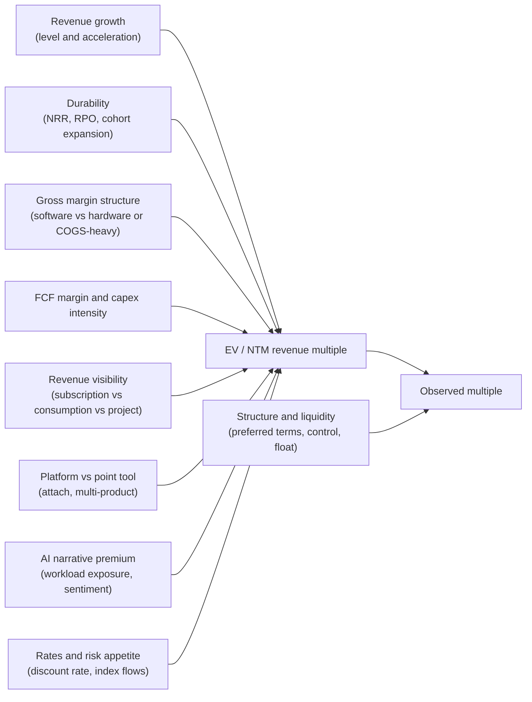
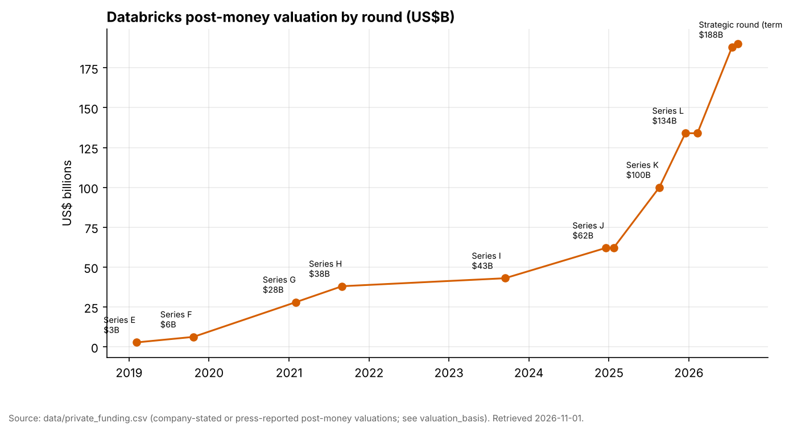
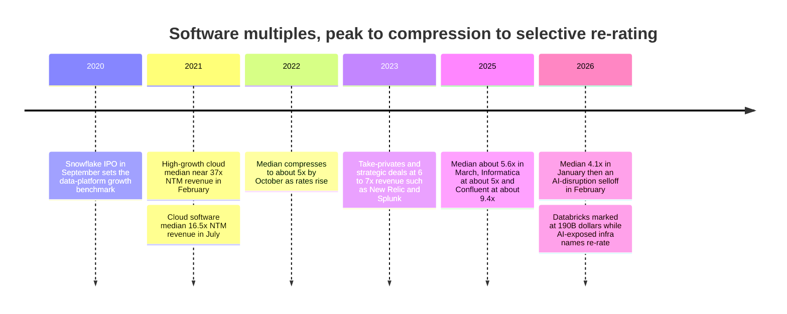

# 37. Public Comps and Valuation
> **Depth:** L2 · **Reading time:** ~14 min · **Last verified:** 2026-11-01 · **Prerequisites:** [Ch 36 — Unit economics and KPIs](ch36-unit-economics-kpis.md)

## TL;DR

- **Growth is the main thing priced, but it explains well under half the spread.** Across 24 listed data and infrastructure comps (Palantir and the acquired Confluent excluded; Domo, whose multiple reflects a pending asset sale, included), a straight line of [EV/NTM revenue](../glossary.md#ntm-revenue-multiple) against latest revenue growth has a slope of about **0.19x per point of growth** and an **R² of 0.38** (our regression on `data/public_comps.csv`, market data as of June–November 2026). Durability, [net revenue retention](../glossary.md#net-revenue-retention), margin structure and the AI narrative account for most of the rest.
- **The market pays for software-like quality, not just speed.** Datadog (21.5x at 36% growth) and Snowflake (16.9x at 35%) sit well above the line. Everpure (8.5x at 38%), NetApp (5.1x at 30%) and Oracle (5.7x at 30%) sit below it. Their growth comes with hardware mix, capex or price tailwinds that investors expect to fade.[^comps]
- **Palantir is a different regime.** On the same basis as the rest of the table it trades at **~53x EV/NTM revenue** (EV ÷ FY2026 revenue-guide midpoint, as of 2026-10-30) with **93%** latest-quarter growth; on trailing revenue the figure is **70.3x EV/TTM** against 79% TTM growth. It adds a 63% adjusted FCF margin in Q2 2026 and a company-defined [Rule of 40](../glossary.md#rule-of-40) score of 155. The line predicts about 22x for 93% growth. Per point of growth (~0.57 turns) Palantir is priced like Datadog; what is extraordinary is the growth level and the bet that it lasts.[^pltr]
- **Private marks run 2–4x hotter than public multiples and are not like-for-like.** Databricks is valued at $190B on a >$7B run-rate (company-stated), about **27x run-rate**. ClickHouse, Supabase and VAST Data are marked at roughly 60x revenue or ARR. Preferred-stock terms, primary-versus-secondary mix, strategic money and run-rate denominators all inflate these figures relative to a public EV/NTM.[^db][^ch][^supa][^vast]
- **Control transactions clear at roughly 5–9x revenue.** Informatica went at ~5x NTM (equity value), Splunk at ~7x trailing, Varonis at ~8.5x its calendar-2026 revenue guide on the $6.3B transaction value (~7.7x on the ~$5.71B equity value) and Confluent at ~9.4x FY2025 revenue on ~$11B EV. Strategic buyers have not paid public-growth-leader multiples for data assets since the 2021 peak.[^infa][^splk][^vrns][^cflt]

## Why this matters (business + Everpure lens)

Valuation is the shared language of corporate development. You use it to judge a target's price, to weigh build versus buy, and to tell a board what a strategy is worth. In the data stack, three sets of numbers rarely line up. The first is the public multiple on a growth leader. The second is the post-money mark on a hot private company. The third is the multiple a strategic buyer actually pays for control. An executive who can't reconcile them will overpay for a private asset because "Snowflake trades at 17x", or will dismiss a bargain because "Databricks is at 27x".

For Everpure the question is also inward-looking. The company trades at **8.5x EV/NTM revenue** (EV $43.01B; NTM = FY2027 revenue guidance midpoint of $5.05B; as of 2026-10-01). That is a premium to storage peers (NetApp 5.1x, Nutanix 6.0x) but below where the regression puts software with 38% growth.[^ep-stock][^comps] The gap is roughly **$14B of enterprise value** (our arithmetic: 2.8x × $5.05B). That is a fair measure of what the market says it would pay for a mix, margin and durability profile that it does not yet see. The [Everpure lens](#everpure-lens-what-a-re-rating-would-require) section below frames what investors would need to see, using public information only.

## How it works

### The comps table

The table groups 24 listed companies (Domo and Confluent excluded; see note) into seven peer sets. Every number comes from `data/public_comps.csv`, except where a footnote marks a figure we added and staged. Read the **basis** columns before comparing rows. For most companies, "NTM revenue" is the current fiscal-year guidance midpoint used as a proxy (code **G**). For companies that do not guide total revenue it is trailing-twelve-month revenue (code **T**), which flatters the multiple of a fast grower. Growth is the latest reported quarter's GAAP year-on-year rate (code **Q**) unless marked TTM or FY.

| Group | Company (ticker) | As of | EV ($B) | NTM rev ($B, basis) | EV/NTM | Growth % (basis) | Gross margin % (basis) | FCF margin % (basis) | Rule of 40 |
|---|---|---|---|---|---|---|---|---|---|
| Cloud data & analytics | Snowflake (SNOW) | 2026-10-30 | 106.31 | 6.30 (G) | 16.9x | 35 (Q) | 75 (non-GAAP product) | 25.5 (FY2026 non-GAAP adj.) | 61 |
| Cloud data & analytics | Palantir (PLTR) | 2026-10-30 | 433.23 | 8.15 (G) | 53.1x (70.3x on TTM $6.16B) | 93 (Q) | 84.8 (GAAP, TTM) | 63 (Q2 2026 adj.)[^pltr] | 156 |
| Cloud data & analytics | Teradata (TDC) | 2026-10-28 | 2.88 | 1.69 (T) | 1.7x | 1 (TTM) | n/d | n/d | n/d |
| Cloud data & analytics | C3.ai (AI) | 2026-06-05 (stale) | 0.975 | 0.225 (G) | 4.3x | −35.7 (FY2026) | n/d | n/d | n/d |
| Operational database | MongoDB (MDB) | 2026-10-20 | 27.14 | 3.01 (G) | 9.0x | 30 (Q) | 74 (GAAP) | 17.8 (Q2 FY2027)[^mdb] | 48 |
| Observability & search | Datadog (DDOG) | 2026-10-02 | 95.80 | 4.46 (G) | 21.5x | 36 (Q) | 79.6 (non-GAAP, Q2)[^ddog] | 25 (Q2 2026)[^ddog] | 61 |
| Observability & search | Dynatrace (DT) | 2026-10-23 | 17.50 | 2.31 (G) | 7.6x | 16 (Q) | n/d | n/d | n/d |
| Observability & search | Elastic (ESTC) | 2026-10-12 | 9.28 | 2.00 (G) | 4.6x | 15 (Q) | n/d | n/d | n/d |
| App platforms with data layers | ServiceNow (NOW) | 2026-10-01 | 144.20 | 14.73 (T) | 9.8x | 24 (Q) | n/d | n/d | n/d |
| App platforms with data layers | GitLab (GTLB) | 2026-10-23 | 8.12 | 1.13 (G) | 7.2x | 21 (Q) | 86.5 (non-GAAP) | n/d | n/d |
| App platforms with data layers | SAP (SAP) | 2026-10-30 | 273.90 | 43.3 (T, FX-converted) | 6.3x | 13 (Q, IFRS) | n/d | n/d | n/d |
| App platforms with data layers | Salesforce (CRM) | 2026-10-30 | 219.58 | 43.94 (T) | 5.0x | 11.2 (TTM) | n/d | n/d | n/d |
| App platforms with data layers | Workday (WDAY) | 2026-10-16 | 46.35 | 10.66 (G) | 4.4x | 12.8 (Q) | n/d | n/d | n/d |
| App platforms with data layers | IBM (IBM) | 2026-10-30 | 299.74 | 70.6 (estimate) | 4.2x | 5 (Q, incl. Confluent) | n/d | n/d | n/d |
| Hyperscalers | Microsoft (MSFT) | 2026-10-30 | 3,950 | 346.45 (T) | 11.4x | 19 (Q) | n/d | n/d | n/d |
| Hyperscalers | Alphabet (GOOGL) | 2026-10-30 | 3,330 | 471.1 (T) | 7.1x | 25 (Q) | n/d | n/d | n/d |
| Hyperscalers | Oracle (ORCL) | 2026-10-23 | 514.52 | 90 (G floor) | 5.7x | 30 (Q) | n/d | negative (TTM) | n/d |
| Hyperscalers | Amazon (AMZN) | 2026-10-30 | 2,760 | 797.46 (T) | 3.5x | 15.4 (TTM) | n/d | n/d | n/d |
| Storage & infrastructure | **Everpure (P)** | 2026-10-01 | 43.01 | 5.05 (G) | **8.5x** | 38 (Q) | 68.4 (GAAP) | 16.8 (FY2026)[^ep-10k] | ~55 |
| Storage & infrastructure | Nutanix (NTNX) | 2026-10-13 | 19.12 | 3.21 (G) | 6.0x | 12 (FY2026) | n/d | 29.5 (FY2026) | 42 |
| Storage & infrastructure | NetApp (NTAP) | 2026-10-01 | 41.20 | 8.10 (G) | 5.1x | 30 (Q) | 70.6 (non-GAAP) | n/d | n/d |
| Data security & protection | Rubrik (RBRK) | 2026-10-26 | 27.06 | 1.69 (G) | 16.0x | 38 (Q) | 81.0 (non-GAAP)[^rbrk] | ~15 (Q2 FY2027)[^rbrk] | ~53 |
| Data security & protection | Varonis (VRNS) | 2026-11-01 | 5.26 | 0.74 (G) | 7.1x | 18 (Q) | 77.7 (non-GAAP) | n/d | n/d |
| Data security & protection | Commvault (CVLT) | 2026-10-09 | 6.51 | 1.22 (T) | 5.3x | 13 (Q) | n/d | n/d | n/d |

*Figure 37.1 — The comps table, grouped. EV/NTM is mostly EV divided by current-fiscal-year guidance (an estimate that understates true NTM for fast growers); "T" rows (ServiceNow, Salesforce, Microsoft, Alphabet, Amazon, SAP, Teradata, Commvault) are really EV/TTM. Palantir is shown on its FY2026 guide (G), as in `data/public_comps.csv` and the chart below; its EV/TTM is 70.3x. ServiceNow's 24% is Q2 2026; its Q3 2026 growth was 20.5% ([Ch 36](ch36-unit-economics-kpis.md)). Rule of 40 = growth % + FCF margin % on the bases shown, which are deliberately mixed and therefore indicative only; [Ch 36](ch36-unit-economics-kpis.md) uses FY2027 FCF guides instead for Snowflake (58) and Everpure (52). "n/d" = not in the dataset. Varonis trades on a pending-deal spread. Domo (0.9x; asset sale to Progress pending) and Confluent (acquired by IBM) are excluded. Sources: `data/public_comps.csv` and company releases.[^comps][^sf][^ep-q2]*

A note on the Rule of 40 column. It adds revenue growth to free-cash-flow margin, so a company growing 35% with a 25% FCF margin scores 60. [Ch 36](ch36-unit-economics-kpis.md) covers the metric. Here it serves as a quality screen. Every company in the table that we could score above 50 (Palantir, Datadog, Snowflake, Everpure, Rubrik) trades above the growth regression line below, except Everpure. That is the first clue that the market is discounting the *source* of Everpure's growth and cash flow, not their level.

### EV/NTM against growth: the regression

*Figure 37.2 — Growth buys multiple, but not reliably. Excluding Palantir (and the acquired Confluent; Domo is included), the fitted line is EV/NTM ≈ 4.1 + 0.19 × growth %, with R² = 0.38 (n = 24). Everpure (P) sits about 2.8 turns below the line. Source: `data/public_comps.csv`, chart SV-14.*

The fitted line says a company with zero growth trades at about **4.1x** revenue and each extra point of growth adds about **0.19x** (n = 24, ordinary least squares, our calculation). At 30% growth the line implies **9.8x**. Two cautions matter more than the coefficients.

First, the line is held down by one high-leverage point. C3.ai has a revenue *decline* of 35.7% but still trades at 4.3x, because the market values its cash balance and optionality. Drop it and the fit becomes EV/NTM ≈ 1.1 + 0.33 × growth, with **R² = 0.57** (n = 23). At 30% growth that line implies **10.9x**. A more defensible reading is "roughly 2–3 turns of multiple per 10 points of growth" than any single slope.

Second, the residuals carry information. Leaving aside C3.ai (+6.9x, the leverage point above), the biggest positive residuals are Datadog (+10.6x), Snowflake (+6.2x), Rubrik (+4.7x) and Microsoft (+3.7x, on a TTM denominator). These businesses have high gross margins, consumption or subscription revenue with visible expansion, and a credible AI-workload story. The biggest negative residuals are NetApp (−4.7x), Oracle (−4.1x), Amazon (−3.5x, TTM denominator) and Everpure (−2.8x); Domo (−3.3x) is a distressed asset-sale case, not a signal. Each pairs strong current growth with something investors expect to fade or to absorb capital: hardware mix, AI datacenter capex funded by debt, or component-price tailwinds.

> **Bridge: fitting a process curve.** Treat the regression like a yield-versus-defect-density model fitted across fabs. Defect density predicts yield, but two lines at the same D0 can yield differently because their die size and design sensitivity differ, and that is what the residual measures. Here growth plays the part of D0, and margin structure, NRR and revenue durability play the part of die size and critical area. An R² of 0.38 means growth is a first-order variable, not the model. A point far off the curve (Palantir) is not noise to average away. It is a different process node, and should be modelled separately.

**Why Palantir is an outlier.** Four things compound. (1) Growth is *accelerating*: Q2 2026 revenue rose 93% and US commercial revenue 149%; trailing-twelve-month growth (79%) understates the current rate. (2) Profitability is extreme for that growth: a 63% adjusted FCF margin. (3) The AI-platform narrative and heavy retail ownership add a sentiment premium that no fundamental variable captures. (4) The basis matters. On the FY2026 revenue guide of $8.150–8.158B the multiple is about **53x** (our arithmetic: $433.23B ÷ $8.154B), about 2.4x the ~22x the line predicts at 93% growth; quoted on trailing revenue ($6.16B) it is **70.3x EV/TTM**, a figure other chapters cite with that label.[^pltr] Growth-adjusted on a like-for-like basis (guide multiple ÷ latest-quarter growth), Palantir costs ~0.57x per point, close to Datadog's 0.60x and above Snowflake's 0.48x; the 0.89x often quoted mixes a TTM multiple with TTM growth. Whether that premium proves durable is the bull/bear debate, not something the regression can settle. For the two names that anchor the data-platform group, [Ch 26](../04-company-deep-dives/ch26-snowflake.md) covers Snowflake's consumption model and [Ch 27](../04-company-deep-dives/ch27-databricks-vs-snowflake.md) compares its public multiple with Databricks' private one.

### Group medians and growth-adjusted multiples

*Figure 37.3 — Group medians are compressed (5.7–10.6x); dispersion within groups is wide. Within almost every group the leader trades at two to three times the median. Everpure is the top of the storage group but would sit near the median of the software groups. Source: `data/public_comps.csv`; script `scripts/charts/ch37_multiples_by_group.py`.*

Dividing the multiple by growth gives a crude **[growth-adjusted multiple](../glossary.md#growth-adjusted-multiple)**: the turns of revenue paid per point of growth. It is the revenue-multiple cousin of a PEG ratio, and it breaks down for low or negative growers. It is still useful for ranking the 15–40% growth names that matter here.

| Company | EV/NTM (or stated basis) | Growth % (basis) | Turns per point of growth | Read-across |
|---|---|---|---|---|
| Palantir | 53.1x (G; 70.3x EV/TTM) | 93 (Q; 79 TTM) | 0.57 (0.89 on TTM/TTM) | Priced per point like Datadog; the premium is the growth level and its assumed duration |
| Datadog | 21.5x | 36 (Q) | 0.60 | Platform breadth, high NRR (low-120s)[^ddog] |
| Microsoft | 11.4x (EV/TTM) | 19 (Q) | 0.60 | Azure +48% inside a 19% total |
| Snowflake | 16.9x | 35 (Q) | 0.48 | Consumption re-acceleration, 126% NRR |
| Rubrik | 16.0x | 38 (Q) | 0.42 | Cloud ARR 89% of subscription ARR |
| ServiceNow | 9.8x (EV/TTM) | 24 (Q) | 0.41 | Durable seat-plus-platform franchise |
| Databricks (private) | ~27x run-rate (post-money equity ÷ company-stated run-rate; not EV/NTM) | >80 (company-stated) | ~0.34 | Cheaper per point than Snowflake, before structure adjustments |
| MongoDB | 9.0x | 30 (Q) | 0.30 | Atlas +29%; net ARR expansion ~122% (press-reported; not comparable with Snowflake's NRR)[^mdb] |
| Everpure | 8.5x | 38 (Q) | 0.22 | Product-led growth, partly price-driven |
| Oracle | 5.7x | 30 (Q) | 0.19 | Net debt ~$132B; negative FCF |
| NetApp | 5.1x | 30 (Q) | 0.17 | All-flash surge; GM guided down |

*Figure 37.4 — Growth-adjusted multiples. Software platforms with high NRR cost 0.4–0.6 turns per point of growth. Infrastructure with hardware or capex intensity costs 0.17–0.22. Databricks' figure uses the company-stated run-rate and growth. Sources: `data/public_comps.csv`; company releases.[^comps][^db]*

### Why the market pays what it pays

*Figure 37.5 — Valuation drivers. Fundamentals set the multiple. Structure and liquidity then separate the observed number (public quote, private mark, deal price) from the fundamental one. The regression captures only the first arrow.*

Growth matters because a revenue multiple is a compressed DCF. At a fixed terminal margin, a business growing 35% for five more years has about 4.5x today's revenue by year five (1.35⁵ ≈ 4.5), while one growing 15% has about 2x. **Durability** decides how many of those years investors believe in. That is why net revenue retention, which is cohort analysis by another name, is the most watched KPI after growth itself. Snowflake's 126% NRR (trailing two-year cohort of product revenue) and MongoDB's net ARR expansion rate (an ARR snapshot, ~121% at FY2026 year-end per its 10-K and ~122% in Q2 FY2027 per press reports) both say the installed base alone grows each business by roughly a fifth to a quarter a year, but the two definitions differ, so the 4-point gap between them means little ([Ch 36](ch36-unit-economics-kpis.md)).[^sf][^mdb]

**Margin structure** sets the terminal FCF per dollar of revenue. A dollar of 80%-gross-margin software revenue can become 25–35 cents of FCF at maturity. A dollar of 68% revenue that includes hardware usually cannot, so investors pay fewer turns. **Visibility** works the same way. Subscription revenue with a large remaining-performance-obligation backlog is a bond-like stream. Consumption revenue (Snowflake, Datadog, MongoDB Atlas) grows faster in good times but can swing quarter to quarter. Datadog's shares fell about 19% on 2026-08-06 despite a guidance raise, because the guide embedded reduced usage from its largest customer.[^comps] **Platform breadth** lowers churn and raises attach, which is why Datadog and ServiceNow carry positive residuals. The **AI premium** is real but selective. It has gone to companies whose revenue visibly rises with AI workloads, not to software as a category.

### Private marks versus public multiples

| Company | Latest mark | Date | Basis | Revenue reference (basis) | Implied multiple |
|---|---|---|---|---|---|
| Databricks | $190B post-money | 2026-08-13 | company-stated | >$7B run-rate, >80% growth (company-stated) | ~27x run-rate; ~22x NTM (estimate, see [Ch 25](../04-company-deep-dives/ch25-databricks.md)) |
| VAST Data | $30B | 2026-04-21 | company-stated | >$500M committed ARR exiting FY2026 (company-stated) | ≤~60x committed ARR |
| ClickHouse | $15B | 2026-01-16 | press-reported | ~$250M annualized revenue, May 2026 (press-reported; four months after the round, so the multiple at pricing was higher) | ~60x |
| Temporal | $12.55B | 2026-09-14 | company-stated | >$250M annualized revenue (reported) | ~50x |
| Cyera | $12B | 2026-06-10 | press-reported | "~80x ARR" (press-reported) | ~80x ARR |
| Supabase | $10.5B (extension at $10.65B, Oct 2026 [VERIFY]) | 2026-06-04 | press-reported | ~$170M ARR, May 2026 (Sacra estimate) | ~62x |
| Snorkel AI | $3.5B | 2026-09-22 | company-stated | ~$375M run-rate (company-stated) | ~9x |
| Fivetran + dbt Labs | no post-merger mark | closed 2026-06-01 | — | ARR "approaching $600M" (company-stated) | Last marks $5.6B (2021) + $4.2B (2022) ≈ 16x ARR (stale, illustrative) |
| Pinecone | $0.75B | 2023-04-27 | press-reported | n/d | n/d; no later priced round found |

*Figure 37.6 — Private marks and implied multiples. Multiples are our arithmetic on the cited numerator and denominator. Each mixes a post-money equity value with a run-rate or ARR denominator, so none is directly comparable with a public EV/NTM. Source: `data/private_funding.csv`.[^db][^vast][^ch][^temporal][^cyera][^supa][^snorkel][^fivetran]*

*Figure 37.7 — The private league table mixes 2026 marks with stale 2021–2022 marks that have never been re-priced (Fivetran, Collibra, Cockroach Labs, dbt Labs). A stale mark is an option on a future round, not a price. Source: `data/private_funding.csv`.*

*Figure 37.8 — Databricks' mark tripled in 20 months ($62B in December 2024 to $190B in August 2026) while its run-rate rose from about $3B (the company's projection for the quarter to January 2025, given with the $62B round) to more than $7B (company-stated). The run-rate multiple moved from ~21x to ~27x, so roughly three-quarters of the re-rating came from revenue and a quarter from multiple (our log decomposition). Source: `data/private_funding.csv`; see [Ch 25](../04-company-deep-dives/ch25-databricks.md).*

Why do private marks sit two to four times above public multiples for similar growth? Five reasons, roughly in order of importance.

1. **Run-rate versus NTM.** A run-rate annualizes the latest month or quarter, while NTM averages the next four quarters. For a company growing 60–200%, the gap is large. ClickHouse's "~60x" is about half that on a forward basis if growth holds.
2. **Preferred-stock structure.** The post-money price is set by a new class of preferred with a [liquidation preference](../glossary.md#liquidation-preference), so it overstates the value of every share. Cooley's Q1 2026 data show **98.2%** of venture deals used a 1x preference and **96.4%** were non-participating.[^cooley] That is the benign structure, but it still matters at the margin.
3. **Primary versus secondary.** More than half of VAST's $1B Series F went to selling employees and early holders. Secondary prices can sit above or below primary, and tender-heavy rounds are partly liquidity events.[^vast]
4. **Strategic investors.** NVIDIA (VAST), hyperscalers and corporate venture arms pay for ecosystem position as well as financial return, so their price is not a pure financial mark.
5. **Illiquidity and scarcity.** Late-stage crossover funds pay up for scarce exposure to category leaders they cannot buy in public markets. The usual illiquidity discount is overwhelmed by that scarcity.

> **Bridge: fair-value hierarchy.** A Snowflake share is a **Level 1** input under ASC 820: a quoted price in an active market. A Databricks preferred share held by a mutual fund is **Level 3**: valued from unobservable inputs, typically by back-solving the latest round through an option-pricing model. The headline "$190B" is the Level 3 input with the least adjustment applied. Comparing it with a Level 1 EV/NTM is like comparing a mark-to-model book with a mark-to-market one. You can do it, but you have to name the model.

> **Bridge: liquidation preferences as options.** A 1x non-participating preferred share pays the greater of its money back or its as-converted common value. That equals common stock plus a put struck at the issue price. In a $190B round the put is far out of the money if the company exits at $300B and deep in the money at $100B. The [OPM backsolve](../glossary.md#opm-backsolve) prices that put explicitly, which is why 409A common valuations sit well below the headline round price.

### Precedent transactions

| Announced | Acquirer → target | Deal value (basis) | Multiple | Multiple basis | Target growth at deal |
|---|---|---|---|---|---|
| 2023-07-31 | Francisco Partners / TPG → New Relic | $6.5B (disclosed) | ~6.7x | Annualized run-rate revenue $970.4M (press-reported); our arithmetic | ~12% |
| 2023-09-21 | Cisco → Splunk | $28B (disclosed) | ~7.1x / ~5.7x | LTM revenue ~$3.9B / forward revenue (analyst estimates) | low teens [VERIFY] |
| 2025-05-27 | Salesforce → Informatica | ~$8B equity value, net of existing stake (disclosed) | ~5x | NTM revenue (Breakingviews / LSEG); ~4.9x FY2024 revenue $1.64B (equity value basis; EV would add Informatica's net debt) | ~3% |
| 2025-06-20 | Haveli → Couchbase | $1.5B (disclosed) | ~7.2x | FY2025 revenue ~$209M (equity value; our arithmetic) [VERIFY revenue vs 10-K] | ~16% |
| 2025-10-21 | Veeam → Securiti AI | $1.725B (disclosed; completed 2025-12-11) | n/d | Revenue not disclosed | n/d |
| 2025-12-08 | IBM → Confluent | ~$11B EV (disclosed) | ~9.4x | FY2025 (calendar) GAAP revenue $1,166.7M; nearly complete at announcement, reported 2026-02 | 21% |
| 2026-07-22 | Progress → Domo platform assets | $400M plus liabilities (press-reported) | ~1.3x | FY2026 revenue ~$318M | ~1% |
| 2026-02-23 | Everpure → 1touch | $125M cash (disclosed) | n/d | Capability deal; revenue not disclosed | n/d |
| 2026-10-15 | Proofpoint (Thoma Bravo) → Varonis | ~$6.3B transaction value (equity value ~$5.71B) | ~8.5x (~7.7x on equity value) | FY2026 (calendar 2026, i.e., current-year) revenue guide midpoint $737M; our arithmetic | 18% (Q2 2026) |

*Figure 37.9 — Precedent transactions. Control deals for scaled data assets cluster at 5–9.5x revenue, on mixed bases. Even the "AI-relevant" ones (Confluent, Varonis) cleared below the public multiples of growth leaders. Sources: `data/ma_deals.csv`, `data/public_comps.csv`, deal releases and press.[^newr][^splk][^infa][^base][^cflt][^vrns][^comps]*

The pattern is consistent. Buyers pay a control premium over the *target's* undisturbed price, not over the sector leader's multiple. They also pay for growth they can underwrite. Confluent at 21% growth fetched ~9.4x. Informatica at ~3% fetched ~5x. Both points sit close to the public regression line. Capability deals (Tabular ~$2B, Neon ~$1B, 1touch $125M) carry no meaningful revenue multiple and should be valued as build-versus-buy decisions on time and talent. [Ch 39](ch39-ma-history.md) covers the deal history.

## Design choices and trade-offs

| Method | When it works | Where it misleads | Use it for |
|---|---|---|---|
| EV/NTM revenue | Unprofitable or reinvesting growth companies; cross-sectional comps | Ignores margin structure; NTM proxies differ (guide vs TTM) | First-pass screen and regression |
| EV/NTM gross profit | Comparing software with hardware-mix or COGS-heavy models | Gross margin definitions vary (GAAP vs non-GAAP, product vs total) | Normalizing Everpure, NetApp and Oracle against software |
| Growth-adjusted multiple | 15–60% growers in the same business model | Breaks at low or negative growth; ignores durability | Relative value within a group |
| Rule-of-40-adjusted multiple | Mature growth companies with real FCF | FCF is lumpy (inventory builds, prepayments) | Quality screen |
| EV/FCF or DCF | Profitable, predictable businesses | Terminal value dominates; small input changes swing it | Intrinsic anchor; board materials |
| Precedent transactions | Pricing a control deal | Different rate regimes and synergy cases | Bid ranges and fairness context |
| Private-round marks | Signal of investor appetite | Preferred terms, run-rate denominators, stale marks | Never as a standalone price |

*Figure 37.10 — Valuation methods and their failure modes. Use at least two. The steelman for plain EV/revenue is that it is the only metric defined for most of the universe. The steelman against it is that it treats a 68%-margin dollar the same as an 85%-margin dollar.*

Converting Figure 37.1 to EV/gross profit narrows Everpure's discount. At 68.4% GAAP gross margin, Everpure's 8.5x revenue is about 12.4x gross profit. Snowflake's 16.9x at ~75% is about 22.5x, and MongoDB's 9.0x at 74% is about 12.2x (our arithmetic, mixing GAAP and non-GAAP margins as labelled). On a gross-profit basis Everpure trades in line with MongoDB, which grows 8 points more slowly. The residual discount is about durability and mix, not margin alone.

## Who's who

| Role in valuation debates | Names | Why they matter |
|---|---|---|
| Public growth anchors | Snowflake, Datadog, MongoDB, Rubrik | Set the "software with 30–40% growth" reference multiple |
| Outlier / narrative anchor | Palantir | Shows the ceiling when the AI narrative and profitability align |
| Infra and storage anchors | Everpure, NetApp, Nutanix | Hardware mix caps multiples despite AI-driven growth |
| Mega-platform acquirers | IBM, Salesforce, Cisco, Microsoft, Alphabet, Oracle | Set strategic bid capacity; buy at 5–10x |
| Private-equity buyers | Thoma Bravo (Proofpoint), Haveli, Francisco/TPG, Clearlake | Buy durable, slower growth at 5–8x |
| Private anchors | Databricks, VAST Data, ClickHouse, Supabase, Cyera | Set expectations for "AI-native" data assets |
| Multiple trackers | Clouded Judgement (Altimeter data), BVP Nasdaq Emerging Cloud Index, Meritech | Index-level context for re-rating claims |

*Figure 37.11 — Who sets the reference prices. For any target in this space, the bid range comes from the PE and strategic rows, not from the private-anchor row.*

## History and trajectory

*Figure 37.12 — The arc. The 2025–26 "AI re-rating" is not a sector-wide multiple expansion. The median software multiple kept falling while capital concentrated in AI-exposed winners.*

The cloud-software median EV/NTM revenue multiple tracked by Clouded Judgement (Altimeter data) was **16.5x** in July 2021, and the high-growth cohort's median reached **37.4x** in February 2021.[^cj21] Rising rates compressed the median to about **5.0x** by October 2022.[^cj22] It was about **5.6x** in March 2025 and **4.1x** at the end of January 2026, below the 2022 trough.[^cj25][^cj26] BVP's Emerging Cloud Index site currently shows an average revenue multiple of **5.8x**, undated and on a trailing basis [VERIFY: date and basis of BVP figure].[^bvp]

Early 2026 added a new driver: the fear that AI agents would erode seat-based software. Coverage tied a sharp sell-off in early February to new agentic products from AI labs, with nearly $1 trillion of software and services market value reported lost (press-reported).[^saas] Yet over the same period AI-exposed data and infrastructure names re-rated. NetApp's and Rubrik's market caps rose about 82% year on year. Snowflake re-accelerated to 35% growth, and private marks for Databricks, ClickHouse and VAST tripled.[^comps][^db][^ch][^vast] The lesson for 2026 is **bifurcation**. "Software" no longer prices as one asset class. The market pays for exposure to AI data workloads and discounts seat-based applications. That explains why application platforms (median 5.7x) trade below the operational database and analytics groups despite similar or better margins.

### Worked example: pricing a $1B data-security business

Take an illustrative target with $1.0B of trailing revenue, 30% growth and an 80% gross margin. That implies NTM revenue of about $1.3B. What multiple would it command in public markets today?

| Method | Implied EV/NTM | Implied EV (on $1.3B NTM) | Comment |
|---|---|---|---|
| Full regression (n = 24): 4.13 + 0.189 × 30 | 9.8x | ~$12.7B | Held down by the C3.ai leverage point |
| Regression ex-C3.ai (n = 23): 1.07 + 0.327 × 30 | 10.9x | ~$14.2B | Better fit (R² 0.57) |
| Data-security interpolation: Varonis 7.1x at 18% → Rubrik 16.0x at 38% | 12.4x | ~$16.1B | Peer-specific; Rubrik's cloud mix lifts the slope |
| Growth-adjusted at 0.42–0.48 turns per point (Rubrik–Snowflake) | 12.6–14.4x | ~$16–19B | Requires software-leader durability |
| Control precedent: Varonis 8.5x (transaction value ÷ CY2026 guide) at 18%, Confluent 9.4x (EV ÷ FY2025 revenue) at 21% | ~9–11x | ~$12–14B | What a buyer has actually paid; mixed bases |

*Figure 37.13 — Worked example (illustrative; our arithmetic on `data/public_comps.csv`). A reasonable public range is 10–12x NTM, about $13–16B of EV. The top end requires 120%+ NRR and a positive FCF margin.*

The 80% gross margin is in line with Rubrik (81.0% non-GAAP) and above Varonis (77.7%), so it supports the peer-group method. The swing factor is free cash flow. At a 15–20% FCF margin the Rule of 40 score is 45–50 and the upper half of the range is defensible. Burning cash would push it toward the regression line. A private round for the same business could be priced well above the public range, as Cyera's ~80x ARR mark shows, but no strategic buyer in Figure 37.9 has paid that.

### Everpure lens: what a re-rating would require

Everpure's 38% growth (GAAP total revenue, Q2 FY2027, quarter ended 2026-08-02) is real, but its composition explains the discount. Product revenue grew **54%** to $687M, or about 58% of the quarter. Subscription services grew **20%** to $499M. Management attributed part of the demand to historic industry price increases in the first half of FY2027 and to hyperscale commitments. A second top-five hyperscaler design win is expected to ramp meaningfully only in FY2028. Free cash flow was **−$238M** in the quarter, after **$616M** for FY2026 (16.8% of $3.66B revenue).[^ep-q2][^ep-10k] Investors read that profile as AI-cycle hardware growth with an inventory and working-capital build. They price it above storage peers but below software.

| What investors would need to see | Today (public data) | Software-multiple reference |
|---|---|---|
| Durability of growth after price and hyperscale tailwinds | FY2027 guide ~38% (5.05 ÷ 3.66); FY2028 not guided | Snowflake and MongoDB at 30–35% with 120%+ NRR |
| Recurring and software mix | Subscription services ~42% of Q2 revenue; subscription ARR $2.1B, +20% | Rubrik: cloud ARR ~89% of subscription ARR |
| Gross margin | 68.4% GAAP / 69.9% non-GAAP (Q2 FY2027) | 75–85% (Snowflake, Datadog, Rubrik, GitLab) |
| Disclosed software KPIs | No standalone ARR for Data Intelligence (1touch); no NRR disclosed | NRR, cloud ARR, RPO disclosed every quarter |
| FCF conversion | FY2026 16.8%; Q2 FY2027 negative | 15–25% FCF margin alongside growth |

*Figure 37.14 — Options a strategy team might evaluate, based on public information: the observable milestones that would move Everpure from "best-in-class storage" (8.5x) toward the software line (~11x at today's growth), worth roughly $14B of EV at constant NTM revenue (our arithmetic).*

The arithmetic is unforgiving on one point. Data-management software acquired at small scale, such as 1touch at $125M, cannot move a $43B EV through its own revenue. It moves the multiple only if it changes how investors classify the *whole* revenue base. That means attach rates, subscription mix and disclosed KPIs that let analysts model Everpure's recurring revenue the way they model Rubrik's or MongoDB's. Storage peers show the counterweight. NetApp's 30% growth earns only 5.1x because investors expect all-flash demand to normalize.

## Numbers that matter

| Metric | Value | Basis | Source / date |
|---|---|---|---|
| Regression slope, EV/NTM on growth (ex-Palantir) | 0.19x per point; intercept 4.1x; R² 0.38 (n = 24) | Our calculation | `data/public_comps.csv`, 2026-06-05 to 2026-11-01 |
| Same, ex-Palantir and C3.ai | 0.33x per point; intercept 1.1x; R² 0.57 (n = 23) | Our calculation | same |
| Snowflake EV/NTM | 16.9x at 35% growth | NTM = FY2027 guide proxy | 2026-10-30[^sf] |
| Datadog EV/NTM | 21.5x at 36% growth | FY2026 guide proxy | 2026-10-02[^comps] |
| Palantir EV/revenue | ~53x FY2026 guide (NTM proxy, as in the CSV); 70.3x TTM | Market data; our arithmetic | 2026-10-30[^pltr] |
| Everpure EV/NTM | 8.5x (EV $43.01B; NTM $5.05B) at 38% growth | FY2027 guide midpoint | 2026-10-01[^ep-stock] |
| Everpure gap to regression line | ~2.8x ≈ $14B EV | Our arithmetic | — |
| Databricks private mark | $190B on >$7B run-rate ≈ 27x | Company-stated | 2026-08-13[^db] |
| ClickHouse / Supabase / VAST marks | $15B / $10.5B / $30B ≈ 60x revenue or ARR | Press-reported or company-stated; our arithmetic | 2026[^ch][^supa][^vast] |
| Confluent → IBM | ~$11B EV ≈ 9.4x FY2025 GAAP revenue ($1,166.7M) | Disclosed value; our multiple | Announced 2025-12-08; closed 2026-03-17[^cflt] |
| Varonis → Proofpoint | ~$6.3B transaction value ≈ 8.5x CY2026 guide midpoint; ~$5.71B equity value ≈ 7.7x | Disclosed values; our multiples | Announced 2026-10-15[^vrns] |
| Informatica → Salesforce | ~$8B ≈ 5x NTM | Disclosed value; LSEG multiple | 2025-05-27[^infa] |
| Cloud-software median EV/NTM | 16.5x (Jul 2021) → 5.0x (Oct 2022) → 4.1x (Jan 2026) | Clouded Judgement (Altimeter data) | [^cj21][^cj22][^cj26] |
| Venture terms: 1x preference / non-participating | 98.2% / 96.4% of deals | Cooley Q1 2026 | 2026-04-29[^cooley] |

*Figure 37.15 — Numbers that matter. Every multiple carries its as-of date and basis. When a deck drops the basis, ask for it.*

## Storage bridge

Storage vendors face a structural multiple ceiling. Their gross margin includes NAND, controllers and chassis, and their growth is exposed to component-price cycles that investors discount. That is why NetApp at 30% growth trades at 5.1x and Everpure at 38% at 8.5x, while Rubrik, which sells data-protection software that runs on others' hardware, trades at 16.0x. The companion *Everpure Tech Atlas* covers the hardware economics. The valuation point here is that moving up the stack changes the multiple only when it changes the revenue mix that investors model.

## Conversation playbook

**Three questions for product managers (pricing and revenue quality)**

1. "What share of next year's revenue is already contracted, as RPO or committed spend, versus consumption you expect to land?" *A good answer* gives a range and explains how committed contracts convert to consumption, and why that visibility should earn a multiple.
2. "How does net revenue retention differ between customers who adopt two or more products and single-product customers?" *A good answer* quantifies the platform effect, because multi-product attach is what moves a company from point tool to platform multiple.
3. "Which part of this year's growth is price, and which is volume?" *A good answer* separates list-price changes and component pass-through from unit or usage growth. Investors capitalize the second, not the first.

**Three questions for engineers (cost-to-serve and margin)**

1. "What drives gross margin on the managed service: cloud compute, storage, egress, or support?" *Good:* a cost stack with the levers named (utilization, tiering, reserved capacity).
2. "If AI agents run most queries, does cost per customer rise faster than revenue per customer?" *Good:* a clear view of whether agentic workloads are priced on the same consumption units that drive cost.
3. "How much of the product would run unchanged on customer-owned infrastructure?" *Good:* an honest answer about whether margin depends on the vendor's own fleet, which affects how investors classify the revenue.

**What good answers sound like.** They name the basis ("EV/NTM on guidance, as of…"), separate run-rate from recognized revenue, and say what would make the multiple wrong. For example: "16.9x is fair if consumption growth holds above 30% through FY2028."

**Don't say this**

- "Databricks is at 27x, so Snowflake is cheap at 17x." Different bases: post-money preferred on a run-rate versus public EV on NTM guidance.
- "Software multiples re-rated on AI." The median fell to 4.1x in January 2026. A narrow set of AI-exposed names re-rated.
- "We'll get a software multiple once we own a software company." Multiples follow the revenue mix investors can model, not the org chart.
- "Palantir proves the market pays 70x for 80% growth." 70x is EV/TTM; on guidance it is ~53x for 93% growth, about what Datadog pays per point. The outlier is the growth level and the duration the price assumes. Build a model on the line, not the outlier.
- "The private round sets the price." It sets the price of one class of preferred stock with downside protection.

## Going deeper

> **Going deeper (L3).** Fit the regression in logs (ln EV/NTM on growth and FCF margin) to cut heteroskedasticity and the influence of outliers. Add a gross-margin term to test whether margin explains the infrastructure residuals. For private marks, reproduce an OPM backsolve: model each share class's payoff as a call spread on exit equity value, solve for the equity value that prices the latest preferred, then read off common. Damodaran's annual industry multiples datasets and Meritech's public comps pages make useful cross-checks against `data/public_comps.csv`.

## Key terms

- [NTM revenue multiple](../glossary.md#ntm-revenue-multiple) — enterprise value divided by next-twelve-months revenue, usually from guidance or consensus.
- [Enterprise value](../glossary.md#enterprise-value) — equity value plus debt minus cash, the value of the operating business.
- [Rule of 40](../glossary.md#rule-of-40) — revenue growth % plus FCF (or operating) margin %; a balance test of growth and profitability.
- [Growth-adjusted multiple](../glossary.md#growth-adjusted-multiple) — EV/NTM revenue divided by growth rate; turns paid per point of growth.
- [Net revenue retention](../glossary.md#net-revenue-retention) — revenue from a prior-year customer cohort today divided by that cohort's revenue a year ago.
- [Revenue run-rate](../glossary.md#revenue-run-rate) — the latest month or quarter annualized; not recognized revenue.
- [Post-money valuation](../glossary.md#post-money-valuation) — the round price per share times fully diluted shares after the round.
- [Liquidation preference](../glossary.md#liquidation-preference) — preferred holders' right to get their money back before common in a sale.
- [OPM backsolve](../glossary.md#opm-backsolve) — an option-pricing method that infers the value of each share class from the latest round price.
- [Fair value hierarchy](../glossary.md#fair-value-hierarchy) — ASC 820's Level 1/2/3 ranking of valuation inputs by observability.
- [Precedent transaction](../glossary.md#precedent-transaction) — a completed or announced M&A deal used to benchmark a control price.
- [Control premium](../glossary.md#control-premium) — the amount a buyer pays above the undisturbed share price to gain control.
- [Take-private](../glossary.md#take-private) — an acquisition, usually by private equity, that delists a public company.
- [Deal spread](../glossary.md#deal-spread) — the gap between a target's trading price and the agreed deal price.
- [Multiple compression](../glossary.md#multiple-compression) — a fall in valuation multiples independent of fundamentals.
- [Secondary sale](../glossary.md#secondary-sale) — existing holders selling shares, with no new money reaching the company.

## Sources

[^comps]: AI Data Atlas dataset `data/public_comps.csv`. Market capitalization and EV from Stock Analysis (e.g., https://stockanalysis.com/stocks/ddog/financials/ratios/), snapshots dated per row 2026-06-05 to 2026-11-01; growth and margins from each company's latest earnings release as cited in the row. Datadog Q2 2026 release: https://www.sec.gov/Archives/edgar/data/0001561550/000162828026053829/ex-991x20260630x8k.htm, published 2026-08-06; retrieved 2026-11-01.
[^sf]: Snowflake Inc., "Snowflake Reports Financial Results for the Second Quarter of Fiscal 2027," https://www.nasdaq.com/press-release/snowflake-reports-financial-results-second-quarter-fiscal-2027-2026-09-02, published 2026-09-02; Stock Analysis, SNOW statistics, https://stockanalysis.com/stocks/snow/statistics/, data as of 2026-10-30; retrieved 2026-11-01. FY2027 = Feb 2026–Jan 2027.
[^mdb]: MongoDB, Inc., "MongoDB, Inc. Announces Second Quarter Fiscal 2027 Financial Results," https://investors.mongodb.com/news-releases/news-release-details/mongodb-inc-announces-second-quarter-fiscal-2027-financial, published 2026-09-01 (FCF $137.6M on revenue $771.8M; FCF margin 17.8% is our arithmetic); Zacks via Nasdaq, "Why Is MongoDB (MDB) Down 7.1% Since Last Earnings Report?", https://www.nasdaq.com/articles/why-mongodb-mdb-down-71-last-earnings-report, published 2026-10 (net ARR expansion rate 122%); retrieved 2026-11-01.
[^ddog]: Datadog, Inc., Form 8-K Ex. 99.1, Q2 2026 results, https://www.sec.gov/Archives/edgar/data/0001561550/000162828026053829/ex-991x20260630x8k.htm, published 2026-08-06 (FCF $279M on revenue ~$1.12B); Zacks, "Datadog Q2 Earnings and Revenues Surpass Estimates," https://www.zacks.com/stock/news/2971162/datadog-q2-earnings-and-revenues-surpass-estimates-rise-yy, published 2026-08 (non-GAAP gross margin 79.6%; trailing NRR low-120s, press-reported); retrieved 2026-11-01.
[^pltr]: Palantir Technologies Inc., Form 8-K Ex. 99.1, Q2 2026 results, https://www.sec.gov/Archives/edgar/data/0001321655/000132165526000039/a2026q2ex991pressrelease.htm, published 2026-08-03 (revenue +93%, US commercial +149%, adjusted FCF margin 63%, Rule of 40 score 155 company-defined, FY2026 guide $8.150–8.158B); Stock Analysis, PLTR market cap, https://stockanalysis.com/stocks/pltr/market-cap/, data as of 2026-10-30; retrieved 2026-11-01. EV/NTM 53.1x = EV $433.23B ÷ FY2026 guide midpoint $8.154B (company guidance, used as the NTM proxy in `data/public_comps.csv`); EV/TTM 70.3x = EV ÷ TTM revenue $6.16B to Q2 2026 (GAAP, via Stock Analysis; `data/company_financials.csv`). Both are our arithmetic.
[^rbrk]: Rubrik, Inc., "Rubrik Reports Second Quarter Fiscal Year 2027 Financial Results," https://www.rubrik.com/company/newsroom/press-releases/26/rubrik-reports-second-quarter-fiscal-year-2027-financial-results, published 2026-08 (non-GAAP gross margin 81.0%; FCF $65.7M on revenue $427.3M ≈ 15%); StorageNewsletter, https://www.storagenewsletter.com/2026/08/28/rubrik-fiscal-2q27-financial-results/, published 2026-08-28; retrieved 2026-11-01.
[^ep-q2]: Everpure, Inc., "Everpure Announces Second Quarter Fiscal 2027 Financial Results," https://investor.everpuredata.com/news-and-events/press-releases/press-release-details/2026/Everpure-Announces-Second-Quarter-Fiscal-2027-Financial-Results/default.aspx, published 2026-08-26; Pulse 2.0, "Everpure: Revenue Jumps 38% As Product Sales Rise 54%…," https://pulse2.com/everpure-revenue-jumps-38-as-product-sales-rise-54-but-free-cash-flow-swings-to-negative-238-million/, published 2026-08; Nasdaq, "Everpure Q2 Earnings Call Highlights," https://www.nasdaq.com/articles/everpure-q2-earnings-call-highlights, published 2026-08 (price increases, second hyperscaler design win); retrieved 2026-11-01. FY2027 = Feb 2026–early Feb 2027.
[^ep-10k]: Everpure, Inc., Form 10-K for fiscal year ended 2026-02-01, https://www.sec.gov/Archives/edgar/data/1474432/000147443226000027/pstg-20260201.htm (total revenue $3,662.8M, GAAP), and Form 8-K Ex. 99.1, Q4 FY2026 results, https://www.sec.gov/Archives/edgar/data/1474432/000147443226000015/pstg-ex991q4fy2026.htm (FCF $616M, non-GAAP), published 2026-02-25 / 2026-03; retrieved 2026-11-01. FCF margin 16.8% is our arithmetic.
[^ep-stock]: Stock Analysis, Everpure (NYSE: P, formerly PSTG) ratios, https://stockanalysis.com/stocks/p/financials/ratios/, data as of 2026-10-01; retrieved 2026-11-01. NTM = FY2027 revenue guidance midpoint $5.03–5.07B (company guidance).
[^db]: Databricks, "Databricks Grows >80% YoY, Surpasses $7B Revenue Run-Rate…," https://www.databricks.com/company/newsroom/press-releases/databricks-grows-80-yoy-surpasses-7b-revenue-run-rate-scales, published 2026-08-13; retrieved 2026-11-01. Company-stated, unaudited.
[^ch]: AP via Standard-Journal, ClickHouse $400M Series D at $15B, https://www.standard-journal.com/ap/business/article_fc7656bf-059e-533c-9dae-7646b95fb9eb.html, published 2026-01-16; TechCrunch, "ClickHouse triples annualized revenue to $250M…," https://techcrunch.com/2026/05/27/clickhouse-triples-anualized-revenue-to-250m-charting-a-path-toward-an-ipo/, published 2026-05-27; retrieved 2026-11-01. Press-reported.
[^temporal]: The Next Web, "Temporal raises $550M Series E at $12.55B valuation," https://thenextweb.com/news/temporal-550m-series-e-12-55bn-valuation-lightspeed, published 2026-09-14; retrieved 2026-11-01.
[^cyera]: SecurityWeek, "Cyera Raises $600 Million at $12 Billion Valuation," https://www.securityweek.com/cyera-raises-600-million-at-12-billion-valuation/amp/, published 2026-06-10; retrieved 2026-11-01. Press-reported.
[^supa]: Orrick, "Supabase Raises $500 Million at $10.5 Billion Valuation…," https://www.orrick.com/en/News/2026/06/Supabase-Raises-500-Million-at-10-5-Billion-Valuation-to-Accelerate-Lead-in-Agentic-Infrastructure, published 2026-06; Sacra, Supabase profile (ARR estimate ~$170M, May 2026), https://sacra.com/c/supabase/, accessed 2026-11-01; NBR, "Supabase raises another US$150m," https://www.nbr.co.nz/tech/supabase-raises-another-us150m/, published 2026-10-03 (single source); retrieved 2026-11-01.
[^vast]: VAST Data, "VAST Series F Financing at $30 Billion Valuation," https://www.vastdata.com/press-releases/vast-series-f-financing-at-30-billion-valuation, published 2026-04-21 (>$500M committed ARR exiting FY2026; >$4B cumulative bookings; company-stated); Quartz, https://qz.com/nvidia-vast-data-series-f-billion-valuation-042226, published 2026-04-22; retrieved 2026-11-01.
[^snorkel]: Snorkel AI, "Snorkel AI raises $350M to scale the data factory for frontier AI," https://snorkel.ai/press/snorkel-ai-raises-350m-to-scale-the-data-factory-for-frontier-ai/, published 2026-09-22; retrieved 2026-11-01.
[^fivetran]: Fivetran, "Fivetran and dbt Labs complete merger…," https://www.fivetran.com/press/fivetran-dbt-labs-complete-merger-to-create-the-data-infrastructure-for-trusted-ai-agents, published 2026-06-01; Sacra, Fivetran and dbt profiles (2021 and 2022 marks), https://sacra.com/c/fivetran/ and https://sacra.com/c/dbt/; retrieved 2026-11-01.
[^cooley]: Cooley LLP, "Q1 2026 Venture Financing Report," https://cooley.com/news/insight/2026/2026-04-29-q1-2026-venture-financing-report, published 2026-04-29; retrieved 2026-11-01. Percentages as summarized by JD Supra, https://www.jdsupra.com/legalnews/q1-2026-venture-financing-report-39-9b-4833136/.
[^newr]: CNBC, "Francisco Partners, TPG to take New Relic private in $6.5 billion deal," https://www.cnbc.com/2023/07/31/francisco-partners-tpg-to-take-new-relic-private-in-6-billion-deal.html, published 2023-07-31; TechCrunch (annualized run-rate revenue $970.4M, 12% growth), https://techcrunch.com/?p=2576463, published 2023-07-31; retrieved 2026-11-01.
[^splk]: Tomasz Tunguz, "Splunk Cisco Acquisition," https://tomtunguz.com/splunk-cisco-acquisition/, published 2023-09 (~5.7x forward revenue); Bloomberg via Yahoo, "Cisco to Buy Splunk for $28 Billion…," https://uk.news.yahoo.com/cisco-buy-splunk-28-billion-155459767.html, published 2023-09-21; retrieved 2026-11-01. The ~7.1x LTM figure is from a secondary deal-data site and rests on ~$3.9B LTM revenue [VERIFY vs Splunk 10-Q].
[^infa]: Reuters Breakingviews via LSEG, "Salesforce's return to M&A fits its sedate remodel," https://lipperalpha.refinitiv.com/2025/05/breakingviews-salesforces-return-to-ma-fits-its-sedate-remodel, published 2025-05-27 (~5x NTM revenue, LSEG data); Briefing.com, https://briefing.com/story-stocks/archive/2025/5/27/salesforce-climbs-higher-as-informatica-acquisition-sets-clear-path-for-more-scalable-ai-(crm), published 2025-05-27 (FY2024 revenue $1.64B); retrieved 2026-11-01.
[^base]: Couchbase, "Haveli Investments Completes Acquisition of Couchbase," https://www.couchbase.com/press-releases/haveli-investments-completes-acquisition-of-couchbase/, published 2025-09-24; The Register, "Private equity types to snap up NoSQL biz Couchbase," https://www.theregister.com/2025/06/23/private_equity_snaps_up_nosql/, published 2025-06-23; FY2025 revenue ~$209M via ROIC.ai aggregator, https://www.roic.ai/quote/BASE [VERIFY vs 10-K]; retrieved 2026-11-01.
[^cflt]: IBM, Form 10-Q for quarter ended 2026-03-31, https://www.sec.gov/Archives/edgar/data/0000051143/000005114326000038/ibm-20260331.htm; Confluent, Form 10-K FY2025, https://www.sec.gov/Archives/edgar/data/1699838/000169983826000006/cflt-20251231.htm, published 2026-02; retrieved 2026-11-01.
[^vrns]: Varonis Systems / Proofpoint, Form 8-K Ex. 99.1 (merger announcement), https://www.sec.gov/Archives/edgar/data/0001361113/000121390026109901/ea030861001ex99-1.htm, published 2026-10-15; SiliconANGLE, https://siliconangle.com/2026/10/15/proofpoint-agrees-to-buy-data-security-company-varonis-for-6-3b-in-cash/, published 2026-10-15; retrieved 2026-11-01. The $6.3B headline is the transaction value; equity value is ~$5.71B (8-K). Multiples (8.5x / 7.7x) are our arithmetic on the CY2026 revenue guide midpoint of $737M (`data/public_comps.csv`).
[^cj21]: Jamin Ball, "Clouded Judgement 7.9.21," https://cloudedjudgement.substack.com/p/clouded-judgement-7921, published 2021-07-09; and "Clouded Judgement 2.5.21," https://cloudedjudgement.substack.com/p/clouded-judgement-2521, published 2021-02-05; retrieved 2026-11-01. Analyst-reported (Altimeter data).
[^cj22]: Jamin Ball, "Clouded Judgement 10.21.22," https://cloudedjudgement.substack.com/p/clouded-judgement-102122, published 2022-10-21; retrieved 2026-11-01.
[^cj25]: Jamin Ball, "Clouded Judgement 3.7.25," https://cloudedjudgement.substack.com/p/clouded-judgement-3725, published 2025-03-07; retrieved 2026-11-01.
[^cj26]: Jamin Ball, "Clouded Judgement 1.30.26," https://cloudedjudgement.substack.com/p/clouded-judgement-13026-software, published 2026-01-30; retrieved 2026-11-01.
[^bvp]: Bessemer Venture Partners, "The BVP Nasdaq Emerging Cloud Index," https://cloudindex.bvp.com/, undated page; retrieved 2026-11-01.
[^saas]: Axios, "The AI disruption in software is here," https://www.axios.com/2026/02/03/ai-software-anthropic-stock-market, published 2026-02-03; Bloomberg, "What's Behind the 'SaaSpocalypse' Plunge in Software Stocks," https://www.bloomberg.com/news/articles/2026-02-04/what-s-behind-the-saaspocalypse-plunge-in-software-stocks, published 2026-02-04; retrieved 2026-11-01. Market-value loss figure press-reported.
