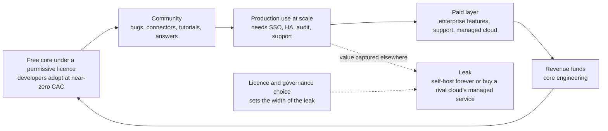
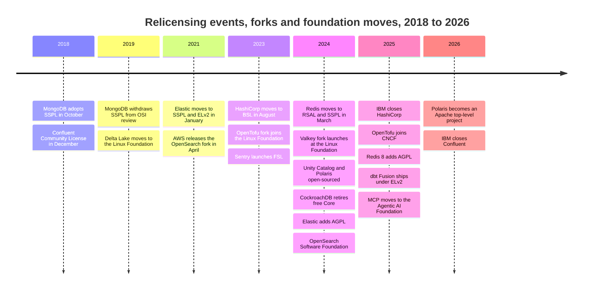
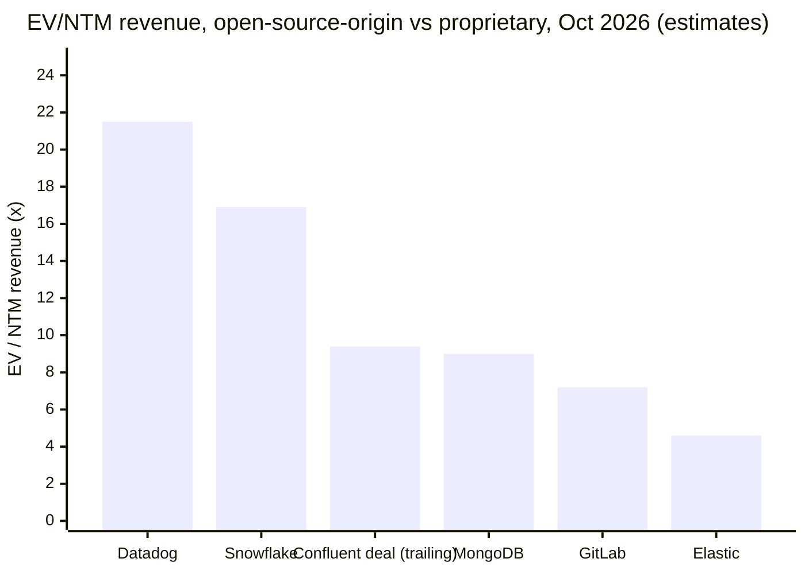

# 38. Open Source as Strategy
> **Depth:** L2 · **Reading time:** ~14 min · **Last verified:** 2026-11-01 · **Prerequisites:** [Ch 35 — Business models](ch35-business-models.md), [Ch 7 — Open table formats](../01-data-systems-foundations/ch07-open-table-formats.md)

## TL;DR

- In data infrastructure, open source is mainly a distribution strategy. A free, permissively licensed core wins developers at almost no acquisition cost. Revenue comes later, from a much smaller paid layer: support, [open core](../glossary.md#open-core) enterprise features, or a managed cloud service. The managed service has become the dominant model. At MongoDB, Atlas was 73% of FY2026 revenue (company-stated).[^mdb-atlas]
- The licence sets how much of that value leaks to others. Permissive licences (Apache 2.0, MIT, BSD) let anyone, including AWS, sell the software as a service. Copyleft (GPL, [AGPL](../glossary.md#agpl)) forces modified code to be shared. [Source-available licences](../glossary.md#source-available-license) ([SSPL](../glossary.md#sspl), [BSL](../glossary.md#business-source-license), Elastic License 2.0, RSAL) block competing hosted services outright, and for that reason fail the OSI's definition of open source.
- From 2018 to 2024, MongoDB, Confluent, Elastic, HashiCorp, Redis and Cockroach Labs each relicensed to stop cloud providers reselling their work. Wherever a hyperscaler had a lot of revenue at stake, it funded a fork: OpenSearch (2021), OpenTofu (2023), Valkey (2024). Elastic (August 2024) and Redis (May 2025) then added AGPL back as an option.[^elastic-agpl][^redis8]
- Governance now matters as much as the licence. A project held by a neutral foundation cannot be relicensed by one vendor. Apache Iceberg's spread of committers across many companies, against Delta Lake's concentration at Databricks, helped settle the table-format war ([Ch 7](../01-data-systems-foundations/ch07-open-table-formats.md)). The 2024 open-sourcing of Unity Catalog and Polaris moved the same contest up to the catalog ([Ch 8](../01-data-systems-foundations/ch08-catalogs-and-metastores.md)).
- The economics are less special than the debate suggests. An open-source origin earns no visible valuation premium. MongoDB, Elastic and GitLab trade at 4.6–9.0x EV/NTM revenue, against 16.9–21.5x for proprietary Snowflake and Datadog (EV ÷ current-year guidance, estimates, as of 2026-10-02 to 2026-10-30). Growth explains only part of the gap: on the [Ch 37](ch37-public-comps-valuation.md) regression it accounts for about one turn of the ~8-turn Snowflake–MongoDB spread. Retention, consumption visibility and AI-workload exposure explain the rest; the licence does not.[^comps] Gross margin is set by how the software is delivered, not by how it is licensed.

## Why this matters (business + Everpure lens)

For a corporate-development team, the licence is part of the asset. When you diligence an open-source-origin company, three questions decide its value. Can a hyperscaler legally sell the same product? Can the vendor change the terms later, or does a foundation hold the code? If the vendor did change the terms, would customers have a credible fork to move to? The answers explain several recent prices. IBM paid $6.4B for HashiCorp after HashiCorp had relicensed Terraform,[^ibm-hashi] and about $11B for Confluent, whose core, Apache Kafka, it does not control.[^comps] Databricks paid a press-reported ~$2B for Tabular, a company built around a project it could not own.[^tabular]

For Everpure, open formats work like a partnership currency. A storage platform does not need its own open-source community. It does need to be a first-class, tested target for the open projects its customers' engines use: Iceberg, Parquet, the Iceberg REST catalog protocol and the S3 API. A vendor that is "open-format compatible" gets a seat in the reference architectures of Databricks, Snowflake, Dremio and Starburst. A vendor that is not is left arguing for a proprietary path. The Storage bridge below lists options a strategy team might evaluate, based on public information.

## How it works

### The funnel: from download to invoice

An open-source data company runs a funnel with four stages. **Adoption:** developers download the free version, usually without talking to sales. **Community:** some of them file bugs, write connectors and tutorials, and answer forum questions. That work lowers the vendor's cost of building an ecosystem. **Production:** a fraction of users put the software into production and run into enterprise needs such as single sign-on, audit logs, high availability, compliance attestations and a phone number to call at 3 a.m. **Monetization:** the vendor sells those needs as a subscription, enterprise features or a managed service, and uses the revenue to fund more work on the free core.

*Figure 38.1 — The open-core flywheel. Adoption is cheap, but production users can always exit to self-hosting or to a hyperscaler's managed service. Relicensing is an attempt to narrow that exit.*

A worked example shows the economics. Assume a project records 1,000,000 downloads a year. Of those, 2% (20,000) turn into production deployments, and 1.5% of production deployments (300) become paying accounts at $60,000 a year. That gives $18M of new annual recurring revenue, with almost no spending on top-of-funnel marketing. All of the inputs are illustrative. Practitioner rules of thumb put the conversion of active users to paid accounts in the low single digits, but no rigorous public study backs a precise rate.[^conv-est] The point is the shape of the funnel, not the numbers. A 1% conversion rate on a huge free base can fund a public company. A small change in how many production users exit to a rival managed service changes the business case.

### Three ways to charge

- **Support and subscriptions (the Red Hat model).** All the code is open, and the customer pays for certified builds, patches, indemnity and support. The model is durable but has a low ceiling, because the product is the same whether or not anyone pays. IBM's $34B purchase of Red Hat (2019) is the high-water mark for the model.[^redhat]
- **Open core.** The engine is free, and the features that enterprises need are proprietary: security, governance, management tooling and some performance features. GitLab is a clean example and reported a non-GAAP gross margin of 86.5% in Q2 FY2027 (May–Jul 2026).[^comps] The risk is drawing the line in the wrong place. Paywall too much and the community forks. Paywall too little and nobody pays.
- **Managed service.** The vendor runs the software for the customer and charges for consumption. Here the vendor is selling operations, not code, which is why a hyperscaler running the same code competes directly. MongoDB's GAAP gross margin of 74% (Q2 FY2027) carries the cloud infrastructure cost that comes with this model.[^mdb-q2]

### Licences at L2: what each one actually permits

The [Open Source Definition](../glossary.md#open-source-definition) maintained by the Open Source Initiative (OSI) has ten criteria. Two matter most here: no discrimination against persons or groups, and no restriction on fields of endeavour. A licence that says "anyone except a cloud provider offering this as a service" fails both, however much code it publishes. That is the legal line between open source and source-available.

| Licence | OSI-approved? | Copyleft scope | Cloud-provider restriction | Examples | Business effect |
|---|---|---|---|---|---|
| Apache 2.0 | Yes | None ([permissive](../glossary.md#permissive-license)); includes an explicit patent grant | None | Iceberg, Spark, Kafka, Arrow, Parquet, Polaris, Unity Catalog OSS | Maximizes adoption and enterprise comfort. Anyone can sell a managed service. |
| MIT / BSD-3 | Yes | None | None | DuckDB (MIT), Valkey (BSD-3), pre-2024 Redis (BSD-3) | Same as Apache, with no explicit patent grant. |
| MPL 2.0 | Yes | File-level: modified files must stay open | None | Pre-2023 Terraform, OpenTofu | Weak copyleft. Easy to embed in proprietary products. |
| GPL (v2 and v3) | Yes | Whole derivative work, triggered by distribution | None in practice. Running a service is not distribution. | Linux kernel (GPLv2), MySQL Community (GPLv2) | Protects against proprietary forks but not against SaaS. |
| AGPLv3 | Yes | Whole derivative work, also triggered by offering it over a network | Indirect. A host must publish its modifications. | Redis 8 (option), Elasticsearch and Kibana (option since 2024), Grafana | The strongest OSI-approved deterrent. Many enterprises ban it by policy. |
| SSPL v1 | No (withdrawn from OSI review, 2019) | Extends to the entire stack used to offer the service | Effective prohibition: publish all service code or license commercially | MongoDB (2018), Elastic (2021), Redis (2024 option) | Stops hyperscaler resale. Linux distributions drop the software. |
| BSL 1.1 | No | None; restricts production use until a change date (up to 4 years), then converts to an open licence | Usually bars competing hosted offerings until the change date | HashiCorp (2023), CockroachDB (2019), MariaDB MaxScale | A time-delayed open licence. Old versions keep becoming open. |
| Elastic License 2.0 | No | None | Bars providing the software as a managed service; bars circumventing licence keys | Elastic (2021), Airbyte, dbt Fusion components (2025) | Short and readable. Allows internal use; competing clouds are blocked. |
| Confluent Community License | No | None | Bars offering covered components (ksqlDB, Schema Registry, REST Proxy) as a competing SaaS | Confluent Platform components (2018) | Protects only the add-ons. Kafka itself stays Apache 2.0. |
| RSALv2 | No | None | Bars offering Redis as a managed service | Redis 7.4+ (2024) | Redis's own version of ELv2-style terms. |
| FSL ("fair source") | No | None; converts to Apache 2.0 or MIT after 2 years | Bars competing commercial use for 2 years | Sentry, Codecov (2023) | A BSL with a shorter, fixed delay, marketed as a middle category. |

*Figure 38.2 — Licence comparison. The column that matters commercially is the cloud-provider restriction. OSI approval requires that column to be empty, so every licence that blocks hyperscaler resale is source-available by definition.*[^osi-sspl][^cfl][^elastic-2021][^redis-2024][^hashi-bsl][^fsl][^dbt-fusion]

> **Going deeper (L3).** Two clauses do most of the work. AGPL section 13 requires anyone who lets users interact with modified software over a network to offer them its source. SSPL section 13 extends "source" to everything needed to run the service: management software, user interfaces, APIs, automation, monitoring, backup and hosting. That definition is so broad that no cloud provider could comply, which is the intent. The second mechanism is the **[contributor licence agreement](../glossary.md#contributor-license-agreement)** (CLA). A vendor can relicense only code it has the right to relicense. A CLA that assigns or broadly licenses contributors' copyright to the company is what makes a later switch possible. Foundation projects either use CLAs that give rights to the foundation or rely on inbound-equals-outbound licensing, so no single company can switch.

### The relicensing battles, 2018–2026

*Figure 38.3 — Relicensing came in two waves, 2018–2021 and 2023–2024, and was followed each time by a fork or a partial reversal. From 2024 the strategic moves shifted from restricting licences to donating projects to foundations.*[^mdb-sspl][^osi-sspl][^cfl][^delta-lf][^elastic-2021][^hashi-bsl][^opentofu-lf][^fsl][^redis-2024][^valkey][^ucoss][^polaris][^crdb-license][^elastic-agpl][^osf][^ibm-hashi][^tofu-cncf][^redis8][^dbt-fusion][^mcp][^comps]

All of these switches applied to future versions only. A release published under Apache, BSD or MPL stays under that licence permanently. That gives every fork its starting point. OpenSearch forked from Elasticsearch 7.10.2, Valkey from Redis 7.2.4, and OpenTofu from the last MPL-licensed Terraform release.[^elastic-2021][^valkey][^opentofu-lf] A fork therefore inherits a complete, production-grade codebase on its first day. The question is whether it can attract maintainers.

| Company | Change (date) | Fork | Outcome for revenue and community | Later reversal |
|---|---|---|---|---|
| MongoDB | AGPL → SSPL (Oct 2018) | No code fork. AWS built DocumentDB as an API-compatible service instead | Revenue rose from $590M (FY2021) to ~$2.46B (FY2026), GAAP. Atlas is 73% of the total. Debian and Fedora dropped MongoDB. | None. SSPL is still in place. |
| Confluent | Apache → Confluent Community License for add-ons (Dec 2018) | None. Kafka stayed Apache under the ASF, so there was nothing to fork | Revenue reached $1,167M in FY2025 (GAAP). IBM bought it for ~$11B (closed Mar 2026). | Not needed |
| Elastic | Apache → SSPL/ELv2 (Jan 2021) | OpenSearch (AWS, Apr 2021), moved to the Linux Foundation in Sep 2024 | Growth continued; FY2027 guidance is ~$2.0B. OpenSearch reported 700M+ downloads by 2024. | AGPL added as an option (Aug 2024) |
| HashiCorp | MPL → BSL (Aug 2023) | OpenTofu (Linux Foundation, Sep 2023; CNCF Sandbox from Apr 2025) | Sold to IBM for $6.4B (closed Feb 2025). OpenTofu reported 10M+ GitHub downloads by 2026. | None |
| Redis | BSD → RSALv2/SSPLv1 (Mar 2024) | Valkey (Linux Foundation, Mar 2024; backed by AWS, Google, Oracle and others) | Redis says the change had no effect on its business (company-stated). Most outside contributors left for Valkey. AWS prices Valkey 20–33% below Redis OSS. | AGPLv3 added in Redis 8 (May 2025) |
| Cockroach Labs | BSL (2019); free Core retired, single Enterprise licence (Aug 2024) | No foundation-backed fork reported | Free for companies under $10M of revenue (honour system); per-core fees above that. Outcome undisclosed (private). | None |
| dbt Labs | New Fusion engine components under ELv2 (May 2025); dbt Core stays Apache 2.0 | No fork. Rival engines such as SQLMesh compete instead | Community concern over a two-track product. Licence scope later narrowed [VERIFY: current Fusion licence split]. | Partial (dbt Core v2 under Apache 2.0) |

*Figure 38.4 — Relicensing outcomes. Revenue rarely suffered. Community control did. Where a hyperscaler's own managed service was at stake (Elasticsearch, Redis), a well-funded fork appeared within weeks. Where the core sat in a foundation (Kafka), the question never came up.*[^mdb-atlas][^comps][^fedora][^cfl][^elastic-2021][^osf][^estc-q1][^ibm-hashi][^tofu-cncf][^redis-ceo][^devclass-redis][^valkey-price][^crdb-license][^dbt-fusion]

Three lessons follow. First, relicensing protects revenue in the short run and costs community in the long run. In the year after the Redis switch, only Redis employees made significant contributions to Redis, while Valkey drew 29 contributors from 10 companies in its first six months, 18 of whom had previously contributed to Redis.[^foster] Second, the reversals were partial. Elastic and Redis added AGPL alongside their source-available licences rather than in place of them. AGPL lets them call the software open source again while still deterring most cloud resellers. Elastic's CTO said the partnership with AWS was "stronger than ever" after the fork.[^elastic-agpl] Third, a relicensed company is often an acquisition target. HashiCorp and Confluent both went to IBM, which also owns Red Hat.

> **Bridge: relicensing as changing royalty terms mid-contract.** A relicense resembles an IP licensor that cannot reprice the nodes already licensed, because past releases stay under their original terms, but announces that all future nodes carry a new royalty for one class of licensee. Licensees who depend on the roadmap have to accept the new terms. Licensees big enough to fund their own roadmap stop at the last old node and design forward on their own. That is what a fork is. The ISA world shows the same split. Arm's licensable ISA earns royalties and lets Arm set terms. RISC-V International's open ISA earns nothing but cannot be repriced by anyone. Hyperscalers and large OEMs hedge by investing in RISC-V for the same reason they backed Valkey.

> **Bridge: forks as second-sourcing.** Semiconductor buyers have long demanded a second source before designing in a critical part. IBM's 1982 requirement that Intel license x86 to AMD is the classic case. Valkey and OpenSearch are the hyperscalers' second source, and their existence disciplines the original vendor's pricing whether or not most customers ever switch.

### The "strip-mining" debate

The vendors' argument goes like this. They fund nearly all of the engineering. A hyperscaler takes the free code, wraps it in a managed service (ElastiCache, Amazon OpenSearch Service, MSK for Kafka), bundles it with its own billing, identity and support, and captures the customer relationship without carrying the R&D cost. The vendor's managed service then competes against its own code, sold by a supplier that also owns the customer's cloud bill.

The counter-argument deserves equal weight. Hyperscalers do contribute: AWS says more than 225 contributors have submitted over 1,500 pull requests to Valkey.[^valkey-two] Managed services also expand the market by bringing the technology to customers who would never run it themselves, and many of those customers later buy the vendor's own enterprise tier. MongoDB grew Atlas to most of its revenue while competing with an API-compatible AWS service.[^mdb-atlas] Most relicensing vendors also chose permissive licences in the first place, because those licences maximized adoption. In this view, a hyperscaler offering the software is the price of the distribution the licence bought. The evidence supports a middle position. Strip-mining is a real risk when the vendor's product is mainly "we run it for you". The risk is much smaller when the vendor has features or performance that the hyperscaler's version lacks.

### Foundations and governance

A foundation holds the trademark, the copyright licences and the governance rules, so no single company can relicense the project or redirect its roadmap. The models differ in who decides.

| Dimension | Apache Software Foundation | Linux Foundation (incl. LF AI & Data, CNCF) | Vendor-controlled project |
|---|---|---|---|
| Who decides | Project Management Committee (PMC) of individuals, elected on merit ("the Apache way"). Employers have no formal seat. | Per-project technical steering committee. Paying members often sit on a governing board for budget and marketing. | The company's maintainers and product management |
| Trademark | Owned by the ASF | Held by the LF or a project-specific LF entity | Owned by the company |
| Licence | Apache 2.0 only | Usually Apache 2.0 (the CNCF default; OpenTofu's MPL needed an exception) | Whatever the company chooses, and changeable via CLA |
| Neutrality signal | PMC and committer diversity; the ASF board requires projects to avoid single-vendor control | Membership breadth and contributor diversity, but a founding vendor can still dominate | None, by construction |
| Data and AI examples | Iceberg, Spark, Kafka, Arrow, Parquet, Hudi, Polaris (top-level project 2026) | Delta Lake, Unity Catalog OSS, Valkey, OpenSearch, Presto, OpenTofu (CNCF), MCP (Agentic AI Foundation) | MongoDB, Redis, Elasticsearch, Terraform, CockroachDB |

*Figure 38.5 — Foundation governance. The ASF is the strictest test of neutrality, because individuals hold the votes. The Linux Foundation is more flexible and better funded, but a project's founding vendor can stay in charge. Vendor control is the only model that can be relicensed.*[^asf-fy25][^tofu-cncf][^delta-lf][^ucoss][^valkey][^osf][^mcp][^polaris]

> **Bridge: foundations as standards bodies.** Foundations play the role in software that JEDEC and PCI-SIG play in hardware. Competitors co-write the specification (DDR5, PCIe 6.0, the Iceberg spec), agree on intellectual-property rules that keep it implementable by all, and then compete on implementation. A memory vendor does not win by owning JEDEC. It wins by shipping the best part to the shared spec. The difference is that a software foundation also hosts the reference implementation, so control of the committer roster is closer to control of the reference design.

**How governance shaped the format war.** Iceberg started at Netflix and entered the ASF. Its PMC and committer roster grew to 25 and 39 people respectively by 2026, drawn from Apple, Netflix, AWS, Snowflake, Databricks (via Tabular), Bloomberg and others.[^iceberg-board] A published employer-by-employer count is not available [VERIFY: Iceberg committers by employer]. A 2022 Dremio analysis, from a vendor aligned with Iceberg, found that no single company accounted for a third of contributions to Iceberg or Hudi, while one company dominated contributions to Delta Lake.[^dremio-gov] Delta moved to the Linux Foundation in 2019 and now reports more than 190 developers from over 70 organizations,[^delta-lf][^delta-io] but buyers saw it as Databricks' project. Snowflake, AWS and Google could adopt Iceberg without depending on a rival's roadmap, and they did. Databricks responded by buying Tabular, the company founded by Iceberg's creators, in June 2024.[^tabular]

**The catalog moves of June 2024.** In the same month, Snowflake announced Polaris, an Iceberg REST catalog, and later donated it to the Apache Incubator. Databricks open-sourced Unity Catalog under Apache 2.0 at LF AI & Data.[^polaris][^ucoss] Both were defensive moves. Each company gave up control of its catalog's interface to show customers it would not lock in their metadata, while keeping the governance features that generate revenue in its commercial product. The choice of foundation sent a signal of its own. Polaris went to the ASF, the stricter test of neutrality, and became a top-level project in early 2026 (ASF announcement 2026-03-05).[^polaris] Unity Catalog went to the LF, where Databricks keeps more influence over its direction.

### Open weights: the next chapter

AI models are going through the same arguments in a new form. Meta's Llama, Mistral, DeepSeek and others publish model weights, but their terms vary. Some use Apache 2.0 or MIT. Others use custom licences with usage restrictions or user thresholds, which are source-available in all but name. In October 2024 the OSI released its Open Source AI Definition 1.0. It requires enough information about the training data to rebuild a substantially equivalent system, and the OSI says Llama's licence does not qualify.[^osaid] The strategic logic is familiar: free weights drive adoption, and the money is made by hosting, fine-tuning and tooling. Governance is moving to foundations here too. Anthropic donated the Model Context Protocol (MCP) to the Linux Foundation's Agentic AI Foundation in December 2025.[^mcp] Expect a model provider to tighten terms on a future release, and expect a fork from the last open checkpoint if it does.

## Design choices and trade-offs

| Strategy | Captures value via | Protects against hyperscalers? | Community cost | Steelman |
|---|---|---|---|---|
| Permissive core + managed service | Operating the software better than anyone else | No | Lowest | Widest adoption. Wins if the vendor's service is clearly better (MongoDB Atlas, Confluent Cloud). |
| Permissive core + proprietary enterprise features (open core) | Feature gating | Partly. A hyperscaler must rebuild the features. | Moderate | Highest gross margins (GitLab 86.5% non-GAAP)[^comps] and clear packaging. |
| Source-available (SSPL, BSL, ELv2) | Exclusive right to host | Yes, legally | High: fork risk, distribution bans, enterprise policy friction | Protects the managed-service business when the vendor is small and the hyperscaler is large. |
| Dual-licence with AGPL | Copyleft deterrent plus commercial licence | Mostly | Moderate | Keeps the "open source" label (OSI-approved) and still deters resale. |
| Donate to a neutral foundation | Ecosystem standard-setting; monetize adjacent layers | No, by design | Gains community | Turns a rival-adoption problem into a standard. Works when the money is one layer up (Polaris, Unity Catalog OSS, Kafka). |

*Figure 38.6 — The choice is between controlling the code and controlling the standard. Source-available licences maximize the first. Foundations maximize the second.*

The economics comparison follows. Managed-service businesses converge on gross margins in the mid-70s, whatever their licence. MongoDB reports 74% GAAP and 76% non-GAAP, Elastic 77% non-GAAP, and proprietary Snowflake a 74.7% non-GAAP product gross margin.[^mdb-q2][^estc-q1][^comps] Open source does not command a valuation premium either.

*Figure 38.7 — The two proprietary names (Datadog, Snowflake) trade at about twice the open-source-origin names. Growth differences (36% and 35% against 15–30%) explain only a small part of that gap on the Ch 37 regression; NRR, consumption visibility and AI exposure do more. Either way, the chart gives no support to the idea that open source earns a premium. Confluent's bar is not an EV/NTM: it is IBM's control-deal multiple, ~$11B EV ÷ FY2025 GAAP revenue of $1,166.7M (announced 2025-12-08, closed 2026-03-17). Values from `data/public_comps.csv`, market data as of 2026-10-02 to 2026-10-30.*[^comps]

## Who's who

- **Vendors that relicensed:** MongoDB (SSPL), Elastic (SSPL/ELv2/AGPL), Redis (RSAL/SSPL/AGPL), Cockroach Labs (Enterprise licence), HashiCorp (BSL, now IBM), Confluent (Community License for add-ons, now IBM), ScyllaDB (source-available from 2024), dbt Labs (ELv2 for Fusion components). See [Ch 29](../04-company-deep-dives/ch29-operational-database-vendors.md) and [Ch 30](../04-company-deep-dives/ch30-data-movement-streaming-companies.md).
- **Fork sponsors:** AWS (OpenSearch, Valkey and DocumentDB-style compatible services), Google Cloud and Oracle (Valkey), and Spacelift, env0, Harness and Gruntwork among the OpenTofu backers.[^opentofu-lf]
- **Foundations:** the ASF (295 projects and 9,905 committers in FY2025),[^asf-fy25] the Linux Foundation with its LF AI & Data, CNCF, OpenSearch Software Foundation and Agentic AI Foundation, and the OSI as keeper of the definition.
- **Permissive-by-conviction players:** DuckDB (MIT, under the DuckDB Foundation), PostgreSQL (community-governed), and Apache-native companies such as Dremio and Starburst that sell on top of ASF projects.
- **Serial acquirer:** IBM bought Red Hat (2019), HashiCorp (2025), DataStax (2025) and Confluent (2026). It is the clearest buyer of open-source-origin infrastructure.

## History and trajectory

The first era (1998–2010) established the vocabulary. The OSI was founded in 1998, the ASF became the default home for Hadoop-era data projects, and companies made money on support. The second era (2010–2018) was open core plus cloud. Databricks, Confluent, Elastic and MongoDB built enterprise tiers and managed services around permissively licensed cores. The third era (2018–2024) was the relicensing wave described above, set off by hyperscaler managed services. The fourth era (2024 onward) moved from restricting licences to setting standards. Vendors donated catalogs and protocols to foundations, hyperscalers funded forks, and two of the relicensers added AGPL back. Fair source tried to give time-delayed licences a respectable label.[^fsl] For the next round, watch AI model licences, the fight over who governs agent protocols, and whether vendors bring source-available terms back for AI-era engines, as dbt Labs did with Fusion.[^dbt-fusion][^mcp]

## Numbers that matter

| Metric | Value | Basis | Source / date |
|---|---|---|---|
| MongoDB Atlas share of revenue | 73% of FY2026 (Feb 2025–Jan 2026) | Company-stated | MongoDB annual report, 2026[^mdb-atlas] |
| IBM–HashiCorp | $6.4B EV, $35/share cash | Company-stated | Announced 2024-04-24; closed 2025-02-27 (IBM)[^ibm-hashi] |
| IBM–Confluent | ~$11B EV, ~9.4x FY2025 GAAP revenue ($1,166.7M) | Company-stated / our arithmetic | Announced 2025-12-08, closed 2026-03-17; IBM 10-Q; `data/public_comps.csv`[^comps] |
| OpenSearch downloads at foundation launch | 700M+ | Foundation-stated | Linux Foundation, 2024-09-16[^osf] |
| Valkey active contributors, 2025 | 346 | Project-stated (LFX analytics) | Valkey blog, 2025-12[^valkey-ye] |
| Valkey contributors and pull requests since fork | 225+ contributors, 1,500+ PRs; 100M+ Docker pulls | AWS-stated | AWS Database Blog, 2026[^valkey-two] |
| Valkey early contributor base | 29 contributors from 10 companies in the first six months | Research | Foster, 2024[^foster] |
| ElastiCache for Valkey vs Redis OSS price | 20% lower (node-based), 33% lower (serverless) | AWS list price | AWS, 2024-10[^valkey-price] |
| OpenTofu downloads | 10M+ GitHub downloads | Foundation-stated | CNCF blog, 2026-03-09[^tofu-cncf] |
| Iceberg PMC / committers | 25 / 39 | ASF board report | ASF Whimsy, 2026[^iceberg-board] |
| Delta Lake contributor base | 190+ developers, 70+ organizations | Project-stated | delta.io, retrieved 2026-11-01[^delta-io] |
| ASF scale | 295 projects, 9,905 committers (FY2025, year to Apr 30, 2025) | Foundation-stated | ASF, 2025-08-27[^asf-fy25] |
| CockroachDB free-tier threshold | Under $10M annual revenue | Company-stated | Cockroach Labs, 2024-08-15[^crdb-license] |
| Change-date delay | BSL ≤4 years (HashiCorp: 4); FSL 2 years | Licence terms | LWN 2023; TechCrunch 2023[^hashi-bsl][^fsl] |
| Gross margin, managed-service models | MongoDB 74% GAAP / 76% non-GAAP; Elastic 77% non-GAAP; GitLab 86.5% non-GAAP | GAAP / non-GAAP, latest quarter | Company releases, Aug–Sep 2026[^mdb-q2][^estc-q1][^comps] |
| Free-to-paid conversion | Low single-digit % of active users | Estimate (rule of thumb) | See note[^conv-est] |

*Figure 38.8 — The fork metrics (contributors, downloads, price gap) are the leading indicators. The deal values show that a relicensed company can still be a $6–11B asset.*

## Storage bridge

> **Storage bridge.** For an infrastructure vendor, open formats replace proprietary integrations as the price of entry. Options a strategy team might evaluate, based on public information: (1) publish conformance results for the S3 behaviours that table formats depend on (strong consistency, conditional writes, high metadata-request rates) and test against Iceberg, Delta and Polaris/Unity Catalog releases; (2) contribute upstream, for example to S3-compatibility test suites or Iceberg's storage I/O layer, so the company is a recognized participant in ASF projects rather than only a user of them; (3) release connectors and Kubernetes operators under Apache 2.0, so they can appear in partners' reference architectures without licence review; (4) avoid source-available licences for anything meant to win partners, since enterprises' open-source policies will slow adoption. See the companion *Everpure Tech Atlas* for object-protocol detail.

## Conversation playbook

**Questions for a PM**

1. "Which licence covers the code your customers run in production, and what share of revenue comes from the managed service versus self-managed licences?"
2. "If AWS or Google launched a managed version of your project tomorrow, what would you still sell that they could not?"
3. "Do you hold copyright or a CLA over all contributions? Who owns the trademark?"

**Questions for an engineer**

1. "What share of commits over the last 12 months came from outside your company, and how many committers do you not employ?"
2. "Which features are in the open core and which are proprietary? Have you moved that line in the last two years?"
3. "If a fork appeared, how quickly would its API compatibility drift from yours, and what would break for users?"

**What good answers sound like.** They give the licence by component ("server under SSPL, drivers under Apache 2.0"). They quantify outside contribution and name the foundation or CLA that governs it. They describe a monetization line based on operational value, such as uptime, security and scale, rather than on features the community could rebuild. They treat a hyperscaler offering as a demand signal to compete with, not only as a threat.

**Don't say this**

- "SSPL is open source." It is not OSI-approved. MongoDB withdrew it from OSI review in March 2019.[^osi-sspl]
- "AGPL means you can't use it commercially." AGPL allows commercial use. It requires sharing modifications if you offer the software over a network.
- "Relicensing kills the company." MongoDB, Elastic and HashiCorp all grew or sold well afterwards. What they lost was community control.
- "Linux Foundation means vendor-neutral." Governance varies by project. Delta Lake and Unity Catalog sit at the LF but remain Databricks-led.
- "Open weights are open source." Most model licences fail the OSI's Open Source AI Definition.[^osaid]

## Going deeper

- The OSI's Open Source Definition and its March 2019 license-review summary on SSPL.[^osi-sspl]
- Dawn Foster, *The New Dynamics of Open Source: Relicensing, Forks, & Community Impact* (2024), for contributor-affiliation data across the OpenSearch, Valkey and OpenTofu forks.[^foster]
- The texts of SSPL section 13, ELv2's three limitations and the BSL "Additional Use Grant", read side by side.
- ASF Incubator graduation criteria, for what counts as "community over code" in practice.

## Key terms

- [Open core](../glossary.md#open-core) — free open-source engine plus paid proprietary enterprise features.
- [Open Source Definition](../glossary.md#open-source-definition) — the OSI's ten criteria a licence must meet to be called open source.
- [Permissive license](../glossary.md#permissive-license) — a licence such as Apache 2.0, MIT or BSD that allows reuse, including in proprietary products, with minimal conditions.
- [Copyleft](../glossary.md#copyleft) — a licence condition that requires derivative works to be shared under the same terms.
- [AGPL](../glossary.md#agpl) — copyleft licence whose sharing duty also applies to software offered over a network.
- [Source-available license](../glossary.md#source-available-license) — publishes code but restricts use, typically barring competing hosted services.
- [SSPL](../glossary.md#sspl) — MongoDB's licence requiring a service provider to publish its entire service stack.
- [Business Source License](../glossary.md#business-source-license) — source-available licence that converts to open source after a change date.
- [Elastic License 2.0](../glossary.md#elastic-license-20) — short source-available licence barring managed-service resale and licence-key circumvention.
- [Fair source](../glossary.md#fair-source) — a label for source-available licences that convert to open source after a fixed delay, such as Sentry's FSL.
- [Relicensing](../glossary.md#relicensing) — changing the licence of future versions of a project, usually to restrict competitors.
- [Software fork](../glossary.md#software-fork) — an independent project started from a copy of another project's last permissively licensed code.
- [Contributor license agreement](../glossary.md#contributor-license-agreement) — contract granting a project owner rights over contributed code, which makes relicensing possible.
- [Project Management Committee](../glossary.md#project-management-committee) — the group of individuals that governs an Apache project.
- [Valkey](../glossary.md#valkey) — the Linux Foundation's BSD-licensed fork of Redis 7.2.4.
- [Open weights](../glossary.md#open-weights) — publicly released AI model parameters, whose licence may or may not be open source.
- [Apache Polaris](../glossary.md#apache-polaris) — Snowflake-donated Iceberg REST catalog, an Apache top-level project since 2026.
- [Unity Catalog](../glossary.md#unity-catalog) — Databricks' governance catalog, with an Apache 2.0 open-source server at LF AI & Data.

## Sources

[^mdb-atlas]: MongoDB, Inc., Annual Report / Form 10-K for FY2026 (Feb 2025–Jan 2026), https://www.sec.gov/Archives/edgar/data/0001441816/000162828026036431/ars.htm, published 2026; retrieved 2026-11-01. Atlas 73% of FY2026 revenue and FY2021/FY2026 revenue ($590.4M; ~$2.46B, GAAP) as recorded in `data/company_financials.csv`.
[^mdb-q2]: MongoDB, Inc., "MongoDB, Inc. Announces Second Quarter Fiscal 2027 Financial Results," https://investors.mongodb.com/news-releases/news-release-details/mongodb-inc-announces-second-quarter-fiscal-2027-financial, published 2026-09-01; retrieved 2026-11-01. GAAP gross margin 74%, non-GAAP 76% (Q2 FY2027 = May–Jul 2026), per `data/company_financials.csv`.
[^comps]: AI Data Atlas, `data/public_comps.csv` (rows for Datadog, Snowflake, MongoDB, GitLab, Elastic, Confluent; EV/NTM revenue are estimates using FY guidance or trailing proxies as documented per row; as_of dates 2026-10-02 to 2026-10-30, Confluent 2026-03-17). Underlying sources include stockanalysis.com statistics pages, GitLab Q2 FY2027 release (https://secure.businesswire.com/news/home/20260901768402/en/GitLab-Reports-Second-Quarter-Fiscal-Year-2027-Financial-Results, 2026-09-01), Snowflake Q2 FY2027 release (https://www.nasdaq.com/press-release/snowflake-reports-financial-results-second-quarter-fiscal-2027-2026-09-02, 2026-09-02) and IBM Form 10-Q Q1 2026 (https://www.sec.gov/Archives/edgar/data/0000051143/000005114326000038/ibm-20260331.htm); retrieved 2026-11-01. IBM–Confluent closed 2026-03-17 (~$11B EV).
[^estc-q1]: Elastic N.V., "Elastic Reports First Quarter Fiscal 2027 Financial Results" (republished), https://www.01net.it/elastic-reports-first-quarter-fiscal-2027-financial-results/, published 2026-08-27; retrieved 2026-11-01. Revenue $478M (+15%, GAAP); non-GAAP total gross margin 77%, subscription 81% (Q1 FY2027 = May–Jul 2026; Elastic FY ends Apr 30); FY2027 revenue guidance $1.998–2.010B. Gross-margin figures via earnings-call summaries (MarketBeat, https://www.marketbeat.com/instant-alerts/transcript-elastic-q1-earnings-call-highlights-2026-08-27/), press-reported.
[^tabular]: TechCrunch, "Databricks reportedly paid $2 billion in Tabular acquisition," https://techcrunch.com/2024/08/14/databricks-reportedly-paid-2-billion-in-tabular-acquisition, published 2024-08-14; retrieved 2026-11-01. Press-reported; deal announced 2024-06-04.
[^ibm-hashi]: IBM, "IBM Completes Acquisition of HashiCorp, Creates Comprehensive, End-to-End Hybrid Cloud Platform," https://newsroom.ibm.com/2025-02-27-ibm-completes-acquisition-of-hashicorp,-creates-comprehensive,-end-to-end-hybrid-cloud-platform, published 2025-02-27; SiliconANGLE, https://siliconangle.com/2025/02/27/ibm-completes-6-4b-hashicorp-acquisition-following-regulatory-approvals/, published 2025-02-27; retrieved 2026-11-01.
[^redhat]: IBM, "IBM Closes Landmark Acquisition of Red Hat for $34 Billion," https://newsroom.ibm.com/2019-07-09-IBM-Closes-Landmark-Acquisition-of-Red-Hat-for-34-Billion-Defines-Open-Hybrid-Cloud-Future, published 2019-07-09; retrieved 2026-11-01 (canonical citation, not live-fetched).
[^conv-est]: Estimate. Practitioner and consultancy write-ups (e.g., Monetizely, "What's the Optimal Conversion Rate from Free to Paid in Open Source SaaS?", https://www.getmonetizely.com/articles/whats-the-optimal-conversion-rate-from-free-to-paid-in-open-source-saas, undated) cite 1–3% of active users without primary data; no rigorous public study was found. The worked-example inputs (2% to production, 1.5% to paid, $60K ACV) are illustrative assumptions; retrieved 2026-11-01.
[^mdb-sspl]: MongoDB, "Server Side Public License FAQ," https://www.mongodb.com/legal/licensing/server-side-public-license/faq, published 2018-10 (SSPL announced 2018-10-16); retrieved 2026-11-01 (canonical citation, not live-fetched).
[^osi-sspl]: Open Source Initiative, "March 2019 License-Review Summary," https://opensource.org/blog/licensereview032019, published 2019-04; OSI license-review list archive, March 2019 (Eliot Horowitz withdrawal message dated 2019-03-08), https://lists.opensource.org/pipermail/license-review_lists.opensource.org/2019-March/; retrieved 2026-11-01.
[^fedora]: Fedora Project, "Changes/MongoDB Removal," https://fedoraproject.org/wiki/Changes/MongoDB_Removal, published 2019-01; retrieved 2026-11-01. Debian removed MongoDB in December 2018 per contemporaneous press coverage.
[^cfl]: Confluent, "A Developer's Guide to the Confluent Community License," https://confluent.io/blog/developers-guide-confluent-community-license, published 2018-12; Data Center Knowledge, "Confluent Creates New 'Open Source' License to Stop Cloud Poaching," https://www.datacenterknowledge.com/open-source/confluent-creates-new-open-source-license-stop-cloud-poaching, published 2018-12; retrieved 2026-11-01.
[^elastic-2021]: FOSSlife, "Amazon Creates ALv2-Licensed Fork of Elasticsearch," https://www.fosslife.org/amazon-creates-alv2-licensed-fork-elasticsearch, published 2021-01; TechRepublic, "OpenSearch: AWS rolls out its open source Elasticsearch fork," https://www.techrepublic.com/google-amp/article/opensearch-aws-rolls-out-its, published 2021-04-13; retrieved 2026-11-01. Fork based on Elasticsearch/Kibana 7.10.2.
[^elastic-agpl]: Elastic via Business Wire, "Elastic Announces Open Source License for Elasticsearch and Kibana Source Code," https://www.businesswire.com/news/home/20240829537786/en/Elastic-Announces-Open-Source-License-for-Elasticsearch-and-Kibana-Source-Code, published 2024-08-29; InfoQ, https://www.infoq.com/news/2024/09/elastic-open-source-agpl, published 2024-09; retrieved 2026-11-01. Quote from Shay Banon's announcement as reported.
[^osf]: Linux Foundation, "Linux Foundation Announces OpenSearch Software Foundation to Foster Open Collaboration in Search and Analytics," https://linuxfoundation.org/press/linux-foundation-announces-opensearch-software-foundation-to-foster-open-collaboration-in-search-and-analytics, published 2024-09-16; retrieved 2026-11-01. 700M+ downloads foundation-stated.
[^redis-2024]: Redis, "Redis Adopts Dual Source-Available Licensing," https://redis.io/blog/redis-adopts-dual-source-available-licensing/, published 2024-03-20; InfoQ, https://www.infoq.com/news/2024/03/redis-license-open-source/, published 2024-03; retrieved 2026-11-01.
[^valkey]: Linux Foundation, "Linux Foundation Launches Open Source Valkey Community," https://www.linuxfoundation.org/press/linux-foundation-launches-open-source-valkey-community, published 2024-03-28; retrieved 2026-11-01 (canonical citation; backers per the announcement).
[^redis8]: Phoronix, "Redis 8.0 Released: Now Tri-Licensed With AGPLv3," https://www.phoronix.com/news/Redis-8.0-Goes-AGPLv3, published 2025-05-01; retrieved 2026-11-01.
[^redis-ceo]: InfoWorld, "Redis bets big on an open source return," https://infoworld.com/article/3975620/redis-bets-big-on-an-open-source-return.html, published 2025-05; retrieved 2026-11-01. CEO statement that the 2024 change had no effect on the business is company-stated, unaudited.
[^devclass-redis]: DevClass, "One year ago Redis changed its license – and lost most of its external contributors," https://devclass.com/2025/04/01/one-year-ago-redis-changed-its-license-and-lost-most-of-its-external-contributors/, published 2025-04-01; retrieved 2026-11-01.
[^foster]: Dawn Foster, "The New Dynamics of Open Source: Relicensing, Forks, & Community Impact," arXiv:2411.04739, https://arxiv.org/abs/2411.04739, published 2024-11; slides, https://fastwonderblog.com/wp-content/uploads/2024/11/Dawn-Foster-New-Dynamics-Relicensing-Forks-OFA-2024.pdf; The New Stack summary, https://thenewstack.io/what-happens-to-relicensed-open-source-projects-and-their-forks/; retrieved 2026-11-01. Valkey six-month contributor figures from slides and secondary summary.
[^valkey-price]: AWS Database Blog, "Amazon ElastiCache and Amazon MemoryDB announce support for Valkey," https://aws.amazon.com/blogs/database/amazon-elasticache-and-amazon-memorydb-announce-support-for-valkey/, published 2024-10; retrieved 2026-11-01. Discounts relative to Redis OSS on ElastiCache, AWS-stated list pricing at launch.
[^valkey-two]: AWS Database Blog, "Valkey turns two," https://aws.amazon.com/blogs/database/valkey-turns-two/, published 2026 (circa March) [VERIFY: publication date]; retrieved 2026-11-01. AWS-stated contributor, PR and Docker-pull counts.
[^valkey-ye]: Valkey project, "Valkey 2025 Year-End Review: Reflecting on Progress and Looking Ahead," https://valkey.io/blog/2025-year-end/, published 2025-12; retrieved 2026-11-01. 346 active contributors counted via LFX analytics.
[^hashi-bsl]: LWN.net, "LWN.net Weekly Edition for August 24, 2023" (HashiCorp moves to BSL on 2023-08-10), https://lwn.net/Articles/941867/, published 2023-08-24; DevOps.com, "Rebellion against changes to open source Terraform license mounts," https://devops.com/rebellion-against-changes-to-open-source-terraform-license-mounts/, published 2023-08; retrieved 2026-11-01.
[^opentofu-lf]: The New Stack, "Linux Foundation Joins OpenTF to Fork for Terraform into OpenTofu," https://thenewstack.io/linux-foundation-joins-opentf-to-fork-for-terraform-into-opentofu/, published 2023-09-20; OpenTF Manifesto, https://github.com/loopsocial/opentf-manifesto, published 2023-08; retrieved 2026-11-01.
[^tofu-cncf]: The New Stack, "OpenTofu Joins CNCF: New Home for Open Source IaC Project," https://thenewstack.io/opentofu-joins-cncf-new-home-for-open-source-iac-project/, published 2025-04; heise online, https://heise.de/-10367910, published 2025-04; CNCF blog, "KubeCon + CloudNativeCon Europe 2026 co-located event deep dive: OpenTofu Day," https://www.cncf.io/blog/2026/03/09/kubecon-cloudnativecon-europe-2026-co-located-event-deep-dive-opentofu-day/, published 2026-03-09; retrieved 2026-11-01. CNCF Sandbox from 2025-04-23; MPL-2.0 licence exception per press reports.
[^crdb-license]: Cockroach Labs, "Enterprise license update," https://cockroachlabs.com/enterprise-license-update, published 2024-08-15; SD Times, "CockroachDB retires self-hosted Core offering, makes Enterprise version free for companies under $10M in annual revenue," https://sdtimes.com/os/cockroachdb-retires-self-hosted-core-offering-makes-enterprise-version-free-for-companies-under-10m-in-annual-revenue/, published 2024-08; retrieved 2026-11-01. Core retired with v24.3 (2024-11-18).
[^dbt-fusion]: dbt Labs, "New code, new license: understanding the new license for the dbt Fusion engine," https://www.getdbt.com/blog/new-code-new-license-understanding-the-new-license-for-the-dbt-fusion-engine, published 2025-05-28; dbt Docs, "About the dbt Fusion engine," https://docs.getdbt.com/docs/fusion/about-fusion, living document; dbt Docs blog, "dbt Core v2 is here," https://docs.getdbt.com/blog/dbt-core-v2-is-here; retrieved 2026-11-01. Later reports that part of the Fusion runtime moved to Apache 2.0 are not confirmed by dbt's docs [VERIFY].
[^fsl]: TechCrunch, "With Functional Source License, Sentry wants to grant developers freedom without harmful free-riding," https://techcrunch.com/2023/11/20/with-functional-source-license-sentry-wants-to-grant-developers-freedom-without-harmful-free-riding/, published 2023-11-20; TechCrunch, "Some startups are going 'fair source' to avoid the pitfalls of open source licensing," https://techcrunch.com/2024/09/22/some-startups-are-going-fair-source-to-avoid-the-pitfalls-of-open-source-licensing/, published 2024-09-22; retrieved 2026-11-01.
[^delta-lf]: Linux Foundation, "The Delta Lake Project Turns to Linux Foundation to Become the Open Standard for Data Lakes," https://linuxfoundation.org/press-release/the-delta-lake-project-turns-to-linux-foundation-to-become-the-open-standard-for-data-lakes, published 2019-10-16; retrieved 2026-11-01.
[^delta-io]: Delta Lake project, "Delta Lake" (home page, contributor statement), https://delta.io/, living document; retrieved 2026-11-01. Project-stated; date of the count not given.
[^dremio-gov]: Dremio, "Table Format Governance and Community Contributions: Apache Iceberg, Apache Hudi, and Delta Lake," https://www.dremio.com/blog/table-format-governance-and-community-contributions-apache-iceberg-apache-hudi-and-delta-lake/, published 2022-06-02; retrieved 2026-11-01. Vendor analysis (Dremio is Iceberg-aligned and is now part of SAP); treat as interested.
[^iceberg-board]: Apache Software Foundation, Board minutes – Iceberg project reports (Whimsy), https://whimsy.apache.org/board/minutes/Iceberg.html, latest report 2026; retrieved 2026-11-01. 39 committers and 25 PMC members; latest addition 2026-02-23.
[^polaris]: Apache Polaris, "Apache Polaris graduates to top-level project," https://polaris.apache.org/blog/2026/02/19/apache-polaris-graduates-to-top-level-project/, published 2026-02-19; ASF, https://news.apache.org/foundation/entry/the-apache-software-foundation-graduates-two-open-source-projects-from-incubator, published 2026-03-05; retrieved 2026-11-01. Polaris announced by Snowflake June 2024; entry into the Apache Incubator in August 2024 per secondary sources [VERIFY: incubator entry date].
[^ucoss]: Databricks, "Open Sourcing Unity Catalog," https://www.databricks.com/blog/open-sourcing-unity-catalog, published 2024-06-12; It's FOSS News, https://itsfoss.com/news/databricks-open-sources-unity-catalog/, published 2024-06; retrieved 2026-11-01. Hosted at LF AI & Data under Apache 2.0.
[^asf-fy25]: The Apache Software Foundation, FY2025 annual report highlights (fiscal year ended 2025-04-30), released 2025-08-27, via ASF News, https://news.apache.org/foundation/entry/the-apache-software-foundation-strengthens-global-open-source-community-with-new-tools-programs-and-contributor-support; retrieved 2026-11-01 [VERIFY: exact annual-report URL]. Foundation-stated.
[^mcp]: Anthropic, "Donating the Model Context Protocol and establishing the Agentic AI Foundation," https://anthropic.com/news/donating-the-model-context-protocol-and-establishing-of-the-agentic-ai-foundation, published 2025-12-09; retrieved 2026-11-01.
[^osaid]: Open Source Initiative, "Meta's LLaMa license is still not Open Source," https://opensource.org/blog/metas-llama-2-license-is-not-open-source (and successor post), published 2023-07 / updated 2025; Gigazine, "OSAID version 1.0 ... is released," https://gigazine.net/gsc_news/en/20241030-open-source-ai-definition, published 2024-10-30; retrieved 2026-11-01. OSAID 1.0 released 2024-10-28.
