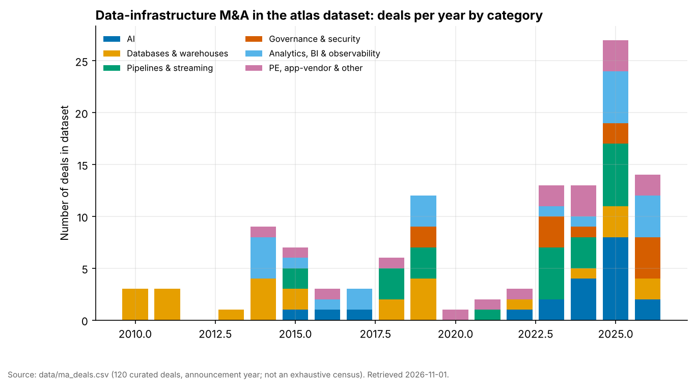
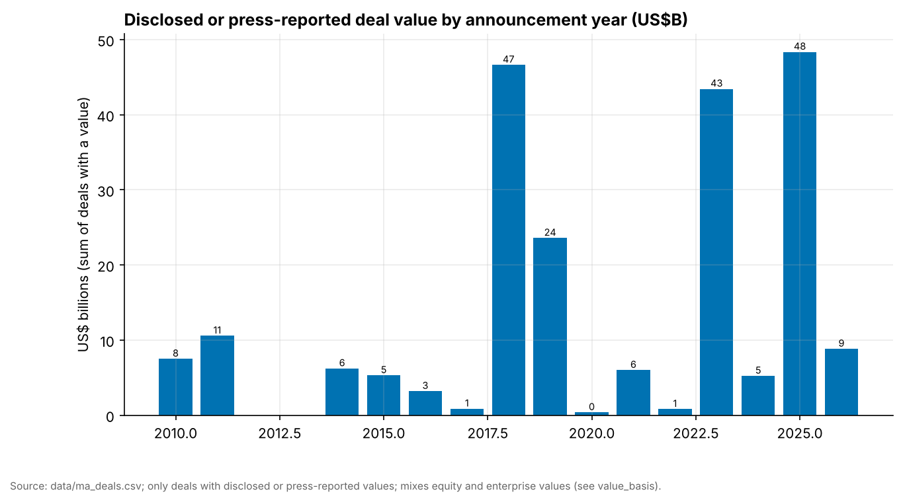
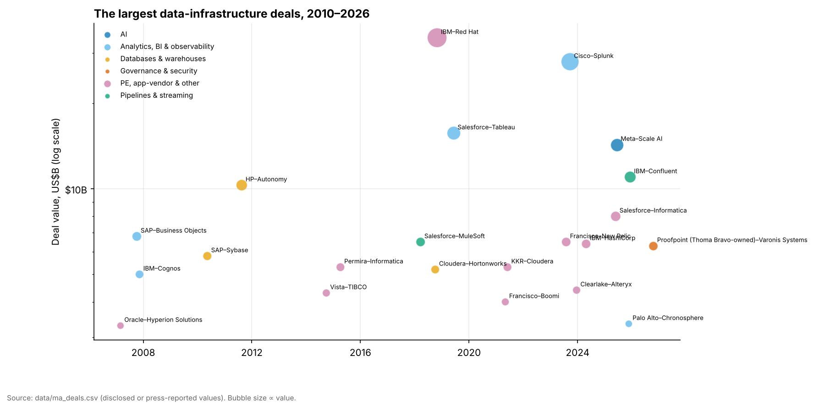
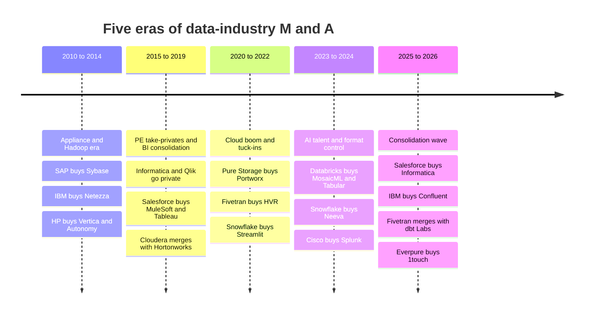
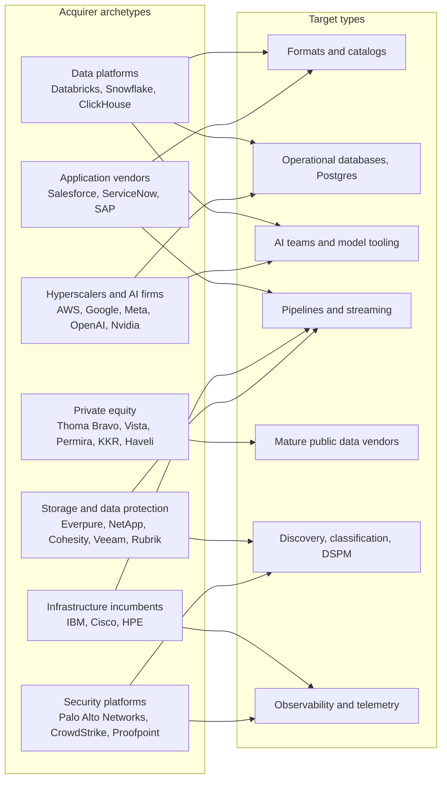

# 39. M&A History of the Data Industry, 2010–2026
> **Depth:** L2 · **Reading time:** ~21 min · **Last verified:** 2026-11-01 · **Prerequisites:** [Ch 37 Public comps and valuation](ch37-public-comps-valuation.md); helpful: [Ch 38 Open-source strategy](ch38-open-source-strategy.md), [Ch 43 The modern data stack](../06-history-and-future/ch43-modern-data-stack.md)

## TL;DR

- **Five eras, one direction.** Data-industry M&A moved from incumbents buying analytic appliances (2010–2014), to private equity taking slow-growth vendors private while app vendors bought BI (2015–2019), to cloud-era tuck-ins (2020–2022), to AI talent and format control (2023–2024), and finally to a broad consolidation wave (2025–2026). In each era buyers paid for control of whatever layer looked most strategic at the time.
- **The dataset.** `data/ma_deals.csv` holds **143 curated deals** (2010 to October 2026). It is not a census. Only **52%** carry any value, and only **38%** carry a company-disclosed one. The median valued deal is **$825M**, which overstates the typical deal because small tuck-ins rarely disclose a price. 2025–26 is the busiest period in the file, with **54 deals**, and also the least transparent: only **43%** have a value.[^ma-csv]
- **Seven patterns explain most recent deals.** They are (1) format and catalog control (Tabular, Dremio, Select Star); (2) the Postgres land grab (Neon, Crunchy Data, Mooncake, Electric); (3) AI talent through [acquihires](../glossary.md#acquihire) and **[license-and-hire](../glossary.md#license-and-hire)** structures, including Meta's ~$14.3B (press-reported) 49% stake in Scale AI; (4) modern-data-stack consolidation (Fivetran + dbt Labs); (5) PE take-privates and re-IPOs (Informatica, Cloudera, Couchbase); (6) app vendors and hyperscalers buying context for agents (Informatica, Confluent, DuckLabs); and (7) storage and data-protection vendors buying data intelligence (Cohesity–Veritas, Veeam–Securiti, Everpure–1touch).
- **What worked and what did not.** Deals that bought a *control point* and plugged it into a distribution engine created value: Salesforce–MuleSoft and Databricks–MosaicML (now an AI business above $1.4B run-rate, company-stated). Deals that bought *revenue in a declining architecture* did not: HP–Autonomy ended in an $8.8B write-down, and Cloudera–Hortonworks went private at roughly the same equity value three years later.
- **Everpure lens.** Everpure's $125M purchase of 1touch (closed May 2026) fits a well-established pattern. Storage and data-protection vendors are buying discovery, classification and governance, the layer just above the bytes. The 2010s precedents (EMC–Greenplum, Hitachi–Pentaho) are a warning. Buying the data *engine* rarely pulled hardware along. Buying the data *metadata* is the newer, better-evidenced bet.

## Why this matters (business + Everpure lens)

M&A is where strategy becomes visible. Product roadmaps are aspirational and earnings calls are curated, but a signed merger agreement shows what a company was willing to pay to own. Read in sequence, the 143 deals in the atlas dataset form a map of where the industry thought the control points were. The map kept changing: from the appliance, to the distribution, to the BI tool, to the cloud warehouse, to the table format, to the catalog, and now to the operational database and the agent's context.

For a corporate-development team this history serves three purposes. First, it sets **price anchors**. When a banker pitches a catalog or DSPM ([data security posture management](../glossary.md#data-security-posture-management)) target, the relevant comparables are Securiti ($1.725B), Varonis ($6.3B headline), Dig Security (~$400M) and 1touch ($125M), not the general software index. Second, it supplies **integration evidence**. Kept brands (Tableau, Portworx, Kaggle) behave differently from absorbed teams (Neeva, Tabular), and the dataset shows both outcomes. Third, it supplies **pattern recognition about competitors**. When NetApp buys GPU data processing (DataPelago) and Veeam buys DSPM (Securiti) within the same twelve months that Everpure buys 1touch, the storage industry is moving as a group, and the remaining targets get scarcer and more expensive.

Everpure's own deal history is short and readable. Portworx ($370M, 2020) bought Kubernetes data services, and 1touch ($125M, 2026) bought data discovery, classification and semantic context.[^portworx][^1touch] Both are layers *above* the array that make the array more valuable without competing with the customer's chosen data platform. That is the right frame for the "acquire" column at the end of this chapter, which uses public information only.

## How it works

### Reading the dataset honestly

Before the history, a note on the instrument. `data/ma_deals.csv` is a **curated** list assembled from press releases, SEC filings and top-tier press. It favours deals that shaped data infrastructure and AI data, and it deliberately includes some adjacent ones (IBM–Red Hat, IBM–HashiCorp, the observability and security deals) because they set price anchors. It is not a census. A full census of data-tool M&A would contain thousands of small transactions.[^ma-csv]

Three properties of the file matter for any analysis built on it:

1. **Disclosure is thin and skewed.** Of 143 deals, 55 (38%) have a company-disclosed value, 19 (13%) a press-reported value, and 69 (48%) none. Small tuck-ins by large acquirers almost never disclose, because the price falls below the materiality threshold that would force disclosure in a 10-Q. The median valued deal is **$825M**, and the median *disclosed* deal is **$1.05B**. Both figures describe the visible tip, not the typical transaction.[^ma-csv]
2. **Values mix bases.** Some rows are equity value (Splunk, $28B), some enterprise value (Confluent, ~$11B), some a combined-company figure (Cloudera–Hortonworks, $5.2B combined equity), and one is a minority stake (Meta–Scale AI). Summing them, as the value-by-year chart does, is a rough gauge of activity, not a market-size estimate.
3. **Press-reported prices for private targets run high.** Snowflake's 10-Q shows $164.5M for Crunchy Data against ~$250M reported, and its 10-K shows $596.2M for Observe against ~$1B reported.[^crunchy][^observe] Treat press figures as upper bounds until a filing appears.

*Figure 39.1 — Deal count by announcement year. Activity was flat through the 2010s, collapsed during the 2020–2022 valuation boom (sellers preferred venture rounds to exits), then exploded from 2023 as AI repriced every data asset. Source: `data/ma_deals.csv`.*

*Figure 39.2 — Value comes in spikes set by one or two mega-deals: Red Hat and MuleSoft in 2018, Splunk in 2023, and Scale AI, Confluent and Informatica in 2025. The 2026 bar is low partly because most 2026 deals are undisclosed tuck-ins and partly because Proofpoint–Varonis is the only multi-billion deal in the file so far.*

*Figure 39.3 — The largest deals cluster in three windows (2010–2011, 2018–2019, 2023–2026). Apart from PE take-privates, the biggest buyers were nearly always application, networking or infrastructure incumbents, not data-native companies.*

### The five eras

*Figure 39.4 — Each era's signature deals bought the layer that looked like the control point at the time. The control point moved up the stack every few years.*

**2010–2014: the appliance and Hadoop era.** In about a year, nearly every independent analytic database of the 2000s was absorbed by a systems or application vendor. SAP paid $5.8B for Sybase (May 2010) to get relational and columnar databases with which to fight Oracle.[^sybase] EMC bought Greenplum (July 2010, undisclosed) as a storage company moving up the stack.[^greenplum] IBM paid $1.7B for Netezza, an appliance already built on IBM hardware.[^netezza] HP bought Vertica (February 2011, undisclosed) after retiring its own Neoview warehouse.[^vertica] Teradata paid $263M for the 89% of Aster Data it did not already own, to add MapReduce-style analytics.[^aster] The logic was hardware pull-through: own the database, sell the box. Then came HP–Autonomy (August 2011, ~$10.3B press-reported, priced in sterling). HP wrote down $8.8B of it in November 2012 and attributed more than $5B of that to alleged accounting improprieties at Autonomy, which Autonomy's founder disputed.[^autonomy][^autonomy-wd] The lesson outlasted the litigation: unstructured-data software bought at a strategic premium, on the seller's own numbers, by an acquirer under pressure to change its story, is the riskiest trade in technology M&A. By 2014 the Hadoop wave had produced its own tuck-ins (Teradata–Hadapt, Teradata–Think Big), and cloud services such as Firebase (Google, 2014) were the first sign of the next architecture.

**2015–2019: PE take-privates and BI consolidation.** Two buyer types dominated. **Private equity** ran [take-privates](../glossary.md#take-private) of the slow-growth public vendors: Vista bought TIBCO ($4.3B including debt, 2014), Permira and CPPIB bought Informatica ($5.3B, 2015) and Thoma Bravo bought Qlik ($3.0B, 2016), often after activist pressure.[^tibco][^infa-2015][^qlik] The PE owners then used these platforms to roll up smaller companies (Qlik bought Attunity for $560M in 2019, and later Talend). **Application vendors** paid the decade's peak prices for data layers: Salesforce bought MuleSoft ($6.5B, 2018) and Tableau ($15.7B, all-stock, 2019), and Google bought Looker ($2.6B, 2019).[^mulesoft][^tableau][^looker] Meanwhile the Hadoop cycle ended. Cloudera and Hortonworks merged in an all-stock deal valuing the combined company at $5.2B (October 2018) to stop competing on price, and HPE picked up MapR's assets in 2019 after it nearly shut down.[^cloudera-hw][^mapr] Hyperscalers mostly built their own engines (Redshift, BigQuery, Cosmos DB) and bought only on-ramps such as Citus and Alooma.

**2020–2022: the cloud boom and modern-data-stack tuck-ins.** This era is thin in the dataset (eight deals) for a structural reason. Venture capital paid more than acquirers did. Snowflake's 2020 IPO and record private rounds let startups such as Fivetran, dbt Labs and Databricks raise at valuations no strategic buyer would match, so founders stayed independent. The deals that did happen were platform builders buying adjacent capability with richly valued stock. Fivetran bought HVR ($700M, announced alongside a $565M Series D) for enterprise CDC ([change data capture](../glossary.md#change-data-capture)); Snowflake bought Streamlit ($800M) for Python apps; and Pure Storage bought Portworx ($370M) for Kubernetes data services.[^hvr][^streamlit][^portworx] PE continued in the background: KKR and CD&R took Cloudera private for $5.3B in 2021, at $16 per share.[^cloudera-tp]

**2023–2024: AI talent and format control.** ChatGPT repriced everything. Databricks paid $1.3B (mostly stock, including retention packages) for MosaicML in June 2023. MosaicML was a model-training startup, and it became Mosaic AI.[^mosaic] Snowflake paid $185.4M for Neeva, whose co-founder Sridhar Ramaswamy became Snowflake's CEO in February 2024.[^neeva] Then came format control. In June 2024 Databricks bought Tabular, the company founded by Apache Iceberg's creators, for a price reported at ~$2B, for a company that had raised about $37M.[^tabular] Cisco closed the era's largest deal, Splunk, at $157 per share (~$28B equity value), which made machine data and observability a networking-security franchise.[^splunk] Storage-adjacent consolidation began as well: Cohesity agreed to combine with Veritas's data-protection business at a combined value of about $7B.[^cohesity]

**2025–2026: the consolidation wave.** Fifty-four of the 143 deals in the file fall in these 22 months. The large ones were app and infrastructure vendors buying data control points outright. Salesforce bought Informatica (~$8B equity value, $25 per share, closed November 2025); IBM bought Confluent (~$11B, $31 per share cash, closed March 2026); and Proofpoint, owned by Thoma Bravo, agreed to buy Varonis ($49.75 per share, ~$6.3B headline value, ~$5.71B equity value, expected to close in the first half of 2027).[^infa-2025][^confluent][^varonis] The modern data stack merged with itself: Fivetran and dbt Labs combined in an all-stock deal that closed June 2026 at combined ARR (annual recurring revenue) "approaching $600M" (company-stated), and Prefect agreed to buy Dagster Labs.[^fivetran-dbt][^prefect] The platforms raced for operational databases: Databricks bought Neon (~$1B press-reported), Mooncake and Electric, and Snowflake bought Crunchy Data. AI-infrastructure buyers bought software layers: CoreWeave bought Weights & Biases (~$1.7B press-reported) and Nscale agreed to buy Anyscale (~$1.65B press-reported).[^wandb][^ma-csv] Engines changed hands at the top of the stack. SAP bought Dremio (closed July 2026, undisclosed) and AWS agreed to buy DuckLabs, the company behind DuckDB, while leaving the project MIT-licensed under the DuckDB Foundation.[^dremio][^ducklabs] Storage and data-protection vendors bought data intelligence: Veeam–Securiti ($1.725B), Everpure–1touch ($125M) and NetApp–DataPelago (undisclosed).[^securiti][^1touch][^datapelago]

*Figure 39.5 — Counts and dollars point to different stories. Pipelines and databases lead on count but are mostly undisclosed tuck-ins. Dollars concentrate in a few mega-deals (Red Hat, Splunk, Tableau) and in PE take-privates, where public targets must disclose. Formats and catalogs are the cheapest group in dollars and among the most strategic. Source: `scripts/charts/ch39_deals_by_category.py` from `data/ma_deals.csv` with ch39 staged corrections.*

### Seven patterns and the deals behind them

| Pattern | Evidence deals (from the CSV) | Strategic logic | Who's next (speculative, author judgment) |
|---|---|---|---|
| 1. Format and catalog control | Databricks–Tabular (~$2B press-reported, 2024); Snowflake–Select Star (2025); Snowflake–Natoma (~$110M, 2026); SAP–Dremio (2026); ServiceNow–data.world (2025); Salesforce–Informatica (catalog, MDM) | Whoever governs the metadata pointer governs every engine that reads the table. Open formats moved lock-in up to the catalog | Remaining independent business catalogs and Iceberg-native query engines; agent-gateway and MCP-governance startups |
| 2. Postgres land grab | Databricks–Neon (~$1B press-reported), Mooncake, Electric; Snowflake–Crunchy Data ($164.5M per 10-Q); Supabase–Turso (2026) | Agents create databases on demand; owning the OLTP engine captures new apps and feeds the lakehouse | Remaining independent serverless-Postgres and agent-database vendors; Postgres extension teams (vector, columnar) |
| 3. AI talent, acquihires, license-and-hire | Databricks–MosaicML ($1.3B); Snowflake–Neeva ($185.4M); Nvidia–Run:ai (~$700M press-reported); OpenAI–Statsig ($1.1B stock); Meta–Scale AI (49%, ~$14.3B press-reported) | Buy a proven team faster than you can hire one; structure around merger review and retention | Evaluation, observability and retrieval teams; small model labs short of compute |
| 4. Modern-data-stack consolidation | Fivetran–HVR, Census, Tobiko and dbt Labs; dbt–Transform and SDF; Prefect–Dagster; Boomi–Rivery and Elementary | Point tools could not sustain standalone valuations; customers want fewer vendors | Data-observability, orchestration and reverse-ETL independents |
| 5. PE take-privates and re-IPOs | TIBCO, Informatica (out 2015, re-IPO 2021, sold 2025), Qlik, Cloudera, New Relic, Alteryx, Couchbase; Proofpoint–Varonis | Buy durable maintenance-like revenue at low multiples, cut costs, roll up, then exit to a strategic buyer or relist | Slower-growth public data, observability and security vendors trading at low EV/revenue |
| 6. Hyperscaler and app-vendor buys for agent context | Salesforce–Informatica and Own; ServiceNow–Moveworks and data.world; IBM–DataStax and Confluent; SAP–Dremio; AWS–DuckLabs | Agents need governed, real-time enterprise context; app vendors refuse to rent it from Snowflake or Databricks | Semantic-layer, streaming and knowledge-graph vendors |
| 7. Storage and data protection buying data intelligence | Pure–Portworx (2020); NetApp–Instaclustr (2022) and DataPelago (2026); Rubrik–Laminar (2023); Cohesity–Veritas (2024); Veeam–Securiti (2025); Everpure–1touch (2026) | Move from storing bytes to understanding them; sell classification, resilience and AI-readiness on the installed base | DSPM, data-access governance, unstructured-data pipeline and GPU data-processing startups |

*Figure 39.6 — Pattern table. The "who's next" column is speculation about target **types** based on public deal patterns. It is not a prediction about any named company.*

**1. Format and catalog control.** The Tabular deal is the clearest case of paying for control rather than revenue. Tabular had little revenue, but its founders steered the Apache Iceberg roadmap, and Databricks needed Iceberg to stop being a weapon for Snowflake. Once Databricks' Delta Lake and Iceberg converged, the contested layer moved up to the catalog (see [Ch 7](../01-data-systems-foundations/ch07-open-table-formats.md) and [Ch 8](../01-data-systems-foundations/ch08-catalogs-and-metastores.md)). That is why the follow-on deals were catalogs and governance (Select Star, data.world, Informatica) and, in 2026, agent-access governance (Natoma's MCP gateway).

> **Bridge: owning a standard.** Qualcomm's licensing arm earned $5.58B of revenue at a 72% EBT margin in FY2025 (fiscal year ended September 2025, as reported in its 10-K segment table) from patents essential to cellular standards.[^qcom] Standard-essential patents make the standard itself a royalty stream. Iceberg is different: it is governed by the Apache Software Foundation and cannot carry a royalty. So buying Tabular bought *influence over the roadmap* and a seat at the table, and the money is made one layer up, in the catalog that every Iceberg engine must call to commit a write. The analogy holds for the strategic instinct (own the standard) and breaks on the monetisation (the toll gate is the catalog, not the spec).

**2. The Postgres land grab.** Between May 2025 and October 2026 every major data platform bought or built a Postgres service (see [Ch 22](../03-ai-data-stack/ch22-agents-and-data.md) and [Ch 29](../04-company-deep-dives/ch29-operational-database-vendors.md)). The thesis is that agents create and discard databases at machine speed, so the vendor whose serverless Postgres they call by default captures the next generation of applications and the operational data that flows into analytics. Databricks says Lakebase, built on Neon, passed a $100M run-rate by mid-2026 (company-stated).[^db-7b] The bear case is that Postgres is open source and highly substitutable, so the price paid buys a team and a managed service, not a moat.

**3. AI talent, acquihires and license-and-hire.** Acquihires are as old as the dataset (Apple–Turi, Teradata–Hadapt), but AI changed the scale and the structure. Meta's June 2025 deal with Scale AI was a ~$14.3B (press-reported) investment for a **49% non-voting** stake, paired with Scale's CEO Alexandr Wang moving to Meta.[^scale] Because the stake stays below control, it avoided the automatic merger notification that a control acquisition of that size would trigger, although agencies can still review it, and advocacy groups asked the FTC to do so.[^scale-axios] Google's July 2025 arrangement with Windsurf followed the license-and-hire template: a non-exclusive technology licence plus hiring the CEO and key researchers for ~$2.4B (press-reported, WSJ via Reuters), with no equity purchased.[^windsurf] For a buyer these structures are fast and avoid merger review. Their cost is that the remaining company, its customers and its employees are left with less, which damages reputation and invites scrutiny.

> **Bridge: buying a design team for a node transition.** In semiconductors, a company facing a new process node or interface standard often buys a small team that has already taped out on it, because twelve months of schedule is worth more than the purchase price. MosaicML was that trade: Databricks bought a team that had already trained large models efficiently and avoided learning on customers' time. The analogy also predicts the risk. Design teams walk when their retention packages vest, which is why MosaicML's $1.3B included retention and why license-and-hire deals pay the people directly.

**4. Modern-data-stack consolidation.** The 2020–2021 "[modern data stack](../glossary.md#modern-data-stack)" (see [Ch 43](../06-history-and-future/ch43-modern-data-stack.md)) was a dozen best-of-breed tools, each funded as if it would become a platform. The consolidation came in steps. Fivetran bought CDC (HVR), reverse ETL (Census) and a rival transformation framework (Tobiko's SQLMesh), then merged with dbt Labs. dbt had earlier bought a semantic layer (Transform) and a compiler (SDF). Orchestration followed with Prefect–Dagster. Almost none of these deals disclosed a price, which is itself a signal: all-stock combinations of private companies rarely publish one, especially below the last round's mark.

**5. PE take-privates and re-IPOs.** Informatica is the full cycle in one company. Permira and CPPIB took it private for $5.3B in 2015.[^infa-2015] It returned to public markets in October 2021 in an ~$841M offering marketed at $29–32 per share, with the company valued around $10B at filing (press-reported).[^infa-ipo] Salesforce then bought it at $25 per share in 2025.[^infa-2025] The sponsors made a return on their 2015 entry. Investors who bought at the IPO did not. Cloudera repeats the shape in miniature: the Hortonworks merger, a falling share price, then a $5.3B take-private at $16 per share.[^cloudera-tp] For a strategic buyer, a PE-owned asset is often the cleanest target in a category, because the owner wants an exit and the cost base has already been cut.

**6. App vendors and hyperscalers buying context for agents.** Salesforce, ServiceNow, SAP and IBM have all concluded that agents are only as good as the governed, current data behind them, and that renting that context from Snowflake or Databricks cedes the economics (see [Ch 34](../04-company-deep-dives/ch34-application-giants-data-platforms.md)). Informatica gives Salesforce cross-system master data and a catalog. Confluent gives IBM the real-time event stream (see [Ch 30](../04-company-deep-dives/ch30-data-movement-streaming-companies.md)). Dremio gives SAP an Iceberg engine it controls. AWS's DuckLabs deal is the hyperscaler variant: it embeds an in-process analytical engine across services instead of buying a platform. DuckDB-powered analytics appeared in Aurora PostgreSQL within weeks, although the closing has not been confirmed by a primary source [VERIFY: AWS–DuckLabs closing].[^ducklabs]

**7. Storage and data protection buying data intelligence.** This is the pattern closest to Everpure, and it is covered in its own section below.

> **Bridge: semiconductor consolidation waves.** The 2015 semiconductor wave was driven by two forces that now drive data M&A. The first was **R&D scale**: each new node cost more, so subscale designers merged. NXP–Freescale (2015) paid ~$11.8B equity value for Freescale to create a combined company worth about $40B, and Avago paid $37B for Broadcom (2015) with $750M of targeted cost synergies.[^nxp][^avago] The second was **platform control**. AMD–Xilinx, announced at $35B all-stock in 2020 and valued at $48.8B at close in February 2022 because AMD's shares had risen, bought adaptive compute to sit beside CPUs and GPUs in the data centre.[^amd] Data's 2025–26 wave has the same two drivers. AI raised the R&D bill (models, agents, evaluation) beyond what a mid-sized data vendor can fund, and the platforms are buying the adjacent control points (catalog, OLTP, streaming) to own the whole socket. The difference is currency. Semiconductor roll-ups used debt and cost synergies. Data platforms such as Databricks used private stock whose value kept rising, so the "price" of a tuck-in was partly paid by future dilution, not cash.

*Figure 39.7 — Acquirer archetypes and what they buy. Discovery, classification and DSPM is the one target type contested by three archetypes at once (storage and data protection, security platforms, and data platforms through their catalogs), which is why those assets have repriced fastest.*

## Design choices and trade-offs

Every acquirer makes two structural choices: **how to buy** and **how to integrate**. The dataset shows the trade-offs clearly.

| Structure | Examples (CSV) | What the buyer gets | What it gives up / risk |
|---|---|---|---|
| Full acquisition, brand kept | Salesforce–Tableau; Pure–Portworx; Google–Kaggle; Datadog–Eppo | Customer trust and product continuity; easier retention | Slower platform integration; brand can drift (Tableau lost momentum inside Salesforce) |
| Full acquisition, absorbed | Snowflake–Neeva; Databricks–Tabular, Okera, Arcion; MongoDB–mLab | Fast integration into one platform and catalog | Target's customers often churn or are migrated off; value hard to measure |
| Acquihire | Databricks–Einblick, SiftD; Apple–Turi; Teradata–Hadapt | Team and speed at low cost | Product usually shut; retention cliff when awards vest |
| License-and-hire or minority stake | Meta–Scale AI (49%); Google–Windsurf (licence) | Talent and technology without control-deal review | Reputational and regulatory risk; the remaining company may weaken |
| Merger of equals (all-stock) | Cloudera–Hortonworks; Fivetran–dbt Labs; Cohesity–Veritas | Scale and an end to price competition without cash | Two cultures and overlapping products; rarely re-rates |
| PE take-private | Informatica, Qlik, Cloudera, Couchbase | Patient capital, cost reset, roll-up platform | Leverage limits R&D; exit multiple risk (Informatica sold below its IPO price) |

*Figure 39.8 — Deal structures and their trade-offs. The structure choice usually predicts the integration outcome better than the price does.*

**Steelman of "absorb."** Platform buyers absorb because their product *is* the integration. A Databricks customer gains nothing from a separate Tabular brand and everything from Iceberg support inside Unity Catalog. The opposing case: absorption destroys the external signal of value, so shareholders cannot tell whether the deal worked. The dataset contains no case of a fully absorbed AI or catalog tuck-in ever being written down publicly. Absence of evidence is not evidence of success.

**Steelman of "keep the brand."** Keeping the brand protects an installed base and a developer community, and it is the norm when the target sells to a different buyer (Portworx to platform engineers, Tableau to analysts). The risk is that a kept brand becomes a silo, with separate sales motions, separate roadmaps and no cross-sell. Portworx is the useful internal precedent here: it kept its name and leader, and Pure sold it through its own channels.[^portworx]

## Who's who

- **Serial platform acquirers.** Databricks is the most active buyer in the file (**16 deals**, five in 2026), followed by Snowflake (**12**). Nearly all were undisclosed tuck-ins that filled one gap each: AI (MosaicML, Lilac, Fennel, Tecton), formats (Tabular), OLTP (Neon, Mooncake, Electric), security (Antimatter, Panther) and user interfaces (Row Zero). ClickHouse is a smaller version of the same model (PeerDB, HyperDX, Langfuse). See [Ch 25](../04-company-deep-dives/ch25-databricks.md) and [Ch 26](../04-company-deep-dives/ch26-snowflake.md).
- **Application giants.** Salesforce has spent more than $32B on data-layer assets since 2018 (MuleSoft, Datorama, Tableau, Own, Informatica; our sum of disclosed and press-reported values).[^ma-csv] ServiceNow (Moveworks, data.world) and SAP (Dremio) followed in 2025–26.
- **Infrastructure incumbents.** IBM is the most consistent buyer of data infrastructure in the file: Netezza, Cloudant, Red Hat, StreamSets and webMethods, HashiCorp, DataStax and Confluent. Cisco (Splunk, Galileo) and HPE (MapR) are occasional buyers.
- **Hyperscalers and AI companies.** Historically these buyers made small tuck-ins. AI changed that. Meta (Scale AI), Nvidia (Run:ai, Gretel), OpenAI (Rockset, Statsig, Neptune), CoreWeave (Weights & Biases) and Nscale (Anyscale) now buy data and ML software layers.
- **Private equity.** Thoma Bravo (Qlik, Talend via Qlik, Proofpoint–Normalyze and –Varonis), Vista (TIBCO), Permira (Informatica), KKR and CD&R (Cloudera), Francisco Partners and TPG (New Relic, Boomi), Clearlake and Insight (Alteryx) and Haveli (Couchbase, and the lead funder of Cohesity–Veritas).
- **Security platforms.** Palo Alto Networks (Dig, Protect AI, Chronosphere, Portkey), CrowdStrike (Flow, Onum), Check Point (Lakera) and Proofpoint all now buy data-security and telemetry assets. They are the main competing bidders for DSPM targets.
- **Storage and data protection.** Everpure (Portworx, 1touch), NetApp (Instaclustr, DataPelago), Cohesity (Veritas), Veeam (Securiti) and Rubrik (Laminar). See [Ch 33](../04-company-deep-dives/ch33-governance-catalog-security-companies.md) for the targets' side of these deals.

## History and trajectory

### The 30 deals that mattered most

| Date | Acquirer | Target | Category | Value (basis) | Rationale | Outcome |
|---|---|---|---|---|---|---|
| 2010-05 | SAP | Sybase | Database | $5.8B (disclosed) | Relational and columnar DBs to fight Oracle | Lived alongside HANA; mature franchise |
| 2010-07 | EMC | Greenplum | Warehouse | Undisclosed | Storage leader moves up-stack into MPP analytics | Spun into Pivotal, then to VMware, then Broadcom |
| 2010-09 | IBM | Netezza | Warehouse | $1.7B (disclosed) | Warehouse appliance on IBM hardware | Rebranded; later revived as Netezza Performance Server |
| 2011-08 | HP | Autonomy | Search | ~$10.3B (press-reported) | Unstructured-data software to pivot from PCs | $8.8B write-down (Nov 2012) |
| 2014-09 | Vista | TIBCO | PE take-private | $4.3B incl. debt (disclosed) | Slowing integration vendor | Later combined with Citrix (2022) |
| 2015-04 | Permira, CPPIB | Informatica | PE take-private | $5.3B (disclosed) | Retool for subscription and cloud | Re-IPO 2021; sold to Salesforce 2025 |
| 2016-06 | Thoma Bravo | Qlik | PE take-private | $3.0B (disclosed) | BI vendor under activist pressure | Became roll-up platform (Attunity, Talend) |
| 2018-03 | Salesforce | MuleSoft | Integration | $6.5B (disclosed) | API-led integration across customer systems | Building block of Data Cloud and agents |
| 2018-10 | Cloudera | Hortonworks | Hadoop | $5.2B combined equity (disclosed) | End Hadoop price war | Growth stalled; taken private 2021 |
| 2019-06 | Google | Looker | BI | $2.6B (disclosed) | Semantic-layer BI on BigQuery | Google Cloud's BI layer |
| 2019-06 | Salesforce | Tableau | BI | $15.7B all-stock (disclosed) | Analytics as a Salesforce cloud | Brand kept; momentum slowed |
| 2020-09 | Pure Storage | Portworx | Storage-adjacent | ~$370M cash (disclosed) | Kubernetes data services | Kept brand; Everpure cloud-native anchor |
| 2021-06 | KKR, CD&R | Cloudera | PE take-private | $5.3B (disclosed) | Slowing Hadoop-era platform | Private; repositioned to hybrid lakehouse |
| 2023-05 | Snowflake | Neeva | AI talent | $185.4M (disclosed, 10-Q) | AI search team | Neeva co-founder became Snowflake CEO |
| 2023-06 | Databricks | MosaicML | AI talent | $1.3B incl. retention (disclosed) | Custom-LLM training | Became Mosaic AI |
| 2023-09 | Cisco | Splunk | Observability | ~$28B equity (disclosed) | Machine data for security and networking | Closed Mar 2024; Cisco's largest deal |
| 2024-02 | Cohesity | Veritas data protection | Storage-adjacent | Undisclosed (combined value ~$7B) | Scale in data protection | Closed Dec 2024 |
| 2024-06 | Databricks | Tabular | Format/catalog | ~$2B (press-reported) | Neutralise the Iceberg format war | Contest moved to catalogs |
| 2025-03 | CoreWeave | Weights & Biases | AI tooling | ~$1.7B (press-reported) | GPU cloud adds MLOps software | Closed May 2025 |
| 2025-05 | Databricks | Neon | Postgres | ~$1B (press-reported) | Serverless Postgres for agents | Lakebase, >$100M run-rate |
| 2025-05 | Salesforce | Informatica | App-vendor data layer | ~$8B equity (disclosed) | Catalog, MDM, integration for agents | Closed Nov 2025 |
| 2025-06 | Snowflake | Crunchy Data | Postgres | $164.5M (disclosed, 10-Q) | Answer to Neon | Snowflake Postgres |
| 2025-06 | Meta | Scale AI (49%) | AI talent | ~$14.3B (press-reported) | Non-control stake plus CEO hire | Investment-acquihire |
| 2025-10 | Fivetran | dbt Labs | MDS consolidation | Undisclosed, all-stock | Ingestion plus transformation | Closed Jun 2026; ARR approaching $600M |
| 2025-10 | Veeam | Securiti AI | DSPM | $1.725B (disclosed) | DSPM and AI governance on backup | Closed Dec 2025 |
| 2025-12 | IBM | Confluent | Streaming | ~$11B EV (disclosed) | Real-time data for watsonx and agents | Closed Mar 2026 |
| 2026-02 | Everpure | 1touch | DSPM / data intelligence | $125M cash (disclosed, 10-Q) | Discovery, classification, semantic context | Closed May 2026; Data Intelligence |
| 2026-05 | SAP | Dremio | App-vendor data layer | Undisclosed | Iceberg lakehouse for Business Data Cloud | Closed Jul 2026 |
| 2026-08 | AWS | DuckLabs | Analytical engine | Undisclosed | Embedded OLAP across AWS | Announced; DuckDB stays MIT |
| 2026-10 | Proofpoint | Varonis | DSPM | ~$6.3B headline (disclosed) | Data-access governance for AI-era risk | Pending; close expected 1H 2027 |

*Figure 39.9 — Master deal table, drawn from `data/ma_deals.csv` (Veeam–Securiti dated to its October 2025 announcement per staged correction). The full list of 143 deals, with rationale, outcome and a source for every row, is in `data/ma_deals.csv` at the repository root.*

### Outcomes and lessons

**Deals that created value.** Two deals are clear successes, and both bought a control point that a larger distribution engine could then push. **Salesforce–MuleSoft** ($6.5B) became the connective tissue for Salesforce's data and agent strategy. Salesforce's FY2026 10-K describes its integration, automation and API-management offerings as built on MuleSoft, and MuleSoft Agent Fabric now governs agents across vendors.[^crm-10k] **Databricks–MosaicML** ($1.3B) is the cleanest AI example. Within about thirty months Databricks reported an AI-products run-rate above $1.4B (company-stated, January 2026).[^db-54] That is not all attributable to MosaicML, but the deal gave Databricks credibility in models when it needed it. Smaller successes follow the same logic: Elastic–Found became Elastic Cloud, MongoDB–mLab moved users onto Atlas, and Google–Looker became Google Cloud's BI layer. Snowflake–Neeva is unusual. The asset was a team, and the outcome was a CEO.

**Deals that disappointed.** **HP–Autonomy** is the industry's cautionary tale: an $8.8B write-down a year after closing.[^autonomy-wd] **Cloudera–Hortonworks** combined two distributors of an architecture (on-premises Hadoop) that cloud object storage and managed Spark were already replacing. The merged company was taken private in 2021 for about $5.3B, roughly the $5.2B combined value at which the 2018 merger was struck, so three years of combination added little visible value.[^cloudera-hw][^cloudera-tp] The 2010–2011 appliance deals produced few category leaders once cloud warehouses arrived. Greenplum went through four owners and Vertica three. **Salesforce–Tableau** is the contested case. The brand survived and Tableau remains a major BI product, but the deal did not make Salesforce the analytics leader, and the next decade's analytics value went to cloud warehouses.

**Integration patterns that predict outcomes.**

1. **Buy the control point, not the revenue.** The best deals in the file bought a layer that other products had to pass through (integration APIs, a catalog, a model-training stack). The worst bought revenue in an architecture about to be superseded (appliances, Hadoop distributions).
2. **The distribution engine matters more than the price.** MuleSoft inside Salesforce and Portworx inside Pure's channel scaled because the acquirer already had the customers. Teradata's Hadoop buys did not, because Teradata's customers were moving to the cloud.
3. **Storage buyers succeed when they buy metadata, not engines.** EMC–Greenplum and Hitachi–Pentaho did not pull through hardware. Portworx did, because it made the storage itself more useful to a new buyer (platform engineers).
4. **Stock currency is a strategic weapon until it is not.** Databricks paid for most of its tuck-ins in private stock whose value kept rising. Fivetran and dbt merged in stock, a structure that avoids publishing a price at all. In a down-market the same currency becomes a liability, because sellers discount private stock they cannot sell.

**How undisclosed values limit the analysis.** Nearly half of the file has no price, and the gap is not random. Undisclosed deals are mostly small tuck-ins, so any median or average describes the large deals. Category comparisons are biased too: formats and catalogs look cheap in Figure 39.5 partly because Select Star, data.world and Dremio never disclosed a price. Two practical fixes help. First, read the acquirer's next 10-Q or 10-K, which often discloses purchase consideration for a deal that was "undisclosed" at announcement (Crunchy, Observe, WarpStream, Neeva and 1touch all became visible this way).[^crunchy][^observe][^warpstream][^neeva][^1touch] Second, treat press-reported figures as upper bounds.

### Everpure lens: storage and data protection move into data intelligence

The seventh pattern is a decade old but has accelerated. In the 2010s storage vendors bought **engines**: EMC–Greenplum, Hitachi–Pentaho, HPE–MapR. In the 2020s they buy **data services and metadata**: Pure–Portworx (2020), NetApp–Instaclustr (2022), Rubrik–Laminar (DSPM, 2023), Cohesity–Veritas (2024), Veeam–Securiti ($1.725B, announced October 2025), Everpure–1touch ($125M, 2026) and NetApp–DataPelago (GPU data processing, 2026).[^ma-csv][^securiti][^datapelago] Salesforce–Own ($1.9B cash, 2024) is the mirror image, with an app vendor buying backup for its own data.[^own]

Everpure announced the 1touch acquisition on the day it renamed itself (February 23, 2026), closed it on May 7, 2026, and relaunched the technology as **Data Intelligence** at Accelerate in June 2026. The product discovers, classifies and adds semantic context to data across Everpure arrays, third-party storage, clouds and SaaS applications, without copying it.[^1touch][^everpure-di] In deal terms it is small: $125M against Veeam's $1.725B for Securiti. That gap reflects scale and stage, not just price discipline. Securiti was a broader DSPM and privacy platform with about 600 employees.[^securiti]

**The "acquire" column: options a strategy team might evaluate, based on public information.** These are target *categories* that public deal patterns suggest a storage company might evaluate. They are not statements about Everpure's plans.

| Target category | Public precedents | Logic for a storage vendor | Main risks |
|---|---|---|---|
| Data-access governance and DSPM depth | Veeam–Securiti; Proofpoint–Varonis; Rubrik–Laminar; Cyera–Trail | Extend classification into who-can-access-what and remediation | Security platforms bid aggressively; valuations repriced (Varonis at ~8.4x LTM revenue, press-reported)[^varonis] |
| Metadata catalog and semantic layer | Snowflake–Select Star; ServiceNow–data.world; Salesforce–Informatica | Make classification tags usable by Unity Catalog, Horizon and agents | Platforms want to own the catalog; risk of competing with partners |
| Unstructured-data and AI-ingest pipelines | Snowflake–Datavolo; Databricks–Lilac; Elastic–Jina AI | Prepare files for retrieval next to where they live | Fast-moving open source; thin moats |
| GPU-accelerated data processing at the storage layer | NetApp–DataPelago | Push filtering and transformation to storage to save GPU time | Unproven demand; NVIDIA's own software roadmap |
| Kubernetes and cloud-native data services | Pure–Portworx; NetApp–Instaclustr | Extend an existing franchise to databases and streaming services | Hyperscaler-managed services compete |
| Open lakehouse engines | SAP–Dremio; AWS–DuckLabs | Query data in place on object storage | Channel conflict with Databricks, Snowflake and Starburst partners; high price |

*Figure 39.10 — "Acquire" options by category, public information only. The first three rows extend the 1touch thesis directly. The last row is the 2010s mistake in modern form unless it is done as a partnership.*

## Numbers that matter

| Metric | Value | Basis | Source / date |
|---|---|---|---|
| Deals in atlas dataset | 143 (2010 to Oct 2026) | Curated, not exhaustive | `data/ma_deals.csv`, 2026-11-01[^ma-csv] |
| Share with any value / disclosed value | 52% / 38% | Our computation | Same |
| Median valued deal / median disclosed deal | $825M / $1.05B | Our computation; biased upward | Same |
| Deals in 2025–26 / share with a value | 54 / 43% | Our computation | Same |
| Most active acquirers | Databricks 16, Snowflake 12, IBM 7 | Count in dataset | Same |
| Largest deal in file | IBM–Red Hat $34B | Disclosed | IBM 8-K, 2019-07-09[^ma-csv] |
| Largest pure data-infrastructure deal | Cisco–Splunk ~$28B equity | Disclosed | SecurityWeek, 2024-03-18[^splunk] |
| HP–Autonomy write-down | $8.8B | Company-reported impairment (Nov 2012) | Computer Weekly, 2012-11-20[^autonomy-wd] |
| Meta–Scale AI | ~$14.3B for 49% non-voting | Press-reported | TechCrunch, 2025-06-13[^scale] |
| Salesforce–Informatica | ~$8B equity, $25/share | Disclosed | Salesforce 10-Q, 2025[^infa-2025] |
| IBM–Confluent | ~$11B, $31/share | Disclosed | IBM release, 2026-03-17[^confluent] |
| Fivetran + dbt Labs combined ARR | Approaching $600M | Company-stated | Fivetran, 2026-06[^fivetran-dbt] |
| Everpure–1touch | $125.0M cash | Disclosed (10-Q) | Everpure 10-Q, 2026-06[^1touch] |
| Veeam–Securiti | $1.725B | Disclosed | Yahoo Finance/TechCrunch, 2025-10-21[^securiti] |
| Proofpoint–Varonis | ~$6.3B headline; ~$5.71B equity | Disclosed / press-reported | Varonis 8-K, 2026-10-15[^varonis] |
| Press-reported vs filed price | Crunchy ~$250M vs $164.5M; Observe ~$1B vs $596.2M | Press-reported vs 10-Q/10-K | Snowflake filings[^crunchy][^observe] |

*Figure 39.11 — Numbers that matter.*

## Storage bridge

> **Storage bridge.** Storage and data protection vendors hold the one asset the data platforms lack: the physical location of the enterprise's unstructured and on-premises data, plus backup copies of nearly everything. That is why discovery, classification and DSPM attract them. Classification can run where the bytes already sit, and backup copies are a ready-made index of the estate. See the companion *Everpure Tech Atlas* for how FlashBlade and backup architectures expose that data.

## Conversation playbook

**Three questions for PMs and corporate-development peers**

1. "When you benchmark a DSPM or catalog target, which comparables do you use: Securiti, Varonis, Dig, 1touch, or the security index?" *A good answer* separates platform deals (Securiti, Varonis) from capability tuck-ins (Dig, 1touch, Normalyze), and adjusts for whether the value is equity, enterprise or headline.
2. "Does the target make our installed base more valuable, or does it put us in competition with our platform partners?" *A good answer* names the partners affected (Databricks Unity Catalog, Snowflake Horizon) and explains how tags or policies flow both ways.
3. "Keep the brand or absorb?" *A good answer* ties the choice to who buys the product. A different buyer means keep the brand (Portworx); the same buyer and the same console means absorb (1touch into Data Intelligence).

**Three questions for engineers and architects**

1. "Does the target's classification run in place, or does it copy data out?" *Good:* in-place scanning with sampling, a clear statement of what metadata leaves the array, and connector coverage.
2. "Which open standards does it read and write: Iceberg REST, OpenLineage, MCP?" *Good:* named versions and a live integration, not a roadmap slide.
3. "What happens to accuracy and cost at billions of objects?" *Good:* a throughput number with hardware assumptions and an incremental-scan design.

**What good answers sound like.** They state the value basis (equity, enterprise, headline or press-reported). They distinguish control points from revenue, and they cite a precedent from the dataset with its outcome, not just its price.

**Don't say this**

- "Databricks paid $2B for Tabular." *The price is press-reported (WSJ $1–2B; TechCrunch ~$2B); Databricks never disclosed it.*
- "Meta bought Scale AI." *Meta bought a 49% non-voting stake and hired the CEO. It is not a control acquisition.*
- "Snowflake paid $250M for Crunchy Data." *The 10-Q shows $164.5M cash. $250M was press-reported.*
- "The median data deal is about $800M." *That is the median of deals with a disclosed or reported value. Most small deals never disclose.*
- "Storage companies buying software always fails." *Engine buys (Greenplum, Pentaho) mostly did. Data-services buys (Portworx) did not.*
- "Cloudera–Hortonworks was a $5.2B acquisition." *$5.2B was the combined equity value of an all-stock merger, not a price paid.*

## Going deeper

> **Going deeper (L3).** To size an "undisclosed" deal, read the acquirer's purchase-price allocation in the next 10-Q or 10-K. Look for total purchase consideration, the split between goodwill and intangible assets, and **holdbacks** or retention awards that are expensed as compensation rather than counted in the price (Confluent's WarpStream disclosure shows $135.1M of consideration plus up to $76.2M of holdbacks).[^warpstream] A high goodwill share with little developed technology signals a talent or strategic buy. Large compensation holdbacks signal an acquihire, whatever the press release calls it.

- `data/ma_deals.csv`, read with the `value_basis` and `outcome` columns, is the starting point. Also see `meta/research-notes-ma-2010s.md` and `meta/research-notes-ma-2020s.md`.
- Related chapters: [Ch 37](ch37-public-comps-valuation.md) for multiples, [Ch 38](ch38-open-source-strategy.md) for why open-source projects survive acquisitions, and [Ch 45](../06-history-and-future/ch45-storage-moving-up-the-stack.md) for the storage-moving-up-the-stack strategy in full.

## Key terms

- [Acquihire](../glossary.md#acquihire) — an acquisition made mainly to hire the target's team, often shutting its product.
- [License-and-hire](../glossary.md#license-and-hire) — a deal that licenses a startup's technology and hires its leaders without buying control of the company.
- [Take-private](../glossary.md#take-private) — a buyout, usually by private equity, that delists a public company.
- [Re-IPO](../glossary.md#re-ipo) — a return to public markets by a company previously taken private.
- [Tuck-in acquisition](../glossary.md#tuck-in-acquisition) — a small acquisition folded into an existing product line, usually with an undisclosed price.
- [Merger of equals](../glossary.md#merger-of-equals) — an all-stock combination of similar-sized companies with no large control premium.
- [Holdback](../glossary.md#holdback) — part of the deal consideration withheld or tied to continued employment, often expensed as compensation.
- [Equity value](../glossary.md#equity-value) — the price for all shares; enterprise value adds net debt.
- [Enterprise value](../glossary.md#enterprise-value) — equity value plus debt minus cash; the value of the operating business.
- [Goodwill impairment](../glossary.md#goodwill-impairment) — a write-down of acquisition goodwill when the business is worth less than its carrying value.
- [Standard-essential patent](../glossary.md#standard-essential-patent) — a patent that must be licensed to implement an industry standard.
- [Modern data stack](../glossary.md#modern-data-stack) — the 2018–2022 cloud toolchain of separate ingestion, warehouse, transformation, BI and activation vendors.
- [Data security posture management](../glossary.md#data-security-posture-management) — software that discovers sensitive data and assesses its exposure and access risk.
- [Open table format](../glossary.md#open-table-format) — a metadata layer (Iceberg, Delta, Hudi) that gives files in object storage database-like tables.
- [Apache Iceberg](../glossary.md#apache-iceberg) — the open table format whose creators' company Databricks bought in 2024.
- [Unity Catalog](../glossary.md#unity-catalog) — Databricks' governance catalog, the control point after the format war.
- [Change data capture](../glossary.md#change-data-capture) — streaming row-level changes out of an operational database.
- [Reverse ETL](../glossary.md#reverse-etl) — pushing warehouse data back into operational applications.
- [Lakebase](../glossary.md#lakebase) — Databricks' serverless Postgres, built on Neon.
- [Model Context Protocol](../glossary.md#model-context-protocol) — open standard for exposing tools and data to AI agents.

## Sources

[^ma-csv]: AI Data Atlas dataset `data/ma_deals.csv` (143 rows, as_of 2026-11-01; per-row sources include company releases, SEC filings and press), with corrections staged in `data/staging/ch39-ma_deals.csv`; statistics computed by the author on 2026-11-01. Companion notes: `meta/research-notes-ma-2010s.md`, `meta/research-notes-ma-2020s.md`; retrieved 2026-11-01.
[^sybase]: SAP, "SAP to acquire Sybase" (ad-hoc release), https://www.sap.com/investors/en/financial-news/ad-hoc-news/2010/05/934992.html, published 2010-05-12; retrieved 2026-11-01. Disclosed.
[^greenplum]: EMC (Dell Technologies newsroom), "EMC to acquire Greenplum," https://corporate.delltechnologies.com/en-us/newsroom/announcements/2010/07/20100706-01.htm, published 2010-07-06; retrieved 2026-11-01. Terms undisclosed.
[^netezza]: WilmerHale, "Netezza to be acquired for $1.7 billion in cash," https://www.wilmerhale.com/en/insights/news/netezza-to-be-acquired-for-1-7-billion-in-cash-september-22-2010, published 2010-09-22; retrieved 2026-11-01.
[^vertica]: TechCrunch, "HP acquires Vertica," https://techcrunch.com/2011/02/14/hp-acquires-data-management-and-real-time-analytics-company-vertica/, published 2011-02-14; retrieved 2026-11-01.
[^aster]: Teradata Corp., Form 8-K (Aster Data merger agreement), https://www.sec.gov/Archives/edgar/data/0000816761/000119312511054332/d8k.htm, published 2011-03-03; retrieved 2026-11-01.
[^autonomy]: The Register, "HP completes Autonomy acquisition," https://www.theregister.com/2011/10/04/hp_buys_autonomy/, published 2011-10-04; retrieved 2026-11-01. Offer priced at GBP 25.50/share; ~$10.3B USD is press-reported.
[^autonomy-wd]: Computer Weekly, "HP writes down Autonomy by $8.8bn," https://www.computerweekly.com/news/2240172197/HP-writes-down-Autonomy-by-88bn, published 2012-11-20; CNN Money, "HP earnings," https://money.cnn.com/2012/11/20/technology/enterprise/hp-earnings/, published 2012-11-20; retrieved 2026-11-01. HP attributed >$5B of the charge to alleged improprieties; Autonomy's founder disputed HP's account.
[^tibco]: Financier Worldwide, "Vista Equity acquires TIBCO for $4.3bn," https://financierworldwide.com/vista-equity-acquires-tibco-for-43bn, published 2014-09; retrieved 2026-11-01.
[^infa-2015]: Permira, "Informatica announces agreement to be acquired by the Permira funds and Canada Pension Plan Investment Board," https://www.permira.com/news-and-insights/news/informatica-announces-agreement-to-be-acquired-by-the-permira-funds-and-canada-pension-plan-investment-board/, published 2015-04-07; retrieved 2026-11-01.
[^infa-ipo]: Informatica Inc., Form 424B4 prospectus, https://www.sec.gov/Archives/edgar/data/1868778/000119312521309474/d169828d424b4.htm, published 2021-10; Bloomberg, "Permira-Backed Technology Company Informatica Files for IPO," https://www.bloomberg.com/news/articles/2021-10-01/permira-backed-technology-company-informatica-files-for-ipo, published 2021-10-01; The Globe and Mail, "CPPIB sees large gain in Informatica as firm goes public," 2021-10; retrieved 2026-11-01. ~$10B valuation is press-reported; final IPO price per share [VERIFY: 424B4 final price].
[^qlik]: Thoma Bravo, "Thoma Bravo to acquire Qlik," https://www.thomabravo.com/press-releases/thoma-bravo-to-acquire-qlik, published 2016-06-02; retrieved 2026-11-01.
[^mulesoft]: Salesforce, "Salesforce Signs Definitive Agreement to Acquire MuleSoft," https://investor.salesforce.com/news/news-details/2018/Salesforce-Signs-Definitive-Agreement-to-Acquire-MuleSoft/default.aspx, published 2018-03-20; retrieved 2026-11-01.
[^tableau]: Cooley, "Tableau enters agreement to sell to Salesforce for $15.7 billion," https://www.cooley.com/news/coverage/2019/2019-06-10-tableau-enters-agreement-to-sell-to-salesforce-for-15-billion, published 2019-06-10; retrieved 2026-11-01.
[^looker]: TechCrunch, "Google closes $2.6B Looker acquisition," https://techcrunch.com/2020/02/13/google-closes-2-6b-looker-acquisition/, published 2020-02-13; retrieved 2026-11-01.
[^cloudera-hw]: TechCrunch, "Cloudera and Hortonworks announce $5.2 billion merger," https://techcrunch.com/2018/10/03/cloudera-and-hortonworks-announce-5-2-billion-merger, published 2018-10-03; retrieved 2026-11-01. $5.2B is combined equity value.
[^mapr]: Hewlett Packard Enterprise, "HPE advances its intelligent data platform with acquisition of MapR business assets," https://hpe.com/us/en/newsroom/press-release/2019/08/hpe-advances-its-intelligent-data-platform-with-acquisition-of-mapr-business-assets.html, published 2019-08-05; retrieved 2026-11-01.
[^hvr]: Fivetran, "Fivetran to Acquire HVR; Announces $565 Million in Series D Funding," https://www.fivetran.com/press/fivetran-to-acquire-hvr-announces-565-million-in-series-d-funding, published 2021-09-20; retrieved 2026-11-01.
[^streamlit]: TechCrunch, "Snowflake acquires Streamlit for $800M," https://techcrunch.com/2022/03/02/snowflake-acquires-streamlit-for-800m-to-help-customers-build-data-based-apps/, published 2022-03-02; retrieved 2026-11-01.
[^portworx]: StorageNewsletter, "Pure Storage to Acquire Portworx for $370 Million in Cash," https://www.storagenewsletter.com/2020/09/18/pure-storage-to-acquire-portworx-for-370-million-in-cash/, published 2020-09-18; TheStreet, "Pure Storage to Buy Data-Storage Provider Portworx for $370M," https://www.thestreet.com/investing/pure-storage-to-acquire-data-storage-provider-portworx-for-370-million, published 2020-09-16; retrieved 2026-11-01. Company-stated approximate price.
[^cloudera-tp]: DBTA, "Cloudera Agrees to be Acquired by Clayton, Dubilier & Rice and KKR for $5.3 Billion," https://dbta.com/Editorial/News-Flashes/Cloudera-Agrees-to-be-Acquired-by-Clayton-Dubilier-and-Rice-and-KKR-for-53-Billion-147223.aspx, published 2021-06; ZDNet, https://www.zdnet.com.au/finance/cloudera-to-be-acquired-by-private-investment-firm-for-5-3-billion/, 2021-06; retrieved 2026-11-01.
[^mosaic]: Databricks, "Databricks Completes Acquisition of MosaicML," https://www.databricks.com/company/newsroom/press-releases/databricks-completes-acquisition-mosaicml, published 2023-07-19; retrieved 2026-11-01. $1.3B includes retention packages.
[^neeva]: Snowflake Inc., Form 10-Q for the quarter ended 2023-07-31, https://www.sec.gov/Archives/edgar/data/1640147/000164014723000199/snow-20230731.htm, published 2023-08/09; retrieved 2026-11-01. $185.4M total preliminary cash consideration.
[^tabular]: TechCrunch, "Databricks reportedly paid $2 billion in Tabular acquisition," https://techcrunch.com/2024/08/14/databricks-reportedly-paid-2-billion-in-tabular-acquisition, published 2024-08-14; retrieved 2026-11-01. Press-reported; WSJ earlier reported $1–2B; ~$37M raised per research notes.
[^splunk]: SecurityWeek, "Cisco Completes $28 Billion Acquisition of Splunk," https://www.securityweek.com/cisco-completes-28-billion-acquisition-of-splunk/, published 2024-03-18; Nasdaq, "Cisco completes acquisition of Splunk," https://www.nasdaq.com/articles/cisco-completes-acquisition-of-splunk, 2024-03; retrieved 2026-11-01.
[^cohesity]: Cohesity via Business Wire (Cohesity–Veritas agreement), https://www.businesswire.com/news/home/20240207468982/en, published 2024-02-07/08; Cohesity, "Cohesity becomes world's largest data protection provider after completing combination with Veritas' enterprise data protection business," https://www.cohesity.com/press/cohesity-becomes-worlds-largest-data-protection-provider-after-completing-combination-with-veritas-enterprise-data-protection-business/, published 2024-12-10; retrieved 2026-11-01. ~$7B is combined-company value, not price.
[^infa-2025]: Salesforce, Inc., Form 10-Q for the quarter ended 2025-07-31, https://www.sec.gov/Archives/edgar/data/1108524/000110852425000088/crm-20250731.htm, published 2025-09; Business Wire via FinancialContent, "Salesforce Completes Acquisition of Informatica," https://markets.financialcontent.com/clarkebroadcasting.mymotherlode/article/bizwire-2025-11-18-salesforce-completes-acquisition-of-informatica, published 2025-11-18; retrieved 2026-11-01. ~$8B equity value net of Salesforce's existing stake.
[^confluent]: IBM release via Stock Titan, "IBM Completes Acquisition of Confluent," https://www.stocktitan.net/news/IBM/ibm-completes-acquisition-of-confluent-making-real-time-data-the-lbuwdbharsqe.html, published 2026-03-17; retrieved 2026-11-01.
[^varonis]: Varonis Systems, Form 8-K Ex. 99.1, https://www.sec.gov/Archives/edgar/data/0001361113/000121390026109901/ea030861001ex99-1.htm, published 2026-10-15; Ynetnews, "Proofpoint to acquire Israeli-founded Varonis for $6.3 billion," https://www.ynetnews.com/business/article/hyyltkk3fl, 2026-10; Verdict, https://www.verdict.co.uk/newsletters/proofpoint-varonis-6-3bn-cybersecurity-deal, 2026-10; retrieved 2026-11-01. $5.71B equity value and 8.4x LTM revenue are press-reported.
[^fivetran-dbt]: Fivetran, "Fivetran & dbt Labs complete merger to create the data infrastructure for trusted AI agents," https://www.fivetran.com/press/fivetran-dbt-labs-complete-merger-to-create-the-data-infrastructure-for-trusted-ai-agents, published 2026-06; retrieved 2026-11-01. Company-stated ARR.
[^prefect]: Dagster Labs, "Prefect is acquiring Dagster," https://dagster.io/blog/prefect-is-acquiring-dagster, published 2026-07-13; retrieved 2026-11-01.
[^wandb]: CoreWeave, "CoreWeave Completes Acquisition of Weights & Biases," https://investors.coreweave.com/news/news-details/2025/CoreWeave-Completes-Acquisition-of-Weights--Biases/default.aspx, published 2025-05-05; retrieved 2026-11-01. ~$1.7B press-reported (The Information).
[^dremio]: SAP News, "SAP Completes Dremio Acquisition," https://news.sap.com/2026/07/sap-completes-dremio-acquisition/, published 2026-07-06; Dremio newsroom, "SAP to Acquire Dremio…," https://www.dremio.com/newsroom/sap-to-acquire-dremio-to-unify-sap-and-non-sap-data-to-power-agentic-ai/, published 2026-05-04; retrieved 2026-11-01.
[^ducklabs]: Amazon, "AWS to acquire DuckLabs," https://www.aboutamazon.com/news/company-news/aws-ducklabs, published 2026-08-26; The Register, https://www.theregister.com/databases/2026/08/26/aws-buys-ducklabs-the-people-behind-the-popular-in-process-olap-database/5292590, published 2026-08-26; retrieved 2026-11-01.
[^securiti]: TechCrunch via Yahoo Finance, "Veeam acquires data security company Securiti AI for $1.7B," https://finance.yahoo.com/news/veeam-acquires-data-security-company-140812256.html, published 2025-10-21; CyberScoop, https://cyberscoop.com/veeam-securiti-ai-acquisition/, 2025-10; Veeam via Business Wire (completion), https://www.businesswire.com/news/home/20251211040418/en/Veeam-Completes-Acquisition-of-Securiti-AI-to-Create-the-Industrys-First-Trusted-Data-Platform-for-Accelerating-Safe-AI-at-Scale, published 2025-12-11; retrieved 2026-11-01.
[^1touch]: Everpure, Inc., Form 10-Q for the quarter ended 2026-05-03, https://www.sec.gov/Archives/edgar/data/0001474432/000147443226000061/pstg-20260503.htm, published 2026-06; Cleary Gottlieb, "Everpure Completes Acquisition of 1touch," https://www.clearygottlieb.com/news-and-insights/news-listing/everpure-completes-acquisition-of-1touch, published 2026-05-11; World Wide Technology (reposting company release), https://www.wwt.com/news/pure-storage-rebrands-to-everpure-and-announces-intent-to-acquire-1touch, published 2026-02-23; retrieved 2026-11-01.
[^everpure-di]: Computer Weekly, "Everpure aims to bridge AI data gap with Universal Data Intelligence," https://www.computerweekly.com/news/366644438/Everpure-aims-to-bridge-AI-data-gap-with-Universal-Data-Intelligence, published 2026-06; retrieved 2026-11-01.
[^datapelago]: NetApp, "NetApp Acquires DataPelago," https://www.netapp.com/en/newsroom/press-releases/news-rel-20260716-210092/, published 2026-07-16; retrieved 2026-11-01.
[^own]: Salesforce, "Salesforce Signs Definitive Agreement to Acquire Own Company," https://www.salesforce.com/ca/news/press-releases/2024/09/05/salesforce-signs-definitive-agreement-to-acquire-own-company/, published 2024-09-05 (completion noted 2024-11-18); retrieved 2026-11-01. ~$1.9B cash, net of Salesforce's ~10% stake.
[^crunchy]: Snowflake Inc., Form 10-Q for the quarter ended 2025-10-31, https://www.sec.gov/Archives/edgar/data/1640147/000164014725000211/snow-20251031.htm, published 2025-12; TechCrunch, "Snowflake to acquire database startup Crunchy Data," https://www.techcrunch.com/2025/06/02/snowflake-to-acquire-database-startup-crunchy-data/, published 2025-06-02; retrieved 2026-11-01.
[^observe]: Snowflake Inc., Form 10-K for FY2026 (Feb 2025–Jan 2026), https://www.sec.gov/Archives/edgar/data/1640147/000164014726000008/snow-20260131.htm, published 2026-03; TechCrunch, https://techcrunch.com/2026/01/08/snowflake-announces-its-intent-to-buy-observability-platform-observe, published 2026-01-08; retrieved 2026-11-01. $596.2M preliminary consideration.
[^warpstream]: Confluent, Inc., Form 10-Q for Q3 2024, https://www.sec.gov/Archives/edgar/data/1699838/000095017024119042/cflt-20240930.htm, published 2024-11; retrieved 2026-11-01.
[^scale]: TechCrunch, "Scale AI confirms 'significant' investment from Meta, says CEO Alexandr Wang is leaving," https://techcrunch.com/2025/06/13/scale-ai-confirms-significant-investment-from-meta-says-ceo-alexandr-wang-is-leaving/, published 2025-06-13; retrieved 2026-11-01. ~$14.3B and 49% non-voting are press-reported (some outlets cite $14.8B).
[^scale-axios]: Axios, "Meta's big AI deal could invite antitrust scrutiny," https://www.axios.com/2025/06/11/metas-noncontrol-scale-ai-deal-antitrust, published 2025-06-11; Axios Pro, "FTC pushed to investigate Meta buying Scale AI," https://www.axios.com/pro/tech-policy/2025/08/07/ftc-pushed-to-investigate-meta-buying-scale-ai, published 2025-08-07; retrieved 2026-11-01.
[^windsurf]: Reuters via TradingView, "Google to pay $2.4 billion in deal to license tech of Windsurf, WSJ reports," https://tw.tradingview.com/news/reuters.com,2025:newsml_L4N3T900U:0-google-to-pay-2-4-billion-in-deal-to-license-tech-of-windsurf-wsj-reports, published 2025-07; Nasdaq, "Google to pay $2.4 billion for AI executives from Windsurf," https://www.nasdaq.com/articles/google-pay-24-billion-ai-executives-windsurf, 2025-07; retrieved 2026-11-01. Press-reported; Reuters could not independently confirm.
[^db-7b]: Databricks, "Databricks Grows >80% YoY, Surpasses $7B Revenue Run-Rate, Scales Lakebase, Genie and Unity AI Gateway," https://www.databricks.com/company/newsroom/press-releases/databricks-grows-80-yoy-surpasses-7b-revenue-run-rate-scales, published 2026-08-13; retrieved 2026-11-01. Company-stated run-rate, unaudited.
[^db-54]: Databricks, "Databricks Grows >65% YoY, Surpasses $5.4 Billion Revenue Run-Rate," https://databricks.com/company/newsroom/press-releases/databricks-grows-65-yoy-surpasses-5-4-billion-revenue-run-rate, published 2026-02-09; retrieved 2026-11-01. AI products >$1.4B run-rate, company-stated.
[^crm-10k]: Salesforce, Inc., Form 10-K for FY2026 (Feb 2025–Jan 2026), https://www.sec.gov/Archives/edgar/data/1108524/000110852426000060/crm-20260131.htm, published 2026-03; retrieved 2026-11-01.
[^qcom]: QUALCOMM Inc., Form 10-K for fiscal 2025 (ended 2025-09-28), https://www.sec.gov/Archives/edgar/data/804328/000080432825000085/qcom-20250928.htm, published 2025-11; retrieved 2026-11-01. QTL revenue $5,582M, EBT $4,043M (segment, as reported).
[^avago]: Broadcom (Avago Technologies), "Avago Technologies to Acquire Broadcom for $37 Billion," https://investors.broadcom.com/news-releases/news-release-details/avago-technologies-acquire-broadcom-37-billion, published 2015-05-28; retrieved 2026-11-01.
[^nxp]: NXP Semiconductors, Ex. 99.1 to Form 6-K, "NXP and Freescale Announce $40 Billion Merger," https://www.sec.gov/Archives/edgar/data/1413447/000119312515072045/d883199dex991.htm, published 2015-03-02; retrieved 2026-11-01. ~$11.8B Freescale equity value; ~$40B combined enterprise value.
[^amd]: AMD, "AMD Completes Acquisition of Xilinx," https://ir.amd.com/news-events/press-releases/detail/1047/amd-completes-acquisition-of-xilinx, published 2022-02-14; AMD Form 10-K FY2022, https://www.sec.gov/Archives/edgar/data/2488/000000248823000047/amd-20221231.htm, published 2023-02; retrieved 2026-11-01. $48.8B total purchase consideration (GAAP, per 10-K).
