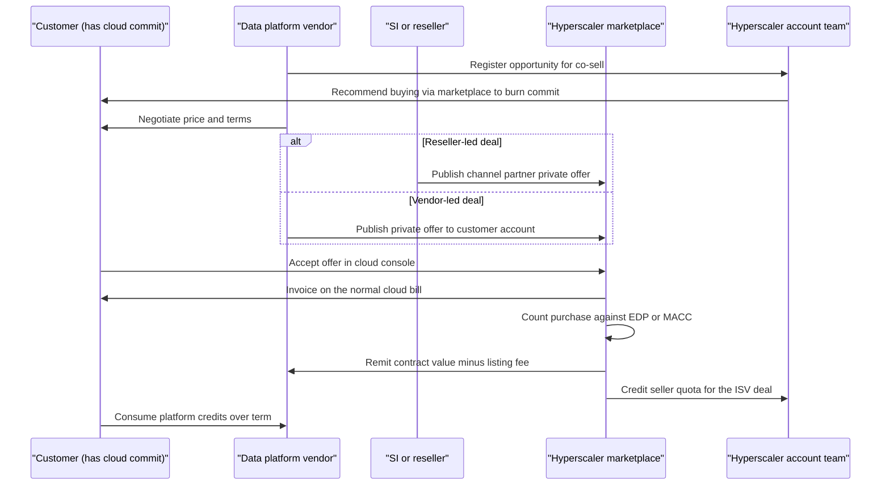
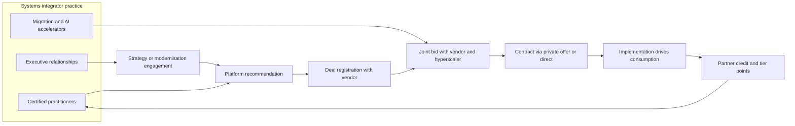
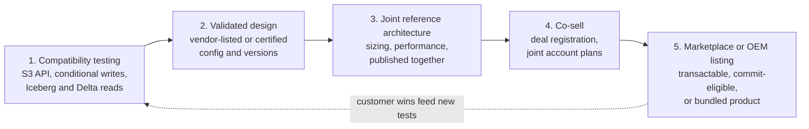
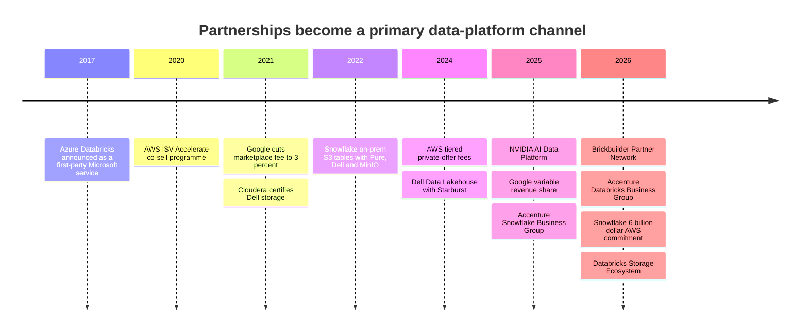

# 40. Go-to-Market and Partnerships
> **Depth:** L2 · **Reading time:** ~13 min · **Last verified:** 2026-11-01 · **Prerequisites:** [Ch 35 — Business models](ch35-business-models.md), [Ch 24 — Where the data stack meets compute and storage](../03-ai-data-stack/ch24-data-meets-compute-and-storage.md)

## TL;DR

- **The hyperscaler marketplace is now a main sales channel for data platforms, and committed cloud spend pays for it.** Enterprises sign multi-year commitments with AWS, Microsoft or Google. A Databricks or Snowflake contract bought through that cloud's marketplace counts against the commitment, so the customer funds it from budget it has already promised. Snowflake reported more than $2B of AWS Marketplace sales in calendar 2025 and more than $7B over the life of the listing (company-stated).[^sf-aws-2b][^sf-aws-6b]
- **The fees are small and the incentives are large.** AWS charges 3% / 2% / 1.5% on private offers, depending on contract size. Google uses the same bands. Microsoft quotes 3%.[^aws-fees][^gcp-vrs][^ms-fee] What the vendor gets for the fee is the cloud's own sellers: under AWS ISV Accelerate and Microsoft's IP co-sell programme, those sellers earn quota credit for closing the vendor's deal.[^isva][^ms-cosell]
- **Systems integrators generate demand.** Accenture runs dedicated business groups for Snowflake (December 2025, more than 5,000 SnowPro-certified staff) and for Databricks (March 2026, more than 25,000 Databricks-trained staff). Migrations and AI projects reach the platform through practices like these.[^acn-sf][^acn-dbx]
- **Storage vendors work with data platforms through a certification ladder.** The rungs are S3-compatibility testing, a validated design, a joint reference architecture, co-sell, and finally a marketplace or OEM listing. Most storage–platform relationships in public view are on the first two rungs. The Databricks Storage Ecosystem (June 2026) and the NVIDIA AI Data Platform (March 2025) are the first programmes that put storage vendors on an official platform roster.[^storage-eco][^aidp]
- **Everpure lens.** Everpure appears on Snowflake's list of S3-compatible storage vendors and on NVIDIA's AI Data Platform roster. It has Dremio and Starburst reference architectures and is a launch partner in Databricks' Storage Ecosystem.[^sf-s3compat][^aidp][^storage-eco] Its next partnership options are to convert those listings into co-sell, MACC/EDP-eligible marketplace offers and joint pipeline.

## Why this matters (business + Everpure lens)

[Ch 35](ch35-business-models.md) explained how data platforms charge: consumption credits, committed-spend contracts and drawdown. This chapter covers how those contracts get sold, and who takes a cut or a credit along the way. For a data platform, the answer is that a large and growing share of deals runs through somebody else's channel: a hyperscaler marketplace, a systems integrator ("SI") practice, or a technology partner's integration.

For a corporate-development reader, partnerships are worth studying because they are cheap options on distribution. A marketplace listing costs a few points of fee and some engineering. A validated design costs a test cycle and joint marketing funds. Either one can open pipeline that a direct sales force would need years to build. The same partners are also competitors. AWS, Microsoft and Google each sell first-party data services against the platforms they co-sell (see [Ch 28](../04-company-deep-dives/ch28-hyperscaler-data-platforms.md)).

For Everpure (formerly Pure Storage; NYSE: P, formerly PSTG), the question is narrower. As it moves from arrays to data management, which partnership assets does it need so that Databricks, Snowflake, NVIDIA and the clouds treat it as part of the data platform and not as the bucket underneath it? This chapter answers in terms of options a strategy team might evaluate, based on public information.

## How it works

### Marketplaces turn a cloud commitment into a buying budget

Large enterprises sign multi-year spend commitments with their clouds in exchange for discounts. AWS calls this an [Enterprise Discount Program](../glossary.md#enterprise-discount-program) (EDP), also known as a Private Pricing Agreement. Microsoft's version is the [Azure Consumption Commitment](../glossary.md#azure-consumption-commitment) (MACC). Google uses committed-spend agreements and [committed use discounts](../glossary.md#committed-use-discount) (CUDs). Any part of the commitment the customer fails to consume is still owed. A CFO sitting on unburned commitment therefore prefers new software bought through the cloud's marketplace, because that purchase retires the commitment.

Microsoft documents the rule explicitly. Offers badged "Azure benefit eligible" count 100% of the pre-tax purchase toward the MACC, provided they are bought through an Azure subscription on the customer's Microsoft agreement. Licences deployed on-premises do not count.[^macc] AWS treats marketplace drawdown as a contract term. Consultancy guidance says marketplace purchases count up to a default cap, often 25% of the commitment, that the customer can negotiate at signing (estimate; not AWS-published).[^edp-cap]

The deal itself is a [private offer](../glossary.md#private-offer): a custom price and terms that the vendor publishes to a single buyer's cloud account.

*Figure 40.1 — A marketplace private offer swaps a new purchase order for a line item on an existing cloud bill. The customer burns its commitment, the vendor gets paid by the cloud, and the cloud's account team earns quota credit. Everyone in the deal has a reason to say yes.*

The economics favour the vendor. In January 2024, AWS set private-offer listing fees at **3%** of total contract value below $1M, **2%** from $1M to under $10M, and **1.5%** at $10M or more and on renewals. A channel partner private offer ([CPPO](../glossary.md#channel-partner-private-offer)), where a reseller transacts on the vendor's behalf, adds 0.5 percentage points.[^aws-fees] Google cut its marketplace share from 20% to 3% in 2021.[^gcp-2021] Since April 2025 it has used a variable schedule that falls to 1.5% for deals of $10M or more, renewals and migrations.[^gcp-vrs] Microsoft says its fee was cut from the industry-standard 20% to 3%.[^ms-fee] Ten years ago, app-store-style marketplaces took about 20%. A 2% fee now costs less than most sales commissions.

**Co-sell is the real prize.** AWS ISV Accelerate is a co-sell programme for vendors whose software is listed and sold through AWS Marketplace. Its central benefit is that AWS account managers earn incentives, including quota retirement, when they help close a partner's marketplace private offer.[^isva] Microsoft has a similar ladder. An offer moves from "co-sell ready" to "Azure IP co-sell eligible", and Microsoft sellers earn quota credit for eligible IP solutions. IP co-sell eligibility is also what makes an offer count toward MACC.[^ms-cosell] AWS added private-offer promotion funding in August 2025 and "express" private offers in November 2025.[^aws-promo]

> **Bridge: semiconductors (design win and approved vendor list).** A marketplace listing that is EDP- or MACC-eligible is the software version of getting onto a hyperscaler's approved vendor list. The customer's committed spend is a socket that has already been designed in and budgeted. Being eligible means your part can fill it without a new purchasing qualification. Co-sell quota retirement then plays the role of the hyperscaler's own sales force promoting your part.

### Worked example: a $2M Databricks deal through an AWS private offer (illustrative)

A US bank has a three-year, $30M AWS EDP and has consumed less than planned. It wants Databricks for a Hadoop migration that a Databricks-tier SI is running. Databricks offers $2M of committed DBU spend for one year as an AWS Marketplace private offer, on classic compute, so the bank also pays AWS directly for the EC2 the clusters use. All figures below are illustrative. Only the fee bands come from AWS's schedule.[^aws-fees]

| Party | What it books | Amount (illustrative) | Notes |
|---|---|---|---|
| Customer | $2M Databricks commitment on its AWS bill; counts toward EDP | $2.0M toward the $30M commit (6.7%) | Fits within a 25% marketplace cap ($7.5M), if that cap applies[^edp-cap] |
| AWS Marketplace | Listing fee at the $1M–<$10M band | 2% × $2M = **$40K** | It would be $50K (2.5%) if the SI resold the deal as a CPPO |
| Databricks | $2M contract, remitted net of fee | ~$1.96M cash | Whether the fee is booked as contra-revenue or selling expense is an accounting judgement |
| AWS account manager | Quota retirement under the ISV Accelerate co-sell benefit | Credit on the $2M | Separately, all EC2 consumption also counts toward the EDP |
| AWS infrastructure | EC2 under classic compute | e.g., $1.0–1.5M/yr (assumption) | Under serverless, Databricks pays AWS instead and prices DBUs higher ([Ch 25](../04-company-deep-dives/ch25-databricks.md)) |
| SI partner | Partner-influenced or partner-sourced credit in Databricks' programme; services fees | Services fees and any reseller margin | Credit counts toward tier status and incentives[^dbx-bpn] |

*Figure 40.2 — The same $2M is counted four times: commitment burn for the customer, bookings for Databricks, quota for the AWS seller and partner credit for the SI. The 2% fee is the cheapest item in this chain. Double-counting of credit is how partner channels get funded.*

The structural risk is that a customer whose commitment is nearly exhausted, or a hyperscaler that changes its seller incentives, can slow a vendor's pipeline without any visible change in demand. This is the reason [Ch 25](../04-company-deep-dives/ch25-databricks.md) lists the share of Databricks revenue sold through Azure as an open question.

### Systems integrators: the demand engine nobody reports

An SI does not usually resell software. It sells the project that creates the software's consumption. A data-platform migration (Teradata, Hadoop or an on-prem warehouse to a lakehouse) is typically scoped, staffed and often architected by an SI before the platform vendor finalises its price. In this channel, scale means certified headcount. Accenture's Snowflake Business Group launched with more than 5,000 SnowPro-certified people. Its Databricks Business Group, launched in March 2026, cites more than 25,000 Databricks-trained professionals.[^acn-sf][^acn-dbx]

*Figure 40.3 — SIs shape the platform choice before procurement starts, then generate the consumption that grows the contract. Vendor programmes repay them with credit, tier status and incentives, which pays for more certified staff and closes the loop.*

The vendor programmes formalise this loop. In February 2026, Databricks folded its partner programmes into a single **Brickbuilder Partner Network**. It has Bronze, Silver, Gold and Platinum tiers, specialisation badges, and a "Velocity" incentive tied to customer consumption.[^dbx-bpn] Snowflake's Partner Network has a free Registered level and three paid tiers: Select, Premier and Elite. Placement depends on certifications, closed pipeline, deal registrations and customer stories.[^spn]

> **Bridge: semiconductors (reps and distributors).** Co-sell and SI deal registration work like a semiconductor company's rep and distributor channel. A manufacturer's rep earns commission on design wins it did not ship. A distributor earns margin plus design-registration protection. Market development funds work like co-op marketing money. AWS and Microsoft sellers who retire quota on a partner's deal are, in effect, reps whose commission the hyperscaler pays.

### Technology partners and data marketplaces

Technology partners are ISVs whose product connects to the platform: ingestion, BI, governance, storage. Snowflake runs "Snowflake Ready" technical validation and a **Powered by Snowflake** track for applications built on Snowflake, many of which are distributed as native apps in Snowflake Marketplace.[^sf-ready][^spn] Databricks' technology-partner page lists tiers from Registered and Validated up to Select and Elite.[^dbx-tech]

The platforms' own [data marketplaces](../glossary.md#data-marketplace) are also a GTM channel. Snowflake Marketplace advertises more than 3,000 listings from more than 750 providers (company-stated, undated page).[^sf-mkt] Databricks reported more than 2,000 Marketplace listings and more than 16,000 Delta Sharing recipients in June 2024 (company-stated).[^ds-stats] Each listing makes the platform harder to leave, because a data provider that publishes once reaches every customer on it. [Delta Sharing](../glossary.md#delta-sharing), now extended as [OpenSharing](../glossary.md#opensharing), is what lets Databricks extend the same mechanism to storage vendors.

### How data platforms partner with storage vendors

Databricks and Snowflake are cloud services, so a storage vendor cannot simply resell them. The relationship runs the other way. The platform needs a reason to trust on-prem storage as a place where governed tables live, and the storage vendor climbs a ladder to provide that reason.

*Figure 40.4 — The storage-partner certification path. Each rung costs more engineering and marketing money and earns more of the platform's sales attention. Most storage relationships stop at rung 2.*

**Rung 1–2: compatibility.** Snowflake can read and write S3-compatible storage through external stages and tables. Its documentation lists vendors that have told Snowflake they tested their products, including Cloudian, Dell, MinIO, NetApp StorageGRID, Pure Storage and Scality. It is explicit that Snowflake does not itself certify them, and it points customers to public tests they can run on their own devices.[^sf-s3compat] In Databricks the equivalent object is an [external location](../glossary.md#external-location). Official support has historically covered cloud object stores, so on-prem S3 sat in a grey zone until 2026 ([Ch 25](../04-company-deep-dives/ch25-databricks.md)).

**Rung 3–4: reference designs and co-sell.** Cloudera's QATS programme has certified Dell PowerScale and ECS since 2021.[^cloudera-qats] Dell went one step further with Starburst. The **Dell Data Lakehouse** (March 2024) bundles Starburst's Trino engine with Dell compute and ECS/ObjectScale storage as a single Dell-sold product, which is an OEM-style relationship.[^dell-dl]

**Rung 5: platform programmes.** In June 2026, Databricks launched the **Storage Ecosystem**. Storage vendors run an OpenSharing server next to their object stores, so Unity Catalog can govern and query Delta and Iceberg tables in place. Launch partners were Everpure, MinIO and Qumulo, with more vendors named as coming later.[^storage-eco] MinIO's integration was listed as generally available, and MinIO was named Databricks' 2026 ISV Storage Partner of the Year.[^minio-poy] Everpure's OpenSharing connector entered private preview on June 9, 2026.[^everpure-os] On the GPU side, NVIDIA's **AI Data Platform** (GTC, March 2025) is a reference design that storage partners build into their products. It sits alongside the NVIDIA-Certified Storage programme, which has Foundation, Enterprise and NCP levels.[^aidp][^nv-cert]

> **Bridge: semiconductors (compliance and qualification).** Rung 1 is the PCI-SIG compliance workshop or JEDEC conformance: necessary, cheap to fail, and not a differentiator. Rungs 2–3 are customer qualification at an OEM, which is slow, tied to specific configurations and versions, and has to be redone at each major release. Unity Catalog, Snowflake or NVIDIA software upgrades reopen qualification just as a new memory controller revision does.

| Storage vendor | Data platform | Relationship type | Date | Source |
|---|---|---|---|---|
| Pure Storage (FlashBlade) | Snowflake | Joint solution: S3-compatible external tables on-prem or in colocation | May 2022 | [^pure-sf] |
| Dell (ECS / ObjectScale) | Snowflake | On-prem data access via S3-compatible tables | May 2022 | [^dell-sf] |
| MinIO | Snowflake | External-table integration | Jun 2022 | [^minio-sf] |
| VAST Data | Dremio | Lakehouse validated on VAST Universal Storage | Sep 2022 | [^vast-dremio] |
| Dell (ECS) | Databricks | Hybrid integration (blog-documented) | 2023 | [^dell-ecs] |
| Cohesity (SmartFiles) | Snowflake | Data on SmartFiles queryable from Snowflake | Nov 2023 | [^cohesity-sf] |
| Dell (ECS, ObjectScale, PowerScale) | Starburst | OEM-style product: Dell Data Lakehouse | Mar 2024 (expanded Jul 2024) | [^dell-dl] |
| Pure Storage (FlashBlade) | Dremio (SAP since 2026) | Joint solution brief: hybrid Iceberg lakehouse | Oct 2024 | [^dremio-pure][^sap-dremio] |
| Everpure (FlashBlade) | Starburst | Reference architecture, "Scalable Lakehouse Analytics" | n.d. | [^starburst-ep] |
| Dell (PowerScale, ECS) | Cloudera | QATS storage certification | May 2021 (ongoing) | [^cloudera-qats] |
| Dell (ObjectScale) | Cloudera | Joint "private AI" platform | Sep 2025 | [^cloudera-dell] |
| DDN, Dell, HPE, Hitachi Vantara, IBM, NetApp, Nutanix, Pure, VAST, WEKA | NVIDIA AI Data Platform | Reference design built into partner products | Mar 2025 | [^aidp][^weka-aidp] |
| Everpure (FlashBlade, FlashArray) | Databricks | Storage Ecosystem launch partner; OpenSharing connector in private preview | Jun 2026 | [^storage-eco][^everpure-os] |
| MinIO (AIStor) | Databricks | Storage Ecosystem, GA; 2026 ISV Storage Partner of the Year | Jun 2026 | [^minio-poy] |
| Qumulo | Databricks | ISV partnership; OpenSharing integration in preview | Jul 2026 | [^qumulo] |
| Everpure (FlashBlade + Data Stream) | NVIDIA AI Data Platform | Vectorisation pipeline built on the reference design | Jun 2026 | [^data-stream] |

*Figure 40.5 — Public storage–data-platform partnerships. The pattern moved from "our array can hold your external tables" (2022) to platform-run rosters (Databricks Storage Ecosystem, NVIDIA AI Data Platform) in 2025–26. Rosters are where co-sell attention goes.*

**What each side gets, and what it costs.** The data platform gets on-prem and sovereign data it could not otherwise reach, plus a storage vendor's sales force pointing at its product. The storage vendor gets relevance in data-architecture discussions, a listing, co-marketing, and sometimes deal registration. The cost is engineering for test suites and connectors, re-qualification at every platform release, market development funds ([MDF](../glossary.md#market-development-funds)) for joint campaigns, and field enablement. A platform with ten storage partners has little reason to prefer any one of them, so differentiation has to come from performance proof, support and customer references.

## Design choices and trade-offs

| Route to market | Who pays whom | Cost to vendor | Strength | Weakness |
|---|---|---|---|---|
| Direct enterprise sale | Customer → vendor | Full sales and marketing cost | Owns the relationship and the price | Slow procurement; competes with cloud budget |
| Marketplace private offer | Customer → cloud → vendor | 1.5–3% fee (AWS/Google), ~3% (Microsoft)[^aws-fees][^gcp-vrs][^ms-fee] | Burns commitment; uses the cloud's paper; co-sell | Dependent on cloud incentives; cloud sees deal data |
| First-party cloud service (e.g., Azure Databricks) | Customer → cloud; revenue share to vendor | Revenue share; product control shared | Native billing and sales reach[^azure-dbx] | Partner is also a rival (Fabric) |
| SI-led (sourced or influenced) | Customer → SI for services; → vendor for software | Partner incentives, enablement, MDF | Creates demand; owns migration | SIs are multi-platform; loyalty follows incentives |
| Reseller or CPPO | Customer → reseller → vendor | Reseller margin + 0.5 pt on AWS CPPO[^aws-fees] | Reaches mid-market and public sector | Margin stacking; channel conflict |
| OEM or bundle (e.g., Dell Data Lakehouse) | Customer → OEM; royalty or licence to ISV | Lower price per unit; roadmap dependence | Rides OEM's installed base[^dell-dl] | OEM controls pricing and support |

*Figure 40.6 — Each route trades margin for reach. Marketplaces have become the default for large cloud deals because the fee is small and the commitment burn helps the buyer.*

The strongest argument against heavy marketplace dependence is concentration. The hyperscaler sees the deal, the customer and the price, and also sells a competing first-party service. The strongest argument against the SI channel is that SIs are platform-agnostic. The same Accenture runs both a Snowflake and a Databricks business group.[^acn-sf][^acn-dbx]

## Who's who

| Programme | Tiers or levels | Key benefits | Typical requirements |
|---|---|---|---|
| Databricks Brickbuilder Partner Network (2026) | C&SI: Bronze, Silver, Gold, Platinum; technology tiers Registered → Elite | Specialisation badges, Velocity incentive tied to consumption, co-sell | Certified staff, revenue influence, customer success; Platinum needs a specialisation[^dbx-bpn][^dbx-tech] |
| Snowflake Partner Network | Registered (free); Select, Premier, Elite (annual fee) | Co-sell support, marketing investment; Powered by Snowflake; Snowflake Ready validation | Certifications, closed pipeline, deal registrations, customer stories[^spn][^sf-ready] |
| AWS Partner Network: ISV Accelerate | Programme membership (co-sell) | Seller quota retirement, MDF, private-offer promotions | GA Marketplace listing, ACE eligibility, launched co-sell opportunities[^isva][^aws-promo] |
| Microsoft co-sell | Co-sell ready → Azure IP co-sell eligible | Seller quota credit; MACC eligibility; marketplace badges | Transactable Azure-based offer, technical validation, billed-revenue threshold[^ms-cosell] |
| Google Cloud Partner Advantage and Marketplace | Partner tiers [VERIFY: current Partner Advantage tier names] | Variable revenue share down to 1.5%; commit drawdown | Marketplace listing; deal size, renewal or migration attributes[^gcp-vrs] |
| NVIDIA AI Data Platform and Certified Storage | Certified Storage: Foundation, Enterprise, NCP | Inclusion in NVIDIA enterprise reference architectures and GTC launches | Pass NVIDIA test suites; integrate reference-design software[^nv-cert][^aidp] |

*Figure 40.7 — Partner-programme comparison. Platform programmes reward consumption the partner influences. Hyperscaler programmes reward marketplace transactions. NVIDIA's rewards validated designs. A storage vendor has to work all three.*

## History and trajectory

*Figure 40.8 — Marketplace fees fell from about 20% to 1.5–3% within five years, while co-sell incentives grew. Partnerships moved from integration lists to transactable, incentive-backed channels.*

The commercial relationship now runs in both directions. In May 2026 Snowflake committed $6B over five years to AWS infrastructure while reporting more than $7B of lifetime AWS Marketplace sales. That is a reciprocal arrangement: the platform buys cloud capacity, and the cloud sells the platform.[^sf-aws-6b] The next step is likely more transactable partner bundles, such as multi-vendor private offers and storage-plus-platform offers, and more platform-run rosters like the Storage Ecosystem. The open question is whether hyperscalers keep subsidising co-sell for data platforms they also compete with.

## Numbers that matter

| Metric | Value | Basis | Source / date |
|---|---|---|---|
| AWS private-offer listing fee | 3% (<$1M), 2% ($1M–<$10M), 1.5% (≥$10M, renewals); CPPO +0.5 pt | AWS-published schedule | AWS, effective 2024-01-05[^aws-fees] |
| Google Cloud Marketplace revenue share | 3% → 1.5% by deal size and type | Google-published schedule | Google, effective 2025-04-21[^gcp-vrs] |
| Microsoft marketplace transaction fee | 3% (cut from 20%) | Company-stated | Microsoft ISV page, n.d.[^ms-fee] |
| MACC contribution of eligible offers | 100% of pre-tax amount | Microsoft policy | Microsoft Learn[^macc] |
| AWS EDP marketplace cap | ~25% of commit by default; negotiable | Estimate (consultancy) | Redress Compliance, n.d.[^edp-cap] |
| Snowflake AWS Marketplace sales | >$2B in CY2025; >$7B lifetime | Company-stated (sales, not revenue) | Snowflake, 2025-12-03 and 2026-05-27[^sf-aws-2b][^sf-aws-6b] |
| Snowflake total revenue, FY2026 | $4,683.9M (Feb 2025–Jan 2026) | GAAP | Snowflake 10-K[^sf-10k] |
| Snowflake commitment to AWS | $6B over five years | Company-stated | Snowflake, 2026-05-27[^sf-aws-6b] |
| Accenture certified/trained staff | >5,000 SnowPro-certified; >25,000 Databricks-trained | Company-stated | 2025-12-03; 2026-03-17[^acn-sf][^acn-dbx] |
| Snowflake Marketplace | 3,000+ listings, 750+ providers | Company-stated | Snowflake page, n.d.[^sf-mkt] |
| Databricks Marketplace / Delta Sharing | >2,000 listings; >16,000 recipients | Company-stated | Databricks, 2024-06[^ds-stats] |
| NVIDIA AI Data Platform storage partners | 10 at launch | Company-stated | NVIDIA, 2025-03[^aidp] |

*Figure 40.9 — Marketplace sales are gross contract value transacted, often multi-year, so they cannot be divided by revenue. They show scale, not share.*

## Storage bridge

> **Storage bridge.** Every rung of the certification ladder depends on storage semantics covered in [Ch 24](../03-ai-data-stack/ch24-data-meets-compute-and-storage.md) and in the companion *Everpure Tech Atlas*: S3 conditional writes, LIST behaviour, credential vending and small-object latency. A failed compatibility test usually comes down to one of these, not to raw throughput. Options a strategy team might evaluate, based on public information: (1) take the Databricks OpenSharing connector from preview to GA and register it for joint co-sell;[^everpure-os] (2) publish Iceberg/Delta and Iceberg REST-catalog compatibility results with Starburst and Dremio/SAP, so that platform teams can cite them;[^starburst-ep][^dremio-pure] (3) make Everpure's existing cloud listings (Cloud Block Store has been sold through the AWS and Azure marketplaces for years; Azure since March 2021) commit-eligible, and bundle them with data-platform private offers;[^pcbs] (4) turn the NVIDIA AI Data Platform and Data Stream work into a joint reference architecture that names a data platform as well as the GPU stack.[^data-stream][^aidp]

## Conversation playbook

**Questions for a PM or alliance lead**

1. "What share of your new bookings is transacted through a hyperscaler marketplace, and how much of that is commitment-funded? How did win rates change when the offer became EDP- or MACC-eligible?"
2. "Which partner tier or programme status actually changes the behaviour of the platform's field sellers: listing, validation, or co-sell registration?"
3. "When the platform ships a major release (Unity Catalog, Iceberg v3, Snowflake external volumes), how long does re-qualification take, and who pays for it?"

**Questions for an engineer or partner architect**

1. "Which compatibility suite do you run for S3, and do you pass conditional-write and multipart edge cases under concurrency, or only the happy path?"
2. "For OpenSharing or external tables, where are credentials vended, which table formats and versions are supported, and does the query push down or scan everything?"
3. "In the NVIDIA AI Data Platform design, which components run on the storage system and which on GPU servers? What is measured in the reference architecture?"

**What good answers sound like.** They give the marketplace share and the fee band, and separate sourced from influenced pipeline. They name the programme status, the versions tested and the date of the last re-qualification. On storage, they cite a specific test suite and a joint customer, not only a logo slide.

**Don't say this**

- "Marketplaces take 20%." That was the old app-store rate. Private offers now pay 1.5–3%, and the 20% figure marks you as out of date.
- "Marketplace sales are revenue." Snowflake's $2B is gross contract value transacted in a year, and much of it is multi-year commitments.
- "Snowflake certified our storage." Snowflake's list is vendor-reported, and Snowflake says it does not certify third-party products.[^sf-s3compat]
- "Co-sell means AWS sells our product." It means AWS sellers are paid to help close it. The vendor still runs the deal.
- "Being on the NVIDIA roster is differentiation." There were ten storage partners at launch. The roster is the entry ticket.

## Going deeper

- AWS Marketplace seller guide on listing fees and CPPOs, and Microsoft Learn's MACC and co-sell requirement pages, for the exact current rules.[^aws-fees][^cppo][^macc][^ms-cosell]
- Databricks' Storage Ecosystem announcement and partner programme guides, for the OpenSharing integration model.[^storage-eco][^dbx-bpn]
- Snowflake's S3-compatible storage documentation and its public compatibility tests.[^sf-s3compat]
- [Ch 45](../06-history-and-future/ch45-storage-moving-up-the-stack.md) for how partnership currency fits Everpure's move up the stack, and [Ch 26](../04-company-deep-dives/ch26-snowflake.md) for Snowflake's go-to-market.

## Key terms

- [Cloud marketplace](../glossary.md#cloud-marketplace) — a hyperscaler's storefront where third-party software is bought on the cloud bill.
- [Private offer](../glossary.md#private-offer) — custom price and terms that a seller publishes to one buyer's cloud marketplace account.
- [Channel partner private offer](../glossary.md#channel-partner-private-offer) — an AWS private offer that a reseller transacts on the software vendor's behalf.
- [Listing fee](../glossary.md#listing-fee) — the percentage of contract value a marketplace keeps on each transaction.
- [Committed-spend drawdown](../glossary.md#committed-spend-drawdown) — consuming a prepaid or promised spend commitment through usage or eligible purchases.
- [Enterprise Discount Program](../glossary.md#enterprise-discount-program) — AWS's multi-year committed-spend contract that trades a spend commitment for discounts.
- [Azure Consumption Commitment](../glossary.md#azure-consumption-commitment) — Microsoft's committed-spend agreement (MACC) that eligible marketplace purchases count toward.
- [Committed use discount](../glossary.md#committed-use-discount) — Google Cloud's discount for committing to a level of resource use or spend.
- [Co-sell](../glossary.md#co-sell) — joint selling in which a hyperscaler's or partner's sellers help close a vendor's deal and earn credit.
- [Quota retirement](../glossary.md#quota-retirement) — counting a partner's deal toward a hyperscaler seller's sales quota.
- [ISV Accelerate](../glossary.md#isv-accelerate) — AWS's co-sell programme for software vendors that sell through AWS Marketplace.
- [Market development funds](../glossary.md#market-development-funds) — vendor money given to partners for joint marketing and demand generation.
- [Deal registration](../glossary.md#deal-registration) — a partner's claim on an opportunity that protects its credit and incentives.
- [Systems integrator](../glossary.md#systems-integrator) — a consulting firm that designs and implements technology projects, often steering platform choice.
- [Partner-sourced revenue](../glossary.md#partner-sourced-revenue) — revenue from deals a partner originated, as opposed to partner-influenced deals it only assisted.
- [Reference architecture](../glossary.md#reference-architecture) — a published, tested design that combines specific products for a stated workload.
- [OEM partnership](../glossary.md#oem-partnership) — one company embeds or bundles another's product and sells it under its own brand.
- [S3-compatible storage](../glossary.md#s3-compatible-storage) — non-AWS object storage that implements the Amazon S3 API.
- [External location](../glossary.md#external-location) — a Unity Catalog object binding a storage path to a credential.
- [Data marketplace](../glossary.md#data-marketplace) — a platform storefront where providers list datasets, models and apps for consumers.
- [Delta Sharing](../glossary.md#delta-sharing) — Databricks' open protocol for sharing tables in place across platforms.
- [OpenSharing](../glossary.md#opensharing) — the open sharing protocol, descended from Delta Sharing, behind the Databricks Storage Ecosystem.
- [NVIDIA AI Data Platform](../glossary.md#nvidia-ai-data-platform) — NVIDIA's 2025 reference design that storage partners build into AI-ready storage products.
- [NVIDIA-Certified Storage](../glossary.md#nvidia-certified-storage) — NVIDIA's storage validation programme with Foundation, Enterprise and NCP levels.

## Sources

[^aws-fees]: AWS, "AWS Marketplace announces simplified and reduced listing fees for sellers," https://aws.amazon.com/about-aws/whats-new/2024/01/aws-marketplace-simplified-reduced-listing-fees/, published 2024-01; AWS Marketplace Seller Guide, "Understanding listing fees for AWS Marketplace sellers," https://docs.aws.amazon.com/marketplace/latest/userguide/listing-fees.html, living document (fees effective 2024-01-05; CPPO +0.5 pt); retrieved 2026-11-01. A 2026 CRN Australia report says the professional-services listing fee fell from 2.5% to 0.5%, https://www.crn.com.au/news/2026/cloud/aws-marketplace-slashes-listing-fee-for-professional-service [VERIFY: date and effective terms].
[^cppo]: AWS, "Work with channel partner private offers using the AWS Marketplace APIs," https://docs.aws.amazon.com/marketplace/latest/APIReference/work-with-cppos.html, living document; retrieved 2026-11-01.
[^edp-cap]: Redress Compliance, "The EDP Marketplace Offset Mechanism," https://redresscompliance.com/aws-edp-marketplace-isv-commitment-offset.html, n.d.; retrieved 2026-11-01. Consultancy estimate; not an AWS-published figure.
[^macc]: Microsoft Learn, "Azure consumption commitment benefit," https://learn.microsoft.com/en-us/marketplace/azure-consumption-commitment-benefit, and "MACC frequently asked questions," https://learn.microsoft.com/en-us/marketplace/macc-frequently-asked-questions, living documents; retrieved 2026-11-01.
[^ms-fee]: Microsoft, "Microsoft commercial marketplace for ISVs," https://microsoft.com/isv/marketplace, n.d.; Microsoft Partner blog, "Reach more customers with new investments in the commercial marketplace," https://blogs.partner.microsoft.com/partner/reach-more-customers-with-new-investments-in-the-commercial-marketplace, n.d.; retrieved 2026-11-01. [VERIFY: date of Microsoft's 20%→3% cut, believed 2021]
[^ms-cosell]: Microsoft Learn, "Co-sell with Microsoft sales teams and partners overview," https://learn.microsoft.com/en-us/partner-center/co-sell-overview, and "Co-sell requirements," https://learn.microsoft.com/partner-center/co-sell-requirements, living documents; Microsoft Partner blog, "Capturing the marketplace opportunity, part four," https://partner.microsoft.com/en-US/blog/article/capturing-the-marketplace-opportunity-part-four, n.d.; retrieved 2026-11-01. [VERIFY: current billed-revenue threshold for IP co-sell eligibility]
[^gcp-2021]: CNBC, "Google lowers its cloud marketplace revenue share to 3% from 20%," https://www.cnbc.com/amp/2021/09/26/google-lowers-its-cloud-marketplace-revenue-share-to-3percent-from-20percent.html, published 2021-09-26; retrieved 2026-11-01. Press-reported.
[^gcp-vrs]: Google Cloud documentation, "Overview of the Vendor Net Revenue Schedule," https://docs.cloud.google.com/marketplace/docs/partners/migrations/variable-revenue-share, living document (effective 2025-04-21); Google Cloud blog, "Upgrades to Google Cloud Marketplace for partners," https://cloud.google.com/blog/topics/partners/upgrades-to-google-cloud-marketplace-for-partners, 2025; retrieved 2026-11-01.
[^isva]: AWS, "AWS ISV Accelerate Program," https://aws.amazon.com/partners/programs/isv-accelerate/, living document; AWS, "AWS ISV Accelerate, a co-sell program for AWS Partners," https://aws.amazon.com/about-aws/whats-new/2020/12/isv-accelerate/, published 2020-12; retrieved 2026-11-01.
[^aws-promo]: AWS, "Announcing new incentives for ISVs selling in AWS Marketplace," https://aws.amazon.com/about-aws/whats-new/2025/08/aws-marketplace-private-offer-promotions/, published 2025-08; AWS, "AWS Marketplace introduces express private offers," https://aws.amazon.com/about-aws/whats-new/2025/11/aws-marketplace-express-private-offers, published 2025-11; retrieved 2026-11-01.
[^sf-aws-2b]: Snowflake via Business Wire, "Snowflake Doubles AWS Marketplace Growth YoY, Eclipses $2 Billion in Sales…," https://www.businesswire.com/news/home/20251203483596/en/, published 2025-12-03; Amazon press, https://press.aboutamazon.com/aws/2025/12/snowflake-doubles-aws-marketplace-growth-yoy-eclipses-2-billion-in-sales-as-new-integrations-accelerate-enterprise-data-and-ai-adoption, 2025-12; retrieved 2026-11-01. Company-stated.
[^sf-aws-6b]: Snowflake press release, "Snowflake Expands AWS Collaboration with $6B Commitment to Accelerate Enterprise Agentic AI Adoption," https://www.snowflake.com/en/news/press-releases/snowflake-expands-aws-collaboration-with-6b-commitment-to-accelerate-enterprise-agentic-ai-adoption/, published 2026-05-27; HPCwire/BigDATAwire, https://www.hpcwire.com/bigdatawire/2026/05/29/snowflakes-6b-aws-bet-signals-where-enterprise-ai-spending-is-headed/, 2026-05-29; retrieved 2026-11-01. Company-stated.
[^sf-10k]: Snowflake Inc., Form 10-K for fiscal year ended 2026-01-31, https://www.sec.gov/Archives/edgar/data/1640147/000164014726000008/snow-20260131.htm, published 2026-03; retrieved 2026-11-01 (value per `data/company_financials.csv`).
[^azure-dbx]: TechCrunch, "Microsoft makes Databricks a first-party service on Azure," https://techcrunch.com/2017/11/15/microsoft-makes-databricks-a-first-party-service-on-azure/, published 2017-11-15; Databricks blog, "Introducing Azure Databricks," https://www.databricks.com/blog/2017/11/15/introducing-azure-databricks.html, 2017-11-15; retrieved 2026-11-01.
[^acn-sf]: Accenture via Business Wire, Accenture Snowflake Business Group announcement, https://www.businesswire.com/news/home/20251203397916/en, published 2025-12-03; Consulting.us, "Accenture and Snowflake form new business group," https://www.consulting.us/news/12789/accenture-and-snowflake-form-new-business-group, 2025-12; retrieved 2026-11-01. Company-stated.
[^acn-dbx]: Databricks press release, "Accenture and Databricks Accelerate Enterprise Adoption of AI Applications and Agents at Scale," https://www.databricks.com/company/newsroom/press-releases/accenture-and-databricks-accelerate-enterprise-adoption-ai, published 2026-03-17; retrieved 2026-11-01. Company-stated.
[^dbx-bpn]: Databricks blog, "Building what's next, together: introducing the Brickbuilder Partner Network for the agentic AI era," https://www.databricks.com/en/blog/building-whats-next-together-introducing-brickbuilder-partner-network-agentic-ai-era, published 2026-02-11; Databricks blog, "New Brickbuilder Partner Network tiers for ISVs and data providers are here," https://www.databricks.com/blog/new-brickbuilder-partner-network-tiers-isvs-and-data-providers-are-here, 2026; retrieved 2026-11-01.
[^dbx-tech]: Databricks, "Technology Partner Program," https://www.databricks.com/company/partners/technology-partner-program, n.d.; retrieved 2026-11-01. Tier labels may predate the 2026 restructuring.
[^spn]: Snowflake, "Service partners" (Select, Premier, Elite; Registered free), https://www.snowflake.com/en/why-snowflake/partners/service-partners/, n.d.; Snowflake, "Powered by Snowflake," https://www.snowflake.com/partners/poweredby-partners/, n.d.; retrieved 2026-11-01.
[^sf-ready]: Snowflake, "Snowflake Ready Technology Validation Program," https://snowflake.com/partners/technology-partners/snowflake-ready-technology-validation-program, n.d.; retrieved 2026-11-01.
[^sf-mkt]: Snowflake, "Essential apps and AI data products" landing page, https://www.snowflake.com/en/lp/essential-apps-ai-data-products/, n.d.; retrieved 2026-11-01. Company-stated, undated.
[^ds-stats]: Databricks press release, "Databricks Doubles Down on Delta Sharing Open Ecosystem With Product Innovations and Strategic Partnerships," https://www.databricks.com/company/newsroom/press-releases/databricks-doubles-down-delta-sharing-open-ecosystem-strategic-partnerships, published 2024-06; retrieved 2026-11-01. Company-stated.
[^sf-s3compat]: Snowflake documentation, "Work with Amazon S3-compatible storage," https://docs.snowflake.com/en/user-guide/data-load-s3-compatible-storage, living document; retrieved 2026-11-01.
[^pure-sf]: Blocks & Files, "Pure gets FlashBlade up close and cloud-adjacent co-lo personal with Snowflake," https://blocksandfiles.com/2022/05/11/pure-gets-flashblade-up-close-and-cloud-adjacent-co-lo-personal-with-snowflake/, published 2022-05-11; Snowflake blog, "Now in Private Preview: Using On-Premises Data in Place with Snowflake," https://www.snowflake.com/en/blog/external-tables-on-prem/, 2022-06; retrieved 2026-11-01.
[^dell-sf]: SiliconANGLE, "Dell partners with Snowflake to ease access to on-premises data," https://siliconangle.com/2022/05/02/dell-partners-snowflake-ease-access-premises-data/, published 2022-05-02; retrieved 2026-11-01.
[^minio-sf]: Blocks & Files, "MinIO plugs its object storage into Snowflake," https://www.blocksandfiles.com/object/2022/06/14/minio-plugs-its-object-storage-into-snowflake/1593509, published 2022-06-14; retrieved 2026-11-01.
[^vast-dremio]: Blocks & Files, "Dremio data lakes can run on VAST Data storage," https://www.blocksandfiles.com/ai-ml/2022/09/30/dremio-data-lakes-can-run-on-vast-data-storage/1591294, published 2022-09-30; retrieved 2026-11-01.
[^dell-ecs]: Databricks blog, "Hybrid cloud solutions: Databricks and Dell ECS storage," https://databricks.com/blog/hybrid-cloud-solutions-databricks-and-dell-ecs-storage, published 2023; retrieved 2026-11-01 (as cited in Ch 25).
[^cohesity-sf]: Blocks & Files, "Cohesity SmartFiles becomes Snowflake analytics playground," https://www.blocksandfiles.com/ai-ml/2023/11/06/cohesity-smartfiles-becomes-snowflake-analytics-playground/1596232, published 2023-11-06; retrieved 2026-11-01.
[^dell-dl]: Starburst blog, "Dell Data Lakehouse powered by Starburst," https://starburst.io/blog/dell-data-lakehouse-powered-by-starburst, 2024-03; Blocks & Files, "Dell enhances Data Lakehouse with faster query speeds and more," https://www.blocksandfiles.com/ai-ml/2024/07/24/dell-enhances-data-lakehouse-with-faster-query-speeds-and-more/1616308, published 2024-07-24; retrieved 2026-11-01.
[^cloudera-qats]: Cloudera press release, "Cloudera Announces New Storage Certification for Cloudera Data Platform Private Cloud," https://www.cloudera.com/about/news-and-blogs/press-releases/2021-05-06-cloudera-announces-new-storage-certification-for-cloudera-data-platform-private-cloud.html, published 2021-05-06; StorageNewsletter, https://storagenewsletter.com/2021/05/11/cloudera-data-platform-private-cloud-certified-on-dell-emc-powerscale, 2021-05-11; retrieved 2026-11-01.
[^cloudera-dell]: SiliconANGLE, "Cloudera's AI box gives enterprises new way to build private AI," https://siliconangle.com/2025/09/25/clouderas-ai-box-gives-enterprises-new-way-build-private-ai/, published 2025-09-25; iTWire, "Cloudera integrates with Dell ObjectScale…," https://itwire.com/it-industry-news/strategy/cloudera-integrates-with-dell-objectscale-to-deliver-enterprises-a-next-generation-private-ai-platform, 2025-09; retrieved 2026-11-01.
[^aidp]: HPCwire, "NVIDIA Unveils AI Data Platform for Accelerated AI Query Workloads in Enterprise Storage," https://www.hpcwire.com/off-the-wire/nvidia-unveils-ai-data-platform-for-accelerated-ai-query-workloads-in-enterprise-storage/, published 2025-03-18 (NVIDIA release; partner list DDN, Dell, HPE, Hitachi Vantara, IBM, NetApp, Nutanix, Pure Storage, VAST Data, WEKA); StorageNewsletter, "NVIDIA GTC 2025: Pure Storage Integrates NVIDIA AI Data Platform into FlashBlade," https://www.storagenewsletter.com/2025/03/19/nvidia-gtc-2025-pure-storage-integrates-nvidia-ai-data-platform-into-flashblade/, 2025-03-19; retrieved 2026-11-01. [VERIFY: partner list against the NVIDIA newsroom original]
[^weka-aidp]: WEKA press release, "WEKA Expands NVIDIA Integrations and Certifications, Unveils Augmented Memory Grid at GTC 2025," https://www.weka.io/news/weka-unveils-nvidia-integrations-and-certifications-at-gtc-2025, published 2025-03-18; retrieved 2026-11-01.
[^nv-cert]: NVIDIA documentation, "NVIDIA-Certified Storage," https://docs.nvidia.com/certification-programs/certified-storage/latest/nvidia-certified-storage.html, living document; NVIDIA blog, "NVIDIA-Certified Program Expands to Enterprise Storage," https://blogs.nvidia.com/blog/nvidia-certified-enterprise-storage/, 2025; retrieved 2026-11-01.
[^storage-eco]: Databricks blog, "Announcing the Databricks Storage Ecosystem: Governing the Enterprise Data Estate Wherever It Lives," https://www.databricks.com/blog/announcing-databricks-storage-ecosystem-governing-enterprise-data-estate-wherever-it-lives, published 2026-06-10; StorageNewsletter, https://www.storagenewsletter.com/2026/06/24/announcing-the-databricks-storage-ecosystem-governing-the-enterprise-data-estate-wherever-it-lives/, 2026-06-24; retrieved 2026-11-01 (as cited in Ch 25).
[^everpure-os]: Everpure blog, "Everpure OpenSharing Connector," https://blog.everpuredata.com/products/everpure-opensharing-connector/, published 2026-06; retrieved 2026-11-01. Vendor-stated; private preview from 2026-06-09.
[^minio-poy]: MinIO press release, "MinIO Awarded 2026 Databricks ISV Storage Partner of the Year at Data + AI Summit," https://www.min.io/press/minio-awarded-2026-databricks-isv-storage-partner-of-the-year-at-data-ai-summit, published 2026-06-15; retrieved 2026-11-01.
[^qumulo]: Blocks & Files, "Qumulo pals up with Databricks," https://blocksandfiles.com/data-management/2026/07/17/qumulo-pals-up-with-databricks/5274406, published 2026-07-17; StorageNewsletter, "Qumulo Announces NeuralSearch and ISV Partnership with Databricks," https://www.storagenewsletter.com/2026/07/24/qumulo-announces-neuralsearch-and-isv-partnership-with-databricks/, 2026-07-24; retrieved 2026-11-01.
[^data-stream]: Everpure via PR Newswire, "Everpure Unveils Data-Primacy Architecture for the AI Era," https://www.prnewswire.com/news-releases/everpure-unveils-data-primacy-architecture-for-the-ai-era-302803097.html, published 2026-06-17; retrieved 2026-11-01 (via `meta/research-briefing.md`).
[^dremio-pure]: Dremio partner page, https://www.dremio.com/partners/pure-storage/, n.d.; Pure Storage/Dremio solution brief, https://dremio.com/wp-content/uploads/2024/10/Dremio-Pure-Storage-Solutions-Brief-1.pdf, 2024-10; retrieved 2026-11-01 (via `meta/research-briefing.md`).
[^sap-dremio]: Dremio newsroom, "SAP to Acquire Dremio…," https://www.dremio.com/newsroom/sap-to-acquire-dremio-to-unify-sap-and-non-sap-data-to-power-agentic-ai/, published 2026-05-04; retrieved 2026-11-01 (via `meta/research-briefing.md`).
[^starburst-ep]: Everpure partner page, "Starburst," https://www.everpuredata.com/la/partners/technology-alliance-partners/starburst.html, n.d.; retrieved 2026-11-01 (via `meta/research-briefing.md`).
[^pcbs]: Blocks & Files, "Hello Azure, Pure Cloud Block Store is here," https://www.blocksandfiles.com/block/2021/03/16/hello-azure-pure-cloud-block-store-is-here/1607078, published 2021-03-16; Everpure AWS partner page, https://www.everpuredata.com/kr/partners/technology-alliance-partners/aws.html, n.d.; retrieved 2026-11-01. [VERIFY: whether current Everpure listings are MACC/EDP-eligible]
