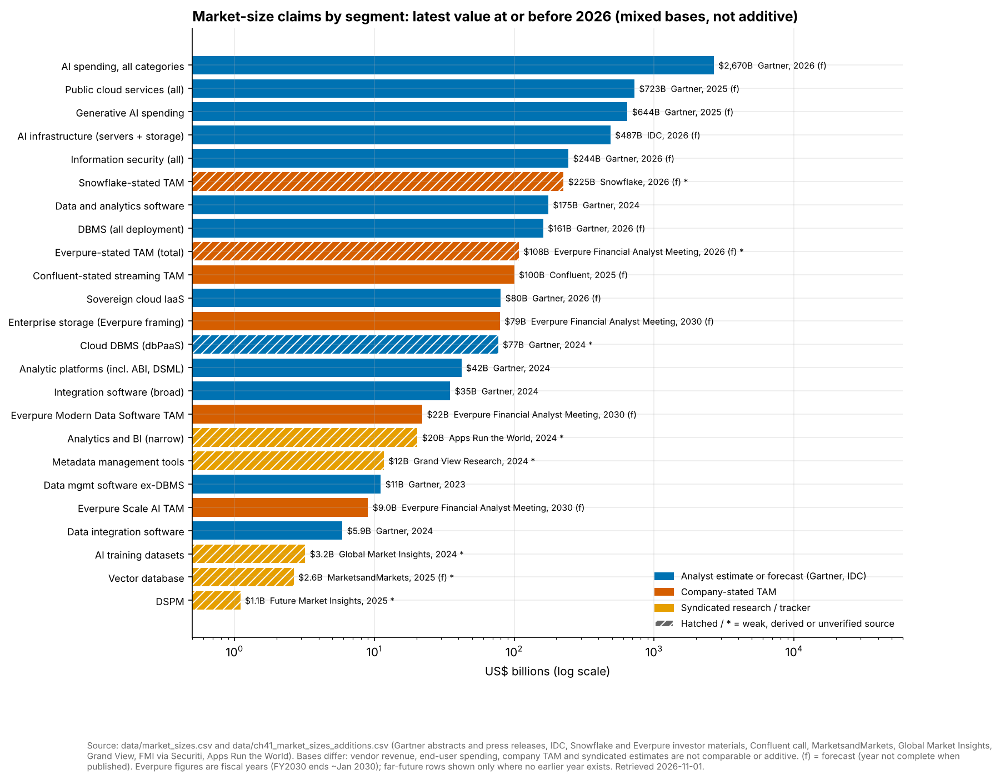
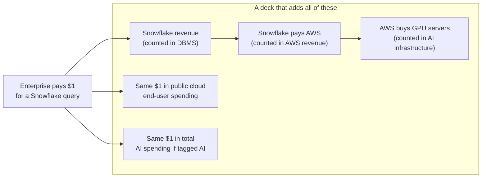
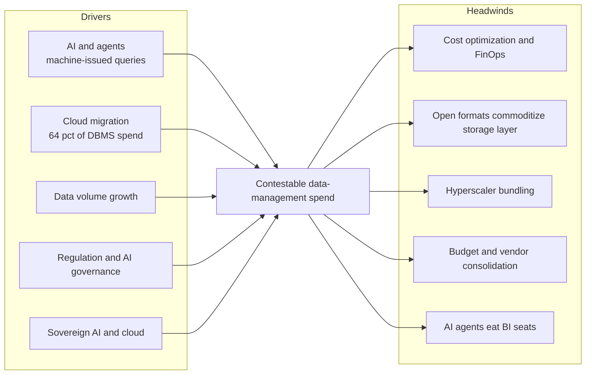

# 41. Market Sizing and Growth Drivers
> **Depth:** L2 · **Reading time:** ~8 min · **Last verified:** 2026-11-01 · **Prerequisites:** [Ch 37 — Public comps and valuation](ch37-public-comps-valuation.md)

## TL;DR

- The best-anchored number in data infrastructure is Gartner's database management system (DBMS) market: **$119.7B in 2024, up 13.4%**, with 64% of spend in the cloud. Gartner forecasts **$161B for 2026**.[^g-dbms24][^g-dbms-fc] Most other "market sizes" in this space are far weaker, and several rows in the atlas dataset are derived or single-sourced. This chapter flags each one.
- Market sizes disagree because they measure different things: vendor revenue, end-user spending, a company's own addressable-market claim, or a syndicated estimate with an undisclosed method. Never add them together. One AI dollar can appear in four of them.
- Company-stated [total addressable markets](../glossary.md#total-addressable-market) (TAMs) run far ahead of analyst markets. Snowflake's ~$225B "current" TAM (weakly sourced) is larger than Gartner's entire 2026 DBMS forecast. Confluent's $100B+ streaming TAM is about 17 times Gartner's $5.9B data-integration software market.[^sf-id26][^cflt-q1][^bf-di]
- Growth drivers are real and measurable: AI infrastructure spending of $318B in 2025, cloud migration, sovereign cloud ($80B of IaaS in 2026) and regulation.[^idc-apr26][^g-sov] So are the headwinds: cost optimization, open formats commoditizing storage, hyperscaler bundling and AI agents displacing BI seats.
- For Everpure, the "up the stack" data-management market is real but small next to storage. Everpure's own FY2030 Modern Data Software TAM is $22B (company estimate, reported second-hand), against $79B for enterprise storage.[^ep-fam]

## Why this matters (business + Everpure lens)

Every deal model in [Ch 37](ch37-public-comps-valuation.md) and every acquisition rationale in [Ch 39](ch39-ma-history.md) leans on a market-size slide. Those slides are the least audited numbers a corp-dev team will see. Analyst abstracts are paywalled, company TAMs are not reviewed by auditors, and syndicated reports often conflict with one another by a factor of four. A team that cannot take a TAM apart will overpay for a growth story.

For Everpure, the question is concrete. The company renamed itself in February 2026 and bought 1touch for $125.0M to move into data discovery and classification ([Ch 33](../04-company-deep-dives/ch33-governance-catalog-security-companies.md)). Its September 2026 analyst meeting put a number on the move: a $22B Modern Data Software TAM by FY2030.[^ep-fam] Whether that number is achievable depends on which data-management dollars are actually contestable, and which are already bundled into hyperscaler and platform bills.

## How it works

### Four bases, four answers

A market-size figure has a **basis**, and the basis decides the number more than the market itself does.

1. **Vendor revenue (market share).** Gartner's market-share series adds up what vendors book in a category. The DBMS figure is one of these. Open-source software counts only through paid services, so free PostgreSQL usage is invisible.[^reg]
2. **[End-user spending](../glossary.md#end-user-spending).** This counts what buyers pay, including hardware, services and devices. Gartner's AI spending forecast ($2.67T for 2026) is an end-user figure, and more than half of it (~$1.48T) is AI infrastructure.[^g-ai26]
3. **Company-stated TAM.** This is the vendor's estimate of the wallet it could address, often including adjacent categories and the labor that its software could replace. It is not audited and it is not an observed market.
4. **Syndicated estimate.** These come from report houses such as MarketsandMarkets or Grand View, sold per report, with opaque methods. For DSPM, vector databases and training data, these are the only public numbers available.

*Figure 41.1 — The figures span more than three orders of magnitude and four bases. Hatched bars rest on derived, single-source or syndicated figures. The bars are not additive. Source: `data/market_sizes.csv` and `data/ch41_market_sizes_additions.csv`.*

### Segment by segment

| Segment | Value | Year | Basis | Publisher | Caveat |
|---|---|---|---|---|---|
| DBMS, all deployment | $119.7B | 2024 | Analyst estimate, vendor revenue | Gartner[^g-dbms24] | Best anchor. 2025 actual not public; ~$136B is *derived* from the 2026 forecast |
| DBMS forecast | $161B | 2026 | Analyst forecast | Gartner[^g-dbms-fc] | Forecast, +18.4% |
| Cloud DBMS ([dbPaaS](../glossary.md#dbpaas)) | ~$76.6B | 2024 | *Derived* (64% × $119.7B) | Gartner[^g-dbms24] | Replaces the dataset's earlier $73.0B (61%) derivation |
| Data and analytics software (all) | $175.17B | 2024 | Analyst estimate | Gartner[^g-da] | Includes DBMS. Forecast $358B by 2029 |
| Analytic platforms (incl. BI, data science) | $41.92B | 2024 | Analyst estimate | Gartner[^g-ap] | Data science and AI platforms alone $11.71B, +38.6% |
| Analytics and BI (narrow) | $20.3B | 2024 | Tracker estimate | Apps Run the World[^artw] | **Weak:** method not public |
| Data integration software | $5.9B | 2024 | Analyst estimate | Gartner via Blocks & Files[^bf-di] | Second-hand; growth slowing to 8.1% CAGR |
| Data management ex-DBMS (governance proxy) | $11.1B | 2023 | Analyst estimate | Gartner[^g-dm] | Metadata management fastest sub-market (+14.5%) |
| Metadata management tools | $11.69B | 2024 | Syndicated | Grand View[^gvr-meta] | **Weak:** exceeds Gartner's whole ex-DBMS market |
| [DSPM](../glossary.md#data-security-posture-management) | ~$1.1B (range $0.4–4.0B) | 2025 | Syndicated | FMI, compiled by Securiti[^dspm] | **Weak:** vendor-compiled; 10x spread |
| Information security (all) | $244B | 2026 | Analyst forecast | Gartner[^g-sec] | Total security, not DSPM |
| Streaming | No analyst figure | — | — | — | Only Confluent's company TAM exists (below) |
| [Vector database](../glossary.md#vector-database) | $2.65B | 2025 | Syndicated | MarketsandMarkets[^mm-vec] | **Weak.** Gartner sees standalone vector DBs at <1% of DBMS by 2029[^yb] |
| AI training datasets | $3.2B | 2024 | Syndicated | Global Market Insights[^gmi] | **Weak:** excludes most human-feedback services |
| AI infrastructure (servers + storage) | $318B | 2025 | Analyst estimate | IDC[^idc-apr26] | Storage only 2.4% of Q4 2025 spend |

*Figure 41.2 — TAM table. Only the Gartner DBMS, analytics and integration rows rest on primary analyst statements. Every syndicated row in governance, DSPM, vector and training data needs a caveat when it is quoted.*

Three rows in the original dataset need explicit warnings. The 2023 DBMS figure ($105.6B) and the cloud-DBMS split are back-calculated, not published. The June 2026 Snowflake TAM comes from an AI-generated transcript summary. The vector-database row is a syndicated estimate with an opaque method.[^sf-id26] They appear in the chart with hatching.

### Why the totals don't add

Gartner's end-user forecasts are built to avoid double counting *within* one forecast. The error comes when a deck stacks markets from different publishers or different layers of one value chain.

*Figure 41.3 — One enterprise dollar can appear in DBMS vendor revenue, in the cloud provider's revenue, in AI-infrastructure capex, in public cloud spending and in total AI spending. Adding these layers overstates the opportunity several times over.*

> **Bridge: semiconductors.** This is the same error as adding TSMC's wafer revenue to NVIDIA's chip revenue and calling the total "the semiconductor market". The wafer is an input cost of the chip. In the same way, the cloud provider's infrastructure revenue is an input cost of Snowflake's revenue. Industry chip-sales statistics count each device once, at the point of sale, and a sound data-market model should do the same.

### Company TAMs versus analyst markets

| Company | Stated TAM (basis, date) | Closest analyst market | Company revenue | Revenue ÷ stated TAM |
|---|---|---|---|---|
| Snowflake | $170B (2024) → $355B (2029), company estimate, Investor Day 2025[^sf-id25]; ~$225B now → >$460B in five years, June 2026 (**weak** source)[^sf-id26] | Gartner data and analytics software $175.17B (2024), *including* every DBMS vendor[^g-da] | $3.46B product revenue, FY2025 (Feb 2024–Jan 2025), GAAP[^sf-fy25] | ~2.0% of the 2024 TAM |
| Confluent (IBM since Mar 2026) | $100B+ (company-stated, Apr 2025); $60B (2023); ~$50B at IPO (2021)[^cflt-q1][^cflt-ipo] | Gartner data integration $5.9B; broad integration software $34.8B (2024)[^bf-di][^g-int] | $1.167B total revenue, FY2025 (calendar), GAAP[^cflt-fy25] | ~1.2% |
| Everpure | $108B (FY2026) → $207B (FY2030), company estimate, reported second-hand (**weak**)[^ep-fam] | Enterprise storage $79B (FY2030, Everpure framing) | >$3.6B revenue, FY2026, GAAP[^ep-fy26] | ~3.3% |
| MongoDB | No dollar TAM surfaced in public summaries of its investor days[^mdb] | Gartner DBMS $119.7B (2024) | — | — |
| Databricks | None public (private company) | — | >$7B revenue run-rate, company-stated, Aug 2026[^dbx] | — |

*Figure 41.4 — Company TAMs run ahead of analyst markets. Snowflake's 2026 figure exceeds Gartner's whole DBMS forecast, and Confluent's is roughly three times Gartner's broad integration-software market. Low revenue/TAM ratios are what investor-day slides are built to show.*

TAM inflation follows a pattern. Each investor day adds adjacent categories: applications, AI, data engineering and security. The horizon also rolls forward. Around 2022, Snowflake projected a $248B TAM for 2026 (weak, secondary source). When 2026 arrived, the reported "current" figure was ~$225B, below the old projection. Yet the headline number still rose, from $355B for 2029 to more than $460B five years out.[^sf-fool][^sf-id26][^sf-id25] Confluent's TAM doubled from ~$50B (2021) to $100B+ (2025), while Gartner's data-integration market was growing at about 10% a year.[^cflt-ipo][^cflt-q1][^bf-di] A TAM that grows with each presentation is evidence of a broader definition, not of a bigger market.

> **Bridge: semiconductors.** A company-stated TAM is the data-industry version of the startup slide that claims "SAM: every 3nm wafer start". It sums the whole node, not the sockets the product can win. The disciplined version is a [serviceable addressable market](../glossary.md#serviceable-addressable-market) built socket by socket: named workloads, current spend per workload, and a share the product can realistically take.

### Growth drivers and headwinds

*Figure 41.5 — The drivers raise total spend, while the headwinds shift where it lands. Net growth for any one vendor depends on which side of the bundling and commoditization line it sits.*

**Drivers.** AI infrastructure spending more than doubled, from $153B in 2024 to $318B in 2025 (IDC).[^idc-apr26] Data science and AI platforms grew 38.6% and nonrelational DBMS grew 22.7% in 2024.[^g-ap][^g-dbms24] Sovereign cloud IaaS will reach about $80B in 2026, up 35.6%, with Europe forecast to pass North America in 2027.[^g-sov] Regulation creates governance and DSPM budgets ([Ch 15](../02-pipelines-and-governance/ch15-governance-security-privacy.md)).

**Headwinds.** Survey respondents estimate 29% of cloud spend is wasted, and AI workloads pushed that figure up in 2026 (Flexera, self-reported).[^flexera] [FinOps](../glossary.md#finops) programs turn that into consumption cuts. [Open table formats](../glossary.md#open-table-format) let customers move engines without migrating data, which caps storage-layer rents ([Ch 7](../01-data-systems-foundations/ch07-open-table-formats.md)). [Hyperscalers](../glossary.md#hyperscaler) bundle integration, catalog and BI into platform bills. Agents that query a [semantic layer](../glossary.md#semantic-layer) directly reduce demand for [seat-based](../glossary.md#seat-based-pricing) BI licenses ([Ch 14](../02-pipelines-and-governance/ch14-semantic-layers-and-bi.md)). Gartner expects data-integration growth to slow from 9.8% to an 8.1% CAGR through 2029.[^bf-di]

## Design choices and trade-offs

| Question you are answering | Use this basis | Why | Main trap |
|---|---|---|---|
| How big is a vendor's competitive arena today? | Vendor revenue (Gartner market share) | Observed, consistently defined | Misses open source and in-house builds |
| How fast is buyer demand growing? | End-user spending forecast | Captures hardware, services, cloud | Mostly hardware in AI; overlaps every other layer |
| What does management think it can reach? | Company TAM | Shows strategic intent and adjacency map | Unaudited, inflates each year |
| Is a new niche real? | Syndicated estimate plus funding and revenue disclosures | Often the only number available | 4–10x spreads; vendor-sponsored |

*Figure 41.6 — Match the basis to the question. The strongest counter-argument to this skepticism is that a company TAM is meant to show direction and adjacency, not to forecast revenue, and that category creators often grow into markets analysts had not yet defined. Even so, a revenue/TAM ratio of 1–3% says little about which share is winnable.*

## Who's who

**Gartner** publishes the most quoted DBMS, analytics, integration and security figures, mainly through paywalled abstracts and press releases. **IDC** owns the AI-infrastructure tracker, and its forecasts have risen sharply: its 2029 figure went from $758B in October 2025 to more than $1T in April 2026.[^idc-oct25][^idc-apr26] **Syndicated houses** (MarketsandMarkets, Grand View, Global Market Insights, Future Market Insights) fill the gaps for niche categories. **Companies** publish TAMs at investor days. Snowflake (2022, 2024, 2025, 2026), Confluent (S-1 and earnings calls) and Everpure (September 2026) are the ones used in this chapter.

## History and trajectory

- **2021:** Cloud reached nearly half of DBMS spending, with cloud DBMS at $39.2B of a market of about $80B (press-reported Gartner figures).[^techrep] Confluent's IPO TAM was ~$50B.[^cflt-ipo]
- **2024:** DBMS reached $119.7B, 64% of it cloud. Data and analytics software reached $175.17B.[^g-dbms24][^g-da]
- **2025:** Snowflake's TAM was $170B, projected to reach $355B by 2029.[^sf-id25] Gartner forecast $644B of generative-AI spending, about 80% of it hardware.[^g-genai] Public cloud spending was forecast at $723.4B.[^g-cloud]
- **2026:** Gartner's 2026 AI spending forecast rose in each of three editions, from $2.52T to $2.67T. IDC put 2029 AI infrastructure above $1T. Everpure published its first segmented TAM, with Modern Data Software at $22B by FY2030.[^g-ai26][^idc-apr26][^ep-fam] Trajectory: the analyst totals keep rising, which pushes company TAMs up too. See [Ch 44](../06-history-and-future/ch44-future-trends.md).

## Numbers that matter

| Metric | Value | Basis | Source/date |
|---|---|---|---|
| DBMS market, 2024 | $119.7B, +13.4% | Analyst estimate, vendor revenue | Gartner, 2025-05[^g-dbms24] |
| DBMS forecast, 2026 | $161B, +18.4% | Analyst forecast | Gartner, 2025-12[^g-dbms-fc] |
| Cloud share of DBMS, 2024 | 64% | Analyst estimate | Gartner, 2025-05[^g-dbms24] |
| Data and analytics software, 2024 → 2029 | $175.17B → $358B | Analyst estimate / forecast | Gartner, 2025[^g-da] |
| Data integration software, 2024 | $5.9B, +9.8% | Analyst estimate, press-reported | Blocks & Files, 2025-12-12[^bf-di] |
| AI infrastructure, 2025 | $318B; storage 2.4% of Q4 | Analyst estimate | IDC, 2026-04-16[^idc-apr26] |
| Total AI spending, 2026 | ~$2.67T, +49.5% | Analyst forecast, end-user spending | Gartner, 2026-09-16[^g-ai26] |
| Sovereign cloud IaaS, 2026 | ~$80B, +35.6% | Analyst forecast | Gartner, 2026-02-09[^g-sov] |
| Estimated cloud waste | 29% | Survey, self-reported | Flexera, 2026[^flexera] |
| Snowflake TAM, 2024 / 2029 | $170B / $355B | Company-stated | Investor Day deck, 2025[^sf-id25] |

*Figure 41.7 — Numbers that matter, with basis. Quote the basis together with the number.*

## Storage bridge

> **Storage bridge.** IDC's tracker shows storage at only 2.4% of AI-infrastructure spend in Q4 2025.[^idc-apr26] That figure explains the logic of moving up the stack: the dollars sit above the array. Everpure's framing puts enterprise storage at $79B and Modern Data Software at $22B by FY2030 (company estimates, reported second-hand). Its $22B figure is already about twice Gartner's entire 2023 data-management-ex-DBMS market ($11.1B), so it must rely on a broad definition that includes Portworx, resilience and cloud.[^ep-fam][^g-dm] Options a strategy team might evaluate, based on public information: (a) build a socket-level SAM for governance and discovery around the 1touch base; (b) treat the large AI-platform TAMs as partner territory rather than addressable revenue; (c) value data-management deals on attach rate to the installed storage base, not on category TAM. See [Ch 45](../06-history-and-future/ch45-storage-moving-up-the-stack.md) and the companion *Everpure Tech Atlas*.

## Conversation playbook

**Questions for a PM**

1. "Which line items in a customer's budget does your TAM replace? Name the cost centers."
2. "What share of your TAM sits inside hyperscaler bills that you cannot displace?"
3. "How has your TAM definition changed since the last investor day, and why?"

**Questions for an engineer**

1. "Which workloads actually move to us after migration, and which stay on the incumbent?"
2. "How much of the spend you see is storage and compute pass-through, and how much is software value?"
3. "When agents generate queries, does consumption rise per user or does seat count fall?"

**What good answers sound like.** They build up from workloads and price points ("40,000 pipelines at about $X each"), separate gross bookings from net vendor revenue, and state a basis and a year. They also admit which competitors' budgets they are counting.

**Don't say this**

- "The data market is $500B." Ask which basis it uses and which layers it double counts.
- "Gartner says DSPM is a $2B market." No public Gartner dollar size has been found. The figures quoted come from syndicated or vendor sources.
- "Vector databases are a $X billion category." Gartner expects standalone vector databases to stay below 1% of DBMS revenue.[^yb]
- "Snowflake's TAM is $460B." That figure comes from a weak transcript summary and has not been checked against the deck.

## Going deeper

- Gartner market-share and forecast abstracts (DBMS, data and analytics software): compare how the definitions differ, not only the totals.[^g-dbms24][^g-da]
- IDC's AI-infrastructure tracker notes, for the server and storage split.[^idc-apr26]
- Snowflake's Investor Day 2025 deck, for a worked example of a TAM build.[^sf-id25] Pair it with [Ch 37](ch37-public-comps-valuation.md) on multiples.

## Key terms

- [Total addressable market](../glossary.md#total-addressable-market) — the revenue available if a product won every possible customer in its defined category.
- [Serviceable addressable market](../glossary.md#serviceable-addressable-market) — the part of a TAM a product can actually reach with its current offer, channels and geography.
- [End-user spending](../glossary.md#end-user-spending) — a market-sizing basis that counts what buyers pay, including hardware and services.
- [Vendor revenue basis](../glossary.md#vendor-revenue-basis) — a market-sizing basis that sums what vendors book in a category.
- [Syndicated research](../glossary.md#syndicated-research) — market reports sold to many buyers, often with opaque methods.
- [Double counting](../glossary.md#double-counting) — adding the same spend more than once across layers of a value chain.
- [dbPaaS](../glossary.md#dbpaas) — a database offered as a managed cloud service.
- [FinOps](../glossary.md#finops) — the practice of managing and reducing cloud spend through shared cost accountability.
- [Sovereign cloud](../glossary.md#sovereign-cloud) — cloud capacity operated under local jurisdiction and control.
- [Data security posture management](../glossary.md#data-security-posture-management) — finding sensitive data and ranking its exposure.
- [Vector database](../glossary.md#vector-database) — a database built for similarity search over embeddings.
- [Hyperscaler](../glossary.md#hyperscaler) — a cloud provider operating at global scale (AWS, Azure, Google Cloud).
- [Open table format](../glossary.md#open-table-format) — metadata that turns files on object storage into transactional tables.
- [Semantic layer](../glossary.md#semantic-layer) — shared business definitions that tools and agents query.
- [Seat-based pricing](../glossary.md#seat-based-pricing) — pricing per named user.

## Sources

[^g-dbms24]: Gartner, DBMS market-share abstract (2024 DBMS revenue $119.7B, +13.4%; cloud 64% vs on-premises 36%; nonrelational +22.7%, relational +10.8%), https://www.gartner.com/en/documents/6494271, published 2025-05; retrieved 2026-11-01. Analyst estimate; full report paywalled.
[^g-dbms-fc]: Gartner, "Forecast: Database Management Systems, Worldwide, 2023–2029, 2025 Update," abstract, https://www.gartner.com/en/documents/7229830, published 2025-12; retrieved 2026-11-01. Analyst forecast.
[^reg]: The Register, report on Gartner's DBMS Market Share Ranks 2011–2025, https://www.theregister.com/2026/04/21/gartner_bamboozling_dbms_chart_shows/, published 2026-04-21; retrieved 2026-11-01.
[^g-da]: Gartner, "Market Share: Data and Analytics Software, Worldwide, 2024," abstract ($175.17B, +13.9%), https://www.gartner.com/en/documents/6504971, published 2025-05-22; 2029 forecast ($358B, 15.4% CAGR) from a Gartner market-opportunity summary dated 2025-07-15; retrieved 2026-11-01. [VERIFY: document IDs taken from search results]
[^g-ap]: Gartner, analytic platforms market-share abstract (2024 $41.92B, +17.3%; data science and AI platforms $11.71B, +38.6%), https://www.gartner.com/en/documents/6537402, published 2025-05-29; retrieved 2026-11-01.
[^artw]: Apps Run the World, "Top 10 Analytics and BI Software Vendors and Market Forecast," https://www.appsruntheworld.com/top-10-analytics-and-bi-software-vendors-and-market-forecast-2015-2020/, published 2025; retrieved 2026-11-01. Independent tracker estimate; weak source.
[^bf-di]: Blocks & Files, "Data integration market set for slower growth, says Gartner," https://www.blocksandfiles.com/ai-ml/2025/12/12/data-integration-market-set-for-slower-growth-says-gartner/1720515, published 2025-12-12; retrieved 2026-11-01. Press-reported Gartner figures.
[^g-int]: Gartner, integration software technologies abstract (2024 $34.8B, +10.9%), https://www.gartner.com/en/documents/6739234, published 2025; retrieved 2026-11-01. [VERIFY: document ID]
[^g-dm]: Gartner, data management software (excluding DBMS) market-share abstract, 2023 (~$11.1B, +8.1%; metadata management +14.5%), https://www.gartner.com/en/documents/5603191, published 2024; retrieved 2026-11-01.
[^gvr-meta]: Grand View Research, "Metadata Management Tools Market Report," https://www.grandviewresearch.com/industry-analysis/metadata-management-tools-market-report, published 2025; retrieved 2026-11-01. Syndicated estimate; weak source.
[^dspm]: Securiti, "DSPM Market Size 2026" (compiles Future Market Insights $1.1B, Research and Markets $2–4B and others), https://securiti.ai/dspm-market-size/, published 2026; Palo Alto Networks Cyberpedia, "DSPM market" (range $415M–$2B), https://www.paloaltonetworks.com/cyberpedia/dspm-market, n.d.; retrieved 2026-11-01. Vendor-compiled; weak.
[^g-sec]: Gartner, information security forecast-analysis abstract (2026 $244B, +11.6% constant currency), https://www.gartner.com/en/documents/6998666, published 2026-02-05; retrieved 2026-11-01.
[^mm-vec]: MarketsandMarkets, "Vector Database Market," https://www.marketsandmarkets.com/Market-Reports/vector-database-market-24340532.html, published 2025; retrieved 2026-11-01. Syndicated estimate; weak.
[^yb]: Yugabyte, landing page for Gartner emerging-tech research on AI-native databases (Gartner prediction: standalone vector DBs <1% of DBMS revenue by 2029), https://info.yugabyte.com/gartner-emerging-tech-ai-native-databases, n.d.; retrieved 2026-11-01. Vendor-hosted.
[^gmi]: Global Market Insights, "AI Training Dataset Market," https://www.gminsights.com/industry-analysis/ai-training-dataset-market, published 2025; retrieved 2026-11-01. Syndicated estimate; weak.
[^cflt-q1]: MarketBeat, Confluent Q1 2025 earnings call transcript (CEO cites $100B+ addressable market), https://www.marketbeat.com/earnings/reports/2025-4-30-confluent-inc-stock, published 2025-04-30; retrieved 2026-11-01. Company-stated.
[^cflt-ipo]: TechTarget, "Confluent goes IPO as Kafka event streaming goes mainstream," https://www.techtarget.com/searchdatamanagement/news/252502989/Confluent-goes-IPO-as-Kafka-event-streaming-goes-mainstream, published 2021-06; retrieved 2026-11-01. $60B figure (2023–2024) press-reported via diginomica, https://diginomica.com/confluent-continues-deliver-ceo-jay-kreps-pitches-era-data-streaming-platforms, n.d.
[^cflt-fy25]: Confluent, Form 10-K for FY2025, https://www.sec.gov/Archives/edgar/data/1699838/000169983826000006/cflt-20251231.htm, published 2026-02; retrieved 2026-11-01 (via `data/ch30_confluent_financials.csv`). [VERIFY: figure against the 10-K]
[^sf-id25]: Snowflake, "Investor Day 2025" presentation (TAM $170B in 2024 to $355B in 2029, Snowflake estimates), https://s26.q4cdn.com/463892824/files/doc_presentations/2025/Snowflake-Investor-Day-2025_vF.pdf, published 2025-06; retrieved 2026-11-01.
[^sf-id26]: Platform Aeronaut transcript summary, "Summit and welcome to Investor Day 2026," https://transcripts.platformaeronaut.com/summaries/summit-and-welcome-to-investor-day-2026-06-02-SNOW, published 2026-06-02; retrieved 2026-11-01. AI-generated summary; weak source. [VERIFY: ~$225B and >$460B on Snowflake's 2026 deck]
[^sf-fool]: The Motley Fool, "Could Snowflake stock help you become a millionaire?" (cites $248B 2026 TAM), https://www.fool.com/investing/2023/02/10/could-snowflake-stock-help-you-become-millionaire, published 2023-02-10; retrieved 2026-11-01. Weak, secondary.
[^sf-fy25]: Snowflake, Q4 and FY2025 earnings release (product revenue $3,462.4M, GAAP), https://www.sec.gov/Archives/edgar/data/1640147/000164014725000016/fy2025q4earnings.htm, published 2025-02-26; retrieved 2026-11-01.
[^ep-fam]: NAND Research, "Everpure 2026 Investor Day: Pure's four-vector push beyond enterprise storage," https://nand-research.com/everpure-investor-day-pures-four-vector-push-beyond-enterprise-storage/, published 2026-09; Blocks & Files, https://www.blocksandfiles.com/flash/2026/09/25/everpures-head-turning-fiscal-2028-guidance/5299205, published 2026-09-25; StorageNewsletter, https://www.storagenewsletter.com/2026/10/01/everpures-expanding-business-model-fuels-new-long-term-outlook/, published 2026-10-01; deck: https://s21.q4cdn.com/687136699/files/content_files/Financial-Analyst-Meeting-Slide-Deck.pdf (meeting held 2026-09-23); retrieved 2026-11-01. Company estimates, reported second-hand. [VERIFY: $108B/$207B totals and segment TAMs on the deck]
[^ep-fy26]: Everpure, Q4 FY2026 earnings press release (8-K Ex. 99.1), https://www.sec.gov/Archives/edgar/data/1474432/000147443226000015/pstg-ex991q4fy2026.htm, published 2026-03; retrieved 2026-11-01. GAAP; FY2026 ≈ Feb 2025–Feb 1, 2026.
[^mdb]: Quartr, "MongoDB (MDB) investor presentation summary," https://quartr.com/events/mongodb-inc-mdb-investor-presentation_3eHbKyfi, published 2026-09; retrieved 2026-11-01. No dollar TAM stated in the summary.
[^dbx]: Databricks, "Databricks Grows >80% YoY, Surpasses $7B Revenue Run-Rate…," https://www.databricks.com/company/newsroom/press-releases/databricks-grows-80-yoy-surpasses-7b-revenue-run-rate-scales, published 2026-08-13; retrieved 2026-11-01 (via `meta/research-briefing.md`). Company-stated run-rate.
[^idc-apr26]: IDC, "AI infrastructure spending caps historic year at $90 billion in Q4 2025; 2029 spending to eclipse $1 trillion," https://www.idc.com/resource-center/blog/ai-infrastructure-spending-caps-historic-year-at-90-billion-in-q4-2025-2029-spending-to-eclipse-1-trillion/, published 2026-04-16; retrieved 2026-11-01.
[^idc-oct25]: IDC, "Artificial intelligence infrastructure spending to reach $758bn USD mark by 2029," https://www.idc.com/resource-center/press-releases/artificial-intelligence-infrastructure-spending-to-reach-758bn-usd-mark-by-2029-according-to-idc/, published 2025-10-28; retrieved 2026-11-01.
[^g-ai26]: Gartner, "Gartner Forecasts Worldwide AI Spending to Grow 49.5% in 2026," https://gartner.com/en/newsroom/press-releases/2026-09-16-gartner-forecasts-worldwide-ai-spending-to-grow-49-point-5-percent-in-2026, published 2026-09-16; earlier editions 2026-01-15 ($2.52T) and 2026-05-19 ($2.59T); retrieved 2026-11-01.
[^g-genai]: Gartner, "Gartner Forecasts Worldwide GenAI Spending to Reach $644 Billion in 2025," https://www.gartner.com/en/newsroom/press-releases/2025-03-31-gartner-forecasts-worldwide-genai-spending-to-reach-644-billion-in-2025, published 2025-03-31; retrieved 2026-11-01.
[^g-cloud]: Gartner, "Gartner Forecasts Worldwide Public Cloud End-User Spending to Total $723 Billion in 2025," https://www.gartner.com/en/newsroom/press-releases/2024-11-19-gartner-forecasts-worldwide-public-cloud-end-user-spending-to-total-723-billion-dollars-in-2025, published 2024-11-19; retrieved 2026-11-01.
[^g-sov]: Gartner, "Gartner Says Worldwide Sovereign Cloud IaaS Spending Will Total $80 Billion in 2026," https://www.gartner.com/en/newsroom/press-releases/2026-02-09-gartner-says-worldwide-sovereign-cloud-iaas-spending-will-total-us-dollars-80-billion-in-2026, published 2026-02-09; retrieved 2026-11-01.
[^flexera]: Flexera, 2026 State of the Cloud findings (estimated waste 29%, up from 27%), https://www.flexera.com/blog/finops/cloud-cost-management-trends/, published 2026; corroborated by TechInformed, https://techinformed.com/ai-workloads-drive-estimated-cloud-waste-to-29/, 2026; retrieved 2026-11-01. Self-reported survey.
[^techrep]: TechRepublic, "New Gartner report shows massive growth in the database market, fueled by cloud," https://www.techrepublic.com/article/new-gartner-report-shows-massive-growth-database-market-fueled-cloud/, published 2022; retrieved 2026-11-01. Press-reported. [VERIFY: exact ~$80B total]
