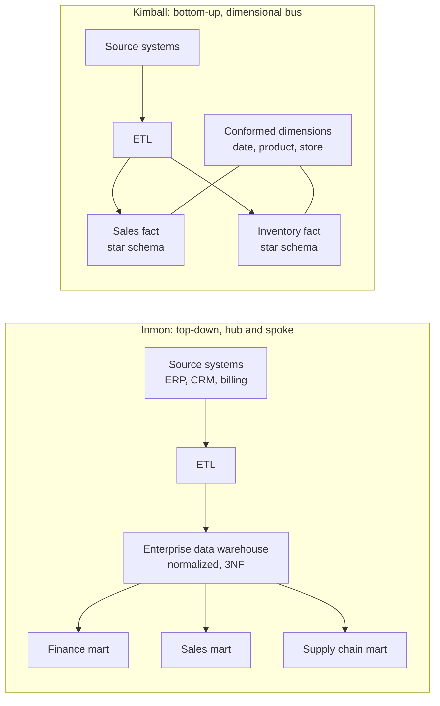
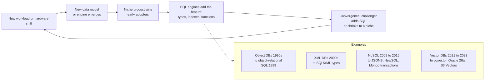

# 42. A History of Databases, 1960s–2026
> **Depth:** L2 · **Reading time:** ~20 min · **Last verified:** 2026-11-01 · **Prerequisites:** [Ch 1 — The data stack map](../01-data-systems-foundations/ch01-data-stack-map.md)

## TL;DR

- Database history runs in nine eras. Each began when hardware or workload changed faster than the incumbents' architecture could follow: mainframes, minicomputers, client-server, web-scale clusters, cloud object storage and now GPUs and agents.
- The [relational model](../glossary.md#relational-model) and SQL keep winning the long game. Object, XML, document, key-value and vector databases each opened a niche, and then SQL engines absorbed the useful idea. Stonebraker's "What Goes Around Comes Around" (2005) and its 2024 sequel with Andy Pavlo make this argument in detail.[^wgaca05][^wgaca24]
- The interface lasts and the implementation turns over. SQL has survived about 50 years, while storage layouts, hardware targets and deployment models have each been replaced several times. That is close to how the x86 instruction set outlived the many microarchitectures built underneath it.
- Business models shifted more than technology did: bundled mainframe software, then perpetual license plus maintenance, then hardware appliances, then open source with subscriptions, then cloud consumption. Each shift moved the profit pool. Incumbents that kept the technology but missed the model (Teradata, Cloudera) lost the most value.
- For a strategist the main lesson is that a new data model is rarely a durable moat. Durable positions come from owning where data lives and who is allowed to read it: the storage layer, the table format, the catalog and the billing relationship. Storage has co-evolved with every era, which is why Everpure should read this history as its own.

## Why this matters (business + Everpure lens)

Every pitch deck in data infrastructure claims that "this time is different". History is the cheapest diligence tool for testing that claim. If a start-up's thesis is "a new data model beats SQL", the base rate is poor: object databases, XML databases and most first-generation NoSQL vendors were absorbed or marginalised within about a decade.[^wgaca24] If the thesis is "a new deployment or business model beats the incumbent", the base rate is much better. Oracle beat IBM to market with commercial SQL, and Snowflake beat Teradata through elasticity and consumption pricing, not through a better query language.

For Everpure the history has a second use. Each database era came with a matching storage architecture: direct-attached disk for mainframes, the storage area network (SAN) for client-server relational databases, the Hadoop Distributed File System (HDFS) for the Hadoop era, and object storage for cloud warehouses and lakehouses. Each storage shift reshuffled the storage vendors as well. Everpure's move up the stack into data management (Enterprise Data Cloud, the 2026 1touch acquisition for discovery and classification) is a bet on which layer controls the next era.[^everpure-1touch] This chapter gives the long view, and [Ch 39](../05-business-and-economics/ch39-ma-history.md) gives the deal-by-deal record.

## How it works

The useful way to read the history is as a repeated cycle, not a list of products. A hardware or workload shift creates a gap. A new architecture fills it, usually from a research lab or a web company. A new business model monetises it. Then the incumbent query interface, SQL, adds the new capability, and the challenger either becomes a SQL engine or shrinks to a niche. Stonebraker and Hellerstein traced this cycle through nine eras of data models up to 2005. Stonebraker and Pavlo extended it in 2024 and concluded that the relational model and SQL had absorbed the main challengers of the following two decades too.[^wgaca05][^wgaca24]

```mermaid
timeline
    title Nine eras of databases, 1960s to 2026
    section Navigational
        1964 : GE Integrated Data Store by Bachman
        1968 : IBM IMS built for the Apollo program
        1971 : CODASYL network model report
    section Relational
        1970 : Codd relational model paper
        1974 : System R and SEQUEL at IBM : Ingres at Berkeley
        1979 : Oracle V2 ships commercial SQL
        1983 : IBM DB2
        1986 : First ANSI SQL standard
    section Warehousing
        1984 : Teradata DBC 1012 appliance
        1992 : Inmon enterprise data warehouse
        1996 : Kimball dimensional modeling
    section Web and NoSQL
        2003 : Google File System paper
        2007 : Amazon Dynamo paper
        2009 : MongoDB and Redis released
    section Hadoop
        2006 : Hadoop split out at Yahoo
        2019 : Cloudera and Hortonworks merger closes
    section Spark
        2010 : Spark open-sourced from AMPLab
        2013 : Databricks founded
    section Cloud warehouse
        2012 : Redshift announced : Snowflake founded
        2020 : Snowflake IPO
    section Lakehouse
        2019 : Delta Lake open-sourced
        2021 : Lakehouse paper at CIDR
    section AI and agents
        2023 : Vector database funding peak
        2025 : Databricks buys Neon : MCP donated to a foundation
        2026 : Agents as primary database consumers
```

*Figure 42.1 — SV-16. Nine eras overlap rather than replace each other. IMS still runs in banks, and Oracle still runs in nearly every large enterprise. Each new era added a layer on top and moved the profit pool. Dates are as cited in the text.*

### Era 1: Navigational databases (1960s–1970s)

The first database systems answered a mainframe-era question: how do many programs share one set of records on expensive disk? Charles Bachman's Integrated Data Store at General Electric (around 1963–64) organised records as a network linked by pointers. A program "navigated" from an owner record to its members, one link at a time. Bachman's 1973 Turing Award lecture was titled "The Programmer as Navigator".[^bachman] The CODASYL Data Base Task Group standardised the network model around 1969–71, and Cullinane's IDMS became its leading commercial product [VERIFY: IDMS commercial release year].

IBM took a hierarchical route. IMS was built with North American Rockwell to track the bill of materials for the Apollo program's Saturn V. Every part sat under a parent, so a tree was the natural shape, and IBM shipped the first release in 1968.[^ims] IMS is still sold and still processes large volumes of banking and airline transactions, which says something about switching costs.

*Lesson:* navigational systems were fast because they hard-wired the access path into the data. That was also their weakness. Every new question needed a programmer and often a reorganisation of the database. The business model was the mainframe's: software tied to IBM hardware, and after IBM's 1969 unbundling, a separately priced monthly license [VERIFY: IMS pricing history after unbundling]. Data independence, meaning the ability to change storage without rewriting applications, was the unmet need the next era addressed.

### Era 2: The relational revolution (1970–1990s)

In 1970 Edgar F. Codd, an IBM researcher, proposed that data be presented to users as simple tables (relations) and queried by declaring *what* is wanted, not *how* to find it. The system would choose the access path.[^codd] The idea was controversial for a decade because practitioners doubted a machine could plan queries as well as a skilled navigator could. Two research prototypes settled that argument.

- **System R** (IBM San Jose, 1974–79) built a full relational system and invented SEQUEL, later renamed SQL. Its cost-based optimiser, described by Selinger and colleagues in 1979, is still the template for query planners.[^systemr][^selinger79][^sequel]
- **Ingres** (UC Berkeley, from 1973) was led by Michael Stonebraker and Eugene Wong. It used its own language, QUEL. Its graduates and code seeded Ingres Corp., Sybase and, through Stonebraker's next project, Postgres (1986).[^ingres][^postgres]

IBM published System R openly but moved slowly to ship it. Larry Ellison, Bob Miner and Ed Oates founded Software Development Laboratories in 1977. They read the IBM papers and in 1979 shipped Oracle V2, generally cited as the first commercially available SQL relational database management system (RDBMS).[^oracle-hist] IBM followed with SQL/DS (1981) and DB2 (1983). Sybase, founded in 1984, built a client-server database. Microsoft licensed it in 1988 for OS/2 and later forked it into Microsoft SQL Server [VERIFY: dates of the Sybase–Microsoft license and split].[^chamberlin12] ANSI published the first SQL standard in 1986, with ISO following in 1987. Once SQL was standardised, it became the shared interface that tools, skills and applications were written against.[^chamberlin12]

> **Bridge: computing eras.** Each database era rode a computing era. IMS and IDMS were mainframe software. Oracle and Ingres grew up on minicomputers (DEC PDP-11 and VAX) running Unix and VMS. Sybase and SQL Server were built for client-server networks of PCs. Google, Hadoop and NoSQL ran on racks of commodity x86 servers. Snowflake and BigQuery were built for cloud object storage, and the AI era is organised around GPUs. The semiconductor parallel is close. Bipolar logic powered mainframes. CMOS microprocessors made minicomputers and then commodity servers cheap enough that software, rather than hardware, became the scarce asset. Today's systems-on-chip and accelerators are pulling data processing toward the GPU (see [Ch 24](../03-ai-data-stack/ch24-data-meets-compute-and-storage.md)).

*Lesson:* the winner of the relational era was the company that commercialised fastest, not the one that invented the technology. IBM did the research. Oracle captured most of the value through aggressive selling, portability across hardware and the **perpetual license plus annual maintenance** model. Under that model a customer paid upfront and then paid a support fee each year, which the industry commonly puts at about 22% of the license price.[^orcl-sig] Maintenance turned an installed base into an annuity. It is the main reason Oracle could later fund its cloud pivot from a position of strength.

### Era 3: Data warehousing (1979–2010s)

Running reports on the same database that took orders slowed the orders down. The industry's answer was to copy data into a separate system built for analysis: the [OLAP](../glossary.md#olap) side of the house, as distinct from transactional [OLTP](../glossary.md#oltp). Teradata, founded in 1979, shipped the DBC/1012 in 1984 [VERIFY: first customer shipment year]. It was a [massively parallel processing](../glossary.md#massively-parallel-processing) machine with a [shared-nothing](../glossary.md#shared-nothing) design: each node owned its own disks and a slice of every table, so a large scan ran in parallel across hundreds of nodes.[^teradata-10k] Teradata sold hardware and software together as an **appliance**. Netezza (to IBM, $1.7B, 2010) and Greenplum (to EMC, 2010) later copied the model.[^ma-netezza][^ma-greenplum]

Two schools then fought over how to design the warehouse itself.

- **Bill Inmon** (*Building the Data Warehouse*, 1992) argued for a single, normalised enterprise data warehouse (EDW) in third normal form, built top-down as the "single version of the truth". Departmental data marts were fed from it.[^inmon]
- **Ralph Kimball** (*The Data Warehouse Toolkit*, 1996) argued for building bottom-up from business processes. Each process got a [star schema](../glossary.md#star-schema): a central fact table of measurements (sales, shipments) surrounded by [dimension](../glossary.md#dimension) tables (date, product, store). Shared "conformed" dimensions tied the stars together into an enterprise "bus".[^kimball]

*Figure 42.2 — Inmon builds the normalised enterprise core first and derives marts from it. Kimball builds process-level star schemas first and links them through conformed dimensions. Most real warehouses ended up as hybrids, and today's "medallion" layers and dbt models recreate the same debate on a lakehouse.*

Around the warehouse grew a tools industry. **OLAP cubes** pre-aggregated data along dimensions for fast slicing. Codd lent his name to a 1993 white paper defining OLAP, sponsored by Arbor Software, maker of the Essbase cube [VERIFY: paper sponsorship and title].[^olap] **Extract-transform-load ([ETL](../glossary.md#etl))** tools such as Informatica, founded in 1993, moved data in. **Business intelligence** suites such as Business Objects, Cognos and Hyperion sat on top. The tools layer consolidated in a single year. Oracle bought Hyperion, SAP bought Business Objects and IBM bought Cognos, all in 2007, for a combined value of roughly $15B (press-reported) [VERIFY: individual deal values].

*Lesson:* the warehouse era made money from **appliances and per-seat tool licenses**, and it rewarded vendors whose customers had big, stable, centralised budgets. It also trained a generation of strategists to treat the data platform as a capital expenditure. That habit made the later move to consumption pricing feel like a shock rather than a trend.

### Era 4: The web and the NoSQL wave (2003–2012)

Web companies hit a limit the warehouse vendors never faced. Google indexed the whole web, and Amazon ran a shopping cart that could never go down. Buying bigger Oracle or Teradata machines was too expensive and still did not scale far enough. Google's answer was a sequence of papers: the Google File System (2003), MapReduce (2004) and Bigtable (2006). They described how to spread storage and computation across thousands of cheap, unreliable machines.[^gfs][^mapreduce][^bigtable] Amazon's Dynamo paper (2007) gave up strong consistency to keep the shopping cart always writable.[^dynamo]

Open-source projects copied these ideas within a few years. Facebook built Cassandra, which combines Dynamo's partitioning with Bigtable's data model, and open-sourced it in 2008.[^cassandra] 10gen (later MongoDB Inc.) released the MongoDB [document database](../glossary.md#document-database) in 2009. Redis, an in-memory [key-value store](../glossary.md#key-value-store), appeared the same year [VERIFY: Redis first public release, 2009].[^mdb-10k] "NoSQL" became the umbrella term around 2009. The pitch was flexible schemas, horizontal scale and developer speed, at the cost of joins and transactions.

The counter-move came quickly. Google's own Spanner paper (2012) showed a globally distributed database with SQL and strong transactions.[^spanner] The analyst Matthew Aslett had already coined "[NewSQL](../glossary.md#newsql)" in 2011 for systems that kept SQL and ACID while scaling out [VERIFY: Aslett 451 Group coinage]. MongoDB added multi-document transactions in version 4.0 and later a SQL-like query interface. NoSQL went from meaning "no SQL" to "not only SQL".[^mdb-10k]

*Lesson:* the NoSQL vendors that survived were the ones that sold a **managed cloud service** and a developer experience, not a data model. MongoDB reached about $2.46B of GAAP revenue in FY2026 (Feb 2025–Jan 2026), and its Atlas cloud service is now about three-quarters of revenue.[^mdb-q4][^mdb-ars] Open-source NoSQL vendors without a cloud service faced competition from hyperscalers hosting their own code. MongoDB (2018, SSPL) and Redis (2024) responded by moving to more restrictive licenses.[^mdb-sspl][^redis-2024]

### Era 5: The Hadoop era (2006–2019)

Doug Cutting and Mike Cafarella's open-source re-implementation of GFS and MapReduce was split out as Hadoop at Yahoo in 2006 and became an Apache top-level project in 2008.[^hadoop] It promised to store everything cheaply, in raw form, on commodity servers, and to impose structure only when data was read ([schema-on-read](../glossary.md#schema-on-read)). The pitch was the "[data lake](../glossary.md#data-lake)".

Three distributors commercialised it: Cloudera (2008), MapR (2009) and Hortonworks (2011, spun out of Yahoo). Capital poured in. Intel's 2014 investment in Cloudera was widely reported at about $740M [VERIFY: amount, stake and primary source], and Hortonworks (2014) and Cloudera (2017) both went public [VERIFY: IPO dates].

The economics then broke. Three vendors were selling subscriptions to the same free code, so prices fell. Gartner warned in 2014 that lakes without governance would become unusable "data swamps".[^gartner-lake] MapReduce was slow and hard to program. Most damaging, Amazon S3 plus on-demand compute made it cheaper to rent a lake than to own a Hadoop cluster. Cloudera and Hortonworks merged in an all-stock deal valued at a combined $5.2B (announced October 2018, closed January 2019). HPE bought MapR's assets in 2019 after MapR nearly shut down, and KKR and CD&R took Cloudera private for about $5.3B in 2021.[^ma-hortonworks][^ma-mapr][^ma-cloudera]

*Lesson:* **open source plus support subscriptions** is a weak model when several vendors distribute the same project and the customer does all the operating. The Hadoop vendors sold software to run on-premises just as the market moved to renting a service. Their technology survived as file formats (Parquet, ORC), the Hive metastore and Spark, but most of the equity value did not.

### Era 6: Spark and Databricks (2009–)

Apache [Spark](../glossary.md#apache-spark) began in 2009 at UC Berkeley's AMPLab as Matei Zaharia's faster, in-memory successor to MapReduce. It was open-sourced in 2010, donated to the Apache Software Foundation in 2013 and made a top-level project in February 2014.[^nsdi][^spark-tlp] Its creators founded Databricks in 2013. The key strategic decision was to *never* sell a Hadoop-style distribution. Databricks ran Spark only as a cloud service, which made usage measurable and billable.[^wiki]

That choice is the clearest A/B test in this history. Cloudera and Databricks both commercialised open-source big-data engines from Berkeley and Yahoo lineages. Cloudera sold on-premises subscriptions and was taken private for about $5.3B.[^ma-cloudera] Databricks sold a cloud consumption service and in August 2026 reported a revenue run-rate above $7B (company-stated) at a $190B valuation.[^constellation]

*Lesson:* the same technology can produce very different equity outcomes depending on the delivery model. Owning the running service means owning the usage data, the upgrade path and the bill.

### Era 7: Cloud data warehouses (2010–2020)

Three products moved the warehouse to the cloud, with different designs.

- **Google BigQuery**, the public version of Dremel, was previewed in 2010 and became generally available around 2011–12. It was serverless from the start and priced per terabyte scanned.[^dremel][^dremel20]
- **Amazon Redshift** was announced in November 2012 and built on code licensed from ParAccel. AWS pitched it at under $1,000 per terabyte per year on reserved pricing, a fraction of appliance prices.[^redshift-2012][^ma-paraccel]
- **Snowflake**, founded in 2012 and generally available in 2015, kept every table in object storage and spun up independent compute clusters on demand. This [separation of storage and compute](../glossary.md#separation-of-storage-and-compute) was set out in its SIGMOD 2016 paper.[^snowflake16]

Separating storage from compute is what made consumption pricing work. A customer could pay for storage by the terabyte-month and for compute by the second, scaling each independently. Teradata's shared-nothing appliance could not do that without being rebuilt. AWS added the same separation to Redshift with RA3 nodes in December 2019, which effectively conceded the point.[^ra3-launch] Snowflake's September 2020 IPO priced at $120 per share and raised about $3.4B, the largest software IPO on record at the time.[^sf-ipo] Teradata now generates about $1.69B of trailing GAAP revenue and has a market capitalisation of about $3.19B (as of 2026-10-28).[^fin-tdc][^comps-tdc]

*Lesson:* the cloud warehouse era made **consumption pricing** the dominant model. Customers buy credits or commit spend, and revenue follows usage. For incumbents, the cost of an architecture that cannot be metered can be larger than the cost of a slower engine.

### Era 8: The modern data stack and the lakehouse (2016–2024)

Cheap cloud warehouses produced a wave of single-purpose tools around them, known as the "modern data stack". Fivetran handled ingestion, dbt handled SQL transformation inside the warehouse ([ELT](../glossary.md#elt) rather than ETL), and Looker and others handled BI. The stack is now consolidating, most visibly through the completed Fivetran–dbt Labs merger.[^fivetran-dbt] [Ch 43](ch43-modern-data-stack.md) tells that story.

At the same time, the data lake came back with transactions. Netflix built Apache Iceberg and donated it to Apache in 2018, Uber built Hudi, and Databricks open-sourced [Delta Lake](../glossary.md#delta-lake) in 2019. Each added a metadata layer that gives ACID tables on top of Parquet files in object storage.[^delta-vldb][^ice-spec] The CIDR 2021 "Lakehouse" paper argued that open-format lakes plus a fast engine would make separate warehouses unnecessary.[^cidr] The format war ended in 2024. Databricks bought Tabular, the Iceberg creators' company, for a reported ~$2B, and both Databricks and Snowflake now support Iceberg.[^tabular] [Ch 7](../01-data-systems-foundations/ch07-open-table-formats.md) covers the mechanics.

*Lesson:* when the storage format becomes open, value moves up to the catalog and the governance layer, which decides who may read what (see [Ch 8](../01-data-systems-foundations/ch08-catalogs-and-metastores.md)). This is the same pattern as Era 2, when a standardised SQL moved value to whoever ran the best engine and the stickiest contracts.

### Era 9: AI and agents (2021–2026)

Large language models created demand for similarity search over embeddings. Purpose-built [vector databases](../glossary.md#vector-database) such as Pinecone, Weaviate, Qdrant and Milvus raised capital quickly. Pinecone's $100M round in April 2023 valued it at about $750M (press-reported).[^pinecone-b] Then the absorption cycle ran faster than ever. [pgvector](../glossary.md#pgvector) put vector search into Postgres.[^pgvector] MongoDB Atlas Vector Search reached general availability in December 2023.[^mdb-vs] Oracle shipped vector search in its AI Database 26ai.[^oracle] AWS made S3 Vectors generally available in December 2025.[^s3v] Within about three years, vector search had become a feature of existing databases, as Stonebraker and Pavlo predicted in 2024.[^wgaca24]

The second AI-era shift is the **Postgres renaissance** and **agents as database consumers**. Databricks bought Neon (serverless Postgres) for about $1B (press-reported) in May 2025. At the time Neon said more than 80% of the databases on its platform were created by AI agents (company-stated).[^neon-deal] Snowflake bought Crunchy Data for $164.5M in cash.[^crunchy] Supabase, a Postgres platform popular with AI coding tools, raised at a $10.5B valuation in June 2026 (press-reported).[^supabase-f] The Model Context Protocol (MCP), the standard interface agents use to call tools including databases, was donated to the Agentic AI Foundation in December 2025.[^mcp] [Ch 22](../03-ai-data-stack/ch22-agents-and-data.md) covers the architecture, and [Ch 44](ch44-future-trends.md) covers what may come next.

*Lesson:* in the AI era, the scarce input is trusted context about data: what it means, who may see it and whether it is current. Raw storage of vectors is not scarce. The business model is still consumption, but the consumer is increasingly a machine that creates databases, runs queries and burns credits without a human in the loop. That favours platforms with metering, governance and very low-cost provisioning.

### The pattern: SQL absorbs challengers

*Figure 42.3 — The absorption cycle. A challenger's data model becomes a column type or index in mainstream SQL engines within roughly five to ten years. Challengers that survive do so on delivery and business model (MongoDB Atlas, Databricks), not on the data model alone.*

The mechanism is simple. A declarative language separates *what* from *how*, so a SQL engine can add a new type (JSON, XML, geospatial, vector) and a new index for it without breaking existing applications. Postgres added JSONB in 2014.[^pg-jsonb] The SQL standard added object-relational features in SQL:1999, XML in SQL:2003, JSON in SQL:2016 and property-graph queries in SQL:2023, with ISO adding a separate graph language, GQL, in 2024 [VERIFY: SQL standard part and year for each feature].[^gql] A challenger, by contrast, has to rebuild everything SQL engines already do (transactions, optimisers, security, tools and skills) before it can win general workloads.

> **Bridge: x86 and RISC.** SQL is to data what the x86 instruction set is to computing. In the 1980s, RISC designs were cleaner and faster, and many expected them to displace x86. Instead, from the mid-1990s, Intel and AMD chips began decoding x86 instructions into RISC-like micro-operations internally. They kept the compatible interface and absorbed the better microarchitecture. SQL engines did the same with columnar storage, vectorised execution and vector indexes. The counterexample matters too. Arm won where x86's compatibility tax mattered least, first in phones and now in efficiency-sensitive datacentres. The data equivalent is new workloads with no legacy SQL estate, such as AI applications on Postgres or embedded DuckDB, where a lighter, cheaper design can win. Interfaces persist, but they can lose share at the edges where the incumbent's cost structure does not fit.

## Design choices and trade-offs

The two tables below sum up the strategic history. The first gives each era's lesson. The second shows how the dominant business model shifted, which matters more for valuation than the technology did.

| Era | Technology shift | Winners | Losers or absorbed | Dominant business model | What it teaches a strategist |
|---|---|---|---|---|---|
| 1. Navigational (1960s–70s) | Pointer-linked records on mainframe disk | IBM (IMS), Cullinet (IDMS) | Most network-model vendors once relational arrived | Software bundled with hardware, then monthly license | Hard-wired access paths are fast but cannot answer new questions |
| 2. Relational (1970s–90s) | Declarative SQL, cost-based optimiser | Oracle, IBM DB2, Microsoft SQL Server, Sybase | Network/hierarchical vendors; Ingres Corp. | Perpetual license + ~22% annual maintenance | The fastest commercialiser beats the inventor; standards create lock-in to skills and tools |
| 3. Warehousing (1980s–2010s) | MPP shared-nothing; star schema; OLAP cubes | Teradata, Informatica, Business Objects, Cognos, Hyperion | Most appliance start-ups sold out 2007–11 | Hardware appliance + per-seat tool licenses | Capex-shaped platforms are exposed when compute becomes rentable |
| 4. Web and NoSQL (2003–12) | Scale-out, relaxed consistency, flexible schema | MongoDB (via Atlas), DynamoDB, Redis | Many NoSQL start-ups; "no SQL" as a slogan | Open source + support, then managed service | Data model is not a moat; delivery and developer experience are |
| 5. Hadoop (2006–19) | Distributed file system + MapReduce on commodity servers | Cloud object stores; Parquet; Spark | Cloudera, Hortonworks, MapR | Open-source subscription, on-premises | Several vendors distributing one free project compete on price; on-premises lost to rented services |
| 6. Spark (2009–) | In-memory distributed compute | Databricks | Hadoop MapReduce | Cloud consumption service | Same code, different delivery model, very different equity value |
| 7. Cloud warehouse (2010–20) | Separation of storage and compute on object storage | Snowflake, BigQuery, Redshift | Teradata, Netezza, on-prem appliances | Consumption credits and committed spend | Meterable architecture is the precondition for consumption economics |
| 8. MDS and lakehouse (2016–24) | ELT tools; open table formats | Databricks, Snowflake, dbt, Fivetran | Point tools being consolidated | Consumption + SaaS seats | Open formats move value to catalog and governance |
| 9. AI and agents (2021–26) | Embeddings, vector indexes, agent tool calls | Postgres platforms, incumbents adding vectors | Stand-alone vector DBs under pressure | Consumption, increasingly machine-driven | New data types get absorbed fast; trusted context is the scarce layer |

*Figure 42.4 — Lessons by era. Winners in one era rarely led the next, except when they changed business model in time. Oracle survived several eras through maintenance cash flow. Cloudera did not survive the move to cloud.*

| Business model | Peak era | How revenue is recognised | Who captured margin | Typical failure mode |
|---|---|---|---|---|
| Bundled or monthly mainframe license | 1960s–80s | Recurring lease/license tied to hardware | IBM | Locked to one hardware family |
| Perpetual license + maintenance | 1980s–2010s | Upfront license, then ~22% annual support[^orcl-sig] | Oracle, IBM, Microsoft, SAP | Customers resent audits and support fees; growth stalls when new licenses slow |
| Appliance (hardware + software) | 1984–2015 | Upfront system sale + support | Teradata, Netezza, Exadata | Capacity bought in lumps; cannot be metered or rented elastically |
| Open source + subscription | 2008–2019 | Annual subscription for support and enterprise features | Red Hat (outside data); weakly Cloudera, Hortonworks | Free substitutes; hyperscalers host the code; license changes follow |
| Cloud consumption | 2012–present | Usage (credits, TB scanned, compute-seconds) against commitments | Snowflake, Databricks, hyperscalers | Revenue volatility when customers optimise (2022–23) |

*Figure 42.5 — Business models by era. Each shift moved more of the infrastructure risk to the vendor and more of the volatility into revenue. [Ch 35](../05-business-and-economics/ch35-business-models.md) covers the economics of each model.*

**Steelman the alternative view.** "SQL always wins" can be overstated. Key-value stores such as DynamoDB and Redis remain huge businesses and were never really absorbed; they serve a different latency tier. Document databases kept a large developer niche, as MongoDB's revenue shows. Dataframe APIs in Python, not SQL, are how most data scientists work, and LLMs may make natural language the dominant query interface. The fair reading is narrower. SQL absorbs *data models and query features*. It does not absorb *latency tiers* or *delivery models*. And the relational interface may yet be hidden behind agents, so that the query language matters less than the semantic layer and the catalog that translate intent into SQL (see [Ch 14](../02-pipelines-and-governance/ch14-semantic-layers-and-bi.md)).

## Who's who

The incumbents that lasted did so by changing business model or by becoming the default interface. The rest were acquired.

| Company or project | Era of origin | Status in 2026 | How it lasted, or why it didn't |
|---|---|---|---|
| IBM (IMS, DB2) | 1, 2 | Public; databases a mature line inside software | Mainframe installed base; bought Confluent (~$11B EV, closed March 2026) and DataStax to stay relevant[^ma-confluent][^ma-datastax] |
| Oracle | 2 | Public; FY2027 revenue guided to at least $90B | Maintenance annuity funded Exadata, Autonomous DB and OCI; database now also sold inside Azure and Google Cloud data centres[^comps-orcl][^oracle-dbazure] |
| Microsoft SQL Server | 2 | Inside Microsoft | Bundled with the Windows Server and Azure estate |
| Sybase | 2 | Acquired by SAP, $5.8B (2010) | Lost the client-server war to Microsoft; value was in its installed base[^ma-sybase] |
| Teradata | 3 | Public; ~$3.19B market cap | Appliance model was slow to move to cloud; a value stock today[^comps-tdc] |
| PostgreSQL | 2 (Postgres 1986) | Open source, the default for new applications | License permissive enough for every cloud to host it; extensions absorb new data types[^postgres][^pgvector] |
| MongoDB | 4 | Public; ~$2.46B FY2026 revenue | Moved to Atlas managed service and SSPL license[^mdb-q4][^mdb-sspl] |
| Cloudera / Hortonworks / MapR | 5 | Merged, taken private, or sold for assets | On-premises subscriptions on shared free code[^ma-hortonworks][^ma-mapr][^ma-cloudera] |
| Databricks | 6 | Private; >$7B run-rate, $190B valuation | Cloud-only delivery from day one[^constellation] |
| Snowflake | 7 | Public; $4.47B FY2026 product revenue | Separation of storage and compute plus consumption pricing[^sf-fy26] |
| Pinecone and peers | 9 | Private; reportedly explored a sale in 2025 | Category absorbed by incumbents within about three years[^pinecone-b][^pinecone-sale] |

*Figure 42.6 — Survivors and casualties. Every long-lived franchise either owned the interface (SQL, Postgres) or owned a running service and billing relationship.*

## History and trajectory

Three long-run trends connect the nine eras, and each points to the next few years.

**First, compute keeps moving toward data, and then data moves to wherever storage is cheapest.** Mainframes centralised data. Client-server spread it out. The warehouse recentralised it for analysis. Hadoop tried to own the lake on-premises, and the cloud put it in object storage. In 2026 the open question is whether AI moves the centre of gravity again, toward GPU clusters and the high-performance storage beside them, or whether GPUs come to the lakehouse (see [Ch 24](../03-ai-data-stack/ch24-data-meets-compute-and-storage.md)).

**Second, each era's profit pool sits one layer above the commoditised one.** When disks became cheap, value moved to the DBMS. When SQL was standardised, value moved to the best engine and the stickiest contract. When open table formats commoditised storage layout, value moved to the catalog. If agents commoditise query writing, value is likely to move to semantic context and governance: the layer that says what data means and who may use it. That is the logic behind Salesforce–Informatica, IBM–Confluent and Everpure–1touch.[^ma-informatica][^ma-confluent][^everpure-1touch]

**Third, the cycle is speeding up.** Relational took about 15 years to go from paper (1970) to dominance. NoSQL took about six years to go from hype (2009) to absorption. Vector search took about three (2021–2024). Faster cycles favour incumbents that ship quickly and platforms with distribution. They are hard on single-feature start-ups, which is the main diligence implication of this chapter. [Ch 44](ch44-future-trends.md) turns these trends into forecasts.

## Numbers that matter

| Metric | Value | Basis | Source / date |
|---|---|---|---|
| Worldwide DBMS market, 2024 | $119.7B, +13.4% YoY | Analyst estimate (Gartner) | Gartner abstract, 2025[^gartner-dbms] |
| Oracle FY2027 revenue guidance (Jun 2026–May 2027) | At least $90B | Company guidance | Sep 2026, via `data/public_comps.csv`[^comps-orcl] |
| Oracle Q1 FY2027 revenue (Jun–Aug 2026) | ~$19.35B | GAAP, press-reported | StorageNewsletter, 2026-09-23[^orcl-q1] |
| Oracle market cap | $382.45B | Market data | 2026-10-23[^comps-orcl] |
| Teradata trailing revenue | ~$1.69B (~+1% YoY) | GAAP, TTM | stockanalysis, 2026-10-23[^fin-tdc] |
| Teradata market cap / EV | $3.19B / $2.88B (~1.7x EV/revenue) | Market data | 2026-10-28[^comps-tdc] |
| Cloudera–Hortonworks merger | $5.2B combined equity | Disclosed, all-stock | Announced 2018-10-03[^ma-hortonworks] |
| Cloudera take-private | ~$5.3B ($16/share) | Disclosed | 2021 [VERIFY][^ma-cloudera] |
| Snowflake IPO | $120/share, ~$3.4B raised | Prospectus | Sep 2020 [VERIFY][^sf-ipo] |
| Snowflake product revenue FY2026 (Feb 2025–Jan 2026) | $4,472.3M | GAAP | 2026-02-25[^sf-fy26] |
| Snowflake market cap | $107.88B | Market data | 2026-10-30[^comps-snow] |
| Databricks revenue run-rate / valuation | >$7B / $190B | Company-stated | 2026-08-13[^constellation] |
| MongoDB revenue FY2026 (Feb 2025–Jan 2026) | ~$2.46B, +23% | GAAP | 2026-03-02[^mdb-q4] |
| Pinecone Series B valuation | ~$750M | Press-reported | 2023-04-27[^pinecone-b] |
| Databricks–Neon | ~$1B | Press-reported | 2025-05-15[^neon-deal] |
| Supabase valuation | $10.5B | Press-reported | 2026-06[^supabase-f] |

*Figure 42.7 — The relational incumbent (Oracle) is still the largest company in this table by revenue. The appliance-era leader (Teradata) now has a market value about a third of the latest private mark for Supabase, a Postgres start-up. Comparison across bases (public market cap vs. private post-money) is indicative only.*

## Storage bridge

> **Storage bridge.** Storage co-evolved with every database era. Client-server relational databases drove the SAN and block-storage arrays, where latency and consistency for OLTP logs were the selling points. Hadoop moved storage into the compute servers through HDFS's triple replication on local disks, which hurt external storage vendors for a decade. The cloud warehouse and lakehouse moved the durable copy of data into object storage behind the S3 API, which made object storage the system of record for analytics. The AI era is adding high-throughput file and object tiers for GPU training, plus fast flash for vector indexes and KV caches. See the companion *Everpure Tech Atlas* for protocol and media detail.

For a strategy team, the pattern suggests one option to evaluate, based on public information. In each era, storage vendors that moved up a layer by buying a database (EMC–Greenplum, HPE–MapR) mostly destroyed value, because they bought an engine just as engines were commoditising.[^ma-greenplum][^ma-mapr] Moves into the *control* layer, such as metadata, classification and governance that work across any engine, follow the profit pool described above. Everpure's 1touch acquisition sits in that second category, and [Ch 45](ch45-storage-moving-up-the-stack.md) evaluates the options in detail.[^everpure-1touch]

## Conversation playbook

**Three questions for product managers**

1. "Which era's business model does your pricing resemble, and what happens to revenue if customers optimise usage the way they did in 2022–23?"
2. "Your new data model: how long before Postgres or Snowflake ships it as an extension or feature, and what would you still own then?"
3. "Which layer do you control that an open format or a standard could commoditise, and which layer controls you?"

**Three questions for engineers**

1. "If a SQL engine added your core index type tomorrow, what would still be hard to copy: the storage layout, the distributed design or the operations?"
2. "Is your system designed around separation of storage and compute, or would metering it require a re-architecture?"
3. "Which lessons from the Hadoop years (small files, metastore bottlenecks, schema drift) does your design avoid, and how?"

**What good answers sound like.** They name a delivery or control-point advantage (a managed service, a catalog, a billing relationship, an installed base) rather than a data model. They put a time frame on absorption risk. They cite usage metrics, not only benchmark speed.

**Don't say this**

- "SQL is dead." It has outlived every challenger since 1974. A better claim is that SQL is increasingly written by machines.
- "Hadoop failed." Its ideas (distributed storage, Parquet, Spark, the metastore) run most of today's lakehouses. The *vendors'* business model failed.
- "Oracle invented the relational database." Codd and IBM's System R did. Oracle was first to sell commercial SQL.
- "Snowflake won because it was faster." It won mainly on elasticity, separation of storage and compute, and consumption pricing.
- "Vector databases are a new category that will stay independent." History says new data types are absorbed within a few years. Independent survivors need a different advantage.

## Going deeper

- Read Stonebraker and Hellerstein (2005) and then Stonebraker and Pavlo (2024) back to back. Together they are the best single argument for the absorption thesis.[^wgaca05][^wgaca24]
- For the origin of SQL, Chamberlin's 2012 account is short and first-hand.[^chamberlin12]
- For the cloud-warehouse design, read the Snowflake SIGMOD 2016 paper alongside the Lakehouse CIDR 2021 paper. They are the two founding documents of today's Databricks–Snowflake rivalry ([Ch 27](../04-company-deep-dives/ch27-databricks-vs-snowflake.md)).[^snowflake16][^cidr]
- Part 1 covers the mechanics behind this history: data models ([Ch 2](../01-data-systems-foundations/ch02-data-models.md)), internals ([Ch 3](../01-data-systems-foundations/ch03-database-internals.md)), distributed databases ([Ch 4](../01-data-systems-foundations/ch04-distributed-databases.md)) and analytical engines ([Ch 5](../01-data-systems-foundations/ch05-analytical-engines.md)).

## Key terms

- [Navigational database](../glossary.md#navigational-database) — a database where programs follow stored pointers from record to record, as in IMS and CODASYL systems.
- [CODASYL](../glossary.md#codasyl) — the 1960s–70s committee whose network-model specification standardised pointer-linked databases such as IDMS.
- [Relational model](../glossary.md#relational-model) — Codd's model of data as tables queried declaratively.
- [SQL](../glossary.md#sql) — the declarative query language from IBM's System R, standardised by ANSI in 1986.
- [Data warehouse](../glossary.md#data-warehouse) — a separate database built for analysis, loaded from operational systems.
- [Enterprise data warehouse](../glossary.md#enterprise-data-warehouse) — Inmon's single normalised warehouse that feeds departmental data marts.
- [Data mart](../glossary.md#data-mart) — a subject-specific subset of warehouse data for one department or process.
- [Star schema](../glossary.md#star-schema) — a fact table of measurements surrounded by dimension tables.
- [Dimensional modeling](../glossary.md#dimensional-modeling) — Kimball's method of designing warehouses as star schemas linked by conformed dimensions.
- [Conformed dimension](../glossary.md#conformed-dimension) — a dimension, such as date or product, shared with the same meaning across several fact tables.
- [OLAP cube](../glossary.md#olap-cube) — pre-aggregated data organised along dimensions for fast slicing.
- [Data warehouse appliance](../glossary.md#data-warehouse-appliance) — hardware and database software sold together as one system.
- [NoSQL](../glossary.md#nosql) — the umbrella term for non-relational databases (key-value, document, wide-column, graph) that spread from 2009.
- [NewSQL](../glossary.md#newsql) — distributed databases that keep SQL and ACID while scaling out.
- [Apache Hadoop](../glossary.md#apache-hadoop) — the open-source distributed file system and MapReduce framework modelled on Google's papers.
- [Data lake](../glossary.md#data-lake) — a store of raw files in many formats, structured only when read.
- [Data swamp](../glossary.md#data-swamp) — a data lake that has become unusable for lack of metadata, quality and governance.
- [Separation of storage and compute](../glossary.md#separation-of-storage-and-compute) — keeping durable data in shared storage while compute scales independently.
- [Lakehouse](../glossary.md#lakehouse) — open table formats on object storage plus a warehouse-grade engine and governance.
- [Modern data stack](../glossary.md#modern-data-stack) — the 2016–2023 pattern of single-purpose cloud tools around a cloud warehouse.
- [Perpetual license](../glossary.md#perpetual-license) — a one-time software license fee, usually followed by annual maintenance payments.
- [Consumption pricing](../glossary.md#consumption-pricing) — billing by measured usage, such as credits or terabytes scanned, rather than seats or licenses.

## Sources

[^wgaca05]: M. Stonebraker and J. M. Hellerstein, "What Goes Around Comes Around," in *Readings in Database Systems*, 4th ed., MIT Press, 2005, author copy https://people.csail.mit.edu/tdanford/6830papers/stonebraker-what-goes-around.pdf [VERIFY: URL path], published 2005; retrieved 2026-11-01 (canonical citation, not live-fetched).
[^wgaca24]: M. Stonebraker and A. Pavlo, "What Goes Around Comes Around… And Around…," *ACM SIGMOD Record* 53(2), https://sigmodrecord.org/2024/06/30/what-goes-around-comes-around-and-around, published 2024-06-30; retrieved 2026-11-01 (search-confirmed listing; PDF not opened).
[^bachman]: C. W. Bachman, "The Programmer as Navigator" (1973 ACM Turing Award lecture), *Communications of the ACM* 16(11), 653–658, https://doi.org/10.1145/355611.362534, published 1973-11; ACM, "Charles W. Bachman," https://amturing.acm.org/award_winners/bachman_9385610.cfm; retrieved 2026-11-01 (canonical citation, not live-fetched).
[^ims]: IBM, "Information Management System" (IBM Heritage), https://www.ibm.com/history/information-management-system [VERIFY: URL path and 1968 first-release date], n.d.; retrieved 2026-11-01 (not live-fetched). Apollo/Rockwell origin is widely documented public history.
[^codd]: E. F. Codd, "A Relational Model of Data for Large Shared Data Banks," *Communications of the ACM* 13(6), 377–387, https://doi.org/10.1145/362384.362685, published 1970-06; retrieved 2026-11-01 (canonical citation, not live-fetched).
[^systemr]: M. M. Astrahan et al., "System R: Relational Approach to Database Management," *ACM TODS* 1(2), https://doi.org/10.1145/320455.320457, published 1976-06; D. D. Chamberlin et al., "A History and Evaluation of System R," *CACM* 24(10), https://doi.org/10.1145/358769.358784, published 1981-10; retrieved 2026-11-01 (canonical citations, not live-fetched).
[^selinger79]: P. G. Selinger, M. M. Astrahan, D. D. Chamberlin, R. A. Lorie, T. G. Price, "Access Path Selection in a Relational Database Management System," *Proc. ACM SIGMOD*, https://dl.acm.org/doi/10.1145/582095.582099, published 1979; retrieved 2026-11-01.
[^sequel]: D. D. Chamberlin and R. F. Boyce, "SEQUEL: A Structured English Query Language," *Proc. ACM SIGFIDET Workshop*, https://doi.org/10.1145/800296.811515, published 1974; retrieved 2026-11-01 (canonical citation, not live-fetched).
[^chamberlin12]: D. D. Chamberlin, "Early History of SQL," *IEEE Annals of the History of Computing* 34(4), 78–82, https://doi.org/10.1109/MAHC.2012.61, published 2012; retrieved 2026-11-01 (canonical citation, not live-fetched). Covers SEQUEL, SQL/DS, DB2, Oracle and the 1986 ANSI standard.
[^ingres]: M. Stonebraker, E. Wong, P. Kreps, G. Held, "The Design and Implementation of INGRES," *ACM TODS* 1(3), https://doi.org/10.1145/320473.320476, published 1976-09; ACM, "Michael Stonebraker" (2014 Turing Award), https://amturing.acm.org/award_winners/stonebraker_1172121.cfm; retrieved 2026-11-01 (canonical citations, not live-fetched).
[^postgres]: M. Stonebraker and L. A. Rowe, "The Design of POSTGRES," *Proc. ACM SIGMOD 1986*, https://doi.org/10.1145/16894.16888, published 1986; PostgreSQL Global Development Group, "A Brief History of PostgreSQL," https://www.postgresql.org/docs/current/history.html, living document; retrieved 2026-11-01 (not live-fetched).
[^oracle-hist]: Oracle Corporation, "Oracle's history: innovation, leadership, results," https://www.oracle.com/corporate/history/ [VERIFY: URL path], n.d.; retrieved 2026-11-01 (not live-fetched). The 1977 founding and the 1979 Oracle V2 release are also cited in Ch 28 and Ch 29 of this atlas.
[^orcl-sig]: Oracle, "Software Investment Guide" and "Technical Support Policies," https://www.oracle.com/support/policies.html, n.d.; retrieved 2026-11-01. The ~22% annual support rate is widely documented industry practice, not taken from a live-fetched Oracle page [VERIFY].
[^teradata-10k]: Teradata Corporation, annual reports on Form 10-K (business history), SEC EDGAR, https://www.sec.gov/cgi-bin/browse-edgar?action=getcompany&CIK=0000816761&type=10-K; retrieved 2026-11-01 (filing index, not live-fetched). 1979 founding as in Ch 31; DBC/1012 date [VERIFY].
[^ma-netezza]: WilmerHale, "Netezza to be acquired for $1.7 billion in cash," https://www.wilmerhale.com/en/insights/news/netezza-to-be-acquired-for-1-7-billion-in-cash-september-22-2010, published 2010-09-22; retrieved 2026-11-01 (via `data/ma_deals.csv`).
[^ma-greenplum]: EMC press release, "EMC to acquire Greenplum," https://corporate.delltechnologies.com/en-us/newsroom/announcements/2010/07/20100706-01.htm, published 2010-07-06; retrieved 2026-11-01 (via `data/ma_deals.csv`; terms undisclosed).
[^inmon]: W. H. Inmon, *Building the Data Warehouse*, QED Technical Publishing Group / John Wiley & Sons, first edition 1992 [VERIFY: publisher URL]; retrieved 2026-11-01 (book citation; no URL verified this session).
[^kimball]: R. Kimball, *The Data Warehouse Toolkit*, John Wiley & Sons, first edition 1996; Kimball Group, "Kimball Dimensional Modeling Techniques," https://www.kimballgroup.com/data-warehouse-business-intelligence-resources/kimball-techniques/, n.d.; retrieved 2026-11-01 (not live-fetched).
[^olap]: E. F. Codd, S. B. Codd, C. T. Salley, "Providing OLAP to User-Analysts: An IT Mandate," white paper, 1993 [VERIFY: title, sponsor (Arbor Software) and a stable URL]; retrieved 2026-11-01.
[^gfs]: S. Ghemawat, H. Gobioff, S.-T. Leung, "The Google File System," SOSP 2003, https://doi.org/10.1145/945445.945450, published 2003-10; retrieved 2026-11-01 (canonical citation, not live-fetched).
[^mapreduce]: J. Dean and S. Ghemawat, "MapReduce: Simplified Data Processing on Large Clusters," OSDI 2004, https://www.usenix.org/legacy/event/osdi04/tech/full_papers/dean/dean.pdf, published 2004-12; retrieved 2026-11-01 (canonical citation, not live-fetched).
[^bigtable]: F. Chang et al., "Bigtable: A Distributed Storage System for Structured Data," OSDI 2006, https://research.google/pubs/bigtable-a-distributed-storage-system-for-structured-data/, published 2006-11; retrieved 2026-11-01.
[^dynamo]: G. DeCandia et al., "Dynamo: Amazon's Highly Available Key-value Store," SOSP 2007, https://www.allthingsdistributed.com/files/amazon-dynamo-sosp2007.pdf, published 2007-10; retrieved 2026-11-01.
[^cassandra]: A. Lakshman and P. Malik, "Cassandra: A Decentralized Structured Storage System," *ACM SIGOPS Operating Systems Review* 44(2), https://doi.org/10.1145/1773912.1773922, published 2010-04; retrieved 2026-11-01 (canonical citation, not live-fetched). 2008 open-source release [VERIFY month].
[^spanner]: J. C. Corbett et al., "Spanner: Google's Globally-Distributed Database," OSDI 2012, https://www.usenix.org/conference/osdi12/technical-sessions/presentation/corbett, published 2012-10; retrieved 2026-11-01.
[^mdb-10k]: MongoDB, Inc., annual reports on Form 10-K (business description and history, including the 2007 founding as 10gen, Atlas launch in 2016 and multi-document transactions in 4.0), SEC EDGAR, https://www.sec.gov/cgi-bin/browse-edgar?action=getcompany&CIK=0001441816&type=10-K; retrieved 2026-11-01 (canonical citation, not live-fetched).
[^mdb-q4]: MongoDB, Inc., Form 8-K Exhibit 99.1, Q4 and FY2026 results, https://www.sec.gov/Archives/edgar/data/1441816/000162828026013199/mdb-13126xex991xrelease.htm, published 2026-03-02; retrieved 2026-11-01 (via `data/company_financials.csv`). GAAP.
[^mdb-ars]: MongoDB, Inc., Annual Report to Shareholders FY2026, SEC EDGAR, https://www.sec.gov/Archives/edgar/data/0001441816/000162828026036431/ars.htm, published 2026 [VERIFY date]; retrieved 2026-11-01. Atlas 73% of FY2026 revenue, company-stated (via Ch 29).
[^mdb-sspl]: MongoDB, "Server Side Public License FAQ," https://www.mongodb.com/legal/licensing/server-side-public-license/faq, published 2018-10; retrieved 2026-11-01 (canonical citation, not live-fetched).
[^redis-2024]: Redis, "Redis Adopts Dual Source-Available Licensing," https://redis.io/blog/redis-adopts-dual-source-available-licensing/, published 2024-03-20; retrieved 2026-11-01 (canonical citation, not live-fetched).
[^hadoop]: The Apache Software Foundation, "Apache Hadoop," https://hadoop.apache.org/, living project site; retrieved 2026-11-01 (not live-fetched). 2006 Yahoo split-out and 2008 top-level-project dates are public project history [VERIFY].
[^gartner-lake]: Gartner press release, "Gartner Says Beware of the Data Lake Fallacy," https://www.gartner.com/en/newsroom/press-releases/2014-07-28-gartner-says-beware-of-the-data-lake-fallacy [VERIFY: URL path], published 2014-07-28; retrieved 2026-11-01 (not live-fetched).
[^ma-hortonworks]: TechCrunch, "Cloudera and Hortonworks announce $5.2 billion merger," https://techcrunch.com/2018/10/03/cloudera-and-hortonworks-announce-5-2-billion-merger, published 2018-10-03; retrieved 2026-11-01 (via `data/ma_deals.csv`). Combined equity value, not a price paid.
[^ma-mapr]: HPE press release, "HPE advances its intelligent data platform with acquisition of MapR business assets," https://hpe.com/us/en/newsroom/press-release/2019/08/hpe-advances-its-intelligent-data-platform-with-acquisition-of-mapr-business-assets.html, published 2019-08-05; retrieved 2026-11-01 (via `data/ma_deals.csv`).
[^ma-cloudera]: `data/ma_deals.csv`, KKR and CD&R take-private of Cloudera ($5.3B, $16/share, closed Oct 2021); the CSV's source is pre-mid-2025 background knowledge, not re-verified [VERIFY]; retrieved 2026-11-01.
[^nsdi]: M. Zaharia et al., "Resilient Distributed Datasets: A Fault-Tolerant Abstraction for In-Memory Cluster Computing," USENIX NSDI 2012, https://www.usenix.org/conference/nsdi12/technical-sessions/presentation/zaharia, published 2012-04; retrieved 2026-11-01.
[^spark-tlp]: The Apache Software Foundation, "The Apache Software Foundation Announces Apache Spark as a Top-Level Project," https://blogs.apache.org/foundation/entry/the_apache_software_foundation_announces50 [VERIFY: URL path], published 2014-02-27; retrieved 2026-11-01 (not live-fetched).
[^wiki]: Wikipedia, "Databricks," https://en.wikipedia.org/wiki/Databricks, accessed 2026-11-01 (founders and founding year; cloud-only delivery strategy as described in Ch 25); retrieved 2026-11-01.
[^constellation]: Databricks press release, "Databricks grows 80% YoY, surpasses $7B revenue run-rate," https://www.databricks.com/company/newsroom/press-releases/databricks-grows-80-yoy-surpasses-7b-revenue-run-rate-scales, published 2026-08-13; Constellation Research, https://www.constellationr.com/insights/news/databricks-hits-7-billion-revenue-run-rate-q2-190-billion-valuation, published 2026-08; retrieved 2026-11-01. Company-stated run-rate and valuation.
[^dremel]: S. Melnik et al., "Dremel: Interactive Analysis of Web-Scale Datasets," PVLDB 3(1), https://research.google/pubs/pub36632/, published 2010; retrieved 2026-11-01.
[^dremel20]: S. Melnik et al., "Dremel: A Decade of Interactive SQL Analysis at Web Scale," PVLDB 13(12), https://www.vldb.org/pvldb/vol13/p3461-melnik.pdf, published 2020; retrieved 2026-11-01.
[^redshift-2012]: Computerworld, "Amazon introduces data warehouse service," https://www.computerworld.com/article/1401411/amazon-introduces-data-warehouse-service.html, published 2012-11-28; retrieved 2026-11-01. AWS pricing claim.
[^ma-paraccel]: `data/ma_deals.csv`, Actian–ParAccel (2013-04-25), notes that ParAccel code had earlier been licensed as the basis of Amazon Redshift; source VentureBeat (URL in CSV); retrieved 2026-11-01.
[^snowflake16]: B. Dageville et al., "The Snowflake Elastic Data Warehouse," SIGMOD 2016, https://doi.org/10.1145/2882903.2903741 (copy: https://www.cs.purdue.edu/homes/csjgwang/CloudNativeDB/SnowflakeSIGMOD16.pdf), published 2016-06; retrieved 2026-11-01.
[^ra3-launch]: AWS What's New, "Amazon Redshift introduces RA3 nodes with managed storage enabling independent compute and storage scaling," https://aws.amazon.com/about-aws/whats-new/2019/12/amazon-redshift-announces-ra3-nodes-managed-storage/, published 2019-12; retrieved 2026-11-01.
[^sf-ipo]: Snowflake Inc., Prospectus (Form 424B4) and Form S-1, SEC EDGAR filing index, https://www.sec.gov/cgi-bin/browse-edgar?action=getcompany&CIK=0001640147&type=424B4, published 2020-09-16; retrieved 2026-11-01. IPO price and proceeds from pre-2025 records; filing not re-opened this session [VERIFY] (as in Ch 26).
[^sf-fy26]: Snowflake Inc., Q4 and FY2026 earnings release (Form 8-K exhibit), https://www.sec.gov/Archives/edgar/data/1640147/000162828026011631/fy2026q4earnings.htm, published 2026-02-25; retrieved 2026-11-01 (via `data/company_financials.csv`). GAAP; FY2026 = Feb 2025–Jan 2026.
[^comps-snow]: stockanalysis.com, "Snowflake statistics," https://stockanalysis.com/stocks/snow/statistics/, data as of 2026-10-30; retrieved 2026-11-01 (via `data/public_comps.csv`).
[^fin-tdc]: stockanalysis.com, "Teradata revenue," https://stockanalysis.com/stocks/tdc/revenue/, data as of 2026-10-23; retrieved 2026-11-01 (via `data/company_financials.csv`). TTM GAAP revenue.
[^comps-tdc]: stockanalysis.com, "Teradata statistics," https://stockanalysis.com/stocks/tdc/statistics/, data as of 2026-10-28; retrieved 2026-11-01 (via `data/public_comps.csv`). Market cap $3.19B, EV $2.88B, TTM revenue $1.69B.
[^fivetran-dbt]: Fivetran press release, "Fivetran and dbt Labs complete merger to create the data infrastructure for trusted AI agents," https://www.fivetran.com/press/fivetran-dbt-labs-complete-merger-to-create-the-data-infrastructure-for-trusted-ai-agents, published 2026; TechTarget, https://www.techtarget.com/data-technologies/news/366643590/Fivetran-DBT-Labs-complete-merger-to-form-data-layer-for-AI; retrieved 2026-11-01 (via `meta/sources.md`) [VERIFY: close date].
[^delta-vldb]: M. Armbrust et al., "Delta Lake: High-Performance ACID Table Storage over Cloud Object Stores," PVLDB 13(12), https://www.vldb.org/pvldb/vol13/p3411-armbrust.pdf, published 2020-08; retrieved 2026-11-01.
[^ice-spec]: Apache Iceberg, "Iceberg Table Spec," https://iceberg.apache.org/spec/, living document; retrieved 2026-11-01. Netflix origin and 2018 Apache incubation as in Ch 7.
[^cidr]: M. Armbrust, A. Ghodsi, R. Xin, M. Zaharia, "Lakehouse: A New Generation of Open Platforms that Unify Data Warehousing and Advanced Analytics," CIDR 2021, https://www.cidrdb.org/cidr2021/papers/cidr2021_paper17.pdf, published 2021-01; retrieved 2026-11-01.
[^tabular]: TechCrunch, "Databricks reportedly paid $2 billion in Tabular acquisition," https://techcrunch.com/2024/08/14/databricks-reportedly-paid-2-billion-in-tabular-acquisition, published 2024-08-14; retrieved 2026-11-01. Press-reported; WSJ range $1–2B per `data/ma_deals.csv`.
[^pinecone-b]: TechCrunch, "Pinecone drops $100M investment on $750M valuation as vector database demand grows," https://techcrunch.com/2023/04/27/pinecone-drops-100m-investment-on-750m-valuation-as-vector-database-demand-grows/, published 2023-04-27; retrieved 2026-11-01. Press-reported; matches `data/private_funding.csv`.
[^pinecone-sale]: Calcalist (CTech), citing The Information, "Pinecone exploring potential sale," https://www.calcalistech.com/ctechnews/article/rz31q82b5, 2025 [VERIFY: publication date]; retrieved 2026-11-01. Press-reported; no transaction announced as of retrieval.
[^pgvector]: PostgreSQL Global Development Group, "pgvector 0.8.0 Released!," https://www.postgresql.org/about/news/pgvector-080-released-2952/, published 2024-11; retrieved 2026-11-01. Initial pgvector release in 2021 [VERIFY].
[^pg-jsonb]: PostgreSQL Global Development Group, "PostgreSQL 9.4 release notes," https://www.postgresql.org/docs/release/9.4.0/, published 2014-12-18; retrieved 2026-11-01 (canonical citation).
[^mdb-vs]: Constellation Research, "MongoDB Atlas Vector Search, Atlas Search Nodes generally available," https://www.constellationr.com/insights/news/mongodb-atlas-vector-search-atlas-search-nodes-generally-available, published 2023-12-04; retrieved 2026-11-01.
[^oracle]: Oracle, "Oracle AI Database 26ai," https://www.oracle.com/database/ai-native-database-26ai/, published 2025-10; retrieved 2026-11-01.
[^s3v]: AWS News Blog, "Amazon S3 Vectors now generally available with increased scale and performance," https://aws.amazon.com/blogs/aws/amazon-s3-vectors-now-generally-available-with-increased-scale-and-performance, published 2025-12-02; retrieved 2026-11-01.
[^gql]: ISO, "ISO/IEC 39075:2024 Information technology — Database languages — GQL," https://www.iso.org/standard/76120.html, published 2024-04; retrieved 2026-11-01.
[^neon-deal]: TechRepublic, "Databricks to Acquire Neon in $1 Billion Deal," https://www.techrepublic.com/article/news-databricks-neon-acquisition/, published 2025-05-15; retrieved 2026-11-01. ~$1B press-reported; ">80% of databases created by AI agents" is a company-stated Neon telemetry claim [VERIFY exact wording].
[^crunchy]: Snowflake Inc., Form 10-Q for the quarter ended 2025-10-31 (Crunchy Data consideration $164.5M), https://www.sec.gov/Archives/edgar/data/1640147/000164014725000211/snow-20251031.htm, published 2025-12; retrieved 2026-11-01.
[^supabase-f]: Orrick, "Supabase Raises $500 Million at $10.5 Billion Valuation to Accelerate Lead in Agentic Infrastructure," https://www.orrick.com/en/News/2026/06/Supabase-Raises-500-Million-at-10-5-Billion-Valuation-to-Accelerate-Lead-in-Agentic-Infrastructure, published 2026-06; retrieved 2026-11-01. Press-reported (counsel announcement).
[^mcp]: Anthropic, "Donating the Model Context Protocol and establishing the Agentic AI Foundation," https://anthropic.com/news/donating-the-model-context-protocol-and-establishing-of-the-agentic-ai-foundation, published 2025-12-09; retrieved 2026-11-01.
[^ma-sybase]: SAP investor release, "SAP to acquire Sybase," https://www.sap.com/investors/en/financial-news/ad-hoc-news/2010/05/934992.html, published 2010-05-12; retrieved 2026-11-01 (via `data/ma_deals.csv`).
[^ma-confluent]: Stock Titan (IBM press release), "IBM completes acquisition of Confluent," https://www.stocktitan.net/news/IBM/ibm-completes-acquisition-of-confluent-making-real-time-data-the-lbuwdbharsqe.html, published 2026-03-17; retrieved 2026-11-01 (via `data/ma_deals.csv`). ~$11B enterprise value, $31/share cash.
[^ma-datastax]: DBTA, "IBM Officially Closes Acquisition of DataStax," https://www.dbta.com/Editorial/News-Flashes/IBM-Officially-Closes-Acquisition-of-DataStax-169711.aspx, published 2025-05; retrieved 2026-11-01 (via `data/ma_deals.csv`; terms undisclosed).
[^ma-informatica]: Bloomberg Law, "Salesforce Agrees to Buy Informatica in Deal Worth $8 Billion," https://news.bloomberglaw.com/tech-and-telecom-law/salesforce-agrees-to-buy-informatica-in-deal-worth-8-billion, published 2025-05-27; retrieved 2026-11-01 (via `data/ma_deals.csv`; closed 2025-11-18).
[^comps-orcl]: stockanalysis.com, "Oracle market cap," https://stockanalysis.com/stocks/orcl/market-cap/, data as of 2026-10-23; FY2027 guidance per StorageNewsletter, https://storagenewsletter.com/2026/09/23/oracle-fiscal-1q27-financial-results, published 2026-09-23; retrieved 2026-11-01 (via `data/public_comps.csv`). Oracle FY ends May 31.
[^orcl-q1]: StorageNewsletter, "Oracle fiscal 1Q27 financial results," https://storagenewsletter.com/2026/09/23/oracle-fiscal-1q27-financial-results, published 2026-09-23; retrieved 2026-11-01 (via `data/company_financials.csv`). Press-reported summary of Oracle's release; Q1 FY2027 = Jun–Aug 2026.
[^oracle-dbazure]: Oracle, "Oracle Database@Azure powers cloud migrations for organizations across the world," https://www.oracle.com/news/announcement/ai-world-oracle-database-at-azure-powers-cloud-migrations-for-organizations-across-the-world-2025-10-14/, published 2025-10-14; retrieved 2026-11-01.
[^gartner-dbms]: Gartner, DBMS market-share abstract, https://www.gartner.com/en/documents/6494271, published 2025-05; retrieved 2026-11-01 (via `data/market_sizes.csv`). Analyst estimate; full report paywalled.
[^everpure-1touch]: Everpure, Inc., Form 10-Q for the quarter ended 2026-05-03 (1touch, $125.0M cash consideration), https://www.sec.gov/Archives/edgar/data/0001474432/000147443226000061/pstg-20260503.htm, published 2026-06; Computer Weekly, "Everpure aims to bridge AI data gap with Universal Data Intelligence," https://www.computerweekly.com/news/366644438/Everpure-aims-to-bridge-AI-data-gap-with-Universal-Data-Intelligence, published 2026-06; retrieved 2026-11-01.
