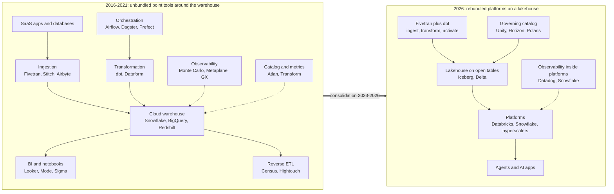
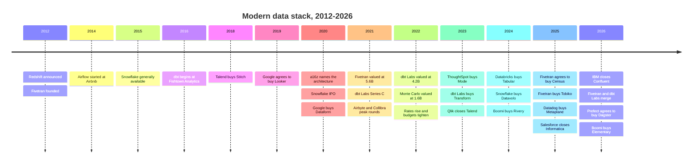

# 43. The Modern Data Stack: Rise, Unbundling and Rebundling
> **Depth:** L2 · **Reading time:** ~10 min · **Last verified:** 2026-11-01 · **Prerequisites:** [Ch 12 — Transformation and orchestration](../02-pipelines-and-governance/ch12-transformation-and-orchestration.md)

## TL;DR

- **The cloud warehouse created the modern data stack.** Redshift (announced November 2012), BigQuery and Snowflake (generally available June 2015) made compute elastic and cheap enough to load raw data first and transform it later.[^redshift-2012][^dremel20][^snowflake16] That one change, from ETL to [ELT](../glossary.md#elt), opened room for a dozen specialist "point tools" around the warehouse.
- **The label arrived at the top.** Andreessen Horowitz's "Emerging Architectures for Modern Data Infrastructure" (October 2020) gave the pattern a reference diagram.[^a16z] Fivetran raised at $5.6B (September 2021) and dbt Labs at $4.2B (February 2022), both company-stated.[^funding-csv] In our curated dataset, disclosed rounds in the six core [modern data stack](../glossary.md#modern-data-stack) categories fell from about $1.2B in 2021 to $50M in 2023.
- **The critique was about the buyer's bill, not the technology.** Practitioners led by Benn Stancil argued the "stack" had become a marketing category. Customers paid an [integration tax](../glossary.md#integration-tax): many contracts, many failure points and no owner for the end-to-end result.[^stancil]
- **2025–26 was the rebundling.** Fivetran agreed to buy Census, bought Tobiko and closed an all-stock merger with dbt Labs (combined ARR "approaching $600M", company-stated).[^merger-close] Datadog bought Metaplane, Snowflake bought Observe ($596.2M preliminary consideration per its 10-K), Prefect agreed to buy Dagster, and FICO and Boomi bought data-quality tools.[^dd-metaplane][^sf-observe][^prefect-dagster][^gx-2026][^elementary]
- **Value pooled at the platform and the metadata control point.** Survivors either became the platform (Snowflake, Databricks), became a consolidator (Fivetran), or own a control point such as the [data catalog](../glossary.md#data-catalog) or [semantic layer](../glossary.md#semantic-layer). The post-MDS stack is a [lakehouse](../glossary.md#lakehouse) on [open table formats](../glossary.md#open-table-format), a governing catalog, a few platforms and agents on top.

## Why this matters (business + Everpure lens)

The modern data stack (MDS) is the clearest recent case study in how a technology layer unbundles, attracts capital, and then rebundles. For a corporate-development reader it answers three practical questions. Which independent data-tooling companies are still targets? What did buyers pay when the music stopped? And which layer captures value when platforms absorb features?

The pattern repeats across this atlas. Ingestion ([Ch 10](../02-pipelines-and-governance/ch10-ingestion-and-integration.md)), transformation ([Ch 12](../02-pipelines-and-governance/ch12-transformation-and-orchestration.md)), observability ([Ch 13](../02-pipelines-and-governance/ch13-data-quality-observability-lineage.md)) and BI ([Ch 14](../02-pipelines-and-governance/ch14-semantic-layers-and-bi.md)) each went through the same cycle. The deal record sits in [Ch 39](../05-business-and-economics/ch39-ma-history.md) and the company detail in [Ch 30](../04-company-deep-dives/ch30-data-movement-streaming-companies.md).

**Everpure lens.** The MDS consolidation suggests that owners of the data platform capture most of the value. Standalone infrastructure layers drift toward commoditization unless they own a control point, usually metadata: what the data is, who may use it, and how it is defined. Everpure's 2026 purchase of 1touch for data discovery and classification is a move toward that metadata layer.[^everpure-1touch] One option a strategy team might evaluate, based on public information, is whether storage-resident metadata can become a control point that platforms integrate with rather than replace.

## How it works

### Act 1: the warehouse becomes the center of gravity (2012–2016)

Before 2012, analytic capacity was a fixed appliance (Teradata, Netezza, Exadata) sized for peak load. Transformations ran on separate ETL servers (Informatica, DataStage) because appliance CPU was too expensive to spend on cleaning data. Amazon priced Redshift at under $1,000 per terabyte per year at launch, against its own estimate of $19,000–25,000 for an in-house warehouse.[^redshift-2012] BigQuery, the public form of Google's Dremel, was serverless from the start.[^dremel20] Snowflake separated storage from compute so that several independent clusters could read one copy of the data.[^snowflake16]

Once compute was elastic and billed by use, it became cheaper to land raw data in the warehouse and transform it there in SQL. That inversion from ETL to ELT is the root of everything that followed. Each step that had lived inside one ETL suite could now be a separate SaaS product that read from or wrote to the warehouse.

### Act 2: the unbundling (2016–2021)

Founders took each step and built a best-of-breed product for it:

- **Ingestion:** Fivetran (founded 2012) and Stitch sold managed connectors priced by [monthly active rows](../glossary.md#monthly-active-rows). Airbyte (2020) was the open-source answer.[^ab-seriesb]
- **Transformation:** dbt, begun at Fishtown Analytics in 2016, turned SQL models into version-controlled code with tests and a dependency graph. It created the job title of [analytics engineering](../glossary.md#analytics-engineering).[^fishtown]
- **Orchestration:** Airflow (Airbnb, 2014) became the default [orchestrator](../glossary.md#orchestrator), followed by Dagster and Prefect.[^airflow-hist]
- **BI and notebooks:** Looker (with its LookML modeling layer), Mode, Sigma and later Hex.
- **Activation:** Census and Hightouch pioneered [reverse ETL](../glossary.md#reverse-etl), pushing modeled data back into Salesforce and ad platforms.
- **Trust and metadata:** Monte Carlo (founded 2019) framed [data observability](../glossary.md#data-observability). Atlan, Alation and Collibra sold catalogs, and Transform built a [metrics layer](../glossary.md#metrics-layer).[^mc-d][^atlan][^transform]

The a16z essay of October 2020 drew all of this as one reference architecture, and the name stuck.[^a16z] Snowflake's record IPO in September 2020 then showed investors what a winning data company could be worth.[^sf-ipo] In 2021–22, capital flowed into every box on the diagram.

*Figure 43.1 — The 2016 diagram had a box per job and a vendor per box. The 2026 diagram has a few platforms, with the catalog as the layer they fight over.*

### Act 3: the critique and the shakeout (2022–2024)

The case against the MDS was mainly about economics. Benn Stancil, co-founder of Mode, wrote and spoke widely about the stack drifting from a description of an architecture into a marketing category. He argued that it had multiplied tools without solving the underlying problem of getting trusted answers to business users.[^stancil] Buyers felt it as an integration tax. A mid-size data team might run six to ten vendors. Each had its own contract, pricing meter (rows, credits, seats, models) and failure modes, and nobody owned the end-to-end outcome. Warehouse consumption bills compounded the problem, because every point tool ran its queries on the customer's own warehouse.

When rates rose in 2022, CFOs started cutting. In our curated dataset, disclosed rounds across the six MDS categories fell from about $1.2B in 2021 to $480M in 2022 and $50M in 2023 (Figure 43.5). The exits that followed were small and often defensive. ThoughtSpot bought Mode for $200M in cash and stock (2023), dbt Labs bought Transform, Qlik completed its purchase of Talend (which already owned Stitch), and Datafold shut down its open-source data-diff project (2024).[^mode][^transform][^qlik-talend][^datafold] Many companies cut staff or quietly shut down in the same period, but our datasets do not record them systematically. `[VERIFY: named MDS-vendor layoffs and shutdowns, 2022–2024]`

No core MDS company in the dataset re-priced up from its 2021–22 mark before 2026. Fivetran's $5.6B and dbt Labs' $4.2B were never tested in a new priced round. Their merger was all-stock, so no price was published.[^merger-ann][^funding-csv]

### Act 4: the rebundling (2025–2026)

Rebundling ran in three directions at once:

1. **Independents merged into suites.** Fivetran agreed to buy Census for reverse ETL (announced May 2025; closing not separately confirmed) and bought Tobiko Data for SQLMesh (September 2025), then merged with dbt Labs (announced October 2025, closed 1 June 2026).[^census][^tobiko][^merger-close] Prefect agreed to buy Dagster in July 2026.[^prefect-dagster] Fivetran also took over stewardship of the Great Expectations open-source project when FICO bought GX Cloud.[^gx-2026]
2. **Platforms absorbed adjacent layers.** Snowflake bought Datavolo (integration, now Openflow), Crunchy Data (Postgres), Select Star (catalog) and Observe (observability).[^datavolo][^crunchy][^selectstar][^sf-observe] Databricks bought Tabular (Iceberg), Neon (Postgres) and Tecton's assets (features).[^tabular][^neon][^tecton] Snowflake also runs dbt projects natively, generally available since November 2025.[^dbt-sf]
3. **Adjacent giants bought their way down.** Salesforce closed Informatica (~$8B, November 2025). IBM closed Confluent (~$11B enterprise value, March 2026). Datadog bought Metaplane, and Boomi bought Rivery and then Elementary.[^infa-close][^ibm-close][^dd-metaplane][^rivery][^elementary]

*Figure 43.2 — About 13 years passed between the warehouse inflection (2012) and the merger wave (2025–26). The funding peak (2021) came about two-thirds of the way through, after almost a decade of unbundling.*

### Why the rebundling happened

There are five reasons, in rough order of weight:

- **Platforms shipped "good enough" features.** Snowflake Dynamic Tables, Databricks Lakeflow, Snowflake data metric functions and native lineage covered the most common 70–80% of what point tools sold. That is our estimate, not a measured figure. For most buyers, a bundled feature at no extra contract beat a better product at an extra contract.
- **Budgets consolidated.** CFOs asked data leaders to cut vendors. Tools priced on top of warehouse consumption were the easiest to cut.
- **AI needs integrated context.** An agent answering "what was net revenue in EMEA?" needs lineage, definitions, quality signals and access policy in one place ([Ch 22](../03-ai-data-stack/ch22-agents-and-data.md)). Six vendors' metadata is harder to serve to an agent than one catalog's.
- **Buyers want fewer vendors.** Security review, procurement and support costs scale with vendor count, not with data volume.
- **Open table formats moved the center of gravity.** Once data sat in Apache Iceberg or Delta tables on object storage, the warehouse stopped being the anchor. The [control plane](../glossary.md#control-plane) moved to the catalog that governs those tables. Databricks open-sourced Unity Catalog and Snowflake open-sourced Polaris in mid-2024.[^uc-oss][^polaris-nessie] See [Ch 7](../01-data-systems-foundations/ch07-open-table-formats.md) and [Ch 8](../01-data-systems-foundations/ch08-catalogs-and-metastores.md).

> **Bridge: fabless, foundry and re-integration.** The MDS story echoes semiconductors. In the 1990s and 2000s the chip industry split into fabless design houses and pure-play foundries, because specialization lowered the capital each firm needed, much as the cloud warehouse let each MDS vendor skip building a database. The split also created an interface tax: design rules, IP blocks and packaging were coordinated across companies. Chiplets and Intel's IDM 2.0 strategy are partial re-integrations, aimed at controlling the expensive interfaces again. The open table format plays the role of the chiplet interconnect standard. It lets platforms re-integrate around a shared interface without locking the data into one vendor's die.

> **Bridge: EDA tuck-ins.** Point tools in the MDS behaved like niche electronic design automation (EDA) startups. A timing, verification or power-analysis specialist would win one step of the flow, and then Synopsys or Cadence bought it and folded it into the suite. The startup's real exit market was the two suites, not the end customer. Metaplane (Datadog), Select Star (Snowflake), Elementary (Boomi) and Tobiko (Fivetran) followed that playbook.[^dd-metaplane][^selectstar][^elementary][^tobiko]

## Design choices and trade-offs

| Choice | Best-of-breed point tools (2019 default) | Platform bundle (2026 default) | When the other side wins |
|---|---|---|---|
| Feature depth | Deepest in one step (e.g., connector breadth, test frameworks) | Covers the common 70–80% (our estimate) | Point tool wins for regulated or high-scale edge cases |
| Commercial | Many contracts, many meters | One contract, one consumption meter | Point tool wins when it is cheaper than platform compute |
| Portability | Works across warehouses | Tied to one platform | Point tool wins in multi-platform estates |
| Metadata for AI | Fragmented across vendors | Unified in the platform catalog | Independent catalog wins if it federates several platforms |
| Innovation speed | Fast, focused roadmap | Slower, but bundled at release | Point tool wins in new categories, as observability did in 2019–2021 |
| Vendor risk | Startup may be acquired or shut down | Platform lock-in and pricing power | Depends on board-level appetite for lock-in |

*Figure 43.3 — The bundle wins on commercial terms and on AI context. Point tools win only on depth, portability and timing.*

The strongest steelman for independence is **neutrality across platforms**. Large enterprises run Databricks and Snowflake, plus a hyperscaler or two ([Ch 27](../04-company-deep-dives/ch27-databricks-vs-snowflake.md)). A vendor that works the same way on all of them has a defensible role. That is the merged Fivetran–dbt pitch and Atlan's pitch. It is also why the Open Semantic Interchange effort exists ([Ch 14](../02-pipelines-and-governance/ch14-semantic-layers-and-bi.md)).

## Who's who

The survivor table below covers the main MDS companies, and the chart shows the funding cycle behind them.

| Company | Category | Status (Nov 2026) | Acquirer, date and value (basis) | Why it survived or not |
|---|---|---|---|---|
| Fivetran | Ingestion (ELT) | Independent; consolidator | Bought Tobiko and dbt Labs; agreed to buy Census; last mark $5.6B (company-stated, 2021)[^funding-csv] | Broadest managed connector library; MAR pricing; became the suite |
| dbt Labs | Transformation | Merged into Fivetran | Closed 2026-06-01; all-stock, undisclosed[^merger-close] | Open-source standard, but >$100M ARR (Feb 2025) could not support a $4.2B mark alone[^dbt-100m] |
| Stitch | Ingestion | Acquired (twice) | Talend, 2018, $60M (disclosed); Qlik bought Talend 2023[^stitch][^qlik-talend] | Early exit before the boom; became a feature of a suite |
| Looker | BI, semantic modeling | Acquired | Google, announced 2019-06-06, closed Feb 2020, $2.6B (disclosed)[^looker-acq] | LookML semantic layer was worth more inside a cloud |
| Dataform | Transformation | Acquired | Google, 2020-12, undisclosed[^dataform] | Became BigQuery's free built-in dbt alternative |
| Mode | BI and notebooks | Acquired | ThoughtSpot, 2023-06, $200M cash and stock (disclosed)[^mode] | Squeezed between BI suites and notebooks |
| Transform | Metrics layer | Acquired | dbt Labs, 2023-02, undisclosed[^transform] | A metrics layer was a feature, not a company |
| Census | Reverse ETL | Acquired (agreed; close not separately confirmed) | Fivetran, announced 2025-05-01, undisclosed[^census] | Activation is the last step of a pipeline |
| Hightouch | Reverse ETL, activation | Independent | $2.75B valuation (press-reported, April 2026)[^hightouch] | Moved into the marketing budget (AI marketing) |
| Monte Carlo | Data observability | Independent | Last mark $1.6B (company-stated, May 2022)[^mc-d] | Category creator; pushing into agent observability |
| Metaplane | Data observability | Acquired | Datadog, 2025-04-23, undisclosed[^dd-metaplane] | Fit inside an observability platform |
| GX Cloud (Great Expectations) | Data quality | Acquired; open source moved | FICO, May 2026, undisclosed; GX Core to Fivetran[^gx-2026] | Open-source quality checks became table stakes |
| Elementary | dbt-native observability | Acquired | Boomi, 2026-10-19, ~$42.5M (press-reported)[^elementary] | Small exit; a feature for an integration suite |
| Datafold data-diff | Data diffing (open source) | Shut (OSS sunset) | Project sunset 2024-05-17; company continues[^datafold] | Open-source upkeep without revenue |
| Atlan | Catalog, active metadata | Independent | $750M (company-stated, May 2024)[^atlan] | Owns a cross-platform metadata control point |
| Select Star | Catalog | Acquired | Snowflake, 2025-11, undisclosed[^selectstar] | Bought to strengthen Horizon |
| Astronomer | Orchestration (Airflow) | Independent | ~$775M (press-reported, May 2025)[^astro-d] | Commercial steward of the default orchestrator |
| Dagster Labs | Orchestration | Acquired (agreed) | Prefect, announced 2026-07-13, undisclosed[^prefect-dagster] | Two subscale orchestrators combined |
| Tobiko Data (SQLMesh) | Transformation | Acquired | Fivetran, 2025-09-03, undisclosed[^tobiko] | dbt's challenger became part of dbt's owner |
| Airbyte | Ingestion (open core) | Independent | Last mark $1.5B (company-stated, Dec 2021)[^ab-seriesb] | Open-source long tail; unpriced since the peak |
| Informatica | Legacy integration, catalog | Acquired | Salesforce, closed 2025-11-18, ~$8B (disclosed)[^infa-close] | Catalog and master data are worth more to an app vendor |
| Sigma Computing | Cloud BI | Independent | $3B (press-reported, May 2026)[^sigma-e] | Spreadsheet interface on live warehouse data; repriced up |

*Figure 43.4 — Of 22 names, 7 remain independent. Most exits were undisclosed tuck-ins, so the 2021 marks were never tested.*

*Figure 43.5 — In the curated dataset, MDS funding collapsed after 2021, and most headline valuations date from 2021–22. Activation and BI rounds drove the 2026 recovery. The dataset is curated, not a census, and is thin before 2021.*

## History and trajectory

The arc runs in four acts. **2012–2016:** the elastic cloud warehouse made ELT economic.[^redshift-2012][^snowflake16] **2016–2021:** founders unbundled the old ETL suite into point tools, and a16z named the result.[^a16z] **2022–2024:** higher interest rates, vendor fatigue and the integration-tax critique dried up funding and forced small exits.[^stancil][^mode] **2025–2026:** independents merged and platforms absorbed the rest.[^merger-close][^sf-observe]

What comes next is the **post-MDS stack**. It has four parts:

- **Storage:** open tables (Iceberg, Delta) on object storage, governed by a catalog (Unity, Horizon, Polaris).
- **Platforms:** two or three compute platforms, typically Databricks, Snowflake and a hyperscaler, which bundle ingestion, transformation, quality and BI.
- **Neutral layers:** a thin set of independents that are useful because they work across platforms (Fivetran–dbt, Atlan, Hightouch).
- **Agents:** they consume governed metadata through semantic layers and catalog APIs.

The open question is whether the catalog itself rebundles into the platforms or stays a neutral layer ([Ch 44](ch44-future-trends.md)). For the database lineage behind this story, see [Ch 42](ch42-history-of-databases.md).

> **Storage bridge.** The rebundling moved data out of warehouse-proprietary storage and into open tables on object storage. That makes the object-storage tier, and the metadata attached to it, more central to the stack than it was in 2016. See the companion *Everpure Tech Atlas* for object-storage and protocol detail.

## Numbers that matter

| Metric | Value | Basis | Source / date |
|---|---|---|---|
| Redshift launch price vs in-house warehouse | <$1,000 vs $19,000–25,000 per TB per year | Company claim (AWS estimate) | Computerworld, 2012-11-28[^redshift-2012] |
| Fivetran peak valuation | $5.6B ($565M Series D) | Company-stated | Sept 2021[^funding-csv] |
| dbt Labs peak valuation | $4.2B ($222M Series D) | Company-stated | Feb 2022[^funding-csv] |
| MDS-category disclosed funding, 2021 vs 2023 | ~$1.19B vs $50M | Curated dataset (author sum) | `data/private_funding.csv`, retrieved 2026-11-01[^funding-csv] |
| Fivetran ARR | >$300M | Company-stated | 2024-09-27[^ft-300m] |
| dbt Labs ARR | >$100M | Company-stated | 2025-02-05[^dbt-100m] |
| Fivetran + dbt Labs combined ARR | "Approaching $600M" | Company-stated, at close | 2026-06-01[^merger-close] |
| Implied Fivetran-side ARR at merger | ~$450–500M | Estimate (author arithmetic, from the two rows above) | 2026-11-01 |
| Salesforce–Informatica | ~$8B equity value | Disclosed | Closed 2025-11-18[^infa-close] |
| IBM–Confluent | ~$11B enterprise value | Disclosed | Closed 2026-03-17[^ibm-close] |
| Snowflake–Observe | $596.2M preliminary consideration (vs ~$1B press-reported) | GAAP purchase accounting (10-K) | FY2026 10-K[^sf-observe] |
| Snowflake total revenue | $4,683.9M | GAAP, FY2026 (Feb 2025–Jan 2026) | Snowflake 10-K[^sf-10k26] |
| Databricks revenue run-rate | >$7B | Company-stated run-rate | 2026-08-13[^dbx-rr] |
| Databricks post-money valuation | $190B | Company-stated | 2026-08-13[^funding-csv] |

*Figure 43.6 — The platforms are now roughly an order of magnitude larger than the largest merged point-tool vendor: Snowflake's FY2026 GAAP revenue is about 8x, and Databricks' company-stated run-rate about 12x, the merged Fivetran–dbt's "approaching $600M" ARR (author arithmetic across different bases). That gap in scale is the rebundling in one line.*

## Conversation playbook

**Questions for PMs and strategy leads**

1. Which of your features would a customer lose if Databricks or Snowflake shipped a "good enough" version next quarter, and what keeps them paying you anyway?
2. How much of your revenue runs on top of a platform's consumption meter, and how do you handle customer pressure to cut that platform bill?
3. Is your control point portable across platforms, and what share of customers run two or more platforms?

**Questions for engineers**

1. Where does your product read and write metadata: your own store, the platform catalog, or an open standard (Iceberg REST, OpenLineage, Open Semantic Interchange)?
2. What breaks for a customer if the platform changes its API or bundles a competing feature?
3. How does an AI agent get your lineage, quality and definition signals today?

**What good answers sound like.** Specific numbers on multi-platform customers. A clear account of which metadata the vendor is the source of truth for. Integration through open interfaces rather than private APIs. An honest view of which features will be commoditized.

**Don't say this**

- "The modern data stack is dead." The tools still run in production. What ended is the venture model of one company per box.
- "dbt Labs was worth $4.2B." That was a 2022 private mark, never re-tested; the merger was all-stock with no price.
- "Platforms will bundle everything." Cross-platform neutrality and the catalog remain contested. Independents with control points (Atlan, Fivetran–dbt) still exist.
- "Reverse ETL failed." It is becoming a suite feature (Census, which Fivetran agreed to buy; closing not separately confirmed) and, at Hightouch, a marketing product.

## Going deeper

> **Going deeper (L3).** Read the a16z essay and its 2022 update side by side to see how the reference diagram grew.[^a16z] The Snowflake SIGMOD 2016 paper explains why separating storage from compute made ELT economic.[^snowflake16] For the rebundling mechanics, compare dbt's Fusion engine and SQLMesh's virtual environments in [Ch 12](../02-pipelines-and-governance/ch12-transformation-and-orchestration.md), and the catalog wars in [Ch 8](../01-data-systems-foundations/ch08-catalogs-and-metastores.md).

## Key terms

- [Modern data stack](../glossary.md#modern-data-stack) — the 2016–2022 pattern of cloud warehouse plus specialist SaaS tools for each pipeline step.
- [ELT](../glossary.md#elt) — extract, load, then transform inside the warehouse or lakehouse.
- [Point tool](../glossary.md#point-tool) — a product that does one step of a workflow and depends on others for the rest.
- [Integration tax](../glossary.md#integration-tax) — the cost of stitching many vendors together: contracts, failures, duplicated metadata.
- [Unbundling](../glossary.md#unbundling) — splitting a suite's functions into separately sold products.
- [Rebundling](../glossary.md#rebundling) — recombining those products into suites or platforms by merger, acquisition or native features.
- [Reverse ETL](../glossary.md#reverse-etl) — syncing modeled warehouse data back into operational apps.
- [Data observability](../glossary.md#data-observability) — monitoring freshness, volume, schema and lineage to catch bad data.
- [Metrics layer](../glossary.md#metrics-layer) — a governed set of business metric definitions shared by tools.
- [Data catalog](../glossary.md#data-catalog) — the inventory and governance layer for data assets.
- [Analytics engineering](../glossary.md#analytics-engineering) — software practices applied to SQL transformation.
- [Lakehouse](../glossary.md#lakehouse) — warehouse features on open files in object storage.
- [Open table format](../glossary.md#open-table-format) — a metadata spec (Iceberg, Delta) that makes object-store files behave like tables.
- [Control plane](../glossary.md#control-plane) — the layer that decides policy and placement, as opposed to moving the data.
- [Monthly active rows](../glossary.md#monthly-active-rows) — Fivetran's pricing unit.
- [Orchestrator](../glossary.md#orchestrator) — software that schedules and sequences pipeline tasks.

## Sources

[^redshift-2012]: Computerworld, "Amazon introduces data warehouse service" (Redshift launch; reserved pricing under $1,000/TB/year; AWS estimate of $19,000–25,000/TB/year in-house), https://www.computerworld.com/article/1401411/amazon-introduces-data-warehouse-service.html, published 2012-11-28; retrieved 2026-11-01. Company claim cited by press.
[^dremel20]: S. Melnik et al., "Dremel: A Decade of Interactive SQL Analysis at Web Scale," PVLDB 13(12): 3461–3472, https://www.vldb.org/pvldb/vol13/p3461-melnik.pdf, published 2020; retrieved 2026-11-01.
[^snowflake16]: B. Dageville et al., "The Snowflake Elastic Data Warehouse," SIGMOD 2016, https://www.snowflake.com/resource/sigmod-2016-paper-snowflake-elastic-data-warehouse/, published 2016-06; retrieved 2026-11-01. GA in June 2015 per the paper and Ch 5.
[^a16z]: Matt Bornstein, Jennifer Li, Martin Casado, "Emerging Architectures for Modern Data Infrastructure," Andreessen Horowitz, https://a16z.com/2020/10/15/emerging-architectures-for-modern-data-infrastructure/, published 2020-10-15; updated edition https://a16z.com/emerging-architectures-for-modern-data-infrastructure/, 2022 [VERIFY: exact date of updated edition]; retrieved 2026-11-01.
[^stancil]: dbt Labs, *The Analytics Engineering Podcast*, "Ep 56: The end of the modern data stack (w/ Benn Stancil, Mode)," https://roundup.getdbt.com/p/ep-56-the-end-of-the-modern-data, n.d.; and "Ep 23: The Bundling vs Unbundling Debate," https://roundup.getdbt.com/p/ep-26-the-bundling-vs-unbundling, n.d.; Stancil's essays at https://benn.substack.com (including one the podcast cites as "The problem was the product: How the modern data stack got lost") [VERIFY: essay URL and publication dates]; retrieved 2026-11-01. Characterization in our words.
[^funding-csv]: AI Data Atlas dataset `data/private_funding.csv` (Fivetran Series D 2021-09-20, $565M at $5.6B, company-stated, via Sacra https://sacra.com/c/fivetran/; dbt Labs Series D 2022-02-24, $222M at $4.2B, company-stated, via Sacra https://sacra.com/c/dbt/; Databricks strategic round 2026-08-13, $190B, company-stated; category sums by author) including the dbt Labs Series C row (June 2021) added via ch43 staging; retrieved 2026-11-01.
[^ab-seriesb]: Airbyte via Business Wire, "Airbyte Closes $150 Million Series B Funding Round Led by Altimeter Capital and Coatue Management," https://www.businesswire.com/news/home/20211217005648/en/, published 2021-12-17; retrieved 2026-11-01. $1.5B valuation company-stated.
[^fishtown]: Newswire, "Fishtown Analytics Rebrands as dbt Labs; Closes $150M to Develop Open-Source Analytics Engineering Software," https://www.newswire.com/view/content/fishtown-analytics-rebrands-as-dbt-labs-closes-150m-to-develop-open-21427433, published 2021-06; Technical.ly, "dbt Labs Series C," https://technical.ly/philly/2021/06/30/dbt-labs-series-c/, published 2021-06-30; retrieved 2026-11-01.
[^airflow-hist]: Apache Airflow, "Project" (history section), https://airflow.apache.org/docs/apache-airflow/1.10.4/project.html, n.d. (docs v1.10.4, 2019); retrieved 2026-11-01.
[^mc-d]: Monte Carlo via Business Wire, "Monte Carlo Raises $135M Series D to Accelerate the Rapid Growth of the Data Observability Category," https://www.businesswire.com/news/home/20220524005417/en/, published 2022-05-24; retrieved 2026-11-01. $1.6B company-stated.
[^atlan]: Datanami, "Atlan plants itself in the middle of the data governance map with $105M round," https://www.datanami.com/2024/05/09/atlan-plants-itself-in-the-middle-of-the-data-governance-map-with-105m-round, published 2024-05-09; retrieved 2026-11-01. $750M valuation per `data/private_funding.csv` (company-stated).
[^transform]: Technical.ly, "dbt Labs acquiring Transform," https://technical.ly/startups/dbt-labs-acquiring-transform/, published 2023-02-08; retrieved 2026-11-01. Terms undisclosed.
[^sf-ipo]: Snowflake Inc., Prospectus (Form 424B4) and Form S-1, SEC EDGAR filing index, https://www.sec.gov/cgi-bin/browse-edgar?action=getcompany&CIK=0001640147&type=424B4, published 2020-09-16; retrieved 2026-11-01. "Record software IPO" characterization per Ch 26.
[^mode]: TechCrunch, "ThoughtSpot acquires Mode Analytics, a BI platform, for $200M in cash and stock," https://techcrunch.com/2023/06/26/thoughtspot-acquires-mode-analytics-a-bi-platform-for-200m-in-cash-and-stock, published 2023-06-26; retrieved 2026-11-01.
[^qlik-talend]: Qlik, "Qlik Acquires Talend," press release, https://www.qlik.com/us/news/company/press-room/press-releases/qlik-acquires-talend, published 2023-05-16; retrieved 2026-11-01. Terms undisclosed.
[^datafold]: Datafold, "Sunsetting open-source data-diff," https://www.datafold.com/blog/sunsetting-open-source-data-diff, published 2024-05-17; retrieved 2026-11-01.
[^merger-ann]: dbt Labs blog, "dbt Labs and Fivetran merge announcement," https://www.getdbt.com/blog/dbt-labs-and-fivetran-merge-announcement, published 2025-10-13; Reuters via TradingView, "a16z-backed data firms Fivetran, dbt Labs to merge in all-stock deal," https://de.tradingview.com/news/reuters.com%2C2025%3Anewsml_L6N3VU00K%3A0-a16z-backed-data-firms-fivetran-dbt-labs-to-merge-in-all-stock-deal, published 2025-10-13; retrieved 2026-11-01.
[^merger-close]: Fivetran press release, "Fivetran & dbt Labs Complete Merger to Create the Data Infrastructure for Trusted AI Agents," https://www.fivetran.com/press/fivetran-dbt-labs-complete-merger-to-create-the-data-infrastructure-for-trusted-ai-agents, published 2026-06-01; retrieved 2026-11-01. Combined ARR company-stated.
[^census]: Business Wire, "Fivetran Signs Agreement to Acquire Census," https://www.businesswire.com/news/home/20250501266140/en, published 2025-05-01; retrieved 2026-11-01. Closing not separately confirmed [VERIFY].
[^tobiko]: Fivetran press release, "Fivetran Acquires Tobiko Data to Power the Next Generation of Advanced, AI-Ready Data Transformation," https://www.fivetran.com/press/fivetran-acquires-tobiko-data-to-power-the-next-generation-of-advanced-ai-ready-data-transformation, published 2025-09-03; retrieved 2026-11-01.
[^prefect-dagster]: Dagster blog, "Prefect is acquiring Dagster," https://dagster.io/blog/prefect-is-acquiring-dagster, published 2026-07-13; retrieved 2026-11-01. Terms undisclosed; closing date [VERIFY].
[^gx-2026]: Great Expectations, "An update from Great Expectations," https://www.greatexpectations.io/blog/an-update-from-great-expectations, published 2026-05-06; Fivetran, "Fivetran to Become Steward of the Great Expectations Open Source Community and GX Core Project," https://www.fivetran.com/press/fivetran-to-become-steward-of-the-great-expectations-open-source-community-and-gx-core-project, published 2026-05-13; retrieved 2026-11-01.
[^datavolo]: Snowflake, "Snowflake Agrees to Acquire Open Data Integration Platform, Datavolo," press release, https://www.snowflake.com/news/snowflake-agrees-to-acquire-open-data-integration-platform-datavolo/, published 2024-11-20; retrieved 2026-11-01.
[^crunchy]: Snowflake Inc., Form 10-Q for the quarter ended 2025-10-31 (Crunchy Data, $164.5M cash, closed 2025-06-06), SEC EDGAR, https://www.sec.gov/Archives/edgar/data/1640147/000164014725000211/snow-20251031.htm, published 2025-12; retrieved 2026-11-01.
[^selectstar]: Snowflake blog, "Snowflake to Acquire Select Star," https://www.snowflake.com/en/blog/snowflake-acquire-select-star/, published 2025-11-24; retrieved 2026-11-01. Terms undisclosed.
[^sf-observe]: Snowflake via Business Wire, "Snowflake Announces Intent to Acquire Observe to Deliver AI Powered Observability at Enterprise Scale," https://www.businesswire.com/news/home/20260108681865/en/, published 2026-01-08; Snowflake Form 10-K FY2026 ($596.2M preliminary consideration), https://www.sec.gov/Archives/edgar/data/1640147/000164014726000008/snow-20260131.htm; retrieved 2026-11-01.
[^tabular]: TechCrunch, "Databricks reportedly paid $2 billion in Tabular acquisition," https://techcrunch.com/2024/08/14/databricks-reportedly-paid-2-billion-in-tabular-acquisition, published 2024-08-14; retrieved 2026-11-01. Press-reported.
[^neon]: TechRepublic, "Databricks to Acquire Neon in $1 Billion Deal," https://www.techrepublic.com/article/news-databricks-neon-acquisition/, published 2025-05-15; retrieved 2026-11-01. Press-reported value.
[^tecton]: Fenwick, "Fenwick Represents Databricks in Acquisition of the Assets of Tecton," https://www.fenwick.com/insights/experience/fenwick-represents-databricks-in-acquisition-of-the-assets-of-tecton, published 2025-08; retrieved 2026-11-01.
[^dbt-sf]: Snowflake release notes, "Nov 06, 2025: dbt Projects on Snowflake (General availability)," https://docs.snowflake.com/en/release-notes/2025/other/2025-11-06-dbt-projects-on-snowflake-ga, published 2025-11-06; retrieved 2026-11-01.
[^infa-close]: Salesforce via Business Wire (FinancialContent), "Salesforce Completes Acquisition of Informatica," https://markets.financialcontent.com/clarkebroadcasting.mymotherlode/article/bizwire-2025-11-18-salesforce-completes-acquisition-of-informatica, published 2025-11-18; retrieved 2026-11-01. ~$8B equity value at $25/share per `data/ma_deals.csv`.
[^ibm-close]: IBM, "IBM Completes Acquisition of Confluent," via Stock Titan, https://www.stocktitan.net/news/IBM/ibm-completes-acquisition-of-confluent-making-real-time-data-the-lbuwdbharsqe.html, published 2026-03-17; retrieved 2026-11-01. ~$11B enterprise value per `data/ma_deals.csv`.
[^dd-metaplane]: Datadog, "Datadog Brings Observability to Data Teams by Acquiring Metaplane," https://investors.datadoghq.com/news-releases/news-release-details/datadog-brings-observability-data-teams-acquiring-metaplane, published 2025-04-23; retrieved 2026-11-01. Terms undisclosed.
[^rivery]: Boomi via Business Wire, "Boomi Boosts Data Management Capabilities with Acquisition of Modern Data Integration Provider Rivery," https://www.businesswire.com/news/home/20241212909154/en, published 2024-12-12; retrieved 2026-11-01. ~$100M press-reported by Calcalist.
[^elementary]: iTWire/Business Wire, "Boomi acquires Elementary Data to bring trusted, governed data to the AI era," https://itwire.com/it-industry-news/deals/boomi-acquires-elementary-data-to-bring-trusted-governed-data-to-the-ai-era, published 2026-10-19; retrieved 2026-11-01. ~$42.5M press-reported (Calcalist) per `data/ma_deals.csv`.
[^uc-oss]: Databricks press release, "Databricks Open Sources Unity Catalog, Creating the Industry's Only Universal Catalog for Data and AI," https://www.databricks.com/company/newsroom/press-releases/databricks-open-sources-unity-catalog-creating-industrys-only-open, published 2024-06-12; retrieved 2026-11-01.
[^polaris-nessie]: FOSS Force, "Snowflake open sources Apache Iceberg-related Polaris data catalog," https://fossforce.com/2024/07/snowflake-open-sources-apache-iceberg-related-polaris-data-catalog/, published 2024-07; retrieved 2026-11-01.
[^stitch]: BigDATAwire, "Talend acquires Stitch" (US$60M), https://bigdatawire.com/2018/11/07/21615, published 2018-11-07; retrieved 2026-11-01 (per `data/ma_deals.csv`).
[^looker-acq]: Alphabet Investor Relations, "Google to Acquire Looker," https://abc.xyz/investor/news/news-details/2019/Google-to-Acquire-Looker-06-06-2019/default.aspx, published 2019-06-06; TechCrunch, "Google closes $2.6B Looker acquisition," https://techcrunch.com/2020/02/13/google-closes-2-6b-looker-acquisition/, published 2020-02-13; retrieved 2026-11-01.
[^dataform]: Google Cloud blog, "Welcoming Dataform to BigQuery," https://cloud.google.com/blog/products/data-analytics/welcoming-dataform-to-bigquery, published 2020-12-08; retrieved 2026-11-01.
[^hightouch]: Pulse 2.0, "Hightouch: $150 Million Series D at $2.75 Billion Valuation…," https://pulse2.com/hightouch-150-million-series-d-at-2-75-billion-valuation-raised-to-power-agentic-marketing-platform/amp/, published 2026-04-29; Adweek, https://www.adweek.com/dealroom/hightouch-raised-322-million-across-six-rounds-heres-how-the-company-skyrocketed-to-a-275-billion-valuation/, published 2026-04; retrieved 2026-11-01. Press-reported.
[^astro-d]: Contrary Research, "Astronomer," https://research.contrary.com/company/astronomer, 2025 (as recorded in `data/private_funding.csv`); retrieved 2026-11-01. Press-reported.
[^sigma-e]: Sigma, "Series E announcement," https://sigmacomputing.com/resources/announcements/series-e, published 2026-05-18; SiliconANGLE, https://siliconangle.com/2026/05/18/sigma-computing-seals-80m-funding-round-pivots-toward-agentic-analytics/, published 2026-05-18; retrieved 2026-11-01. Valuation press-reported.
[^dbt-100m]: dbt Labs blog, "dbt Labs surpasses $100M ARR," https://getdbt.com/blog/dbt-labs-100m-arr-milestone, published 2025-02-05; retrieved 2026-11-01. Company-stated.
[^ft-300m]: Fivetran, "Fivetran Surpasses $300M ARR, Driven by Growing AI and Data Movement Demand," press release, https://www.fivetran.com/press/fivetran-surpasses-300m-arr-driven-by-growing-ai-and-data-movement-demand, published 2024-09-27; retrieved 2026-11-01. Company-stated.
[^sf-10k26]: Snowflake Inc., Form 10-K for the fiscal year ended January 31, 2026, https://www.sec.gov/Archives/edgar/data/1640147/000164014726000008/snow-20260131.htm, published 2026-03; retrieved 2026-11-01 (total revenue via `data/company_financials.csv`).
[^dbx-rr]: Databricks, "Databricks Grows >80% YoY, Surpasses $7B Revenue Run-Rate…," press release, https://www.databricks.com/company/newsroom/press-releases/databricks-grows-80-yoy-surpasses-7b-revenue-run-rate-scales, published 2026-08-13; retrieved 2026-11-01. Company-stated run-rate.
[^everpure-1touch]: World Wide Technology (reposting Pure Storage release), "Pure Storage rebrands to Everpure and announces intent to acquire 1touch," https://www.wwt.com/news/pure-storage-rebrands-to-everpure-and-announces-intent-to-acquire-1touch, published 2026-02-23; retrieved 2026-11-01. $125.0M cash consideration per Everpure 10-Q (via `data/ma_deals.csv`).
