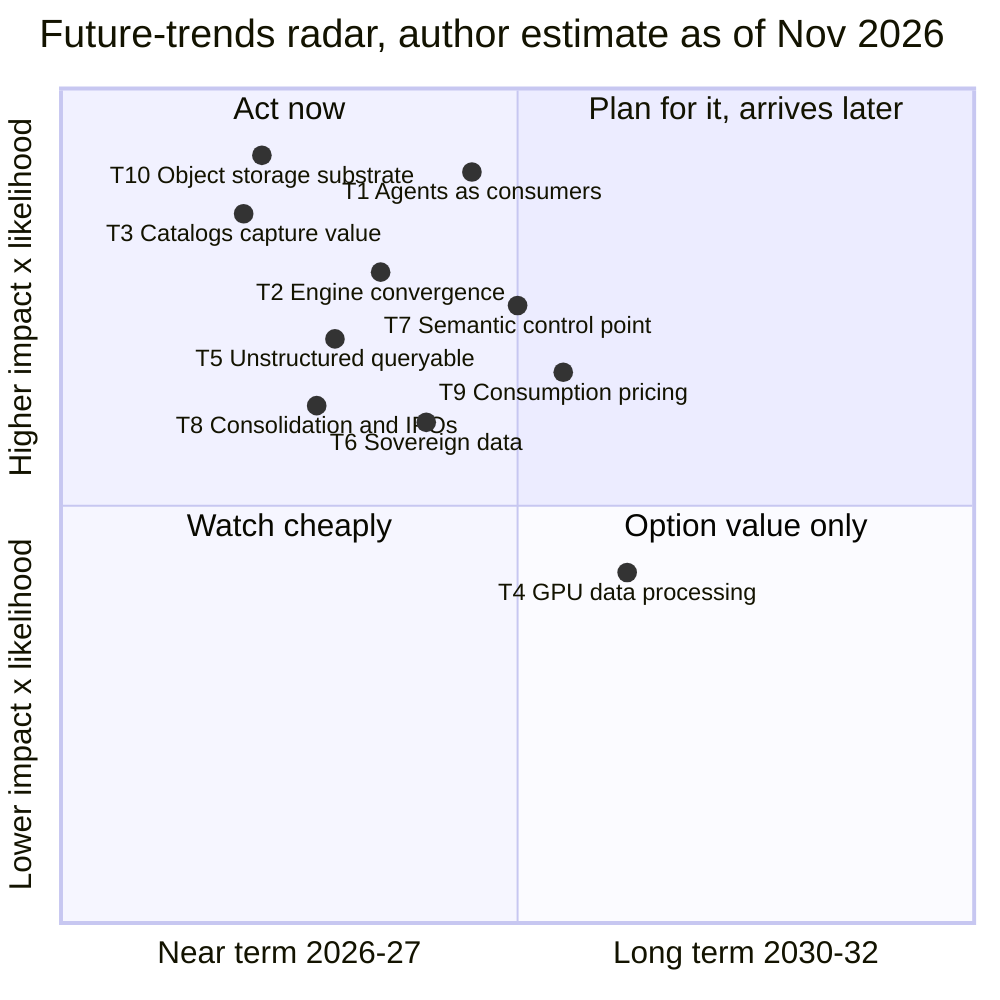
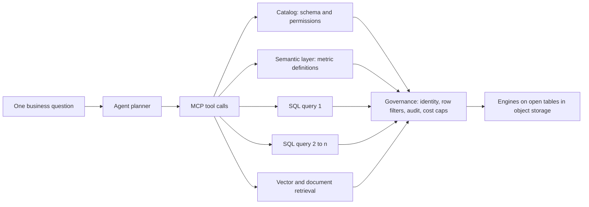
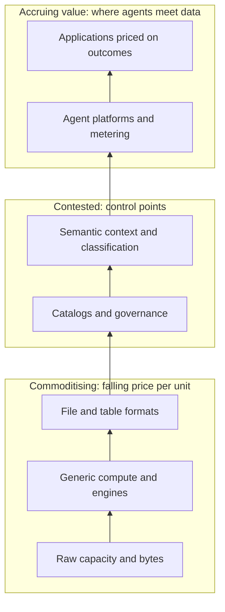
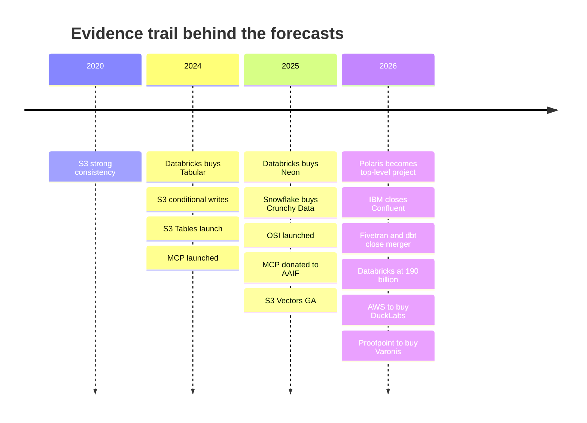

# 44. Future Trends, 2026–2032
> **Depth:** L2 · **Reading time:** ~18 min · **Last verified:** 2026-11-01 · **Prerequisites:** [Ch 42 — History of databases](ch42-history-of-databases.md), [Ch 43 — The modern data stack](ch43-modern-data-stack.md)

## TL;DR

- **The thesis of this chapter: value is moving up.** Storage bytes and generic compute are becoming cheaper and more interchangeable. Value is moving toward the layers that decide what data *means* and who may use it: catalogs, semantic context, governance and the agents that consume data. Every forecast below is the author's judgment (an **estimate**). Each one is anchored to evidence already sourced in Parts 1–4 and comes with a falsifier.
- **High-likelihood, near-term calls:** agents become the fastest-growing consumers of enterprise data. OLTP, OLAP, vector and search keep converging on Postgres-plus-lakehouse platforms. Iceberg becomes the default storage contract while catalogs capture the rents. Object storage becomes the substrate under almost every engine. Vendors add consumption meters next to seats.
- **Medium-likelihood calls:** GPU-accelerated SQL and ETL become mainstream only for a minority of large jobs. Sovereignty grows, but much of that demand goes to hyperscaler "sovereign clouds" rather than to on-prem.
- **Calls against the consensus:** standalone vector databases will not become a large independent category, and SQL will not disappear. Agents are already the biggest new *writers* of SQL.
- **For Everpure:** the trends with the best odds (object storage as substrate, governed agent access, semantic context at the data layer) line up with the company's public moves: Data Intelligence (1touch), Data Stream and the Databricks OpenSharing connector. The detailed options analysis is in [Ch 45](ch45-storage-moving-up-the-stack.md).

## Why this matters (business + Everpure lens)

A corporate-development team underwrites the future, not the present. An acquisition closed in 2027 pays back over 2028–2032. A partnership signed today depends on which platforms will still matter then. This chapter turns the mechanisms explained in Parts 1–4 into ten forecasts. Each has a likelihood, a timing window, winners, losers, signposts and a falsifier. Together they form a scorecard the reader can update quarterly instead of a story to believe.

For a storage company moving up the stack, the stakes are concrete. In five years the infrastructure layer has gained database features: conditional writes, managed tables and native vectors in the object store itself ([Ch 24](../03-ai-data-stack/ch24-data-meets-compute-and-storage.md)). Meanwhile the platforms above it have started reaching down to govern on-prem data in place.[^storage-eco] The useful question is not whether storage matters. It is which software layers a storage vendor can credibly own, which it should partner for, and which it should leave alone. Each trend below ends with a one-line Everpure implication, written as options a strategy team might evaluate, based on public information.

**How to read the forecasts.** *Likelihood* is the author's subjective probability that the thesis holds by the end of its timing window: High (≥70%), Medium (40–70%), Low (<40%). *Timing* is when the thesis becomes observable in public data: near (2026–27), mid (2028–29) or long (2030–32). All likelihoods and timings are estimates.

## How it works

### The radar: ten trends on one page

*Figure 44.1 — SV-17, the future-trends radar. The x-axis is when the trend becomes visible in public data (left = 2026–27, right = 2030–32). The y-axis is impact on data-industry economics multiplied by likelihood. The top-left quadrant is where a strategy team should already be acting. All placements are the author's estimates.*

The radar is deliberately crude. It ranks trends by the product of "how much it changes the economics" and "how likely it is", and spreads them by when the evidence becomes decisive. Two trends sit at the top left because the evidence is already strong: object storage as the substrate (T10) and catalogs as the control point (T3). GPU data processing (T4) sits lowest because its impact depends on one unresolved bottleneck, which is I/O.

### Trend 1 — Agents become the primary data consumer

**Thesis.** By 2029, AI agents issue most queries and tool calls against governed enterprise data stores. Humans still set intent, but most traffic is machine-generated.

**Evidence today.** The [Model Context Protocol](../glossary.md#model-context-protocol) (MCP) had more than 97 million monthly SDK downloads and more than 10,000 active servers when Anthropic donated it to the [Agentic AI Foundation](../glossary.md#agentic-ai-foundation) in December 2025 (company-stated).[^mcp-donate] Google made a remote MCP server for BigQuery generally available at Next '26.[^bq-mcp] Databricks positions Unity AI Gateway as governance for agent traffic.[^db-7b] On the write side, Neon said agents provisioned more than 80% of its databases (company-stated, May 2025).[^neon-dbx]

**Mechanism.** One human question becomes a chain of dependent calls: schema lookup, metric query, drill-down, retrieval and verification. Agents also run continuously, not during office hours. Even modest adoption therefore multiplies query counts. It also shifts the bottleneck from engine throughput to context and governance. Text-to-SQL accuracy falls from 91.2% on Spider 1.0 to 21.3% on the enterprise-style Spider 2.0 for the same setup,[^spider2] so the winners will be the systems that supply schema, meaning and permissions, not the ones that only execute SQL quickly.

*Figure 44.2 — Agent query fan-out. One question becomes many governed calls, and each one passes the identity, policy and cost controls. Query volume rises by a multiple. The value sits in the catalog, the semantic layer and the governance box, not in the engine alone.*

**Call.** Likelihood High. Timing mid (2028–29) for "majority of queries". **Winners:** platforms with a governed catalog and metering (Databricks, Snowflake, hyperscalers), low-latency engines such as ClickHouse ([Ch 23](../03-ai-data-stack/ch23-real-time-analytics-htap.md)), and Postgres-for-agents vendors. **Losers:** seat-priced BI front ends and engines priced for a few expensive queries. **Signposts:** a vendor discloses the agent share of queries or DBUs/credits; managed MCP servers reach GA at Snowflake and Databricks [VERIFY: GA status]; a first large published agent data-exfiltration incident. **Falsifier:** by the end of 2028, no major platform reports agents as more than a quarter of query volume, or security incidents push enterprises to cap agents at read-only sandboxes. **Everpure implication:** agents create many small, bursty reads and short-lived databases, so the option to evaluate is pairing the storage layer with identity-aware access and audit, rather than competing for the agent front end.

### Trend 2 — OLTP, OLAP, vector and search converge

**Thesis.** Most new applications will run on a small set of unified engines: Postgres with extensions for operational work, a lakehouse for analytics, and a managed bridge between the two on one copy of data. Specialised engines survive at the extremes of scale and latency.

**Evidence today.** The land grab for Postgres priced this thesis in 2025–26. Databricks paid about $1B for Neon (press-reported), and the resulting Lakebase passed a $100M run-rate (company-stated).[^neon-dbx][^db-7b] Snowflake paid $164.5M in cash for Crunchy Data (10-Q disclosure).[^crunchy] Supabase raised at $10.5B post-money (press-reported).[^supabase-f] Microsoft previewed Azure HorizonDB.[^horizondb] Databricks announced LTAP, which runs Lakebase and the lakehouse on one copy of data, as "coming soon" at DAIS 2026.[^dais26] Earlier HTAP moves include Snowflake Hybrid Tables (GA on AWS, November 2024), pg_duckdb and DuckDB-powered analytics inside Aurora PostgreSQL.[^sf-hybrid][^pgduckdb][^aurora-duck]

```mermaid
flowchart LR
    subgraph OLD["2015-2022: one engine per workload"]
        O1["OLTP database"]
        O2["Warehouse"]
        O3["Vector database"]
        O4["Search cluster"]
        O5["Stream processor"]
    end
    subgraph NEW["2027-2032: unified engines"]
        N1["Postgres plus extensions<br/>vector, columnar, search"]
        N2["Lakehouse engines<br/>SQL, Python, AI functions"]
        N3["Real-time layer<br/>streams and mirroring"]
    end
    S["Open tables on object storage<br/>Iceberg and Delta, one copy"]
    O1 --> N1
    O3 --> N1
    O4 --> N1
    O2 --> N2
    O5 --> N3
    N1 --> S
    N2 --> S
    N3 --> S
```

*Figure 44.3 — Convergence. Five workload-specific engines collapse into three engine families that share one copy of data in open tables on object storage. The extremes (hyperscale OLTP, sub-10 ms analytics) keep specialised engines.*

**Mechanism.** The cost of keeping copies in sync (pipelines, CDC, reconciliation and duplicate governance) rises with every new engine. Agents make it worse, because they need fresh operational state and history in the same reasoning loop. Postgres wins the operational side because its extension model absorbs new data types (pgvector is the archetype) without a new database, and because every model has been trained on a great deal of Postgres SQL.

**Call.** Likelihood High. Timing near-to-mid. **Winners:** Databricks, Snowflake, hyperscaler Postgres services, Supabase. **Losers:** single-workload engines without a distribution partner, and integration tooling whose job is moving copies between engines. **Signposts:** LTAP ships GA; Lakebase and Snowflake Postgres run-rate disclosures; MongoDB's growth relative to Postgres services ([Ch 29](../04-company-deep-dives/ch29-operational-database-vendors.md)). **Falsifier:** LTAP slips past 2027 and Lakebase growth stalls, showing that customers prefer best-of-breed engines connected by CDC. **Everpure implication:** convergence concentrates both the transactional and analytical tiers on one storage contract (open tables, WAL tiering to object storage), which favours a vendor certified under both.

### Trend 3 — Open formats commoditise storage; catalogs capture value

**Thesis.** By 2027 Iceberg (with Delta interoperating) is the default storage contract for analytical data, and storage becomes swappable. The [technical catalog](../glossary.md#technical-catalog) becomes the control point, because it holds commit rights, credentials, policy and usage telemetry.

**Evidence today.** Databricks paid a press-reported ~$2B for Tabular, a company with ~$37M of funding.[^tabular] Snowflake donated Polaris, which became an Apache top-level project in early 2026.[^polaris-tlp] AWS built managed Iceberg into S3 itself (S3 Tables, December 2024).[^s3tables] Iceberg v3 arrived across AWS services in December 2025.[^iceberg-v3] DuckLake 1.0 (April 2026) offered a database-backed alternative.[^ducklake] Catalog fees remain tiny: Glue charges $1.00 per 100,000 objects a month above the free tier,[^glue-pricing] and Snowflake plans to bill 0.5 credits per million Horizon Iceberg REST calls.[^horizon-irc] The value lies in control, not in fees.

**Mechanism.** See [Ch 7](../01-data-systems-foundations/ch07-open-table-formats.md) and [Ch 8](../01-data-systems-foundations/ch08-catalogs-and-metastores.md). An open format separates the bytes from the engine, so engines compete for each workload. But every read and write must still ask the catalog for permission and a credential. Whoever runs the catalog sees all traffic, sets policy and is the default place to attach lineage, classification and semantic context.

> **Bridge: standards-essential patents and ISA ownership.** An open table format is like an open instruction set such as RISC-V: nobody collects a royalty on the format, and anyone can build a compliant engine. The catalog is like the holder of standards-essential patents in cellular. Every compliant device must deal with it, and the open interface (the [Iceberg REST catalog](../glossary.md#iceberg-rest-catalog) spec plays the FRAND role) limits, but does not remove, the holder's leverage. Arm earns royalties because it owns the ISA everyone targets. Catalog owners earn the governance and AI workloads attached to the namespace everyone targets.

**Call.** Likelihood High. Timing near. **Winners:** Unity Catalog, Horizon/Polaris, hyperscaler catalogs; neutral catalogs only where multi-platform buyers insist on them. **Losers:** proprietary storage formats, and business catalogs without a place on the read/write path ([Ch 33](../04-company-deep-dives/ch33-governance-catalog-security-companies.md)). **Signposts:** catalog federation between Unity and Polaris; adoption of server-side scan planning; catalog-level pricing; SAP's use of Dremio's catalog after the acquisition.[^sap-dremio] **Falsifier:** the Iceberg REST spec makes catalogs genuinely swappable, catalog switching becomes routine, and value moves to engines or agents instead. **Everpure implication:** if the bucket is a commodity, the option is table awareness (a REST catalog endpoint, compaction, credential vending) or deep certification under the dominant catalogs, rather than staying a passive bucket.

### Trend 4 — GPU-accelerated data processing goes mainstream (partly)

**Thesis.** By 2029 GPU execution is a standard option in major Spark, Velox/Presto and vector-index services, but it handles a minority of data-processing spend: large joins, ETL at petabyte scale, and index builds.

**Evidence today.** NVIDIA claims speedups of up to ~150x for `cudf.pandas` and ~12x for GPU-native Velox on a DGX B200 (vendor claims).[^cudf-pandas][^velox-gpu] FINRA reported a 14x speedup and 90% cost savings on one Spark workload (customer/vendor-stated).[^finra] An OpenSearch GPU index build fell from about 274 to 29 minutes (project benchmark).[^cuvs] Presto published GPU nightly images in June 2026.[^presto-gpu] NetApp bought DataPelago to put GPU data processing at the storage layer.[^datapelago]

**Mechanism and counter-evidence.** GPUs win when the work is compute-bound and the data fits the device's memory hierarchy. Most queries are small: an analysis of Amazon's Redshift fleet data found only about 0.03% scan more than 10 TB.[^md-redshift][^redset] Many jobs wait on storage and network, not on arithmetic. A GPU fed by a slow object store is an idle GPU.

**Call.** Likelihood Medium. Timing mid. **Winners:** NVIDIA (cuDF/cuVS), clouds with spare GPU capacity, storage with GPU-direct data paths. **Losers:** CPU-only engines on the largest ETL jobs. **Signposts:** a GPU-backed SQL warehouse SKU from a major platform; the GPU share of Spark runtime in Databricks or EMR disclosures; GPU rental prices falling enough to make data processing an off-peak use for inference fleets. **Falsifier:** no major warehouse or lakehouse ships a GA GPU SQL engine by the end of 2028. **Everpure implication:** the bottleneck argument favours storage. Feeding GPUs at line rate is a storage problem, so the option is to be the certified data path (GPUDirect, cuObject) rather than to build engines.[^cuobject]

### Trend 5 — Unstructured data becomes queryable

**Thesis.** By 2028, documents, images and audio are queried with the same SQL and governance as tables. Parsing, embedding and extraction become built-in functions, priced per page or per token.

**Evidence today.** Snowflake's `AI_PARSE_DOCUMENT` handles files of up to 2,000 pages, and Databricks ships `ai_parse_document` (Beta).[^sf-parse][^dbx-parse] Snowflake put generative AI inside SQL with Cortex AISQL (public preview, 2025).[^aisql] Parsing prices are falling: hyperscaler OCR lists at about $1.50 per 1,000 pages, and Reducto's r-1 at about one cent a page for agentic parsing (company-stated).[^textract][^reducto-r1] The commonly cited share of unstructured data is about 90%, but that figure comes from a vendor-sponsored estimate.[^idc-box]

**Mechanism.** Once a model can turn a page into rows and vectors for under a cent, a document is just a table that has not been parsed yet. The hard part moves to [ACL propagation](../glossary.md#acl-propagation) and incremental sync, which require knowing who may see each chunk and keeping indexes current as files change ([Ch 17](../03-ai-data-stack/ch17-unstructured-data-processing.md)).

**Call.** Likelihood High. Timing near-to-mid. **Winners:** data platforms with AI functions; multimodal formats such as [Lance](../glossary.md#lance); content platforms with permission graphs. **Losers:** standalone parsing APIs without distribution, which face [feature absorption](../glossary.md#feature-absorption). **Signposts:** AI-function share of platform consumption; GA of multimodal table types; per-page price declines. **Falsifier:** permission failures (Copilot-style oversharing) make enterprises keep unstructured data out of AI pipelines, or long-context models bypass the data platform entirely. **Everpure implication:** most unstructured bytes already sit on file and object storage, so Data Stream and Data Intelligence give it the data-gravity argument. The option is to be the place permissions and change events originate.[^data-stream]

### Trend 6 — Sovereign and on-prem AI data

**Thesis.** Regulation and AI factories make data locality a buying criterion. Sovereignty is a High-likelihood trend. On-prem *share* gains are only Medium, because hyperscalers are selling sovereignty too.

**Evidence today.** AWS launched its European Sovereign Cloud in January 2026.[^aws-esc] The EU's AI Omnibus moved standalone high-risk AI obligations to 2 December 2027.[^ai-omnibus] EU Data Act cloud-switching charges are due to reach zero by January 2027 [VERIFY: Data Act dates against EUR-Lex].[^eu-data-act] A vendor-commissioned Cloudera survey found 66% of respondents had repatriated some AI workloads in the past 12 months.[^cloudera-survey] The NVIDIA AI Data Platform reference design underpins storage-vendor offers such as Everpure's Data Stream.[^aidp][^data-stream]

**Mechanism.** GPU clusters are expensive to leave idle, and moving petabytes across a WAN is slow and billed ([Ch 24](../03-ai-data-stack/ch24-data-meets-compute-and-storage.md)). Regulators increasingly ask where data and models physically sit and who can be compelled to hand them over. Both forces pull compute to the data.

**Call.** Likelihood Medium (on-prem share), High (sovereignty as a requirement). Timing near-to-mid. **Winners:** sovereign-cloud regions, on-prem lakehouse stacks (Iceberg, Trino/Starburst, Dremio inside SAP), storage vendors in NVIDIA designs. **Losers:** cloud-only platforms without in-region or customer-managed options. **Signposts:** Databricks and Snowflake on-prem and sovereign SKUs; hyperscaler capex shifting to sovereign regions; national AI-factory procurements. **Falsifier:** hyperscaler sovereign regions absorb almost all of the demand and on-prem AI clusters stay confined to labs and neoclouds. **Everpure implication:** the option is to pair on-prem object storage with the governance and catalog connections (OpenSharing, Iceberg REST) that let cloud platforms query it in place.[^everpure-os]

### Trend 7 — Semantic context and data intelligence become the control point

**Thesis.** By 2029 the layer that records what data means (semantic models, ontologies, classification and lineage) is where agent accuracy is won, and it becomes as strategic as the catalog.

**Evidence today.** In data.world's 2023 study, GPT-4 accuracy on enterprise questions rose from 16.7% to 54.2% when the data was given a knowledge-graph representation.[^dw-bench] dbt's 2026 benchmark reports 98–100% for the Semantic Layer versus 84–90% for text-to-SQL (vendor-run).[^dbt-bench] Open Semantic Interchange launched in September 2025 and finalised its specs in January 2026.[^osi-launch][^osi-v1] Microsoft previewed Fabric IQ.[^ignite25] Databricks announced Genie Ontology [VERIFY: Preview vs GA].[^dais26] Palantir, the ontology vendor, trades near 70x EV/TTM revenue.[^comps] Data-intelligence assets are expensive: Cyera at $12B (press-reported), Varonis at $6.3B, Securiti at $1.725B, and Everpure's $125.0M for 1touch.[^cyera-g][^varonis-8k][^securiti][^ep-10q]

**Mechanism.** Models are commodities. Context is not. An agent that knows "net revenue" is defined net of refunds, that a column holds personal data, and that a table is deprecated gives correct answers, and safe ones. Whoever maintains that context is consulted on every agent call.

**Call.** Likelihood Medium-High. Timing near-to-mid. **Winners:** platform semantic layers (metric views, semantic views, Fabric IQ), Palantir, data-security platforms with classification at scale, and the merged Fivetran + dbt. **Losers:** dashboards whose only moat was their semantic model; standalone glossaries. **Signposts:** OSI adoption in shipping products; semantic objects billed separately; M&A for classification assets. **Falsifier:** models reach roughly 80%+ on Spider 2.0-style enterprise benchmarks over raw schemas, making semantic layers optional, or OSI makes semantics so portable that nobody can charge for it. **Everpure implication:** classification and context at the layer that holds every byte is the 1touch thesis. The option is to feed that context into platform catalogs rather than to build a rival semantic layer.

### Trend 8 — Consolidation continues; the IPO window reopens selectively

**Thesis.** Strategic buyers keep absorbing the middle of the stack, and a few scaled independents list between 2027 and 2029.

**Evidence today.** IBM closed Confluent (~$11B) in March 2026, Salesforce closed Informatica (~$8B) in November 2025, Fivetran and dbt Labs merged (combined ARR "approaching $600M", company-stated), SAP bought Dremio, AWS agreed to buy DuckLabs, and Proofpoint agreed to buy Varonis.[^ibm-cflt][^infa-close][^fivetran-dbt][^sap-dremio][^aws-duck][^varonis-8k] Databricks is valued at $190B, about 27x its >$7B company-stated run-rate, while Snowflake trades at 16.9x EV/NTM revenue (2026-10-30).[^db-7b][^comps-sf] PitchBook's analysis put Databricks' operating value nearer $68.7B (estimate).[^ms] ClickHouse ($15B, press-reported; >$250M ARR, company-stated), VAST ($30B, company-stated) and Cyera ($12B) are the next cohort.[^ch-seriesd][^ch-arr][^vast-f][^cyera-g]

| Scenario | Databricks outcome | Consolidation pattern | Signposts that it is happening | Estimated probability (author) |
|---|---|---|---|---|
| **Bull** | Lists in 2027 at ≥$190B; audited growth ≥50% and gross margin near 80% validate the private mark | IPO re-rates the category; ClickHouse, Fivetran + dbt and Cyera list by 2028; Snowflake re-rates upward | Public S-1 with audited margins; strong lock-up performance; follow-on S-1s | ~25% |
| **Base** | Lists in 2027–28 at roughly $120–190B; serverless COGS shows margin below 80% | Steady strategic M&A (hyperscalers, SAP, Salesforce, IBM, security platforms); one or two other IPOs | Run-rate growth decelerating toward 50%; margin disclosure in S-1; more tender offers before listing | ~50% |
| **Bear** | Delays past 2028 or lists below its last private mark; multiple compresses toward Snowflake's | IPO window shuts; independents sell to strategics at lower multiples; vector and catalog pure plays fold into platforms | Growth below 40%; down-round tenders; AI spending pullback; rising price competition with Fabric and BigQuery | ~25% |

*Figure 44.4 — Databricks IPO and consolidation scenarios. Probabilities and valuation ranges are the author's estimates. Ghodsi has called 2026 a poor year to list (press-reported), and we found no public S-1 as of 2026-11-01. A confidential submission would not be visible.*[^ipo][^ms]

**Call.** Likelihood High (consolidation), Medium (Databricks IPO by end-2028). Timing near-to-mid. **Winners:** buyers with distribution (hyperscalers, application giants, security platforms). **Losers:** sub-scale independents in absorbed categories. **Falsifier:** a wave of independent IPOs at premium multiples with no strategic takeouts, or antitrust blocks on platform acquisitions. **Everpure implication:** targets in classification, catalogs and data movement are being priced by security and application buyers. A storage buyer's edge is integration with the data path, not price.

### Trend 9 — Pricing shifts from seats to consumption and agent outcomes

**Thesis.** By 2030 most incremental data and AI software revenue is metered (credits, DBUs, actions) rather than per seat. True *outcome* pricing (per resolved case) stays a minority, because outcomes are hard to audit.

**Evidence today.** Salesforce moved Agentforce from $2 per conversation (2024) to Flex Credits at $0.10 per action (2025) [VERIFY: current list prices].[^af-price] Salesforce's market cap fell about 21% year over year and Workday's about 27%, while Palantir trades near 70x.[^comps] Data platforms have always metered (Snowflake credits, Databricks DBUs), and catalogs are adding per-call meters.[^horizon-irc]

**Mechanism.** Agents decouple work from headcount. A seat price is an annuity indexed to the customer's employee count. A meter is a toll on volume. Vendors switch to tolls before the seat count shrinks ([Ch 34](../04-company-deep-dives/ch34-application-giants-data-platforms.md)).

**Call.** Likelihood High (consumption), Low-Medium (outcome pricing). Timing mid. **Winners:** consumption-native platforms. **Losers:** seat-heavy BI and application vendors that move slowly. **Signposts:** the share of Agentforce-style revenue in disclosures; hybrid "credit pools" at renewals; finance teams demanding agent cost caps. **Falsifier:** premium seat tiers with bundled AI (the ServiceNow pattern) remain the dominant model through 2029. **Everpure implication:** Evergreen//One already prices storage as a service. An option is to meter the data-intelligence layer per object classified or per governed query, which would align revenue with agent activity.

### Trend 10 — Object storage becomes the universal database substrate

**Thesis.** By 2028, almost every new database, stream and vector index keeps its durable state on S3-compatible object storage, with local flash and memory as caches.

**Evidence today.** S3 gained strong consistency (December 2020), conditional writes (August and November 2024), a low-latency tier (Express One Zone), managed tables (S3 Tables) and native vectors (S3 Vectors, GA December 2025, up to 2B vectors per index, vendor-stated).[^s3-consistency][^s3-cond][^s3-ifmatch][^s3-express][^s3tables][^s3-vectors] Confluent paid $135.1M for WarpStream, a Kafka-compatible engine built on object storage (10-Q disclosure).[^warpstream] NVIDIA Dynamo tiers the [KV cache](../glossary.md#kv-cache) from HBM down to networked storage, and NVIDIA's CMX defines a flash context-memory tier.[^dynamo-kv][^nvidia-cmx]

**Mechanism.** Once the store offers [compare-and-swap](../glossary.md#compare-and-swap) semantics, a database can treat it as its log and its disk. Compute becomes stateless and elastic, and the database becomes "metadata plus caches over objects". The same logic now covers inference: KV state that does not fit in HBM spills to flash and object tiers.

**Call.** Likelihood High. Timing near. **Winners:** hyperscaler object stores, S3-compatible platforms that match the full API, cache and tiering layers. **Losers:** shared-nothing engines tied to local disks; block-only storage for analytics. **Signposts:** on-prem S3 stores supporting conditional writes and table/vector APIs; Kafka-on-S3 share of new streaming deployments; KV-cache tiering in inference benchmarks. **Falsifier:** latency-critical OLTP and inference stay on local NVMe, and object storage remains a cold tier. **Everpure implication:** this is the strongest trend for a storage vendor, but only if FlashBlade tracks S3's database-grade features (conditional writes, tables, vectors) and KV-tier integrations such as Everpure KVA.[^everpure-kva]

### Value migration: the picture behind all ten trends

*Figure 44.5 — Value migration, 2026–2032 (author estimate). As formats open up and object storage commoditises, pricing power moves from bytes and engines toward the catalog, semantic context and agent layers. A storage vendor's path up the stack runs through the middle box.*

> **Bridge: semiconductors.** The AI server shows the same pattern. A decade ago the CPU was the value center of a server bill of materials. In AI systems a growing share of value accrues to the accelerator and its HBM stacks, while the host CPU, chassis and commodity DRAM matter less. Value did not vanish; it moved to the part that defines system performance. In data infrastructure that part is moving from the storage engine to the layer that defines meaning and access. A storage company moving up the stack is like a memory maker that learned to sell HBM: same physics, closer to the binding constraint.

### Things that won't happen (author's contrarian calls)

**Standalone vector databases will not become a large independent category.** Vector search is now a feature of Postgres, MongoDB, Elastic, the platforms and S3 itself.[^s3-vectors] Pinecone's last priced round ($750M post-money) dates from 2023, and Qdrant's 2026 Series B was $50M (press-reported).[^pinecone-b][^qdrant] Expect one or two to survive as specialists, with the rest acquired (estimate). *Falsifier:* a pure-play vector vendor discloses more than $500M ARR by 2030.

**SQL will not end.** Agents write SQL at machine rates, and semantic layers compile to SQL. SQL becomes the machine-to-machine interface, the way assembly outlived the people who wrote it by hand. *Falsifier:* a major platform's agent traffic moves mostly to a non-SQL query interface.

**The format war will not restart.** Iceberg and Delta now interoperate, and the fight has moved to catalogs. *Falsifier:* a major vendor ships a proprietary format that its engines read materially faster.

**The cloud warehouse will not be repatriated wholesale.** Repatriation is selective: AI training and retrieval data, regulated data and steady-state workloads move. Elastic analytics stays in the cloud.

## Design choices and trade-offs

| Forecast | Strongest counter-thesis (steelman) | Why we still lean the other way | What would flip us |
|---|---|---|---|
| T1 Agents as primary consumer | Agent pilots stall on accuracy and security, as chatbots did in 2017–2019 | MCP adoption and agent-created databases are already measurable | Agent share flat in vendor disclosures through 2028 |
| T2 Convergence | Best-of-breed engines connected by CDC are cheaper and faster | Copy and governance costs rise with every engine, and agents need one view | LTAP and Lakebase stall |
| T3 Catalogs capture value | Iceberg REST makes catalogs swappable, so they commoditise too | Policy, lineage and context make switching costly even when the API is open | Routine catalog migrations |
| T4 GPU data processing | Most queries are small and I/O-bound | We agree, hence Medium likelihood | GPU SQL becomes default for mid-size jobs |
| T6 Sovereign on-prem | Hyperscaler sovereign regions take the demand | Sovereignty and data gravity favour local AI factories for the largest data sets | On-prem AI clusters stay confined to labs |
| T7 Semantic control point | Models learn schemas directly; semantics become optional | Enterprise benchmarks still show large context gaps | Raw-schema accuracy above ~80% on Spider 2.0 |
| T9 Outcome pricing | Buyers reject unpredictable meters | Consumption is already the data-platform norm | Seat-plus-AI bundles dominate renewals |

*Figure 44.6 — Each forecast against its best counter-argument. The right-hand column is the falsifier to monitor.*

## Who's who

| Trend | Likelihood | Timing | Likely winners | Likely losers | Key signposts |
|---|---|---|---|---|---|
| T1 Agents as primary consumer | High | Mid | Governed platforms, ClickHouse, Postgres-for-agents | Seat-priced BI, slow engines | Agent share of queries; MCP GA |
| T2 Engine convergence | High | Near–mid | Databricks, Snowflake, Supabase, hyperscaler Postgres | Single-workload engines | LTAP GA; Lakebase run-rate |
| T3 Catalogs capture value | High | Near | Unity, Horizon/Polaris, hyperscaler catalogs | Proprietary formats; off-path catalogs | Catalog federation and pricing |
| T4 GPU data processing | Medium | Mid | NVIDIA, GPU clouds, GPU-direct storage | CPU-only ETL at the largest scale | GA GPU SQL SKUs |
| T5 Unstructured queryable | High | Near–mid | Platforms with AI functions, Lance, content platforms | Standalone parsing APIs | AI-function consumption share |
| T6 Sovereign data | Medium–High | Near–mid | Sovereign regions, on-prem lakehouse, NVIDIA-design storage | Cloud-only platforms | Sovereign SKUs; AI-factory deals |
| T7 Semantic control point | Medium–High | Near–mid | Platform semantic layers, Palantir, DSPM leaders | Dashboard-only BI | OSI in products; classification M&A |
| T8 Consolidation and IPOs | High / Medium | Near–mid | Strategic acquirers | Sub-scale independents | Databricks S-1; take-outs |
| T9 Consumption pricing | High / Low–Medium | Mid | Consumption-native vendors | Seat-heavy apps | Credit pools at renewal |
| T10 Object storage substrate | High | Near | S3 and full-API S3-compatible stores | Local-disk shared-nothing | Conditional-write and vector APIs on-prem |

*Figure 44.7 — The trend table: likelihood, timing, winners, losers and signposts in one view (author estimates). Company-level detail is in [Part 4](../04-company-deep-dives/ch25-databricks.md).*

## History and trajectory

*Figure 44.8 — The forecasts extrapolate a dated trail. Between 2024 and 2026 the industry bought formats, then Postgres, then context, while the object store gained database features underneath.*[^mcp-launch][^tabular][^s3-cond][^s3tables][^neon-dbx][^crunchy][^osi-launch][^mcp-donate][^s3-vectors][^polaris-tlp][^ibm-cflt][^fivetran-dbt][^db-7b][^aws-duck][^varonis-8k]

The long arc in [Ch 42](ch42-history-of-databases.md) is one of separation followed by rebundling. Storage separated from compute (Snowflake, 2012–2016), formats separated from engines (Iceberg and Delta, 2017–2024), and the modern data stack unbundled into dozens of tools before consolidating ([Ch 43](ch43-modern-data-stack.md)). The 2026–2032 phase is a rebundling around control points: whoever owns the catalog and the context rebuilds the suite on top of open storage.

## Numbers that matter

| Metric | Value | Basis | Source / date |
|---|---|---|---|
| MCP monthly SDK downloads / active servers | >97M / >10,000 | Company-stated | Anthropic, 2025-12-09[^mcp-donate] |
| Text-to-SQL accuracy, Spider 1.0 vs Spider 2.0 | 91.2% vs 21.3% | Academic paper | Lei et al., 2025-03[^spider2] |
| Neon databases created by agents | >80% | Company-stated | 2025-05[^neon-dbx] |
| Databricks run-rate and growth | >$7B, >80% YoY (fiscal Q2, May–Jul 2026) | Company-stated run-rate, unaudited | Databricks, 2026-08-13[^db-7b] |
| Databricks valuation | $190B post-money (~27x run-rate) | Private mark; multiple is an estimate | Databricks, 2026-08-13[^db-7b] |
| Snowflake EV/NTM revenue | 16.9x | Market data; NTM from guidance | `public_comps.csv`, 2026-10-30[^comps-sf] |
| Lakebase run-rate | >$100M | Company-stated run-rate | Databricks, 2026-08-13[^db-7b] |
| Supabase valuation | $10.5B post-money | Press-reported | Orrick, 2026-06[^supabase-f] |
| Databricks–Tabular | ~$2B | Press-reported | TechCrunch, 2024-08-14[^tabular] |
| S3 Vectors scale | 2B vectors per index | Vendor-stated | AWS, 2025-12[^s3-vectors] |
| Redshift queries scanning >10 TB | ~0.03% | Vendor analysis of public dataset | MotherDuck / PVLDB 2024[^md-redshift][^redset] |
| AI workloads repatriated (12 months) | 66% of respondents | Vendor-commissioned survey | Cloudera, 2026-08[^cloudera-survey] |
| Enterprise SQL accuracy, raw vs knowledge graph | 16.7% → 54.2% | Preprint (vendor authors) | data.world, 2023-11[^dw-bench] |
| IBM–Confluent | ~$11B | Disclosed | IBM, closed 2026-03-17[^ibm-cflt] |
| Cyera valuation | $12B post-money | Press-reported | SecurityWeek, 2026-06[^cyera-g] |
| Everpure–1touch | $125.0M cash | GAAP disclosure (10-Q) | Everpure 10-Q, 2026-06[^ep-10q] |
| Agentforce unit price | $2/conversation → $0.10/action | Company list prices [VERIFY] | Salesforce, 2024–2025[^af-price] |

*Figure 44.9 — Numbers that matter: the evidence points behind the forecasts. Run-rates are company-stated; private marks are not public enterprise values; survey and benchmark figures are vendor-sponsored unless stated.*

## Storage bridge

> **Storage bridge.** Six of the ten trends (T2, T3, T5, T6, T7, T10) raise the strategic value of the layer that holds the bytes, but only if that layer exposes database-grade semantics (conditional writes, table and vector APIs, change events, permission metadata) and plugs into the catalogs and semantic layers above it. The risk runs the other way too: S3 Tables and S3 Vectors show a hyperscaler can absorb table and vector features into the store itself. Options a strategy team might evaluate, based on public information, are developed in [Ch 45](ch45-storage-moving-up-the-stack.md). See the companion *Everpure Tech Atlas* for protocol and performance detail.

## Conversation playbook

**Questions for a PM**

1. "What share of your queries, or of your credits/DBUs, comes from agents today, and how do you measure it?"
2. "If a customer moves its Iceberg tables to another catalog, what do they lose: policy, lineage, semantic definitions or usage history?"
3. "Which of your meters will grow if your customers' headcount shrinks?"

**Questions for an engineer**

1. "Which S3 features does your engine require: conditional writes, strong consistency, a low-latency tier? Does it run on an S3-compatible on-prem store?"
2. "For a GPU-accelerated job, where is the bottleneck after the switch: compute, PCIe, network or storage?"
3. "How does a permission change on a source file reach the chunks and vectors derived from it, and how long does that take?"

**What good answers sound like.** They give measured shares rather than adjectives ("agents are 18% of query count and growing 4 points a quarter"), name the specific API primitive ("put-if-absent on the commit file"), and separate company-stated run-rates from audited revenue. Strong answers also volunteer what would prove them wrong.

**Don't say this**

- "Vector databases are the next big database category." Vector search became a feature; the independents raise small rounds.
- "Open formats mean no lock-in." Lock-in moved to the catalog and its policies.
- "GPUs will replace CPUs for SQL." Most queries are small and I/O-bound.
- "Databricks is worth $190B, so its IPO will price there." A preferred-stock private mark is not a public enterprise value.
- "Sovereignty means on-prem." Hyperscalers sell sovereign regions too.

## Going deeper

- Read the falsifiers, not the theses: build a quarterly tracker with one row per signpost in Figure 44.7.
- Spider 2.0 (Lei et al.) for the gap between benchmark and enterprise text-to-SQL.[^spider2]
- The Redset paper on real query-size distributions.[^redset]
- The Iceberg REST catalog spec and the OSI specs, which define the two contested interfaces.[^osi-v1]
- PitchBook's Databricks valuation analysis, for a sceptical bear case.[^ms]

## Key terms

- [Model Context Protocol](../glossary.md#model-context-protocol) — the open standard for connecting AI agents to tools and data.
- [Agentic AI Foundation](../glossary.md#agentic-ai-foundation) — the Linux Foundation fund that now stewards MCP.
- [Technical catalog](../glossary.md#technical-catalog) — the service that maps table names to metadata and controls commits, credentials and policy.
- [Iceberg REST catalog](../glossary.md#iceberg-rest-catalog) — the vendor-neutral HTTP API for Iceberg catalogs.
- [Semantic layer](../glossary.md#semantic-layer) — governed business definitions compiled into SQL.
- [Feature absorption](../glossary.md#feature-absorption) — when a platform adds a startup's product as a feature.
- [Compare-and-swap](../glossary.md#compare-and-swap) — an atomic update that succeeds only if the current value matches the expected one.
- [KV cache](../glossary.md#kv-cache) — stored attention keys and values for tokens already processed.
- [ACL propagation](../glossary.md#acl-propagation) — carrying source-file permissions through to derived chunks and vectors.
- [Lance](../glossary.md#lance) — an open columnar format and table spec for multimodal AI data.
- [Value migration](../glossary.md#value-migration) — the shift of profit pools from one layer of a value chain to another.
- [Signpost](../glossary.md#signpost) — an observable event that confirms or weakens a forecast.
- [Falsifier](../glossary.md#falsifier) — a stated outcome that would prove a forecast wrong.
- [Consumption-based pricing](../glossary.md#consumption-based-pricing) — charging per unit of usage (credits, DBUs, actions) rather than per seat.
- [Outcome-based pricing](../glossary.md#outcome-based-pricing) — charging per completed business result, such as a resolved case.
- [AI factory](../glossary.md#ai-factory) — a dedicated GPU cluster with its data and networking, built to produce AI output at scale.

## Sources

[^storage-eco]: Databricks blog, "Announcing the Databricks Storage Ecosystem: Governing the Enterprise Data Estate Wherever It Lives," https://www.databricks.com/blog/announcing-databricks-storage-ecosystem-governing-enterprise-data-estate-wherever-it-lives, published 2026-06-10; retrieved 2026-11-01 (as cited in Ch 25).
[^everpure-os]: Everpure blog, "Everpure OpenSharing Connector," https://blog.everpuredata.com/products/everpure-opensharing-connector/, published 2026-06; retrieved 2026-11-01. Vendor-stated; private preview from 2026-06-09 (as cited in Ch 25).
[^mcp-launch]: Anthropic, "Introducing the Model Context Protocol," https://www.anthropic.com/news/model-context-protocol, published 2024-11-25; retrieved 2026-11-01 (as cited in Ch 22; not re-fetched).
[^mcp-donate]: Anthropic, "Donating the Model Context Protocol and establishing the Agentic AI Foundation," https://anthropic.com/news/donating-the-model-context-protocol-and-establishing-of-the-agentic-ai-foundation, published 2025-12-09; retrieved 2026-11-01. Company-stated download and server counts (as cited in Ch 22).
[^bq-mcp]: G-gen (Google Cloud partner), "Next '26 What's new in BigQuery," https://blog.g-gen.co.jp/entry/next-26-whats-new-in-bigquery, published 2026-04; retrieved 2026-11-01. Secondary source, in Japanese (via `meta/research-briefing.md`).
[^db-7b]: Databricks, "Databricks Grows >80% YoY, Surpasses $7B Revenue Run-Rate, Scales Lakebase, Genie and Unity AI Gateway," https://www.databricks.com/company/newsroom/press-releases/databricks-grows-80-yoy-surpasses-7b-revenue-run-rate-scales, published 2026-08-13; retrieved 2026-11-01. Company-stated run-rate, unaudited; ~27x multiple is an estimate ($190B ÷ $7B) as computed in Ch 25.
[^neon-dbx]: TechRepublic, "Databricks to Acquire Neon in $1 Billion Deal to Boost AI-Driven Databases," https://www.techrepublic.com/article/news-databricks-neon-acquisition/, published 2025-05; Constellation Research, "Databricks acquires Neon, sees Postgres scaling key to agentic AI," https://www.constellationr.com/insights/news/databricks-acquires-neon-sees-postgres-scaling-key-agentic-ai, published 2025-05; retrieved 2026-11-01. Price press-reported; >80% figure company-stated.
[^spider2]: Fangyu Lei et al., "Spider 2.0: Evaluating Language Models on Real-World Enterprise Text-to-SQL Workflows," ICLR 2025, arXiv:2411.07763v2, https://arxiv.org/abs/2411.07763v2, published 2025-03-17; retrieved 2026-11-01.
[^crunchy]: Snowflake Inc., Form 10-Q for the quarter ended 2025-10-31 (Crunchy Data cash consideration $164.5M), https://www.sec.gov/Archives/edgar/data/1640147/000164014725000211/snow-20251031.htm, published 2025-12; retrieved 2026-11-01 (via `data/ma_deals.csv`; ~$250M press-reported figure superseded).
[^supabase-f]: Orrick, "Supabase Raises $500 Million at $10.5 Billion Valuation to Accelerate Lead in Agentic Infrastructure," https://www.orrick.com/en/News/2026/06/Supabase-Raises-500-Million-at-10-5-Billion-Valuation-to-Accelerate-Lead-in-Agentic-Infrastructure, published 2026-06; retrieved 2026-11-01. Press-reported.
[^horizondb]: Microsoft Tech Community, "Announcing Azure HorizonDB," https://techcommunity.microsoft.com/blog/adforpostgresql/-/4469710, published 2025-11; retrieved 2026-11-01. Preview.
[^dais26]: Flexera, "Databricks Data + AI Summit 2026 recap: Genie One, LTAP, Lakehouse RT and every major launch," https://www.flexera.com/blog/perspectives/databricks-data-ai-summit-2026-recap-genie-one-ltap-lakehouse-rt-and-every-major-launche/, published 2026-06; retrieved 2026-11-01. Secondary recap; product statuses per recap.
[^sf-hybrid]: Snowflake press release, "Snowflake's Unistore Unifies Transactional and Analytical Data with the General Availability of Hybrid Tables," https://www.businesswire.com/news/home/20241112313046/en/, published 2024-11-12; retrieved 2026-11-01.
[^pgduckdb]: BigDATAwire, "MotherDuck Launches Beta Extension to Enhance PostgreSQL with DuckDB Analytics," https://www.hpcwire.com/bigdatawire/2024/10/28/motherduck-launches-beta-extension-to-enhance-postgresql-with-duckdb-analytics/, published 2024-10-28; retrieved 2026-11-01.
[^aurora-duck]: AWS documentation, "How Aurora PostgreSQL analytics works," https://docs.aws.amazon.com/AmazonRDS/latest/AuroraUserGuide/aurora-analytics-how-it-works.html, n.d.; SiliconANGLE, https://siliconangle.com/?p=848849, published 2026-09-30; retrieved 2026-11-01 (as cited in Ch 23).
[^tabular]: TechCrunch, "Databricks reportedly paid $2 billion in Tabular acquisition," https://techcrunch.com/2024/08/14/databricks-reportedly-paid-2-billion-in-tabular-acquisition, published 2024-08-14; retrieved 2026-11-01. Press-reported; Tabular's ~$37M funding per `data/ma_deals.csv` and Ch 7.
[^polaris-tlp]: Apache Polaris blog, "Apache Polaris graduates to top-level project," https://polaris.apache.org/blog/2026/02/19/apache-polaris-graduates-to-top-level-project/, published 2026-02-19; ASF announcement, https://news.apache.org/foundation/entry/the-apache-software-foundation-graduates-two-open-source-projects-from-incubator, published 2026-03-05; retrieved 2026-11-01.
[^s3tables]: AWS News Blog, "New Amazon S3 Tables: Storage optimized for analytics workloads," https://aws.amazon.com/blogs/aws/new-amazon-s3-tables-storage-optimized-for-analytics-workloads/, published 2024-12-03; retrieved 2026-11-01.
[^iceberg-v3]: AWS Big Data Blog, "AWS analytics at re:Invent 2025: unifying data, AI and governance at scale," https://aws.amazon.com/blogs/big-data/aws-analytics-at-reinvent-2025-unifying-data-ai-and-governance-at-scale, published 2025-12; retrieved 2026-11-01 (via `meta/research-briefing.md`).
[^ducklake]: DuckDB blog, "DuckLake 1.0," https://duckdb.org/2026/04/13/ducklake-10.html, published 2026-04-13; retrieved 2026-11-01.
[^glue-pricing]: AWS, "AWS Glue pricing," https://aws.amazon.com/glue/pricing/, list-price page, n.d.; retrieved 2026-11-01.
[^horizon-irc]: Snowflake documentation, "Access Apache Iceberg tables with an external engine through Snowflake Horizon Catalog," https://docs.snowflake.com/en/user-guide/tables-iceberg-access-using-external-query-engine-snowflake-horizon, n.d.; retrieved 2026-11-01. Planned 2026 billing; list price, subject to change.
[^sap-dremio]: Dremio newsroom, "SAP to Acquire Dremio to Unify SAP and Non-SAP Data to Power Agentic AI," https://www.dremio.com/newsroom/sap-to-acquire-dremio-to-unify-sap-and-non-sap-data-to-power-agentic-ai/, published 2026-05-04; retrieved 2026-11-01. Terms undisclosed; close about July 2026 [VERIFY: closing date].
[^cudf-pandas]: NVIDIA Technical Blog, "RAPIDS cuDF Accelerates pandas Nearly 150x with Zero Code Changes," https://developer.nvidia.com/blog/rapids-cudf-accelerates-pandas-nearly-150x-with-zero-code-changes, published 2023-11; retrieved 2026-11-01. Vendor benchmark.
[^velox-gpu]: NVIDIA Technical Blog, "Accelerating Large-Scale Data Analytics with GPU-Native Velox and NVIDIA cuDF," https://developer.nvidia.com/blog/accelerating-large-scale-data-analytics-with-gpu-native-velox-and-nvidia-cudf, published 2025; retrieved 2026-11-01. Vendor claim.
[^finra]: DEV Community summary of AWS re:Invent 2025 session AIM279, "FINRA: accelerate massive data processing with NVIDIA on AWS EMR," https://dev.to/kazuya_dev/aws-reinvent-2025-finra-accelerate-massive-data-processing-with-nvidia-on-aws-emr-aim279-4cae, published 2025-12; retrieved 2026-11-01. Secondary summary; single workload.
[^cuvs]: OpenSearch, "GPU-accelerated vector search in OpenSearch: A new frontier," https://opensearch.org/blog/gpu-accelerated-vector-search-opensearch-new-frontier, published 2025; retrieved 2026-11-01. Project benchmark (10M × 768-d).
[^presto-gpu]: Presto Foundation blog, "GPU-Accelerated Presto C++ is Here: Nightly Images for NVIDIA GPUs," https://prestodb.io/blog/2026/06/24/gpu-accelerated-presto-c/, published 2026-06-24; retrieved 2026-11-01.
[^datapelago]: NetApp press release, "NetApp Acquires DataPelago, Making Data AI-Ready at the Infrastructure Layer," https://www.netapp.com/en/newsroom/press-releases/news-rel-20260716-210092/, published 2026-07-16; retrieved 2026-11-01. Terms undisclosed.
[^md-redshift]: MotherDuck blog, "Redshift Files: The Hunt for Big Data," https://motherduck.com/blog/redshift-files-hunt-for-big-data/, published 2024 [VERIFY: exact date]; retrieved 2026-11-01. Vendor analysis of public data.
[^redset]: A. van Renen et al., "Why TPC Is Not Enough: An Analysis of the Amazon Redshift Fleet," PVLDB 17(11), https://vldb.org/pvldb/vol17/p3694-saxena.pdf, published 2024; retrieved 2026-11-01.
[^cuobject]: NVIDIA, "NVIDIA cuObject: Accelerated CUDA libraries for Object Storage," https://docs.nvidia.com/gpudirect-storage/cuobject/index.html, dated 2026-01-12; retrieved 2026-11-01.
[^sf-parse]: Snowflake documentation, "AI_PARSE_DOCUMENT increased page limit to 2,000 pages," https://docs.snowflake.com/release-notes/2026/other/2026-04-30-ai-parse-document-2000-pages, published 2026-04-30; retrieved 2026-11-01.
[^dbx-parse]: Databricks documentation, "ai_parse_document function" (Beta), https://docs.databricks.com/aws/sql/language-manual/functions/ai_parse_document, living document; Databricks blog, "From PDFs to Production," https://www.databricks.com/blog/pdfs-production-announcing-state-art-document-intelligence-databricks-article, published 2025-11; retrieved 2026-11-01.
[^aisql]: Constellation Research, "Snowflake Summit 2025: Everything you need to know," https://www.constellationr.com/insights/news/snowflake-summit-2025-everything-you-need-know, published 2025-06; retrieved 2026-11-01 (via `meta/research-briefing.md`).
[^textract]: AWS, "Amazon Textract pricing," https://aws.amazon.com/textract/pricing/, living document; retrieved 2026-11-01. List price; varies by region (as cited in Ch 17).
[^reducto-r1]: Reducto, "Introducing r-1," https://reducto.ai/blog/parse-r-1-model, published 2026-09 [VERIFY: day]; retrieved 2026-11-01. Company-stated.
[^idc-box]: IDC (sponsored by Box), "Untapped Value: What Every Executive Needs to Know About Unstructured Data," IDC #US51128223, https://bitpipe.computerweekly.com/resource/1706846435_778, published 2023-08; retrieved 2026-11-01. Vendor-sponsored estimate.
[^data-stream]: Everpure via PR Newswire, "Everpure Unveils Data-Primacy Architecture for the AI Era," https://www.prnewswire.com/news-releases/everpure-unveils-data-primacy-architecture-for-the-ai-era-302803097.html, published 2026-06-17; Everpure newsroom, https://www.everpuredata.com/company/newsroom/press-releases/everpure-announces-data-stream.html, 2026-06-17; retrieved 2026-11-01.
[^aws-esc]: Amazon press release, "AWS Launches AWS European Sovereign Cloud and Announces Expansion Across Europe," https://press.aboutamazon.com/2026/1/aws-launches-aws-european-sovereign-cloud-and-announces-expansion-across-europe, published 2026-01-14; retrieved 2026-11-01.
[^ai-omnibus]: Council of the EU, "Artificial intelligence: Council and Parliament agree to simplify and streamline rules," https://www.consilium.europa.eu/en/press/press-releases/2026/05/07/artificial-intelligence-council-and-parliament-agree-to-simplify-and-streamline-rules/, published 2026-05-07; Future of Privacy Forum, "The AI Act implementation timeline: What changes under the AI Omnibus?," https://fpf.org/blog/the-ai-act-implementation-timeline-what-changes-under-the-ai-omnibus/, 2026; retrieved 2026-11-01. Regulation (EU) 2026/1744 in force 2026-07-27 per `meta/research-briefing.md`.
[^eu-data-act]: `meta/research-briefing.md`, section F (EU Data Act obligations from 2025-09-12; switching charges to zero by 2027-01-12), retrieved 2026-11-01. Pre-2025 knowledge, not re-checked against EUR-Lex.
[^cloudera-survey]: Virtualization Review, "Cloudera survey: 66 percent repatriated AI workloads from public cloud," https://virtualizationreview.com/articles/2026/08/12/cloudera-survey-66-percent-repatriated-ai-workloads-from-public-cloud.aspx, published 2026-08-12; retrieved 2026-11-01. Vendor-commissioned survey.
[^aidp]: StorageNewsletter, "NVIDIA GTC 2025: Pure Storage Integrates NVIDIA AI Data Platform into FlashBlade," https://www.storagenewsletter.com/2025/03/19/nvidia-gtc-2025-pure-storage-integrates-nvidia-ai-data-platform-into-flashblade/, published 2025-03-19; retrieved 2026-11-01.
[^dw-bench]: Juan Sequeda, Dean Allemang, Bryon Jacob (data.world), "A Benchmark to Understand the Role of Knowledge Graphs on Large Language Model's Accuracy for Question Answering on Enterprise SQL Databases," arXiv:2311.07509, https://arxiv.org/abs/2311.07509, published 2023-11-13; retrieved 2026-11-01.
[^dbt-bench]: dbt Labs, "Semantic Layer vs. Text-to-SQL: 2026 benchmark update," https://docs.getdbt.com/blog/semantic-layer-vs-text-to-sql-2026, published 2026-04; retrieved 2026-11-01. Vendor-run; 11 questions × 20 runs.
[^osi-launch]: Snowflake press release, "Snowflake, Salesforce, dbt Labs, and More, Revolutionize Data Readiness for AI with Open Semantic Interchange Initiative," https://snowflake.com/en/news/press-releases/snowflake-salesforce-dbt-labs-and-more-revolutionize-data-readiness-for-ai-with-open-semantic-interchange-initiative, published 2025-09-23; retrieved 2026-11-01.
[^osi-v1]: Snowflake blog, "Open Semantic Interchange's specs finalized," https://www.snowflake.com/en/blog/open-semantic-interchanges-specs-finalized/, published 2026-01-27; dbt Labs, "The OSI spec updates," https://www.getdbt.com/blog/the-osi-spec-updates, published 2026-01-29; retrieved 2026-11-01. Databricks joined OSI in January 2026 per `meta/research-briefing.md`.
[^ignite25]: Microsoft Azure blog, "Azure at Microsoft Ignite 2025: all the intelligent cloud news explained," https://azure.microsoft.com/en-us/blog/azure-at-microsoft-ignite-2025-all-the-intelligent-cloud-news-explained/, published 2025-11; retrieved 2026-11-01. Fabric IQ in preview.
[^comps]: AI Data Atlas dataset `data/public_comps.csv`: Palantir EV/TTM revenue 70.3x (as of 2026-10-30, stockanalysis.com; trailing basis, not NTM); Salesforce market cap down ~21% YoY (2026-10-30) and Workday down ~27% YoY (2026-10-16), as cited in Ch 34; retrieved 2026-11-01.
[^cyera-g]: SecurityWeek, "Cyera raises $600 million at $12 billion valuation," https://www.securityweek.com/cyera-raises-600-million-at-12-billion-valuation/amp/, published 2026-06; retrieved 2026-11-01. Press-reported.
[^varonis-8k]: Varonis Systems, Inc., Form 8-K Exhibit 99.1 (merger agreement with Proofpoint), https://www.sec.gov/Archives/edgar/data/0001361113/000121390026109901/ea030861001ex99-1.htm, published 2026-10-15; SiliconANGLE, https://siliconangle.com/2026/10/15/proofpoint-agrees-to-buy-data-security-company-varonis-for-6-3b-in-cash/, 2026-10-15; retrieved 2026-11-01. Disclosed; pending.
[^securiti]: Veeam via Business Wire, "Veeam Completes Acquisition of Securiti AI…," https://www.businesswire.com/news/home/20251211040418/en/, published 2025-12-11; retrieved 2026-11-01. $1.725B disclosed.
[^ep-10q]: Everpure, Inc., Form 10-Q for the quarter ended 2026-05-03 (1touch closed 2026-05-07; $125.0M cash consideration), https://www.sec.gov/Archives/edgar/data/0001474432/000147443226000061/pstg-20260503.htm, published 2026-06; retrieved 2026-11-01. GAAP disclosure.
[^ibm-cflt]: Stock Titan (IBM press release), "IBM Completes Acquisition of Confluent…," https://www.stocktitan.net/news/IBM/ibm-completes-acquisition-of-confluent-making-real-time-data-the-lbuwdbharsqe.html, published 2026-03-17; ChannelWeb UK, https://www.channelweb.co.uk/news-network/2026/ibm-completes-11bn-confluent-acquisition, 2026-03; retrieved 2026-11-01. ~$11B enterprise value per `data/ma_deals.csv`.
[^infa-close]: Salesforce via Business Wire (FinancialContent), "Salesforce Completes Acquisition of Informatica," https://markets.financialcontent.com/clarkebroadcasting.mymotherlode/article/bizwire-2025-11-18-salesforce-completes-acquisition-of-informatica, published 2025-11-18; retrieved 2026-11-01. ~$8B equity value.
[^fivetran-dbt]: Fivetran press release, "Fivetran & dbt Labs Complete Merger to Create the Data Infrastructure for Trusted AI Agents," https://www.fivetran.com/press/fivetran-dbt-labs-complete-merger-to-create-the-data-infrastructure-for-trusted-ai-agents, published 2026-06-01; retrieved 2026-11-01. Combined ARR company-stated.
[^aws-duck]: Amazon, "AWS to acquire DuckLabs, the Amsterdam-based company behind DuckDB," https://www.aboutamazon.com/news/company-news/aws-ducklabs, published 2026-08-26; retrieved 2026-11-01. Terms undisclosed.
[^comps-sf]: AI Data Atlas dataset `data/public_comps.csv`, Snowflake row (EV $106.31B, NTM revenue $6.30B from guidance, 16.9x), as of 2026-10-30; retrieved 2026-11-01.
[^ms]: Morningstar (republishing PitchBook analysis), "Ahead of an IPO, the Math Behind Databricks' $190 Billion Valuation Doesn't Add Up," https://www.morningstar.com/stocks/ahead-an-ipo-math-behind-databricks-190-billion-valuation-doesnt-add-up, published 2026 (after 2026-08-13); retrieved 2026-11-01. Estimate; figures from search summaries (as cited in Ch 25).
[^ipo]: Let's Data Science (summarising a Bloomberg Television interview), "Databricks CEO Says Company Won't Go Public This Year," https://letsdatascience.com/news/databricks-ceo-says-company-wont-go-public-this-year-e4312233, published 2026-06; retrieved 2026-11-01. Secondary source [VERIFY: primary Bloomberg clip].
[^ch-seriesd]: Bloomberg, "ClickHouse Lands $15 Billion Valuation in AI Database Race," https://bloomberg.com/news/articles/2026-01-16/clickhouse-lands-15-billion-valuation-in-ai-database-race, published 2026-01-16; retrieved 2026-11-01. Press-reported.
[^ch-arr]: ClickHouse via Business Wire, "ClickHouse Tops $250M ARR and 4,000 Customers…," https://www.businesswire.com/news/home/20260527813115/en/, published 2026-05-27; retrieved 2026-11-01. Company-stated ARR.
[^vast-f]: Quartz, "Nvidia-backed VAST Data Series F at $30B," https://qz.com/nvidia-vast-data-series-f-billion-valuation-042226, published 2026-04-22; retrieved 2026-11-01. Company-stated; about half secondary.
[^af-price]: Salesforce newsroom, Agentforce pricing ($2 per conversation, 2024) and Flex Credits ($0.10 per action), https://www.salesforce.com/news/, published 2024-09 and 2025-05 [VERIFY: exact URLs and current list prices]; retrieved 2026-11-01 (as cited in Ch 34).
[^s3-consistency]: AWS, "Amazon S3 now delivers strong read-after-write consistency automatically for all applications," https://aws.amazon.com/about-aws/whats-new/2020/12/amazon-s3-now-delivers-strong-read-after-write-consistency-automatically-for-all-applications/, published 2020-12-01; retrieved 2026-11-01.
[^s3-cond]: AWS, "Amazon S3 now supports conditional writes," https://aws.amazon.com/about-aws/whats-new/2024/08/amazon-s3-conditional-writes/, published 2024-08-20; retrieved 2026-11-01.
[^s3-ifmatch]: AWS, "Amazon S3 adds new functionality for conditional writes," https://aws.amazon.com/about-aws/whats-new/2024/11/amazon-s3-functionality-conditional-writes, published 2024-11-25; retrieved 2026-11-01.
[^s3-express]: AWS News Blog, "New Amazon S3 Express One Zone high performance storage class," https://aws.amazon.com/blogs/aws/new-amazon-s3-express-one-zone-high-performance-storage-class/, published 2023-11-28; retrieved 2026-11-01.
[^s3-vectors]: AWS News Blog, "Top announcements of AWS re:Invent 2025," https://aws.amazon.com/blogs/aws/top-announcements-of-aws-reinvent-2025, published 2025-12; Blocks & Files, "AWS piles on S3 upgrades from vector search to 50 TB objects," https://www.blocksandfiles.com/ai-ml/2025/12/03/aws-piles-on-s3-upgrades-from-vector-search-to-50-tb-objects/1704690, published 2025-12-03; retrieved 2026-11-01. Vendor-stated.
[^warpstream]: AI Data Atlas dataset `data/ma_deals.csv`, Confluent–WarpStream row ($135.1M preliminary consideration per Confluent 10-Q; TechCrunch, https://techcrunch.com/2024/09/09/confluent-acquires-streaming-data-startup-warpstream/, published 2024-09-09) [VERIFY: TechCrunch URL slug]; retrieved 2026-11-01.
[^dynamo-kv]: NVIDIA, "Dynamo Distributed KV Cache Manager," https://docs.nvidia.com/dynamo/latest/architecture/kv_cache_manager.html, living document; retrieved 2026-11-01.
[^nvidia-cmx]: NVIDIA, "CMX context memory storage platform," https://www.nvidia.com/en-us/data-center/ai-storage/cmx/, living document; Blocks & Files, "Nvidia standardizes GPU cluster KV cache offload to NVMe SSDs," https://blocksandfiles.com/2026/01/06/nvidia-standardizes-gpu-cluster-kv-cache-offload-to-nvme-ssds/, published 2026-01-06; retrieved 2026-11-01.
[^everpure-kva]: Everpure blog, "Pure KVA integrates NVIDIA Dynamo for scalable, low-latency LLM inference," https://blog.everpuredata.com/news-events/pure-kva-integrates-nvidia-dynamo-for-scalable-low-latency-llm-inference/, published 2025–2026; retrieved 2026-11-01. Vendor claims [VERIFY: GA date] (as cited in Ch 19).
[^pinecone-b]: Crunchbase News, "Pinecone raises $100M Series B," https://news.crunchbase.com/ai-robotics/startup-venture-funding-database-pinecone, published 2023-04-27; retrieved 2026-11-01. Valuation press-reported.
[^qdrant]: TechTarget, "Qdrant raises $50M in funding to fuel vector database growth," https://techtarget.com/searchdatamanagement/news/366640132/Qdrant-raises-50M-in-funding-to-fuel-vector-database-growth, published 2026-03; retrieved 2026-11-01. Press-reported (via `data/private_funding.csv`).
