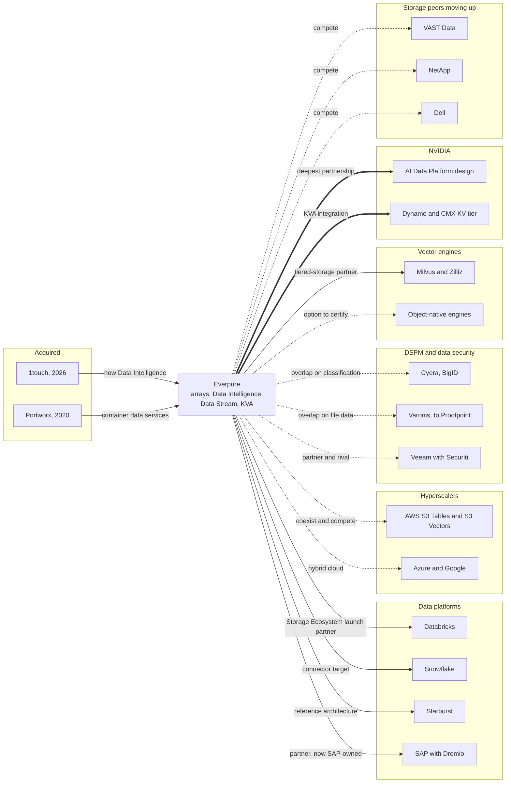
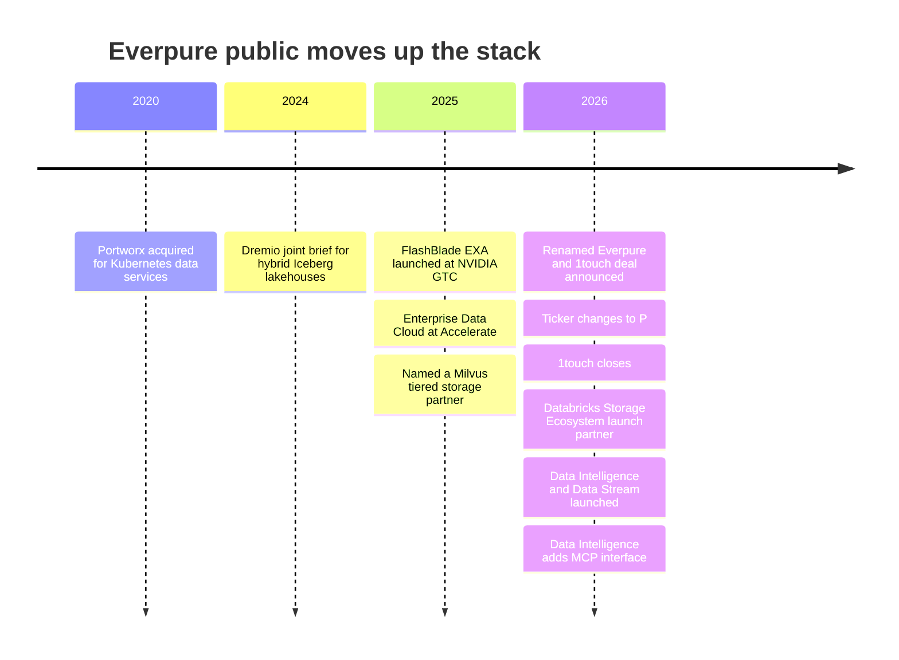

# 45. Implications for a Storage Company Moving Up the Stack
> **Depth:** L2 · **Reading time:** ~12 min · **Last verified:** 2026-11-01 · **Prerequisites:** [Ch 24 — Where the data stack meets compute and storage](../03-ai-data-stack/ch24-data-meets-compute-and-storage.md), [Ch 44 — Future trends](ch44-future-trends.md)

## TL;DR

- **Storage now meets data in four places:** the [lakehouse](../glossary.md#lakehouse) substrate (open tables on [object storage](../glossary.md#object-storage)), the vector and [KV cache](../glossary.md#kv-cache) tiers that AI retrieval and inference push onto flash, metadata intelligence (discovery, classification and semantic context), and cyber-resilience. Each is a separate market with different buyers, partners and rivals.
- **Everpure's public moves cover the bottom three layers of a seven-layer stack and part of the vector/KV layer.** These are the Enterprise Data Cloud and intelligent control plane (2025–26), 1touch ($125.0M cash, closed 2026-05-07), now **Data Intelligence**, **Data Stream** on NVIDIA (June 2026), the **Key-Value Accelerator (KVA)** and launch-partner status in the Databricks Storage Ecosystem (2026-06-10). Engines, catalogs and agent platforms remain partner territory.
- **Every storage peer is moving up, by different routes.** VAST builds its own database and engines. NetApp built an AI Data Engine and bought DataPelago. Dell embeds Starburst and Elastic. Hammerspace sells metadata across other vendors' storage. Veeam paid $1.725B for Securiti. The routes differ mainly in how much [channel conflict](../glossary.md#channel-conflict) each accepts with Databricks, Snowflake and the hyperscalers.
- **Options by layer (public information only):** *partner* at the engine and catalog layers, *build or extend* where the array already sees the data (metadata, vector/KV tiers), *acquire* small capabilities next to Data Intelligence, and *compete* only where a partner would not be harmed. Precedents from EMC–Greenplum (2010) to NetApp–DataPelago (2026) show that buying a whole engine is the riskiest route.
- **Investors will judge the move on software mix, not slogans.** Subscription ARR was $2.1B (+20%) at Q2 FY2027 and subscription services were about 42% of quarterly revenue (estimate). The market cap was $43.79B and EV/NTM revenue about 8.5x (2026-10-01). That multiple sits between NetApp's ~5.1x and Rubrik's ~16x, the gap the up-stack story is trying to close.

## Why this matters (business + Everpure lens)

A storage company that stays a storage company sells capacity and performance. That is a good business, but the market prices it like hardware: NetApp traded at about 5.1x EV/NTM revenue on 2026-10-01. Rubrik, a data-security company built on backup copies, traded at about 16x.[^comps-peers] The gap between those two multiples is the economic prize behind every "moving up the stack" announcement in this chapter. It is also why investors discount such announcements until they show up in reported software revenue.

Everpure (formerly Pure Storage; NYSE: P, formerly PSTG) chose its name to signal the move. On 2026-02-23 it renamed itself and announced the intent to acquire 1touch, a company whose software discovers, classifies and adds semantic context to data. It said its aim was to move customers from controlling their data to understanding it.[^ep-wwt] The ticker changed to P on 2026-04-17.[^ep-ticker] At its September 2026 Financial Analyst Meeting the company sized a "Modern Data Software" addressable market at $22B by FY2030 (company-stated, reported second-hand) [VERIFY: confirm on the analyst-day deck].[^ep-fam]

This chapter does not re-teach storage. It maps where storage meets the data and AI layers described in Parts 1–3. It lists what Everpure has publicly announced at each layer and compares the peers. It then sets out options a strategy team might evaluate, based on public information. None of it describes non-public Everpure plans.

## How it works

### The seven-layer map

Read the stack from the bytes upward. Layers 1–2 are classic storage: media, arrays and object stores, then data services such as snapshots, replication and cyber-recovery. Layer 3 is metadata intelligence: knowing what the data is, whether it is sensitive and how it relates to other data. Layers 4–5 are the data platform: open table formats and catalogs ([Ch 7](../01-data-systems-foundations/ch07-open-table-formats.md), [Ch 8](../01-data-systems-foundations/ch08-catalogs-and-metastores.md)) and the engines that query them. Layer 6 is AI retrieval: embeddings, vector indexes and the KV cache that inference servers spill out of GPU memory. Layer 7 is the applications and agents that consume all of it.

*Figure 45.1 — Everpure's public announcements sit in the storage layers, in metadata intelligence and in part of the vector/KV layer. Table formats, engines and agent platforms are reached through partners and connectors, and that boundary is where the strategic choices lie. Sources: footnotes in this chapter.*

The layers are not equally valuable. Gross margins and multiples rise as you climb, but so does the number of well-funded incumbents. Layers 4–5 are where Databricks (a >$7B revenue run-rate, company-stated) and Snowflake fight ([Ch 27](../04-company-deep-dives/ch27-databricks-vs-snowflake.md)). Layer 3 is where DSPM and catalog vendors are consolidating at high prices ([Ch 33](../04-company-deep-dives/ch33-governance-catalog-security-companies.md)). Layer 6 is still being defined.

### Opportunity 1: the lakehouse substrate

Every lakehouse is a stack of software on an object store ([Ch 24](../03-ai-data-stack/ch24-data-meets-compute-and-storage.md)). The hyperscalers have spent five years pulling database features down into that store. AWS added conditional writes in 2024, managed [Apache Iceberg](../glossary.md#apache-iceberg) tables inside the bucket (S3 Tables, December 2024) and native vector indexes (S3 Vectors, GA December 2025).[^s3tables][^s3-vectors] Any on-prem S3-compatible platform is now judged against that bar.

Everpure's public position here is partnership. There are FlashBlade reference architectures with Dremio (now owned by SAP) and Starburst for Iceberg lakehouses.[^dremio-pure][^starburst-ep][^sap-dremio] Everpure was also a launch partner when Databricks announced its Storage Ecosystem on 2026-06-10, alongside MinIO and Qumulo.[^storage-eco] Under that programme an OpenSharing connector in private preview lets Databricks govern and query Delta and Iceberg tables held on Everpure object storage without copying them [VERIFY: general-availability status].[^everpure-os] The value to a storage vendor is location. Regulated or sovereign data stays on-prem, and every engine reads one copy.

### Opportunity 2: the vector and KV tier on flash

Two AI workloads have moved from DRAM to flash. The first is billion-scale [approximate nearest neighbor](../glossary.md#approximate-nearest-neighbor) search. The [DiskANN](../glossary.md#diskann) paper served a billion vectors from one 64 GB-RAM workstation plus an SSD, at under 3 ms mean latency (authors' benchmark).[^diskann] Milvus 2.6 added [tiered storage](../glossary.md#tiered-storage) across RAM, SSD and object storage, and coverage of the release named Pure Storage among its storage partners.[^milvus26] Data Stream, announced on 2026-06-17, puts Everpure on the producing side of the same workload. It selects data, vectorises it on FlashBlade with NVIDIA GPUs and applies stream-level access controls, using the NVIDIA AI Data Platform reference design.[^ep-ds][^aidp]

The second workload is inference context. A 70B-class model with grouped-query attention holds about 0.33 MB of KV state per token, so a one-million-token context needs roughly 330 GB (estimate).[^kv-math] That is more than one GPU holds. NVIDIA's Dynamo tiers KV blocks from GPU memory down to networked storage, and NVIDIA's CMX context-memory platform formalises a flash tier for it. Trade coverage names Dell, IBM, VAST and WEKA as CMX supporters.[^dynamo-kv][^nvidia-cmx] Everpure's KVA integrates with Dynamo and keeps reusable prompt prefixes on FlashBlade over NFS and S3 (vendor claims) [VERIFY: GA date].[^ep-kva] This is the most storage-native of the up-stack opportunities. It is also the one where NVIDIA sets the interface, so differentiation has to come from latency, density and operations rather than from a proprietary API.

### Opportunity 3: metadata and data intelligence

The 1touch logic runs in three steps. **Discovery** finds data wherever it lives. **Classification** labels what it is, including sensitive data. **Semantic context** records what the data means and how it relates to other data. The output is metadata, and metadata is what catalogs, policy engines and agents consume. Everpure relaunched 1touch as **Data Intelligence** in June 2026. Trade coverage says it works across Everpure arrays, third-party storage, public clouds and SaaS without copying data, with connectors that include Databricks, Snowflake, Oracle and SQL Server.[^ep-cw][^ep-tz] An October 2026 update added a metadata-only File Edition and a [Model Context Protocol](../glossary.md#model-context-protocol) interface, so agents can query the metadata directly.[^ep-oct]

The structural argument is that a storage system sees copies no catalog registered: snapshots, clones and scratch volumes ([Ch 15](../02-pipelines-and-governance/ch15-governance-security-privacy.md)). The counter-argument is that classification only matters where policy is enforced. Enforcement sits in Unity Catalog, Horizon, Purview and identity systems, which all ship their own classifiers. So the likely winning design is "classify near the bytes, publish tags to where enforcement happens", not a competing console.

### Opportunity 4: the cyber-resilience adjacency

Backup vendors reached the same layer from the other side. A backup holds an indexed, versioned copy of everything, so classifying it is cheap. Rubrik bought Laminar (DSPM) in 2023 [VERIFY: primary release]. Veeam announced its Securiti deal in October 2025 and closed it in December 2025 for $1.725B, and Securiti's founder became Veeam's President of Security and AI.[^dspm-tuckins][^securiti] Everpure's intelligent control plane includes cyber-anomaly detection and compliance reporting.[^ep-cp] The result is coopetition. Backup vendors are partners on Everpure arrays and rivals in data intelligence. Both sides will want their tags to be the system of record.

> **Bridge: memory makers and Arm moving up the stack.** SK hynix and Samsung turned commodity DRAM into HBM, a co-designed product sold into NVIDIA's roadmap, and that move raised margins because the platform owner needed it. Their processing-in-memory parts (Samsung HBM-PIM, SK hynix AiM) went further up, putting compute next to the DRAM banks. Adoption has been slow, because the host vendor owns the programming model and software had to be rewritten ([compute-in-memory](../glossary.md#compute-in-memory)). Arm's shift from licensing IP to selling pre-integrated Neoverse compute subsystems, and reports that it is designing its own chips, shows the other risk: moving up can make you a competitor of your own licensees.[^tk-bridge] The lesson for storage is direct. Data Stream and KVA resemble HBM, because they plug into NVIDIA's reference designs. A storage-native database would resemble PIM or Arm's own chips: possibly valuable, but it needs partners to change their behaviour or accept a new rival.

## Design choices and trade-offs

The strategy question is not "move up or not" but *which posture at which layer*. The matrix below sets out options a strategy team might evaluate, based on public information. It does not describe Everpure plans.

| Layer | Partner | Build / extend | Acquire | Compete | Key considerations |
|---|---|---|---|---|---|
| Object storage substrate | Certify with Databricks, Snowflake, Starburst, SAP-Dremio | Iceberg-aware services: REST catalog endpoint, table maintenance (as S3 Tables does) | Rarely needed; capability is engineering, not IP | Against VAST, NetApp, Dell, MinIO and hyperscaler S3 on price and performance | Low switching cost between storage partners; publish conditional-write and metadata benchmarks |
| Table and catalog integration | OpenSharing connector to GA; Unity, Polaris, Horizon integrations | Two-way tag sync from Data Intelligence | Small catalog team only if integration stalls | Avoid: catalogs are the platforms' control point | Channel risk is high if seen as a rival catalog |
| Vector / KV tier | NVIDIA Dynamo and CMX; Milvus, LanceDB-style engines | KVA, Data Stream, flash-native index serving | Tuck-in in retrieval or parsing at 1touch scale | With VAST, WEKA, DDN on KV-cache tiers | NVIDIA sets the interface; differentiation is latency, density and operations |
| Classification / metadata intelligence | Feed tags to Collibra, Atlan, Cyera, BigID | Extend Data Intelligence coverage and accuracy | Connector or model teams | With Hammerspace on cross-vendor metadata | Scan cost on production arrays; third-party-storage reach is the differentiator |
| Governance / DSPM | Partner with DSPM leaders and backup vendors | Posture views on storage-resident data only | Large DSPM deals price at $1.7B–$6.3B | Avoid a CISO-led head-to-head | Different buyer (security) and sales motion |
| Semantic layer / agent access | Open Semantic Interchange, catalog semantics | MCP interface over metadata (shipped Oct 2026) | Unlikely to need | Avoid: platforms own semantics | Agents need permissions and context, not another BI layer |
| Data movement | Fivetran-dbt, Confluent (IBM), Hammerspace | Fusion workload mobility; Data Stream pipelines | Selective, if replication-to-pipeline gaps appear | Limited | Crowded; value is in policy-aware placement, not generic ETL |

*Figure 45.2 — Options matrix (public information only). Posture changes by layer: partner where platforms own the control point, build where the array already sees the data, and acquire only small capabilities next to Data Intelligence.*

**Channel conflict is the binding constraint.** Databricks' Storage Ecosystem names ten storage vendors, three at launch and seven to follow.[^storage-eco] A storage vendor that launches its own query engine or vector database gives a platform partner a reason to favour the other nine. VAST accepts that risk because it wants to *be* the AI data platform. Dell manages it by embedding partners (Starburst, Elastic) rather than building engines.[^dell-aidp] Everpure's public posture so far, preparing and understanding data while partnering at the engine layer, keeps conflict low. The cost is that more of the value above layer 3 goes to partners.

**Required capabilities differ by layer.** Layers 1–2 need hardware and systems engineering. Layer 3 needs connector breadth, classifier accuracy and cloud/SaaS delivery. Layer 6 needs GPU-ecosystem engineering. Selling into layers 3 and above also brings new buyers (data, security and AI-platform teams), consumption pricing and partner co-sell. The 1touch deal bought a product and connectors, not a security sales force.[^ep-10q]

*Figure 45.3 — Partner, compete and acquire map. Thick lines are the deepest public partnerships (NVIDIA), solid lines are announced partnerships or acquisitions, and dotted lines are overlaps or options. Public information only.*

## Who's who

The comparison below is neutral and limited to public announcements. Several rows rest on pre-2025 knowledge and are flagged.

| Vendor | Starting point | Moves up the stack (public) | Route | Overlap with Everpure | Source |
|---|---|---|---|---|---|
| VAST Data | Software-defined all-flash | VAST DataBase (tables), DataEngine (functions), InsightEngine (embedding with NVIDIA), "AI operating system" | Build; raised $1B at $30B (Apr 2026, company-stated) | High: storage, vector, KV tier | [^tk-vast][^vast-ie][^vast-f] |
| NetApp | Unified storage (ONTAP) | AFX disaggregated system and AI Data Engine (Oct 2025); DataPelago GPU data processing (Jul 2026) | Build plus acquire | High: storage, AI data prep | [^netapp-aide][^datapelago] |
| Dell | Servers and storage | AI Data Platform with Starburst analytics engine and Elastic search engine, MCP server (Oct 2025 announcement) | Partner and embed | High: storage; partner overlap on Starburst | [^dell-aidp] |
| DDN | HPC parallel file system | Infinia object store for AI | Build | Medium: AI storage | [^tk-weka-ddn] |
| Hammerspace | Software over others' storage | Global namespace and metadata-driven data placement | Build; >$500M valuation (Apr 2025, company-stated) | Medium: cross-vendor metadata | [^hammerspace-b][^tk-hammerspace] |
| WEKA | Parallel file system | NeuralMesh platform; named CMX supporter for KV offload | Build | Medium: KV tier | [^tk-weka-ddn][^nvidia-cmx] |
| Cohesity | Backup | Veritas data-protection combination (closed Dec 2024); AI search over backups | Acquire for scale | Medium: data intelligence on copies | [^cohesity][^tk-backup-ai] |
| Rubrik | Backup and cyber-recovery | Laminar DSPM (2023); AI data access on backup copies | Acquire plus build | Medium: classification | [^dspm-tuckins][^tk-backup-ai] |
| Veeam | Backup | Securiti ($1.725B, closed Dec 2025): DSPM, privacy, AI governance | Acquire | Medium-high: classification, governance | [^securiti] |
| Everpure (reference) | Flash arrays, subscriptions | EDC, control plane, Data Intelligence (1touch), Data Stream, KVA | Build plus acquire, partner up-stack | — | [^ep-edc][^ep-cp][^ep-10q][^ep-ds][^ep-kva] |

*Figure 45.4 — Comparables. Three routes emerge: build a platform (VAST), embed partners (Dell), or buy data-security software (Veeam, Rubrik). NetApp and Everpure mix building with small acquisitions. Rows marked in the sources as training knowledge need re-verification [VERIFY: VAST, WEKA, DDN, Hammerspace and backup-vendor AI feature details].*

The peers also differ in neutrality. Hammerspace and Everpure's Data Intelligence both claim value across storage the customer already owns, including competitors' arrays. VAST's engines mainly run on VAST. Veeam's Securiti works on primary and SaaS data as well as backups, so it competes with storage-side classification for the same tags.[^securiti]

## History and trajectory

Storage vendors have tried this before, and the record is mixed. EMC bought Greenplum in 2010 to move into analytic databases. Greenplum was spun into Pivotal in 2013 and open-sourced in 2015. Hitachi Data Systems bought Pentaho in 2015 and later folded it into Hitachi Vantara. HPE bought MapR's assets in 2019 after the Hadoop distributor nearly shut down.[^ma-csv] Those deals bought whole engines and asked storage sales teams to sell them. The 2023–2026 deals are smaller and closer to the array: classification, data protection and in-place processing.

| Date | Acquirer → target | Value (basis) | What it teaches |
|---|---|---|---|
| 2010-07 | EMC → Greenplum | Undisclosed | Whole-engine buys struggled inside a storage sales motion; later spun out |
| 2015-02 | Hitachi Data Systems → Pentaho | Undisclosed | An OEM'd tool brought in-house; brand kept, absorbed into Vantara |
| 2020-09 | Pure Storage → Portworx | ~$370M (company-announced) [VERIFY] | Data services for Kubernetes; still an Everpure franchise |
| 2023-08 | Rubrik → Laminar | Undisclosed | First backup-to-DSPM move |
| 2024-06 | Databricks → Tabular | ~$2B (press-reported) | Table-format control is worth billions to platforms |
| 2025-12 | Veeam → Securiti | $1.725B (disclosed) | Data protection buys a full data-intelligence platform |
| 2026-05 | Everpure → 1touch | $125.0M cash (GAAP) | Small, adjacent, quickly productised (six weeks to relaunch) |
| 2026-05 | SAP → Dremio | Undisclosed | A storage partner's engine partner can be bought by an application vendor |
| 2026-07 | NetApp → DataPelago | Undisclosed | In-storage GPU data processing |
| 2026-10 | Proofpoint → Varonis | $6.3B (pending) | DSPM consolidation prices at scale |

*Figure 45.5 — Precedent deals from `data/ma_deals.csv`. Recent storage-adjacent deals are smaller and sit next to the array, while engine and catalog control has gone to platforms at multi-billion prices.[^ma-csv][^securiti][^varonis-8k][^ep-10q][^datapelago]*

*Figure 45.6 — Everpure's announced moves cluster in 2025–2026, after a decade in which the array and the Evergreen subscription model were the product. Sources: footnotes in this chapter.[^ma-csv][^dremio-pure][^ep-edc][^milvus26][^ep-wwt][^ep-ticker][^ep-10q][^storage-eco][^ep-ds][^ep-oct]*

The trajectory has three strands. Hyperscalers keep pulling table and vector semantics into object storage, which raises the bar for on-prem stores. NVIDIA keeps standardising the AI data path (AI Data Platform, Dynamo, CMX), which rewards storage vendors that plug in rather than invent. Security and backup vendors keep buying classification, so metadata intelligence is becoming crowded quickly. [Ch 44](ch44-future-trends.md) places these strands in the wider future-trends picture.

## KPIs and signposts investors would watch

| KPI or signpost | Latest public value | Basis | Why it matters |
|---|---|---|---|
| Subscription ARR | $2.1B, +20% (Q2 FY2027); $1.924B, +16% (FY2026 year-end) | Company-stated KPI | Recurring base that software attach must grow |
| Subscription services share of revenue | ~42% of Q2 FY2027 ($499M of ~$1.19B); ~40% in Q4 FY2026 | Estimate from GAAP figures | Falls when product revenue surges; watch the trend, not one quarter |
| RPO | $4.1B (Q2 FY2027); $3.7B, +40% (FY2026) | GAAP | Contracted backlog, incl. subscriptions |
| Gross margin | 68.4% GAAP / 69.9% non-GAAP (Q2 FY2027) | GAAP / non-GAAP | Software mix should lift it over time |
| Data Intelligence and Data Stream attach rate | Not disclosed | — | The clearest proof of up-stack demand; watch for a first disclosure |
| Third-party-storage share of Data Intelligence | Not disclosed | — | Tests whether it is a neutral product or an array feature |
| Partner milestones | OpenSharing connector in private preview (Jun 2026) | Vendor-stated | GA, co-sell and Snowflake certification are the next signposts |
| Valuation gap | EV/NTM ~8.5x vs NetApp ~5.1x, Rubrik ~16x (2026-10-01 to 10-26) | Estimate, guidance-based NTM | Re-rating would show investors accept the software story |

*Figure 45.7 — KPIs and signposts. Today's disclosures show the subscription base, not the attach of the new data software. The first explicit attach or software-ARR figure would be the key signpost.[^ep-q2][^ep-q4][^comps-peers][^everpure-os]*

Read the mix numbers with care. Q2 FY2027 revenue grew 38% (GAAP), and product revenue ($687M) grew faster than subscription services.[^ep-q2] A falling subscription share in a strong product quarter is not evidence against the software strategy. It does mean that headline ARR alone cannot show whether Data Intelligence is selling. [Attach rate](../glossary.md#attach-rate), [net revenue retention](../glossary.md#net-revenue-retention) on data software and the share of deals sold to data or security buyers would show it. None of these is disclosed today.

## Numbers that matter

| Metric | Value | Basis | Source / date |
|---|---|---|---|
| Everpure market cap / EV | $43.79B / $43.01B | Market data | `public_comps.csv`, 2026-10-01[^ep-comps] |
| Everpure EV/NTM revenue | ~8.5x | Estimate; NTM = FY2027 guide midpoint | `public_comps.csv`, 2026-10-01[^ep-comps] |
| FY2027 revenue guidance | $5.03–5.07B (midpoint $5.05B) | Company guidance (FY2027 ≈ Feb 2026–Jan 2027) | Q2 FY2027 release, 2026-08[^ep-q2] |
| FY2026 revenue | >$3.6B, +16% | GAAP (FY2026 ≈ Feb 2025–Feb 1 2026) | Q4 FY2026 release, 2026-02[^ep-q4] |
| Subscription ARR | $2.1B, +20% | Company-stated KPI, Q2 FY2027 | Q2 FY2027 release[^ep-q2] |
| Q2 FY2027 revenue / product / subscription services | ~$1.19B / $687M / $499M | GAAP | Q2 FY2027 release[^ep-q2] |
| FY2026 free cash flow | $616M | Non-GAAP | Q4 FY2026 release[^ep-q4] |
| 1touch consideration | $125.0M cash; ~0.3% of market cap | GAAP (10-Q); ratio is an estimate | 10-Q, 2026-06[^ep-10q] |
| Modern Data Software TAM | $22B by FY2030, 26% CAGR | Company-stated, reported second-hand [VERIFY] | Analyst meeting, 2026-09-23[^ep-fam] |
| Veeam–Securiti | $1.725B (~14x the 1touch price) | Disclosed; ratio is an estimate | Business Wire, 2025-12-11[^securiti] |
| Proofpoint–Varonis | $6.3B | Disclosed, pending | 8-K, 2026-10-15[^varonis-8k] |
| VAST Data valuation | $30B post-money | Company-stated, ~half secondary | Apr 2026[^vast-f] |
| KV cache, 1M tokens on 70B-class model | ~330 GB | Estimate | Author's arithmetic[^kv-math] |

*Figure 45.8 — The 1touch deal is small next to peers' data-intelligence deals. That is consistent with a build-and-partner posture rather than an attempt to buy a platform.*

## Storage bridge

> **Storage bridge.** The up-stack options above all depend on storage properties that this atlas does not re-teach: S3 conditional-write correctness and metadata latency for lakehouse commits, small-random-read tail latency for flash-resident ANN indexes, sustained throughput for KV-cache reloads, and snapshot and metadata access for classification at low production impact. The companion *Everpure Tech Atlas* covers FlashBlade, FlashArray and protocol detail. The point here is that every layer-3-to-6 product inherits its credibility from layer-1 benchmarks published with partners.

## Conversation playbook

**Questions for a PM**

1. "Which Data Intelligence deployments cover non-Everpure storage, and what share of customers start there rather than on an Everpure array?"
2. "When a customer runs Unity Catalog or Horizon, where do our classifications end up, and who enforces them?"
3. "For KVA and Data Stream, which NVIDIA reference-design certifications do customers ask for first, and how do we compare with the CMX partners?"

**Questions for an engineer**

1. "What is the production-performance cost of a full classification scan versus incremental scans, and how is sampling tuned?"
2. "For KV-cache reloads, what is p99 time-to-first-token with prefixes on FlashBlade versus recompute, at what concurrency?"
3. "Does the OpenSharing connector serve Iceberg and Delta reads with the same consistency guarantees as cloud object storage under concurrent commits?"

**What good answers sound like.** They separate integrations (connectors to a product) from partnerships (joint engineering and co-sell). They quote benchmarks with the partner's name on them. They describe classification as a feed into enforcement points, not a rival console. On economics, they distinguish subscription ARR, which includes Evergreen hardware subscriptions, from software that sells without an Everpure array.

**Don't say this**

- "Everpure is becoming a data platform like Databricks." Its public moves stop below the engine layer and partner with Databricks.
- "Data Intelligence replaces a DSPM tool." It overlaps on discovery and classification, but DSPM vendors sell posture and remediation to security teams.
- "Subscription ARR proves the software strategy." ARR includes storage-as-a-service; data-software attach is not disclosed.
- "Storage companies always fail when they buy software." EMC–Greenplum struggled, but Portworx and 1touch are smaller, adjacent and productised.
- "KV-cache offload is Everpure's own standard." NVIDIA defines the interfaces (Dynamo, CMX); storage vendors compete inside them.

## Going deeper

- [Ch 24](../03-ai-data-stack/ch24-data-meets-compute-and-storage.md) for what a lakehouse demands of object storage, and [Ch 18](../03-ai-data-stack/ch18-embeddings-and-vector-search.md) for DiskANN and flash-resident vector indexes.
- [Ch 15](../02-pipelines-and-governance/ch15-governance-security-privacy.md) for how discovery and classification pipelines work, and [Ch 33](../04-company-deep-dives/ch33-governance-catalog-security-companies.md) for the DSPM and catalog vendors.
- [Ch 32](../04-company-deep-dives/ch32-ai-native-data-companies.md) for VAST, Hammerspace and the AI-native data companies; [Ch 39](../05-business-and-economics/ch39-ma-history.md) for the full M&A history; [Ch 40](../05-business-and-economics/ch40-gtm-partnerships.md) for how storage–platform partnerships are sold.
- NVIDIA's Dynamo KV-cache manager documentation for the tiering interfaces storage must meet.[^dynamo-kv]

## Key terms

- [Moving up the stack](../glossary.md#moving-up-the-stack) — expanding from a lower layer (such as storage) into higher-value software layers above it.
- [Data intelligence](../glossary.md#data-intelligence) — software that discovers, classifies and adds semantic context to data so other tools and agents can use it.
- [Data discovery](../glossary.md#data-discovery) — finding and inventorying data across systems.
- [Data classification](../glossary.md#data-classification) — labelling data by type and sensitivity.
- [Data security posture management](../glossary.md#data-security-posture-management) — tools that combine classification with access and exposure to rank data risk.
- [Cyber resilience](../glossary.md#cyber-resilience) — the ability to detect, withstand and recover from attacks such as ransomware, mainly through protected copies.
- [Lakehouse](../glossary.md#lakehouse) — warehouse-grade management over open table formats on object storage.
- [Apache Iceberg](../glossary.md#apache-iceberg) — the leading open table format for lakehouse data.
- [OpenSharing](../glossary.md#opensharing) — open protocol for sharing tables in place, used by the Databricks Storage Ecosystem.
- [Approximate nearest neighbor](../glossary.md#approximate-nearest-neighbor) — vector search that trades a little recall for large speedups.
- [DiskANN](../glossary.md#diskann) — graph-based ANN index designed to serve billion-scale vectors from SSD.
- [Tiered storage](../glossary.md#tiered-storage) — placing data across memory, flash and object tiers by access frequency.
- [KV cache](../glossary.md#kv-cache) — stored attention keys and values that let a model avoid recomputing earlier tokens.
- [KV-cache offload](../glossary.md#kv-cache-offload) — moving KV-cache blocks from GPU memory to CPU memory, local flash or networked storage for reuse.
- [Model Context Protocol](../glossary.md#model-context-protocol) — open protocol for connecting AI agents to tools and data sources.
- [Compute-in-memory](../glossary.md#compute-in-memory) — placing processing next to memory to avoid moving data.
- [Channel conflict](../glossary.md#channel-conflict) — friction when a vendor's product competes with the partners that resell or integrate it.
- [Coopetition](../glossary.md#coopetition) — companies that partner and compete at the same time.
- [Attach rate](../glossary.md#attach-rate) — the share of customers or deals that also buy an add-on product.
- [Subscription ARR](../glossary.md#subscription-arr) — Everpure's company-defined annualised recurring revenue from subscription offerings.
- [Software mix](../glossary.md#software-mix) — the share of revenue from software and subscriptions rather than hardware.
- [Net revenue retention](../glossary.md#net-revenue-retention) — revenue from an existing customer cohort now versus a year earlier.

## Sources

[^comps-peers]: AI Data Atlas dataset `data/public_comps.csv`, rows for NetApp (EV/NTM 5.1x, as of 2026-10-01), Rubrik (16.0x, as of 2026-10-26), Commvault and Varonis, citing https://stockanalysis.com/stocks/ntap/financials/ratios/ and https://stockanalysis.com/stocks/rbrk/market-cap/; retrieved 2026-11-01. NTM revenue is a guidance or TTM proxy (estimate).
[^ep-wwt]: World Wide Technology (reposting Pure Storage press release), "Pure Storage rebrands to Everpure and announces intent to acquire 1touch," https://www.wwt.com/news/pure-storage-rebrands-to-everpure-and-announces-intent-to-acquire-1touch, published 2026-02-23; retrieved 2026-11-01.
[^ep-ticker]: Everpure press release, "Everpure to change ticker symbol," https://www.purestorage.com/company/newsroom/press-releases/everpure-to-change-ticker-symbol.html, published 2026-04-07 (effective 2026-04-17); Nasdaq, 2026-04-07; retrieved 2026-11-01 (via `meta/research-briefing.md`).
[^ep-fam]: NAND Research, "Everpure investor day: Pure's four-vector push beyond enterprise storage," https://nand-research.com/everpure-investor-day-pures-four-vector-push-beyond-enterprise-storage/, published 2026-09 (meeting 2026-09-23); retrieved 2026-11-01 via `data/ch41_market_sizes_additions.csv`. Company-stated TAM reported second-hand (weak source) [VERIFY: confirm on the Financial Analyst Meeting deck].
[^s3tables]: AWS News Blog, "New Amazon S3 Tables: Storage optimized for analytics workloads," https://aws.amazon.com/blogs/aws/new-amazon-s3-tables-storage-optimized-for-analytics-workloads/, published 2024-12-03; retrieved 2026-11-01.
[^s3-vectors]: AWS News Blog, "Top announcements of AWS re:Invent 2025," https://aws.amazon.com/blogs/aws/top-announcements-of-aws-reinvent-2025, published 2025-12; Blocks & Files, "AWS piles on S3 upgrades from vector search to 50 TB objects," https://www.blocksandfiles.com/ai-ml/2025/12/03/aws-piles-on-s3-upgrades-from-vector-search-to-50-tb-objects/1704690, published 2025-12-03; retrieved 2026-11-01.
[^dremio-pure]: Dremio partner page, https://www.dremio.com/partners/pure-storage/, n.d.; Pure Storage/Dremio solution brief, https://dremio.com/wp-content/uploads/2024/10/Dremio-Pure-Storage-Solutions-Brief-1.pdf, published 2024-10; retrieved 2026-11-01 (via `meta/research-briefing.md`).
[^starburst-ep]: Everpure partner page, "Starburst," https://www.everpuredata.com/la/partners/technology-alliance-partners/starburst.html, n.d.; retrieved 2026-11-01 (via `meta/research-briefing.md`).
[^sap-dremio]: Dremio newsroom, "SAP to Acquire Dremio…," https://www.dremio.com/newsroom/sap-to-acquire-dremio-to-unify-sap-and-non-sap-data-to-power-agentic-ai/, published 2026-05-04; CIO.com, https://www.cio.com/article/4166881/sap-to-acquire-data-lakehouse-vendor-dremio.html, 2026-05; retrieved 2026-11-01. Terms undisclosed; closed about July 2026 per `meta/research-briefing.md`.
[^storage-eco]: Databricks blog, "Announcing the Databricks Storage Ecosystem: Governing the Enterprise Data Estate Wherever It Lives," https://www.databricks.com/blog/announcing-databricks-storage-ecosystem-governing-enterprise-data-estate-wherever-it-lives, published 2026-06-10; StorageNewsletter, https://www.storagenewsletter.com/2026/06/24/announcing-the-databricks-storage-ecosystem-governing-the-enterprise-data-estate-wherever-it-lives/, 2026-06-24; retrieved 2026-11-01.
[^everpure-os]: Everpure blog, "Everpure OpenSharing Connector," https://blog.everpuredata.com/products/everpure-opensharing-connector/, published 2026-06; retrieved 2026-11-01 (as cited in Ch 25). Vendor-stated; private preview from 2026-06-09 [VERIFY: GA status].
[^diskann]: S. Jayaram Subramanya, F. Devvrit, R. Kadekodi, R. Krishnaswamy, H. V. Simhadri, "DiskANN: Fast Accurate Billion-point Nearest Neighbor Search on a Single Node," NeurIPS 2019, https://papers.nips.cc/paper/2019/hash/09853c7fb1d3f8ee67a61b6bf4a7f8e6-Abstract.html, published 2019-12; retrieved 2026-11-01. Authors' benchmark.
[^milvus26]: Zilliz, "Milvus 2.6: Built for Scale, Designed to Reduce Costs," https://zilliz.com/news/milvus-2-6-built-for-scale-designed-to-reduce-costs, published 2025-06-12; BigDATAwire, "Zilliz Releases Milvus 2.6 with Tiered Storage and Int8 Compression to Cut Vector Search Costs," https://www.bigdatawire.com/this-just-in/zilliz-releases-milvus-2-6-with-tiered-storage-and-int8-compression-to-cut-vector-search-costs, published 2025-06; retrieved 2026-11-01. Storage-partner list (Cohesity, Pure Storage, MinIO, NetApp) per this coverage.
[^ep-ds]: Everpure via PR Newswire, "Everpure Unveils Data-Primacy Architecture for the AI Era," https://www.prnewswire.com/news-releases/everpure-unveils-data-primacy-architecture-for-the-ai-era-302803097.html, published 2026-06-17; Everpure newsroom, "Everpure Announces Data Stream," https://www.everpuredata.com/company/newsroom/press-releases/everpure-announces-data-stream.html, published 2026-06-17; SiliconANGLE, https://siliconangle.com/2026/06/17/everpure-accelerates-ai-workloads-data-stream-unveils-data-primacy-architectural-vision/, 2026-06-17; retrieved 2026-11-01.
[^aidp]: StorageNewsletter, "NVIDIA GTC 2025: Pure Storage Integrates NVIDIA AI Data Platform into FlashBlade," https://www.storagenewsletter.com/2025/03/19/nvidia-gtc-2025-pure-storage-integrates-nvidia-ai-data-platform-into-flashblade/, published 2025-03-19; retrieved 2026-11-01.
[^kv-math]: Author's estimate (not vendor data): KV bytes per token = 2 (K and V) × 80 layers × 8 KV heads × 128 head dimension × 2 bytes (FP16) ≈ 327,680 bytes ≈ 0.33 MB, using published Llama-3-70B-style dimensions with grouped-query attention; × 1,000,000 tokens ≈ 328 GB. Consistent with the Ch 19 estimate. Computed 2026-11-01.
[^dynamo-kv]: NVIDIA, "Dynamo Distributed KV Cache Manager," https://docs.nvidia.com/dynamo/latest/architecture/kv_cache_manager.html, living document; retrieved 2026-11-01.
[^nvidia-cmx]: NVIDIA, "CMX context memory storage platform," https://www.nvidia.com/en-us/data-center/ai-storage/cmx/, living document; Blocks & Files, "Nvidia standardizes GPU cluster KV cache offload to NVMe SSDs," https://blocksandfiles.com/2026/01/06/nvidia-standardizes-gpu-cluster-kv-cache-offload-to-nvme-ssds/, published 2026-01-06; retrieved 2026-11-01. Partner list per trade coverage.
[^ep-kva]: Everpure blog, "Pure KVA integrates NVIDIA Dynamo for scalable, low-latency LLM inference," https://blog.everpuredata.com/news-events/pure-kva-integrates-nvidia-dynamo-for-scalable-low-latency-llm-inference/, and "Everpure KVA Meets FlashBlade//EXA," https://blog.everpuredata.com/purely-technical/everpure-kva-meets-flashblade-exa-enterprise-kv-caching-at-neocloud-scale/, published 2025–2026; retrieved 2026-11-01 (as cited in Ch 19). Vendor claims [VERIFY: GA date of the Dynamo integration, reported for Feb–Apr 2026].
[^ep-cw]: Computer Weekly, "Everpure aims to bridge AI data gap with Universal Data Intelligence," https://www.computerweekly.com/news/366644438/Everpure-aims-to-bridge-AI-data-gap-with-Universal-Data-Intelligence, published 2026-06; retrieved 2026-11-01.
[^ep-tz]: Techzine, "Stop vectorizing garbage: inside Everpure's smart AI data pipeline," https://www.techzine.eu/blogs/infrastructure/144105/stop-vectorizing-garbage-inside-everpures-smart-ai-data-pipeline/, published 2026-06; retrieved 2026-11-01. Connector list is an integration list, not announced partnerships.
[^ep-oct]: HPCwire/AIwire, "Everpure enhances Data Intelligence to bolster customer AI projects," https://www.hpcwire.com/aiwire/2026/10/07/verpure-enhances-data-intelligence-to-bolster-customer-ai-projects/, published 2026-10-07; retrieved 2026-11-01 (trade press).
[^dspm-tuckins]: Rubrik–Laminar (announced 2023-08, terms undisclosed) per deal-tracker summary https://www.privsource.com/acquisitions/deal/3ASll0 (weak source) and `data/ma_deals.csv`; retrieved 2026-11-01 [VERIFY: Rubrik–Laminar primary release].
[^securiti]: Veeam via Business Wire, "Veeam Completes Acquisition of Securiti AI to Create the Industry's First Trusted Data Platform for Accelerating Safe AI at Scale," https://www.businesswire.com/news/home/20251211040418/en/Veeam-Completes-Acquisition-of-Securiti-AI-to-Create-the-Industrys-First-Trusted-Data-Platform-for-Accelerating-Safe-AI-at-Scale, published 2025-12-11; retrieved 2026-11-01. $1.725B disclosed; announcement 2025-10-21 per `data/staging/ch39-ma_deals.csv`.
[^ep-cp]: Blocks & Files, "Everpure extends data and control planes for agentic AI," https://www.blocksandfiles.com/data-management/2026/06/17/everpure-extends-data-and-control-planes-for-agentic-ai/5257407, published 2026-06-17; TechTarget, "7 highlights from Pure Accelerate 2026," https://www.techtarget.com/it-infrastructure/opinion/7-highlights-from-Pure-Accelerate-2026, published 2026-06; retrieved 2026-11-01.
[^tk-bridge]: Samsung HBM-PIM (announced 2021), SK hynix GDDR6-AiM (2022), Arm Neoverse Compute Subsystems (2023) and press reports (2025) that Arm is designing its own chips; training knowledge (pre-mid-2025), not re-verified 2026-11-01 [VERIFY: primary announcements for each].
[^dell-aidp]: ITPro, "Dell Technologies just announced a major data platform overhaul – here's what customers can expect," https://itpro.com/infrastructure/dell-technologies-touts-major-data-platform-overhaul-with-nvidia-elastic-and-starburst-collaborations, published 2025-10; SiliconANGLE, https://siliconangle.com/2025/10/22/dell-unveils-ai-platform-unlock-enterprise-data-ai-era-dellaidataplatform/, published 2025-10-22; Blocks & Files, https://www.blocksandfiles.com/ai-ml/2025/10/22/dell-expands-ai-data-platform-with-search-analytics/1607930, published 2025-10-22; retrieved 2026-11-01. MCP server for the Data Analytics Engine planned for Feb 2026 and Data Search Engine for 1H 2026 (vendor-stated at announcement).
[^ep-10q]: Everpure, Inc., Form 10-Q for the quarter ended 2026-05-03, SEC EDGAR, https://www.sec.gov/Archives/edgar/data/0001474432/000147443226000061/pstg-20260503.htm, published 2026-06; Cleary Gottlieb, "Everpure Completes Acquisition of 1touch," https://www.clearygottlieb.com/news-and-insights/news-listing/everpure-completes-acquisition-of-1touch, published 2026-05-11; retrieved 2026-11-01. $125.0M stated cash consideration, subject to adjustments and escrow; closed 2026-05-07.
[^tk-vast]: VAST Data product announcements: VAST DataBase (2023), DataEngine and "AI operating system" positioning (2025); training knowledge (pre-mid-2025), not re-verified 2026-11-01 [VERIFY].
[^vast-ie]: VAST Data, "VAST Data Unveils VAST InsightEngine with NVIDIA," press release, https://www.vastdata.com/press-releases/vast-data-unveils-vast-insightengine-with-nvidia, published 2024-10-01; retrieved 2026-11-01.
[^vast-f]: AI Data Atlas dataset `data/private_funding.csv`, VAST Data Series F row ($1B at $30B post-money, company-stated, about half secondary), citing Quartz, https://qz.com/nvidia-vast-data-series-f-billion-valuation-042226, published 2026-04-22; retrieved 2026-11-01.
[^netapp-aide]: Blocks & Files, "NetApp disaggregates ONTAP storage and provides an AI Data Engine," https://blocksandfiles.com/2025/10/14/netapp-disaggregates-ontap-storage-and-provides-an-ai-data-engine/, published 2025-10-14; TechTarget, https://www.techtarget.com/searchstorage/news/366632757/NetApp-adds-AI-Data-Engine-expands-Nvidia-partnership, 2025-10; retrieved 2026-11-01.
[^datapelago]: NetApp press release, "NetApp Acquires DataPelago, Making Data AI-Ready at the Infrastructure Layer," https://www.netapp.com/en/newsroom/press-releases/news-rel-20260716-210092/, published 2026-07-16; retrieved 2026-11-01. Terms undisclosed.
[^tk-weka-ddn]: WEKA NeuralMesh rebrand (2025) and DDN Infinia object store; training knowledge, not re-verified 2026-11-01 [VERIFY].
[^hammerspace-b]: NAND Research, "Research note: Hammerspace $100M Series B to accelerate AI infrastructure growth," https://nand-research.com/research-note-hammerspace-100m-series-b-to-accelerate-ai-infrastructure-growth/, published 2025-04; retrieved 2026-11-01. Valuation "over $500M", company-stated.
[^tk-hammerspace]: Hammerspace technical materials (global data platform, metadata-driven placement over existing storage using the standard Linux pNFS client); training knowledge (pre-mid-2025), not re-verified 2026-11-01 [VERIFY].
[^cohesity]: Cohesity press release on completing the Veritas data-protection combination, https://www.cohesity.com/press/, published 2024-12-10; retrieved 2026-11-01 (per `data/ma_deals.csv`; combined-company valuation >$7B is not a deal price).
[^tk-backup-ai]: Cohesity Gaia (AI search over backup data, 2024) and Rubrik's AI data-access features on backup copies (2024–2025); training knowledge, not re-verified 2026-11-01 [VERIFY: current product names and status].
[^ep-edc]: Blocks & Files, "Pure Storage Enterprise Data Cloud," https://blocksandfiles.com/2025/06/18/pure-storage-enterprise-data-cloud/, published 2025-06-18; IT Brief UK, "Pure Storage unveils Enterprise Data Cloud…," https://itbrief.co.uk/story/pure-storage-unveils-enterprise-data-cloud-flash-upgrades, 2025-06; retrieved 2026-11-01.
[^ma-csv]: AI Data Atlas dataset `data/ma_deals.csv`, rows for EMC–Greenplum (2010-07-06), Hitachi Data Systems–Pentaho (2015-02-10), HPE–MapR (2019-08-05), Pure Storage–Portworx (2020-09-16; ~$370M per company announcement, training knowledge [VERIFY]), Rubrik–Laminar, Databricks–Tabular (~$2B press-reported, TechCrunch 2024-08) and SAP–Dremio; per-row sources listed in the CSV (e.g., EMC press release https://corporate.delltechnologies.com/en-us/newsroom/announcements/2010/07/20100706-01.htm); retrieved 2026-11-01.
[^varonis-8k]: Varonis Systems, Inc., Form 8-K Exhibit 99.1, SEC EDGAR, https://www.sec.gov/Archives/edgar/data/0001361113/000121390026109901/ea030861001ex99-1.htm, published 2026-10-15; retrieved 2026-11-01. $49.75/share cash; close expected 1H 2027.
[^ep-q2]: Everpure, "Everpure Announces Second Quarter Fiscal 2027 Financial Results," https://investor.everpuredata.com/news-and-events/press-releases/press-release-details/2026/Everpure-Announces-Second-Quarter-Fiscal-2027-Financial-Results/default.aspx, published 2026-08-26; retrieved 2026-11-01 (values per `data/company_financials.csv`). Q2 FY2027 = May–Aug 2 2026. Subscription-services share (~42%) is our estimate: $499M ÷ ~$1.19B.
[^ep-q4]: Everpure, Q4 FY2026 earnings press release (8-K Ex. 99.1), https://www.sec.gov/Archives/edgar/data/1474432/000147443226000015/pstg-ex991q4fy2026.htm, published 2026-02-25; retrieved 2026-11-01. FY2026 revenue >$3.6B (+16%), subscription ARR $1.924B, RPO $3.7B, FCF $616M (non-GAAP); Q4 subscription services $440M of ~$1.1B revenue (~40%, our estimate).
[^ep-comps]: AI Data Atlas dataset `data/public_comps.csv`, Everpure row: market cap $43.79B, EV $43.01B, EV/NTM ~8.5x, as of 2026-10-01, from https://stockanalysis.com/stocks/p/financials/ratios/; retrieved 2026-11-01. 1touch ratio: $125.0M ÷ $43.79B ≈ 0.3% (estimate).
