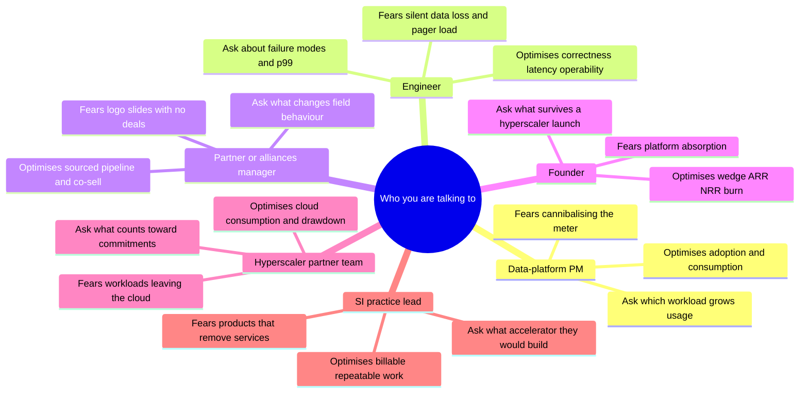
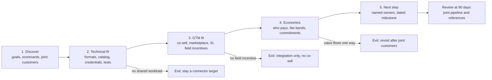

# 46. Talking with Data-Platform PMs, Engineers, Partners and Founders
> **Depth:** L2 · **Reading time:** ~17 min · **Last verified:** 2026-11-01 · **Prerequisites:** [Ch 27 — Databricks vs Snowflake](../04-company-deep-dives/ch27-databricks-vs-snowflake.md), [Ch 36 — Unit economics and KPIs](../05-business-and-economics/ch36-unit-economics-kpis.md), [Ch 40 — GTM and partnerships](../05-business-and-economics/ch40-gtm-partnerships.md), [Ch 45 — Storage moving up the stack](../06-history-and-future/ch45-storage-moving-up-the-stack.md)

## TL;DR

- **Every persona is paid to optimise something different.** A data-platform PM is measured on adoption and consumption, an engineer on correctness, latency and operability, a partner manager on pipeline and co-sell, a founder on wedge, ARR, NRR, burn and the next round, a hyperscaler partner team on cloud consumption and commitment drawdown, and an SI practice lead on billable, repeatable services. Ask each one about the number they own, and ask it in their units.
- **Conversations have an arc.** A partnership talk moves from discovery to technical fit, then GTM fit, then economics, then a concrete next step. Most partnership talks that fail skip technical fit and go straight to logos, or skip economics and end up as an integration nobody sells.
- **Good answers share a texture.** They give the definition before the number, label the basis (GAAP, company-stated run-rate, estimate), name the trade-off and admit a gap. Evasive answers switch units, cite an anonymous customer, or answer a different question.
- **A handful of vocabulary mistakes cost credibility in seconds.** Calling Iceberg a database, quoting a run-rate as revenue, equating vector databases with RAG, treating zero-ETL as "no pipeline" and calling a lakehouse "just a data lake" each tell a technical listener you learned the field from press releases.
- **Use storage expertise as a scalpel, not a lecture.** One precise question about conditional writes, small files, metadata latency or egress earns more respect than five minutes on flash media. For an Everpure professional, stick to public positioning: Enterprise Data Cloud, Data Intelligence (from 1touch) and the Databricks Storage Ecosystem launch-partner status. Never hint at non-public plans.

## Why this matters (business + Everpure lens)

Corporate development is mostly conversation. A partnership term sheet, a minority investment or an acquisition starts as a run of meetings in which you are trying to learn three things. What does this team really believe? What are they paid to do? What will they do when your interests and theirs diverge? The 45 chapters before this one give you the content. This chapter is about how to use it in a room where the other side knows the technology better than you do.

The stakes are high because the data industry runs on numbers nobody audits and terms that change every few months. Databricks reports a company-stated revenue run-rate above $7B with more than 80% year-on-year growth (August 2026).[^db-7b] Its last disclosed full-year revenue was about $2.6B, for the fiscal year ended January 2025, and that figure is press-reported.[^cnbc-25] Snowflake's 126% net revenue retention is a trailing-12-month cohort ratio, not a growth rate.[^sf-q2] A product name can change between two meetings: Snowflake Intelligence became Snowflake CoWork in June 2026 ([Ch 26](../04-company-deep-dives/ch26-snowflake.md)). If you quote the wrong basis or the old name, the conversation quietly moves from peer-to-peer to vendor-to-prospect, and you stop hearing the useful material.

For Everpure the lens is specific. Pure Storage renamed itself Everpure on 23 February 2026 and announced the 1touch acquisition the same day.[^ep-wwt] It now trades as NYSE: P.[^ep-ticker] 1touch closed on 7 May 2026 for $125.0M cash (GAAP, per the 10-Q).[^ep-10q] On 10 June 2026 Everpure was named a launch partner of the Databricks Storage Ecosystem, with an OpenSharing connector in private preview (vendor-stated).[^storage-eco][^everpure-os] A strategy professional at a company moving up the stack ([Ch 45](../06-history-and-future/ch45-storage-moving-up-the-stack.md)) will be talking constantly with data-platform PMs, alliance teams and founders. Every one of them will be weighing whether a storage company is a partner, a channel or a future competitor. Your vocabulary and your questions are how they decide.

## How each persona thinks

Before any meeting, work out the counterpart's scorecard. People answer questions in a way that protects the metric they are paid on. Knowing that metric lets you read an answer for what it leaves out.

*Figure 46.1 — Each persona optimises a different metric and fears a different failure. The right question targets the metric the person actually owns.*

**The data-platform PM.** At Databricks, Snowflake or a hyperscaler, a PM's feature is judged by adoption (active accounts, workspaces, queries) and, increasingly, by the consumption it drives on the company's meter: DBUs, credits or slots ([Ch 35](../05-business-and-economics/ch35-business-models.md)). That creates an unusual tension. A performance improvement that cuts a customer's bill is a price cut, and the PM must argue that elasticity will win the revenue back. PMs also live with [feature absorption](../glossary.md#feature-absorption): their roadmap is the list of startups they intend to make unnecessary. In a partnership meeting a PM is asking one question. Does your product make customers run more workloads on my platform, or does it pull workloads off it? If you can't answer that in their units, you are a logo, not a partner.

**The engineer.** Engineers are measured, formally or not, on correctness, latency and operability. Correctness means the system does what it claims under concurrency and failure: commits are atomic, deletes really delete, and exactly-once really is exactly-once. Latency means [tail latency](../glossary.md#tail-latency), the p99 at realistic concurrency, not the average on an idle cluster. Operability means upgrades, observability, on-call load and blast radius. Engineers distrust slides and trust test suites, incident stories and code. The quickest way to earn their respect is to ask about a failure mode ("what happens when two writers commit to the same Iceberg table through different catalogs?"). Asking for a benchmark is slower.

**The partner or alliances manager.** Alliance teams are measured on partner-sourced pipeline (deals the partner originated), partner-influenced pipeline (deals the partner touched), co-sell registrations, marketplace transactions, certifications completed and referenceable joint customers ([Ch 40](../05-business-and-economics/ch40-gtm-partnerships.md)). Their structural problem is that they do not control the field sellers. A partnership that consumes engineering time and produces a press release, but no change in seller behaviour, is their nightmare and yours. Ask what will make their sellers bring you into deals. Usually the answer is quota credit, not technical elegance.

**The founder.** A data-infrastructure founder thinks in 18-to-24-month cycles bounded by runway. The scorecard is the wedge (the first narrow job the product does better than anyone), ARR and its growth, net revenue retention, burn and burn multiple, and the story for the next round. The existential fear is platform absorption: Databricks, Snowflake or AWS shipping the wedge as a free feature. AWS shipped S3 Vectors at re:Invent 2025, and that is the kind of event that resets a vector-database startup's pitch.[^s3-vectors] Founders are usually the most open persona about strategy and the least precise about metric definitions. Your job is to hold them to the definitions without souring the relationship.

**The hyperscaler partner team.** AWS, Microsoft and Google partner teams are paid on cloud consumption. Marketplace private offers, co-sell wins and drawdown against customer commitments ([EDP](../glossary.md#edp), [MACC](../glossary.md#macc)) are the main channels ([Ch 28](../04-company-deep-dives/ch28-hyperscaler-data-platforms.md)). They are more neutral between Databricks and Snowflake than outsiders expect, because the hyperscaler earns infrastructure revenue and marketplace fees whichever platform wins. For an on-premises storage vendor, their interest is narrower. They want hybrid and migration workloads that eventually land in their cloud, and they are wary of anything that keeps data out of it.

**The SI practice lead.** At a systems integrator (Accenture, Deloitte, a boutique data consultancy), the practice lead is measured on billable utilisation, practice revenue, certified headcount and partner tier. Repeatable offerings matter most: a migration factory or an industry accelerator can be sold fifty times. Accenture formed a dedicated Snowflake business group in December 2025 and expanded its Databricks alliance in March 2026, both company-stated.[^acn-sf][^acn-dbx] Each move signals where practice leads expect billable work. An SI asks whether your product creates services work (migration, governance, AI pipelines) or removes it. Products that remove services work get polite meetings and no pipeline.

| Persona | Primary scorecard | Typical blind spot | Credibility currency | Deeper chapter |
|---|---|---|---|---|
| Data-platform PM | Adoption, consumption on the meter, attach rate | Overstates partner neutrality of their catalog | Their units (DBU, credit), current product names | [Ch 25](../04-company-deep-dives/ch25-databricks.md), [Ch 26](../04-company-deep-dives/ch26-snowflake.md) |
| Engineer | Correctness, p99 latency, on-call load | Underweights GTM and pricing realities | Precise failure-mode questions | [Ch 3](../01-data-systems-foundations/ch03-database-internals.md), [Ch 7](../01-data-systems-foundations/ch07-open-table-formats.md) |
| Partner / alliances manager | Sourced and influenced pipeline, co-sell, certifications | Counts integrations as partnerships | Sourced vs influenced; programme tiers | [Ch 40](../05-business-and-economics/ch40-gtm-partnerships.md) |
| Founder | Wedge, ARR, NRR, burn multiple, next round | Loose metric definitions; underrates absorption | ARR vs run-rate discipline; licence literacy | [Ch 36](../05-business-and-economics/ch36-unit-economics-kpis.md), [Ch 38](../05-business-and-economics/ch38-open-source-strategy.md) |
| Hyperscaler partner team | Cloud consumption, marketplace, commitment drawdown | Treats on-prem as a migration source only | Marketplace fee bands, EDP/MACC rules | [Ch 28](../04-company-deep-dives/ch28-hyperscaler-data-platforms.md) |
| SI practice lead | Billable utilisation, repeatable offerings, partner tier | Optimises for services volume, not customer TCO | Knowing which accelerators exist | [Ch 40](../05-business-and-economics/ch40-gtm-partnerships.md), [Ch 43](../06-history-and-future/ch43-modern-data-stack.md) |

*Figure 46.2 — Persona scorecards. Read every answer for what it protects: a PM protects the meter, an alliance manager protects pipeline credit, a founder protects the next round.*

## Question sets

The matrix below is the one-page version. The four sub-sections that follow give the full sets and the reasoning behind them. [Ch 48](ch48-question-bank.md) holds the tagged question bank, and [Ch 47](ch47-diligence-checklist.md) turns the diligence questions into a checklist.

| Persona | (a) Partnership talk | (b) Technical diligence | (c) Founder / investment | (d) Customer reference |
|---|---|---|---|---|
| Data-platform PM | Which of your roadmap items does our integration accelerate, and which does it compete with? | Which APIs are stable enough to build on, and which changed in the last two releases? | Which startups' wedges are on your 12-month roadmap? | Which partner integrations do your largest customers actually turn on? |
| Engineer | What does the catalog govern on our storage: permissions, lineage, audit? | Show the test that proves exactly one concurrent commit wins. | What breaks first at 10x data or 10x tenants? | What failed in production, and how fast did the vendor fix it? |
| Partner manager | What makes your field sellers bring a partner into a deal? | Which certification suite, which versions, last re-qualification date? | Which partners source your pipeline today, by share? | Who introduced the vendor: platform seller, SI or direct? |
| Founder | If the platform ships your feature, what do you still sell? | What share of COGS is cloud infrastructure, and how does it scale? | Define ARR, NRR cohort and burn multiple. | Would you buy again at today's price? |
| Hyperscaler team | Does a marketplace purchase of our product draw down EDP or MACC? | Which managed services must the product call, and at what egress? | Which marketplace motions convert best for companies at this stage? | Did the purchase burn an existing commitment? |
| SI practice lead | What repeatable offering would you build on this integration? | How many certified consultants does deployment need? | Which data vendors create the most services work for you? | How much SI time did go-live take, versus the plan? |

*Figure 46.3 — The question-set matrix. Each cell targets the number that persona owns in that type of conversation.*

### (a) Partnership talks with Databricks, Snowflake and the hyperscalers

A partnership conversation has a predictable arc, and the most common failure is skipping a stage. The flowchart shows the stages and the exit ramps. An exit is not a failure. "Integration only, no co-sell" is a perfectly good outcome, provided both sides say so explicitly.

*Figure 46.4 — The partnership arc. Each stage has an honest exit, and the 90-day review checks for pipeline and references, not press releases.*

**Discover.** Start with their scorecard, not your pitch. Ask which joint customers already run both products and what those customers complain about. With Databricks, ask how the Storage Ecosystem is meant to grow Unity Catalog's reach over data outside the cloud.[^storage-eco] With Snowflake, ask how Iceberg tables on external volumes affect a customer's consumption a year later ([Ch 26](../04-company-deep-dives/ch26-snowflake.md)). With a hyperscaler, ask which hybrid workloads its field is chasing this year.

**Technical fit.** This is where you prove you are worth a second meeting. Ask which table formats and versions are supported, where credentials are vended, whether queries push down or scan everything, and which catalog is the system of record ([Ch 8](../01-data-systems-foundations/ch08-catalogs-and-metastores.md)). Ask what "certified" means. Snowflake's documentation lists S3-compatible storage vendors (Pure Storage among them), but says Snowflake does not itself test or validate third-party products, and the current page asks the storage provider to offer a "Snowflake S3-compatible tested and compliant" service.[^sf-s3compat] A partner who claims "Snowflake certified us" is either mistaken or using the word loosely.

**GTM fit.** Ask what changes field behaviour: listing, validation, or co-sell registration. Ask whether partner-sourced deals count toward the platform seller's quota. Ask about recognition programmes as well as tiers. MinIO, for example, was named Databricks' 2026 ISV Storage Partner of the Year,[^minio-poy] which tells you what the alliance team rewards.

**Economics.** Ask who pays whom, and how. On AWS Marketplace, private-offer listing fees are 3% below $1M of contract value, 2% from $1M to under $10M, and 1.5% at $10M or more and on renewals.[^aws-fees] The real economics are in commitment drawdown and co-sell quota credit. Snowflake says it passed $2B of AWS Marketplace sales in a year (company-stated, gross contract value).[^sf-aws-2b] Ask whether your offer would be commitment-eligible, and at what percentage.

**Next step.** End every meeting with named owners and a dated milestone: a joint reference architecture, one shared customer pilot, or a re-qualification against the next platform release. "Let's stay in touch" means the arc stalled at stage three.

### (b) Technical diligence of a data-infrastructure startup

Diligence is where vocabulary turns into risk assessment. Work through six areas, in order of how often each one sinks a deal.

1. **Correctness under concurrency.** "Show me the test that proves exactly one of two concurrent commits wins, and the bug you found with it." Teams building on object storage should talk fluently about [conditional writes](../glossary.md#conditional-write) and optimistic concurrency ([Ch 7](../01-data-systems-foundations/ch07-open-table-formats.md)).
2. **Performance with a realistic shape.** "Give me p99 at your largest customer's concurrency, on their data size, with filters on." Vendor benchmarks on idle clusters say little ([Ch 5](../01-data-systems-foundations/ch05-analytical-engines.md)).
3. **Cost to serve.** "What share of cost of goods sold is cloud infrastructure, and how does gross margin change between your smallest and largest tier?" Consumption businesses can carry structurally low gross margin when they resell compute ([Ch 36](../05-business-and-economics/ch36-unit-economics-kpis.md)).
4. **Operability.** "Who carries the pager, how often did it fire last quarter, and what was the worst incident?" A team that cannot name an incident has either not shipped at scale or is not being candid.
5. **Dependencies and licences.** "Which open-source components sit in the critical path, under which licences, and do you hold a contributor licence agreement over your own code?" SSPL is not OSI-approved; MongoDB withdrew it from OSI review in March 2019.[^osi-sspl] A dependency's relicensing can become your problem ([Ch 38](../05-business-and-economics/ch38-open-source-strategy.md)).
6. **Roadmap against the platform.** "Which of your features are on a platform's public roadmap?" This is the technical form of the absorption question below.

### (c) Founder conversations

Founder meetings work best as a series of hard questions asked with genuine curiosity. Five topics matter.

**Wedge.** "Which job do you do that a buyer would pay for even if you did nothing else?" A good wedge is narrow, painful and measurable: real-time analytics at high concurrency, connector maintenance, permission-aware retrieval. A vague wedge ("the AI data platform") means the company has not found its first market.

**Moat versus platform absorption.** "If Databricks, Snowflake or AWS shipped your core feature for free next quarter, what would you still sell?" Good answers point to something the platforms are structurally bad at: neutrality across several platforms, depth in one hard workload, or ownership of a control point such as the catalog. History is useful here. Databricks paid a press-reported ~$2B for Tabular in 2024 because the format's creators were a control point,[^tabular] while many single-feature tools were simply absorbed ([Ch 43](../06-history-and-future/ch43-modern-data-stack.md)).

**Open-source strategy.** "What is open, what is proprietary, and has that line moved in two years? Who owns the trademark?" Founders should distinguish community adoption from revenue and explain why a hyperscaler-managed version would not take their customers ([Ch 38](../05-business-and-economics/ch38-open-source-strategy.md)).

**Pricing unit and cloud COGS.** "What do you meter, and why that unit? What stops customers gaming it? What share of each revenue dollar goes to AWS?" The pricing unit decides whether efficiency gains are passed on or captured. The cloud bill decides whether growth improves or worsens gross margin ([Ch 35](../05-business-and-economics/ch35-business-models.md)).

**Metrics and the next round.** "Define ARR. Is it contracted, or annualised usage? Which cohort does NRR use? What is your burn multiple, and what milestone does the next round fund?" Use a public anchor. ClickHouse reports company-stated ARR above $250M[^ch-arr] against a press-reported $15B valuation from January 2026.[^ch-seriesd] Saying both numbers, with their bases, signals you know the difference between a valuation and a revenue line.

### (d) Customer reference calls

A reference the vendor chose is a reference the vendor has rehearsed. Your aim is to get past the script to the operator's experience. Ask to speak with the person who runs the system day to day, not only the executive sponsor. Ask open questions, and listen for specifics.

- "What did you replace, and what did you consider instead?" This reveals the real competitive set.
- "How did you buy it: direct, marketplace, through an SI? Did it burn an existing cloud commitment?" This tests the GTM claims from section (a).
- "What broke in the first 90 days, and how did the vendor respond?" The quality of the incident story matters more than its absence.
- "How has your monthly bill moved since go-live, and why?" Consumption bills that rise with value are healthy. Bills that rise with inefficiency are churn in waiting.
- "If the vendor disappeared tomorrow, how long would it take you to move off?" This is the lock-in question, and it has real-world precedent. OpenAI's 2024 acquisition of Rockset led to the managed service being shut down and its customers migrating elsewhere.[^rockset]
- "Would you buy it again at today's price?"

Keep the commercial discipline tight on these calls. Do not disclose your own company's interest beyond what has been agreed, and do not share anything another party told you under NDA.

## Signals of a strong vs weak answer

Strong answers share a texture regardless of persona. They give the definition before the number, label the basis, name the trade-off and volunteer one thing the speaker's own company does badly. Evasive answers have a texture too. The unit changes mid-sentence, a customer is anonymous, the question is answered at a different level of abstraction, or "on the roadmap" appears without a quarter attached.

| Question | Strong answer sounds like | Evasive answer sounds like | Your follow-up |
|---|---|---|---|
| "How do you define the run-rate you disclose?" | "Latest quarter's revenue times four; it includes consumption, so it moves with usage." | "It's our annualised number, broadly in line with ARR." | "Is it quarterly × 4 or exit month × 12? Does it include infrastructure pass-through?" |
| "Which catalog governs shared tables?" | "Unity Catalog is the system of record; Snowflake reads through Iceberg REST, with table-level grants only." | "We're fully open, so any catalog works." | "Which policies travel with the table, and which stop at the boundary?" |
| "What's your p99?" | "38 ms at 400 queries per second on a 2 TB working set; it degrades past 1,000 because of merge pressure." | "Sub-second for most queries." | "At what concurrency and data size, with which filters?" |
| "What do you still sell if AWS ships this?" | "Cross-cloud neutrality and the governance plane; our largest accounts run three clouds." | "We're ten times better; they can't catch up." | "Which customer would stay, and why, if the AWS version were free?" |
| "What does certified mean?" | "We pass their published compatibility suite on version X, re-qualified in July." | "We're a premier partner and fully certified." | "Certified by whom, against which test, on which date?" |
| "How has NRR trended?" | "118% trailing-12-month, dollar-based; gross retention 95%; flat for four quarters." | "Best-in-class, well above 120%." | "Which cohort, which window, and what is gross retention?" |

*Figure 46.5 — Good vs evasive answers. The strong column defines, labels and admits a limit. The evasive column switches units or abstraction. The answers in the strong column are illustrative and do not quote any company.*

## Red flags

Some answers should change your view of the deal, not just add a follow-up question. The table lists the most common ones from data-infrastructure conversations.

| Red flag | Why it matters | Probe | Where to read more |
|---|---|---|---|
| Run-rate quoted as revenue, with no definition | Run-rates can annualise a peak month and include pass-through | Ask for the formula and the last audited or disclosed fiscal year | [Ch 36](../05-business-and-economics/ch36-unit-economics-kpis.md) |
| NRR quoted without a cohort or window | The same customers can produce very different NRR under different definitions | Ask for the cohort rule and gross retention | [Ch 36](../05-business-and-economics/ch36-unit-economics-kpis.md) |
| "Partnership" that is only a connector listing | No field incentive means no pipeline | Ask for sourced-pipeline share and one joint win | [Ch 40](../05-business-and-economics/ch40-gtm-partnerships.md) |
| Benchmarks only from the vendor, on idle clusters | Tail latency under concurrency is what customers feel | Ask for p99 at a named customer's concurrency | [Ch 5](../01-data-systems-foundations/ch05-analytical-engines.md) |
| Gross margin "will improve with scale," with no mechanism | Resold cloud compute has a floor cost | Ask for the COGS stack and the utilisation lever | [Ch 35](../05-business-and-economics/ch35-business-models.md) |
| Wedge is on a platform's public roadmap | Feature absorption compresses pricing power | Ask what survives a free platform version | [Ch 32](../04-company-deep-dives/ch32-ai-native-data-companies.md) |
| Recent licence change with no stated reason | Signals hyperscaler pressure or community conflict | Ask who owns the trademark and what share of commits come from outside the company | [Ch 38](../05-business-and-economics/ch38-open-source-strategy.md) |
| "Text-to-SQL is solved" | Enterprise-style benchmarks remain hard: Spider 2.0 reported about 21% for a strong system[^spider2] | Ask how business definitions are resolved | [Ch 22](../03-ai-data-stack/ch22-agents-and-data.md) |
| Only executive-sponsor references | Operators know what breaks | Ask for the on-call engineer | This chapter, section (d) |

*Figure 46.6 — Red flags. Each one is a probe, not a verdict, but three or more in one meeting usually means the story is ahead of the business.*

## Vocabulary traps

Technical listeners use vocabulary as a filter. One slip does not end a meeting, but it changes how much the other side bothers to explain. The traps below come from the "Don't say this" lists across the atlas.

| Don't say | Say instead | Chapter |
|---|---|---|
| "Iceberg is a database" (or a file format) | Iceberg is an open table format: metadata over Parquet files that gives ACID commits. Engines query it, and a catalog commits it. | [Ch 7](../01-data-systems-foundations/ch07-open-table-formats.md) |
| "Databricks' revenue is $7B" | Databricks states a revenue run-rate above $7B (company-stated); its last disclosed fiscal-year revenue was ~$2.6B (FY ended Jan 2025, press-reported). | [Ch 25](../04-company-deep-dives/ch25-databricks.md) |
| "Vector DB = RAG" | RAG is a pattern: retrieve, rerank, then generate. It often uses hybrid search inside existing databases. | [Ch 19](../03-ai-data-stack/ch19-retrieval-architectures.md) |
| "Zero-ETL means no pipeline" | Zero-ETL means the vendor runs the pipeline, usually CDC, for you. The hops and their costs remain. | [Ch 9](../02-pipelines-and-governance/ch09-pipeline-patterns.md) |
| "A lakehouse is just a data lake" | A lakehouse adds table formats, a catalog and transactional guarantees to open files in object storage. | [Ch 7](../01-data-systems-foundations/ch07-open-table-formats.md) |
| "Open format means no lock-in" | Lock-in has moved to the catalog, its policies and its credentials. | [Ch 8](../01-data-systems-foundations/ch08-catalogs-and-metastores.md) |
| "$190B is Databricks' market cap" | $190B is a private post-money valuation set by preferred shares. | [Ch 37](../05-business-and-economics/ch37-public-comps-valuation.md) |
| "Snowflake is profitable" | Non-GAAP operating margin was 15.3% in Q2 FY2027; GAAP operating margin was −17.0%. | [Ch 26](../04-company-deep-dives/ch26-snowflake.md) |
| "Marketplaces take 20%" | AWS Marketplace private offers now carry listing fees of 1.5–3%, by contract size. | [Ch 40](../05-business-and-economics/ch40-gtm-partnerships.md) |
| "Databricks and Snowflake run on-prem" | They are cloud services that can read on-prem data through S3-compatible tables, OpenSharing or federation. | [Ch 24](../03-ai-data-stack/ch24-data-meets-compute-and-storage.md) |
| "Kafka is a message queue" | Kafka is a replayable log; queue semantics arrived late. | [Ch 11](../02-pipelines-and-governance/ch11-streaming-and-event-platforms.md) |

*Figure 46.7 — Vocabulary traps. Each correction is one sentence. Saying it unprompted is often the moment a technical counterpart starts treating you as a peer.*

Three of these traps deserve a sentence of history, because the misconception has a traceable source. "Zero-ETL" entered the vocabulary through AWS's November 2022 announcement of Aurora-to-Redshift integration.[^aws-zetl-2022] The name described the customer's experience, not the architecture, which is still change data capture. "Vector DB = RAG" spread in 2023 when standalone vector databases were the visible new category. Since then the capability has spread into Postgres, search engines, lakehouses and object storage itself.[^s3-vectors] The run-rate confusion persists because private companies choose the metric they disclose, and the press repeats it as "revenue". The S3 Vectors launch is a useful reminder of a fourth trap as well: a startup's category can turn into a cloud feature within one product cycle.

## Using storage expertise as credibility

A storage background is an asset in these rooms, as long as you use it to ask sharper questions about their system rather than to teach them about yours. Data-platform engineers know object storage as an API with a price list. They often don't know how it behaves under contention, at scale or on-premises. One well-placed question shows you understand the layer their whole architecture sits on.

The pattern is one sentence of storage context, then a question about their design. Examples:

- "Your commits rely on a conditional put. On non-AWS S3-compatible endpoints, how do you test that two writers can't both win?" ([Ch 24](../03-ai-data-stack/ch24-data-meets-compute-and-storage.md))
- "Streaming ingest creates small files. What is your compaction budget as a share of compute, and who pays for it?" ([Ch 7](../01-data-systems-foundations/ch07-open-table-formats.md))
- "Query planning on object storage is bound by metadata latency, not throughput. What is your planning time on a table with a million files?"
- "If the GPUs sit in one cloud and the lakehouse in another, what does the customer pay in egress per training epoch?"

Avoid the opposite move: explaining flash endurance, erasure coding or protocol details to people who don't need them. That material lives in the companion *Everpure Tech Atlas*. Bring it in only when someone asks.

> **Storage bridge.** The storage questions that matter to data platforms are about semantics, not media: conditional-write correctness, LIST and HEAD latency, small-object performance, consistency under concurrent commits, and egress pricing. Ask about those, and let your counterpart see that you understand why their table format needs them. The companion *Everpure Tech Atlas* covers the hardware and protocol depth behind each one.

## Framing for an Everpure strategy professional

Everything in this section rests on public information. A strategy team might evaluate options at each layer of the stack ([Ch 45](../06-history-and-future/ch45-storage-moving-up-the-stack.md)). In conversations, though, your job is to learn, not to signal.

**How to describe Everpure.** Use the company's public positioning. It offers an Enterprise Data Cloud with an intelligent control plane. It sells Data Intelligence, built on the acquired 1touch technology, which discovers, classifies and adds semantic context to data across Everpure and third-party storage. It offers Data Stream for AI pipelines on NVIDIA. It is a launch partner in the Databricks Storage Ecosystem.[^storage-eco][^everpure-os] It also sits on the NVIDIA AI Data Platform roster. That roster had ten storage partners at launch,[^aidp] so it is an entry ticket, not a differentiator.

**What not to imply.** Do not suggest Everpure is building an engine or competing with Databricks or Snowflake. Its public moves stop below the engine layer. Do not hint at M&A interest in a partnership meeting. Do not quote internal pipeline, pricing or roadmap. When a counterpart asks "where is Everpure going?", answer with what has been announced and turn the question back: "What would you need from a storage partner to make on-prem data a first-class source for you?"

**Information discipline.** Partnership, investment and acquisition conversations often involve the same people at different times. Keep each conversation inside the confidentiality terms that cover it, and separate what you learned in public from what you learned under NDA in your notes.

## Conversation playbook

This is the meta-playbook: questions that work in almost any first meeting with a data-platform counterpart, whatever the topic.

**Three questions for a PM (or founder, or alliance lead)**

1. "Which metric are you measured on this year, and which feature or partner moved it most?" This surfaces the scorecard directly. A good answer names a unit (credits, DBUs, active accounts, sourced pipeline) and a cause.
2. "Which of your roadmap items would make a partner like us unnecessary, and which would make us more valuable?" A good answer is candid about absorption and names the boundary.
3. "When a customer runs both Databricks and Snowflake, where does your product sit, and which catalog is the system of record?" A good answer is specific about governance boundaries, not "we're open".

**Three questions for an engineer**

1. "What is the failure you worry about most in production, and how do you detect it?" A good answer names a concrete mode (split-brain commits, stale metadata, a stalled CDC consumer filling a disk) and an alert.
2. "What is your p99 at your largest customer's concurrency, and what saturates first?" A good answer gives numbers with conditions and names the bottleneck.
3. "Which storage behaviours do you depend on that aren't in the S3 API documentation?" A good answer mentions conditional writes, LIST consistency, multipart edge cases or request-rate limits.

**What good answers sound like.** They give definitions before numbers and label the basis (GAAP, non-GAAP, company-stated run-rate, estimate). They separate storage, catalog and engine. They quote benchmarks with conditions and a partner's name attached, and they admit one weakness unprompted. When they don't know, they say so and offer to follow up, which is itself a strong signal.

**Don't say this**

- "Iceberg is a database." It is a table format; see Figure 46.7.
- "Their revenue is $7B." Say run-rate, company-stated, and give the basis.
- "We need a vector DB for RAG." Retrieval is a pipeline, and the index is the smallest part of it.
- "Zero-ETL, so no pipeline." The vendor runs the pipeline for you.
- "Everpure is becoming a data platform." Its public moves stop below the engine layer and partner with the platforms.

## Key terms

- [Revenue run-rate](../glossary.md#revenue-run-rate) — annualised recent revenue (quarter × 4 or month × 12), often company-stated and unaudited.
- [Annual recurring revenue](../glossary.md#annual-recurring-revenue) — annualised value of recurring contracts at a point in time; not the same as a consumption run-rate.
- [Net revenue retention](../glossary.md#net-revenue-retention) — revenue from a prior-year customer cohort now, divided by the same cohort's revenue a year earlier.
- [Burn multiple](../glossary.md#burn-multiple) — net cash burn divided by net new ARR over the same period.
- [Wedge](../glossary.md#wedge) — the first narrow job a startup does better than anyone, used to enter accounts.
- [Feature absorption](../glossary.md#feature-absorption) — a standalone product's core function becoming a bundled platform feature.
- [Partner-sourced pipeline](../glossary.md#partner-sourced-pipeline) — sales opportunities a partner originated, as opposed to ones it only influenced.
- [Co-sell](../glossary.md#co-sell) — joint selling in which a partner's sellers help close a vendor's deal and earn credit for it.
- [Private offer](../glossary.md#private-offer) — custom marketplace price and terms published to one buyer.
- [EDP](../glossary.md#edp) and [MACC](../glossary.md#macc) — AWS and Microsoft committed-spend agreements that marketplace purchases can draw down.
- [Cloud COGS](../glossary.md#cloud-cogs) — the share of a SaaS vendor's cost of goods sold that is public-cloud infrastructure.
- [Reference call](../glossary.md#reference-call) — a diligence conversation with an existing customer of the company being evaluated.
- [Apache Iceberg](../glossary.md#apache-iceberg) — an open table format; metadata over data files that gives ACID tables on object storage.
- [Lakehouse](../glossary.md#lakehouse) — open table formats, a catalog and engines over object storage, giving warehouse guarantees on open files.
- [Zero-ETL](../glossary.md#zero-etl) — vendor-managed replication between services, usually CDC under the hood.
- [Vector database](../glossary.md#vector-database) — a system specialised for approximate nearest-neighbour search over embeddings.
- [Retrieval-augmented generation](../glossary.md#retrieval-augmented-generation) — retrieving relevant content and placing it in a model's context before it answers.
- [Conditional write](../glossary.md#conditional-write) — a storage write that succeeds only if the object is in an expected state; the basis of safe table commits.
- [Tail latency](../glossary.md#tail-latency) — high-percentile response time (p99), which users feel more than the average.
- [OpenSharing](../glossary.md#opensharing) — the open data-sharing protocol, descended from Delta Sharing, that underpins the Databricks Storage Ecosystem.
- [Open core](../glossary.md#open-core) — a model with an open-source core and proprietary paid features or services.

## Sources

[^db-7b]: Databricks, "Databricks Grows >80% YoY, Surpasses $7B Revenue Run-Rate, Scales Lakebase, Genie and Unity AI Gateway," https://www.databricks.com/company/newsroom/press-releases/databricks-grows-80-yoy-surpasses-7b-revenue-run-rate-scales, published 2026-08-13; retrieved 2026-11-01. Company-stated run-rate, unaudited (via Ch 25).
[^cnbc-25]: CNBC (syndicated by NBC San Diego), "Databricks says annualized revenue will reach $3.7 billion by next month," https://www.nbcsandiego.com/news/business/money-report/databricks-says-annualized-revenue-will-reach-3-7-billion-by-next-month/3845982/, published 2025-06; retrieved 2026-11-01. Press-reported FY revenue (~$2.6B, FY ended Jan 2025) (via Ch 25).
[^sf-q2]: Snowflake via Business Wire, "Snowflake Reports Financial Results for the Second Quarter of Fiscal 2027," https://secure.businesswire.com/news/home/20260902386235/en/Snowflake-Reports-Financial-Results-for-the-Second-Quarter-of-Fiscal-2027, published 2026-09-02; retrieved 2026-11-01. GAAP and non-GAAP margins as labelled; NRR is a company KPI. FY2027 = Feb 2026–Jan 2027 (via Ch 26).
[^ep-wwt]: World Wide Technology (reposting Pure Storage press release), "Pure Storage rebrands to Everpure and announces intent to acquire 1touch," https://www.wwt.com/news/pure-storage-rebrands-to-everpure-and-announces-intent-to-acquire-1touch, published 2026-02-23; retrieved 2026-11-01 (via Ch 33).
[^ep-ticker]: Everpure press release, "Everpure to change ticker symbol," https://www.purestorage.com/company/newsroom/press-releases/everpure-to-change-ticker-symbol.html, published 2026-04-07 (effective 2026-04-17); retrieved 2026-11-01 (via Ch 45).
[^ep-10q]: Everpure, Inc., Form 10-Q for the quarter ended 2026-05-03 (1touch closed 2026-05-07; $125.0M stated cash consideration, subject to adjustments and escrow), SEC EDGAR, https://www.sec.gov/Archives/edgar/data/0001474432/000147443226000061/pstg-20260503.htm, published 2026-06; Cleary Gottlieb, "Everpure Completes Acquisition of 1touch," https://www.clearygottlieb.com/news-and-insights/news-listing/everpure-completes-acquisition-of-1touch, published 2026-05-11; retrieved 2026-11-01 (via Ch 33).
[^storage-eco]: Databricks blog, "Announcing the Databricks Storage Ecosystem: Governing the Enterprise Data Estate Wherever It Lives," https://www.databricks.com/blog/announcing-databricks-storage-ecosystem-governing-enterprise-data-estate-wherever-it-lives, published 2026-06-10; StorageNewsletter, https://www.storagenewsletter.com/2026/06/24/announcing-the-databricks-storage-ecosystem-governing-the-enterprise-data-estate-wherever-it-lives/, 2026-06-24; retrieved 2026-11-01 (via Ch 25 and Ch 40).
[^everpure-os]: Everpure blog, "Everpure OpenSharing Connector," https://blog.everpuredata.com/products/everpure-opensharing-connector/, published 2026-06; retrieved 2026-11-01. Vendor-stated; private preview from 2026-06-09 (via Ch 25).
[^s3-vectors]: Amazon Web Services, "Top announcements of AWS re:Invent 2025," https://aws.amazon.com/blogs/aws/top-announcements-of-aws-reinvent-2025, published 2025-12; Blocks & Files, "AWS piles on S3 upgrades from vector search to 50 TB objects," https://www.blocksandfiles.com/ai-ml/2025/12/03/aws-piles-on-s3-upgrades-from-vector-search-to-50-tb-objects/1704690, published 2025-12-03; retrieved 2026-11-01. Company-stated (via Ch 32).
[^acn-sf]: Accenture via Business Wire, Accenture Snowflake Business Group announcement, https://www.businesswire.com/news/home/20251203397916/en, published 2025-12-03; retrieved 2026-11-01. Company-stated (via Ch 40).
[^acn-dbx]: Databricks press release, "Accenture and Databricks Accelerate Enterprise Adoption of AI Applications and Agents at Scale," https://www.databricks.com/company/newsroom/press-releases/accenture-and-databricks-accelerate-enterprise-adoption-ai, published 2026-03-17; retrieved 2026-11-01. Company-stated (via Ch 40).
[^sf-s3compat]: Snowflake documentation, "Work with Amazon S3-compatible storage," https://docs.snowflake.com/en/user-guide/data-load-s3-compatible-storage, living document; retrieved 2026-11-01 (via Ch 40).
[^minio-poy]: MinIO press release, "MinIO Awarded 2026 Databricks ISV Storage Partner of the Year at Data + AI Summit," https://www.min.io/press/minio-awarded-2026-databricks-isv-storage-partner-of-the-year-at-data-ai-summit, published 2026-06-15; retrieved 2026-11-01. Vendor-stated (via Ch 40).
[^aws-fees]: AWS, "AWS Marketplace announces simplified and reduced listing fees for sellers," https://aws.amazon.com/about-aws/whats-new/2024/01/aws-marketplace-simplified-reduced-listing-fees/, published 2024-01; AWS Marketplace Seller Guide, "Understanding listing fees for AWS Marketplace sellers," https://docs.aws.amazon.com/marketplace/latest/userguide/listing-fees.html, living document (fees effective 2024-01-05); retrieved 2026-11-01 (via Ch 40).
[^sf-aws-2b]: Snowflake via Business Wire, "Snowflake Doubles AWS Marketplace Growth YoY, Eclipses $2 Billion in Sales…," https://www.businesswire.com/news/home/20251203483596/en/, published 2025-12-03; retrieved 2026-11-01. Company-stated; gross contract value transacted, not revenue (via Ch 40).
[^osi-sspl]: Open Source Initiative, "March 2019 License-Review Summary," https://opensource.org/blog/licensereview032019, published 2019-04; retrieved 2026-11-01 (via Ch 38).
[^tabular]: TechCrunch, "Databricks reportedly paid $2 billion in Tabular acquisition," https://techcrunch.com/2024/08/14/databricks-reportedly-paid-2-billion-in-tabular-acquisition, published 2024-08-14; retrieved 2026-11-01. Press-reported; never disclosed by Databricks (via Ch 7).
[^ch-arr]: ClickHouse via Business Wire, "ClickHouse Tops $250M ARR and 4,000 Customers, Launches Claude-Powered Agents at Open House 2026," https://www.businesswire.com/news/home/20260527813115/en/, published 2026-05-27; retrieved 2026-11-01. Company-stated ARR, a lower bound (via Ch 23 and Ch 31).
[^ch-seriesd]: Bloomberg, "ClickHouse Lands $15 Billion Valuation in AI Database Race," https://bloomberg.com/news/articles/2026-01-16/clickhouse-lands-15-billion-valuation-in-ai-database-race, published 2026-01-16; retrieved 2026-11-01. Press-reported post-money valuation (via Ch 31 and `data/private_funding.csv`).
[^rockset]: Rockset blog, "OpenAI Acquires Rockset," https://rockset.com/blog/openai-acquires-rockset, published 2024-06-21; TechCrunch, "OpenAI buys Rockset to bolster its enterprise AI," https://techcrunch.com/2024/06/21/openai-buys-rockset-to-bolster-its-enterprise-ai, 2024-06-21; retrieved 2026-11-01. Terms undisclosed; customer off-boarding per Ch 23.
[^spider2]: Fangyu Lei et al., "Spider 2.0: Evaluating Language Models on Real-World Enterprise Text-to-SQL Workflows," ICLR 2025, arXiv:2411.07763v2, https://arxiv.org/abs/2411.07763v2, published 2025-03-17; retrieved 2026-11-01 (via Ch 22).
[^aws-zetl-2022]: Amazon, "AWS Announces Two New Capabilities to Move Toward a Zero-ETL Future on AWS," https://press.aboutamazon.com/2022/11/aws-announces-two-new-capabilities-to-move-toward-a-zero-etl-future-on-aws, published 2022-11-29; retrieved 2026-11-01 (via Ch 9).
[^aidp]: HPCwire, "NVIDIA Unveils AI Data Platform for Accelerated AI Query Workloads in Enterprise Storage," https://www.hpcwire.com/off-the-wire/nvidia-unveils-ai-data-platform-for-accelerated-ai-query-workloads-in-enterprise-storage/, published 2025-03-18 (partner list DDN, Dell, HPE, Hitachi Vantara, IBM, NetApp, Nutanix, Pure Storage, VAST Data, WEKA); retrieved 2026-11-01 (via Ch 40).
