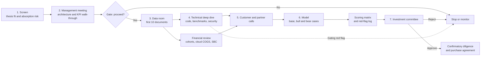
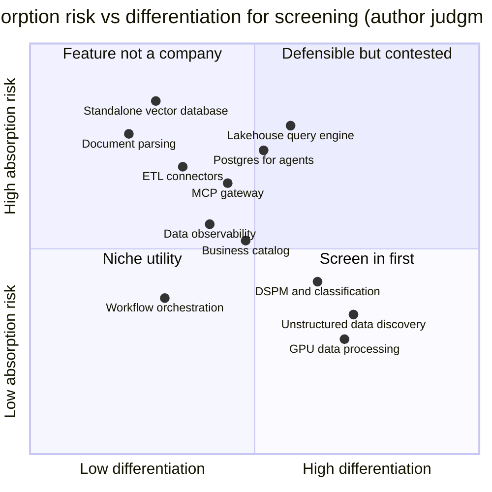

# 47. Technical and Business Diligence Checklist for a Data-Infrastructure Target
> **Depth:** L2 · **Reading time:** ~13 min · **Last verified:** 2026-11-01 · **Prerequisites:** [Ch 36 Unit economics and KPIs](../05-business-and-economics/ch36-unit-economics-kpis.md), [Ch 38 Open source as strategy](../05-business-and-economics/ch38-open-source-strategy.md), [Ch 39 M&A history](../05-business-and-economics/ch39-ma-history.md)

## TL;DR

- **Data-infrastructure diligence fails in predictable places.** Most failures trace to one of four gaps: a revenue metric nobody reconciled to GAAP, a licence or community the buyer could not control, a feature that Databricks, Snowflake or a hyperscaler was about to ship for free, or a pricing model that clashed with the acquirer's own. This chapter is a checklist for all four, organized into eight workstreams.
- **Each workstream follows the same pattern: what to ask, what to request, what good looks like, and the red flags.** A red-flag table (Figure 47.5) lists 18 tests. A weighted scoring matrix (Figure 47.6) turns the findings into a number the investment committee (IC) can compare across targets, and it includes gating criteria that override the total.
- **Unit economics carries the most weight because the definitions are the least standard.** [Revenue run-rate](../glossary.md#revenue-run-rate), [ARR](../glossary.md#annual-recurring-revenue) and GAAP revenue are three different numbers. Databricks reports a company-stated run-rate above $7B, while Fivetran and dbt Labs report combined ARR "approaching $600M". Neither is audited revenue.[^db-7b][^fivetran-dbt]
- **Platform-absorption risk is the defining product question.** Vector search, document parsing, Postgres, lakehouse engines and MCP gateways all became platform features or platform acquisitions between 2024 and 2026.[^s3-vectors][^datavolo][^dremio][^ducklabs][^natoma] Screen targets on differentiation against absorption risk (Figure 47.2) before spending diligence money.
- **For a storage acquirer, integration fit is a workstream of its own.** The questions are channel conflict with data-platform partners, keeping an open-source community after the deal, and reconciling per-TB and consumption pricing. The 1touch deal ($125.0M cash, closed May 7, 2026) is the template for a small, metadata-layer purchase that avoided most of these traps.[^1touch]

## Why this matters (business + Everpure lens)

Data-infrastructure targets are harder to diligence than most software. The product is invisible to the end user, so reference calls with business buyers say little about the engine underneath. Revenue is often consumption-recognized, so last quarter's number tells you what customers ran, not what they committed to. And much of the code may be open source, which means the asset you are buying can be legally reproduced by a hyperscaler. The cautionary case is still HP–Autonomy, an $8.8B write-down within about a year of closing, which began as a revenue-quality problem rather than a technology problem.[^autonomy-wd] The modern equivalents are subtler: a run-rate quoted as ARR, a net revenue retention figure with no gross retention behind it, or a gross margin that falls as the serverless mix rises.

For Everpure, the lens is specific. The company's 2026 move into data intelligence, through the 1touch acquisition and the June 2026 relaunch as Data Intelligence, puts it in the market for metadata, governance and AI-data-pipeline assets.[^1touch] Every target in that market sells to the same data teams that Databricks and Snowflake sell to, and Everpure is itself a launch partner in the Databricks Storage Ecosystem (June 2026).[^storage-eco] A checklist that tests channel conflict and pricing fit alongside the usual technology and financial questions is therefore one of the options a strategy team might evaluate, based on public information. It is not a description of Everpure's process.

## The diligence process

The workflow below is the sequence most corporate-development teams follow. The useful discipline is the two gates. A target that fails the screen or the management meeting should not reach the data room, because data-room work is where diligence cost and deal momentum both build up.

*Figure 47.1 — The diligence funnel. The technical deep dive and the financial review run in parallel off the same data room, and either can stop the process. The scoring matrix sits between the model and the IC so that judgment is recorded before the vote.*

Two habits improve the output. First, keep a running red-flag log from the first meeting, with an owner and a test for each flag, so that nothing raised early is forgotten by the IC date. Second, write the bear case before the base case. Teams that build the base case first tend to anchor on management's numbers.

## Workstream checklists

### 1. Architecture and technology

The question is whether the product works at the scale and in the environment the acquirer cares about, and whether it is open enough to fit into customers' existing stacks. Read [Ch 7](../01-data-systems-foundations/ch07-open-table-formats.md) and [Ch 8](../01-data-systems-foundations/ch08-catalogs-and-metastores.md) first, because the open-format stance now decides most enterprise architecture reviews.

- **What to ask.** What is the storage engine, and who owns the on-disk format? How does the system scale, and what was the largest production deployment by data volume, concurrency and tenant count? Is [multi-tenancy](../glossary.md#multi-tenancy) enforced by separate compute, separate processes or only by row filters? Does it read and write Apache Iceberg and Delta Lake natively, and does it speak the [Iceberg REST catalog](../glossary.md#iceberg-rest-catalog) protocol?[^irc-spec] Which certifications does it hold: SOC 2 Type II, ISO 27001, HIPAA attestations, FedRAMP?
- **What to request.** An architecture document, production telemetry for the five largest customers, benchmark scripts and configurations, the latest penetration test and SOC 2 report with exceptions, and an export test that moves a customer table out to Iceberg.
- **What good looks like.** Benchmarks you can reproduce on your own hardware with published configurations. Native open-format reads and writes rather than a one-way export. Tenant isolation explained at the process or account level. A SOC 2 Type II report with few exceptions and a remediation trail.
- **Red flags.** Vendor-run benchmarks with no configurations. A proprietary format with no open export path, which creates [vendor lock-in](../glossary.md#vendor-lock-in) that enterprise buyers now push back on. "Iceberg support" that turns out to be read-only. Certifications that are "in progress."

> **Bridge: datasheet typicals versus corner characterization.** A vendor benchmark is a datasheet "typical" value: measured at nominal voltage, room temperature and a friendly workload. A semiconductor buyer qualifies a part at its process corners. Ask for the data-platform equivalent: the worst-case concurrency, the largest tenant, the cold-cache query and the slowest storage tier, not the headline TPC-style number.

### 2. Open source and licensing

If the target's core is open source, the licence is part of the asset. [Ch 38](../05-business-and-economics/ch38-open-source-strategy.md) covers the mechanics. Diligence needs to answer three questions: can a hyperscaler sell the same thing, can the vendor change the terms, and would customers have a credible fork if it did?

- **What to ask.** Which licence covers the core, and which covers the paid layer ([open core](../glossary.md#open-core), [source-available](../glossary.md#source-available-license) or proprietary)? Does a [contributor license agreement](../glossary.md#contributor-license-agreement) give the company the right to relicense? Who holds the trademark, the company or a foundation? Has the licence ever changed, and what happened to the community afterwards?
- **What to request.** Licence history, the CLA text, commit and maintainer data by employer for the last three years, and download or usage telemetry.
- **What good looks like.** A clear separation between an open core the company does not need to restrict and a paid layer a hyperscaler cannot easily copy. [Contributor concentration](../glossary.md#contributor-concentration) that is high enough to give the company roadmap control but not so high that the project dies if a few engineers leave.
- **Red flags.** A relicense under consideration. A managed hyperscaler version of the same project. Recent history is instructive. Redis moved to source-available licences in March 2024. In its first six months, Valkey, the Linux Foundation fork, drew 29 contributors from 10 companies, 18 of whom had previously contributed to Redis.[^redis-2024][^valkey][^foster] Elasticsearch saw the same pattern with AWS's OpenSearch fork in 2021.[^elastic-2021] A relicense does not necessarily lower the price: IBM still paid $6.4B for HashiCorp after its Terraform relicense.[^ibm-hashi] It does change what you are buying. You get the code and the customers, but not the community.

### 3. Product and roadmap

The central risk is [feature absorption](../glossary.md#feature-absorption), where the target's core function becomes a bundled feature of a platform the customer already pays for. Between late 2024 and late 2026, Snowflake bought Datavolo for document ingestion, AWS made vector search a feature of S3 (S3 Vectors, generally available December 2025), SAP bought Dremio, AWS agreed to buy DuckLabs, and Snowflake agreed to buy the MCP-gateway company Natoma for about $110M of stated consideration.[^datavolo][^s3-vectors][^dremio][^ducklabs][^natoma] The company chapters ([Ch 25](../04-company-deep-dives/ch25-databricks.md) to [Ch 34](../04-company-deep-dives/ch34-application-giants-data-platforms.md)) track each platform's roadmap.

- **What to ask.** Which of your top ten features appear in Databricks, Snowflake, AWS, Microsoft or Google release notes from the last 18 months? Why do customers still pay you after the platform version ships? How ready is the product for AI agents: does it expose an [MCP server](../glossary.md#mcp-server), and does it publish semantic context (a [semantic layer](../glossary.md#semantic-layer) or business definitions) that an agent can use?
- **What to request.** A feature-by-feature overlap map against the platforms, win/loss records against platform-native options, and the roadmap with dates and owners.
- **What good looks like.** A workload where the target is several times cheaper or materially more capable, not just "better integrated." [Model Context Protocol](../glossary.md#model-context-protocol) support shipped and in use, now that MCP sits in a neutral foundation (donated to the Agentic AI Foundation in December 2025).[^mcp-donate]
- **Red flags.** A roadmap that chases platform announcements. Win rates that fall after a platform launch. "Agent-ready" claims with no shipped MCP endpoint.

*Figure 47.2 — A screening view of target categories, author judgment, not data. Categories in the top half have already seen platform launches or platform acquisitions. The bottom-right quadrant holds categories closest to where the bytes live, where a storage acquirer has an advantage the platforms lack.*

### 4. Unit economics

This workstream carries the largest weight in the scoring matrix because the metrics are company-defined, unaudited and easy to flatter. The SEC's 2020 guidance requires public companies to define each key metric and calculate it consistently. Private targets owe you no such discipline.[^sec-kpi] [Ch 35](../05-business-and-economics/ch35-business-models.md) and [Ch 36](../05-business-and-economics/ch36-unit-economics-kpis.md) explain the mechanics.

- **What to ask.** How is ARR defined, and has the definition changed? Is consumption included as trailing usage annualized, or as contracted commitments? Who pays the cloud bill: the customer (classic deployment, [bring your own cloud](../glossary.md#bring-your-own-cloud)) or the vendor ([serverless compute](../glossary.md#serverless-compute))? How volatile is consumption per account?
- **What to request.** A monthly revenue file by customer and product since inception, cohort tables for [net revenue retention](../glossary.md#net-revenue-retention) and [gross revenue retention](../glossary.md#gross-revenue-retention), cloud invoices and committed-spend agreements, sales-and-marketing spend by quarter, and the fully diluted cap table.
- **What good looks like.** ARR that reconciles to GAAP revenue within a known, explained gap. NRR backed by GRR, by cohort. Gross-profit dollars rising as serverless grows, even if margin percentage dips. Snowflake shows the pattern: non-GAAP product gross margin was 74.7% in Q2 FY2027 (May–Jul 2026), and the full-year guide was trimmed to 74% because AI workloads use more expensive compute.[^sf-q2]
- **Red flags.** NRR shown only as a blended figure. A hyperscaler commit larger than forecast usage. [Stock-based compensation](../glossary.md#stock-based-compensation) treated as free. Consumption can fall as fast as it rose. Snowflake's NRR went from 178% in FY2022 (Feb 2021–Jan 2022) to 126% by FY2025 (Feb 2024–Jan 2025), and product revenue growth fell from 106% to 38% over FY2022–FY2024 as customers optimized spend (company-stated KPI; GAAP growth).[^fin-csv]

| KPI | Formula | Reference point (basis, date) | Diligence trap |
|---|---|---|---|
| ARR | Annualized value of recurring contracts at a point in time | Fivetran + dbt Labs "approaching $600M" (company-stated, Jun 2026)[^fivetran-dbt] | Consumption ARR is an annualization of usage, not a contract |
| Revenue run-rate | Latest quarter revenue × 4 (or month × 12) | Databricks >$7B (company-stated, unaudited, Aug 2026)[^db-7b] | Peak-month annualization; mixes one-off and recurring |
| Net revenue retention | Cohort spend in year 2 ÷ same cohort's spend in year 1 | Snowflake 126% (company-stated, Q2 FY2027)[^sf-q2] | Cohort and window vary; lags quarterly inflections |
| Gross revenue retention | (Prior spend − contraction − churn) ÷ prior spend, capped at 100% | Rarely disclosed by public comps[^fin-csv] | Strong NRR can hide a leaky base |
| Gross margin | (Revenue − COGS) ÷ revenue; split by deployment model | Snowflake product 70.9% GAAP / 74.7% non-GAAP; GitLab ~86.5% non-GAAP (Q2 FY2027)[^sf-q2][^comps] | Serverless mix lowers %, may raise $ |
| Magic number | (Quarter revenue − prior quarter revenue) × 4 ÷ prior-quarter S&M | ~0.7 is the common healthy threshold[^scale] | Day-count and one-quarter noise |
| CAC payback | 12 ÷ (magic number × gross margin), in months | Derived from the two rows above | Ignores churn; inherits noise |
| SBC intensity | SBC ÷ revenue | Snowflake ~27% (press-reported, Q2 FY2027)[^secapi] | Excluded from non-GAAP; dilution is permanent |
| On-demand share | On-demand revenue ÷ total revenue | Snowflake ~1% (FY2026)[^sf-10k26] | Low share does not mean low volatility, because prepaid capacity is still recognized only as consumed |

*Figure 47.3 — KPI definitions for the unit-economics workstream. Rebuild every metric from the monthly revenue file rather than accepting management's figure. The reference points are comparison anchors, not pass marks.*

### 5. Customers and go-to-market

Data platforms increasingly sell through hyperscaler marketplaces and systems integrators, so a target's pipeline may depend on partners it does not control ([Ch 40](../05-business-and-economics/ch40-gtm-partnerships.md)). Snowflake reported more than $2B of AWS Marketplace sales in calendar 2025 (company-stated), and AWS private-offer fees run at 3%, 2% or 1.5% depending on contract size.[^sf-aws-2b][^aws-fees]

- **What to ask.** What share of revenue comes from the top 10 and top 25 customers? What share of new bookings is [cloud marketplace](../glossary.md#cloud-marketplace)-transacted or hyperscaler [co-sell](../glossary.md#co-sell)-sourced? What is logo churn, as distinct from dollar churn? Which partner sources the most pipeline?
- **What to request.** Bookings by source (direct, marketplace, SI, co-sell), partner agreements with their termination and exclusivity clauses, a churned-customer list with reasons, and a reference list the team chooses, not one management chooses.
- **What good looks like.** No single customer or partner large enough to sink the model. Marketplace used as a payment channel rather than as the only source of demand. Reference calls that cover churned and contracted customers as well as happy ones.
- **Red flags.** [Customer concentration](../glossary.md#customer-concentration) with renewals due in the first year after close. A single hyperscaler co-sell program sourcing most of the pipeline, through programs such as AWS ISV Accelerate, which the hyperscaler can change unilaterally.[^isva] Rising [logo churn](../glossary.md#logo-churn) masked by expansion in the largest accounts.

### 6. Team and organization

In small data-infrastructure companies, a handful of engineers often hold the knowledge of the storage engine or query optimizer. [Key-person risk](../glossary.md#key-person-risk) is therefore a valuation item, not just an HR item.

- **What to ask.** Who wrote the core engine, and are they still there? What role will each founder take after close? How fast does the company hire senior engineers, and where does it lose them?
- **What to request.** An org chart with tenure, a vesting schedule for every key employee, attrition by function for three years, and open roles with time-to-fill.
- **What good looks like.** Core knowledge spread across several engineers. Founders who want operating roles after close. A retention plan sized to the risk.
- **Red flags.** Key engineers fully vested at signing. Founders who plan to leave. Retention that relies only on cash. Acquirers use [holdbacks](../glossary.md#holdback) for this. Confluent's WarpStream disclosure showed $135.1M of consideration plus up to $76.2M of holdbacks, which is a reminder that retention money can be a large share of the real price.[^warpstream]

### 7. Legal, IP and data privacy

Data-infrastructure products process customers' personal data, and AI features widen the exposure ([Ch 15](../02-pipelines-and-governance/ch15-governance-security-privacy.md)). GDPR fines can reach €20M or 4% of worldwide turnover, whichever is higher.[^gdpr] The EU AI Act's data-governance duties for high-risk systems now apply from December 2, 2027 (Annex III) and August 2, 2028 (Annex I), after the 2026 AI Omnibus.[^omnibus] The EU Data Act's cloud-switching rules have applied since September 12, 2025.[^dataact]

- **What to ask.** Is the target a data processor for customer personal data, and under which agreements? Where is data stored and processed, and can customers pin a region? Do any features fall into AI Act high-risk categories? What patents does it own, and has it received infringement claims?
- **What to request.** Data processing agreements (DPAs) and the subprocessor list, a region map, the patent schedule, an open-source software composition analysis (SCA) report, and the litigation log.
- **What good looks like.** Standard DPAs, data residency by region, no copyleft code mixed into proprietary components, and a clean claims history.
- **Red flags.** AGPL or GPL code inside a closed product. No residency controls for EU customers. Training data or telemetry used without a contractual basis.

### 8. Integration fit for a storage acquirer

This workstream is specific to the buyer. For a storage company it decides whether the target adds value to the installed base or creates friction with the data platforms the customer already runs. [Ch 39](../05-business-and-economics/ch39-ma-history.md) shows that storage buyers did better when they bought metadata and data services (Portworx, 1touch) than when they bought engines (Greenplum, Pentaho).

- **What to ask.** Which integration path applies: a connector into an existing data-intelligence layer, software that runs on the array, metadata published into Unity Catalog or Horizon, or a co-packaged appliance? Does the target compete with Databricks, Snowflake or Starburst, all of which have public relationships with storage vendors?[^storage-eco][^starburst-ep] If the target is open source, will the community stay after a storage company owns the project? How does consumption pricing map onto per-TB or reserve-commitment pricing?
- **What to request.** The partner list with revenue by partner, the community's governance documents, and a pricing reconciliation that runs the target's top ten customers through the acquirer's pricing model.
- **What good looks like.** A target that makes the storage more valuable to the data platforms rather than replacing them. A public commitment to keep the licence and governance unchanged, or a foundation donation. A pricing bridge the sales team can explain. Everpure's own Evergreen//One model already combines a reserve commitment with on-demand charges, and both feed its Subscription ARR KPI, so a consumption-priced target is not foreign to it.[^ep-10k]
- **Red flags.** [Channel conflict](../glossary.md#channel-conflict) with a platform partner that sources joint pipeline. A community that signals it will fork. Sales compensation plans that cannot pay on both per-TB and consumption revenue.

| Integration path | What it means | Public precedent | Channel-conflict risk | Pricing fit with per-TB or reserve commitment |
|---|---|---|---|---|
| Absorb into an existing data-intelligence layer | Target becomes a feature of the acquirer's console | 1touch relaunched as Everpure Data Intelligence[^1touch] | Low: adds metadata, not a competing engine | Good: bundled into existing contracts |
| Keep the brand for a new buyer | Separate product line sold to a different persona | Pure–Portworx, sold to platform engineers ([Ch 39](../05-business-and-economics/ch39-ma-history.md)) | Low to moderate | Separate price book needed |
| Publish into partner catalogs | Tags and policies flow into Unity Catalog or Horizon | Databricks Storage Ecosystem; Everpure OpenSharing connector in private preview[^storage-eco][^everpure-os] | Low: makes the partner's platform better | Neutral |
| Co-packaged lakehouse or query engine | Acquirer ships an engine on its own storage | 2010s engine buys (EMC–Greenplum, Hitachi–Pentaho) ([Ch 39](../05-business-and-economics/ch39-ma-history.md)) | High: competes with Databricks, Snowflake and Starburst | Poor: consumption engine on a capacity contract |

*Figure 47.4 — Integration paths for a storage acquirer. The further a path moves from metadata toward the query engine, the higher the channel conflict and the worse the pricing fit.*

> **Storage bridge.** The storage acquirer's advantage is location: it already holds the enterprise's unstructured and on-premises bytes, and often the backup copies too. Targets that turn that location into metadata (discovery, classification, semantic context) inherit the advantage. Targets that compete with the customer's query engine do not. See the companion *Everpure Tech Atlas* for how the array exposes that data.

## Red-flag table

| # | Red flag | Why it matters | How to test |
|---|---|---|---|
| 1 | ARR definition changed in the last two years, or run-rate is presented as ARR | Inflates the base the multiple is applied to | Reconcile ARR to GAAP revenue by quarter; ask for every past definition |
| 2 | NRR disclosed without GRR or by cohort | Expansion in a few accounts can hide a leaking base | Rebuild NRR and GRR from the monthly customer revenue file |
| 3 | Top customers dominate revenue or expansion | One renewal can break the model | Revenue by customer by quarter; renewal calendar for the first year after close |
| 4 | Gross margin falls as serverless grows, with flat gross-profit dollars | The vendor is reselling cloud compute at thin margins | COGS by deployment model; cloud invoices reconciled to COGS |
| 5 | Hyperscaler committed spend exceeds forecast usage | A take-or-pay liability transfers to the buyer | Read the commit agreement; model burn-down against forecast |
| 6 | Consumption concentrated in workloads customers can optimize | Revenue can drop quickly, as in the 2022–23 optimization cycle | Monthly usage by top account and workload; price-performance release history |
| 7 | Relicense under discussion, or a CLA that allows one | Triggers fork risk and community loss | Licence history; board minutes; community metrics before and after any change |
| 8 | Very high or very low contributor concentration | High: key-person risk. Low: the company does not control the roadmap | Commits and maintainers by employer for three years |
| 9 | A hyperscaler offers a managed version of the same project | Price ceiling and lost customer relationships | Win/loss against the managed service; price comparison |
| 10 | Benchmarks vendor-run with unpublished configurations | Performance claims may not survive your workload | Reproduce on your hardware with published configurations |
| 11 | Proprietary format or catalog with no open export | Customers increasingly reject lock-in; the buyer inherits the pushback | Export test to Iceberg; Iceberg REST catalog conformance run |
| 12 | Roadmap overlaps recent platform releases | Feature absorption compresses pricing | Map features to Databricks, Snowflake and hyperscaler release notes |
| 13 | One marketplace or co-sell program sources most pipeline | The partner can change terms or compete | Bookings by source; partner contract termination clauses |
| 14 | Core engineers fully vested or founders leaving | Knowledge walks out after close | Vesting schedules; retention plan; holdback sizing |
| 15 | SBC high and rising with a large option overhang | Real cost moves to the acquirer's share count | SBC ÷ revenue trend; fully diluted cap table |
| 16 | Personal data processed without DPAs or residency options | GDPR exposure up to 4% of worldwide turnover | DPA inventory; subprocessor list; region map |
| 17 | Copyleft code inside proprietary components | Forced disclosure or rewrite after close | Independent SCA scan, not the target's own |
| 18 | Price anchors taken from press reports | Press figures often exceed filed prices | Use filed figures: Snowflake–Crunchy Data was $164.5M filed against ~$250M press-reported[^crunchy] |

*Figure 47.5 — Eighteen red flags with a test for each. Rows 1–6 sit with the financial team, 7–13 with the technical and product team, and 14–18 with HR, legal and corporate development. Rows 7, 16 and 17 are usually gating.*

## Scoring matrix

The matrix converts the workstreams into a weighted score from 1 to 5. Weights reflect where data-infrastructure deals have historically gone wrong. They are author judgment and should be re-weighted for each thesis.

| Criterion | Weight | 1 = weak | 3 = acceptable | 5 = strong | Gating? |
|---|---|---|---|---|---|
| Architecture and technology | 15% | Unreproducible benchmarks; proprietary format; no SOC 2 | Reproducible at mid scale; Iceberg read; SOC 2 Type II | Reproducible at largest scale; native Iceberg/Delta and REST catalog; clean audits | No |
| Open source and licensing | 10% | Relicense pending; hyperscaler fork exists | Stable licence; some hyperscaler overlap | Clear open-core split; foundation-held core; healthy community | Yes, if a relicense would trigger a fork |
| Product and absorption risk | 15% | Top features shipped by a platform | Partial overlap; defensible workload | Several times better on a workload platforms ignore; MCP and semantic context shipped | No |
| Unit economics | 20% | ARR unreconciled; NRR without GRR; margin falling in dollars | Reconciled ARR; NRR and GRR by cohort; stable margin | Clean reconciliation; strong GRR; rising gross-profit dollars; magic number near or above healthy threshold | Yes, if ARR does not reconcile |
| Customers and GTM | 10% | Concentrated; one partner sources most pipeline | Moderate concentration; mixed sources | Diversified; marketplace used as payment rail | No |
| Team and organization | 10% | Core engineers vested; founders exiting | Partial retention coverage | Knowledge distributed; founders committed; retention sized | No |
| Legal, IP and privacy | 5% | Copyleft contamination; no DPAs | Minor remediation needed | Clean SCA; standard DPAs; residency | Yes, for copyleft or privacy breaches |
| Integration fit | 15% | Direct conflict with key platform partners; pricing clash | Manageable conflict; pricing bridge exists | Makes partners' platforms better on our storage; community retained | No |

*Figure 47.6 — Weighted scoring matrix, author judgment. Weighted total = Σ (weight × score). A gating "1" stops the deal regardless of the total, which keeps a strong technology score from outvoting a licensing or revenue-quality failure.*

As an illustrative example (not a real target), a catalog company that scores 4 on architecture, 4 on licensing, 2 on absorption risk, 3 on unit economics, 3 on GTM, 4 on team, 4 on legal and 4 on integration fit has a weighted total of 3.4. The low absorption score is the item to escalate. The IC should ask whether the price assumes the platform catalogs stay behind, because Unity Catalog and Horizon are moving into the same space ([Ch 33](../04-company-deep-dives/ch33-governance-catalog-security-companies.md)).

## First 10 documents to request

1. **Monthly revenue by customer and product since inception.** Every unit-economics metric can be rebuilt from this file. If it is refused, treat the refusal as a red flag.
2. **ARR, run-rate and NRR definitions, with history.** These show whether the headline metric changed when it became inconvenient.
3. **Cloud invoices and hyperscaler committed-spend agreements.** These show who pays the cloud bill and what take-or-pay exposure transfers.
4. **Cohort tables for NRR and GRR.** Request them by signing year, size band and product.
5. **Architecture document and benchmark kit.** This lets your engineers reproduce performance claims.
6. **Licence history, CLA and contributor data by employer.** Together these test relicensing rights and community dependence.
7. **SOC 2 Type II report, penetration test and incident log.** These show security posture with exceptions, not marketing claims.
8. **Top 25 customer contracts and partner agreements.** Look for termination rights, exclusivity, most-favoured-nation pricing and change-of-control clauses.
9. **Org chart with tenure, vesting schedules and attrition.** These size key-person risk and retention cost.
10. **DPAs, subprocessor list, region map and SCA report.** These cover privacy, residency and open-source compliance in one pass.

Ask for documents 1–4 before the management meeting if possible. A target that shares them early usually has clean numbers.

## Conversation playbook

**Three questions for PMs and corporate-development peers**

1. "Which of this target's features have Databricks, Snowflake or the hyperscalers announced in the last 18 months?" *A good answer* names the specific releases and explains which customer segment still pays for the standalone product.
2. "Does the headline ARR reconcile to GAAP revenue, and what is in the gap?" *A good answer* gives the bridge: consumption annualization, multi-year commitments, services, and any one-off items.
3. "Who is harmed if we buy this, among our platform partners?" *A good answer* names the partner, the joint pipeline at stake, and the plan to keep the relationship.

**Three questions for the target's engineers and architects**

1. "Show us your largest tenant and your worst-case query." *Good:* telemetry with hardware assumptions, cold-cache numbers and concurrency limits.
2. "If a customer wanted to leave tomorrow, how would their data and metadata move?" *Good:* an Iceberg or Delta export and an Iceberg REST catalog endpoint, demonstrated, not described.
3. "Which three people, if they left, would stall the roadmap?" *Good:* a candid list and a plan to spread the knowledge, not "nobody."

**What good answers sound like.** They state the basis of every number (GAAP, company-stated, run-rate). They separate gross from net retention. They treat platform overlap as a fact to manage rather than something to deny.

**Don't say this**

- "Their ARR is $X, so revenue is $X." *ARR, run-rate and GAAP revenue are different numbers, and consumption ARR is an annualization of usage.*
- "NRR is 130%, so the base is sticky." *NRR includes expansion. Stickiness is GRR, which is often undisclosed.*
- "It is open source, so there is no lock-in risk for us." *A CLA can allow a relicense, and a hyperscaler can sell the same code. Read the licence and the governance.*
- "Serverless lowers their margin, so it is bad." *Judge serverless in gross-profit dollars, not margin points.*
- "The platforms will partner, not compete." *The 2024–2026 record of platform launches and platform acquisitions says otherwise.*[^datavolo][^dremio][^natoma]

## Key terms

- [Annual recurring revenue](../glossary.md#annual-recurring-revenue) — annualized value of recurring contracts at a point in time.
- [Revenue run-rate](../glossary.md#revenue-run-rate) — the latest quarter's or month's revenue annualized, company-stated and unaudited.
- [Net revenue retention](../glossary.md#net-revenue-retention) — a fixed cohort's spend this year divided by its spend last year.
- [Gross revenue retention](../glossary.md#gross-revenue-retention) — the share of a cohort's prior spend kept after contraction and churn, excluding expansion.
- [Magic number](../glossary.md#magic-number) — annualized new revenue divided by the prior quarter's sales and marketing spend.
- [CAC payback](../glossary.md#cac-payback) — months of gross profit needed to recover acquisition spend.
- [Stock-based compensation](../glossary.md#stock-based-compensation) — employee pay in equity, a real but non-cash cost.
- [Serverless compute](../glossary.md#serverless-compute) — vendor-run compute whose cloud cost sits in the vendor's COGS.
- [Bring your own cloud](../glossary.md#bring-your-own-cloud) — deployment in which the customer's cloud account runs and pays for the compute.
- [Feature absorption](../glossary.md#feature-absorption) — a standalone product's core function becoming a platform feature.
- [Contributor concentration](../glossary.md#contributor-concentration) — the share of an open-source project's commits or maintainers from one company or a few people.
- [Contributor license agreement](../glossary.md#contributor-license-agreement) — a contract granting a project owner rights over contributions, often including the right to relicense.
- [Open core](../glossary.md#open-core) — a free open-source engine with paid proprietary features or services around it.
- [Source-available license](../glossary.md#source-available-license) — a licence that publishes code but restricts competing uses.
- [Vendor lock-in](../glossary.md#vendor-lock-in) — the cost to a customer of leaving a vendor's format, catalog or contract.
- [Multi-tenancy](../glossary.md#multi-tenancy) — serving many customers from shared infrastructure with isolation between them.
- [Iceberg REST catalog](../glossary.md#iceberg-rest-catalog) — the vendor-neutral API engines use to find and commit Iceberg tables.
- [Model Context Protocol](../glossary.md#model-context-protocol) — the open protocol through which AI agents call tools and data sources.
- [MCP server](../glossary.md#mcp-server) — a service that exposes tools or data to agents over MCP.
- [Semantic layer](../glossary.md#semantic-layer) — shared business definitions of metrics and entities that tools and agents query.
- [Cloud marketplace](../glossary.md#cloud-marketplace) — a hyperscaler storefront through which customers buy third-party software against committed cloud spend.
- [Co-sell](../glossary.md#co-sell) — joint selling in which a partner's sellers help close the vendor's deal.
- [Customer concentration](../glossary.md#customer-concentration) — the share of revenue from the largest customers.
- [Logo churn](../glossary.md#logo-churn) — the share of customers lost in a period, counted by account rather than by dollars.
- [Key-person risk](../glossary.md#key-person-risk) — the value lost if a few individuals leave.
- [Holdback](../glossary.md#holdback) — deal consideration withheld or tied to continued employment.
- [Channel conflict](../glossary.md#channel-conflict) — friction when a vendor's product competes with partners that resell or integrate it.
- [Data room](../glossary.md#data-room) — the controlled repository where a target shares diligence documents.

## Sources

[^db-7b]: Databricks, "Databricks Grows >80% YoY, Surpasses $7B Revenue Run-Rate, Scales Lakebase, Genie and Unity AI Gateway," https://www.databricks.com/company/newsroom/press-releases/databricks-grows-80-yoy-surpasses-7b-revenue-run-rate-scales, published 2026-08-13; retrieved 2026-11-01. Company-stated run-rate, unaudited.
[^fivetran-dbt]: Fivetran, "Fivetran & dbt Labs complete merger to create the data infrastructure for trusted AI agents," https://www.fivetran.com/press/fivetran-dbt-labs-complete-merger-to-create-the-data-infrastructure-for-trusted-ai-agents, published 2026-06; retrieved 2026-11-01. Company-stated ARR.
[^s3-vectors]: Amazon Web Services, "Top announcements of AWS re:Invent 2025," https://aws.amazon.com/blogs/aws/top-announcements-of-aws-reinvent-2025, published 2025-12; Blocks & Files, "AWS piles on S3 upgrades from vector search to 50 TB objects," https://www.blocksandfiles.com/ai-ml/2025/12/03/aws-piles-on-s3-upgrades-from-vector-search-to-50-tb-objects/1704690, published 2025-12-03; retrieved 2026-11-01. Company-stated.
[^datavolo]: Snowflake press release, "Snowflake Agrees to Acquire Open Data Integration Platform Datavolo," https://www.snowflake.com/news/snowflake-agrees-to-acquire-open-data-integration-platform-datavolo/, published 2024-11-20; TechCrunch, 2024-11-20; retrieved 2026-11-01.
[^dremio]: SAP News, "SAP Completes Dremio Acquisition," https://news.sap.com/2026/07/sap-completes-dremio-acquisition/, published 2026-07-06; Dremio newsroom, "SAP to Acquire Dremio to Unify SAP and Non-SAP Data to Power Agentic AI," https://www.dremio.com/newsroom/sap-to-acquire-dremio-to-unify-sap-and-non-sap-data-to-power-agentic-ai/, published 2026-05-04; retrieved 2026-11-01. Terms undisclosed.
[^ducklabs]: Amazon, "AWS to acquire DuckLabs," https://www.aboutamazon.com/news/company-news/aws-ducklabs, published 2026-08-26; The Register, https://www.theregister.com/databases/2026/08/26/aws-buys-ducklabs-the-people-behind-the-popular-in-process-olap-database/5292590, published 2026-08-26; retrieved 2026-11-01.
[^natoma]: Snowflake Inc., Form 10-Q for the quarter ended 2026-04-30 (Natoma Labs, ~$110M stated consideration), https://www.sec.gov/Archives/edgar/data/0001640147/000164014726000030/snow-20260430.htm, published 2026-05/06; retrieved 2026-11-01 (per `data/ma_deals.csv`).
[^1touch]: Everpure, Inc., Form 10-Q for the quarter ended 2026-05-03, https://www.sec.gov/Archives/edgar/data/0001474432/000147443226000061/pstg-20260503.htm, published 2026-06; Cleary Gottlieb, "Everpure Completes Acquisition of 1touch," https://www.clearygottlieb.com/news-and-insights/news-listing/everpure-completes-acquisition-of-1touch, published 2026-05-11; World Wide Technology (reposting company release), https://www.wwt.com/news/pure-storage-rebrands-to-everpure-and-announces-intent-to-acquire-1touch, published 2026-02-23; retrieved 2026-11-01.
[^autonomy-wd]: Computer Weekly, "HP writes down Autonomy by $8.8bn," https://www.computerweekly.com/news/2240172197/HP-writes-down-Autonomy-by-88bn, published 2012-11-20; CNN Money, "HP earnings," https://money.cnn.com/2012/11/20/technology/enterprise/hp-earnings/, published 2012-11-20; retrieved 2026-11-01. Company-reported impairment.
[^storage-eco]: Databricks blog, "Announcing the Databricks Storage Ecosystem: Governing the Enterprise Data Estate Wherever It Lives," https://www.databricks.com/blog/announcing-databricks-storage-ecosystem-governing-enterprise-data-estate-wherever-it-lives, published 2026-06-10; StorageNewsletter, https://www.storagenewsletter.com/2026/06/24/announcing-the-databricks-storage-ecosystem-governing-the-enterprise-data-estate-wherever-it-lives/, 2026-06-24; retrieved 2026-11-01 (as cited in Ch 25).
[^irc-spec]: Apache Iceberg, "REST Catalog Spec," https://iceberg.apache.org/rest-catalog-spec/, n.d. (living spec); retrieved 2026-11-01.
[^redis-2024]: Redis, "Redis Adopts Dual Source-Available Licensing," https://redis.io/blog/redis-adopts-dual-source-available-licensing/, published 2024-03-20; InfoQ, https://www.infoq.com/news/2024/03/redis-license-open-source/, published 2024-03; retrieved 2026-11-01.
[^valkey]: Linux Foundation, "Linux Foundation Launches Open Source Valkey Community," https://www.linuxfoundation.org/press/linux-foundation-launches-open-source-valkey-community, published 2024-03-28; retrieved 2026-11-01 (canonical citation; backers per the announcement).
[^foster]: Dawn Foster, "The New Dynamics of Open Source: Relicensing, Forks, & Community Impact," arXiv:2411.04739, https://arxiv.org/abs/2411.04739, published 2024-11; slides, https://fastwonderblog.com/wp-content/uploads/2024/11/Dawn-Foster-New-Dynamics-Relicensing-Forks-OFA-2024.pdf; The New Stack summary, https://thenewstack.io/what-happens-to-relicensed-open-source-projects-and-their-forks/; retrieved 2026-11-01. Valkey six-month contributor figures from slides and secondary summary.
[^elastic-2021]: FOSSlife, "Amazon Creates ALv2-Licensed Fork of Elasticsearch," https://www.fosslife.org/amazon-creates-alv2-licensed-fork-elasticsearch, published 2021-01; TechRepublic, "OpenSearch: AWS rolls out its open source Elasticsearch fork," https://www.techrepublic.com/google-amp/article/opensearch-aws-rolls-out-its-open-source-elasticsearch-fork/, published 2021-04; retrieved 2026-11-01.
[^ibm-hashi]: IBM, "IBM Completes Acquisition of HashiCorp, Creates Comprehensive, End-to-End Hybrid Cloud Platform," https://newsroom.ibm.com/2025-02-27-ibm-completes-acquisition-of-hashicorp,-creates-comprehensive,-end-to-end-hybrid-cloud-platform, published 2025-02-27; retrieved 2026-11-01.
[^mcp-donate]: Anthropic, "Donating the Model Context Protocol and establishing the Agentic AI Foundation," https://anthropic.com/news/donating-the-model-context-protocol-and-establishing-of-the-agentic-ai-foundation, published 2025-12-09; retrieved 2026-11-01.
[^sec-kpi]: U.S. Securities and Exchange Commission, "Commission Guidance on Management's Discussion and Analysis of Financial Condition and Results of Operations," Release No. 33-10751, https://www.sec.gov/rules/final/33-10751.htm, published 2020-01-30 (effective 2020-02-25); retrieved 2026-11-01.
[^sf-q2]: Snowflake Inc., "Snowflake Reports Financial Results for the Second Quarter of Fiscal 2027," https://www.nasdaq.com/press-release/snowflake-reports-financial-results-second-quarter-fiscal-2027-2026-09-02 (also Business Wire, https://secure.businesswire.com/news/home/20260902386235/en/Snowflake-Reports-Financial-Results-for-the-Second-Quarter-of-Fiscal-2027), published 2026-09-02; retrieved 2026-11-01. FY2027 = Feb 2026–Jan 2027; product gross margin 70.9% GAAP / 74.7% non-GAAP; NRR 126%; FY2027 non-GAAP product gross margin guide 74%.
[^fin-csv]: AI Data Atlas dataset `data/company_financials.csv` (Snowflake FY2020–Q2 FY2027 product revenue, NRR, RPO, margins, SBC; sources per row: Snowflake 10-Ks and earnings releases incl. https://www.sec.gov/Archives/edgar/data/1640147/000162828026011631/fy2026q4earnings.htm, published 2026-02-25); retrieved 2026-11-01. NRR and gross-retention disclosure as summarized in Ch 36.
[^comps]: AI Data Atlas dataset `data/public_comps.csv` (GitLab non-GAAP gross margin 86.5%, Q2 FY2027 = May–Jul 2026), sourced from stockanalysis.com and company releases; retrieved 2026-11-01.
[^scale]: Scale Venture Partners, "A History of the Magic Number," https://www.scalevp.com/blog/a-history-of-the-magic-number, published [VERIFY date]; retrieved 2026-11-01 (term coined 2005; ~0.7 healthy baseline).
[^secapi]: sec-api.io, "Snowflake (SNOW) stock after the $3.75bn convertible notes: Q2 FY2027 product revenue, RPO, insider sales and scenarios to FY2030," https://sec-api.io/insights/snowflake-snow-stock-after-the-3-75bn-convertible-notes-q2-fy2027-product-revenue-rpo-insider-sales-and-scenarios-to-fy2030, published 2026-10-10; retrieved 2026-11-01. Press-reported (secondary analysis citing the 10-Q): SBC ~$424M, ~27% of revenue.
[^sf-10k26]: Snowflake Inc., Form 10-K for the fiscal year ended January 31, 2026 (capacity vs on-demand arrangements; on-demand ~1%/2%/3% of revenue FY2026/FY2025/FY2024; rollover of unused capacity; revenue recognised as consumed), https://www.sec.gov/Archives/edgar/data/1640147/000164014726000008/snow-20260131.htm, published 2026-03; retrieved 2026-11-01.
[^sf-aws-2b]: Snowflake via Business Wire, "Snowflake Doubles AWS Marketplace Growth YoY, Eclipses $2 Billion in Sales…," https://www.businesswire.com/news/home/20251203483596/en/, published 2025-12-03; Amazon press, https://press.aboutamazon.com/aws/2025/12/snowflake-doubles-aws-marketplace-growth-yoy-eclipses-2-billion-in-sales-as-new-integrations-accelerate-enterprise-data-and-ai-adoption, 2025-12; retrieved 2026-11-01. Company-stated.
[^aws-fees]: AWS, "AWS Marketplace announces simplified and reduced listing fees for sellers," https://aws.amazon.com/about-aws/whats-new/2024/01/aws-marketplace-simplified-reduced-listing-fees/, published 2024-01; AWS Marketplace Seller Guide, "Understanding listing fees for AWS Marketplace sellers," https://docs.aws.amazon.com/marketplace/latest/userguide/listing-fees.html, living document (fees effective 2024-01-05); retrieved 2026-11-01.
[^isva]: AWS, "AWS ISV Accelerate Program," https://aws.amazon.com/partners/programs/isv-accelerate/, living document; AWS, "AWS ISV Accelerate, a co-sell program for AWS Partners," https://aws.amazon.com/about-aws/whats-new/2020/12/isv-accelerate/, published 2020-12; retrieved 2026-11-01.
[^warpstream]: Confluent, Inc., Form 10-Q for Q3 2024, https://www.sec.gov/Archives/edgar/data/1699838/000095017024119042/cflt-20240930.htm, published 2024-11; retrieved 2026-11-01 ($135.1M consideration plus up to $76.2M of holdbacks, as summarized in Ch 39).
[^gdpr]: Regulation (EU) 2016/679 (General Data Protection Regulation), EUR-Lex, https://eur-lex.europa.eu/eli/reg/2016/679/oj, published 2016-05-04 (applies from 2018-05-25); Article 83; retrieved 2026-11-01.
[^omnibus]: Council of the EU, "Artificial intelligence: Council and Parliament agree to simplify and streamline rules," https://www.consilium.europa.eu/en/press/press-releases/2026/05/07/artificial-intelligence-council-and-parliament-agree-to-simplify-and-streamline-rules/, published 2026-05-07; Future of Privacy Forum, "The AI Act implementation timeline: What changes under the AI Omnibus?," https://fpf.org/blog/the-ai-act-implementation-timeline-what-changes-under-the-ai-omnibus/, 2026 (Regulation (EU) 2026/1744; Annex III to 2027-12-02, Annex I to 2028-08-02); retrieved 2026-11-01.
[^dataact]: Regulation (EU) 2023/2854 (Data Act), EUR-Lex, https://eur-lex.europa.eu/eli/reg/2023/2854/oj, published 2023-12-22 (applies from 2025-09-12); Society for Computers and Law, "EU Data Act in force from 12 September 2025," https://www.scl.org/eu-data-act-in-force-from-12-september-2025/, 2025-09; retrieved 2026-11-01.
[^starburst-ep]: Everpure partner page, "Starburst" (Scalable Lakehouse Analytics reference architecture), https://www.everpuredata.com/la/partners/technology-alliance-partners/starburst.html, n.d.; retrieved 2026-11-01 (via `meta/research-briefing.md`).
[^everpure-os]: Everpure blog, "Everpure OpenSharing Connector," https://blog.everpuredata.com/products/everpure-opensharing-connector/, published 2026-06; retrieved 2026-11-01. Vendor-stated; private preview from 2026-06-09.
[^ep-10k]: Everpure, Inc. (formerly Pure Storage), Form 10-K for the fiscal year ended February 1, 2026 (Subscription ARR definition incl. on-demand billings × 4; Evergreen//One reserve commitment and on-demand structure), https://www.sec.gov/Archives/edgar/data/1474432/000147443226000027/pstg-20260201.htm, published 2026-03; retrieved 2026-11-01.
[^crunchy]: Snowflake Inc., Form 10-Q for the quarter ended 2025-10-31, https://www.sec.gov/Archives/edgar/data/1640147/000164014725000211/snow-20251031.htm, published 2025-12; TechCrunch, "Snowflake to acquire database startup Crunchy Data," https://www.techcrunch.com/2025/06/02/snowflake-to-acquire-database-startup-crunchy-data/, published 2025-06-02; retrieved 2026-11-01. $164.5M filed vs ~$250M press-reported, as summarized in Ch 39.
