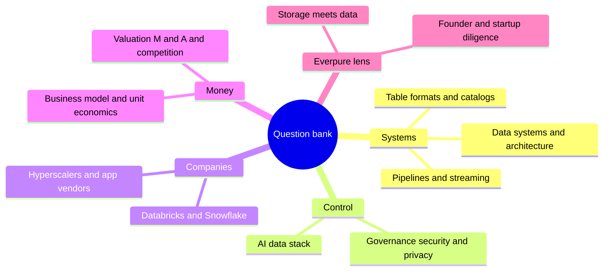
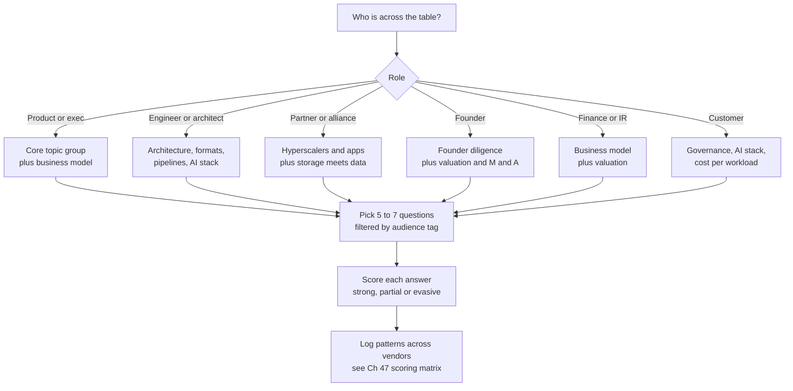
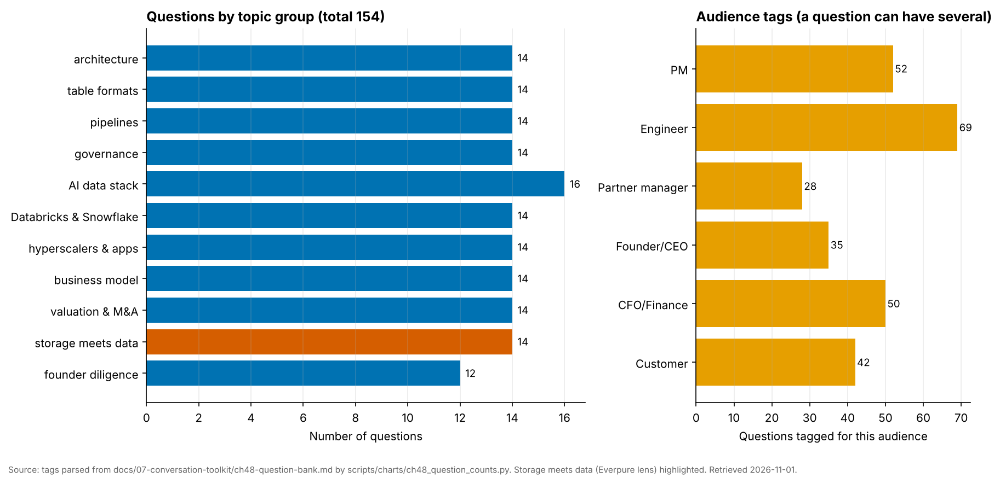

# 48. Question Bank: 154 Questions
> **Depth:** L2 · **Reading time:** ~36 min · **Last verified:** 2026-11-01 · **Prerequisites:** [Ch 46 — Talking with data people](ch46-talking-with-data-people.md), [Ch 47 — Diligence checklist](ch47-diligence-checklist.md)

## TL;DR

- **This is a working bank of 154 numbered questions** for meetings with data-platform vendors, hyperscaler partner teams, founders, customers and finance counterparts. Each question carries a topic tag and an audience tag, and most come with a *Listen for* note that says what a strong answer contains.
- **Eleven topic groups** run from database internals to founder diligence. Each group links to the chapters that explain the answers, so a question you cannot follow up is one click from the background you need.
- **The best questions ask for a number, a mechanism and a trade-off.** Weak answers use adjectives ("seamless", "fully open", "enterprise-grade"). Strong answers name a unit, a percentile, a cohort or a primitive, and admit what they gave up.
- **Many questions are built around the misconceptions the earlier chapters flagged**: run-rate is not GAAP revenue, open formats do not end lock-in, zero-ETL is still a pipeline, and models enforce no permissions. Asking well is the fastest way to avoid saying the wrong thing.
- **The storage-meets-data group is written for an Everpure strategy lens.** It uses public information only and frames every question as one a strategy team might ask partners, customers or itself, never as a statement of non-public plans.

## Why this matters (business + Everpure lens)

A corporate-development professional in the data industry spends much of the week in conversations where the other side knows the product better than you do. A partner manager at Databricks knows the Storage Ecosystem programme. A founder knows the churn cohort. A customer architect knows which catalog actually holds the grants. You will not out-know them. You can out-ask them. A precise question shows you understand the mechanism. It also makes evasion visible, and it gives you something comparable across the five companies you meet that month.

Questions also protect credibility. Most of the "Don't say this" lists in earlier chapters are statements a newcomer might make in good faith: "Databricks' revenue is $7B", "Snowflake is profitable", "Iceberg means no lock-in". The same point turned into a question ("How do you define the run-rate you disclose?") gets the information without the risk. The bank is built that way on purpose.

For Everpure (formerly Pure Storage; NYSE: P, formerly PSTG), the conversations cluster in three places. The first is partner teams at Databricks, Snowflake, the hyperscalers and NVIDIA, where the questions are about certification, credential vending and co-sell. The second is targets and founders near Data Intelligence, the product built from the 1touch acquisition, where the questions are about classification accuracy, buyer and comparables. The third is customers deciding where their lakehouse tables and AI retrieval tiers will live. The bank weights those three, but it stays useful for any data-industry meeting.

## How to use this chapter

**Read the tags first.** Every question ends with a tag in the form *[Topic: … · Audience: …]*. The topic matches one of the eleven `##` groups below. The audience lists who should answer it: **PM** (product manager), **Engineer** (engineer or solution architect), **Partner manager** (alliances or partner engineering), **Founder/CEO**, **CFO/Finance** (finance, investor relations, FP&A) and **Customer** (a buyer or practitioner who runs the product). A question tagged for an engineer will annoy a CFO, and the reverse. Filter by audience before the meeting.

**Pick five to seven, not twenty.** A one-hour meeting supports about five real questions with follow-ups. Choose two from the counterpart's core topic, one on business model or economics, one on the storage or partner angle, and one open question that invites them to tell you what you missed. Keep three spares for when an answer opens a door.

**Use the *Listen for* notes as a scoring key.** They describe what a strong answer contains: a unit, a measured number, a named primitive, an honest trade-off. After the meeting, mark each answer strong, partial or evasive. Over a quarter, the pattern across vendors is more informative than any single answer. [Ch 47](ch47-diligence-checklist.md) turns the same idea into a diligence scoring matrix.

**Follow up on the noun.** When an answer is vague, repeat its key noun as a question. "We support Iceberg" becomes "Support for read, write or commit? Which catalog?" "Our margins are improving" becomes "Gross margin percentage, or gross-profit dollars per customer?" The follow-up is often more revealing than the first question.

**Use the red-flag tables.** Each group ends with a short table of answers that should worry you, drawn from the misconceptions earlier chapters flagged, with the follow-up that tests each one. If you hear one of those answers, ask the follow-up before moving on.

**Do not ask what you cannot follow.** Each group links to the chapters that explain the answer. If a question touches a mechanism you have not read about (deletion vectors, credential vending, the lethal trifecta), read the linked chapter first or skip the question. A question you cannot follow up costs more credibility than a question you did not ask.

*Figure 48.1 — The eleven topic groups fall into five clusters: how systems work, who controls the data, the companies, the money, and the Everpure-specific lens.*

*Figure 48.2 — Choosing questions for a meeting starts with the counterpart's role, pulls from two or three topic groups, and ends with scoring the answers so they can be compared across meetings.*

### Coverage: topic by audience

A question can be tagged for more than one audience, so the row totals exceed the number of questions in each group. Counts were tallied from the tags in this file.

| Topic group | Questions | PM | Engineer | Partner manager | Founder/CEO | CFO/Finance | Customer |
|---|---:|---:|---:|---:|---:|---:|---:|
| architecture | 14 | 6 | 9 | 2 | 3 | 1 | 3 |
| table formats | 14 | 6 | 7 | 3 | 1 | 1 | 7 |
| pipelines | 14 | 5 | 8 | 1 | 2 | 5 | 4 |
| governance | 14 | 5 | 8 | 2 | 2 | 3 | 6 |
| AI data stack | 16 | 7 | 10 | 0 | 3 | 2 | 7 |
| Databricks & Snowflake | 14 | 5 | 7 | 5 | 0 | 6 | 3 |
| hyperscalers & apps | 14 | 4 | 6 | 6 | 2 | 5 | 3 |
| business model | 14 | 5 | 4 | 1 | 2 | 11 | 1 |
| valuation & M&A | 14 | 3 | 0 | 2 | 9 | 9 | 0 |
| storage meets data | 14 | 4 | 7 | 5 | 1 | 2 | 6 |
| founder diligence | 12 | 2 | 3 | 1 | 10 | 5 | 2 |
| **Total** | **154** | **52** | **69** | **28** | **35** | **50** | **42** |

*Figure 48.3 — Engineers (69 tags), PMs (52) and finance leads (50) have the deepest benches. Partner-manager questions cluster where Everpure's partner conversations happen: hyperscalers, Databricks and Snowflake, and storage meets data. The gaps are deliberate: there are no partner-manager questions on the AI data stack and no engineer questions on valuation.*

*Figure 48.4 — The bank is deliberately balanced: no topic group falls below 12 questions, and the AI data stack is the largest because it has the most new vocabulary to probe. Generated by `scripts/charts/ch48_question_counts.py` from the tags in this chapter.*

## Data systems and architecture

Background: [Ch 1 — The data stack map](../01-data-systems-foundations/ch01-data-stack-map.md), [Ch 3 — Database internals](../01-data-systems-foundations/ch03-database-internals.md), [Ch 4 — Distributed databases](../01-data-systems-foundations/ch04-distributed-databases.md), [Ch 5 — Analytical engines](../01-data-systems-foundations/ch05-analytical-engines.md), [Ch 23 — Real-time analytics and HTAP](../03-ai-data-stack/ch23-real-time-analytics-htap.md), [Ch 42 — History of databases](../06-history-and-future/ch42-history-of-databases.md).

**1.** Walk me through how one record travels from your customer's operational database to your product. How many hops and copies are there, and which do you remove? *[Topic: architecture · Audience: PM, Customer]* — *Listen for:* named hops, a freshness number such as "under a minute on Postgres sources", and candour about the copies that remain.

**2.** Which workload family is your core, and which adjacent workloads do you support only adequately? *[Topic: architecture · Audience: PM, Founder/CEO]* — *Listen for:* an honest split between the engine they built for and the convergence pitch they sell.

**3.** Is your storage engine B-tree or LSM-based, and what workload made you choose it? *[Topic: architecture · Audience: Engineer]* — *Listen for:* the read/write mix of target customers and the cost they accepted, such as compaction stalls or slower range scans.

**4.** What isolation level do customers get by default, and which anomalies can they still hit? *[Topic: architecture · Audience: Engineer, Customer]* — *Listen for:* "snapshot isolation by default, serializable at a throughput cost", not "we're fully ACID".

**5.** What is your end-to-end write amplification, including the device? *[Topic: architecture · Audience: Engineer]* — *Listen for:* engine and device amplification quantified separately, plus how compaction is tuned. Storage economics hide here.

**6.** What is your commit latency budget, and how much of it is storage flush time? *[Topic: architecture · Audience: Engineer]* — *Listen for:* the platform's `fsync` latency and how group commit behaves under load.

**7.** In a three-region deployment, where do leaders live by default, and what does a write from the farthest region cost in round trips and milliseconds? *[Topic: architecture · Audience: PM, Engineer]* — *Listen for:* a number that respects physics. Someone always pays a cross-region round trip for a strongly consistent write.

**8.** What share of your customers actually run multi-region active-active in production, versus single region with disaster recovery? *[Topic: architecture · Audience: PM, Partner manager]* — *Listen for:* a share, not an adjective. The gap between the brochure and production is usually wide.

**9.** Is your executor vectorized, compiled or hybrid, and why did you pick that batch size? *[Topic: architecture · Audience: Engineer]* — *Listen for:* batch size tied to CPU cache, and the query shapes where compiled code wins.

**10.** What request size and parallelism do you issue against object storage, and what throughput per node keeps the CPUs busy? *[Topic: architecture · Audience: Engineer, Partner manager]* — *Listen for:* a stated request size, the number of requests in flight per node and a measured cache hit rate.

**11.** What is your p99 latency at peak concurrency, not your median on an idle cluster, and what happens to it during merges or ingest spikes? *[Topic: architecture · Audience: Engineer, Customer]* — *Listen for:* a percentile under named load, and a clear list of fast patterns (keyed filters, time windows) and slow ones (ad hoc many-way joins).

**12.** How would you price a workload of hundreds of small queries per second, and what does a customer pay per million queries? *[Topic: architecture · Audience: PM, CFO/Finance]* — *Listen for:* the unit (compute time, queries or bytes scanned) and a worked number. Warehouses built for fewer, larger queries often struggle to answer.

**13.** Which engine components do you build yourselves, and which do you take from Arrow, Velox or DataFusion? *[Topic: architecture · Audience: Founder/CEO, Engineer]* — *Listen for:* a view of where differentiation sits once execution is commoditized: optimizer, caching, catalog or operations.

**14.** If a mainstream SQL engine shipped your core index type tomorrow, what would still be hard to copy? *[Topic: architecture · Audience: Founder/CEO, PM]* — *Listen for:* a delivery or control-point advantage (managed service, catalog, installed base) and a time frame for absorption risk, not a data-model argument.

### Answers that should worry you

| Answer you may hear | Why it should worry you | Follow-up |
|---|---|---|
| "We're fully ACID." | Most engines default to read committed or snapshot isolation, which allow known anomalies. | "Which anomalies can a customer hit at the default level?" |
| "Faster storage makes the whole database faster." | If the working set fits in memory, the system is CPU- or lock-bound; storage helps commits and cache misses. | "What share of query time is I/O wait at p99?" |
| "Active-active with no latency penalty." | Strongly consistent cross-region writes must pay a round trip. | "Who pays the round trip, and how many milliseconds is it?" |

*Figure 48.5 — Three answers on architecture that signal marketing rather than mechanism, each with the follow-up that exposes it.*

## Table formats and catalogs

Background: [Ch 6 — File formats](../01-data-systems-foundations/ch06-file-formats.md), [Ch 7 — Open table formats](../01-data-systems-foundations/ch07-open-table-formats.md), [Ch 8 — Catalogs and metastores](../01-data-systems-foundations/ch08-catalogs-and-metastores.md).

**15.** Which table formats and catalogs do your customers write to in production, and how has that mix changed since mid-2024? *[Topic: table formats · Audience: PM, Partner manager]* — *Listen for:* a mix with a direction, and the word "write", not "support".

**16.** Who runs compaction and snapshot expiry for your customers: you, the engine vendor or the customer? Do you charge for it? *[Topic: table formats · Audience: PM, Customer]* — *Listen for:* a named owner and a schedule. Unowned maintenance shows up later as slow queries and storage bloat.

**17.** How do you implement the atomic commit: catalog compare-and-swap, conditional PUT or an external lock? What happens on a conflicting retry? *[Topic: table formats · Audience: Engineer]* — *Listen for:* the exact primitive, for example ETag-based commits through a REST catalog or put-if-absent on the next log entry, consistent with the optimistic-concurrency rules in the Iceberg spec.[^ice-spec]

**18.** What is your small-file strategy for streaming ingest, and what file-size distribution do you see before and after compaction? *[Topic: table formats · Audience: Engineer]* — *Listen for:* target file sizes, a compaction cadence, and an admission that merge-on-read slows reads until compaction runs.

**19.** How do you guarantee that a deleted row is physically gone within the retention policy, given snapshots and time travel? *[Topic: table formats · Audience: Engineer, Customer]* — *Listen for:* compaction plus snapshot expiry plus orphan-file cleanup, with a time bound for each.

**20.** Where are you on Iceberg v3 features such as deletion vectors, row lineage and the variant type, and which engines in your ecosystem lag? *[Topic: table formats · Audience: PM, Partner manager]* — *Listen for:* named versions and named laggards.

**21.** Which catalog is the system of record for your Iceberg tables, and which engines can commit to it, not just read? *[Topic: table formats · Audience: Customer, Engineer]* — *Listen for:* one catalog per domain with writers listed explicitly. "All of them" is a red flag, because concurrent multi-catalog writes risk corruption.

**22.** If you left your platform vendor, what would you have to rebuild: grants, lineage, tags or metric definitions? *[Topic: table formats · Audience: Customer, CFO/Finance]* — *Listen for:* a priced exit plan. Data files move freely; policies and context do not.

**23.** Do your engines get vended credentials or standing bucket keys? *[Topic: table formats · Audience: Engineer, Customer]* — *Listen for:* short-lived, prefix-scoped credential vending. Shared long-lived keys per engine are a red flag.

**24.** Have you tested catalog federation, and which policies survive the hop? *[Topic: table formats · Audience: Engineer, Partner manager]* — *Listen for:* candour that row filters and masks often do not travel across catalogs.

**25.** When a customer's data sits in Iceberg on their own bucket, what do they lose in performance versus your managed storage, and how are you closing the gap? *[Topic: table formats · Audience: PM, Customer]* — *Listen for:* a measured gap and named levers such as caching, clustering and use of manifest statistics.

**26.** Which file formats do your largest datasets actually use, and are Lance or Vortex showing up in requests for proposal? *[Topic: table formats · Audience: PM, Founder/CEO]* — *Listen for:* Parquet as the default, with newer formats appearing in multimodal and AI workloads, backed by specific deal evidence.

**27.** What row-group and page sizes do you write, and did you tune them for scans or for point lookups? *[Topic: table formats · Audience: Engineer]* — *Listen for:* specific sizes and codec settings, and a clear statement of which workload each layout serves.

**28.** Where do your AI agents get table descriptions and certified metrics? *[Topic: table formats · Audience: PM, Customer]* — *Listen for:* the catalog or the semantic layer, not prompts stuffed with schema dumps.

### Answers that should worry you

| Answer you may hear | Why it should worry you | Follow-up |
|---|---|---|
| "Open format, so there's no lock-in." | Lock-in moved to the catalog: grants, credentials, lineage and maintenance services. | "What would we rebuild if we changed catalogs?" |
| "Every engine can write to it." | Uncoordinated multi-catalog writes risk corrupting table state. | "Which catalog arbitrates commits, and which engines are certified writers?" |
| "Deleted rows are gone immediately." | Data persists until compaction, snapshot expiry and file cleanup have all run. | "What is the time bound from DELETE to physical removal?" |

*Figure 48.6 — Table-format answers to probe: openness claims usually need a catalog-level follow-up.*

## Pipelines, streaming and integration

Background: [Ch 9 — Pipeline patterns](../02-pipelines-and-governance/ch09-pipeline-patterns.md), [Ch 10 — Ingestion and integration](../02-pipelines-and-governance/ch10-ingestion-and-integration.md), [Ch 11 — Streaming and event platforms](../02-pipelines-and-governance/ch11-streaming-and-event-platforms.md), [Ch 12 — Transformation and orchestration](../02-pipelines-and-governance/ch12-transformation-and-orchestration.md), [Ch 30 — Data movement and streaming companies](../04-company-deep-dives/ch30-data-movement-streaming-companies.md).

**29.** For your top customers, how many physical copies of a core table such as orders exist across your platform and theirs, and do you charge for each? *[Topic: pipelines · Audience: PM, CFO/Finance]* — *Listen for:* an actual count. Copies multiply across hops, and each one carries storage and compute cost.

**30.** When you say zero-ETL, what runs under the hood, and what does the customer give up compared with their own pipeline? *[Topic: pipelines · Audience: PM, Customer]* — *Listen for:* "it is change data capture that we operate", plus honest limits on transforms, format choice and portability.

**31.** Is your CDC log-based, and what happens to the source database's write-ahead log or binlog if your connector stops for 48 hours? *[Topic: pipelines · Audience: Engineer]* — *Listen for:* retention alerts and a slot-size threshold. A stalled consumer can fill the primary's disk.

**32.** Where exactly is exactly-once enforced: at the source connector, in the log, or by an idempotent `MERGE` at the sink? What key do you deduplicate on? *[Topic: pipelines · Audience: Engineer]* — *Listen for:* delivery separated from effect, such as at-least-once delivery with an idempotent merge on primary key plus log position.

**33.** How do you backfill one table without pausing the live stream? *[Topic: pipelines · Audience: Engineer]* — *Listen for:* incremental snapshots interleaved with the change stream, and idempotent partition-level reprocessing.

**34.** What share of your rows, and of your revenue, comes from the top ten connectors versus the long tail? Which is growing faster? *[Topic: pipelines · Audience: PM, CFO/Finance, Founder/CEO]* — *Listen for:* awareness that platform-bundled connectors compete for the head, while the tail is where maintenance cost and stickiness live.

**35.** How many engineer-hours a month go into connector maintenance, and how much of it is upstream API churn rather than bugs? *[Topic: pipelines · Audience: Engineer, Founder/CEO]* — *Listen for:* a measured fraction. "Connectors are a commodity" is the wrong answer: building one is cheap, maintaining hundreds is not.

**36.** When a source adds, drops or retypes a column, what happens by default: evolve, block or quarantine? *[Topic: pipelines · Audience: Engineer, Customer]* — *Listen for:* a stated default, a configurable policy and an alert path to the table owner.

**37.** What share of streaming volume is latency-tolerant enough for an object-storage tier, and how do you price that tier against classic clusters? *[Topic: pipelines · Audience: PM, CFO/Finance]* — *Listen for:* a view on whether volume growth outruns the lower revenue per GB.

**38.** In a diskless, object-storage-backed Kafka design, what orders the records, and what happens to in-flight batches if the metadata service loses its quorum? *[Topic: pipelines · Audience: Engineer]* — *Listen for:* a named sequencer, and a p99 latency quoted at a stated flush interval. It is a different latency class, not just cheaper Kafka.

**39.** Since IBM closed its acquisition of Confluent in March 2026, which commitments to non-IBM clouds and data platforms are contractual rather than aspirational? *[Topic: pipelines · Audience: Partner manager, Customer]* — *Listen for:* named commitments and support terms. The deal closed on 2026-03-17 at about $11B enterprise value (disclosed).[^ibm-confluent]

**40.** Since the Fivetran–dbt Labs merger, what share of combined ARR comes from customers buying both ingestion and transformation, and how has net retention moved? *[Topic: pipelines · Audience: CFO/Finance, PM]* — *Listen for:* an attach rate and a cohort view against combined ARR the companies described as approaching $600M (company-stated).[^fivetran-dbt]

**41.** When an upstream schema changes, where does it fail first: producer CI, a dbt contract, or production? *[Topic: pipelines · Audience: Engineer, Customer]* — *Listen for:* "producer CI, via a contract check". "We find out from the dashboard" is the weak answer.

**42.** How many environment copies of your gold tables exist, and who deletes them? *[Topic: pipelines · Audience: Engineer, CFO/Finance]* — *Listen for:* zero-copy clones or virtual environments plus a retention policy. This is also the most storage-relevant question in the group.

### Answers that should worry you

| Answer you may hear | Why it should worry you | Follow-up |
|---|---|---|
| "Zero-ETL means there's no pipeline." | A pipeline still exists; the vendor runs it, usually as CDC. | "What happens on a source schema change or delete?" |
| "Kafka gives us exactly-once, so duplicates are impossible." | Exactly-once holds inside Kafka; external sinks must be idempotent or transactional. | "What key does the sink deduplicate on?" |
| "Connectors are a commodity." | Building one is cheap; maintaining hundreds against moving APIs is the cost. | "How many engineer-hours a month go into maintenance?" |

*Figure 48.7 — Pipeline answers that hide work: each one moves effort to someone who is not in the room.*

## Governance, security and privacy

Background: [Ch 13 — Data quality, observability and lineage](../02-pipelines-and-governance/ch13-data-quality-observability-lineage.md), [Ch 14 — Semantic layers and BI](../02-pipelines-and-governance/ch14-semantic-layers-and-bi.md), [Ch 15 — Governance, security and privacy](../02-pipelines-and-governance/ch15-governance-security-privacy.md), [Ch 33 — Governance, catalog and security companies](../04-company-deep-dives/ch33-governance-catalog-security-companies.md).

**43.** When your classifier tags a column, where does that tag go: your own console, or Unity Catalog, Horizon and Purview so their engines enforce it? How long does it take? *[Topic: governance · Audience: PM, Partner manager]* — *Listen for:* named write-back APIs, a sync latency and conflict rules.

**44.** What share of sensitive-data findings come from unstructured stores and from copies that no catalog knew about? *[Topic: governance · Audience: PM, Customer]* — *Listen for:* evidence of shadow copies. That share is the case for discovery below the catalog.

**45.** How do you price: per GB scanned, per data store or per identity? What happens to the bill when the customer's data doubles? *[Topic: governance · Audience: CFO/Finance, Customer]* — *Listen for:* a unit that does not punish growth, or an honest admission that it does.

**46.** Walk me through your sampling strategy for a multi-petabyte object estate and a large file share. What are the escape rate and false-positive rate on real customer data? *[Topic: governance · Audience: Engineer]* — *Listen for:* explicit sampling rules, confidence thresholds that trigger a full scan, and measured error rates.

**47.** Where do your LLM classifiers run, what data leaves the customer's boundary, and how do you make labels repeatable enough for audit? *[Topic: governance · Audience: Engineer, Customer]* — *Listen for:* in-boundary inference, pinned model versions and stored evidence for each label.

**48.** How do you resolve a detection to a specific data subject, and how do you prove an erasure request was completed in backups and derived tables? *[Topic: governance · Audience: Engineer, Customer]* — *Listen for:* an entity-resolution method with measured precision, and a deletion chain that reaches vectors and caches.

**49.** When an agent queries your platform, whose identity does the query run as, and does the audit log show both the user and the agent? *[Topic: governance · Audience: PM, Engineer, Customer]* — *Listen for:* an on-behalf-of token, the user's row filters enforced and a separate actor field. An agent with its own admin account is the confused-deputy pattern.

**50.** Are row- and column-level policies enforced in the semantic layer, in the warehouse, or both? *[Topic: governance · Audience: Engineer]* — *Listen for:* enforcement at the warehouse under the end user's identity, not a shared service account.

**51.** Is your lineage parsed from SQL, emitted via OpenLineage, or read from the platform, and what falls through the gaps? *[Topic: governance · Audience: Engineer]* — *Listen for:* named blind spots such as Python transforms, path-based reads and BI extracts, and whether lineage is column-level.

**52.** When Databricks and Snowflake give freshness and volume checks away, what do customers still pay you for? *[Topic: governance · Audience: Founder/CEO, PM]* — *Listen for:* cross-platform lineage, incident workflow, distribution checks and agent-facing trust APIs, with customer names.

**53.** What share of your new ARR comes from customers already running Unity Catalog, Horizon or Purview, and what do they buy from you on top? *[Topic: governance · Audience: Founder/CEO, CFO/Finance]* — *Listen for:* breadth across platforms and unstructured coverage, and an admission that platform catalogs are good enough for single-platform shops.

**54.** What is your scanning cost per terabyte classified, and how has sampling changed gross margin? *[Topic: governance · Audience: CFO/Finance, Engineer]* — *Listen for:* first scan separated from incremental scans, and the accuracy trade-off admitted.

**55.** Who is the buyer, the chief data officer or the chief information security officer, and how does that change the sales cycle and the competitor set? *[Topic: governance · Audience: PM, Partner manager]* — *Listen for:* clarity that posture-management tools sell to security teams while catalogs sell stewardship to data teams.

**56.** How does your product treat tokenized or pseudonymised data under GDPR? *[Topic: governance · Audience: Customer, Engineer]* — *Listen for:* recognition that pseudonymised data generally remains personal data if anyone can re-identify it.

### Answers that should worry you

| Answer you may hear | Why it should worry you | Follow-up |
|---|---|---|
| "We have RBAC, so we're governed." | Roles protect tables, not the sensitive columns and documents inside them. | "How are sensitive columns found and tagged?" |
| "We have lineage." | Often table-level only, and blind to Python transforms and BI extracts. | "Is it column-level, and does it cross system boundaries?" |
| "Classification was a one-time project." | Estates change daily; drift monitoring is the real product. | "How often is the estate rescanned, and what triggers it?" |

*Figure 48.8 — Governance answers that sound complete but leave the sensitive data itself unmanaged.*

## AI data stack (RAG, vectors, agents, training data)

Background: [Ch 16 — The AI data lifecycle](../03-ai-data-stack/ch16-ai-data-lifecycle.md), [Ch 17 — Unstructured data processing](../03-ai-data-stack/ch17-unstructured-data-processing.md), [Ch 18 — Embeddings and vector search](../03-ai-data-stack/ch18-embeddings-and-vector-search.md), [Ch 19 — Retrieval architectures](../03-ai-data-stack/ch19-retrieval-architectures.md), [Ch 20 — Training data supply chain](../03-ai-data-stack/ch20-training-data-supply-chain.md), [Ch 21 — ML platforms, feature stores and LLMOps](../03-ai-data-stack/ch21-ml-platforms-feature-stores-llmops.md), [Ch 22 — Agents and data](../03-ai-data-stack/ch22-agents-and-data.md), [Ch 32 — AI-native data companies](../04-company-deep-dives/ch32-ai-native-data-companies.md).

**57.** Which AI lifecycle stages do your customers pay you for today, and which do they still build themselves? How has that changed since 2024? *[Topic: AI data stack · Audience: PM, Founder/CEO]* — *Listen for:* a stage-by-stage answer that separates frontier-lab needs from enterprise needs.

**58.** How do you know a customer's RAG or agent system got better last quarter, and who owns the evaluation set? *[Topic: AI data stack · Audience: PM, Customer]* — *Listen for:* a graded golden set with a named owner that gates every release.

**59.** Can you reproduce a model or agent answer from six months ago: dataset commit, checkpoint, index version and prompt? *[Topic: AI data stack · Audience: Engineer, Customer]* — *Listen for:* versioned data and indexes treated like code. Most teams cannot, which is itself informative.

**60.** Do you filter by access control list before vector ranking or after? How do you handle nested groups and anonymous sharing links? *[Topic: AI data stack · Audience: Engineer]* — *Listen for:* pre-filtering or in-graph filtering. Models enforce nothing; access control must happen before tokens reach the context window.

**61.** When a group membership changes in the source system, how long until search and RAG results reflect it, and is that guaranteed in the contract? *[Topic: AI data stack · Audience: Customer, PM]* — *Listen for:* a measured propagation lag for group changes and for deletions.

**62.** When a document is deleted, how do you find and purge every chunk, vector and cached answer derived from it? *[Topic: AI data stack · Audience: Engineer, Customer]* — *Listen for:* lineage from source document to chunk to vector, and a purge that reaches answer caches.

**63.** At what recall@10 do you quote latency, with what filter selectivity, and on which dataset? *[Topic: AI data stack · Audience: Engineer]* — *Listen for:* latency and recall quoted together at a stated percentile. Approximate nearest-neighbour search is approximate by design.

**64.** Where does your vector index live, in DRAM, on NVMe or in object storage, and how has your cost per million vectors moved since S3 Vectors launched? *[Topic: AI data stack · Audience: PM, Engineer, CFO/Finance]* — *Listen for:* bytes per vector in each tier, for example quantized vectors in RAM with full precision on flash for rescoring.

**65.** What share of new workloads do you win against pgvector or S3 Vectors already in the customer's stack, and on what criterion? *[Topic: AI data stack · Audience: Founder/CEO, PM]* — *Listen for:* a measurable edge such as cost per million vectors at a stated recall, not "we are purpose-built".

**66.** When a customer changes embedding models, what does re-embedding cost in time and money, and do you help? *[Topic: AI data stack · Audience: Customer, PM]* — *Listen for:* a worked estimate and a migration path that does not double the index for weeks.

**67.** Do you run hybrid retrieval? How do you fuse the ranked lists, and what does the reranker add in quality and latency? *[Topic: AI data stack · Audience: Engineer]* — *Listen for:* keyword plus vector search, a named fusion method and a measured quality gain per millisecond added.

**68.** Where do customers choose long context over retrieval today, and how did prompt caching change that mix? *[Topic: AI data stack · Audience: PM, Engineer]* — *Listen for:* a view that caching narrowed the cost gap but left permissions, freshness and scale problems in place.

**69.** How does your text-to-SQL pipeline do schema linking and repair, and what accuracy do you see on our questions rather than public benchmarks? *[Topic: AI data stack · Audience: Engineer, Customer]* — *Listen for:* an internal evaluation set built from real questions. On the enterprise-style Spider 2.0 benchmark, the best system in the original paper solved only about 21% of tasks.[^spider2]

**70.** Which of your MCP tools can write, send or fetch from the internet, and can any session combine those with untrusted input? *[Topic: AI data stack · Audience: Engineer, Customer]* — *Listen for:* the lethal trifecta named, and which leg each configuration removes.

**71.** What share of your training-data spend goes to human data, licensing and synthetic generation, and what would you do if your largest data vendor took a strategic investment from a competing lab? *[Topic: AI data stack · Audience: Founder/CEO, CFO/Finance]* — *Listen for:* a rough mix and a multi-vendor policy with a concentration cap.

**72.** What deduplication stack do you run, and how do you decontaminate against the benchmarks you report? *[Topic: AI data stack · Audience: Engineer]* — *Listen for:* exact, MinHash and semantic deduplication with stated thresholds, and ablations that show the effect.

### Answers that should worry you

| Answer you may hear | Why it should worry you | Follow-up |
|---|---|---|
| "RAG eliminates hallucinations." | It reduces them when retrieval is right; models still misread retrieved text. | "How do you measure faithfulness on your own golden set?" |
| "The model respects document permissions." | Models enforce nothing; filtering must happen before tokens reach the context window. | "Where in the pipeline is the ACL filter applied?" |
| "Text-to-SQL is solved." | High scores come from easy benchmarks; enterprise-style tasks score far lower.[^spider2] | "What accuracy do you see on our questions?" |

*Figure 48.9 — AI-stack answers to challenge: the gap between demo and production usually sits in permissions and evaluation.*

## Databricks and Snowflake

Background: [Ch 25 — Databricks](../04-company-deep-dives/ch25-databricks.md), [Ch 26 — Snowflake](../04-company-deep-dives/ch26-snowflake.md), [Ch 27 — Databricks vs. Snowflake](../04-company-deep-dives/ch27-databricks-vs-snowflake.md).

**73.** What share of DBUs now runs on serverless, and how does the gross margin on serverless SQL compare with classic Jobs compute? *[Topic: Databricks & Snowflake · Audience: PM, CFO/Finance]* — *Listen for:* a direction and a mechanism, such as utilisation gains from warm pools and engine efficiency.

**74.** How do you define the revenue run-rate you disclose, and does net retention count dollars or DBUs? *[Topic: Databricks & Snowflake · Audience: CFO/Finance]* — *Listen for:* the arithmetic, quarter times four or exit month times twelve. The >$7B figure from August 2026 is a company-stated, unaudited run-rate, not GAAP revenue.[^db-7b]

**75.** For storage partners in the Databricks Storage Ecosystem, what does Unity Catalog govern on-premises (permissions, lineage, audit), and who owns the sharing server's service level? *[Topic: Databricks & Snowflake · Audience: Partner manager, Engineer]* — *Listen for:* a clean split between what the catalog enforces and what the storage partner must guarantee. The programme was announced on 2026-06-10.[^dbx-storage]

**76.** When an external engine reads a Unity Catalog table on S3-compatible storage, how are credentials vended, and what happens on a non-AWS endpoint? *[Topic: Databricks & Snowflake · Audience: Engineer, Partner manager]* — *Listen for:* temporary-credential scoping and the endpoint and signature requirements.

**77.** With UniForm, which Iceberg features can third-party engines read today, and what is the metadata-generation lag after a Delta commit? *[Topic: Databricks & Snowflake · Audience: Engineer]* — *Listen for:* specific versions, and whether metadata generation is synchronous or asynchronous.

**78.** Where does Lakebase store pages and write-ahead log, and could that layer sit on customer-managed object storage? *[Topic: Databricks & Snowflake · Audience: Engineer, Partner manager]* — *Listen for:* a clear explanation of the log-service and page-server split, and an honest "not today" if that is the case.

**79.** What share of Snowflake credits now comes from AI (Cortex functions, agents, CoWork), and what is the gross margin on that consumption compared with SQL warehouses? *[Topic: Databricks & Snowflake · Audience: PM, CFO/Finance]* — *Listen for:* model-hosting cost named as the driver, and gross-profit dollars rather than margin percentage alone.

**80.** When a customer moves tables from managed storage to Iceberg on its own volumes, what happens to that customer's consumption a year later? *[Topic: Databricks & Snowflake · Audience: PM, CFO/Finance]* — *Listen for:* cohort evidence (compute up, storage revenue down), not an assertion that openness is good for everyone.

**81.** How do you decide whether to ship a performance improvement that cuts customers' bills? *[Topic: Databricks & Snowflake · Audience: PM, CFO/Finance]* — *Listen for:* price elasticity, win rates and workload migration. An efficiency gain is a price cut that elasticity has to pay for.

**82.** For Iceberg tables on an S3-compatible external volume outside the three big clouds, which operations are supported, and what endpoint, TLS and signature requirements apply? *[Topic: Databricks & Snowflake · Audience: Engineer, Partner manager]* — *Listen for:* a concrete support matrix for read, write and Snowflake-managed catalog.

**83.** When an external engine reads a Horizon-governed table through the Iceberg REST endpoint, are masking and row-access policies enforced, or only table-level grants? *[Topic: Databricks & Snowflake · Audience: Engineer, Customer]* — *Listen for:* an honest list of which policies travel to third-party engines.

**84.** Price this workload on your platform: a nightly two-hour ETL job and a ten-hour BI dashboard. What does a proof-of-concept show per finished job? *[Topic: Databricks & Snowflake · Audience: Customer, CFO/Finance]* — *Listen for:* cost per workload. DBUs and credits meter different amounts of work, so unit prices do not compare.

**85.** When a customer runs both platforms, which catalog governs the shared Iceberg tables, and how do permissions flow between them? *[Topic: Databricks & Snowflake · Audience: Customer, Partner manager]* — *Listen for:* a named catalog of record and the Iceberg REST path. Most large enterprises run both.

**86.** How do your agents (Genie on Databricks, CoWork on Snowflake) resolve business definitions: through a semantic layer, the catalog or prompt context? *[Topic: Databricks & Snowflake · Audience: PM, Engineer]* — *Listen for:* a named, governed semantic object such as metric views or semantic views.

### Answers that should worry you

| Answer you may hear | Why it should worry you | Follow-up |
|---|---|---|
| "Databricks' revenue is $7B." | It is a company-stated, unaudited run-rate, not GAAP revenue.[^db-7b] | "How is the run-rate calculated?" |
| "Snowflake is profitable." | Only on a non-GAAP basis; GAAP operating margin was negative in Q2 FY2027.[^sf-q2] | "How much of the gap is stock-based compensation?" |
| "A DBU is cheaper than a credit." | The units meter different amounts of work. | "What does this workload cost per finished job on each?" |

*Figure 48.10 — Common misstatements about the two platforms, and the question that replaces each.*

## Hyperscalers and application vendors

Background: [Ch 28 — Hyperscaler data platforms](../04-company-deep-dives/ch28-hyperscaler-data-platforms.md), [Ch 29 — Operational database vendors](../04-company-deep-dives/ch29-operational-database-vendors.md), [Ch 34 — Application giants as data platforms](../04-company-deep-dives/ch34-application-giants-data-platforms.md), [Ch 40 — Go-to-market and partnerships](../05-business-and-economics/ch40-gtm-partnerships.md).

**87.** What share of your data and analytics consumption comes through third-party platforms on your marketplace versus native services, and how is the field compensated for each? *[Topic: hyperscalers & apps · Audience: Partner manager]* — *Listen for:* an admission that both count toward quota and commitment drawdown, which is why hyperscalers profit from Databricks and Snowflake.

**88.** Which marketplace purchases count toward a customer's cloud commitment, at what percentage and with what caps? *[Topic: hyperscalers & apps · Audience: Partner manager, CFO/Finance]* — *Listen for:* eligibility rules and private-offer terms. Listing fees on private offers are now a low single-digit percentage, not the old app-store rate of about 20%.[^aws-fees]

**89.** Is your catalog meant to govern data that other engines read, or only data your own engines read? *[Topic: hyperscalers & apps · Audience: PM, Engineer]* — *Listen for:* named Iceberg REST endpoints, credential vending and a list of supported external engines.

**90.** When your engine writes an S3 Tables or BigLake Iceberg table, can Databricks or Snowflake write to it safely too? *[Topic: hyperscalers & apps · Audience: Engineer]* — *Listen for:* catalog-mediated commits, and engines certified for writes, not just reads.

**91.** How does zero-ETL or mirroring handle schema changes and deletes, and what is the end-to-end lag? *[Topic: hyperscalers & apps · Audience: Engineer, Customer]* — *Listen for:* a clear description of the CDC path, its limits, and what happens on a source schema change.

**92.** With Oracle Database@Azure or @AWS, who operates the hardware, and how are licence, support and infrastructure revenue split between the two companies? *[Topic: hyperscalers & apps · Audience: Partner manager, CFO/Finance]* — *Listen for:* Oracle-operated hardware in the host's datacenter, bring-your-own-licence versus licence-included, and who books what.

**93.** Which partner tier or programme status actually changes the behaviour of the platform's field sellers: listing, validation or co-sell registration? *[Topic: hyperscalers & apps · Audience: Partner manager, Founder/CEO]* — *Listen for:* co-sell registration and commitment eligibility. A listing alone changes little.

**94.** When the platform ships a major release, how long does re-qualification take, and who pays for it? *[Topic: hyperscalers & apps · Audience: Partner manager, Engineer]* — *Listen for:* a dated last re-qualification and versions tested.

**95.** When an Agentforce or Joule agent needs data held in Databricks, does it query in place, cache it or copy it, and who pays for that compute? *[Topic: hyperscalers & apps · Audience: PM, Customer]* — *Listen for:* federation versus caching named precisely, with latency and billing.

**96.** What share of agent actions write back to a system of record, as opposed to answering questions? *[Topic: hyperscalers & apps · Audience: PM, Engineer]* — *Listen for:* a measured ratio and how approvals and audit apply to writes.

**97.** How do customers trade seat licences for agent consumption at renewal? *[Topic: hyperscalers & apps · Audience: CFO/Finance, Customer]* — *Listen for:* contract mechanics such as credit pools and conversion rates, not a slogan.

**98.** Is your "zero-copy" integration exposed through an open protocol (Iceberg REST, Delta Sharing, OpenSharing) or a proprietary connector? *[Topic: hyperscalers & apps · Audience: Engineer, Partner manager]* — *Listen for:* protocol names and where metadata is authoritative. Queries still move data, and caches still hold copies.

**99.** For a document-database service, how much of recent growth comes from new workloads versus consumption growth in existing ones, and how do you identify AI workloads in telemetry? *[Topic: hyperscalers & apps · Audience: CFO/Finance, PM]* — *Listen for:* new-workload and existing-workload growth separated, with a stated method for tagging AI use.

**100.** For a serverless Postgres platform, what share of databases are created by agents, how many survive 30 days, and what is revenue per surviving database? *[Topic: hyperscalers & apps · Audience: Founder/CEO, CFO/Finance]* — *Listen for:* cohort survival and conversion, not creation counts.

### Answers that should worry you

| Answer you may hear | Why it should worry you | Follow-up |
|---|---|---|
| "Hyperscalers want to kill Databricks and Snowflake." | They profit from both through infrastructure, marketplace fees and commitment drawdown. | "How is your field compensated on partner consumption?" |
| "Marketplaces take 20%." | Private-offer listing fees are now a low single-digit percentage.[^aws-fees] | "What fee band applies to private offers?" |
| "Zero-copy means no data moves." | Queries still move data across networks, and caches hold copies. | "Is it federation or caching, and who pays the compute?" |

*Figure 48.11 — Partner-ecosystem answers that sound adversarial or free, and the economics underneath.*

## Business model and unit economics

Background: [Ch 35 — Business models](../05-business-and-economics/ch35-business-models.md), [Ch 36 — Unit economics and KPIs](../05-business-and-economics/ch36-unit-economics-kpis.md), [Ch 41 — Market sizing](../05-business-and-economics/ch41-market-sizing.md).

**101.** What share of your revenue is recognised as consumed versus ratably, and how much of the consumed part sits under committed contracts with rollover? *[Topic: business model · Audience: CFO/Finance]* — *Listen for:* cash (billings, remaining performance obligations) separated from revenue (consumption), and the on-demand share.

**102.** When you shipped your last big performance improvement, what elasticity did you assume, and what workload growth followed over the next two quarters? *[Topic: business model · Audience: PM, CFO/Finance]* — *Listen for:* evidence in the form "cost per query fell by X and query volume rose by Y".

**103.** How are account executives paid: on bookings, on consumption or both? What happens to a rep whose customer over-commits? *[Topic: business model · Audience: CFO/Finance, Partner manager]* — *Listen for:* a compensation plan that rewards consumption, because over-commitment shows up later as rollover and churn.

**104.** Which part of a customer's bill is your software and which is cloud infrastructure you resell? How does that change between classic and serverless? *[Topic: business model · Audience: CFO/Finance, Engineer]* — *Listen for:* recognition that serverless can lower margin percentage while raising gross-profit dollars per customer.

**105.** What telemetry do you use to forecast consumption, and how far ahead can you see a customer's optimisation project coming? *[Topic: business model · Audience: CFO/Finance, Engineer]* — *Listen for:* leading indicators such as query mix and warehouse sizing, with a stated lead time.

**106.** If we priced this feature per query rather than per terabyte, what would we need to meter, and what would stop customers from gaming the unit? *[Topic: business model · Audience: PM, Engineer]* — *Listen for:* a meter tied to the cost driver and a view on how customers will optimise against it.

**107.** How do you define net revenue retention: which cohort, which window, and are reseller end-customers included? *[Topic: business model · Audience: CFO/Finance]* — *Listen for:* the cohort entry rule, revenue- or ARR-based measurement and trailing smoothing. Snowflake reported 126% for Q2 FY2027 (May–July 2026), which is not directly comparable to another company's NRR.[^sf-q2]

**108.** What share of remaining performance obligations converts in the next twelve months, and how much of current revenue is on-demand? *[Topic: business model · Audience: CFO/Finance]* — *Listen for:* current RPO coverage of next-year revenue and the rollover terms.

**109.** How do AI workloads change product gross margin, and do you price them to protect gross-profit dollars per unit? *[Topic: business model · Audience: CFO/Finance, PM]* — *Listen for:* GPU or compute intensity named as the cost driver, and pricing that tracks it.

**110.** What fraction of a typical query's cost is compute, storage and egress? *[Topic: business model · Audience: Engineer, Customer]* — *Listen for:* compute dominates analytics bills, storage is small, and egress matters mainly for cross-cloud sharing.

**111.** Which engine-efficiency gains did you pass to customers as lower consumption? *[Topic: business model · Audience: PM, CFO/Finance]* — *Listen for:* specific examples, plus an admission that revenue dips before elasticity brings it back.

**112.** How do you reconcile GAAP and non-GAAP operating margin, and how much of the gap is stock-based compensation? *[Topic: business model · Audience: CFO/Finance]* — *Listen for:* stock-based compensation treated as a real cost. In Q2 FY2027 Snowflake's operating margin was 15.3% non-GAAP and −17.0% GAAP.[^sf-q2]

**113.** Which line items in a customer's budget does your total addressable market replace? Name the cost centres. *[Topic: business model · Audience: Founder/CEO, CFO/Finance]* — *Listen for:* a bottom-up build from workloads and price points, with a basis and a year.

**114.** Which of your meters grows if your customers' headcount shrinks? *[Topic: business model · Audience: PM, Founder/CEO]* — *Listen for:* consumption or outcome meters rather than seats, and a view on agents as both a threat to seats and a driver of queries.

### Answers that should worry you

| Answer you may hear | Why it should worry you | Follow-up |
|---|---|---|
| "Consumption revenue is recurring revenue." | It recurs only if usage does; commitments secure cash, not revenue timing. | "What share is on-demand versus drawn from commitments?" |
| "RPO is next year's revenue." | Only the current portion is expected within twelve months, and capacity can roll over. | "What share of RPO is current, and what are rollover terms?" |
| "Lower gross margin means a worse business." | Serverless can lower margin percentage while raising gross-profit dollars. | "What happened to gross-profit dollars per customer?" |

*Figure 48.12 — Business-model answers that confuse cash, revenue and margin; the follow-ups separate them.*

## Valuation, M&A and competition

Background: [Ch 37 — Public comps and valuation](../05-business-and-economics/ch37-public-comps-valuation.md), [Ch 38 — Open-source strategy](../05-business-and-economics/ch38-open-source-strategy.md), [Ch 39 — M&A history](../05-business-and-economics/ch39-ma-history.md), [Ch 43 — The modern data stack](../06-history-and-future/ch43-modern-data-stack.md).

**115.** What share of next year's revenue is already contracted, as RPO or committed spend, versus consumption you expect to land? *[Topic: valuation & M&A · Audience: CFO/Finance]* — *Listen for:* a range, and an explanation of how commitments convert to consumption.

**116.** How does net revenue retention differ between customers who use two or more products and single-product customers? *[Topic: valuation & M&A · Audience: CFO/Finance, PM]* — *Listen for:* a quantified platform effect. Multi-product attach is what moves a company from point tool to platform multiple.

**117.** Which part of this year's growth is price and which is volume? *[Topic: valuation & M&A · Audience: CFO/Finance]* — *Listen for:* list-price changes and pass-through separated from usage growth. Investors capitalize the second, not the first.

**118.** When you compare a private round with a public multiple, how do you adjust for preferences, run-rate versus GAAP, equity versus enterprise value and illiquidity? *[Topic: valuation & M&A · Audience: CFO/Finance]* — *Listen for:* all four adjustments. Databricks' $190B is a post-money price of preferred stock set against a company-stated run-rate, not an EV/NTM revenue multiple.[^db-7b]

**119.** When you benchmark a posture-management or catalog target, which comparables do you use, and why those? *[Topic: valuation & M&A · Audience: CFO/Finance, Founder/CEO]* — *Listen for:* platform deals separated from capability tuck-ins, with the value basis of each.

**120.** Does this target make our installed base more valuable, or does it put us in competition with our platform partners? *[Topic: valuation & M&A · Audience: Partner manager, Founder/CEO]* — *Listen for:* named partners affected and how tags or policies would flow to their catalogs.

**121.** Keep the brand or absorb it? *[Topic: valuation & M&A · Audience: Founder/CEO, PM]* — *Listen for:* a choice tied to the buyer. A different buyer argues for keeping the brand; the same buyer and console argue for absorbing it.

**122.** Which value basis are you quoting for that deal: equity, enterprise, headline or press-reported? *[Topic: valuation & M&A · Audience: CFO/Finance]* — *Listen for:* the basis stated without prompting. Filed prices often differ from press figures.

**123.** What was the precedent's outcome, not just its price? *[Topic: valuation & M&A · Audience: Founder/CEO, CFO/Finance]* — *Listen for:* integration results. Storage companies that bought engines mostly struggled; data-services buys fared better.

**124.** Which licence covers the code your customers run in production, and what share of revenue comes from the managed service versus self-managed licences? *[Topic: valuation & M&A · Audience: Founder/CEO, CFO/Finance]* — *Listen for:* the licence by component. SSPL, for example, is not OSI-approved; MongoDB withdrew it from review in March 2019.[^osi-sspl]

**125.** If AWS or Google launched a managed version of your project tomorrow, what would you still sell that they could not? *[Topic: valuation & M&A · Audience: Founder/CEO]* — *Listen for:* a control point or capability beyond hosting, such as proprietary features, support depth or a cross-cloud position.

**126.** Who holds copyright or a contributor licence agreement over contributions, and who owns the trademark? *[Topic: valuation & M&A · Audience: Founder/CEO, CFO/Finance]* — *Listen for:* clean ownership. Relicensing optionality is an asset in diligence.

**127.** Which of your features would a customer lose if a platform shipped a "good enough" version next quarter, and what keeps them paying you anyway? *[Topic: valuation & M&A · Audience: Founder/CEO, PM]* — *Listen for:* cross-platform neutrality or a workflow the platform does not want to own.

**128.** Is your control point portable across platforms, and what share of customers run two or more platforms? *[Topic: valuation & M&A · Audience: Founder/CEO, Partner manager]* — *Listen for:* a measured multi-platform share. Neutrality is worth most where customers run more than one platform.

### Answers that should worry you

| Answer you may hear | Why it should worry you | Follow-up |
|---|---|---|
| "Databricks' multiple is higher, so Snowflake is cheap." | Different bases: post-money preferred on a run-rate versus public EV on NTM guidance. | "Which adjustments make the two comparable?" |
| "The private round sets the price." | It prices one class of preferred stock with downside protection. | "What preferences and participation sit above common?" |
| "Storage companies buying software always fails." | Engine buys mostly struggled; adjacent data-services buys fared better. | "Which precedent is closest, and how did it integrate?" |

*Figure 48.13 — Valuation and M&A answers that skip the basis; every multiple needs a date, a numerator and a denominator.*

## Storage meets data (Everpure lens, public information only)

Background: [Ch 24 — Where the data stack meets compute and storage](../03-ai-data-stack/ch24-data-meets-compute-and-storage.md), [Ch 44 — Future trends](../06-history-and-future/ch44-future-trends.md), [Ch 45 — Implications for a storage company moving up the stack](../06-history-and-future/ch45-storage-moving-up-the-stack.md). These are questions a strategy team might ask partners, customers or its own product teams, based on public information. They imply nothing about non-public plans.

> **Storage bridge.** The questions here test the seams between the array and the data layers above it: conditional writes for table commits, metadata request rates for planning, and classification that feeds a platform's enforcement point. The companion *Everpure Tech Atlas* covers the storage mechanics; this group asks what the data platforms need from them.

**129.** Which engines and catalogs do on-premises customers run against S3-compatible storage today, and which validations (Databricks Storage Ecosystem, Snowflake external volumes, Starburst, Dremio) do they ask for first? *[Topic: storage meets data · Audience: Partner manager, Customer]* — *Listen for:* a ranked list grounded in deals, not a logo slide.

**130.** Where do the customer's GPU clusters sit relative to their lakehouse tables, and what egress or copy cost do they report when the two are apart? *[Topic: storage meets data · Audience: Customer, PM]* — *Listen for:* a real copy count and bill. Exit-fee waivers do not cover steady-state cross-cloud reads.

**131.** Show me p99 latency for small GETs and HEADs at a high request rate while a large scan runs. What happens to Iceberg planning time? *[Topic: storage meets data · Audience: Engineer]* — *Listen for:* metadata performance separated from throughput, with both quoted.

**132.** How do you implement `If-Match` and `If-None-Match` under contention across nodes, and how did you test that exactly one commit wins? *[Topic: storage meets data · Audience: Engineer]* — *Listen for:* conditional-write correctness tests, not just API coverage. "S3-compatible" does not guarantee identical behaviour.

**133.** For a GPU-accelerated Spark or cuDF job, what fraction of runtime is I/O versus compute? *[Topic: storage meets data · Audience: Engineer, Customer]* — *Listen for:* a profile that splits the two. GPUs help join- and aggregation-heavy jobs more than small, I/O-bound scans.

**134.** Which Data Intelligence deployments cover non-Everpure storage, and what share of customers start there rather than on an Everpure array? *[Topic: storage meets data · Audience: PM, CFO/Finance]* — *Listen for:* evidence of storage-agnostic pull. Data Intelligence is the product built on 1touch, which Everpure announced it would acquire on 2026-02-23 and closed in May 2026.[^everpure-1touch]

**135.** When a customer runs Unity Catalog or Horizon, where do our classifications end up, and who enforces them? *[Topic: storage meets data · Audience: PM, Partner manager]* — *Listen for:* classification as a feed into the platform's enforcement point, with a named sync path.

**136.** What is the production-performance cost of a full classification scan versus incremental scans, and how is sampling tuned? *[Topic: storage meets data · Audience: Engineer, Customer]* — *Listen for:* throttling controls, concrete throughput limits and incremental designs for billions of objects.

**137.** Does an OpenSharing connector serve Iceberg and Delta reads with the same consistency guarantees as cloud object storage under concurrent commits? *[Topic: storage meets data · Audience: Engineer, Partner manager]* — *Listen for:* a tested answer, with conditional writes and listing behaviour named.

**138.** For KV-cache offload, what is p99 time-to-first-token with prefixes reloaded from storage versus recompute, and at what concurrency? *[Topic: storage meets data · Audience: Engineer, Customer]* — *Listen for:* benchmarks with the partner's name on them. NVIDIA defines the interfaces; storage vendors compete inside them.

**139.** What exactly does the platform certify for on-premises object storage, and is it a formal programme or a vendor-reported compatibility list? *[Topic: storage meets data · Audience: Partner manager]* — *Listen for:* the difference. Databricks runs a named Storage Ecosystem programme;[^dbx-storage] Snowflake's documentation lists S3-compatible vendors (Pure Storage among them) but says Snowflake does not itself test or validate third-party products, and now asks providers to offer a "tested and compliant" service ([Ch 40](../05-business-and-economics/ch40-gtm-partnerships.md)).

**140.** If your documents live on on-premises object storage, can the AI pipeline read them in place, and how are permissions carried through to retrieval? *[Topic: storage meets data · Audience: Customer, Engineer]* — *Listen for:* an S3-compatible read path plus permission propagation, not "copy it to our cloud first".

**141.** Which of your data services run inside NVIDIA's reference design, and which ask developers to adopt your own APIs? *[Topic: storage meets data · Audience: Partner manager, Founder/CEO]* — *Listen for:* standard interfaces (S3, NFS, Iceberg) separated from proprietary ones. Being on the roster is the entry ticket, not the differentiation.

**142.** As customers adopt open table formats in their own storage, which share of their data-platform spend moves toward the storage layer? *[Topic: storage meets data · Audience: CFO/Finance, PM]* — *Listen for:* recognition that open formats move tables into the customer's account while compute still dominates the bill.

### Answers that should worry you

| Answer you may hear | Why it should worry you | Follow-up |
|---|---|---|
| "S3-compatible means compatible." | Conditional writes, LIST behaviour and multipart edge cases vary widely. | "Which compatibility suite do you pass under concurrency?" |
| "Our storage is certified by the platform." | Some platforms publish vendor-reported lists and do not certify third parties. | "Is it a formal programme or a self-reported listing?" |
| "GPUs make every query faster." | Small and I/O-bound queries gain little. | "What is the I/O versus compute split in the profile?" |

*Figure 48.14 — Storage-meets-data answers where a partner slide overstates what was tested.*

## Founder and startup diligence

Background: [Ch 47 — Diligence checklist](ch47-diligence-checklist.md), [Ch 32 — AI-native data companies](../04-company-deep-dives/ch32-ai-native-data-companies.md), [Ch 38 — Open-source strategy](../05-business-and-economics/ch38-open-source-strategy.md), [Ch 43 — The modern data stack](../06-history-and-future/ch43-modern-data-stack.md).

**143.** What did your last ten lost deals choose instead, and why? *[Topic: founder diligence · Audience: Founder/CEO, PM]* — *Listen for:* named alternatives, including "built it on the platform" and "did nothing". A founder who has never lost to the platform has not looked.

**144.** What share of revenue comes from your top three customers, and how do you prove neutrality to customers who compete with each other? *[Topic: founder diligence · Audience: Founder/CEO, CFO/Finance]* — *Listen for:* a concentration range and data-segregation controls.

**145.** What share of commits over the last 12 months came from outside your company, and how many committers do you not employ? *[Topic: founder diligence · Audience: Engineer, Founder/CEO]* — *Listen for:* a measured outside share and a named foundation or CLA. A "community" with no outside committers is a marketing channel.

**146.** How much of your revenue runs on top of a platform's consumption meter, and what do you do when customers cut that platform bill? *[Topic: founder diligence · Audience: Founder/CEO, CFO/Finance]* — *Listen for:* a plan for the moment the customer's FinOps team arrives.

**147.** Where does your product read and write metadata: your own store, the platform catalog or an open standard? *[Topic: founder diligence · Audience: Engineer, Founder/CEO]* — *Listen for:* Iceberg REST, OpenLineage or Open Semantic Interchange named. Private APIs are fragile ground.

**148.** What breaks for a customer if the platform changes its API or bundles a competing feature? *[Topic: founder diligence · Audience: Engineer, Customer]* — *Listen for:* a specific dependency list and a mitigation for each.

**149.** How does an AI agent get your lineage, quality and definition signals today? *[Topic: founder diligence · Audience: PM, Founder/CEO]* — *Listen for:* a named MCP server or API, real customers gating agent actions on it, and pricing tied to that use.

**150.** Is the ARR you quote contracted recurring revenue, an annualized run-rate, or gross billings before pass-through costs? *[Topic: founder diligence · Audience: CFO/Finance, Founder/CEO]* — *Listen for:* the label given unprompted. Labor marketplaces that quote gross run-rate before contractor pay overstate net revenue.

**151.** What is your gross margin after cloud infrastructure, and how does it change as your largest customers scale? *[Topic: founder diligence · Audience: CFO/Finance]* — *Listen for:* a cost stack with levers named (utilization, tiering, reserved capacity) and an honest view of large-customer discounts.

**152.** After the last round, what do liquidation preferences, participation and secondary sales look like on the cap table? *[Topic: founder diligence · Audience: CFO/Finance, Founder/CEO]* — *Listen for:* transparency. A private round prices one class of preferred stock with downside protection, not the whole company.

**153.** Which customer would you let us call who has been in production for over a year and nearly churned? *[Topic: founder diligence · Audience: Founder/CEO, Customer]* — *Listen for:* willingness to offer a hard reference, and a clear story of what went wrong and what was fixed.

**154.** If we partnered rather than acquired, what would you need from us in the first 90 days? *[Topic: founder diligence · Audience: Founder/CEO, Partner manager]* — *Listen for:* concrete asks such as a connector, co-sell or a joint benchmark. The asks reveal where the value lives.

### Answers that should worry you

| Answer you may hear | Why it should worry you | Follow-up |
|---|---|---|
| "Our ARR is $X." (unlabelled) | It may be gross billings, a run-rate or contracted recurring revenue. | "Contracted, annualized, or gross before pass-through?" |
| "We have no real competitors." | The platform's bundled feature and "do nothing" are always competitors. | "What did your last ten lost deals choose?" |
| "Our community is huge." | Downloads are not contributors; outside committers show real community. | "How many committers do you not employ?" |

*Figure 48.15 — Founder answers that should trigger diligence follow-ups rather than nods.*

## Key terms

- [Revenue run-rate](../glossary.md#revenue-run-rate) — annualized recent revenue (quarter times four or month times twelve); not audited annual revenue.
- [Net revenue retention](../glossary.md#net-revenue-retention) — revenue this period from a cohort of customers divided by the same cohort's revenue a year earlier.
- [Remaining performance obligations](../glossary.md#remaining-performance-obligations) — contracted revenue not yet recognised; under consumption contracts it converts only as customers consume.
- [DBU](../glossary.md#dbu) — Databricks Unit, the metered unit of Databricks compute consumption.
- [Snowflake credit](../glossary.md#snowflake-credit) — Snowflake's unit of compute consumption, priced by edition and region.
- [Open table format](../glossary.md#open-table-format) — a metadata layer and commit protocol (Iceberg, Delta, Hudi) that turns files on object storage into a transactional table.
- [Technical catalog](../glossary.md#technical-catalog) — the on-path service that resolves table names, arbitrates commits and enforces access.
- [Credential vending](../glossary.md#credential-vending) — a catalog issuing short-lived, table-scoped storage credentials to an authorized engine.
- [Change data capture](../glossary.md#change-data-capture) — reading a database's log to emit each committed change as an event.
- [Zero-ETL](../glossary.md#zero-etl) — a vendor-operated replication pipeline, usually CDC, that the customer does not build.
- [Permission-aware retrieval](../glossary.md#permission-aware-retrieval) — retrieval that filters results by the requesting user's access rights before content reaches a model.
- [Model Context Protocol](../glossary.md#model-context-protocol) — an open standard for connecting AI agents to tools and data sources.
- [Lethal trifecta](../glossary.md#lethal-trifecta) — an agent with private-data access, exposure to untrusted content and a way to send data out.
- [Text-to-SQL](../glossary.md#text-to-sql) — generating SQL queries from natural-language questions.
- [Golden set](../glossary.md#golden-set) — a curated, labelled set of questions and answers used to evaluate a model or retrieval system.
- [Data security posture management](../glossary.md#data-security-posture-management) — tools that discover, classify and score risk on sensitive data across an estate.
- [OpenSharing](../glossary.md#opensharing) — Databricks' open sharing protocol, used by storage partners to expose on-premises tables to Unity Catalog.
- [Enterprise value](../glossary.md#enterprise-value) — equity value plus debt minus cash; the basis for EV/revenue multiples.
- [Liquidation preference](../glossary.md#liquidation-preference) — a preferred shareholder's right to be repaid before common holders in a sale.
- [Listen-for note](../glossary.md#listen-for-note) — in this bank, a short description of what a strong answer to a question contains.

## Sources

The questions synthesize the "Conversation playbook" sections of Chapters 1–45; footnotes in those chapters source each underlying claim. Figures quoted in this chapter are sourced below.

[^db-7b]: Databricks, "Databricks Grows >80% YoY, Surpasses $7B Revenue Run-Rate, Scales Lakebase, Genie and Unity AI Gateway," https://www.databricks.com/company/newsroom/press-releases/databricks-grows-80-yoy-surpasses-7b-revenue-run-rate-scales, published 2026-08-13; cross-checked with IT Brief, https://itbrief.com.au/story/databricks-tops-usd-7-billion-run-rate-after-funding, 2026-08; retrieved 2026-11-01. Company-stated run-rate, unaudited; $190B post-money valuation (company-stated).

[^sf-q2]: Snowflake via Business Wire, "Snowflake Reports Financial Results for the Second Quarter of Fiscal 2027," https://secure.businesswire.com/news/home/20260902386235/en/Snowflake-Reports-Financial-Results-for-the-Second-Quarter-of-Fiscal-2027, published 2026-09-02; retrieved 2026-11-01 (via `data/company_financials.csv`). GAAP operating margin −17.0% and non-GAAP operating margin 15.3% as reported in Ch 26 and Ch 36; NRR 126% is a company KPI. FY2027 = Feb 2026–Jan 2027.

[^dbx-storage]: Databricks blog, "Announcing the Databricks Storage Ecosystem: Governing the Enterprise Data Estate Wherever It Lives," https://www.databricks.com/blog/announcing-databricks-storage-ecosystem-governing-enterprise-data-estate-wherever-it-lives, published 2026-06-10; retrieved 2026-11-01 (cited in Ch 25).

[^everpure-1touch]: World Wide Technology (reposting Pure Storage release), "Pure Storage rebrands to Everpure and announces intent to acquire 1touch," https://www.wwt.com/news/pure-storage-rebrands-to-everpure-and-announces-intent-to-acquire-1touch, published 2026-02-23; Everpure, Inc., Form 10-Q for the quarter ended 2026-05-03 (closed 2026-05-07; $125.0M cash consideration), https://www.sec.gov/Archives/edgar/data/0001474432/000147443226000061/pstg-20260503.htm, published 2026-06; retrieved 2026-11-01.

[^ibm-confluent]: IBM, "IBM Completes Acquisition of Confluent…," press release as syndicated by Stock Titan, https://www.stocktitan.net/news/IBM/ibm-completes-acquisition-of-confluent-making-real-time-data-the-lbuwdbharsqe.html, published 2026-03-17; retrieved 2026-11-01. Value per `data/ma_deals.csv` (disclosed, ~$11B enterprise value).

[^fivetran-dbt]: Fivetran, "Fivetran & dbt Labs Complete Merger to Create the Data Infrastructure for Trusted AI Agents," press release, https://www.fivetran.com/press/fivetran-dbt-labs-complete-merger-to-create-the-data-infrastructure-for-trusted-ai-agents, published 2026-06-01; retrieved 2026-11-01. Combined ARR company-stated.

[^ice-spec]: Apache Iceberg, "Iceberg Table Spec" (optimistic concurrency, row-level deletes, deletion vectors), https://iceberg.apache.org/spec/, living document last updated 2026-10-30; retrieved 2026-11-01.

[^spider2]: Fangyu Lei et al., "Spider 2.0: Evaluating Language Models on Real-World Enterprise Text-to-SQL Workflows," ICLR 2025, arXiv:2411.07763v2, https://arxiv.org/abs/2411.07763v2, published 2025-03-17 (v1 2024-11); retrieved 2026-11-01.

[^aws-fees]: AWS, "AWS Marketplace announces simplified and reduced listing fees for sellers," https://aws.amazon.com/about-aws/whats-new/2024/01/aws-marketplace-simplified-reduced-listing-fees/, published 2024-01; AWS Marketplace Seller Guide, "Understanding listing fees for AWS Marketplace sellers," https://docs.aws.amazon.com/marketplace/latest/userguide/listing-fees.html, living document; retrieved 2026-11-01.

[^osi-sspl]: Open Source Initiative, "March 2019 License-Review Summary," https://opensource.org/blog/licensereview032019, published 2019-04; retrieved 2026-11-01.
