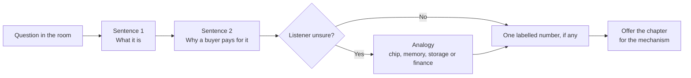
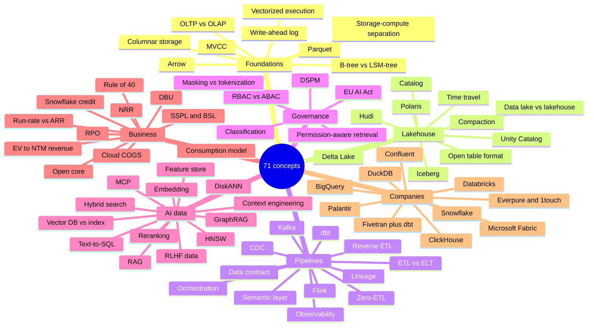
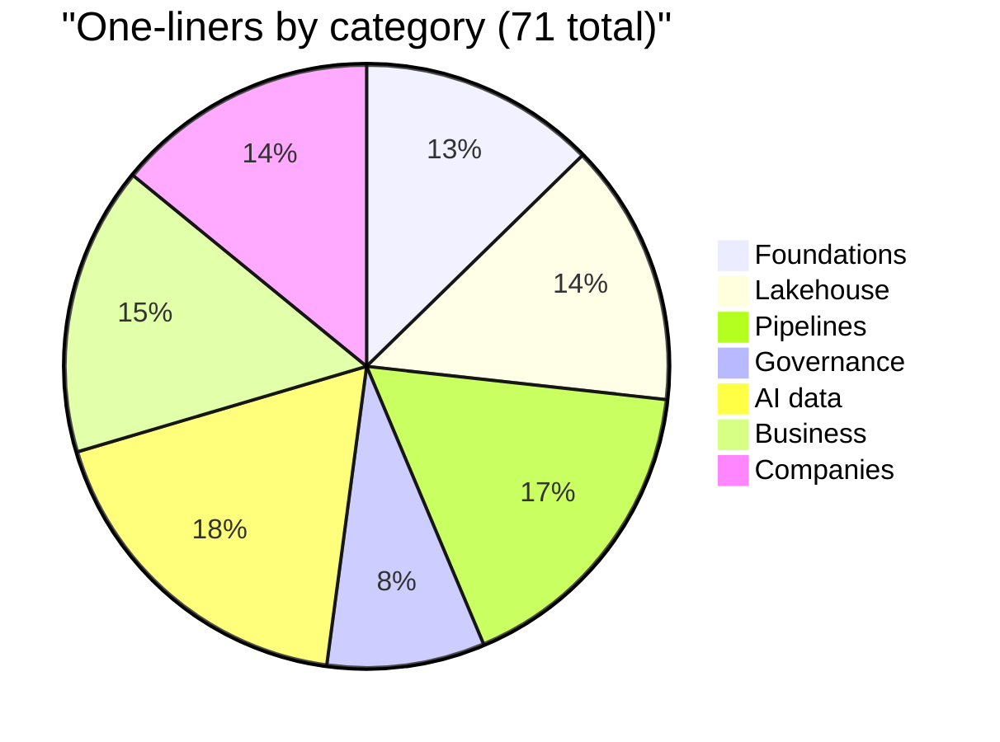
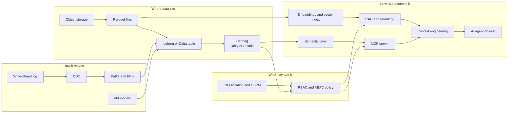

# 49. Explain It in 30 Seconds
> **Depth:** L1–L2 · **Reading time:** ~20 min · **Last verified:** 2026-11-01 · **Prerequisites:** none; each one-liner links to the chapter that explains it ([Ch 1 — The data stack map](../01-data-systems-foundations/ch01-data-stack-map.md) is the best single starting point)

## TL;DR

- This chapter holds **71 one-liners**, numbered and grouped into seven categories: foundations, lakehouse, pipelines, governance, AI data, business, and companies. Each one says what the thing is, why it matters, and gives one analogy. Each one links to the chapter that covers it in depth.
- Each entry takes about 30 seconds to say aloud. That is roughly how long an executive will listen before deciding whether you understand the topic or are reciting it.
- The analogies come from the reader's home ground: semiconductors and the memory hierarchy, storage, datacenters, and finance. If an analogy breaks under questioning, drop it and give the mechanism. The linked chapter has the mechanism.
- The numbers here are a small, dated set taken from the atlas datasets (`data/*.csv`) and the verified-facts register. Each carries a label (GAAP, company-stated run-rate, press-reported or estimate) and a footnote. Do not round them up when you repeat them.
- Two visuals show how the concepts link and which pairs people confuse most. Many credibility losses in data conversations come from mixing up adjacent terms: ARR and run-rate, data lake and lakehouse, vector index and vector database.

## Why this matters

A corporate-development professional joining Everpure (formerly Pure Storage) will hear these terms in a single week across very different rooms: a product review on Data Intelligence, a banker's pitch on a catalog startup, an earnings call from Snowflake, a partner meeting with a lakehouse vendor. Nobody in those rooms will stop to define Iceberg or NRR. The person who can define a term crisply, place it in the stack and give its business consequence gets trusted with the next question.

The one-liners are also a test of understanding. If you cannot say what a thing does, why a buyer pays for it and what it resembles in a world you already know, you do not yet know it well enough to evaluate a deal built on it. Use the entries as flash summaries before a meeting, and use the linked chapters when the meeting goes deeper than 30 seconds.

There is a specific Everpure angle as well. The company's 2026 move from storing data to understanding it, through the 1touch acquisition and the Data Intelligence launch, places it next to several categories below: classification, DSPM, catalogs, semantic context, vector pipelines. Being able to explain those neighbours accurately is what lets a strategy team talk about options, partners and competitors on the basis of public information.

## How to use this chapter

1. **Before a meeting**, scan the categories that apply. A lakehouse partner call needs entries 10–19 and 62–63. A diligence call on an AI start-up needs 38–50 and 57–59.
2. **Say the first sentence, then stop.** The first sentence of every entry is the definition and should stand on its own. Add the second sentence (why it matters) if the listener nods. Use the analogy only if they look unsure.
3. **Never improvise a number.** If you need one, use the figure in the entry with its label and date ("company-stated run-rate, August 2026"). A wrong number spoken confidently does more damage than saying you will confirm it.
4. **Use the confused-pairs table** at the end as a "don't say this" list.
5. **Go to the linked chapter** when someone asks "how does that actually work?" That is an L2 question, and this chapter is mostly L1.

*Figure 49.1 — Anatomy of a 30-second answer. Lead with the definition, earn the second sentence, and use the analogy only when the listener needs it. A number is optional, but if you give one, give its label and date.*

*Figure 49.2 — The 71 concepts fall into seven categories. Foundations and lakehouse explain where data sits, pipelines and governance explain how it moves and who may touch it, AI data explains how models consume it, and business and companies explain who gets paid.*

| Category | Entries | Count | Main chapters |
|---|---|---|---|
| Foundations | 1–9 | 9 | [Ch 1](../01-data-systems-foundations/ch01-data-stack-map.md), [Ch 3](../01-data-systems-foundations/ch03-database-internals.md), [Ch 5](../01-data-systems-foundations/ch05-analytical-engines.md), [Ch 6](../01-data-systems-foundations/ch06-file-formats.md) |
| Lakehouse | 10–19 | 10 | [Ch 7](../01-data-systems-foundations/ch07-open-table-formats.md), [Ch 8](../01-data-systems-foundations/ch08-catalogs-and-metastores.md), [Ch 27](../04-company-deep-dives/ch27-databricks-vs-snowflake.md) |
| Pipelines | 20–31 | 12 | [Ch 9](../02-pipelines-and-governance/ch09-pipeline-patterns.md) to [Ch 14](../02-pipelines-and-governance/ch14-semantic-layers-and-bi.md) |
| Governance | 32–37 | 6 | [Ch 15](../02-pipelines-and-governance/ch15-governance-security-privacy.md), [Ch 33](../04-company-deep-dives/ch33-governance-catalog-security-companies.md) |
| AI data | 38–50 | 13 | [Ch 16](../03-ai-data-stack/ch16-ai-data-lifecycle.md) to [Ch 22](../03-ai-data-stack/ch22-agents-and-data.md) |
| Business | 51–61 | 11 | [Ch 35](../05-business-and-economics/ch35-business-models.md) to [Ch 38](../05-business-and-economics/ch38-open-source-strategy.md) |
| Companies | 62–71 | 10 | [Ch 25](../04-company-deep-dives/ch25-databricks.md) to [Ch 34](../04-company-deep-dives/ch34-application-giants-data-platforms.md) |
| **Total** | 1–71 | **71** | |

*Figure 49.3 — Category summary. The AI-data and pipeline groups are the largest because they are where executives most often hear unfamiliar jargon. Business terms are fewer, but they are where a wrong answer costs the most credibility.*

*Figure 49.4 — Share of entries by category. Roughly a third of the chapter (entries 38–61) covers AI data and business terms, the two areas where strategy conversations move fastest and where definitions are most often stretched.*

## Foundations

**1. OLTP vs OLAP.** Online transaction processing (OLTP) records the business one small transaction at a time; online analytical processing (OLAP) scans millions of those records to answer questions about it. They are tuned in opposite directions, so most companies run both and pay to move data between them, like a cash register next to the general ledger. ([Ch 1](../01-data-systems-foundations/ch01-data-stack-map.md), [Ch 2](../01-data-systems-foundations/ch02-data-models.md))

**2. B-tree vs LSM-tree.** A B-tree updates sorted pages in place and is fast to read; a log-structured merge tree (LSM-tree) appends writes and merges sorted files later, so it is fast to write. Choosing one decides whether reads or writes pay, the same trade-off as an update-in-place file system versus a flash translation layer that writes out of place and garbage-collects later. ([Ch 3](../01-data-systems-foundations/ch03-database-internals.md))

**3. MVCC.** Multi-version concurrency control keeps several versions of each row, so readers see a consistent snapshot while writers keep working. It is why a long report does not freeze the checkout page, much as accountants close on a frozen trial balance while payables keeps posting. ([Ch 3](../01-data-systems-foundations/ch03-database-internals.md))

**4. Columnar storage.** Storing each column's values together instead of each row's, so a query touching 3 of 200 columns reads only those 3 and compresses well. It is the main reason analytical databases are fast, like a DRAM burst that fetches contiguous bytes instead of scattered ones. ([Ch 5](../01-data-systems-foundations/ch05-analytical-engines.md))

**5. Vectorized execution.** The engine processes batches of about a thousand values per operation instead of one row at a time, keeping CPU caches and SIMD units busy. Every modern engine (DuckDB, Photon, Velox) works this way; it is the software version of moving from scalar to SIMD instructions. ([Ch 5](../01-data-systems-foundations/ch05-analytical-engines.md))

**6. Separation of storage and compute.** Durable data sits in shared object storage while compute clusters start to query it and stop when idle. It turned the warehouse from a capacity purchase into a metered utility, which Snowflake commercialized, much as a fabless company rents foundry capacity instead of owning a fab. ([Ch 5](../01-data-systems-foundations/ch05-analytical-engines.md), [Ch 26](../04-company-deep-dives/ch26-snowflake.md))

**7. Apache Parquet.** The default open columnar file format: row groups stored column by column, compressed, with min/max statistics so engines skip blocks they do not need. Physically, nearly every lakehouse table is a pile of Parquet files, a standard package any board vendor can mount. ([Ch 6](../01-data-systems-foundations/ch06-file-formats.md))

**8. Apache Arrow.** A standard in-memory columnar layout, so systems pass data without converting it row by row. Parquet is how data rests on disk and Arrow is how it moves through memory and over the wire, a common bus protocol like PCIe. ([Ch 6](../01-data-systems-foundations/ch06-file-formats.md))

**9. Write-ahead log.** A database appends every change to a durable sequential log before touching its data files, so a crash can be replayed. The same log later feeds change data capture (entry 21); the journal comes before the ledger. ([Ch 3](../01-data-systems-foundations/ch03-database-internals.md))

## Lakehouse

**10. Data lake vs lakehouse.** A data lake is cheap files in object storage with no transactions; a lakehouse adds a table format and catalog so the same files behave like warehouse tables. The difference is the metadata layer, not the storage, like a pallet floor before and after an inventory system goes live. ([Ch 7](../01-data-systems-foundations/ch07-open-table-formats.md))

**11. Open table format.** A metadata layer and commit protocol that turns a folder of immutable Parquet files into a table with atomic commits, snapshots and schema evolution. Each commit swaps one small pointer, much like updating a page table, so many engines can safely share one copy of the data. ([Ch 7](../01-data-systems-foundations/ch07-open-table-formats.md))

**12. Apache Iceberg.** The open table format created at Netflix, which tracks a table as a tree of metadata files and relies on a catalog for atomic commits. It became the neutral industry standard, a JEDEC for tables; Databricks paid a press-reported ~$2B for Tabular, its creators' company, in June 2024.[^tabular] ([Ch 7](../01-data-systems-foundations/ch07-open-table-formats.md))

**13. Delta Lake.** Databricks' open table format: Parquet files plus an ordered JSON commit log with periodic checkpoints, a journal with periodic trial balances. It dominates Databricks estates, and UniForm lets Delta tables also publish Iceberg metadata for other engines. ([Ch 7](../01-data-systems-foundations/ch07-open-table-formats.md), [Ch 25](../04-company-deep-dives/ch25-databricks.md))

**14. Apache Hudi.** The table format from Uber, built around a timeline of actions and tuned for upserts and streaming ingestion. It is strong for frequent row-level changes but has the smallest commercial ecosystem of the three, like a specialist process node with few customers. ([Ch 7](../01-data-systems-foundations/ch07-open-table-formats.md))

**15. Catalog.** The service that records which tables exist, where their current metadata lives and who may read them; for Iceberg it also performs the commit. Every engine asks it first, so it is the lakehouse's control point, like a share registrar whose register defines ownership. ([Ch 8](../01-data-systems-foundations/ch08-catalogs-and-metastores.md))

**16. Unity Catalog.** Databricks' governance catalog for tables, files, models and functions, handling permissions, lineage, audit and short-lived storage credentials, with an open-source version. It is how Databricks keeps control of policy even when data sits in open formats, the way a landlord who holds the keys controls an open-plan building. ([Ch 8](../01-data-systems-foundations/ch08-catalogs-and-metastores.md), [Ch 25](../04-company-deep-dives/ch25-databricks.md))

**17. Apache Polaris.** An open-source Iceberg REST catalog donated by Snowflake in 2024, since promoted to an Apache top-level project. It is Snowflake's neutral bid to be where other engines register tables, while its richer governance stays in proprietary Horizon, like a standards body seeded by one vendor. ([Ch 8](../01-data-systems-foundations/ch08-catalogs-and-metastores.md), [Ch 27](../04-company-deep-dives/ch27-databricks-vs-snowflake.md))

**18. Time travel.** Querying a table as it stood at an earlier snapshot, possible because old files are kept until the snapshot expires. It serves audits, reproducible ML training sets and undoing bad loads, and is cheap for the same reason array snapshots are: only changed data is new. ([Ch 7](../01-data-systems-foundations/ch07-open-table-formats.md))

**19. Compaction.** Background rewriting of many small files into fewer large ones, plus snapshot expiry and orphan-file cleanup. Streaming writers create small files constantly, so this SSD-style garbage collection is where much of a lakehouse's operating cost and vendor differentiation now sit. ([Ch 7](../01-data-systems-foundations/ch07-open-table-formats.md))

## Pipelines

**20. ETL vs ELT.** Extract-transform-load (ETL) reshapes data before it lands; extract-load-transform (ELT) lands raw data and transforms it inside the warehouse with SQL. Cheap cloud compute made ELT the default and created Fivetran's and dbt's market, like shipping raw ore to a big smelter instead of refining at the mine. ([Ch 9](../02-pipelines-and-governance/ch09-pipeline-patterns.md))

**21. Change data capture.** Change data capture (CDC) reads a database's transaction log and emits each committed insert, update and delete as an event. It keeps analytics minutes behind production without loading the source, like reading the bank's live feed instead of reprinting the statement nightly. ([Ch 10](../02-pipelines-and-governance/ch10-ingestion-and-integration.md))

**22. Apache Kafka.** An open-source distributed log: producers append events to topics and many consumers read them independently, like desks reading one exchange tape. It is the default event-streaming backbone, and IBM completed its ~$11B purchase of Confluent, Kafka's main vendor, in March 2026.[^ibm-close] ([Ch 11](../02-pipelines-and-governance/ch11-streaming-and-event-platforms.md))

**23. Apache Flink.** A stream-processing engine that runs continuous joins, aggregations and time windows over events as they arrive, with managed state and exactly-once guarantees. Kafka moves events and Flink computes on them: the conveyor belt and the inspection station on it. ([Ch 11](../02-pipelines-and-governance/ch11-streaming-and-event-platforms.md))

**24. dbt.** An open-source framework in which analysts write SQL SELECT "models" that dbt compiles into a dependency graph, tests and runs inside the warehouse. It turned transformation into version-controlled engineering (analytics engineering), like a chip design flow with regression tests on every change. ([Ch 12](../02-pipelines-and-governance/ch12-transformation-and-orchestration.md))

**25. Orchestration.** An orchestrator (Airflow, Dagster, Prefect) schedules, runs, retries and records pipeline tasks in dependency order as a directed acyclic graph. It is the fab's manufacturing execution system for data: rarely glamorous, always blamed when the 6 a.m. dashboard is late. ([Ch 12](../02-pipelines-and-governance/ch12-transformation-and-orchestration.md))

**26. Reverse ETL.** Syncing modelled warehouse data back into operational tools such as a CRM or ad platform so front-line teams act on it. It makes the warehouse a source as well as a sink, a refinery that also runs the delivery trucks; Fivetran agreed to buy Census for this in 2025. ([Ch 9](../02-pipelines-and-governance/ch09-pipeline-patterns.md), [Ch 30](../04-company-deep-dives/ch30-data-movement-streaming-companies.md))

**27. Zero-ETL.** Vendor-managed replication from an operational database into an analytics service (Aurora to Redshift, Fabric mirroring), so the customer builds no pipeline. "Zero" means zero pipelines for you, not zero copies, like an automatic bank sweep: the money still moves. ([Ch 9](../02-pipelines-and-governance/ch09-pipeline-patterns.md))

**28. Data contract.** A producer-owned, enforced agreement on a dataset's schema, meaning and quality, checked automatically before changes ship. It moves quality upstream to the engineers who can break it, like an interface spec between chip blocks where changing a pin fails the integration test. ([Ch 12](../02-pipelines-and-governance/ch12-transformation-and-orchestration.md), [Ch 13](../02-pipelines-and-governance/ch13-data-quality-observability-lineage.md))

**29. Data observability.** Automated monitoring of each table's freshness, volume, schema, value distributions and lineage, to catch broken data before users do. Its business case is "data downtime", and it works like a fab's in-line metrology catching drift before final test. ([Ch 13](../02-pipelines-and-governance/ch13-data-quality-observability-lineage.md))

**30. Data lineage.** The graph of how data flows from sources through transformations to dashboards and models, increasingly per column. It answers "what breaks if I change this?" and "where did this number come from?", the audit trail from a reported figure back to its journal entries. ([Ch 13](../02-pipelines-and-governance/ch13-data-quality-observability-lineage.md))

**31. Semantic layer.** One governed set of business definitions, such as "revenue" or "active customer", that every BI tool and AI agent queries instead of re-deriving. It matters more with AI because a model writing raw SQL guesses definitions; the semantic layer is the chart of accounts. ([Ch 14](../02-pipelines-and-governance/ch14-semantic-layers-and-bi.md))

## Governance

**32. RBAC vs ABAC.** Role-based access control (RBAC) grants permissions to roles; attribute-based access control (ABAC) decides each request from attributes such as sensitivity tag, region and purpose. RBAC sprawls into thousands of roles at scale while ABAC scales through tags, like office keys versus a badge reader that checks clearance. ([Ch 15](../02-pipelines-and-governance/ch15-governance-security-privacy.md))

**33. DSPM.** Data security posture management (DSPM) continuously finds where sensitive data lives, who can reach it and how exposed it is, across clouds, SaaS and on-premises stores. It is the inventory count before the audit, and Proofpoint's pending Varonis deal, announced October 2026 at ~$6.3B transaction value (~$5.71B equity value; close expected 1H 2027), prices the category.[^varonis] ([Ch 15](../02-pipelines-and-governance/ch15-governance-security-privacy.md), [Ch 33](../04-company-deep-dives/ch33-governance-catalog-security-companies.md))

**34. Data classification.** Labelling data by type and sensitivity (email address, card number, health record) so policies attach to the label rather than to each table. Classifiers combine patterns, checksums and ML models, and the rules follow the label like hazmat placards on containers. ([Ch 15](../02-pipelines-and-governance/ch15-governance-security-privacy.md))

**35. Masking vs tokenization.** Dynamic masking rewrites a sensitive value at query time depending on who asks (`****1234`); tokenization replaces the stored value with a surrogate only an authorized vault can reverse. Masking is frosted glass on the view; tokenization is a safe-deposit box that protects every downstream copy. ([Ch 15](../02-pipelines-and-governance/ch15-governance-security-privacy.md))

**36. EU AI Act.** Regulation (EU) 2024/1689 sets risk-tiered duties for AI systems, including training-data governance for high-risk systems (Article 10). After the 2026 AI Omnibus those duties start on 2 December 2027 (standalone) and 2 August 2028 (product-embedded), turning lineage and quality records into compliance evidence, as SOX did for controls.[^aiact][^omnibus] ([Ch 15](../02-pipelines-and-governance/ch15-governance-security-privacy.md))

**37. Permission-aware retrieval.** Enforcing the source system's access rights at query time, so an AI assistant retrieves only passages the asking user could open directly. Without it, retrieval is a fast way to leak the HR folder; it is a library that checks your card per book, not only at the door. ([Ch 17](../03-ai-data-stack/ch17-unstructured-data-processing.md), [Ch 19](../03-ai-data-stack/ch19-retrieval-architectures.md))

## AI data

**38. Embedding.** A list of hundreds to a few thousand numbers that a model produces so that similar items land near each other. Embeddings let software search by meaning rather than exact words: GPS coordinates for meaning, where "invoice" and "bill" sit a block apart. ([Ch 18](../03-ai-data-stack/ch18-embeddings-and-vector-search.md))

**39. Vector database vs vector index.** A vector index (HNSW, IVF, DiskANN) is the data structure that finds nearest neighbours fast; a vector database wraps indexes with storage, filtering, updates, access control and scaling. Most mainstream databases now ship an index, which squeezes standalone vector databases, much as integrated memory controllers squeezed discrete northbridges. ([Ch 18](../03-ai-data-stack/ch18-embeddings-and-vector-search.md))

**40. HNSW.** Hierarchical Navigable Small World, a layered graph index where a search hops across sparse upper layers, then refines in dense lower ones: highways, then arterials, then local streets. It is the default for in-memory vector search, fast and accurate but memory-hungry. ([Ch 18](../03-ai-data-stack/ch18-embeddings-and-vector-search.md))

**41. DiskANN.** Microsoft's graph vector index that keeps the graph and full vectors on SSD and only compressed vectors in RAM, enabling billion-vector search on one machine. It moves vector-search cost from DRAM to NAND, the memory hierarchy applied, which matters directly to a storage vendor. ([Ch 18](../03-ai-data-stack/ch18-embeddings-and-vector-search.md), [Ch 24](../03-ai-data-stack/ch24-data-meets-compute-and-storage.md))

**42. RAG.** Retrieval-augmented generation (RAG) fetches relevant passages at question time and adds them to the prompt, so a large language model (LLM) answers from your data rather than memory. It is an open-book exam and the cheapest route to current, private, citable answers, and quality depends more on retrieval than on the model. ([Ch 19](../03-ai-data-stack/ch19-retrieval-architectures.md))

**43. Reranking.** A second-stage model, usually a cross-encoder, reads the query alongside each of the top few dozen candidates and reorders them by true relevance. A fast first pass buys recall and a slower second pass buys precision, like wafer probe followed by final test. ([Ch 19](../03-ai-data-stack/ch19-retrieval-architectures.md))

**44. GraphRAG.** Microsoft Research's 2024 approach in which an LLM extracts entities and relationships into a knowledge graph, summarizes clusters, and retrieves over that structure. It helps with connect-the-dots questions across many documents, at much higher indexing cost, like an analyst's deal map versus a stack of filings. ([Ch 19](../03-ai-data-stack/ch19-retrieval-architectures.md))

**45. Context engineering.** Deciding, on every model call, which instructions, retrieved data, tool results and memory enter the limited context window, and in what order. It has replaced prompt wording as the main lever on agent quality because long, noisy context degrades models; it is cache management for the model's fastest tier. ([Ch 16](../03-ai-data-stack/ch16-ai-data-lifecycle.md), [Ch 22](../03-ai-data-stack/ch22-agents-and-data.md))

**46. MCP.** The Model Context Protocol (MCP) is an open standard for connecting AI applications to tools and data through "MCP servers", introduced by Anthropic in November 2024 and donated to the Linux Foundation's Agentic AI Foundation in December 2025.[^mcp] It is USB-C for agents: build one connector and any compliant agent can use it, which is why most major data vendors now ship one. ([Ch 22](../03-ai-data-stack/ch22-agents-and-data.md))

**47. Text-to-SQL.** An LLM translating a plain-English question into a SQL query. Demos are easy and production is hard, because accuracy drops on real enterprise schemas unless the model is grounded in a semantic layer, like a new analyst fluent in SQL who does not know your chart of accounts. ([Ch 14](../02-pipelines-and-governance/ch14-semantic-layers-and-bi.md), [Ch 22](../03-ai-data-stack/ch22-agents-and-data.md))

**48. Feature store.** A system that defines each ML feature once, such as "transactions in the last seven days", and serves identical values to training (offline) and live prediction (online). It prevents training-serving skew, acting as the golden reference both test and production calibrate to, and as a standalone category it has largely been absorbed by platforms. ([Ch 21](../03-ai-data-stack/ch21-ml-platforms-feature-stores-llmops.md))

**49. RLHF data.** Reinforcement learning from human feedback (RLHF) tunes a model against a reward model trained on human judgements of which answer is better. The scarce input is preference and expert data, which is why labelling and expert-network firms command large valuations; it is yield learning, where engineers' judgements become the training signal. ([Ch 20](../03-ai-data-stack/ch20-training-data-supply-chain.md))

**50. Hybrid search.** Combining keyword search (BM25) with vector search and merging the ranked lists, often by reciprocal rank fusion. Keywords catch exact part numbers and names that embeddings blur, and vectors catch paraphrases, like a fund blending a quant screen with analyst judgement. ([Ch 18](../03-ai-data-stack/ch18-embeddings-and-vector-search.md))

## Business

**51. DBU.** The Databricks Unit (DBU) is a normalized unit of processing per hour, priced from about $0.15 for classic jobs compute to about $0.70 for serverless SQL (third-party-compiled US list prices).[^dbx-pricing] Think kilowatt-hours: one meter, different tariffs per workload. ([Ch 25](../04-company-deep-dives/ch25-databricks.md), [Ch 35](../05-business-and-economics/ch35-business-models.md))

**52. Snowflake credit.** Snowflake's unit of compute: a running virtual warehouse burns credits per second, each size step doubles the hourly rate, and the price per credit depends on edition and region. Customers usually pre-commit to credits and Snowflake recognizes revenue only as they burn, like prepaid mobile minutes. ([Ch 26](../04-company-deep-dives/ch26-snowflake.md), [Ch 35](../05-business-and-economics/ch35-business-models.md))

**53. Consumption model.** Customers pay for what they use rather than for seats or licences, so revenue follows workloads. It ties price to value and lets small deals grow, but makes revenue harder to forecast and turns customer optimization into slower growth: a toll road, not a lease. ([Ch 35](../05-business-and-economics/ch35-business-models.md))

**54. NRR.** Net revenue retention (NRR) is this year's revenue from last year's customer cohort divided by that cohort's revenue a year earlier, including expansion and net of contraction and churn: same-store sales for software. Snowflake reported 126% for Q2 FY2027 (May–Jul 2026, company KPI), down from a 178% peak in FY2022 and 158% in FY2023.[^sf-q2][^sf-hist] ([Ch 36](../05-business-and-economics/ch36-unit-economics-kpis.md))

**55. RPO.** Remaining performance obligations (RPO) are contracted but unrecognized revenue: the order book. Snowflake's RPO was about $9.0B at Q2 FY2027 (GAAP; about 54% expected within 12 months, the current portion or cRPO), down from $9.77B at FY2026 year-end. That dip is partly seasonal: many renewals are signed in fiscal Q4, then drawn down in Q1–Q2 faster than new commitments arrive.[^sf-q2] ([Ch 36](../05-business-and-economics/ch36-unit-economics-kpis.md))

**56. Cloud COGS.** For a cloud data platform, cost of goods sold (COGS) is mostly the hyperscaler bill for the compute, storage and networking that run customer queries. Gross margin is the premium over a cost the vendor does not control, the fabless company's wafer cost, with committed-spend deals as its long-term wafer agreements. ([Ch 36](../05-business-and-economics/ch36-unit-economics-kpis.md))

**57. Rule of 40.** Revenue growth plus free-cash-flow margin should be at least 40%, a quick test of whether growth is being bought. Snowflake scores about 58 (35% GAAP revenue growth in Q2 FY2027 plus a 23% full-year adjusted FCF-margin guide), and Palantir reports 155% (company-stated, Q2 2026).[^r40][^pltr] ([Ch 36](../05-business-and-economics/ch36-unit-economics-kpis.md))

**58. EV/NTM revenue.** Enterprise value divided by expected next-twelve-months revenue, the EV/EBITDA of companies without meaningful EBITDA yet. On 30 October 2026 Snowflake traded near 16.9x and Palantir near 53x (FY2026 guidance basis; about 70x on trailing revenue), both on guidance-derived NTM estimates.[^comps] ([Ch 37](../05-business-and-economics/ch37-public-comps-valuation.md))

**59. Run-rate vs ARR.** A revenue run-rate annualizes the latest quarter or month of all revenue, consumption included; annual recurring revenue (ARR) annualizes contracted subscription value. Databricks' ">$7B revenue run-rate" (company-stated, August 2026) is neither ARR nor audited GAAP revenue, just as one strong month of fab output is not a signed long-term agreement.[^db-7b] ([Ch 25](../04-company-deep-dives/ch25-databricks.md), [Ch 36](../05-business-and-economics/ch36-unit-economics-kpis.md))

**60. Open core.** Giving away an open-source core and selling proprietary features, hosting or support around it, as Databricks (Spark), Confluent (Kafka) and MongoDB did. It builds adoption cheaply, like a free reference design that sells chips, but a hyperscaler can host the free core too. ([Ch 38](../05-business-and-economics/ch38-open-source-strategy.md))

**61. SSPL and BSL.** Source-available licences that stop rivals, chiefly hyperscalers, from selling the software as a service: MongoDB's Server Side Public License (2018) demands the whole service stack be published, and the Business Source License restricts production use until a change date. Neither is OSI-approved open source; think of a patent licence with a field-of-use carve-out. ([Ch 38](../05-business-and-economics/ch38-open-source-strategy.md))

## Companies

**62. Databricks.** The lakehouse company, founded by Apache Spark's creators, selling data engineering, warehousing, governance (Unity Catalog), Postgres (Lakebase) and AI tooling on open formats. In August 2026 it stated a revenue run-rate above $7B growing more than 80%, and raised $5B at a $190B valuation (company-stated).[^db-7b] ([Ch 25](../04-company-deep-dives/ch25-databricks.md))

**63. Snowflake.** The cloud data warehouse that commercialized storage-compute separation, now expanding into Iceberg, Postgres and AI agents (Snowflake CoWork). Product revenue was about $1.49B in Q2 FY2027 (May–Jul 2026), up 37% (GAAP), and the FY2027 product revenue guide was raised to $6.07B (company-stated).[^sf-q2] ([Ch 26](../04-company-deep-dives/ch26-snowflake.md), [Ch 27](../04-company-deep-dives/ch27-databricks-vs-snowflake.md))

**64. Microsoft Fabric.** Microsoft's SaaS analytics suite (pipelines, Spark, warehouse, real-time, Power BI) on OneLake, one tenant-wide lake stored as Delta and Parquet. Its edge is distribution into existing Power BI and Microsoft 365 estates on one capacity bill, like an integrated device maker bundling the whole board. ([Ch 28](../04-company-deep-dives/ch28-hyperscaler-data-platforms.md))

**65. BigQuery.** Google Cloud's serverless warehouse, descended from Google's Dremel and priced per terabyte scanned or per slot-hour. It sits in a cloud segment that grew 103% to $30.7B in Q3 2026 (GAAP segment revenue), though most of that growth probably came from AI compute and TPU sales; BigQuery's share is not disclosed.[^goog-q3] ([Ch 28](../04-company-deep-dives/ch28-hyperscaler-data-platforms.md))

**66. ClickHouse.** An open-source columnar database from Yandex, built for very fast real-time analytics: the high-clock-speed part of the market. Its company reached a press-reported $15B valuation in January 2026 and stated more than $250M ARR in May 2026.[^ch-seriesd][^ch-arr] ([Ch 23](../03-ai-data-stack/ch23-real-time-analytics-htap.md), [Ch 31](../04-company-deep-dives/ch31-analytical-engine-challengers-legacy.md))

**67. DuckDB.** An in-process analytical database ("SQLite for analytics") that runs inside a laptop, notebook or application with no server, the edge chip of the data world. AWS agreed in August 2026 to acquire DuckLabs, the company behind it, on undisclosed terms; DuckDB stays MIT-licensed under the DuckDB Foundation.[^aws-duck] ([Ch 31](../04-company-deep-dives/ch31-analytical-engine-challengers-legacy.md))

**68. Confluent.** The company founded by Kafka's creators, selling managed Kafka and Flink. FY2025 (calendar) revenue was $1,166.7M, up 21% (GAAP), including $624M from Confluent Cloud, and IBM completed its ~$11B acquisition on 17 March 2026.[^cflt][^ibm-close] ([Ch 30](../04-company-deep-dives/ch30-data-movement-streaming-companies.md))

**69. Fivetran + dbt Labs.** Fivetran's managed extract-and-load connectors merged with dbt Labs' transformation framework in an all-stock deal announced October 2025 and closed 1 June 2026, with combined ARR "approaching $600M" (company-stated).[^ft-dbt-close] It is the modern data stack consolidating, as point-tool EDA vendors once rolled up into suites. ([Ch 30](../04-company-deep-dives/ch30-data-movement-streaming-companies.md), [Ch 43](../06-history-and-future/ch43-modern-data-stack.md))

**70. Palantir.** Software that builds an "ontology", a governed model of a customer's business objects and allowed actions, so operators and AI agents act through it (Foundry, AIP); here the semantic layer is the product. Revenue grew 93% in Q2 2026 (GAAP) and the stock trades near 53x EV/NTM revenue (FY2026 guidance basis, estimate; about 70x EV/TTM).[^pltr][^comps] ([Ch 34](../04-company-deep-dives/ch34-application-giants-data-platforms.md))

**71. Everpure and 1touch.** Everpure (formerly Pure Storage; NYSE: P) bought 1touch, a data discovery, classification and semantic-context company, for $125.0M stated cash; the deal closed on 7 May 2026 and relaunched as Everpure Data Intelligence in June 2026.[^ep-10q][^ep-di] It is a storage vendor moving from storing data to understanding it; options a strategy team might evaluate, based on public information, are in Ch 45. ([Ch 24](../03-ai-data-stack/ch24-data-meets-compute-and-storage.md), [Ch 33](../04-company-deep-dives/ch33-governance-catalog-security-companies.md), [Ch 45](../06-history-and-future/ch45-storage-moving-up-the-stack.md))

## How the concepts connect

The one-liners are easier to remember as a chain than as a list. The flowchart follows a single path from bytes on storage to an agent's answer. Each node is an entry above, and each arrow is a dependency: the layer on the right cannot work well unless the one on its left does.

*Figure 49.5 — From bytes to answers. Parquet becomes a table through Iceberg or Delta. The catalog then becomes the control point that both the semantic layer and access policy depend on. Agents reach data through MCP and retrieval, and both of those paths inherit governance from the catalog. Whoever owns the catalog and policy layer sits on the critical path of every AI answer, which is why Databricks, Snowflake and storage vendors all compete for it.*

## Numbers worth carrying

These are the only figures in this chapter. Each is dated and labelled; quote them that way or not at all.

| Metric | Value | Basis and period | Entry |
|---|---|---|---|
| Databricks revenue run-rate | >$7B, >80% growth | Company-stated run-rate, August 2026 | 59, 62 |
| Databricks valuation | $190B ($5B round) | Company-stated, private round closed 2026-08-13 | 62 |
| Snowflake product revenue | ~$1.49B, +37% | GAAP, Q2 FY2027 (May–Jul 2026) | 63 |
| Snowflake NRR | 126% | Company KPI, Q2 FY2027 | 54 |
| Snowflake RPO | ~$9.0B (from $9.77B at FY2026 year-end) | GAAP, Q2 FY2027 | 55 |
| Snowflake EV/NTM revenue | ~16.9x | Estimate, guidance-derived NTM, as of 2026-10-30 | 58 |
| Palantir EV/NTM revenue | ~53x | Estimate, FY2026 guidance midpoint, as of 2026-10-30 | 58, 70 |
| Confluent revenue | $1,166.7M, +21% | GAAP, FY2025 (calendar) | 68 |
| IBM–Confluent deal | ~$11B | Disclosed enterprise value, closed 2026-03-17 | 22, 68 |
| ClickHouse valuation | $15B | Press-reported, January 2026 | 66 |
| Fivetran + dbt Labs ARR | approaching $600M | Company-stated, June 2026 | 69 |
| Everpure–1touch | $125.0M | Stated cash consideration (10-Q), closed 2026-05-07 | 71 |

*Figure 49.6 — Numbers worth carrying. Four different labels appear in twelve rows (GAAP, company-stated, press-reported, estimate), and mixing them up is the most common way a correct-sounding number turns into a wrong claim.*

## Most-confused pairs

| People say | What is actually true | Why it matters | Entry |
|---|---|---|---|
| "ARR of $7B" for Databricks | It is a company-stated **revenue run-rate** (annualized recent revenue, consumption included), not ARR and not GAAP revenue | Applying an ARR multiple to a consumption run-rate overstates durability | 59 |
| "Data lake" and "lakehouse" as synonyms | A lakehouse is a lake **plus** a table format and a catalog that provide transactions and governance | The value, and the vendor lock-in, sits in the metadata layer | 10 |
| "Vector database" for any vector search | A vector **index** is a data structure. A vector **database** is a full system built around one | Most incumbents now ship vector indexes, which squeezes standalone vector databases | 39 |
| "Zero-ETL means no copies" | It means no **pipeline you build**. Data is still replicated and stored twice | Storage and egress costs do not disappear | 27 |
| "RPO is next year's revenue" | RPO is **all** contracted, unrecognized revenue, of which only part falls in the next 12 months | Falling RPO with rising revenue can be healthy burn-down, not a demand collapse | 55 |
| "Open source means anyone can host it" | SSPL and BSL are **source-available** licences that bar competing hosted services | Licence choice decides whether a hyperscaler can take the revenue | 61 |
| "Masking and tokenization are the same" | Masking hides the value **at query time**. Tokenization replaces the **stored** value | Only tokenization protects downstream copies | 35 |
| "MCP is an agent framework" | MCP is a **connection protocol** between agents and tools or data | The value goes to whoever owns the servers and the permissions behind them | 46 |
| "EU AI Act high-risk rules apply from August 2026" | The 2026 Omnibus moved them to **2 December 2027 and 2 August 2028** | A wrong compliance date undermines any governance pitch | 36 |

*Figure 49.7 — Most-confused pairs. Each row is a "don't say this" item. The middle column is the 30-second correction, and the entry number points to the full one-liner.*

## Key terms

- [OLTP](../glossary.md#oltp) and [OLAP](../glossary.md#olap) — transactional versus analytical workloads.
- [B-tree](../glossary.md#b-tree) and [LSM-tree](../glossary.md#lsm-tree) — read-optimized versus write-optimized index structures.
- [MVCC](../glossary.md#mvcc) — multiple row versions so readers and writers do not block each other.
- [Columnar storage](../glossary.md#columnar-storage) and [Vectorized execution](../glossary.md#vectorized-execution) — the two reasons analytical engines are fast.
- [Separation of storage and compute](../glossary.md#separation-of-storage-and-compute) — shared durable storage, elastic compute.
- [Apache Parquet](../glossary.md#apache-parquet) and [Apache Arrow](../glossary.md#apache-arrow) — columnar formats on disk and in memory.
- [Write-ahead log](../glossary.md#write-ahead-log) — the durable change log that also feeds CDC.
- [Lakehouse](../glossary.md#lakehouse) and [Data lake](../glossary.md#data-lake) — open files with and without a table-format and catalog layer.
- [Open table format](../glossary.md#open-table-format), [Apache Iceberg](../glossary.md#apache-iceberg), [Delta Lake](../glossary.md#delta-lake) and [Apache Hudi](../glossary.md#apache-hudi) — metadata layers that turn files into tables.
- [Data catalog](../glossary.md#data-catalog), [Unity Catalog](../glossary.md#unity-catalog) and [Apache Polaris](../glossary.md#apache-polaris) — the lakehouse control point.
- [Time travel](../glossary.md#time-travel) and [Compaction](../glossary.md#compaction) — snapshot queries and table maintenance.
- [ETL](../glossary.md#etl), [ELT](../glossary.md#elt), [Reverse ETL](../glossary.md#reverse-etl) and [Zero-ETL](../glossary.md#zero-etl) — the main data-movement patterns.
- [Change data capture](../glossary.md#change-data-capture), [Apache Kafka](../glossary.md#apache-kafka) and [Apache Flink](../glossary.md#apache-flink) — log-based capture, event transport and stream computation.
- [dbt](../glossary.md#dbt) and [Orchestrator](../glossary.md#orchestrator) — transformation as code, and the scheduler that runs it.
- [Data contract](../glossary.md#data-contract), [Data observability](../glossary.md#data-observability) and [Data lineage](../glossary.md#data-lineage) — preventing, detecting and tracing bad data.
- [Semantic layer](../glossary.md#semantic-layer) — governed business definitions for BI and AI.
- [Role-based access control](../glossary.md#role-based-access-control) and [Attribute-based access control](../glossary.md#attribute-based-access-control) — role grants versus attribute-driven policy.
- [Data security posture management](../glossary.md#data-security-posture-management) and [Data classification](../glossary.md#data-classification) — finding and labelling sensitive data.
- [Dynamic data masking](../glossary.md#dynamic-data-masking) and [Tokenization](../glossary.md#tokenization) — hiding the view versus replacing the stored value.
- [EU AI Act](../glossary.md#eu-ai-act) — EU risk-tiered AI regulation with training-data governance duties.
- [Permission-aware retrieval](../glossary.md#permission-aware-retrieval) — retrieval that enforces source access rights per user.
- [Embedding](../glossary.md#embedding), [Vector index](../glossary.md#vector-index), [Vector database](../glossary.md#vector-database), [HNSW](../glossary.md#hnsw) and [DiskANN](../glossary.md#diskann) — semantic vectors and the structures that search them.
- [Retrieval-augmented generation](../glossary.md#retrieval-augmented-generation), [Reranker](../glossary.md#reranker), [GraphRAG](../glossary.md#graphrag) and [Hybrid search](../glossary.md#hybrid-search) — retrieval patterns for LLMs.
- [Context engineering](../glossary.md#context-engineering) and [Model Context Protocol](../glossary.md#model-context-protocol) — what goes into the model's window, and the standard plug for tools and data.
- [Text-to-SQL](../glossary.md#text-to-sql) and [Feature store](../glossary.md#feature-store) — natural-language querying and consistent ML features.
- [Reinforcement learning from human feedback](../glossary.md#reinforcement-learning-from-human-feedback) and [Preference data](../glossary.md#preference-data) — human judgements as training signal.
- [DBU](../glossary.md#dbu) and [Snowflake credit](../glossary.md#snowflake-credit) — the two leading consumption meters.
- [Consumption pricing](../glossary.md#consumption-pricing) — paying for usage rather than seats or licences.
- [Net revenue retention](../glossary.md#net-revenue-retention) and [Remaining performance obligations](../glossary.md#remaining-performance-obligations) — cohort expansion and contracted backlog.
- [Cloud COGS](../glossary.md#cloud-cogs) and [Rule of 40](../glossary.md#rule-of-40) — the hyperscaler bill behind gross margin, and the growth-plus-cash test.
- [EV to NTM revenue](../glossary.md#ev-to-ntm-revenue), [Revenue run-rate](../glossary.md#revenue-run-rate) and [Annual recurring revenue](../glossary.md#annual-recurring-revenue) — the valuation multiple and the two most-confused revenue measures.
- [Open core](../glossary.md#open-core), [SSPL](../glossary.md#sspl) and [Business Source License](../glossary.md#business-source-license) — open-source business models and licences that block hyperscaler resale.
- [Microsoft Fabric](../glossary.md#microsoft-fabric), [OneLake](../glossary.md#onelake) and [BigQuery](../glossary.md#bigquery) — hyperscaler analytics platforms.

## Sources

[^tabular]: TechCrunch, "Databricks reportedly paid $2 billion in Tabular acquisition," https://techcrunch.com/2024/08/14/databricks-reportedly-paid-2-billion-in-tabular-acquisition, published 2024-08-14; retrieved 2026-11-01. Deal announced 2024-06-04; price press-reported (WSJ range $1–2B), never disclosed by Databricks; as recorded in `data/ma_deals.csv` (via Ch 7).

[^ibm-close]: IBM, "IBM Completes Acquisition of Confluent," via Stock Titan, https://www.stocktitan.net/news/IBM/ibm-completes-acquisition-of-confluent-making-real-time-data-the-lbuwdbharsqe.html, published 2026-03-17; ChannelWeb UK, "IBM completes $11bn Confluent acquisition," https://www.channelweb.co.uk/news-network/2026/ibm-completes-11bn-confluent-acquisition, published 2026-03; retrieved 2026-11-01. ~$11B enterprise value, $31/share cash; as recorded in `data/ma_deals.csv` (via Ch 30).

[^cflt]: Confluent, Inc., Form 10-K for fiscal year 2025 (calendar; ended 2025-12-31), SEC EDGAR, https://www.sec.gov/Archives/edgar/data/1699838/000169983826000006/cflt-20251231.htm, published 2026-02; Business Wire, "Confluent Announces Fourth Quarter and Fiscal Year 2025 Financial Results," https://www.businesswire.com/news/home/20260210008002/en/Confluent-Announces-Fourth-Quarter-and-Fiscal-Year-2025-Financial-Results, published 2026-02-10; retrieved 2026-11-01. GAAP total revenue $1,166.7M (+21%); Confluent Cloud $624M (+27%) (`meta/verified-facts.md` #1).

[^varonis]: Varonis Systems, Inc., Form 8-K Exhibit 99.1 (merger agreement with Proofpoint), SEC EDGAR, https://www.sec.gov/Archives/edgar/data/0001361113/000121390026109901/ea030861001ex99-1.htm, published 2026-10-15; retrieved 2026-11-01. $49.75/share cash; ~$6.3B is the headline transaction value and ~$5.71B the equity value; close expected 1H 2027 (`data/ma_deals.csv`; `meta/verified-facts.md` #14).

[^aiact]: Regulation (EU) 2024/1689 (Artificial Intelligence Act), EUR-Lex, https://eur-lex.europa.eu/eli/reg/2024/1689/oj, published 2024-07-12 (in force 2024-08-01; Article 10 on data and data governance); retrieved 2026-11-01 (via Ch 15).

[^omnibus]: Council of the EU, "Artificial intelligence: Council and Parliament agree to simplify and streamline rules," https://www.consilium.europa.eu/en/press/press-releases/2026/05/07/artificial-intelligence-council-and-parliament-agree-to-simplify-and-streamline-rules/, published 2026-05-07; Future of Privacy Forum, "The AI Act implementation timeline: What changes under the AI Omnibus?," https://fpf.org/blog/the-ai-act-implementation-timeline-what-changes-under-the-ai-omnibus/, published 2026; retrieved 2026-11-01. High-risk duties from 2 December 2027 (Annex III) and 2 August 2028 (Annex I), per Regulation (EU) 2026/1744 as summarized in Ch 15.

[^mcp]: Anthropic, "Introducing the Model Context Protocol," https://www.anthropic.com/news/model-context-protocol, published 2024-11-25; Anthropic, "Donating the Model Context Protocol and establishing the Agentic AI Foundation," https://anthropic.com/news/donating-the-model-context-protocol-and-establishing-of-the-agentic-ai-foundation, published 2025-12-09; retrieved 2026-11-01 (via Ch 22).

[^dbx-pricing]: CloudForecast, "Databricks Pricing Guide (2026)," https://www.cloudforecast.io/guides/databricks-pricing-costs-guide/, published 2026; Espresso AI, "Databricks Pricing Explained," https://espresso.ai/guides/databricks-pricing-explained, published 2026; retrieved 2026-11-01. Third-party compilations of AWS US list prices; authoritative source is Databricks' pricing page (via Ch 35).

[^sf-q2]: Snowflake via Business Wire, "Snowflake Reports Financial Results for the Second Quarter of Fiscal 2027," https://secure.businesswire.com/news/home/20260902386235/en/Snowflake-Reports-Financial-Results-for-the-Second-Quarter-of-Fiscal-2027, published 2026-09-02; retrieved 2026-11-01. FY2027 = Feb 2026–Jan 2027. GAAP product revenue ~$1.49B (+37%) and RPO ~$9.0B; NRR 126% is a company KPI; FY2027 product revenue guide $6.07B company-stated (via Ch 26 and `meta/verified-facts.md` #6). FY2026 year-end RPO of $9.77B per Snowflake's FY2026 Form 10-K as cited in Ch 26; ~54% of Q2 FY2027 RPO expected within 12 months per the 10-Q, as recorded in `data/company_financials.csv`.

[^sf-hist]: Snowflake Inc., Forms 10-K FY2022–FY2026 via SEC EDGAR, https://www.sec.gov/cgi-bin/browse-edgar?action=getcompany&CIK=0001640147&type=10-K; values as recorded in `data/company_financials.csv` (NRR 178% in FY2022 = Feb 2021–Jan 2022; 158% in FY2023 = Feb 2022–Jan 2023), as of 2026-11-01; retrieved 2026-11-01 (via Ch 35).

[^r40]: AI Data Atlas dataset `data/ch36_rule_of_40.csv`, Snowflake row (Q2 FY2027 GAAP total revenue growth 35% plus FY2027 company guidance for non-GAAP adjusted FCF margin 23% = 58), source Snowflake Q2 FY2027 release, https://www.nasdaq.com/press-release/snowflake-reports-financial-results-second-quarter-fiscal-2027-2026-09-02, published 2026-09-02; retrieved 2026-11-01. Score is author arithmetic (estimate).

[^pltr]: Palantir Technologies Inc., "Q2 2026 results," Form 8-K Exhibit 99.1, https://www.sec.gov/Archives/edgar/data/0001321655/000132165526000039/a2026q2ex991pressrelease.htm, published 2026-08; retrieved 2026-11-01. GAAP revenue $1.935B (+93%); company-defined adjusted FCF margin 63%; company-stated Rule of 40 score 155% (via Ch 36 and `data/ch36_rule_of_40.csv`).

[^comps]: AI Data Atlas dataset `data/public_comps.csv`, Snowflake row (EV $106.31B; NTM revenue $6.30B, an estimate grossed up from FY2027 product revenue guidance; 16.9x) and Palantir row (EV $433.23B; NTM revenue $8.154B from FY2026 guidance midpoint; 53.1x), stockanalysis.com, https://stockanalysis.com/stocks/snow/statistics/ and https://stockanalysis.com/stocks/pltr/market-cap/, as of 2026-10-30; retrieved 2026-11-01.

[^db-7b]: Databricks, "Databricks Grows >80% YoY, Surpasses $7B Revenue Run-Rate, Scales Lakebase, Genie and Unity AI Gateway," https://www.databricks.com/company/newsroom/press-releases/databricks-grows-80-yoy-surpasses-7b-revenue-run-rate-scales, published 2026-08-13; retrieved 2026-11-01. Company-stated run-rate, unaudited; $5B round at $190B valuation company-stated (`data/private_funding.csv`; `meta/verified-facts.md` #8).

[^goog-q3]: Alphabet Inc., Form 8-K Exhibit 99.1, "Alphabet Announces Third Quarter 2026 Results," https://www.sec.gov/Archives/edgar/data/0001652044/000165204426000080/googexhibit991q32026.htm, published 2026-10-28; retrieved 2026-11-01. GAAP segment revenue, including AI compute and TPU sales (via Ch 28; `meta/verified-facts.md` #4).

[^ch-seriesd]: Bloomberg, "ClickHouse Lands $15 Billion Valuation in AI Database Race," https://bloomberg.com/news/articles/2026-01-16/clickhouse-lands-15-billion-valuation-in-ai-database-race, published 2026-01-16; retrieved 2026-11-01. Press-reported valuation; $400M Series D led by Dragoneer (`data/private_funding.csv`).

[^ch-arr]: ClickHouse via Business Wire, "ClickHouse Tops $250M ARR and 4,000 Customers…," https://www.businesswire.com/news/home/20260527813115/en/, published 2026-05-27; retrieved 2026-11-01. Company-stated ARR (via Ch 31).

[^aws-duck]: Amazon, "AWS to acquire DuckLabs, the Amsterdam-based company behind DuckDB," https://www.aboutamazon.com/news/company-news/aws-ducklabs, published 2026-08-26; M. Raasveldt and H. Mühleisen, "DuckLabs to Join AWS, Projects to Remain Open Source," DuckDB blog, https://duckdb.org/2026/08/26/ducklabs-to-join-aws.html, published 2026-08-26; retrieved 2026-11-01. Terms undisclosed (via Ch 31; `meta/verified-facts.md` #13).

[^ft-dbt-close]: Fivetran, "Fivetran & dbt Labs Complete Merger to Create the Data Infrastructure for Trusted AI Agents," https://www.fivetran.com/press/fivetran-dbt-labs-complete-merger-to-create-the-data-infrastructure-for-trusted-ai-agents, published 2026-06-01; announcement: Business Wire, https://www.businesswire.com/news/home/20251013172495/en, published 2025-10-13; retrieved 2026-11-01. Combined ARR company-stated (via Ch 30).

[^ep-10q]: Everpure, Inc., Form 10-Q for the quarter ended 2026-05-03 (1touch closed 2026-05-07; $125.0M stated cash consideration, subject to adjustments and escrow), SEC EDGAR, https://www.sec.gov/Archives/edgar/data/0001474432/000147443226000061/pstg-20260503.htm, published 2026-06; Cleary Gottlieb, "Everpure Completes Acquisition of 1touch," https://www.clearygottlieb.com/news-and-insights/news-listing/everpure-completes-acquisition-of-1touch, published 2026-05-11; retrieved 2026-11-01. Rename and ticker change per Everpure press release 2026-04-07 (`meta/verified-facts.md` #10).

[^ep-di]: Computer Weekly, "Everpure aims to bridge AI data gap with Universal Data Intelligence," https://www.computerweekly.com/news/366644438/Everpure-aims-to-bridge-AI-data-gap-with-Universal-Data-Intelligence, published 2026-06; Everpure via PR Newswire, "Everpure Unveils Data-Primacy Architecture for the AI Era," https://www.prnewswire.com/news-releases/everpure-unveils-data-primacy-architecture-for-the-ai-era-302803097.html, published 2026-06-17; retrieved 2026-11-01 (via `meta/research-briefing.md` section A).
