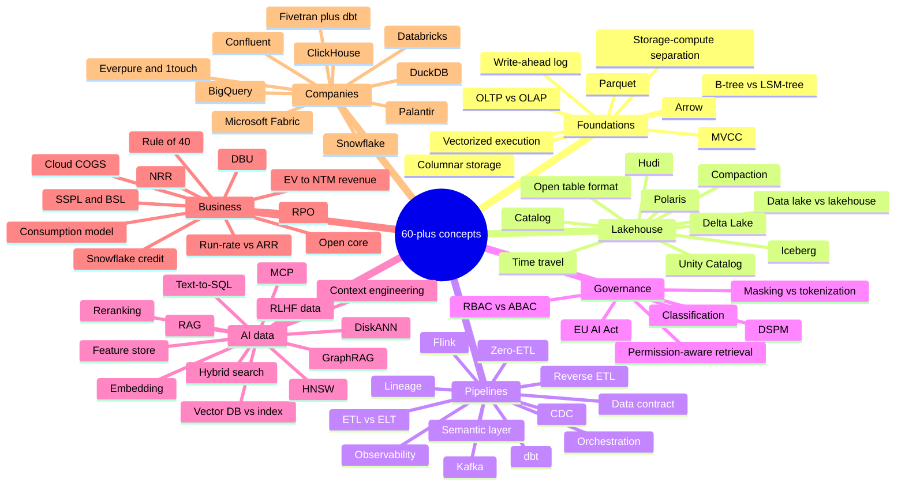
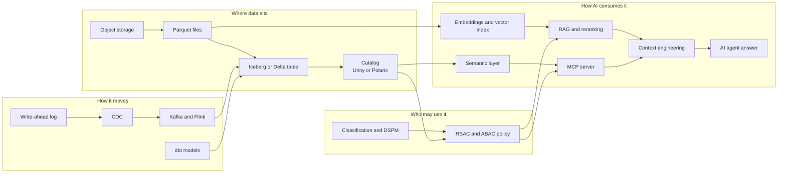

# 49. Explain It in 30 Seconds
> **Depth:** L1–L2 · **Reading time:** ~17 min · **Last verified:** 2026-11-01 · **Prerequisites:** none; each one-liner links to the chapter that explains it ([Ch 1 — The data stack map](../01-data-systems-foundations/ch01-data-stack-map.md) is the best single starting point)

## TL;DR

- This chapter holds **71 one-liners**, numbered and grouped into seven categories: foundations, lakehouse, pipelines, governance, AI data, business, and companies. Each one says what the thing is, why it matters, and gives one analogy. Each one links to the chapter that covers it in depth.
- Each entry takes about 30 seconds to say aloud. That is roughly how long an executive will listen before deciding whether you understand the topic or are reciting it.
- The analogies come from the reader's home ground: semiconductors and the memory hierarchy, storage, datacenters, and finance. If an analogy breaks under questioning, drop it and give the mechanism. The linked chapter has the mechanism.
- The numbers here are a small, dated set taken from the atlas datasets (`data/*.csv`) and the verified-facts register. Each carries a label (GAAP, company-stated run-rate, press-reported or estimate) and a footnote. Do not round them up when you repeat them.
- Two visuals show how the concepts link and which pairs people confuse most. Many credibility losses in data conversations come from mixing up adjacent terms: ARR and run-rate, data lake and lakehouse, vector index and vector database.

## Why this matters

A corporate-development professional joining Everpure (formerly Pure Storage) will hear these terms in a single week across very different rooms: a product review on Data Intelligence, a banker's pitch on a catalog startup, an earnings call from Snowflake, a partner meeting with a lakehouse vendor. Nobody in those rooms will stop to define Iceberg or NRR. The person who can define a term crisply, place it in the stack and give its business consequence gets trusted with the next question.

The one-liners are also a test of understanding. If you cannot say what a thing does, why a buyer pays for it and what it resembles in a world you already know, you do not yet know it well enough to evaluate a deal built on it. Use the entries as flash summaries before a meeting, and use the linked chapters when the meeting goes deeper than 30 seconds.

There is a specific Everpure angle as well. The company's 2026 move from storing data to understanding it, through the 1touch acquisition and the Data Intelligence launch, places it next to several categories below: classification, DSPM, catalogs, semantic context, vector pipelines. Being able to explain those neighbours accurately is what lets a strategy team talk about options, partners and competitors on the basis of public information.

## How to use this chapter

1. **Before a meeting**, scan the categories that apply. A lakehouse partner call needs entries 10–19 and 62–63. A diligence call on an AI start-up needs 38–50 and 57–59.
2. **Say the first sentence, then stop.** The first sentence of every entry is the definition and should stand on its own. Add the second sentence (why it matters) if the listener nods. Use the analogy only if they look unsure.
3. **Never improvise a number.** If you need one, use the figure in the entry with its label and date ("company-stated run-rate, August 2026"). A wrong number spoken confidently does more damage than saying you will confirm it.
4. **Use the confused-pairs table** at the end as a "don't say this" list.
5. **Go to the linked chapter** when someone asks "how does that actually work?" That is an L2 question, and this chapter is mostly L1.

*Figure 49.1 — The 71 concepts fall into seven categories. Foundations and lakehouse explain where data sits, pipelines and governance explain how it moves and who may touch it, AI data explains how models consume it, and business and companies explain who gets paid.*

| Category | Entries | Count | Main chapters |
|---|---|---|---|
| Foundations | 1–9 | 9 | [Ch 1](../01-data-systems-foundations/ch01-data-stack-map.md), [Ch 3](../01-data-systems-foundations/ch03-database-internals.md), [Ch 5](../01-data-systems-foundations/ch05-analytical-engines.md), [Ch 6](../01-data-systems-foundations/ch06-file-formats.md) |
| Lakehouse | 10–19 | 10 | [Ch 7](../01-data-systems-foundations/ch07-open-table-formats.md), [Ch 8](../01-data-systems-foundations/ch08-catalogs-and-metastores.md), [Ch 27](../04-company-deep-dives/ch27-databricks-vs-snowflake.md) |
| Pipelines | 20–31 | 12 | [Ch 9](../02-pipelines-and-governance/ch09-pipeline-patterns.md) to [Ch 14](../02-pipelines-and-governance/ch14-semantic-layers-and-bi.md) |
| Governance | 32–37 | 6 | [Ch 15](../02-pipelines-and-governance/ch15-governance-security-privacy.md), [Ch 33](../04-company-deep-dives/ch33-governance-catalog-security-companies.md) |
| AI data | 38–50 | 13 | [Ch 16](../03-ai-data-stack/ch16-ai-data-lifecycle.md) to [Ch 22](../03-ai-data-stack/ch22-agents-and-data.md) |
| Business | 51–61 | 11 | [Ch 35](../05-business-and-economics/ch35-business-models.md) to [Ch 38](../05-business-and-economics/ch38-open-source-strategy.md) |
| Companies | 62–71 | 10 | [Ch 25](../04-company-deep-dives/ch25-databricks.md) to [Ch 34](../04-company-deep-dives/ch34-application-giants-data-platforms.md) |
| **Total** | 1–71 | **71** | |

*Figure 49.2 — Category summary. The AI-data and pipeline groups are the largest because they are where executives most often hear unfamiliar jargon. Business terms are fewer, but they are where a wrong answer costs the most credibility.*

## Foundations

**1. OLTP vs OLAP.** Online transaction processing (OLTP) systems record the business one small transaction at a time: an order, a payment, a login. Online analytical processing (OLAP) systems scan millions of those records to answer questions about the business. The two are tuned in opposite directions, so most companies run both and pay to move data between them. Think of a cash register next to the general ledger. ([Ch 1](../01-data-systems-foundations/ch01-data-stack-map.md), [Ch 2](../01-data-systems-foundations/ch02-data-models.md))

**2. B-tree vs LSM-tree.** A B-tree keeps data in sorted pages and updates them in place, which makes reads fast. A log-structured merge tree (LSM-tree) appends writes to memory, flushes them as sorted files and merges those files later, which makes writes fast. Picking one means picking whether reads or writes pay the cost. It is the NAND trade-off again: overwrite in place, or write a log and garbage-collect later. ([Ch 3](../01-data-systems-foundations/ch03-database-internals.md))

**3. MVCC.** Multi-version concurrency control keeps several versions of each row. Readers see a consistent snapshot while writers keep working, and neither blocks the other. It is why a long-running report does not freeze the checkout page. Compare a finance team closing the books on a frozen trial balance while accounts payable keeps posting to the live ledger. ([Ch 3](../01-data-systems-foundations/ch03-database-internals.md))

**4. Columnar storage.** Each column's values are stored together instead of each row's. A query that touches 3 of 200 columns reads only those 3 columns, and similar values next to each other compress well. This is the main reason analytical databases are fast. It works like a DRAM burst: fetch the contiguous bytes you need instead of scattered ones. ([Ch 5](../01-data-systems-foundations/ch05-analytical-engines.md))

**5. Vectorized execution.** The query engine processes a batch of about a thousand values per operation instead of one row at a time. That keeps CPU caches and SIMD units busy. Every modern engine works this way, including DuckDB, Photon and Velox, because it gets far more throughput from the same silicon. It is the software version of moving from scalar to SIMD instructions. ([Ch 5](../01-data-systems-foundations/ch05-analytical-engines.md))

**6. Separation of storage and compute.** Durable data sits in cheap shared object storage. Compute clusters start up to query it and shut down when idle. This turned the data warehouse from a capacity purchase into a metered utility, and Snowflake built its business on it. The parallel is a fabless chip company that rents foundry capacity per wafer instead of owning a fab. ([Ch 5](../01-data-systems-foundations/ch05-analytical-engines.md), [Ch 26](../04-company-deep-dives/ch26-snowflake.md))

**7. Apache Parquet.** Parquet is the default open columnar file format for analytics. Data is split into row groups and stored column by column, compressed, with min/max statistics so engines can skip blocks they do not need. Physically, nearly every lakehouse table is a pile of Parquet files. Think of it as a standard chip package that any board vendor can mount. ([Ch 6](../01-data-systems-foundations/ch06-file-formats.md))

**8. Apache Arrow.** Arrow is a standard in-memory columnar layout, so two systems can pass data to each other without converting it row by row. Parquet is how data rests on disk. Arrow is how it moves through memory and over the network. It plays the role of a common bus protocol, like PCIe, that lets any card talk to any host. ([Ch 6](../01-data-systems-foundations/ch06-file-formats.md))

**9. Write-ahead log.** Before a database changes its data files, it appends the change to a sequential log and makes the log durable, so a crash can be replayed. The same log later feeds change data capture (entry 21). In accounting terms, the journal comes before the ledger, and balances can always be rebuilt from the journal entries. ([Ch 3](../01-data-systems-foundations/ch03-database-internals.md))

## Lakehouse

**10. Data lake vs lakehouse.** A data lake is cheap files in object storage, with no transactions. A lakehouse puts a table format and a catalog on top, so the same files behave like warehouse tables with atomic commits and governance. What separates the two is the metadata layer. The storage is the same. Picture a warehouse floor of pallets, then the same floor with an inventory system running. ([Ch 7](../01-data-systems-foundations/ch07-open-table-formats.md))

**11. Open table format.** An open table format is a metadata layer plus a commit protocol. It turns a folder of immutable Parquet files into a table with atomic commits, snapshots and schema evolution. A commit swaps one small pointer, so many engines can safely share one copy of the data. It resembles a page table that maps logical pages to physical ones: change the map, and the whole view changes at once. ([Ch 7](../01-data-systems-foundations/ch07-open-table-formats.md))

**12. Apache Iceberg.** Iceberg is the open table format created at Netflix. It tracks a table as a tree of metadata files and relies on a catalog to make commits atomic. It became the industry's neutral standard. Databricks paid a press-reported ~$2B in June 2024 for Tabular, the company Iceberg's creators founded.[^tabular] Think of it as the JEDEC standard for tables. ([Ch 7](../01-data-systems-foundations/ch07-open-table-formats.md))

**13. Delta Lake.** Delta Lake is Databricks' open table format: Parquet files plus an ordered log of JSON commits, with periodic checkpoints. It dominates inside Databricks estates. UniForm lets a Delta table also publish Iceberg metadata so other engines can read it. In accounting terms, it is a journal with a periodic trial balance. ([Ch 7](../01-data-systems-foundations/ch07-open-table-formats.md), [Ch 25](../04-company-deep-dives/ch25-databricks.md))

**14. Apache Hudi.** Hudi is the table format that came out of Uber. It is built around a timeline of table actions and tuned for upserts and streaming ingestion. Technically it is strong at frequent row-level changes, but it has the smallest commercial ecosystem of the three main formats. Compare a specialist process node that is excellent for one workload and has few customers. ([Ch 7](../01-data-systems-foundations/ch07-open-table-formats.md))

**15. Catalog.** A catalog records which tables exist, where each table's current metadata lives and who may read it. For Iceberg, the catalog also performs the commit. Every engine has to ask the catalog first, which makes the catalog the control point of the lakehouse. A finance parallel is the share registrar: whoever keeps the register decides who owns what. ([Ch 8](../01-data-systems-foundations/ch08-catalogs-and-metastores.md))

**16. Unity Catalog.** Unity Catalog is Databricks' governance catalog for tables, files, models and functions. It handles permissions, lineage, audit and the short-lived storage credentials that engines use. There is also an open-source version. It is how Databricks keeps control of policy even when the data sits in open formats that any engine could read. ([Ch 8](../01-data-systems-foundations/ch08-catalogs-and-metastores.md), [Ch 25](../04-company-deep-dives/ch25-databricks.md))

**17. Apache Polaris.** Polaris is an open-source Iceberg REST catalog that Snowflake donated in 2024. It later became an Apache top-level project. Its design is neutral and Iceberg-native, and it is Snowflake's bid to be where other engines register their tables. Snowflake's richer proprietary governance lives in Horizon. Like a standards body seeded by one vendor, it is open, but its sponsor shapes the roadmap. ([Ch 8](../01-data-systems-foundations/ch08-catalogs-and-metastores.md), [Ch 27](../04-company-deep-dives/ch27-databricks-vs-snowflake.md))

**18. Time travel.** Time travel means querying a table as it stood at an earlier snapshot. It works because old data files are kept until the snapshot expires. It is useful for audits, for reproducing an ML training set exactly, and for undoing a bad load. It works like an array snapshot, which is cheap because only changed blocks are new. ([Ch 7](../01-data-systems-foundations/ch07-open-table-formats.md))

**19. Compaction.** Compaction is background work that rewrites many small files into fewer large ones, along with expiring old snapshots and deleting orphaned files. Streaming writers create small files all the time. That makes table maintenance the place where much of a lakehouse's operating cost, and much of the vendor differentiation, now sits. It is SSD garbage collection for tables. ([Ch 7](../01-data-systems-foundations/ch07-open-table-formats.md))

## Pipelines

**20. ETL vs ELT.** Extract-transform-load (ETL) reshapes data before it lands in the warehouse. Extract-load-transform (ELT) lands raw data first and transforms it inside the warehouse with SQL. Cheap, elastic cloud compute made ELT the default and created the market for Fivetran and dbt. Compare refining ore at the mine with shipping raw ore to a large smelter. ([Ch 9](../02-pipelines-and-governance/ch09-pipeline-patterns.md))

**21. Change data capture.** Change data capture (CDC) reads a database's transaction log and sends each committed insert, update and delete downstream as an event. It keeps analytics minutes behind production without loading the source with queries. It is like reading the bank's live transaction feed instead of reprinting the whole statement every night. ([Ch 10](../02-pipelines-and-governance/ch10-ingestion-and-integration.md))

**22. Apache Kafka.** Kafka is an open-source distributed log. Producers append events to topics, and many consumers read them independently, each at its own pace. It is the default backbone for event streaming. IBM completed its roughly $11B purchase of Confluent, Kafka's main commercial vendor, in March 2026.[^ibm-close] Think of an exchange ticker tape that every trading desk reads. ([Ch 11](../02-pipelines-and-governance/ch11-streaming-and-event-platforms.md))

**23. Apache Flink.** Flink is a stream-processing engine. It runs continuous joins, aggregations and time windows over events as they arrive, and it manages state with exactly-once guarantees. Kafka moves the events and Flink computes on them. If Kafka is the conveyor belt, Flink is the inspection station built onto it. ([Ch 11](../02-pipelines-and-governance/ch11-streaming-and-event-platforms.md))

**24. dbt.** dbt is an open-source framework in which analysts write SQL SELECT statements as "models". dbt compiles them, orders them into a dependency graph, tests them and runs them inside the warehouse. It turned transformation into version-controlled software work, a practice now called analytics engineering. The parallel is a chip design flow with regression tests run on every change. ([Ch 12](../02-pipelines-and-governance/ch12-transformation-and-orchestration.md))

**25. Orchestration.** An orchestrator, such as Airflow, Dagster or Prefect, schedules, runs, retries and records pipeline tasks in dependency order, as a directed acyclic graph. It is the control tower of the data platform. It is rarely glamorous and always blamed when the 6 a.m. dashboard is late. A fab parallel is the manufacturing execution system that routes wafers between tools. ([Ch 12](../02-pipelines-and-governance/ch12-transformation-and-orchestration.md))

**26. Reverse ETL.** Reverse ETL syncs modelled data from the warehouse back into operational tools such as a CRM, a support desk or an ad platform, so front-line teams can act on it. It makes the warehouse a source of data as well as a destination. Fivetran agreed to buy Census for exactly this in 2025. Compare a refinery that also runs the delivery trucks. ([Ch 9](../02-pipelines-and-governance/ch09-pipeline-patterns.md), [Ch 30](../04-company-deep-dives/ch30-data-movement-streaming-companies.md))

**27. Zero-ETL.** Zero-ETL is vendor-managed replication from an operational database into an analytics service, so the customer builds no pipeline. Examples are Aurora to Redshift and Fabric mirroring. "Zero" means the customer builds zero pipelines. It does not mean zero copies: the data is still moved and stored twice. It is like a bank's automatic sweep account: the money still moves, you just do not move it yourself. ([Ch 9](../02-pipelines-and-governance/ch09-pipeline-patterns.md))

**28. Data contract.** A data contract is an enforced agreement, owned by the team that produces a dataset, on its schema, meaning and quality. It is checked automatically before any change ships. It moves data quality upstream to the engineers who can actually break it. It works like an interface specification between chip blocks: change a pin and the integration test fails. ([Ch 12](../02-pipelines-and-governance/ch12-transformation-and-orchestration.md), [Ch 13](../02-pipelines-and-governance/ch13-data-quality-observability-lineage.md))

**29. Data observability.** Data observability automatically monitors each table's freshness, volume, schema and value distributions, plus its lineage, to catch broken data before users do. It is application performance monitoring for datasets. Its business case rests on "data downtime", the hours when dashboards or models silently run on bad data. Think of it as the fab's in-line metrology, which catches drift before the wafers reach final test. ([Ch 13](../02-pipelines-and-governance/ch13-data-quality-observability-lineage.md))

**30. Data lineage.** Lineage is the graph of how data flows from sources through transformations to dashboards and models, more and more often at the level of individual columns. It answers two questions: "what breaks if I change this?" for engineers, and "where did this number come from?" for auditors and regulators. In finance terms, it is the audit trail from a reported figure back to its journal entries. ([Ch 13](../02-pipelines-and-governance/ch13-data-quality-observability-lineage.md))

**31. Semantic layer.** A semantic layer is one shared, governed set of business definitions, such as what counts as "revenue" or an "active customer". Every BI tool and AI agent queries those definitions instead of re-deriving them. It matters more in the AI era, because a model writing raw SQL has to guess definitions, and the semantic layer gives it the answer key. The accounting equivalent is the chart of accounts. ([Ch 14](../02-pipelines-and-governance/ch14-semantic-layers-and-bi.md))

## Governance

**32. RBAC vs ABAC.** Role-based access control (RBAC) grants permissions to roles such as "finance analyst". Attribute-based access control (ABAC) decides each request at run time, from attributes such as the data's sensitivity tag, the user's region and the stated purpose. RBAC is simple but grows into thousands of roles at scale. ABAC scales through tags. Compare a key for every office with a badge reader that checks clearance. ([Ch 15](../02-pipelines-and-governance/ch15-governance-security-privacy.md))

**33. DSPM.** Data security posture management (DSPM) continuously finds where sensitive data lives across clouds, SaaS apps and on-premises stores, who can reach it, and how exposed it is. It is the inventory step that every other control depends on. Proofpoint's pending deal for Varonis, announced in October 2026 at about $6.3B transaction value, shows what buyers will pay for it.[^varonis] Think of a physical inventory count before an audit. ([Ch 15](../02-pipelines-and-governance/ch15-governance-security-privacy.md), [Ch 33](../04-company-deep-dives/ch33-governance-catalog-security-companies.md))

**34. Data classification.** Classification labels data by type and sensitivity, such as an email address, a card number or a health record, so that policies attach to the label instead of to each table. Automated classifiers combine pattern matching, checksums and machine-learning models. The parallel is hazmat labels on shipping containers: the handling rules follow the label wherever the container goes. ([Ch 15](../02-pipelines-and-governance/ch15-governance-security-privacy.md))

**35. Masking vs tokenization.** Dynamic masking rewrites a sensitive value at query time, depending on who is asking: one user sees the full card number, another sees `****1234`. Tokenization replaces the stored value with a surrogate token that only an authorized vault can reverse. Masking protects the view of the data. Tokenization protects the data itself, including every downstream copy. It is the difference between frosted glass and a safe-deposit box. ([Ch 15](../02-pipelines-and-governance/ch15-governance-security-privacy.md))

**36. EU AI Act.** The EU AI Act, Regulation (EU) 2024/1689, sets risk-tiered duties for AI systems, including data-governance requirements for the training data of high-risk systems (Article 10). After the 2026 AI Omnibus, those high-risk duties start on 2 December 2027 for standalone systems and on 2 August 2028 for systems embedded in products.[^aiact][^omnibus] Its effect is to turn lineage and data-quality records into compliance evidence, much as SOX turned internal controls into auditable artefacts. ([Ch 15](../02-pipelines-and-governance/ch15-governance-security-privacy.md))

**37. Permission-aware retrieval.** Permission-aware retrieval enforces the source system's access rights at query time, so an AI assistant only retrieves passages the asking user could open directly. Without it, a retrieval system becomes a very fast way to leak the HR folder. Compare a library that checks your card for each book, not just at the front door. ([Ch 17](../03-ai-data-stack/ch17-unstructured-data-processing.md), [Ch 19](../03-ai-data-stack/ch19-retrieval-architectures.md))

## AI data

**38. Embedding.** An embedding is a list of numbers, usually hundreds to a few thousand of them, that a model produces so that similar items sit near each other in space. Embeddings let software search by meaning instead of exact words. Think of them as GPS coordinates for meaning, where "invoice" and "bill" end up a block apart. ([Ch 18](../03-ai-data-stack/ch18-embeddings-and-vector-search.md))

**39. Vector database vs vector index.** A vector index, such as HNSW, IVF or DiskANN, is the data structure that finds nearest neighbours quickly. A vector database wraps one or more indexes with storage, filtering, updates, access control and scaling. Most mainstream databases now ship a vector index, which squeezes standalone vector databases. The parallel is a cache controller compared with a whole memory subsystem. ([Ch 18](../03-ai-data-stack/ch18-embeddings-and-vector-search.md))

**40. HNSW.** Hierarchical Navigable Small World (HNSW) is a layered graph index. A search hops across sparse upper layers to get close, then refines its result in denser lower layers. It is the default for in-memory vector search because it is fast and accurate, but it uses a lot of memory. Think of driving on highways first, then arterial roads, then local streets. ([Ch 18](../03-ai-data-stack/ch18-embeddings-and-vector-search.md))

**41. DiskANN.** DiskANN is Microsoft's graph vector index. It keeps the graph and the full vectors on SSD and holds only compressed vectors in RAM, which allows billion-vector search on a single machine. It moves the cost of vector search from DRAM to flash, which matters directly to a storage vendor. It is the memory hierarchy applied: DRAM as the cache, NAND as the capacity tier. ([Ch 18](../03-ai-data-stack/ch18-embeddings-and-vector-search.md), [Ch 24](../03-ai-data-stack/ch24-data-meets-compute-and-storage.md))

**42. RAG.** Retrieval-augmented generation (RAG) fetches relevant passages when a question arrives and adds them to the prompt, so the model answers from your data instead of from memory. It is the cheapest way to give a large language model (LLM) current, private and citable knowledge. Answer quality depends more on retrieval than on the model. It is an open-book exam. ([Ch 19](../03-ai-data-stack/ch19-retrieval-architectures.md))

**43. Reranking.** A reranker is a second-stage model, usually a cross-encoder, that reads the query alongside each of the top few dozen candidates and reorders them by true relevance. A fast first pass gets recall, and a slower, precise second pass gets precision. It is cheap insurance for RAG quality. The fab parallel is wafer probe followed by final test. ([Ch 19](../03-ai-data-stack/ch19-retrieval-architectures.md))

**44. GraphRAG.** GraphRAG is Microsoft Research's 2024 approach. An LLM extracts entities and relationships from documents into a knowledge graph, summarizes clusters of related entities, and retrieves over that structure. It helps with "connect the dots" questions that span many documents, at a much higher indexing cost. Compare an analyst's org-chart-and-deal map with a stack of filings. ([Ch 19](../03-ai-data-stack/ch19-retrieval-architectures.md))

**45. Context engineering.** Context engineering decides, on every model call, which instructions, retrieved data, tool results and memory go into the limited context window, and in what order. It has replaced prompt wording as the main lever on agent quality, because models get worse when context is long and noisy. It is cache management: what you keep in the small, fast tier decides performance. ([Ch 16](../03-ai-data-stack/ch16-ai-data-lifecycle.md), [Ch 22](../03-ai-data-stack/ch22-agents-and-data.md))

**46. MCP.** The Model Context Protocol (MCP) is an open standard for connecting AI applications to tools and data through "MCP servers". Anthropic introduced it in November 2024 and donated it to the Linux Foundation's Agentic AI Foundation in December 2025.[^mcp] It works like USB-C for agents: build one connector, and any compliant agent can use it. That is why every data vendor now ships an MCP server. ([Ch 22](../03-ai-data-stack/ch22-agents-and-data.md))

**47. Text-to-SQL.** Text-to-SQL means an LLM translating a plain-English question into a SQL query against a database. Demos are easy and production is hard. Accuracy drops sharply on real enterprise schemas unless the model is grounded in a semantic layer and its output is checked. It is like a new analyst who writes fluent SQL but does not know your chart of accounts. ([Ch 14](../02-pipelines-and-governance/ch14-semantic-layers-and-bi.md), [Ch 22](../03-ai-data-stack/ch22-agents-and-data.md))

**48. Feature store.** A feature store defines each machine-learning feature once, for example "transactions in the last seven days". It then serves identical values to training (the offline store) and to real-time prediction (the online store). That prevents training-serving skew, the silent bug where a model sees different data in production than it was trained on. As a standalone category it has largely been absorbed into platforms. Think of it as a golden reference standard that test and production both calibrate to. ([Ch 21](../03-ai-data-stack/ch21-ml-platforms-feature-stores-llmops.md))

**49. RLHF data.** Reinforcement learning from human feedback (RLHF) tunes a model against a reward model trained on human judgements of which answer is better. The scarce input is preference data and expert-written examples, which is why data-labelling and expert-network companies command large valuations. The fab parallel is yield learning, where engineers' judgements become the training signal for the process. ([Ch 20](../03-ai-data-stack/ch20-training-data-supply-chain.md))

**50. Hybrid search.** Hybrid search combines keyword search (BM25) with vector search and merges the two ranked lists, often by reciprocal rank fusion. Keywords catch exact part numbers, names and codes that embeddings blur. Vectors catch paraphrases that keywords miss. It works like a fund that blends a quantitative screen with an analyst's judgement. ([Ch 18](../03-ai-data-stack/ch18-embeddings-and-vector-search.md))

## Business

**51. DBU.** A Databricks Unit (DBU) is a normalized unit of processing per hour. The price per DBU varies by product, from about $0.15 for classic jobs compute to about $0.70 for serverless SQL (third-party-compiled US list prices).[^dbx-pricing] Think of kilowatt-hours: the meter is uniform, but the tariff depends on what you run. ([Ch 25](../04-company-deep-dives/ch25-databricks.md), [Ch 35](../05-business-and-economics/ch35-business-models.md))

**52. Snowflake credit.** A Snowflake credit is the unit of compute consumption. A running virtual warehouse burns credits by the second, and each step up in warehouse size doubles the credits burned per hour. The price per credit depends on edition and region. Customers usually commit to buy credits in advance, and Snowflake recognizes revenue only as they are burned. It works like prepaid mobile minutes. ([Ch 26](../04-company-deep-dives/ch26-snowflake.md), [Ch 35](../05-business-and-economics/ch35-business-models.md))

**53. Consumption model.** Under a consumption model, customers pay for what they use, not for seats or licences, so revenue follows workloads. The model ties price to value and lets small deals grow large. The cost is predictability: revenue is harder to forecast, and customers' cost optimization shows up directly as slower growth. It is a toll road, not a lease. ([Ch 35](../05-business-and-economics/ch35-business-models.md))

**54. NRR.** Net revenue retention (NRR) is this year's revenue from last year's customer cohort divided by that cohort's revenue a year earlier. Expansion, contraction and churn are all included. Snowflake reported 126% for Q2 FY2027 (May–Jul 2026, company KPI), down from 158% in FY2023.[^sf-q2][^sf-hist] Read it as same-store sales growth for software. ([Ch 36](../05-business-and-economics/ch36-unit-economics-kpis.md))

**55. RPO.** Remaining performance obligations (RPO) are contracted revenue not yet recognized: the backlog. Snowflake's RPO was about $9.0B at Q2 FY2027 (GAAP), down from $9.77B at FY2026 year-end, because customers burned through commitments faster than they signed new ones.[^sf-q2] It is the semiconductor order book, and like any order book it can fall while revenue rises. ([Ch 36](../05-business-and-economics/ch36-unit-economics-kpis.md))

**56. Cloud COGS.** For a cloud data platform, cost of goods sold (COGS) is mostly the hyperscaler bill: compute, storage and networking bought from AWS, Azure or Google to run customer queries. Gross margin is the premium charged over a cost the vendor does not control. This is the fabless chip company's wafer cost, and multi-year committed-spend deals with hyperscalers are the equivalent of long-term wafer agreements. ([Ch 36](../05-business-and-economics/ch36-unit-economics-kpis.md))

**57. Rule of 40.** The Rule of 40 says revenue growth plus free-cash-flow margin should be at least 40%. Snowflake scores about 58: 35% GAAP revenue growth in Q2 FY2027 plus a 23% full-year adjusted FCF-margin guide. Palantir reports 155% (company-stated, Q2 2026).[^r40][^pltr] It is a quick check of whether growth is being bought. In investment terms, it trades growth against yield. ([Ch 36](../05-business-and-economics/ch36-unit-economics-kpis.md))

**58. EV/NTM revenue.** Enterprise value divided by expected revenue over the next twelve months is the standard multiple for growth software. On 30 October 2026, Snowflake traded near 16.9x and Palantir near 53x, both using NTM proxies derived from company guidance (estimates).[^comps] It is the EV/EBITDA of companies that have no meaningful EBITDA yet. ([Ch 37](../05-business-and-economics/ch37-public-comps-valuation.md))

**59. Run-rate vs ARR.** A revenue run-rate annualizes the latest quarter or month of all revenue, consumption included. Annual recurring revenue (ARR) annualizes contracted subscription value. Databricks' ">$7B revenue run-rate" (company-stated, August 2026) is neither ARR nor audited GAAP revenue.[^db-7b] Compare annualizing one strong month of fab output with counting signed long-term agreements. ([Ch 25](../04-company-deep-dives/ch25-databricks.md), [Ch 36](../05-business-and-economics/ch36-unit-economics-kpis.md))

**60. Open core.** Open core means giving away an open-source core and selling proprietary features, hosting or support around it. Databricks (Spark), Confluent (Kafka) and MongoDB all started this way. It builds adoption cheaply, but the vendor has to hold back enough value from the free version, and a hyperscaler can host the free core too. Think of a reference design given away to sell the chips. ([Ch 38](../05-business-and-economics/ch38-open-source-strategy.md))

**61. SSPL and BSL.** These are source-available licences that stop competitors, chiefly hyperscalers, from selling the software as a service. MongoDB's Server Side Public License (SSPL, 2018) requires anyone offering it as a service to publish their whole service stack. The Business Source License (BSL) restricts production use until a change date, after which the code becomes open source. Neither is OSI-approved open source. It works like a patent licence with a field-of-use carve-out. ([Ch 38](../05-business-and-economics/ch38-open-source-strategy.md))

## Companies

**62. Databricks.** Databricks is the lakehouse company, founded by the creators of Apache Spark. It sells data engineering, warehousing, governance (Unity Catalog), Postgres (Lakebase) and AI tooling, all on open formats. In August 2026 it stated a revenue run-rate above $7B, growing more than 80%, and raised $5B at a $190B valuation (company-stated).[^db-7b] Its bull case is that it is the default platform for AI. Its bear case is a valuation that already prices that in. ([Ch 25](../04-company-deep-dives/ch25-databricks.md))

**63. Snowflake.** Snowflake is the cloud data warehouse that commercialized the separation of storage and compute. It is now expanding into Iceberg, Postgres and AI agents (Snowflake CoWork). Product revenue was about $1.49B in Q2 FY2027 (May–Jul 2026), up 37% (GAAP), and Snowflake raised its FY2027 product revenue guide to $6.07B.[^sf-q2] Ease of use is its moat, and open formats are its main threat. ([Ch 26](../04-company-deep-dives/ch26-snowflake.md), [Ch 27](../04-company-deep-dives/ch27-databricks-vs-snowflake.md))

**64. Microsoft Fabric.** Fabric is Microsoft's SaaS analytics suite, covering pipelines, Spark, warehouse, real-time analytics and Power BI. It runs on OneLake, a single tenant-wide lake stored as Delta and Parquet. Its main advantage is distribution: it sells into existing Power BI and Microsoft 365 customers on one capacity bill. Think of an integrated device maker bundling the whole board. ([Ch 28](../04-company-deep-dives/ch28-hyperscaler-data-platforms.md))

**65. BigQuery.** BigQuery is Google Cloud's serverless data warehouse, descended from Google's internal Dremel system and priced per terabyte scanned or per slot-hour. It sits inside a cloud segment that grew 103% to $30.7B in Q3 2026 (GAAP segment revenue). Most of that growth came from AI compute, not BigQuery.[^goog-q3] Think of a utility meter attached to Google's own infrastructure. ([Ch 28](../04-company-deep-dives/ch28-hyperscaler-data-platforms.md))

**66. ClickHouse.** ClickHouse is an open-source columnar database built for very fast real-time analytics. It originated at Yandex. The company reached a press-reported $15B valuation in January 2026 and stated more than $250M of ARR in May 2026 (company-stated).[^ch-seriesd][^ch-arr] It is the high-clock-speed part of the analytics market: built for latency, not breadth. ([Ch 23](../03-ai-data-stack/ch23-real-time-analytics-htap.md), [Ch 31](../04-company-deep-dives/ch31-analytical-engine-challengers-legacy.md))

**67. DuckDB.** DuckDB is an in-process analytical database, often described as SQLite for analytics. It runs inside a laptop, a notebook or an application with no server. In August 2026 AWS agreed to acquire DuckLabs, the company behind it, on undisclosed terms. DuckDB itself stays MIT-licensed under the independent DuckDB Foundation.[^aws-duck] It is the edge-compute chip of the data world: small, local and everywhere. ([Ch 31](../04-company-deep-dives/ch31-analytical-engine-challengers-legacy.md))

**68. Confluent.** Confluent was founded by Kafka's creators and sells managed Kafka and Flink. FY2025 revenue (calendar year) was $1,166.7M, up 21% (GAAP), of which Confluent Cloud was $624M. IBM completed its roughly $11B acquisition on 17 March 2026.[^cflt][^ibm-close] It is the clearest proof so far that streaming became infrastructure a platform buys rather than a standalone category. ([Ch 30](../04-company-deep-dives/ch30-data-movement-streaming-companies.md))

**69. Fivetran + dbt Labs.** Fivetran's managed connectors, which extract and load data, merged with dbt Labs' transformation framework. The all-stock deal was announced in October 2025 and closed on 1 June 2026, with combined ARR "approaching $600M" (company-stated).[^ft-dbt-close] It is the modern data stack consolidating, much as point-tool EDA vendors rolled up into suites. ([Ch 30](../04-company-deep-dives/ch30-data-movement-streaming-companies.md), [Ch 43](../06-history-and-future/ch43-modern-data-stack.md))

**70. Palantir.** Palantir builds an "ontology" over a customer's data: a governed model of its business objects and the actions allowed on them. Operators and AI agents then act through that model (Foundry, AIP). Revenue grew 93% in Q2 2026 (GAAP), and the stock trades near 53x EV/NTM revenue.[^pltr][^comps] The semantic layer here is the product itself, not plumbing. ([Ch 34](../04-company-deep-dives/ch34-application-giants-data-platforms.md))

**71. Everpure and 1touch.** Everpure (formerly Pure Storage; NYSE: P) bought 1touch, a data discovery, classification and semantic-context company, for $125.0M in stated cash consideration. The deal closed on 7 May 2026, and the product was relaunched in June 2026 as Everpure Data Intelligence.[^ep-10q][^ep-di] It is a storage vendor moving up the stack, from storing data to understanding it. Options a strategy team might evaluate, based on public information, are discussed in Ch 24 and Ch 33. ([Ch 24](../03-ai-data-stack/ch24-data-meets-compute-and-storage.md), [Ch 33](../04-company-deep-dives/ch33-governance-catalog-security-companies.md))

## How the concepts connect

The one-liners are easier to remember as a chain than as a list. The flowchart follows a single path from bytes on storage to an agent's answer. Each node is an entry above, and each arrow is a dependency: the layer on the right cannot work well unless the one on its left does.

*Figure 49.3 — From bytes to answers. Parquet becomes a table through Iceberg or Delta. The catalog then becomes the control point that both the semantic layer and access policy depend on. Agents reach data through MCP and retrieval, and both of those paths inherit governance from the catalog. Whoever owns the catalog and policy layer sits on the critical path of every AI answer, which is why Databricks, Snowflake and storage vendors all compete for it.*

## Most-confused pairs

| People say | What is actually true | Why it matters | Entry |
|---|---|---|---|
| "ARR of $7B" for Databricks | It is a company-stated **revenue run-rate** (annualized recent revenue, consumption included), not ARR and not GAAP revenue | Applying an ARR multiple to a consumption run-rate overstates durability | 59 |
| "Data lake" and "lakehouse" as synonyms | A lakehouse is a lake **plus** a table format and a catalog that provide transactions and governance | The value, and the vendor lock-in, sits in the metadata layer | 10 |
| "Vector database" for any vector search | A vector **index** is a data structure. A vector **database** is a full system built around one | Most incumbents now ship vector indexes, which squeezes standalone vector databases | 39 |
| "Zero-ETL means no copies" | It means no **pipeline you build**. Data is still replicated and stored twice | Storage and egress costs do not disappear | 27 |
| "RPO is next year's revenue" | RPO is **all** contracted, unrecognized revenue, of which only part falls in the next 12 months | Falling RPO with rising revenue can be healthy burn-down, not a demand collapse | 55 |
| "Open source means anyone can host it" | SSPL and BSL are **source-available** licences that bar competing hosted services | Licence choice decides whether a hyperscaler can take the revenue | 61 |
| "Masking and tokenization are the same" | Masking hides the value **at query time**. Tokenization replaces the **stored** value | Only tokenization protects downstream copies | 35 |
| "MCP is an agent framework" | MCP is a **connection protocol** between agents and tools or data | The value goes to whoever owns the servers and the permissions behind them | 46 |
| "EU AI Act high-risk rules apply from August 2026" | The 2026 Omnibus moved them to **2 December 2027 and 2 August 2028** | A wrong compliance date undermines any governance pitch | 36 |

*Figure 49.4 — Most-confused pairs. Each row is a "don't say this" item. The middle column is the 30-second correction, and the entry number points to the full one-liner.*

## Key terms

- [OLTP](../glossary.md#oltp) and [OLAP](../glossary.md#olap) — transactional versus analytical workloads.
- [B-tree](../glossary.md#b-tree) and [LSM-tree](../glossary.md#lsm-tree) — read-optimized versus write-optimized index structures.
- [MVCC](../glossary.md#mvcc) — multiple row versions so readers and writers do not block each other.
- [Columnar storage](../glossary.md#columnar-storage) and [Vectorized execution](../glossary.md#vectorized-execution) — the two reasons analytical engines are fast.
- [Separation of storage and compute](../glossary.md#separation-of-storage-and-compute) — shared durable storage, elastic compute.
- [Apache Parquet](../glossary.md#apache-parquet) and [Apache Arrow](../glossary.md#apache-arrow) — columnar formats on disk and in memory.
- [Write-ahead log](../glossary.md#write-ahead-log) — the durable change log that also feeds CDC.
- [Lakehouse](../glossary.md#lakehouse) and [Data lake](../glossary.md#data-lake) — open files with and without a table-format and catalog layer.
- [Open table format](../glossary.md#open-table-format), [Apache Iceberg](../glossary.md#apache-iceberg), [Delta Lake](../glossary.md#delta-lake) and [Apache Hudi](../glossary.md#apache-hudi) — metadata layers that turn files into tables.
- [Data catalog](../glossary.md#data-catalog), [Unity Catalog](../glossary.md#unity-catalog) and [Apache Polaris](../glossary.md#apache-polaris) — the lakehouse control point.
- [Time travel](../glossary.md#time-travel) and [Compaction](../glossary.md#compaction) — snapshot queries and table maintenance.
- [ETL](../glossary.md#etl), [ELT](../glossary.md#elt), [Reverse ETL](../glossary.md#reverse-etl) and [Zero-ETL](../glossary.md#zero-etl) — the main data-movement patterns.
- [Change data capture](../glossary.md#change-data-capture), [Apache Kafka](../glossary.md#apache-kafka) and [Apache Flink](../glossary.md#apache-flink) — log-based capture, event transport and stream computation.
- [dbt](../glossary.md#dbt) and [Orchestrator](../glossary.md#orchestrator) — transformation as code, and the scheduler that runs it.
- [Data contract](../glossary.md#data-contract), [Data observability](../glossary.md#data-observability) and [Data lineage](../glossary.md#data-lineage) — preventing, detecting and tracing bad data.
- [Semantic layer](../glossary.md#semantic-layer) — governed business definitions for BI and AI.
- [Role-based access control](../glossary.md#role-based-access-control) and [Attribute-based access control](../glossary.md#attribute-based-access-control) — role grants versus attribute-driven policy.
- [Data security posture management](../glossary.md#data-security-posture-management) and [Data classification](../glossary.md#data-classification) — finding and labelling sensitive data.
- [Dynamic data masking](../glossary.md#dynamic-data-masking) and [Tokenization](../glossary.md#tokenization) — hiding the view versus replacing the stored value.
- [EU AI Act](../glossary.md#eu-ai-act) — EU risk-tiered AI regulation with training-data governance duties.
- [Permission-aware retrieval](../glossary.md#permission-aware-retrieval) — retrieval that enforces source access rights per user.
- [Embedding](../glossary.md#embedding), [Vector index](../glossary.md#vector-index), [Vector database](../glossary.md#vector-database), [HNSW](../glossary.md#hnsw) and [DiskANN](../glossary.md#diskann) — semantic vectors and the structures that search them.
- [Retrieval-augmented generation](../glossary.md#retrieval-augmented-generation), [Reranker](../glossary.md#reranker), [GraphRAG](../glossary.md#graphrag) and [Hybrid search](../glossary.md#hybrid-search) — retrieval patterns for LLMs.
- [Context engineering](../glossary.md#context-engineering) and [Model Context Protocol](../glossary.md#model-context-protocol) — what goes into the model's window, and the standard plug for tools and data.
- [Text-to-SQL](../glossary.md#text-to-sql) and [Feature store](../glossary.md#feature-store) — natural-language querying and consistent ML features.
- [Reinforcement learning from human feedback](../glossary.md#reinforcement-learning-from-human-feedback) and [Preference data](../glossary.md#preference-data) — human judgements as training signal.
- [DBU](../glossary.md#dbu) and [Snowflake credit](../glossary.md#snowflake-credit) — the two leading consumption meters.
- [Consumption pricing](../glossary.md#consumption-pricing) — paying for usage rather than seats or licences.
- [Net revenue retention](../glossary.md#net-revenue-retention) and [Remaining performance obligations](../glossary.md#remaining-performance-obligations) — cohort expansion and contracted backlog.
- [Cloud COGS](../glossary.md#cloud-cogs) and [Rule of 40](../glossary.md#rule-of-40) — the hyperscaler bill behind gross margin, and the growth-plus-cash test.
- [EV to NTM revenue](../glossary.md#ev-to-ntm-revenue), [Revenue run-rate](../glossary.md#revenue-run-rate) and [Annual recurring revenue](../glossary.md#annual-recurring-revenue) — the valuation multiple and the two most-confused revenue measures.
- [Open core](../glossary.md#open-core), [SSPL](../glossary.md#sspl) and [Business Source License](../glossary.md#business-source-license) — open-source business models and licences that block hyperscaler resale.
- [Microsoft Fabric](../glossary.md#microsoft-fabric), [OneLake](../glossary.md#onelake) and [BigQuery](../glossary.md#bigquery) — hyperscaler analytics platforms.

## Sources

[^tabular]: TechCrunch, "Databricks reportedly paid $2 billion in Tabular acquisition," https://techcrunch.com/2024/08/14/databricks-reportedly-paid-2-billion-in-tabular-acquisition, published 2024-08-14; retrieved 2026-11-01. Deal announced 2024-06-04; price press-reported (WSJ range $1–2B), never disclosed by Databricks; as recorded in `data/ma_deals.csv` (via Ch 7).

[^ibm-close]: IBM, "IBM Completes Acquisition of Confluent," via Stock Titan, https://www.stocktitan.net/news/IBM/ibm-completes-acquisition-of-confluent-making-real-time-data-the-lbuwdbharsqe.html, published 2026-03-17; ChannelWeb UK, "IBM completes $11bn Confluent acquisition," https://www.channelweb.co.uk/news-network/2026/ibm-completes-11bn-confluent-acquisition, published 2026-03; retrieved 2026-11-01. ~$11B enterprise value, $31/share cash; as recorded in `data/ma_deals.csv` (via Ch 30).

[^cflt]: Confluent, Inc., Form 10-K for fiscal year 2025 (calendar; ended 2025-12-31), SEC EDGAR, https://www.sec.gov/Archives/edgar/data/1699838/000169983826000006/cflt-20251231.htm, published 2026-02; Business Wire, "Confluent Announces Fourth Quarter and Fiscal Year 2025 Financial Results," https://www.businesswire.com/news/home/20260210008002/en/Confluent-Announces-Fourth-Quarter-and-Fiscal-Year-2025-Financial-Results, published 2026-02-10; retrieved 2026-11-01. GAAP total revenue $1,166.7M (+21%); Confluent Cloud $624M (+27%) (`meta/verified-facts.md` #1).

[^varonis]: Varonis Systems, Inc., Form 8-K Exhibit 99.1 (merger agreement with Proofpoint), SEC EDGAR, https://www.sec.gov/Archives/edgar/data/0001361113/000121390026109901/ea030861001ex99-1.htm, published 2026-10-15; retrieved 2026-11-01. $49.75/share cash; ~$6.3B is the headline transaction value and ~$5.71B the equity value; close expected 1H 2027 (`data/ma_deals.csv`; `meta/verified-facts.md` #14).

[^aiact]: Regulation (EU) 2024/1689 (Artificial Intelligence Act), EUR-Lex, https://eur-lex.europa.eu/eli/reg/2024/1689/oj, published 2024-07-12 (in force 2024-08-01; Article 10 on data and data governance); retrieved 2026-11-01 (via Ch 15).

[^omnibus]: Council of the EU, "Artificial intelligence: Council and Parliament agree to simplify and streamline rules," https://www.consilium.europa.eu/en/press/press-releases/2026/05/07/artificial-intelligence-council-and-parliament-agree-to-simplify-and-streamline-rules/, published 2026-05-07; Future of Privacy Forum, "The AI Act implementation timeline: What changes under the AI Omnibus?," https://fpf.org/blog/the-ai-act-implementation-timeline-what-changes-under-the-ai-omnibus/, published 2026; retrieved 2026-11-01. High-risk duties from 2 December 2027 (Annex III) and 2 August 2028 (Annex I), per Regulation (EU) 2026/1744 as summarized in Ch 15.

[^mcp]: Anthropic, "Introducing the Model Context Protocol," https://www.anthropic.com/news/model-context-protocol, published 2024-11-25; Anthropic, "Donating the Model Context Protocol and establishing the Agentic AI Foundation," https://anthropic.com/news/donating-the-model-context-protocol-and-establishing-of-the-agentic-ai-foundation, published 2025-12-09; retrieved 2026-11-01 (via Ch 22).

[^dbx-pricing]: CloudForecast, "Databricks Pricing Guide (2026)," https://www.cloudforecast.io/guides/databricks-pricing-costs-guide/, published 2026; Espresso AI, "Databricks Pricing Explained," https://espresso.ai/guides/databricks-pricing-explained, published 2026; retrieved 2026-11-01. Third-party compilations of AWS US list prices; authoritative source is Databricks' pricing page (via Ch 35).

[^sf-q2]: Snowflake via Business Wire, "Snowflake Reports Financial Results for the Second Quarter of Fiscal 2027," https://secure.businesswire.com/news/home/20260902386235/en/Snowflake-Reports-Financial-Results-for-the-Second-Quarter-of-Fiscal-2027, published 2026-09-02; retrieved 2026-11-01. FY2027 = Feb 2026–Jan 2027. GAAP product revenue ~$1.49B (+37%) and RPO ~$9.0B; NRR 126% is a company KPI; FY2027 product revenue guide $6.07B company-stated (via Ch 26 and `meta/verified-facts.md` #6). FY2026 year-end RPO of $9.77B per Snowflake's FY2026 Form 10-K as cited in Ch 26.

[^sf-hist]: Snowflake Inc., Forms 10-K FY2022–FY2026 via SEC EDGAR, https://www.sec.gov/cgi-bin/browse-edgar?action=getcompany&CIK=0001640147&type=10-K; values as recorded in `data/company_financials.csv` (NRR 158% in FY2023 = Feb 2022–Jan 2023), as of 2026-11-01; retrieved 2026-11-01 (via Ch 35).

[^r40]: AI Data Atlas dataset `data/ch36_rule_of_40.csv`, Snowflake row (Q2 FY2027 GAAP total revenue growth 35% plus FY2027 company guidance for non-GAAP adjusted FCF margin 23% = 58), source Snowflake Q2 FY2027 release, https://www.nasdaq.com/press-release/snowflake-reports-financial-results-second-quarter-fiscal-2027-2026-09-02, published 2026-09-02; retrieved 2026-11-01. Score is author arithmetic (estimate).

[^pltr]: Palantir Technologies Inc., "Q2 2026 results," Form 8-K Exhibit 99.1, https://www.sec.gov/Archives/edgar/data/0001321655/000132165526000039/a2026q2ex991pressrelease.htm, published 2026-08; retrieved 2026-11-01. GAAP revenue $1.935B (+93%); company-defined adjusted FCF margin 63%; company-stated Rule of 40 score 155% (via Ch 36 and `data/ch36_rule_of_40.csv`).

[^comps]: AI Data Atlas dataset `data/public_comps.csv`, Snowflake row (EV $106.31B; NTM revenue $6.30B, an estimate grossed up from FY2027 product revenue guidance; 16.9x) and Palantir row (EV $433.23B; NTM revenue $8.154B from FY2026 guidance midpoint; 53.1x), stockanalysis.com, https://stockanalysis.com/stocks/snow/statistics/ and https://stockanalysis.com/stocks/pltr/market-cap/, as of 2026-10-30; retrieved 2026-11-01.

[^db-7b]: Databricks, "Databricks Grows >80% YoY, Surpasses $7B Revenue Run-Rate, Scales Lakebase, Genie and Unity AI Gateway," https://www.databricks.com/company/newsroom/press-releases/databricks-grows-80-yoy-surpasses-7b-revenue-run-rate-scales, published 2026-08-13; retrieved 2026-11-01. Company-stated run-rate, unaudited; $5B round at $190B valuation company-stated (`data/private_funding.csv`; `meta/verified-facts.md` #8).

[^goog-q3]: Alphabet Inc., Form 8-K Exhibit 99.1, "Alphabet Announces Third Quarter 2026 Results," https://www.sec.gov/Archives/edgar/data/0001652044/000165204426000080/googexhibit991q32026.htm, published 2026-10-28; retrieved 2026-11-01. GAAP segment revenue, including AI compute and TPU sales (via Ch 28; `meta/verified-facts.md` #4).

[^ch-seriesd]: Bloomberg, "ClickHouse Lands $15 Billion Valuation in AI Database Race," https://bloomberg.com/news/articles/2026-01-16/clickhouse-lands-15-billion-valuation-in-ai-database-race, published 2026-01-16; retrieved 2026-11-01. Press-reported valuation; $400M Series D led by Dragoneer (`data/private_funding.csv`).

[^ch-arr]: ClickHouse via Business Wire, "ClickHouse Tops $250M ARR and 4,000 Customers…," https://www.businesswire.com/news/home/20260527813115/en/, published 2026-05-27; retrieved 2026-11-01. Company-stated ARR (via Ch 31).

[^aws-duck]: Amazon, "AWS to acquire DuckLabs, the Amsterdam-based company behind DuckDB," https://www.aboutamazon.com/news/company-news/aws-ducklabs, published 2026-08-26; M. Raasveldt and H. Mühleisen, "DuckLabs to Join AWS, Projects to Remain Open Source," DuckDB blog, https://duckdb.org/2026/08/26/ducklabs-to-join-aws.html, published 2026-08-26; retrieved 2026-11-01. Terms undisclosed (via Ch 31; `meta/verified-facts.md` #13).

[^ft-dbt-close]: Fivetran, "Fivetran & dbt Labs Complete Merger to Create the Data Infrastructure for Trusted AI Agents," https://www.fivetran.com/press/fivetran-dbt-labs-complete-merger-to-create-the-data-infrastructure-for-trusted-ai-agents, published 2026-06-01; announcement: Business Wire, https://www.businesswire.com/news/home/20251013172495/en, published 2025-10-13; retrieved 2026-11-01. Combined ARR company-stated (via Ch 30).

[^ep-10q]: Everpure, Inc., Form 10-Q for the quarter ended 2026-05-03 (1touch closed 2026-05-07; $125.0M stated cash consideration, subject to adjustments and escrow), SEC EDGAR, https://www.sec.gov/Archives/edgar/data/0001474432/000147443226000061/pstg-20260503.htm, published 2026-06; Cleary Gottlieb, "Everpure Completes Acquisition of 1touch," https://www.clearygottlieb.com/news-and-insights/news-listing/everpure-completes-acquisition-of-1touch, published 2026-05-11; retrieved 2026-11-01. Rename and ticker change per Everpure press release 2026-04-07 (`meta/verified-facts.md` #10).

[^ep-di]: Computer Weekly, "Everpure aims to bridge AI data gap with Universal Data Intelligence," https://www.computerweekly.com/news/366644438/Everpure-aims-to-bridge-AI-data-gap-with-Universal-Data-Intelligence, published 2026-06; Everpure via PR Newswire, "Everpure Unveils Data-Primacy Architecture for the AI Era," https://www.prnewswire.com/news-releases/everpure-unveils-data-primacy-architecture-for-the-ai-era-302803097.html, published 2026-06-17; retrieved 2026-11-01 (via `meta/research-briefing.md` section A).
