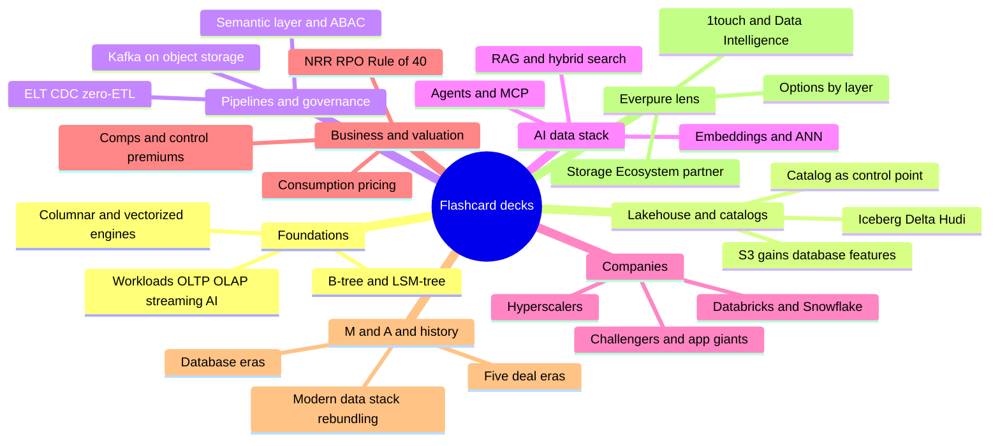
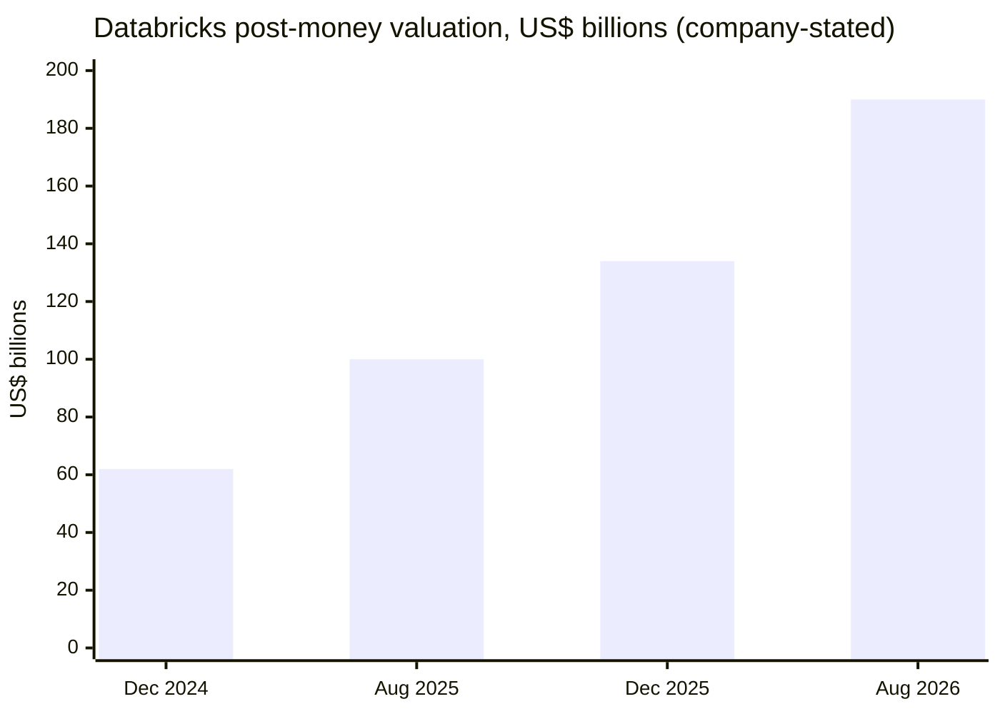
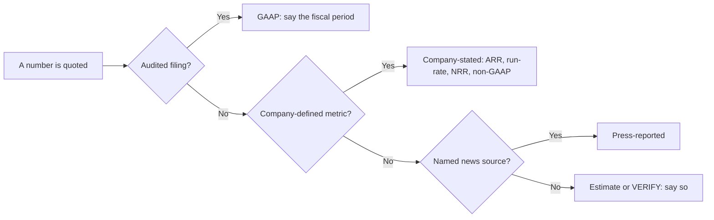
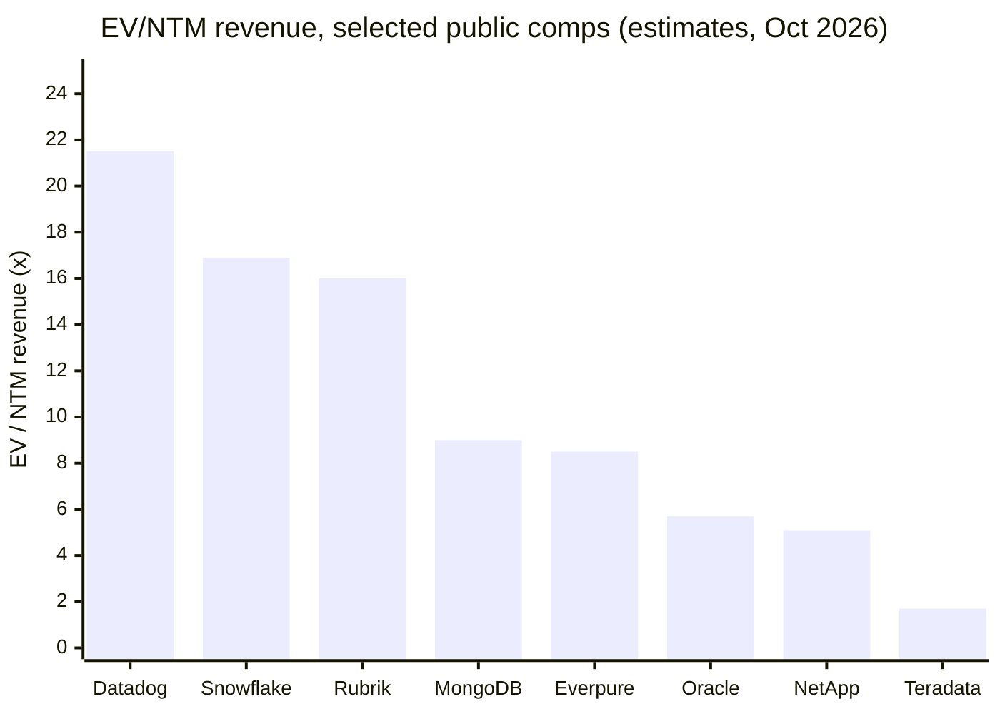
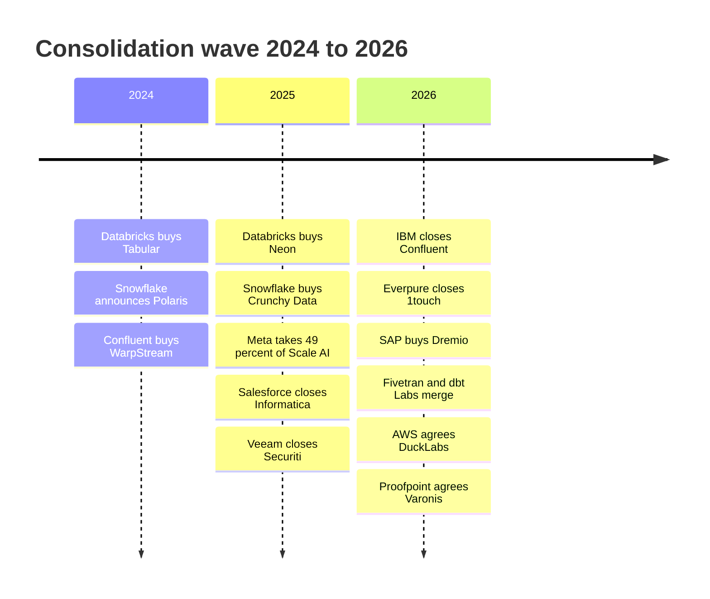
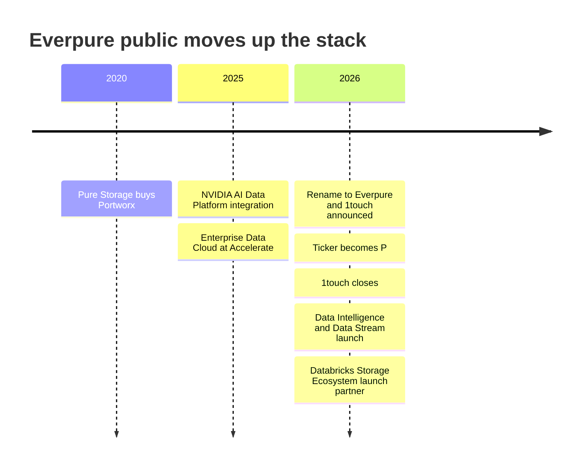

# 50. Self-Test and Cheat Sheets
> **Depth:** L1–L2 · **Reading time:** ~57 min · **Last verified:** 2026-11-01 · **Prerequisites:** none for the cheat sheets; the flashcards assume Parts 1–5 ([Ch 1](../01-data-systems-foundations/ch01-data-stack-map.md), [Ch 25](../04-company-deep-dives/ch25-databricks.md), [Ch 37](../05-business-and-economics/ch37-public-comps-valuation.md))

## TL;DR

- **253 flashcards in eight topic decks.** Each card is one question with a short answer and a link to the chapter that explains it. The decks cover definitions, mechanisms, labelled numbers ("company-stated run-rate", "GAAP", "press-reported") and "which is bigger, and why" comparisons. Every number is the same figure, with the same label, that appears in the cited chapter or in `data/*.csv`.
- **Four one-page posters.** An acronym sheet (79 entries), a layered market map of about 40 representative companies, a table of the 25 deals that best explain the industry (read from `data/ma_deals.csv`), and a Databricks vs. Snowflake one-pager that matches [Ch 27](../04-company-deep-dives/ch27-databricks-vs-snowflake.md).
- **The three numbers people most often get wrong.** Databricks' **>$7B** is a company-stated run-rate, not GAAP revenue. Snowflake's **~$1.49B** quarterly product revenue (+37%) is GAAP. A **$190B** private post-money mark is a different object from Snowflake's **$106.31B** enterprise value.[^db-7b][^sf-q2][^comps-sf]
- **The one idea that ties the decks together:** value has moved from bytes and engines towards metadata. The catalog, the semantic layer and governance decide what data means and who may use it, which is why most of the 2024–2026 deals bought those layers.
- **Everpure lens.** The last deck uses public information only. It covers the 1touch purchase ($125.0M), Data Intelligence and Data Stream, the Databricks Storage Ecosystem launch-partner slot, and the ~8.5x EV/NTM multiple that the up-the-stack story is trying to move.[^ep-10q][^storage-eco][^ep-comps]

## Why this matters (business + Everpure lens)

A corporate-development professional is judged on recall in the room. When a founder says "we're the Iceberg-native catalog for agents", or a banker quotes "~27x run-rate", the useful response is the next question: run-rate on what basis, catalog of record for which engines, and what happened to the last three companies that tried this. That reflex comes from having the vocabulary and the anchor numbers ready, not from re-reading a 4,000-word chapter on the train.

The atlas has about 50 chapters. This one compresses them into material that can be tested. The flashcards are written as *answers you could say out loud* in under 30 seconds. They give the mechanism first and the number second, and they always say what kind of number it is. That last habit matters most. In this industry the commonest credibility mistake is to treat a run-rate as revenue, a private mark as market value, or a vendor benchmark as a measurement. Every numeric card therefore carries its label.

For Everpure the stakes are specific. The company is moving from storage into data management: Enterprise Data Cloud, the 1touch acquisition (now Data Intelligence), Data Stream on NVIDIA, the Key-Value Accelerator and launch-partner status in the Databricks Storage Ecosystem.[^ep-10q][^ep-ds][^storage-eco] Conversations with Databricks, Snowflake, the hyperscalers, catalog vendors and possible acquisition targets will all start from the vocabulary in these decks. They will be judged against the deal precedents on the deal poster, from EMC–Greenplum in 2010 to NetApp–DataPelago in 2026.[^ma] The posters are built to be printed and carried into that kind of meeting.

> **Bridge: spaced repetition as a yield-learning loop.** A fab improves yield by testing every wafer, binning the failures and feeding the defect map back to the process step that caused them. Flashcards work the same way. Test yourself cold, sort the cards you missed into a "re-study" pile, and go back to the linked chapter for those only. The chapter link on every card plays the role of the defect map: it tells you which process step (which chapter) to fix.

## How to use this chapter

**Three ways to use the material.** First, *self-test before a meeting*. Pick the one or two decks that match the meeting (Companies and Business & valuation for a banker call; AI data stack and Everpure lens for a product review). Read each question, answer it aloud, then open the card. Second, *refresh numbers*. The numeric cards are the quickest way to check that you are quoting the current, correctly labelled figure. Where a figure changes every quarter (Snowflake, MongoDB, the hyperscalers), the card names the quarter. Third, *print the posters*. The acronym sheet, market map, deal table and one-pager each fit on one or two pages and are written to stand alone.

**How the cards are built.** Each card has a numbered question (Q1 to Q253) and an answer that ends with a link to its source chapter. Where the answer contains a number, the footnote points to the primary source or the atlas dataset row the chapter used. The decks follow the atlas's parts, but the questions are mixed by type. About a third are definitions ("what is a semantic layer?"). About a third are mechanisms ("why is commit latency a storage property?"). The rest are numbers and comparisons ("which is cheaper on a growth-adjusted basis, Databricks or Snowflake, and why?"). Comparisons are the most useful in conversation, because they force you to hold two facts and a reason at once.

**A suggested routine.** On day one, go through all 253 cards once and mark the misses. On day three, redo only the misses. On day seven, redo the whole Companies and Business & valuation decks, because those numbers move. Roughly 20 minutes a day for a week is enough to make the core vocabulary automatic. For deeper practice, pair this chapter with the question bank in [Ch 48](ch48-question-bank.md) and the 30-second explanations in [Ch 49](ch49-explain-in-30-seconds.md).

| If you have… | Do this | Decks / posters |
|---|---|---|
| 10 minutes before a call | Read the one-pager and the five "when each wins" bullets | Databricks vs. Snowflake one-pager |
| 30 minutes | Self-test one deck, then scan the acronym sheet | Companies or Business & valuation |
| 2 hours | All decks once; mark misses; read the deal table | All |
| One week | Day 1 all cards; day 3 misses; day 7 the two "moving-number" decks | Companies; Business & valuation |
| Before an Everpure strategy session | Everpure lens deck plus the market map and deal table | Everpure lens; posters |

*Figure 50.1 — Study routes. Match the depth of review to the meeting. The two decks whose numbers change every quarter (Companies; Business & valuation) deserve the most frequent refresh.*

*Figure 50.2 — The eight decks and what each one tests. The decks run bottom-up through the stack (foundations, then lakehouse, pipelines and AI), then cover the companies, the economics and the deal history, and finish with the Everpure lens.*

## Flashcards

The decks hold 253 cards in total: Foundations (29), Lakehouse & catalogs (25), Pipelines & governance (39), AI data stack (46), Companies (44), Business & valuation (29), M&A & history (22) and Everpure lens (19). Click a question to reveal the answer. Numbers carry their basis. Fiscal years follow each company's calendar: Snowflake, MongoDB, Databricks and Salesforce years end on January 31, and Everpure's ends on the Sunday nearest February 1. Microsoft's year ends June 30 and Oracle's May 31.

### Foundations

These cards cover how databases store, find and protect data. Start with the six pairs below, because confusing either half of a pair is the fastest way to lose an engineer's attention.

| Pair people confuse | The difference in one line | Chapter |
|---|---|---|
| OLTP vs. OLAP | Many small correct writes vs. big scans over history | [Ch 1](../01-data-systems-foundations/ch01-data-stack-map.md) |
| B-tree vs. LSM-tree | Update pages in place (reads) vs. append and merge (writes) | [Ch 3](../01-data-systems-foundations/ch03-database-internals.md) |
| Sharding vs. replication | Split data to scale vs. copy data to survive failures | [Ch 4](../01-data-systems-foundations/ch04-distributed-databases.md) |
| Row store vs. column store | Fetch whole records vs. scan a few columns across many rows | [Ch 5](../01-data-systems-foundations/ch05-analytical-engines.md) |
| Vectorized vs. compiled execution | Batches of ~1,000 values vs. per-query machine code | [Ch 5](../01-data-systems-foundations/ch05-analytical-engines.md) |
| Parquet vs. Arrow | On-disk columnar file vs. in-memory columnar standard | [Ch 6](../01-data-systems-foundations/ch06-file-formats.md) |

*Figure 50.3 — Six pairs to keep straight. Each pair is a trade-off, not a winner, and most vendor pitches pick one side of one pair.*

Q1: What are the four workload families of enterprise data?

A: OLTP records each business event quickly and correctly; OLAP scans history to answer questions; streaming moves and reacts to events as they happen; AI prepares training data, embeds and retrieves content and feeds context to agents. Each family asks something different of the system underneath, which is why each grew its own vendors. (→ [Ch 1](../01-data-systems-foundations/ch01-data-stack-map.md))

Q2: Why did the data stack fragment into many specialised engines, and who called it?

A: No single engine served every access pattern well. Stonebraker and Çetintemel argued in 2005 that "one size fits all" was over, and the market proved them right for roughly 15 years before the lakehouse, HTAP, Postgres extensions and agents started pulling layers back together.[^stonebraker] (→ [Ch 1](../01-data-systems-foundations/ch01-data-stack-map.md))

Q3: Which two horizontal layers accumulate control and data gravity across every hop of a data pipeline?

A: Storage, which sits under every hop, and the catalog and governance layer, which spans all of them. They are the two layers most relevant to Everpure, because every copy of data lands on one and is described by the other. (→ [Ch 1](../01-data-systems-foundations/ch01-data-stack-map.md))

Q4: How many systems can one customer order pass through before an AI agent can discuss it, and what changes at each hop?

A: Six to eight. At each hop the order changes shape (row, change event, columnar file, metric, vector), its delay grows from milliseconds to minutes, and it is copied again. (→ [Ch 1](../01-data-systems-foundations/ch01-data-stack-map.md))

Q5: What is a data model, and why does the choice matter commercially?

A: It is the shape a database holds data in: tables, documents, key-value pairs, wide rows, graphs, time series, inverted indexes or vectors. The shape decides which questions are cheap and which are expensive, so it decides which workloads, and which vendors, an engine can win. (→ [Ch 2](../01-data-systems-foundations/ch02-data-models.md))

Q6: When did Codd publish the relational model, and how dominant is relational today?

A: In 1970, in Communications of the ACM. More than 50 years later PostgreSQL topped the Stack Overflow developer survey for database usage in both 2024 and 2025.[^codd][^so25] (→ [Ch 2](../01-data-systems-foundations/ch02-data-models.md))

Q7: "SQL won." What is the more accurate summary?

A: SQL absorbed the other models. Postgres runs JSONB documents, pgvector embeddings and PostGIS geometry in one engine, and MongoDB ships vector search. Multi-model engines took the useful idea from each NoSQL niche. (→ [Ch 2](../01-data-systems-foundations/ch02-data-models.md))

Q8: How do search and vector models differ from relational queries?

A: They rank results by relevance or similarity instead of returning exact matches. A SQL WHERE clause is true or false; a BM25 or cosine score is a ranking, so "top 10" replaces "all rows that match". (→ [Ch 2](../01-data-systems-foundations/ch02-data-models.md))

Q9: What are the two halves of every database?

A: The storage engine, which decides how bytes sit on disk and in memory, and the query processor, which turns SQL into a plan and runs it. Most vendor performance claims are really about one half or the other. (→ [Ch 3](../01-data-systems-foundations/ch03-database-internals.md))

Q10: B-tree vs. LSM-tree: what does each optimise for, and who uses it?

A: A B-tree updates fixed-size pages in place and favours reads (PostgreSQL, MySQL InnoDB, Oracle, SQL Server). An LSM-tree buffers writes in memory, flushes immutable sorted files and merges them in the background, which favours writes (RocksDB, Cassandra). (→ [Ch 3](../01-data-systems-foundations/ch03-database-internals.md))

Q11: What does the RUM conjecture say?

A: An access method can optimise at most two of read cost, update cost and memory or space overhead. Every index design is a choice of which one to give up. (→ [Ch 3](../01-data-systems-foundations/ch03-database-internals.md))

Q12: Why is database commit latency really a storage property?

A: Durability comes from the write-ahead log: the change is written sequentially to the log and forced to stable media with fsync before the commit returns. The data pages are updated later. Commit latency is therefore dominated by log-flush latency. (→ [Ch 3](../01-data-systems-foundations/ch03-database-internals.md))

Q13: What does MVCC buy, and how do PostgreSQL and Oracle implement it differently?

A: Multi-version concurrency control lets writers create new row versions so readers never wait. PostgreSQL keeps old versions in the table and cleans them up with vacuum; Oracle and InnoDB keep them in an undo log. (→ [Ch 3](../01-data-systems-foundations/ch03-database-internals.md))

Q14: What is the query optimizer's biggest weakness?

A: Cardinality estimation. When its row-count guesses are wrong, the plan it picks can be ten to a hundred times slower than the best available plan. (→ [Ch 3](../01-data-systems-foundations/ch03-database-internals.md))

Q15: What are the three reasons to distribute a database?

A: One machine is too small, one machine is a single point of failure, or the data must live in several places for latency or legal data sovereignty. Every distributed design trades those goals against the speed of light. (→ [Ch 4](../01-data-systems-foundations/ch04-distributed-databases.md))

Q16: Sharding vs. replication: which is harder, and why?

A: Keeping replicas consistent. Sharding splits data so the system scales; replication copies it so the system survives failures, and copies drift apart (replication lag) unless the system pays to keep them in agreement through consensus. Sharding has its own hard part, transactions and joins that span shards. (→ [Ch 4](../01-data-systems-foundations/ch04-distributed-databases.md))

Q17: How many replica failures can a five-replica Raft group survive, and what does each write cost?

A: Two. A write commits once a majority (three of five) has stored it, so each write costs one round trip to the nearest majority. (→ [Ch 4](../01-data-systems-foundations/ch04-distributed-databases.md))

Q18: How do Spanner, CockroachDB and TiDB order transactions in time?

A: Spanner uses GPS and atomic clocks (TrueTime); CockroachDB and YugabyteDB use hybrid logical clocks; TiDB uses a central timestamp service. Aurora DSQL uses optimistic concurrency plus AWS's microsecond-accurate clock service. (→ [Ch 4](../01-data-systems-foundations/ch04-distributed-databases.md))

Q19: Why is distributed SQL (NewSQL) described as technically mature but commercially niche?

A: Single-node Postgres covers most needs. Cockroach Labs ended its free self-hosted Core edition in 2024, and Fauna shut its service down in 2025, citing capital intensity, while hyperscaler services (Spanner, Aurora DSQL) take a growing share.[^crdb-license][^fauna] (→ [Ch 4](../01-data-systems-foundations/ch04-distributed-databases.md))

Q20: Why does columnar storage cut bytes scanned by one to two orders of magnitude?

A: Analytical queries touch a few columns across billions of rows. Storing each column contiguously lets the engine read only those columns, and similar values side by side compress well (dictionary, run-length, delta encoding). (→ [Ch 5](../01-data-systems-foundations/ch05-analytical-engines.md))

Q21: Vectorized vs. compiled execution: what problem do both solve?

A: Keeping the CPU fed from cache instead of stalling on memory. Vectorized engines process batches of about a thousand values per operator call (MonetDB/X100, DuckDB, ClickHouse, Velox, Photon); compiled engines turn each query into machine code (HyPer, Spark whole-stage codegen).[^x100][^hyper] (→ [Ch 5](../01-data-systems-foundations/ch05-analytical-engines.md))

Q22: What is shared-nothing MPP, and what is its operational weakness?

A: Each node owns its slice of the data (Teradata, Netezza, Greenplum, Redshift classic). It scales reads well, but resizing the cluster means physically reshuffling data, so elasticity is slow and expensive. (→ [Ch 5](../01-data-systems-foundations/ch05-analytical-engines.md))

Q23: Which single design decision in Snowflake's 2016 paper produced elastic scaling and pay-per-use?

A: Making cloud object storage the durable disk, with stateless compute clusters that cache on local SSD and a separate services layer that owns metadata. Elasticity, isolated concurrency and per-second billing followed from that choice.[^sigmod16] (→ [Ch 5](../01-data-systems-foundations/ch05-analytical-engines.md))

Q24: Into which reusable parts are analytical engines decomposing?

A: Arrow for the in-memory format, Velox or DataFusion for execution, and Parquet plus Iceberg for storage. Performance becomes a commodity, and control moves to storage throughput, caching and the catalog.[^velox][^datafusion] (→ [Ch 5](../01-data-systems-foundations/ch05-analytical-engines.md))

Q25: What is inside a Parquet file, and where did it come from?

A: Row groups, which hold column chunks, which hold pages; a footer written last records the schema and min/max statistics. Twitter and Cloudera created it in 2013, building on Google's Dremel paper.[^dremel10] (→ [Ch 6](../01-data-systems-foundations/ch06-file-formats.md))

Q26: Parquet vs. Arrow: what is the difference?

A: Parquet is the on-disk columnar file format; Arrow is the matching in-memory columnar standard. Two engines that both speak Arrow can hand data over without converting it, which removes the serialization tax. (→ [Ch 6](../01-data-systems-foundations/ch06-file-formats.md))

Q27: What does Parquet do poorly that AI workloads stress, and who is challenging it?

A: Fast random access to individual rows, needed for training shuffles, vector search and multimodal blobs. Lance, Vortex and Nimble are the main challengers; Parquet keeps the ecosystem. (→ [Ch 6](../01-data-systems-foundations/ch06-file-formats.md))

Q28: Which I/O pattern does each create: a Parquet scan or Lance-style ML access?

A: Parquet scans arrive as large sequential range reads that need throughput; Lance-style access arrives as small random reads that need IOPS. Too many small files hurts both. (→ [Ch 6](../01-data-systems-foundations/ch06-file-formats.md))

Q29: What do the letters in ACID guarantee?

A: Atomicity (all or nothing), consistency (constraints hold), isolation (concurrent transactions do not see each other's partial work) and durability (committed data survives a crash). Open table formats exist largely to bring ACID to files on object storage. (→ [Ch 7](../01-data-systems-foundations/ch07-open-table-formats.md))

### Lakehouse & catalogs

These cards cover the lakehouse: open table formats on object storage and the catalogs that govern them. The table shows where the open standard ends and vendor control begins at each layer.

| Layer | Open standard | Where vendors hold control | Chapter |
|---|---|---|---|
| Object storage API | S3 API (consistency, conditional writes) | S3 Tables, S3 Vectors, S3 Express One Zone | [Ch 24](../03-ai-data-stack/ch24-data-meets-compute-and-storage.md) |
| File format | Apache Parquet, Arrow | Little: formats are commodities | [Ch 6](../01-data-systems-foundations/ch06-file-formats.md) |
| Table format | Iceberg, Delta Lake, Hudi | Maintenance (compaction), UniForm, managed tables | [Ch 7](../01-data-systems-foundations/ch07-open-table-formats.md) |
| Catalog | Iceberg REST catalog API | Unity Catalog, Horizon, Glue, OneLake, Knowledge Catalog | [Ch 8](../01-data-systems-foundations/ch08-catalogs-and-metastores.md) |
| Sharing | Delta Sharing / OpenSharing, Iceberg REST | Snowflake Secure Data Sharing and Marketplace | [Ch 9](../02-pipelines-and-governance/ch09-pipeline-patterns.md) |

*Figure 50.4 — Openness by layer. Files and table formats are now open; the catalog is where commit rights, credentials and policy, and therefore lock-in, have moved.*

Q30: Why is a folder of Parquet files on object storage not a table?

A: It has no atomic multi-file commit, no consistent view while a job is writing, and no safe way to change the schema. An open table format adds the metadata layer that fixes all three. (→ [Ch 7](../01-data-systems-foundations/ch07-open-table-formats.md))

Q31: What is the core commit mechanism shared by every open table format?

A: Data files are immutable. A commit writes new files plus new metadata, and the table moves forward only when one small pointer or log entry is swapped atomically (a compare-and-swap). Concurrent writers use optimistic concurrency: the loser re-reads and retries. (→ [Ch 7](../01-data-systems-foundations/ch07-open-table-formats.md))

Q32: Iceberg, Delta Lake, Hudi: who built each and how does each store metadata?

A: Iceberg (Netflix, donated to Apache in 2018) keeps a tree of metadata files and relies on a catalog for the swap. Delta Lake (Databricks) keeps an ordered log of JSON commits with checkpoints. Hudi (Uber) keeps a timeline tuned for upserts and streaming. (→ [Ch 7](../01-data-systems-foundations/ch07-open-table-formats.md))

Q33: How did the 2020–2024 table-format war end?

A: In convergence, not a winner. Databricks paid a press-reported ~$2B for Tabular in June 2024; Snowflake, AWS, Google and Microsoft all write Iceberg; Delta exposes Iceberg metadata through UniForm. Leverage moved up to the catalog.[^tabular] (→ [Ch 7](../01-data-systems-foundations/ch07-open-table-formats.md))

Q34: What is UniForm?

A: A Delta Lake feature that writes Iceberg metadata from the same commit, so one physical table can be read by Delta and Iceberg engines without a second copy. (→ [Ch 7](../01-data-systems-foundations/ch07-open-table-formats.md))

Q35: What is the hidden operating cost of open table formats?

A: Maintenance. Streaming writers create small files and piles of snapshots, so every table needs compaction, snapshot expiry and orphan-file cleanup. Most remaining product differentiation sits in that work. (→ [Ch 7](../01-data-systems-foundations/ch07-open-table-formats.md))

Q36: Copy-on-write vs. merge-on-read: which favours writers?

A: Merge-on-read. Copy-on-write rewrites whole data files on update (cheap reads, expensive writes); merge-on-read writes small delete files or deletion vectors and reconciles them at read time (cheap writes, costlier reads until compaction). (→ [Ch 7](../01-data-systems-foundations/ch07-open-table-formats.md))

Q37: What is time travel in a table format, and why does AI care?

A: Querying a table as of an earlier snapshot. It gives reproducibility: a training run or an audit can point to the exact data version it used, much as a fab traces lot genealogy. (→ [Ch 16](../03-ai-data-stack/ch16-ai-data-lifecycle.md))

Q38: Technical catalog vs. business catalog: what is the difference?

A: A technical catalog (metastore) sits on the read and write path: it maps a table name to its current metadata, makes commits atomic, enforces policy and vends credentials. A business catalog (Collibra, Alation, Atlan) helps people find and trust data and is not on the data path. (→ [Ch 8](../01-data-systems-foundations/ch08-catalogs-and-metastores.md))

Q39: Trace the lineage of the technical catalog.

A: Hive Metastore (about 2010, a Thrift API over a relational database) → AWS Glue Data Catalog (2017) → the vendor-neutral Iceberg REST catalog API (2022) → Unity Catalog OSS, Apache Polaris and one catalog per hyperscaler (from 2024).[^hive-icde][^glue-ga][^irc-spec] (→ [Ch 8](../01-data-systems-foundations/ch08-catalogs-and-metastores.md))

Q40: What is the "open format, closed catalog" debate?

A: Open formats made the files portable, but every engine still has to ask the catalog for commit rights, credentials and policy. Whoever runs the catalog keeps the control point, so openness at the file level can coexist with lock-in one layer up. (→ [Ch 8](../01-data-systems-foundations/ch08-catalogs-and-metastores.md))

Q41: What is credential vending?

A: The catalog hands an engine short-lived storage credentials scoped to the tables it is allowed to read, so the engine never holds standing keys to the bucket. (→ [Ch 8](../01-data-systems-foundations/ch08-catalogs-and-metastores.md))

Q42: Why do AWS, Google and Microsoft give their catalogs away nearly free?

A: Because a catalog pulls data and workloads onto the cloud's paid meters (compute, storage, egress). The catalog is the loss leader; the meters are the business. (→ [Ch 28](../04-company-deep-dives/ch28-hyperscaler-data-platforms.md))

Q43: What is Apache Polaris and what is its status?

A: An open Iceberg REST catalog that Snowflake announced and donated in 2024. It graduated to an Apache top-level project in early 2026 (Polaris blog 2026-02-19; ASF announcement 2026-03-05).[^polaris-pr][^polaris] (→ [Ch 8](../01-data-systems-foundations/ch08-catalogs-and-metastores.md))

Q44: What does Unity Catalog govern, and when was it open-sourced?

A: Tables, files, ML models, functions and, since 2026, model and agent traffic through the Unity AI Gateway. Databricks open-sourced it in June 2024 and placed it with the Linux Foundation.[^uc-oss][^uc-dais26] (→ [Ch 25](../04-company-deep-dives/ch25-databricks.md))

Q45: Horizon Catalog vs. Apache Polaris: which one did Snowflake keep proprietary?

A: Horizon, Snowflake's internal governance layer. Snowflake open-sourced a second catalog (Polaris) rather than its main one, whereas Databricks open-sourced its main catalog (Unity Catalog).[^polaris] (→ [Ch 27](../04-company-deep-dives/ch27-databricks-vs-snowflake.md))

Q46: Which paper defined the lakehouse, and what did it claim?

A: The CIDR 2021 Lakehouse paper (Armbrust, Ghodsi, Xin, Zaharia). It argued that open Parquet files in the customer's bucket plus a transaction log, caching and a vectorised engine could match warehouse performance on one copy of data.[^cidr] (→ [Ch 25](../04-company-deep-dives/ch25-databricks.md))

Q47: What are S3 Tables?

A: AWS's managed Apache Iceberg tables stored in S3 "table buckets", with automatic compaction and snapshot cleanup, announced at re:Invent in December 2024.[^s3tables-pr] (→ [Ch 28](../04-company-deep-dives/ch28-hyperscaler-data-platforms.md))

Q48: Where does each platform put data by default: Databricks or Snowflake?

A: Databricks writes Delta tables in the customer's own object storage. Snowflake writes to its own managed storage (proprietary micro-partitions) unless the customer chooses Iceberg tables in an external volume. (→ [Ch 27](../04-company-deep-dives/ch27-databricks-vs-snowflake.md))

Q49: Which database features has the S3 API gained since 2020?

A: Strong read-after-write consistency (December 2020), conditional create-if-absent and compare-and-swap writes (August and November 2024), a low-latency tier (S3 Express One Zone), managed Iceberg (S3 Tables) and native vectors (S3 Vectors, GA December 2025).[^s3-consistency][^s3-cond][^s3-ifmatch][^s3v] (→ [Ch 24](../03-ai-data-stack/ch24-data-meets-compute-and-storage.md))

Q50: Why do conditional writes on object storage matter to lakehouses?

A: They let a writer commit with a compare-and-swap directly on the object store, which is the primitive table formats need for safe concurrent commits. Any S3-compatible store, on-prem included, is now judged against that bar.[^s3-cond] (→ [Ch 24](../03-ai-data-stack/ch24-data-meets-compute-and-storage.md))

Q51: What is a micro-partition?

A: Snowflake's internal storage unit: an immutable, compressed columnar file with metadata on value ranges that lets the optimiser prune partitions it does not need to read. (→ [Ch 5](../01-data-systems-foundations/ch05-analytical-engines.md))

Q52: Which deals put catalogs and table formats under bigger owners?

A: Databricks–Tabular (2024, ~$2B press-reported), Snowflake–Select Star (2025, undisclosed, for Horizon) and SAP–Dremio (announced May 2026, undisclosed). Each buyer paid for metadata control, not storage.[^ma] (→ [Ch 8](../01-data-systems-foundations/ch08-catalogs-and-metastores.md))

Q53: What is OneLake?

A: Microsoft Fabric's single tenant-wide data lake. Shortcuts let it reference data in other clouds or stores without copying, so Fabric can claim one logical lake. (→ [Ch 28](../04-company-deep-dives/ch28-hyperscaler-data-platforms.md))

Q54: What is Google's Knowledge Catalog?

A: Google Cloud's governance and metadata catalog, formerly Dataplex, which bundles discovery and policy into the BigQuery estate and competes with Unity Catalog and Horizon. (→ [Ch 28](../04-company-deep-dives/ch28-hyperscaler-data-platforms.md))

### Pipelines & governance

These cards cover moving, transforming, checking and governing data. Every pattern removes one cost and adds another, as the table shows.

| Pattern | What it removes | What it costs | Chapter |
|---|---|---|---|
| ELT | A separate transform server | Warehouse compute and raw data in the warehouse | [Ch 9](../02-pipelines-and-governance/ch09-pipeline-patterns.md) |
| Log-based CDC | Load on the source database; missed deletes | Log access, replication slots, schema-change handling | [Ch 9](../02-pipelines-and-governance/ch09-pipeline-patterns.md) |
| Zero-ETL | Pipeline engineering | Lock-in to the vendor that runs the pipeline | [Ch 9](../02-pipelines-and-governance/ch09-pipeline-patterns.md) |
| Zero-copy sharing | The copy itself | Dependence on the provider's platform or protocol | [Ch 9](../02-pipelines-and-governance/ch09-pipeline-patterns.md) |
| Diskless Kafka | Cross-AZ replication traffic | Hundreds of milliseconds of extra latency | [Ch 11](../02-pipelines-and-governance/ch11-streaming-and-event-platforms.md) |
| Semantic layer | Conflicting metric definitions | Modelling effort and a new control point | [Ch 14](../02-pipelines-and-governance/ch14-semantic-layers-and-bi.md) |
| ABAC policies | Role explosion | Discipline in tagging data correctly | [Ch 15](../02-pipelines-and-governance/ch15-governance-security-privacy.md) |

*Figure 50.5 — Pipeline and governance patterns as trades. "Zero" in a product name usually means the cost moved somewhere else, not that it disappeared.*

Q55: ETL vs. ELT: why did ELT become the default?

A: Cloud warehouses made compute cheap and elastic, so landing raw data first and transforming it inside the warehouse became simpler. At launch in 2012 Amazon priced Redshift under $1,000 per TB per year, against its estimate of $19,000–25,000 for an in-house warehouse.[^redshift-2012] (→ [Ch 9](../02-pipelines-and-governance/ch09-pipeline-patterns.md))

Q56: When does ETL still beat ELT?

A: When sensitive data must be scrubbed before it lands, or when warehouse compute is the most expensive thing you own and a cheaper engine can do the reshaping upstream. (→ [Ch 9](../02-pipelines-and-governance/ch09-pipeline-patterns.md))

Q57: What is log-based CDC, and how consolidated is it?

A: Change data capture that reads the database's write-ahead log instead of querying its tables, so it adds little load and misses no deletes. Qlik bought Attunity ($560M, 2019), Fivetran bought HVR ($700M, 2021) and Databricks bought Arcion (~$100M, 2023).[^ma] (→ [Ch 9](../02-pipelines-and-governance/ch09-pipeline-patterns.md))

Q58: What does "zero-ETL" actually mean?

A: Not that there is no pipeline: the vendor runs it (usually CDC plus replication plus format conversion) inside its own platform. You save engineering effort and pay in lock-in. (→ [Ch 9](../02-pipelines-and-governance/ch09-pipeline-patterns.md))

Q59: Zero-ETL vs. zero-copy sharing: which is the stronger idea, and why?

A: Zero-copy sharing (Snowflake Secure Data Sharing, Delta Sharing/OpenSharing), because it removes the copy itself, not just the code that makes it. The consumer queries the provider's data in place. (→ [Ch 9](../02-pipelines-and-governance/ch09-pipeline-patterns.md))

Q60: What two habits make pipelines correct?

A: Idempotent loads, so running a load twice gives the same result, and planned backfills, so history can be rebuilt. The medallion architecture is mostly a way to make both routine. (→ [Ch 9](../02-pipelines-and-governance/ch09-pipeline-patterns.md))

Q61: What is the medallion architecture?

A: Bronze (raw, as landed), silver (cleaned and conformed) and gold (business-ready aggregates) layers of tables. Each layer can be rebuilt from the one below. (→ [Ch 9](../02-pipelines-and-governance/ch09-pipeline-patterns.md))

Q62: What is reverse ETL?

A: Copying modelled data from the warehouse back into operational SaaS tools (CRM, ads, support) so business teams act on it. Census (which Fivetran agreed to buy in 2025) and Hightouch are the best-known vendors. (→ [Ch 9](../02-pipelines-and-governance/ch09-pipeline-patterns.md))

Q63: Why is a connector a liability as well as an asset?

A: Every connector has to be patched whenever the upstream API changes. Fivetran and Airbyte each advertise 700+ connectors: a moat because rivals must pay the same maintenance bill, and a cost centre for the same reason.[^ft-700][^ab-700] (→ [Ch 10](../02-pipelines-and-governance/ch10-ingestion-and-integration.md))

Q64: How do ingestion vendors price, and why don't the units translate?

A: Fivetran meters monthly active rows per connection; Airbyte sells capacity (Data Workers) or credits; Informatica sells pooled IPUs; Matillion sells credits; hyperscalers bill compute time or volume. Each unit tracks a different cost driver. (→ [Ch 10](../02-pipelines-and-governance/ch10-ingestion-and-integration.md))

Q65: What happened to Fivetran and dbt Labs, and what is the combined scale?

A: They agreed an all-stock merger (announced October 2025) that closed on 2026-06-01. Combined ARR is "approaching $600M" (company-stated).[^ft-dbt-close] (→ [Ch 10](../02-pipelines-and-governance/ch10-ingestion-and-integration.md))

Q66: What is Kafka's core abstraction, and where did it come from?

A: A shared, append-only, partitioned log that any number of systems write to and read from at their own pace, decoupling producers from consumers. LinkedIn open-sourced Kafka in 2011, and its creators founded Confluent in 2014.[^kreps-log] (→ [Ch 11](../02-pipelines-and-governance/ch11-streaming-and-event-platforms.md))

Q67: What is a consumer group?

A: A set of consumers that split a topic's partitions between them, so each event is processed once per group while different groups read the same log independently. (→ [Ch 11](../02-pipelines-and-governance/ch11-streaming-and-event-platforms.md))

Q68: Why is Kafka being rebuilt around object storage?

A: Classic Kafka copies every byte to three brokers in three availability zones. AWS bills cross-AZ traffic at $0.01/GB in each direction, so at high volume the network bill can exceed compute. Diskless designs write to S3 and accept hundreds of milliseconds of latency.[^aws-xaz] (→ [Ch 11](../02-pipelines-and-governance/ch11-streaming-and-event-platforms.md))

Q69: What is KIP-1150?

A: Apache Kafka's accepted "diskless topics" proposal (vote passed 2026-03-02), which lets Kafka itself write directly to object storage, as WarpStream, AutoMQ and others already do.[^kip1150] (→ [Ch 11](../02-pipelines-and-governance/ch11-streaming-and-event-platforms.md))

Q70: How is the stream becoming a table?

A: Confluent Tableflow and Redpanda Iceberg Topics materialise Kafka topics as Apache Iceberg tables, collapsing the Kafka → ETL job → lake pipeline into a storage-level setting. (→ [Ch 11](../02-pipelines-and-governance/ch11-streaming-and-event-platforms.md))

Q71: Which stream processor is the system of record, and who is catching up?

A: Apache Flink, for stateful, event-time processing. Spark 4.1 added a real-time mode, and streaming databases (RisingWave, Materialize) deliver similar results through SQL materialised views. (→ [Ch 11](../02-pipelines-and-governance/ch11-streaming-and-event-platforms.md))

Q72: What did dbt turn into a software discipline?

A: SQL transformation. It applied version control, tests, documentation and a dependency graph to SQL models, creating the role of the analytics engineer. (→ [Ch 12](../02-pipelines-and-governance/ch12-transformation-and-orchestration.md))

Q73: Where did Airflow start, and when did 3.0 ship?

A: At Airbnb in 2014. The Airflow 3.0 rewrite shipped in April 2025 (release notes dated 2025-04-22).[^airflow3] (→ [Ch 12](../02-pipelines-and-governance/ch12-transformation-and-orchestration.md))

Q74: Dagster, Prefect, Temporal: how do the Airflow alternatives differ?

A: Dagster is asset-centric (it models the tables a pipeline produces), Prefect is Python-native, and Temporal sells durable execution with retries and saved state. Temporal's Series E valued it at $12.55B in September 2026 (company-stated).[^temporal] (→ [Ch 12](../02-pipelines-and-governance/ch12-transformation-and-orchestration.md))

Q75: What did Prefect agree in July 2026?

A: To acquire Dagster Labs (announced 2026-07-13, terms undisclosed), consolidating two of the three main Airflow alternatives.[^prefect-dagster] (→ [Ch 12](../02-pipelines-and-governance/ch12-transformation-and-orchestration.md))

Q76: How are platforms absorbing transformation?

A: Snowflake Dynamic Tables, Databricks Lakeflow Spark Declarative Pipelines (formerly Delta Live Tables) and Google Dataform build transformation into the engine, and Snowflake runs dbt projects natively. (→ [Ch 12](../02-pipelines-and-governance/ch12-transformation-and-orchestration.md))

Q77: What is a data contract?

A: A versioned, machine-checkable agreement between a data producer and its consumers on schema, semantics, freshness and quality, so upstream changes cannot silently break downstream users. (→ [Ch 12](../02-pipelines-and-governance/ch12-transformation-and-orchestration.md))

Q78: What is data downtime, and how solid is the famous $12.9M cost figure?

A: Any period when data is late, missing, wrong or misleading. Gartner's $12.9M per organisation per year rests on a 2020 vendor-reference survey of self-estimated costs, so treat it as soft evidence that the problem is common.[^gartner-129] (→ [Ch 13](../02-pipelines-and-governance/ch13-data-quality-observability-lineage.md))

Q79: Testing vs. observability: what does each catch?

A: Tests (dbt tests, Great Expectations, Soda) check rules written in advance: known unknowns. Observability watches metadata for drift nobody predicted: unknown unknowns. (→ [Ch 13](../02-pipelines-and-governance/ch13-data-quality-observability-lineage.md))

Q80: What are Monte Carlo's five pillars of data observability?

A: Freshness, volume, schema, distribution and lineage.[^mc-pillars] (→ [Ch 13](../02-pipelines-and-governance/ch13-data-quality-observability-lineage.md))

Q81: What are the three ways to capture lineage?

A: Parsing SQL in query logs; runtime events (the OpenLineage standard emitted by Airflow, Spark and dbt); or natively in the platform (Unity Catalog, Snowflake Horizon, Microsoft Purview). Column-level lineage is the useful and the hard grade. (→ [Ch 13](../02-pipelines-and-governance/ch13-data-quality-observability-lineage.md))

Q82: Which data-quality vendors were absorbed in 2025–2026?

A: Datadog bought Metaplane (April 2025), FICO bought GX Cloud and Fivetran took over stewardship of GX Core (May 2026), and Boomi bought Elementary Data (October 2026). Monte Carlo remains the best-funded independent, last priced at $1.6B in May 2022 (company-stated).[^ma][^funding] (→ [Ch 13](../02-pipelines-and-governance/ch13-data-quality-observability-lineage.md))

Q83: What is a semantic layer?

A: A governed dictionary of business meaning (entities, measures, dimensions, join paths, access rules) that compiles a request like "net revenue by region" into correct SQL, so each metric is defined once. (→ [Ch 14](../02-pipelines-and-governance/ch14-semantic-layers-and-bi.md))

Q84: Where is the semantic layer moving?

A: Out of individual BI tools (cubes, BusinessObjects universes, LookML) and into the data platform (Snowflake semantic views, Databricks metric views) or neutral services (dbt Semantic Layer/MetricFlow, Cube, AtScale). (→ [Ch 14](../02-pipelines-and-governance/ch14-semantic-layers-and-bi.md))

Q85: Why did LLMs make the semantic layer strategic?

A: Natural-language questions answered against governed definitions are far more accurate than text-to-SQL over raw tables. In data.world's 2023 study accuracy rose from 16.7% to 54.2% (vendor-run benchmark).[^dw-bench] (→ [Ch 14](../02-pipelines-and-governance/ch14-semantic-layers-and-bi.md))

Q86: What do 2026 BI funding rounds say about the category?

A: Money is flowing to warehouse-native front ends: Sigma raised at $3B (press-reported) and Omni at $1.5B (company-stated) in 2026, while Microsoft bundles Power BI into Fabric. The control point is moving from the dashboard to the definitions underneath.[^sigma-e][^omni-c] (→ [Ch 14](../02-pipelines-and-governance/ch14-semantic-layers-and-bi.md))

Q87: What three questions does governance answer about every piece of data?

A: What is it (classification), who may use it and for what purpose (access policy), and where has it gone (lineage). Each depends on the one before, and most failures start with the first. (→ [Ch 15](../02-pipelines-and-governance/ch15-governance-security-privacy.md))

Q88: RBAC vs. ABAC: what is the difference?

A: Role-based access control grants permissions to roles, table by table. Attribute-based access control writes one policy against tags on the data and attributes of the user, so it covers tables that do not exist yet. Unity Catalog ABAC became generally available in 2026.[^uc-abac] (→ [Ch 15](../02-pipelines-and-governance/ch15-governance-security-privacy.md))

Q89: What are the steps of a discovery and classification engine?

A: Connect, sample, detect (patterns plus checksums, dictionaries, ML and LLM classifiers, exact-data fingerprints), resolve detections to a person, score confidence, write tags to the catalog, then watch for drift. (→ [Ch 15](../02-pipelines-and-governance/ch15-governance-security-privacy.md))

Q90: What does DSPM add to classification?

A: Data security posture management adds a map of who can reach sensitive data and where it is exposed (public buckets, over-broad roles, stale copies), turning an inventory into a risk ranking. (→ [Ch 15](../02-pipelines-and-governance/ch15-governance-security-privacy.md))

Q91: What do regulation and breach costs look like in numbers?

A: GDPR fines totalled about €7.1B by January 2026 (DLA Piper). IBM's 2025 study put the average breach at $4.44M globally and $10.22M in the US.[^dla][^ibm-breach] (→ [Ch 15](../02-pipelines-and-governance/ch15-governance-security-privacy.md))

Q92: When do the EU AI Act's data-governance duties for high-risk systems now apply?

A: After the 2026 AI Omnibus: 2 December 2027 for standalone (Annex III) systems and 2 August 2028 for product-embedded (Annex I) systems.[^omnibus] (→ [Ch 15](../02-pipelines-and-governance/ch15-governance-security-privacy.md))

Q93: Row-level security vs. dynamic data masking?

A: Row-level security filters which rows a user can see; dynamic masking returns the rows but obscures sensitive column values at query time (for example, showing only the last four digits of a card number). (→ [Ch 15](../02-pipelines-and-governance/ch15-governance-security-privacy.md))

### AI data stack

These cards cover the AI data lifecycle, unstructured processing, vector search, retrieval, training data, MLOps, agents, real-time engines and GPUs. The numbers below are the ones most often quoted in AI-data conversations, each with its basis.

| Number to remember | Value | Basis | Chapter |
|---|---|---|---|
| Hybrid retrieval quality ladder (NDCG@10) | 0.22 → 0.49 → 0.53 → 0.59 | Vendor-reported benchmark[^sf-cortex] | [Ch 19](../03-ai-data-stack/ch19-retrieval-architectures.md) |
| Text-to-SQL: Spider 1.0 vs. Spider 2.0 | 91.2% vs. 21.3% | Academic paper, same setup[^spider2] | [Ch 22](../03-ai-data-stack/ch22-agents-and-data.md) |
| Cost per query: long context vs. RAG (800K tokens) | ~$1.61 uncached, ~$0.17 cached, ~$0.03 RAG | Illustrative, list prices Nov 2026[^anthropic-pricing] | [Ch 19](../03-ai-data-stack/ch19-retrieval-architectures.md) |
| 1B × 768-dim float32 vectors | ~3.1 TB raw | Our arithmetic (estimate) | [Ch 18](../03-ai-data-stack/ch18-embeddings-and-vector-search.md) |
| Queries scanning >10 TB in Redshift fleet data | ~0.03% | Vendor analysis of public data[^md-redshift] | [Ch 23](../03-ai-data-stack/ch23-real-time-analytics-htap.md) |
| Neon databases created by agents | >80% | Company-stated, May 2025[^neon-dbx] | [Ch 22](../03-ai-data-stack/ch22-agents-and-data.md) |

*Figure 50.6 — AI-data anchor numbers. Two of the six are vendor-produced and one is our own arithmetic. Say so when you quote them.*

Q94: What are the eight stages of the AI data lifecycle?

A: Raw data, curation, pretraining, post-training, evaluation, deployment context, agents and feedback. Each has its own data shape, volume, tools and risks; most AI quality problems are data problems surfacing at one of them. (→ [Ch 16](../03-ai-data-stack/ch16-ai-data-lifecycle.md))

Q95: How big is frontier pretraining data?

A: Llama 3 used more than 15 trillion tokens and Qwen3 about 36 trillion; a single 2026 Common Crawl snapshot is about 360 TiB. Perhaps a dozen organisations run this lifecycle.[^llama3-blog][^qwen3][^cc-aug26] (→ [Ch 16](../03-ai-data-stack/ch16-ai-data-lifecycle.md))

Q96: Frontier-lab lifecycle vs. enterprise lifecycle: what is the difference?

A: Frontier labs go from web-scale crawls to a trained model. Enterprises start from a finished model and add their own data at run time through RAG, light fine-tuning and agents calling tools over governed data, which is where Databricks, Snowflake and the clouds compete. (→ [Ch 16](../03-ai-data-stack/ch16-ai-data-lifecycle.md))

Q97: Where has the value in AI data moved since 2024?

A: From pretraining scale to curation quality, post-training data (preference data, RL environments, verifiers) and, for enterprises, context: which governed facts reach the model at the moment it answers. (→ [Ch 16](../03-ai-data-stack/ch16-ai-data-lifecycle.md))

Q98: How does storage demand differ across AI stages?

A: Curation and training need high-throughput sequential reads plus random reads for shuffling; checkpoints write in bursts; RAG needs low-latency random reads over vectors; feedback logs grow without limit. (→ [Ch 16](../03-ai-data-stack/ch16-ai-data-lifecycle.md))

Q99: How well measured is the claim that 80–90% of enterprise data is unstructured?

A: Weakly. It traces to a 1998 claim, and its modern version is a Box-sponsored IDC paper (August 2023) that put the share at about 90%. Directionally right, poorly measured.[^idc-box] (→ [Ch 17](../03-ai-data-stack/ch17-unstructured-data-processing.md))

Q100: What are the seven steps that turn a file into retrievable AI context?

A: Ingest, parse, clean, chunk, enrich, embed and index. Parsing and chunking decide answer quality; indexing is close to a commodity. (→ [Ch 17](../03-ai-data-stack/ch17-unstructured-data-processing.md))

Q101: What are the three tiers of document parsing and their list prices?

A: Cheap OCR at about $1–2 per 1,000 pages, layout-aware parsing at about $10, and agentic parsing driven by a vision-language model at about $10–60 per 1,000 pages (list prices, late 2026).[^textract][^llamaparse] (→ [Ch 17](../03-ai-data-stack/ch17-unstructured-data-processing.md))

Q102: What are the two hard enterprise problems in unstructured pipelines (not parsing)?

A: ACL propagation (each chunk carries the source file's permissions) and incremental sync (the index tracks edits, permission changes and deletions without reprocessing everything). Microsoft's own Copilot oversharing guidance shows what goes wrong when permissions are messy at source. (→ [Ch 17](../03-ai-data-stack/ch17-unstructured-data-processing.md))

Q103: What is an embedding, and how many dimensions do typical models use?

A: A vector that places a chunk of text, an image or code in a space of roughly 384 to 3,072 dimensions so that similar meanings land close together. Search becomes geometry, scored by cosine similarity or dot product.[^openai-emb] (→ [Ch 18](../03-ai-data-stack/ch18-embeddings-and-vector-search.md))

Q104: Why use approximate nearest neighbour search, and what are the main index families?

A: Exact search compares the query with every vector, which is too slow at scale. ANN trades a little recall for speedups of 100x or more. Families: graphs (HNSW, DiskANN), clusters (IVF) and compression (product quantization). (→ [Ch 18](../03-ai-data-stack/ch18-embeddings-and-vector-search.md))

Q105: How much memory do one billion 768-dimension float32 vectors need?

A: About 3.1 TB before any index structure (1B × 768 × 4 bytes; our arithmetic, an estimate). That is why in-RAM HNSW at billion scale needs several large-memory servers. (→ [Ch 18](../03-ai-data-stack/ch18-embeddings-and-vector-search.md))

Q106: How does DiskANN change the cost of billion-scale vector search?

A: It keeps a compressed copy (about 64 GB at billion scale) in DRAM and leaves the full vectors and graph on NVMe flash. For media alone the chapter estimates more than 25x lower cost at similar recall (illustrative estimate).[^diskann] (→ [Ch 18](../03-ai-data-stack/ch18-embeddings-and-vector-search.md))

Q107: Dedicated vector database vs. vector-as-a-feature: who is on each side?

A: Dedicated: Pinecone, Weaviate, Qdrant, Milvus/Zilliz, Chroma, LanceDB, turbopuffer, Vespa. As a feature: Postgres (pgvector), MongoDB, Oracle, SQL Server, Elasticsearch, Redis, Databricks, Snowflake and, since December 2025, Amazon S3 itself (S3 Vectors GA).[^s3v] (→ [Ch 18](../03-ai-data-stack/ch18-embeddings-and-vector-search.md))

Q108: What does recall@k measure?

A: The share of the true k nearest neighbours that an approximate index actually returns. It is the quality side of the ANN speed–quality trade. (→ [Ch 18](../03-ai-data-stack/ch18-embeddings-and-vector-search.md))

Q109: What are the two halves of RAG?

A: Index time (parse, chunk, embed, store) and query time (rewrite the question, retrieve, rerank, assemble context, generate an answer with citations). The term comes from Lewis et al., NeurIPS 2020.[^lewis2020] (→ [Ch 19](../03-ai-data-stack/ch19-retrieval-architectures.md))

Q110: How much does each step of hybrid retrieval add, on Snowflake's benchmark?

A: NDCG@10 rose from 0.22 (keyword only) to 0.49 (vector), 0.53 (hybrid) and 0.59 (hybrid plus reranker). Vendor-reported internal benchmark.[^sf-cortex] (→ [Ch 19](../03-ai-data-stack/ch19-retrieval-architectures.md))

Q111: What is reciprocal rank fusion?

A: A simple way to merge ranked lists (for example BM25 and vector results) by summing 1/(k + rank) for each document across lists, so items ranked well by both rise to the top without score calibration. (→ [Ch 19](../03-ai-data-stack/ch19-retrieval-architectures.md))

Q112: Bi-encoder vs. cross-encoder: which is the reranker, and why?

A: The cross-encoder. A bi-encoder embeds query and document separately (fast, used for first-stage retrieval); a cross-encoder reads them together and scores relevance more accurately but slowly, so it reranks only the top candidates. (→ [Ch 19](../03-ai-data-stack/ch19-retrieval-architectures.md))

Q113: What problem does GraphRAG solve, and at what cost?

A: "Global" questions about a whole corpus, which chunk retrieval handles badly. An LLM extracts entities and relations, clusters them into communities and pre-writes summaries (Microsoft Research, 2024). Indexing is expensive.[^edge2024] (→ [Ch 19](../03-ai-data-stack/ch19-retrieval-architectures.md))

Q114: Did million-token context windows kill RAG? Give the cost comparison.

A: No. In an illustrative 800K-token workload, stuffing everything into the prompt costs about $1.61 per query uncached and about $0.17 with prompt caching, versus about $0.03 for RAG (Claude Sonnet 5.5 list prices, November 2026). Long inputs also degrade quality.[^anthropic-pricing] (→ [Ch 19](../03-ai-data-stack/ch19-retrieval-architectures.md))

Q115: What is context engineering?

A: Selecting, compressing and ordering everything that enters a model's scarce context window: instructions, tools, retrieved documents, memory and history. Retrieval is one input among several. (→ [Ch 19](../03-ai-data-stack/ch19-retrieval-architectures.md))

Q116: What is a KV cache and why does storage care?

A: The attention keys and values a transformer stores for tokens already processed, so they need not be recomputed. Long contexts make it large (about 330 GB for 1M tokens on a 70B-class model, author's estimate), creating a new flash tier for offloaded caches.[^kv-math] (→ [Ch 45](../06-history-and-future/ch45-storage-moving-up-the-stack.md))

Q117: What are the four input channels of frontier training data?

A: Crawled web data, licensed content, human-produced data (labels, preference rankings, expert demonstrations) and synthetic data from other models. Curation (dedup, quality filtering, PII removal, mixing) is the refinery in the middle. (→ [Ch 20](../03-ai-data-stack/ch20-training-data-supply-chain.md))

Q118: How far has human data moved up-market?

A: Expert networks now lead: Mercor's priced valuation reached $10B (October 2025, company-confirmed), Snorkel AI's $3.5B (September 2026, company-stated), and bootstrapped Surge AI reportedly passed $1B of 2024 revenue (press-reported).[^mercor-c][^snorkel-e][^surge-reuters] (→ [Ch 20](../03-ai-data-stack/ch20-training-data-supply-chain.md))

Q119: What is the Scale AI lesson about neutrality?

A: Meta paid a press-reported ~$14.3B for 49% of Scale AI in June 2025 and hired its CEO. Within weeks Google and OpenAI were reported to be winding down work with Scale. A large stake from one customer drove the others away.[^meta-scale][^scale-customers] (→ [Ch 20](../03-ai-data-stack/ch20-training-data-supply-chain.md))

Q120: What did Bartz v. Anthropic decide, and what did it cost?

A: On the record before it, the court held that training on books can be fair use, but building a library from pirated copies was a separate question. That issue led to a $1.5B class settlement, which received final approval in July 2026.[^bartz-final] (→ [Ch 20](../03-ai-data-stack/ch20-training-data-supply-chain.md))

Q121: What does FineWeb-Edu show about curation?

A: Keeping only the "educational" 1.3T tokens of a 15T-token web corpus produced models that scored much better on knowledge and reasoning benchmarks. Curation beats raw scale.[^fineweb] (→ [Ch 20](../03-ai-data-stack/ch20-training-data-supply-chain.md))

Q122: What is MinHash used for in training-data pipelines?

A: Near-duplicate detection at web scale: it approximates Jaccard similarity between documents from small signatures, so billions of pages can be deduplicated without pairwise comparison. (→ [Ch 20](../03-ai-data-stack/ch20-training-data-supply-chain.md))

Q123: What problem does a feature store solve?

A: Training-serving skew. It pairs an offline store (history on the lakehouse) with an online store (latest values in a key-value database) and builds training sets with point-in-time joins so no future data leaks into the past. (→ [Ch 21](../03-ai-data-stack/ch21-ml-platforms-feature-stores-llmops.md))

Q124: What is MLflow's standing?

A: The default system of record for MLOps. Databricks open-sourced it in 2018 and said it passed 30M monthly downloads around the MLflow 3 launch in June 2025 (company-stated).[^mlflow3] (→ [Ch 21](../03-ai-data-stack/ch21-ml-platforms-feature-stores-llmops.md))

Q125: Translate MLOps nouns into LLMOps nouns.

A: Features become prompts, prediction logs become traces, accuracy metrics become evals and LLM-as-judge, and the request path gains guardrails and AI gateways. (→ [Ch 21](../03-ai-data-stack/ch21-ml-platforms-feature-stores-llmops.md))

Q126: Who absorbed the standalone MLOps and LLMOps vendors?

A: Data platforms (Databricks–Tecton), GPU clouds (CoreWeave–Weights & Biases, ~$1.7B press-reported; Nscale–Anyscale, ~$1.65B press-reported, announced July 2026) and security or observability vendors (ClickHouse–Langfuse, Cisco–Galileo, Palo Alto–Portkey).[^wandb][^nscale][^ma] (→ [Ch 21](../03-ai-data-stack/ch21-ml-platforms-feature-stores-llmops.md))

Q127: What are the three ways agents reach data?

A: They write SQL themselves (text-to-SQL), call governed tools such as a semantic-layer metric API, or retrieve documents and memories. Most production systems blend all three behind one protocol. (→ [Ch 22](../03-ai-data-stack/ch22-agents-and-data.md))

Q128: Is text-to-SQL solved? Give the benchmark gap.

A: Not on real schemas. In the same 2025 paper one setup scored 91.2% on Spider 1.0 and 73.0% on BIRD but only 21.3% on enterprise-style Spider 2.0. The fix is context (catalog, semantic layer, test-and-repair loops), not a bigger model.[^spider2] (→ [Ch 22](../03-ai-data-stack/ch22-agents-and-data.md))

Q129: What is MCP and how did it become the standard?

A: The Model Context Protocol, a standard way to expose tools and data to agents. Anthropic launched it in November 2024; OpenAI, Google and Microsoft adopted it in 2025; Anthropic donated it to the Linux Foundation's Agentic AI Foundation in December 2025.[^mcp-launch][^mcp-donate] (→ [Ch 22](../03-ai-data-stack/ch22-agents-and-data.md))

Q130: What is identity propagation, and why is it the real agent-governance problem?

A: The agent acts as a specific user, with that user's rights and no more, so row filters, masking and audit still apply. Without it an agent becomes a super-user. The top security risk alongside it is prompt injection hidden in data the agent reads. (→ [Ch 22](../03-ai-data-stack/ch22-agents-and-data.md))

Q131: What share of Neon's databases were created by agents, and why did it matter?

A: More than 80% (company-stated, May 2025). The claim helped set off the Postgres land grab: Databricks–Neon (Lakebase), Snowflake–Crunchy Data (Snowflake Postgres) and Supabase at a $10.5B valuation (press-reported, June 2026).[^neon-dbx][^supabase-f] (→ [Ch 22](../03-ai-data-stack/ch22-agents-and-data.md))

Q132: What is real-time analytics, and how does it differ from warehouse BI?

A: Sub-second queries over data that is seconds old, served to thousands of concurrent callers (customer dashboards, observability, ad tech, agents). Warehouse BI takes seconds to minutes and serves tens of analysts. (→ [Ch 23](../03-ai-data-stack/ch23-real-time-analytics-htap.md))

Q133: How do ClickHouse, Druid and Pinot get their speed?

A: By doing work at write time: sorting, pre-aggregating and indexing data as it lands so each read touches only kilobytes to megabytes. (→ [Ch 23](../03-ai-data-stack/ch23-real-time-analytics-htap.md))

Q134: What is HTAP, and who offers it?

A: Hybrid transactional/analytical processing: a row store for writes plus a continuously replicated column store for scans behind one SQL front end. SingleStore, TiDB, Oracle Database In-Memory, SAP HANA, AlloyDB, Snowflake Hybrid Tables and DuckDB-inside-Postgres all take versions of it. (→ [Ch 23](../03-ai-data-stack/ch23-real-time-analytics-htap.md))

Q135: What does the Redshift fleet data say about query size?

A: Only about 0.03% of queries scan more than 10 TB (MotherDuck's reading of Amazon's published Redset data). Most queries are small, which is the case for in-process engines like DuckDB.[^md-redshift] (→ [Ch 23](../03-ai-data-stack/ch23-real-time-analytics-htap.md))

Q136: Why do agents favour engines built for many cheap queries?

A: An agent that issues eight dependent queries pays the engine's latency eight times, and agents generate traffic at machine rates. Per-query cost and latency matter more than peak throughput on one big query. (→ [Ch 23](../03-ai-data-stack/ch23-real-time-analytics-htap.md))

Q137: When do GPUs win and lose in data processing?

A: They win on large joins, aggregations and vector-index builds (NVIDIA RAPIDS: cuDF, cuML, cuVS, and the RAPIDS Accelerator for Spark). They lose when the job is waiting on storage or network, which is common. (→ [Ch 24](../03-ai-data-stack/ch24-data-meets-compute-and-storage.md))

Q138: How much does data gravity cost in egress?

A: Internet egress lists at about $0.09/GB in AWS's first tier, so re-reading a large share of a lake from another cloud each month can cost more than storing it.[^s3-pricing] (→ [Ch 24](../03-ai-data-stack/ch24-data-meets-compute-and-storage.md))

Q139: What is the strategic answer to data gravity?

A: Bring compute to the data: federation, zero-copy sharing, caches and engines that run where data sits, including on-prem Iceberg lakehouses. Storage vendors are acting on it (NetApp–DataPelago, Everpure Data Stream). (→ [Ch 24](../03-ai-data-stack/ch24-data-meets-compute-and-storage.md))

### Companies

These cards cover the companies in Part 4. Their headline figures sit on different bases, as the scale-marker table shows, and the chart that follows shows how fast Databricks' private marks moved.

| Company | Latest scale marker | Basis | Period |
|---|---|---|---|
| Databricks | >$7B revenue run-rate, >80% growth | Company-stated, unaudited[^db-7b] | Q2, May–Jul 2026 |
| Snowflake | $1.49B product revenue, +37% | GAAP[^sf-q2] | Q2 FY2027, May–Jul 2026 |
| MongoDB | $771.8M revenue, +30% | GAAP[^mdb-q2] | Q2 FY2027, May–Jul 2026 |
| Confluent | $1,166.7M revenue, +21% | GAAP[^cflt-fin] | FY2025 (calendar) |
| ClickHouse | >$250M ARR | Company-stated[^ch-arr] | May 2026 |
| AWS | $46.0B segment sales, +39% | GAAP segment[^amzn-q3] | Q3 2026 |
| Google Cloud | $30.7B revenue, +103% | GAAP segment[^goog-q3] | Q3 2026 |
| Salesforce Data 360 | $2.4B ARR (incl. $1.1B Informatica) | Company-stated[^crm-q2fy27] | Q2 FY2027, May–Jul 2026 |

*Figure 50.7 — Scale markers on different bases. Only the GAAP rows can be added or compared directly; run-rates and ARR are company-defined.*

*Figure 50.8 — Databricks' marks roughly tripled in 20 months, from $62B (Series J) to $190B. These are private preferred-round prices, not market values. Source: `data/private_funding.csv`; Databricks press release.[^funding][^db-7b]*

Q140: What run-rate and growth does Databricks state for its fiscal Q2 2026?

A: More than $7B revenue run-rate, growing more than 80% year over year (fiscal Q2 = May–Jul 2026). Company-stated and unaudited; Databricks publishes no GAAP statements.[^db-7b] (→ [Ch 25](../04-company-deep-dives/ch25-databricks.md))

Q141: Name Databricks' stated sub-line run-rates.

A: Data warehousing above $1.5B (July 2026), AI products above $1.4B (January 2026), Lakebase above $100M (July 2026), with net retention above 140%. All company-stated run-rates or KPIs with undisclosed definitions.[^db-7b][^db-54][^constellation] (→ [Ch 25](../04-company-deep-dives/ch25-databricks.md))

Q142: Trace Databricks' valuation from Series J to August 2026.

A: $62B (Series J, December 2024) → $100B (Series K, August 2025) → $134B (Series L, December 2025) → $190B post-money ($5B round closed 2026-08-13). All company-stated; roughly tripled in 20 months.[^funding][^db-7b] (→ [Ch 25](../04-company-deep-dives/ch25-databricks.md))

Q143: What was Databricks' last disclosed full-year revenue?

A: About $2.6B for the fiscal year ended January 2025 (press-reported via CNBC). Every later figure is a run-rate floor.[^cnbc-25] (→ [Ch 25](../04-company-deep-dives/ch25-databricks.md))

Q144: How many large customers does Databricks claim?

A: More than 800 at a run-rate above $1M and more than 70 above $10M (January 2026, company-stated).[^db-54] (→ [Ch 25](../04-company-deep-dives/ch25-databricks.md))

Q145: What is a DBU?

A: A Databricks Unit: a normalised unit of processing per hour that Databricks meters and prices by workload SKU (Jobs, All-Purpose, SQL, serverless). On classic compute the customer pays the cloud VM bill separately. (→ [Ch 27](../04-company-deep-dives/ch27-databricks-vs-snowflake.md))

Q146: What is Lakebase?

A: Databricks' serverless Postgres, built on the Neon acquisition (2025), generally available in 2026, with a stated run-rate above $100M. It syncs operational data into the lakehouse and targets agent-created databases.[^db-7b] (→ [Ch 25](../04-company-deep-dives/ch25-databricks.md))

Q147: Who founded Databricks, and who runs it?

A: Seven UC Berkeley AMPLab researchers in 2013, including Ali Ghodsi, Matei Zaharia and Ion Stoica, around Apache Spark. Ghodsi has been CEO since 2016. (→ [Ch 25](../04-company-deep-dives/ch25-databricks.md))

Q148: What did Snowflake report for Q2 FY2027?

A: Product revenue of about $1.49B (+37%) and total revenue of $1,546.8M (+35%), GAAP, for May–Jul 2026 (FY2027 = Feb 2026–Jan 2027).[^sf-q2] (→ [Ch 26](../04-company-deep-dives/ch26-snowflake.md))

Q149: What did Snowflake report for FY2026?

A: Product revenue $4,472.3M (+29%) and total revenue $4,683.9M, GAAP (FY2026 = Feb 2025–Jan 2026).[^sf-10k] (→ [Ch 26](../04-company-deep-dives/ch26-snowflake.md))

Q150: What is Snowflake's FY2027 product-revenue guide, and how has growth trended?

A: $6.07B (+36%), raised twice. Product growth accelerated from 30% (Q4 FY2026) to 34% (Q1 FY2027) to 37% (Q2 FY2027).[^sf-q2][^sf-fin] (→ [Ch 26](../04-company-deep-dives/ch26-snowflake.md))

Q151: Snowflake NRR and $1M customers at Q2 FY2027?

A: Net revenue retention 126% (trailing 12 months) and 828 customers above $1M of trailing product revenue (+27% YoY). Company-stated KPIs.[^sf-q2] (→ [Ch 26](../04-company-deep-dives/ch26-snowflake.md))

Q152: Snowflake's GAAP vs. non-GAAP operating margin in Q2 FY2027, and the main reason for the gap?

A: −17.0% GAAP vs. +15.3% non-GAAP. The gap is mostly stock-based compensation, which was $1,599.5M in FY2026, about 34% of revenue.[^sf-q2][^sf-fin] (→ [Ch 26](../04-company-deep-dives/ch26-snowflake.md))

Q153: What is a Snowflake credit?

A: Snowflake's unit of compute consumption. A warehouse burns credits per hour by size (doubling with each size step), and the dollar price per credit is set by edition (Standard, Enterprise, Business Critical) plus cloud and region. Infrastructure is always included. (→ [Ch 27](../04-company-deep-dives/ch27-databricks-vs-snowflake.md))

Q154: What did Snowflake rename at Summit 2026?

A: Snowflake Intelligence became Snowflake CoWork (the business-user agent) and Cortex Code became CoCo (the developer agent).[^summit26] (→ [Ch 27](../04-company-deep-dives/ch27-databricks-vs-snowflake.md))

Q155: Who has run Snowflake?

A: Mike Speiser (founding CEO, 2012–2014), Bob Muglia (2014–2019), Frank Slootman (2019–2024) and Sridhar Ramaswamy since February 2024, who arrived with the Neeva acquisition.[^ceo-sf] (→ [Ch 26](../04-company-deep-dives/ch26-snowflake.md))

Q156: What were Snowflake's market cap, EV and EV/NTM multiple at the end of October 2026?

A: Market cap $107.88B, EV $106.31B and 16.9x EV/NTM revenue (2026-10-30; NTM is a guidance-derived estimate).[^comps-sf] (→ [Ch 26](../04-company-deep-dives/ch26-snowflake.md))

Q157: How large is the database market, and who leads it?

A: Gartner sized DBMS at $119.7B in 2024, up 13.4% (analyst estimate). AWS, Microsoft, Oracle and Google sit at the top of its share rankings.[^g-dbms24] (→ [Ch 28](../04-company-deep-dives/ch28-hyperscaler-data-platforms.md))

Q158: What did AWS report for Q3 2026?

A: Segment sales of $46.0B, up 39% (GAAP, its fastest in about five years, up from 37% in Q2 2026), and a $184B annualised run-rate (company-stated).[^amzn-q3] (→ [Ch 28](../04-company-deep-dives/ch28-hyperscaler-data-platforms.md))

Q159: What did Google Cloud report for Q3 2026?

A: Revenue of $30.7B, up 103% (GAAP segment revenue, including TPU system sales), with segment operating income of $11.1B.[^goog-q3] (→ [Ch 28](../04-company-deep-dives/ch28-hyperscaler-data-platforms.md))

Q160: Azure and OCI growth in the latest quarter?

A: Azure grew 48% in Microsoft's Q1 FY2027 (Jul–Sep 2026; press-reported summary). Oracle's OCI grew 121% in its Q1 FY2027 (Jun–Aug 2026), and Oracle's RPO reached $664B (press-reported summary).[^msft-q1][^orcl-q1] (→ [Ch 28](../04-company-deep-dives/ch28-hyperscaler-data-platforms.md))

Q161: Why are the hyperscalers both rivals and suppliers to Databricks and Snowflake?

A: Both platforms rent hyperscaler infrastructure as cost of revenue and sell through cloud marketplaces, and Azure Databricks is a first-party Microsoft service. Yet Redshift, BigQuery, Fabric and Oracle's lakehouse chase the same budgets. (→ [Ch 28](../04-company-deep-dives/ch28-hyperscaler-data-platforms.md))

Q162: What did MongoDB report for Q2 FY2027?

A: Revenue of $771.8M, up 30% (GAAP, May–Jul 2026), re-accelerating from a 19% trough in Q3 FY2026. Atlas is about 73% of revenue.[^mdb-q2] (→ [Ch 29](../04-company-deep-dives/ch29-operational-database-vendors.md))

Q163: Who runs MongoDB as of November 2026?

A: Dev Ittycheria, as interim CEO. CJ Desai, named CEO in November 2025, left for Meta in September 2026, and a search for a permanent CEO is under way.[^mdb-ceo] (→ [Ch 29](../04-company-deep-dives/ch29-operational-database-vendors.md))

Q164: Why does Valkey exist?

A: Redis moved to source-available licences in 2024; AWS, Google and others backed a Linux Foundation fork of the last open version, Valkey. Redis added AGPLv3 back as an option in 2025.[^valkey][^redis8] (→ [Ch 29](../04-company-deep-dives/ch29-operational-database-vendors.md))

Q165: Which independent operational-database vendors were sold?

A: DataStax to IBM (2025), Couchbase to Haveli Investments ($1.5B, 2025) and SingleStore to Vector Capital (2025). Survivors without a cloud of their own were mostly sold.[^ma][^funding] (→ [Ch 29](../04-company-deep-dives/ch29-operational-database-vendors.md))

Q166: Give Confluent's FY2025 profile.

A: Revenue $1,166.7M, up 21% (GAAP, calendar 2025); Confluent Cloud $624M (+27%), about 53% of revenue; non-GAAP operating margin 7.4%; GAAP operating loss $380.1M. Growth had slowed from 64% in FY2021.[^cflt-fin][^comps-cflt] (→ [Ch 30](../04-company-deep-dives/ch30-data-movement-streaming-companies.md))

Q167: What did IBM pay for Confluent, and at what multiple?

A: About $11B enterprise value, announced 2025-12-08 and closed 2026-03-17: roughly 9.4x Confluent's FY2025 GAAP revenue.[^ibm-close][^comps-cflt] (→ [Ch 30](../04-company-deep-dives/ch30-data-movement-streaming-companies.md))

Q168: What is ClickHouse's scale and valuation?

A: More than $250M ARR and over 4,000 customers (May 2026, company-stated); a $15B valuation on a $400M round in January 2026 (press-reported), 2.4x its $6.35B mark of May 2025.[^ch-arr][^ch-seriesd][^funding] (→ [Ch 31](../04-company-deep-dives/ch31-analytical-engine-challengers-legacy.md))

Q169: What happened to DuckDB's company in 2026?

A: AWS agreed to acquire DuckLabs, the Amsterdam company behind DuckDB (announced 2026-08-26, terms undisclosed). DuckDB itself stays MIT-licensed under the DuckDB Foundation.[^aws-duck] (→ [Ch 31](../04-company-deep-dives/ch31-analytical-engine-challengers-legacy.md))

Q170: What did SAP buy in 2026, and why does Everpure care?

A: Dremio, the Iceberg lakehouse engine (announced 2026-05-04, completed 2026-07-06, terms undisclosed). Dremio was an existing FlashBlade reference partner, so the counterparty is now SAP.[^sap-dremio][^ma][^dremio-pure] (→ [Ch 31](../04-company-deep-dives/ch31-analytical-engine-challengers-legacy.md))

Q171: Teradata vs. Palantir: how far apart are the multiples?

A: Teradata trades at about 1.7x EV/revenue on roughly flat revenue; Palantir at about 53x EV/NTM (FY2026 guide basis, per `data/public_comps.csv`), or about 70x EV/TTM (both as of late October 2026). Legacy is cheap for a reason; Palantir is a different regime.[^comps] (→ [Ch 31](../04-company-deep-dives/ch31-analytical-engine-challengers-legacy.md))

Q172: What is Palantir's ontology, in data-stack terms?

A: A semantic layer with operational write-back: business objects, their relationships and the actions allowed on them, which Palantir sells to executives as an AI operating system. (→ [Ch 31](../04-company-deep-dives/ch31-analytical-engine-challengers-legacy.md))

Q173: What are the five groups of AI-native data companies?

A: Vector databases; document parsing and ETL-for-AI; training-data and labeling suppliers; AI data-infrastructure platforms grown out of storage (VAST); and enterprise AI search (Glean). Same buyer, very different margins and exits. (→ [Ch 32](../04-company-deep-dives/ch32-ai-native-data-companies.md))

Q174: VAST Data vs. Pinecone: where did AI-data money go?

A: To the bottom and top of the stack. VAST raised at $30B in April 2026 (company-stated, about half secondary). Pinecone's last priced round was $750M post-money in 2023 (press-reported), now more than three years old.[^vast-f][^pinecone-b] (→ [Ch 32](../04-company-deep-dives/ch32-ai-native-data-companies.md))

Q175: What is feature absorption?

A: A standalone product's core capability becomes a feature of a bigger platform. Vector search was absorbed by Postgres, MongoDB, Elastic, Databricks, Snowflake and S3; document parsing is being absorbed by data platforms and by models that read PDFs directly. (→ [Ch 32](../04-company-deep-dives/ch32-ai-native-data-companies.md))

Q176: How stale are the business-catalog valuations?

A: Collibra $5.25B (2021, press-reported), Alation $1.7B (2022, press-reported), Atlan $750M (2024, company-stated). Platform catalogs (Unity, Horizon, Purview, Knowledge Catalog) bundle good-enough governance.[^funding] (→ [Ch 33](../04-company-deep-dives/ch33-governance-catalog-security-companies.md))

Q177: How fast did Cyera's valuation rise?

A: From $3B (November 2024) to $12B post-money (June 2026), both press-reported: about 4x in 19 months, making it the main independent DSPM vendor left.[^funding][^cyera-g] (→ [Ch 33](../04-company-deep-dives/ch33-governance-catalog-security-companies.md))

Q178: What are the terms of Proofpoint–Varonis?

A: $49.75 per share in cash: about $6.3B transaction value and about $5.71B equity value, announced 2026-10-15, expected to close in 1H 2027. About 8.5x calendar-2026 revenue guidance on the transaction value, or ~7.7x on equity value (estimates).[^varonis-8k] (→ [Ch 33](../04-company-deep-dives/ch33-governance-catalog-security-companies.md))

Q179: What did Veeam pay for Securiti AI?

A: $1.725B in cash and stock (announced 2025-10-21, completed 2025-12-11): a backup vendor buying data discovery and DSPM.[^securiti] (→ [Ch 33](../04-company-deep-dives/ch33-governance-catalog-security-companies.md))

Q180: How big is Salesforce's Data 360 business?

A: Data 360 ARR of $2.4B (+>200%) in Q2 FY2027 (May–Jul 2026), including $1.1B of Informatica Cloud ARR, within combined Agentforce + Data 360 ARR of about $3.9B. All company-stated.[^crm-q2fy27] (→ [Ch 34](../04-company-deep-dives/ch34-application-giants-data-platforms.md))

Q181: What is the application giants' data-layer thesis?

A: Agents need context across systems and permission to write back into the system of record. Salesforce, ServiceNow, SAP and Workday hold the write path and business semantics, so each builds a data layer to make its own agents the system of intelligence. (→ [Ch 34](../04-company-deep-dives/ch34-application-giants-data-platforms.md))

Q182: Why is zero-copy between app vendors and data platforms "a truce, not a merger"?

A: Both sides now expose tables in place (Salesforce with Snowflake, Databricks, BigQuery and Redshift; SAP embeds Databricks in Business Data Cloud), but each still wants to be where the agent runs. (→ [Ch 34](../04-company-deep-dives/ch34-application-giants-data-platforms.md))

Q183: What did ServiceNow buy for its data and agent layer?

A: Moveworks ($2.85B disclosed, closed December 2025) and data.world (announced May 2025, terms undisclosed).[^moveworks][^ma] (→ [Ch 34](../04-company-deep-dives/ch34-application-giants-data-platforms.md))

### Business & valuation

These cards cover pricing models, KPIs, comps, open-source economics, go-to-market and market sizing. Before quoting any figure, run it through the label check below. The chart then shows where the main public comps trade.

*Figure 50.9 — The label check. Every numeric card in these decks has passed through this tree. Quote the label along with the number.*

| Figure type | Example from the decks | The trap |
|---|---|---|
| GAAP revenue | Snowflake $1.49B product revenue, Q2 FY2027 | Forgetting the fiscal year ends Jan 31 |
| Company-stated run-rate | Databricks >$7B | Treating it as revenue; method undisclosed |
| Non-GAAP margin | Snowflake +15.3% operating margin | Ignoring ~32 points of SBC-driven gap |
| Private post-money | Databricks $190B | Comparing it with a public EV |
| Press-reported deal value | Tabular ~$2B; Neon ~$1B | Treating it as disclosed |
| Analyst estimate | Gartner DBMS $119.7B (2024) | Adding it to other market sizes |

*Figure 50.10 — Six kinds of number and the mistake each invites. Sources for each example are in the cards that cite them.*

*Figure 50.11 — Where the comps trade. Everpure (8.5x) sits between hardware-heavy NetApp (5.1x) and software-like Rubrik (16.0x). Market data dated 2026-10-01 to 2026-10-30. Source: `data/public_comps.csv`.[^comps]*

Q184: What are the four basic ways data infrastructure is sold?

A: Consumption (credits, DBUs, slots, bytes scanned), subscription (per seat, node or source), open core (free engine, paid features or support) and managed cloud service (software plus infrastructure). Most large deals are hybrids: a capacity commitment drawn down by usage. (→ [Ch 35](../05-business-and-economics/ch35-business-models.md))

Q185: Why is nearly all Snowflake revenue consumption-recognised even though on-demand is only ~1%?

A: Customers prepay capacity, but prepaid capacity becomes revenue only when it is consumed. Snowflake's FY2026 10-K puts on-demand billing at about 1% of revenue.[^sf-10k26] (→ [Ch 35](../05-business-and-economics/ch35-business-models.md))

Q186: How elastic is consumption revenue? Use Snowflake.

A: Product revenue grew 106% in FY2022 (Feb 2021–Jan 2022), then fell to 38% growth in FY2024 as customers optimised spend and the vendor's own performance gains lowered bills. Management had guided to a ~$97M FY2023 headwind from its own efficiency improvements.[^sf-hist][^sf-fy22] (→ [Ch 35](../05-business-and-economics/ch35-business-models.md))

Q187: Why does gross margin depend on who pays the cloud bill?

A: If the customer pays AWS directly (classic deployment) the vendor earns something like a royalty at software margins. If the vendor pays (serverless, managed) revenue per workload rises and margin percentage falls. Snowflake runs about 75% non-GAAP product gross margin; GitLab about 86%.[^sf-q2][^comps] (→ [Ch 35](../05-business-and-economics/ch35-business-models.md))

Q188: Why is Everpure's Evergreen//One already consumption-like?

A: It bills a reserve commitment as a floor plus on-demand charges above it, and both feed the Subscription ARR KPI. The open question for data-intelligence software is the unit: per TB, per query or per governed asset.[^ep-10k] (→ [Ch 35](../05-business-and-economics/ch35-business-models.md))

Q189: In a consumption model, which KPI dominates the growth equation?

A: Net revenue retention. Snowflake's NRR fell from 178% (FY2022) to 126% (FY2025), and product growth fell with it; NRR then held at 125–126% while growth re-accelerated to 37% in Q2 FY2027.[^fin][^sf-q2] (→ [Ch 36](../05-business-and-economics/ch36-unit-economics-kpis.md))

Q190: What does RPO measure, and what did Snowflake's do in 2026?

A: Remaining performance obligations: contracted backlog not yet recognised, not a forecast. Snowflake's fell from $9.77B to about $9.0B in the two quarters to July 2026 while revenue accelerated. Part of that is seasonal: many renewals are signed in fiscal Q4, and customers then burn prepaid capacity faster than new commitments arrive in Q1–Q2. About 54% of the Q2 figure is expected within 12 months (cRPO).[^fin][^sf-q2] (→ [Ch 36](../05-business-and-economics/ch36-unit-economics-kpis.md))

Q191: How big is Snowflake's GAAP-to-non-GAAP gap, and what drives it?

A: About 32 points of operating margin in Q2 FY2027 (−17.0% vs. +15.3%), mostly stock-based compensation of about $424M, roughly 27% of quarterly revenue (press-reported).[^sf-q2][^secapi] (→ [Ch 36](../05-business-and-economics/ch36-unit-economics-kpis.md))

Q192: Why is the Rule of 40 "a family of formulas"?

A: Growth plus margin, but which margin (GAAP operating, non-GAAP operating, FCF, SBC-adjusted FCF) changes the answer. For Snowflake the score ranges from about 18 to about 58 (our arithmetic); the SBC-adjusted reading is the conservative one.[^fin] (→ [Ch 36](../05-business-and-economics/ch36-unit-economics-kpis.md))

Q193: Can you compare Snowflake's NRR with MongoDB's net ARR expansion rate?

A: Not directly. Both ask how much more last year's customers spend, but they use different cohorts, units and windows. Read each definition in the 10-K first. (→ [Ch 36](../05-business-and-economics/ch36-unit-economics-kpis.md))

Q194: How much of the valuation spread does growth explain across public data comps?

A: Well under half. Across 24 comps (Palantir excluded), EV/NTM revenue vs. growth has a slope of about 0.19x per point of growth and an R² of 0.38 (our regression, market data June–November 2026).[^comps] (→ [Ch 37](../05-business-and-economics/ch37-public-comps-valuation.md))

Q195: Who sits above and below the growth line, and why?

A: Above: Datadog (21.5x at 36%) and Snowflake (16.9x at 35%). Below: Everpure (8.5x at 38%), NetApp (5.1x at 30%) and Oracle (5.7x at 30%), whose growth comes with hardware mix, capex or price tailwinds investors expect to fade.[^comps] (→ [Ch 37](../05-business-and-economics/ch37-public-comps-valuation.md))

Q196: Why are private marks not comparable with public EV/NTM?

A: Preferred-stock terms, primary vs. secondary mix, strategic money and run-rate denominators all inflate private figures. Private marks for Databricks (~27x run-rate) and for ClickHouse, Supabase and VAST (roughly 60x revenue or ARR) run 2–4x hotter than public multiples.[^db-7b][^funding] (→ [Ch 37](../05-business-and-economics/ch37-public-comps-valuation.md))

Q197: At what revenue multiples do control transactions clear?

A: Roughly 5–9x: Informatica ~5x NTM, Splunk ~7x trailing, Varonis ~8.5x FY-guide revenue (on the $6.3B transaction value; ~7.7x on equity value) and Confluent ~9.4x trailing. Strategic buyers have not paid public growth-leader multiples for data assets since 2021.[^infa37][^splk][^varonis-8k][^comps-cflt] (→ [Ch 37](../05-business-and-economics/ch37-public-comps-valuation.md))

Q198: Enterprise value vs. post-money valuation: what is the difference?

A: EV is market cap plus debt minus cash, priced daily by the marginal buyer of liquid common stock. Post-money is the latest preferred price times fully diluted shares; preference terms and illiquidity mean it overstates a common share's value. (→ [Ch 27](../04-company-deep-dives/ch27-databricks-vs-snowflake.md))

Q199: Databricks or Snowflake: which is cheaper on a growth-adjusted basis?

A: Databricks, on its own figures: ~27x run-rate ÷ >80% growth ≈ 0.34x per point, against Snowflake's 16.9x EV/NTM ÷ 35% ≈ 0.48x. The caveat: Databricks' numerator is a private equity mark and its denominator an unaudited run-rate.[^db-7b][^comps-sf] (→ [Ch 27](../04-company-deep-dives/ch27-databricks-vs-snowflake.md))

Q200: What does Snowflake's public multiple imply Databricks is worth?

A: Anywhere from about $120B (at Snowflake's ~17x run-rate) to about $270B (at Snowflake's growth-adjusted 0.48x applied to >80% growth), depending on the anchor. Illustrative arithmetic from Ch 27.[^comps-sf][^db-7b] (→ [Ch 27](../04-company-deep-dives/ch27-databricks-vs-snowflake.md))

Q201: Why is open source mainly a distribution strategy?

A: A free core wins developers at almost no acquisition cost; revenue comes later from support, open-core features or, increasingly, a managed service. At MongoDB, Atlas was 73% of FY2026 revenue (company-stated).[^mdb-atlas] (→ [Ch 38](../05-business-and-economics/ch38-open-source-strategy.md))

Q202: Permissive, copyleft, source-available: what does each allow?

A: Permissive (Apache 2.0, MIT, BSD) lets anyone, including AWS, sell the software as a service. Copyleft (GPL, AGPL) forces modified code to be shared. Source-available (SSPL, BSL, Elastic License 2.0) blocks competing hosted services and fails the OSI definition. (→ [Ch 38](../05-business-and-economics/ch38-open-source-strategy.md))

Q203: What happened when vendors relicensed to stop cloud resale?

A: Where a hyperscaler had revenue at stake it funded a fork: OpenSearch (2021), OpenTofu (2023), Valkey (2024). Elastic (August 2024) and Redis (May 2025) then added AGPL back as an option.[^elastic-agpl][^redis8] (→ [Ch 38](../05-business-and-economics/ch38-open-source-strategy.md))

Q204: Does an open-source origin earn a valuation premium?

A: No visible one. MongoDB, Elastic and GitLab trade at 4.6–9.0x EV/NTM revenue against 16.9–21.5x for proprietary Snowflake and Datadog (October 2026 market data). Growth explains only a small part of the gap (about one turn of the ~8-turn Snowflake–MongoDB spread on the Ch 37 regression); retention, consumption visibility and AI exposure explain more, and the licence does not.[^comps] (→ [Ch 38](../05-business-and-economics/ch38-open-source-strategy.md))

Q205: How do hyperscaler marketplaces fund data-platform deals?

A: A platform contract bought through the marketplace counts against the customer's committed cloud spend (AWS EDP, Microsoft MACC), so it draws on budget already promised. Snowflake reported more than $2B of AWS Marketplace sales in calendar 2025 (company-stated).[^sf-aws-2b] (→ [Ch 40](../05-business-and-economics/ch40-gtm-partnerships.md))

Q206: What do marketplace private offers cost the vendor?

A: AWS charges 3% / 2% / 1.5% depending on contract size; Google uses the same bands. The fee buys the cloud sellers' quota credit through co-sell programmes.[^aws-fees][^gcp-vrs] (→ [Ch 40](../05-business-and-economics/ch40-gtm-partnerships.md))

Q207: How big are the systems-integrator practices for the two platforms?

A: Accenture's Snowflake business group (December 2025) has more than 5,000 SnowPro-certified staff; its Databricks group (March 2026) more than 25,000 Databricks-trained staff (company-stated).[^acn-sf][^acn-dbx] (→ [Ch 40](../05-business-and-economics/ch40-gtm-partnerships.md))

Q208: What are the rungs of the storage-vendor certification ladder?

A: S3-compatibility testing, validated design, joint reference architecture, co-sell, then marketplace or OEM listing. Most storage–platform relationships in public view sit on the first two rungs. (→ [Ch 40](../05-business-and-economics/ch40-gtm-partnerships.md))

Q209: What is the best-anchored market size in data infrastructure?

A: Gartner's DBMS market: $119.7B in 2024 (+13.4%), 64% of it in the cloud, with a forecast of $161B for 2026 (analyst estimates).[^g-dbms24][^g-dbms-fc] (→ [Ch 41](../05-business-and-economics/ch41-market-sizing.md))

Q210: Why should you never add market sizes together?

A: They measure different things (vendor revenue, end-user spend, company TAM claims, syndicated estimates), so one AI dollar can appear in four of them. (→ [Ch 41](../05-business-and-economics/ch41-market-sizing.md))

Q211: How far do company TAMs run ahead of analyst markets?

A: Far. Snowflake's ~$225B "current" TAM (weakly sourced) exceeds Gartner's entire 2026 DBMS forecast, and Confluent's $100B+ streaming TAM is about 17 times Gartner's $5.9B data-integration software market.[^sf-id26][^cflt-q1][^bf-di] (→ [Ch 41](../05-business-and-economics/ch41-market-sizing.md))

Q212: Which growth drivers in data infrastructure are actually measured?

A: AI infrastructure spending of $318B in 2025 (IDC) and sovereign-cloud IaaS of $80B in 2026 (Gartner), plus cloud migration and regulation. Headwinds: cost optimisation, open formats, bundling and agents displacing BI seats.[^idc-apr26][^g-sov] (→ [Ch 41](../05-business-and-economics/ch41-market-sizing.md))

### M&A & history

These cards cover the deal eras, the database eras and the rise and rebundling of the modern data stack. The timeline condenses the 2024–2026 wave. The table then shows why one deal can carry two prices.

*Figure 50.12 — The 2024–2026 wave in one view. Buyers paid for formats and catalogs first, then for Postgres, then for context and governance. Source: `data/ma_deals.csv`.[^ma]*

| Deal | Figure A | Figure B | Why they differ |
|---|---|---|---|
| Snowflake–Crunchy Data | $164.5M (10-Q purchase consideration) | ~$250M (press-reported) | The filing shows purchase consideration; the press figure's basis is not stated |
| Snowflake–Observe | $596.2M (10-K, preliminary) | ~$1B (press-reported) | Preliminary purchase accounting vs. headline |
| Proofpoint–Varonis | ~$6.3B transaction value | ~$5.71B equity value | Different bases: total transaction value vs. common-equity value |
| Databricks–Tabular | ~$2B (press-reported) | Not disclosed | Private buyer, no filing |
| IBM–Confluent | ~$11B enterprise value | ~9.4x FY2025 GAAP revenue | Same deal expressed as a multiple |

*Figure 50.13 — One deal, two numbers. Always ask which basis is on the table. Source: `data/ma_deals.csv`; `data/public_comps.csv`.[^ma][^comps-cflt]*

Q213: What are the five eras of data-industry M&A?

A: Incumbents buying analytic appliances (2010–2014); PE take-privates and app vendors buying BI (2015–2019); cloud-era tuck-ins (2020–2022); AI talent and format control (2023–2024); a broad consolidation wave (2025–2026). (→ [Ch 39](../05-business-and-economics/ch39-ma-history.md))

Q214: What does the atlas M&A dataset look like statistically?

A: 143 curated deals from 2010 to October 2026; 52% carry any value and 38% a company-disclosed one; the median valued deal is $825M (biased up, since small tuck-ins rarely disclose); 2025–26 has 54 deals, only 43% with a value.[^ma] (→ [Ch 39](../05-business-and-economics/ch39-ma-history.md))

Q215: Name the seven patterns behind recent data deals.

A: Format and catalog control; the Postgres land grab; AI talent via acquihires and license-and-hire; modern-data-stack consolidation; PE take-privates and re-IPOs; app vendors and hyperscalers buying context for agents; storage and data-protection vendors buying the layer above the bytes. (→ [Ch 39](../05-business-and-economics/ch39-ma-history.md))

Q216: Which deals created value, and which destroyed it?

A: Buying a control point and plugging it into distribution worked (Salesforce–MuleSoft; Databricks–MosaicML, now inside an AI business above $1.4B run-rate). Buying revenue in a declining architecture failed: HP–Autonomy ended in an $8.8B write-down, and Cloudera–Hortonworks went private three years later at about the same equity value.[^ma][^db-54] (→ [Ch 39](../05-business-and-economics/ch39-ma-history.md))

Q217: Acquihire vs. license-and-hire: what is the difference?

A: An acquihire buys a company mainly for its team. License-and-hire takes a non-exclusive licence to the technology and hires the leaders without buying the company, often to avoid merger review; Meta's 49% Scale AI stake plus its CEO is a variant. (→ [Ch 39](../05-business-and-economics/ch39-ma-history.md))

Q218: What is the largest data-tools deal of the 2010s in the dataset?

A: Salesforce–Tableau, $15.7B disclosed (announced June 2019, closed August 2019). IBM–Red Hat ($34B, 2018) and Cisco–Splunk ($28B, 2023) are larger but sit at the edge of the data category.[^ma] (→ [Ch 39](../05-business-and-economics/ch39-ma-history.md))

Q219: How do Databricks' and Snowflake's acquisition budgets compare?

A: Databricks: ~$4.4B on deals with values (MosaicML, Tabular, Neon, Arcion; two press-reported). Snowflake: ~$1.86B on filed figures (Streamlit, Neeva, Crunchy Data, Observe, Natoma), or ~$2.35B using press figures for Crunchy and Observe.[^ma] (→ [Ch 27](../04-company-deep-dives/ch27-databricks-vs-snowflake.md))

Q220: Snowflake–Observe: why are there two prices?

A: Snowflake's FY2026 10-K shows $596.2M of preliminary purchase consideration; the press reported about $1B. Deal closed 2026-02-02. Observe adds IT telemetry, not data quality.[^ma] (→ [Ch 26](../04-company-deep-dives/ch26-snowflake.md))

Q221: Neon vs. Crunchy Data: same thesis, how different the price?

A: Databricks paid ~$1B (press-reported) for Neon in May 2025; Snowflake paid $164.5M (10-Q purchase consideration; ~$250M press-reported) for Crunchy Data a month later. Roughly 6x on Snowflake's filed figure, 4x on the press figure.[^ma][^neon] (→ [Ch 27](../04-company-deep-dives/ch27-databricks-vs-snowflake.md))

Q222: What did Snowflake pay for Streamlit, and what became of it?

A: $800M (March 2022). It became Streamlit in Snowflake, the app layer, and remains open source.[^ma] (→ [Ch 26](../04-company-deep-dives/ch26-snowflake.md))

Q223: What did Databricks pay for MosaicML?

A: $1.3B (announced June 2023, closed July 2023), including retention packages and mostly in stock. It became Mosaic AI.[^ma] (→ [Ch 25](../04-company-deep-dives/ch25-databricks.md))

Q224: Which storage and data-protection vendors bought data software, and what is the lesson?

A: EMC–Greenplum (2010), Hitachi–Pentaho (2015), NetApp–Instaclustr (2022), Veeam–Securiti (2025), Everpure–1touch (2026) and NetApp–DataPelago (2026). Buying a data engine rarely pulled hardware along; buying metadata (discovery, classification) is the better-evidenced bet.[^ma] (→ [Ch 39](../05-business-and-economics/ch39-ma-history.md))

Q225: What triggers a new database era?

A: Hardware or workload changing faster than incumbents' architecture can follow: mainframes, minicomputers, client-server, web-scale clusters, cloud object storage and now GPUs and agents. The atlas counts nine eras. (→ [Ch 42](../06-history-and-future/ch42-history-of-databases.md))

Q226: What is Stonebraker's "What Goes Around Comes Around" argument?

A: Each new data model (object, XML, document, key-value, vector) opens a niche, then SQL engines absorb the useful idea. The 2005 essay with Hellerstein got a 2024 sequel with Andy Pavlo.[^wgaca05] (→ [Ch 42](../06-history-and-future/ch42-history-of-databases.md))

Q227: Why compare SQL with the x86 instruction set?

A: The interface lasts and the implementation turns over. SQL has survived about 50 years while storage layouts, hardware targets and deployment models were each replaced several times, much as x86 outlived many microarchitectures. (→ [Ch 42](../06-history-and-future/ch42-history-of-databases.md))

Q228: Which business-model shifts moved the database profit pool?

A: Bundled mainframe software → perpetual licence plus maintenance → hardware appliances → open source with subscriptions → cloud consumption. Incumbents that kept the technology but missed the model (Teradata, Cloudera) lost the most value. (→ [Ch 42](../06-history-and-future/ch42-history-of-databases.md))

Q229: What did Hadoop do to external storage vendors?

A: HDFS moved storage into compute servers with triple replication on local disks, which hurt external storage vendors for a decade, until cloud object storage made it cheaper to rent a lake than own a cluster. (→ [Ch 42](../06-history-and-future/ch42-history-of-databases.md))

Q230: Which launches created the modern data stack?

A: Cloud warehouses that made ELT cheap: Redshift (announced November 2012), BigQuery, and Snowflake (generally available June 2015).[^redshift-2012][^sigmod16] (→ [Ch 43](../06-history-and-future/ch43-modern-data-stack.md))

Q231: When did the modern data stack peak, by funding?

A: a16z's reference diagram appeared in October 2020; Fivetran raised at $5.6B (September 2021) and dbt Labs at $4.2B (February 2022), both company-stated. Disclosed rounds in the six core MDS categories in our dataset fell from about $1.2B in 2021 to $50M in 2023.[^a16z][^funding] (→ [Ch 43](../06-history-and-future/ch43-modern-data-stack.md))

Q232: What was the "integration tax" critique of the modern data stack?

A: Practitioners led by Benn Stancil argued the stack had become a marketing category: customers paid for many contracts, many failure points and no owner of the end-to-end result.[^stancil] (→ [Ch 43](../06-history-and-future/ch43-modern-data-stack.md))

Q233: What does "rebundling" mean in 2025–26?

A: Fivetran agreed to buy Census (closing not separately confirmed), bought Tobiko and merged with dbt Labs; Datadog bought Metaplane; Snowflake bought Observe; Prefect agreed to buy Dagster; FICO and Boomi bought data-quality tools. Value pooled at platforms, consolidators and metadata control points.[^ma] (→ [Ch 43](../06-history-and-future/ch43-modern-data-stack.md))

Q234: Which three independent data-movement businesses changed hands in 18 months?

A: Informatica to Salesforce (~$8B equity value, closed November 2025), Confluent to IBM (~$11B EV, closed March 2026) and dbt Labs into Fivetran (all-stock, closed June 2026).[^infa-close][^ibm-close][^ft-dbt-close] (→ [Ch 30](../04-company-deep-dives/ch30-data-movement-streaming-companies.md))

### Everpure lens (public info only)

These cards use public information only. They frame strategy as options a strategy team might evaluate, not as statements of Everpure's plans. The timeline lists the company's public moves up the stack. The table maps them to the layers in the market map.

*Figure 50.14 — From storage to data management in six years, most of it in 2025–2026. Sources: `data/ma_deals.csv`; Everpure filings and releases cited in the cards.[^ma][^ep-10q][^ep-ticker][^storage-eco]*

| Market-map layer | Everpure public move | Posture a strategy team might evaluate |
|---|---|---|
| 1. Storage and object | FlashBlade S3-compatible object; Enterprise Data Cloud | Core: compete |
| 2. Formats and catalogs | OpenSharing connector (private preview); Iceberg reference designs | Partner with catalog owners |
| 3. Engines and platforms | Dremio and Starburst reference architectures; Storage Ecosystem slot | Partner, not build |
| 5. Governance and security | Data Intelligence (1touch) discovery and classification | Build or extend; small acquisitions nearby |
| 6. AI data | Data Stream on NVIDIA; Key-Value Accelerator | Build where the array already sees the data |

*Figure 50.15 — Everpure's public moves by layer. The pattern is build-and-partner, not buy-a-platform. Sources: cards in this deck; [Ch 45](../06-history-and-future/ch45-storage-moving-up-the-stack.md).*

Q235: When did Pure Storage become Everpure, and what is the ticker?

A: The rename was announced 2026-02-23 (with the 1touch deal); the NYSE ticker changed from PSTG to P effective 2026-04-17.[^ep-wwt][^ep-ticker] (→ [Ch 45](../06-history-and-future/ch45-storage-moving-up-the-stack.md))

Q236: What did Everpure pay for 1touch, and how big is that relative to the company?

A: $125.0M in cash (GAAP, per 10-Q), announced 2026-02-23 and closed 2026-05-07: about 0.3% of Everpure's $43.79B market cap (2026-10-01; ratio is an estimate).[^ep-10q][^ep-comps] (→ [Ch 33](../04-company-deep-dives/ch33-governance-catalog-security-companies.md))

Q237: What does 1touch do, and what is it called now?

A: It discovers data wherever it lives, classifies it (including sensitive data) and builds semantic context about what it is and how it relates. It was relaunched as Everpure Data Intelligence in June 2026.[^ep-cw] (→ [Ch 45](../06-history-and-future/ch45-storage-moving-up-the-stack.md))

Q238: Data Intelligence vs. Data Stream: what is the difference?

A: Data Intelligence (from 1touch) discovers, classifies and contextualises data across Everpure and third-party storage, clouds and SaaS. Data Stream (announced June 2026) vectorises selected data for AI pipelines on FlashBlade plus NVIDIA GPUs, built on the NVIDIA AI Data Platform design.[^ep-ds][^ep-tz] (→ [Ch 45](../06-history-and-future/ch45-storage-moving-up-the-stack.md))

Q239: What is Everpure's most concrete public tie to Databricks?

A: Launch-partner status in the Databricks Storage Ecosystem (announced 2026-06-10), with an Everpure OpenSharing connector for FlashBlade/FlashArray object storage in private preview from 2026-06-09.[^storage-eco][^everpure-os] (→ [Ch 25](../04-company-deep-dives/ch25-databricks.md))

Q240: What is the Everpure–Snowflake relationship, from public information?

A: No named storage-partner program. Snowflake reads S3-compatible storage through external stages and Iceberg external volumes. Its documentation has listed Pure Storage among S3-compatible vendors, but Snowflake says it does not itself test or validate third-party products and now asks providers to offer a "Snowflake S3-compatible tested and compliant" service; FlashBlade's status under that newer wording is unconfirmed [VERIFY]. Pure Storage and Snowflake announced an on-prem and colocation joint solution with FlashBlade in May 2022. Data Intelligence lists Snowflake as a connector target.[^sf-s3compat][^pure-sf] (→ [Ch 27](../04-company-deep-dives/ch27-databricks-vs-snowflake.md))

Q241: Where does Everpure's multiple sit against storage and data-protection peers?

A: About 8.5x EV/NTM revenue (market cap $43.79B, EV $43.01B, 2026-10-01), between NetApp's ~5.1x and Rubrik's ~16x. Closing that gap is what the up-the-stack story is trying to do.[^ep-comps][^comps] (→ [Ch 45](../06-history-and-future/ch45-storage-moving-up-the-stack.md))

Q242: What are Everpure's headline financial markers?

A: FY2026 revenue above $3.6B (+16%, GAAP; FY2026 ≈ Feb 2025–Feb 1 2026) and $616M of free cash flow (non-GAAP); Q2 FY2027 Subscription ARR $2.1B (+20%, company-stated); FY2027 revenue guide $5.03–5.07B.[^ep-q4][^ep-q2] (→ [Ch 45](../06-history-and-future/ch45-storage-moving-up-the-stack.md))

Q243: How big is Everpure's own data-software market claim?

A: A Modern Data Software TAM of $22B by FY2030 (26% CAGR, company estimate, reported second-hand), against $79B for enterprise storage. Real, but small next to storage.[^ep-fam] (→ [Ch 41](../05-business-and-economics/ch41-market-sizing.md))

Q244: In which four places does storage now meet data?

A: The lakehouse substrate (open tables on object storage); vector and KV-cache tiers pushed onto flash; metadata intelligence (discovery, classification, semantic context); and cyber-resilience. Each has different buyers, partners and rivals. (→ [Ch 45](../06-history-and-future/ch45-storage-moving-up-the-stack.md))

Q245: How are storage peers moving up the stack?

A: VAST builds its own database and engines; NetApp built an AI Data Engine and bought DataPelago; Dell embeds Starburst and Elastic; Hammerspace sells metadata across others' storage; Veeam paid $1.725B for Securiti. Routes differ in how much channel conflict they accept.[^securiti] (→ [Ch 45](../06-history-and-future/ch45-storage-moving-up-the-stack.md))

Q246: What options by layer does the atlas frame for Everpure (public information only)?

A: Partner at the engine and catalog layers; build or extend where the array already sees the data (metadata, vector and KV tiers); acquire small capabilities next to Data Intelligence; compete only where a partner would not be harmed. (→ [Ch 45](../06-history-and-future/ch45-storage-moving-up-the-stack.md))

Q247: Why is buying a whole data engine the riskiest route for a storage vendor?

A: Precedent: EMC–Greenplum (2010) ended in the Pivotal spinout and open-sourcing, and engine deals rarely pulled hardware along. Engines also put the buyer in conflict with Databricks, Snowflake and the hyperscalers, who are channels.[^ma] (→ [Ch 39](../05-business-and-economics/ch39-ma-history.md))

Q248: What is Enterprise Data Cloud?

A: Everpure's architecture, launched at Pure//Accelerate in June 2025, for managing storage across on-prem, public cloud and hybrid as one virtualised pool with unified control; Pure Fusion is the mechanism.[^ep-edc] (→ [Ch 45](../06-history-and-future/ch45-storage-moving-up-the-stack.md))

Q249: What is Everpure's Key-Value Accelerator (KVA)?

A: A flash tier for offloading LLM inference KV caches, integrated with NVIDIA Dynamo, so long-context inference can reuse cached attention state instead of recomputing it.[^ep-kva] (→ [Ch 45](../06-history-and-future/ch45-storage-moving-up-the-stack.md))

Q250: Which official platform rosters list Everpure?

A: The NVIDIA AI Data Platform (from March 2025) and the Databricks Storage Ecosystem (June 2026). Everpure also has FlashBlade reference architectures with Dremio and Starburst.[^aidp][^storage-eco][^dremio-pure][^starburst-ep] (→ [Ch 40](../05-business-and-economics/ch40-gtm-partnerships.md))

Q251: What was Pure Storage's earlier move up the stack?

A: Portworx, announced 2020-09-16 for about $370M (disclosed), which became the anchor of its Kubernetes data services.[^ma] (→ [Ch 39](../05-business-and-economics/ch39-ma-history.md))

Q252: What is channel conflict, and why does it bind Everpure's options?

A: Competing with the partners that sell or specify your product. Databricks, Snowflake, the hyperscalers and engine vendors are routes to market for storage, so building a rival engine or catalog would put those routes at risk. (→ [Ch 45](../06-history-and-future/ch45-storage-moving-up-the-stack.md))

Q253: Which subscription-mix figure will investors watch?

A: Subscription services were about 42% of Q2 FY2027 revenue (estimate from ~$499M of ~$1.19B) with Subscription ARR at $2.1B. Investors will judge the up-stack story on software mix, not slogans.[^ep-q2] (→ [Ch 45](../06-history-and-future/ch45-storage-moving-up-the-stack.md))

## Acronym sheet

The table below expands the 79 acronyms that come up most in data-platform, AI-data and deal conversations. Each line gives the one-line meaning a non-engineer needs, and the chapter that explains it. Where a term is also a pricing unit or a KPI (DBU, MAR, IPU, ARR, NRR, RPO), the meaning says what it measures, because those are the acronyms most often misused in valuation discussions.

| Acronym | Expansion | One-line meaning | Chapter |
|---|---|---|---|
| **A2A** | Agent2Agent protocol | Open protocol for agents to delegate tasks to other agents (Google, 2025; now Linux Foundation). | [Ch 22](../03-ai-data-stack/ch22-agents-and-data.md) |
| **AAIF** | Agentic AI Foundation | Linux Foundation fund that has governed MCP since December 2025. | [Ch 22](../03-ai-data-stack/ch22-agents-and-data.md) |
| **ABAC** | Attribute-based access control | One policy written against data tags and user attributes; covers future tables. | [Ch 15](../02-pipelines-and-governance/ch15-governance-security-privacy.md) |
| **ACID** | Atomicity, consistency, isolation, durability | The guarantees that make transactions safe. | [Ch 3](../01-data-systems-foundations/ch03-database-internals.md) |
| **ACL** | Access control list | Users and groups allowed to access a resource, and with what rights. | [Ch 17](../03-ai-data-stack/ch17-unstructured-data-processing.md) |
| **ADBC** | Arrow Database Connectivity | Client API that returns query results as Arrow batches. | [Ch 6](../01-data-systems-foundations/ch06-file-formats.md) |
| **AGPL** | GNU Affero General Public License | Copyleft licence whose sharing duty also covers software offered as a service. | [Ch 38](../05-business-and-economics/ch38-open-source-strategy.md) |
| **ANN** | Approximate nearest neighbor | Vector search that trades a little recall for large speedups. | [Ch 18](../03-ai-data-stack/ch18-embeddings-and-vector-search.md) |
| **ARR** | Annual recurring revenue | Annualised value of recurring contracts; company-defined, not GAAP. | [Ch 36](../05-business-and-economics/ch36-unit-economics-kpis.md) |
| **ASF** | Apache Software Foundation | Neutral home of Iceberg, Parquet, Spark, Kafka, Polaris and Airflow. | [Ch 38](../05-business-and-economics/ch38-open-source-strategy.md) |
| **BI** | Business intelligence | Dashboards and reports for business users. | [Ch 14](../02-pipelines-and-governance/ch14-semantic-layers-and-bi.md) |
| **BM25** | Best Matching 25 | Standard keyword relevance score in Lucene, Elasticsearch and OpenSearch. | [Ch 19](../03-ai-data-stack/ch19-retrieval-architectures.md) |
| **BSL** | Business Source License | Source-available licence that converts to open source after a delay. | [Ch 38](../05-business-and-economics/ch38-open-source-strategy.md) |
| **BYOC** | Bring your own cloud | Vendor software runs in the customer's cloud account, managed remotely. | [Ch 11](../02-pipelines-and-governance/ch11-streaming-and-event-platforms.md) |
| **CAGR** | Compound annual growth rate | Smoothed yearly growth between two points. | [Ch 41](../05-business-and-economics/ch41-market-sizing.md) |
| **CAP** | Consistency, availability, partition tolerance | Under a network partition, choose consistency or availability. | [Ch 4](../01-data-systems-foundations/ch04-distributed-databases.md) |
| **CDC** | Change data capture | Streaming every insert, update and delete out of a database, ideally from its log. | [Ch 9](../02-pipelines-and-governance/ch09-pipeline-patterns.md) |
| **DBMS** | Database management system | The software category Gartner sizes at $119.7B (2024). | [Ch 41](../05-business-and-economics/ch41-market-sizing.md) |
| **DBU** | Databricks Unit | Databricks' normalised processing unit, priced per workload SKU. | [Ch 27](../04-company-deep-dives/ch27-databricks-vs-snowflake.md) |
| **DSPM** | Data security posture management | Finds sensitive data and maps who can reach it. | [Ch 15](../02-pipelines-and-governance/ch15-governance-security-privacy.md) |
| **EDC** | Enterprise Data Cloud | Everpure's architecture for one virtualised storage pool across on-prem and cloud. | [Ch 45](../06-history-and-future/ch45-storage-moving-up-the-stack.md) |
| **EDP** | Enterprise Discount Program | AWS's historical name for its committed-spend contract. | [Ch 28](../04-company-deep-dives/ch28-hyperscaler-data-platforms.md) |
| **ELT** | Extract, load, transform | Land raw data first, transform inside the warehouse. | [Ch 9](../02-pipelines-and-governance/ch09-pipeline-patterns.md) |
| **ETL** | Extract, transform, load | Transform on a separate system before loading. | [Ch 9](../02-pipelines-and-governance/ch09-pipeline-patterns.md) |
| **EV** | Enterprise value | Market cap plus debt minus cash. | [Ch 37](../05-business-and-economics/ch37-public-comps-valuation.md) |
| **FCF** | Free cash flow | Operating cash flow minus capex; usually reported non-GAAP. | [Ch 36](../05-business-and-economics/ch36-unit-economics-kpis.md) |
| **GAAP** | Generally accepted accounting principles | Audited US accounting basis; the default label for reported revenue. | [Ch 36](../05-business-and-economics/ch36-unit-economics-kpis.md) |
| **GDPR** | General Data Protection Regulation | EU privacy law; fines of about €7.1B by January 2026. | [Ch 15](../02-pipelines-and-governance/ch15-governance-security-privacy.md) |
| **GQL** | Graph Query Language | ISO standard (2024) for querying property graphs. | [Ch 2](../01-data-systems-foundations/ch02-data-models.md) |
| **HNSW** | Hierarchical Navigable Small World | Layered graph index, the default in-memory ANN structure. | [Ch 18](../03-ai-data-stack/ch18-embeddings-and-vector-search.md) |
| **HTAP** | Hybrid transactional/analytical processing | One system serving OLTP and OLAP on fresh data. | [Ch 23](../03-ai-data-stack/ch23-real-time-analytics-htap.md) |
| **IaaS** | Infrastructure as a service | Rented compute, storage and network (EC2, OCI). | [Ch 28](../04-company-deep-dives/ch28-hyperscaler-data-platforms.md) |
| **IPU** | Informatica Processing Unit | Informatica's pooled consumption unit for cloud services. | [Ch 10](../02-pipelines-and-governance/ch10-ingestion-and-integration.md) |
| **ISV** | Independent software vendor | A software company that sells on, and through, a platform or cloud. | [Ch 40](../05-business-and-economics/ch40-gtm-partnerships.md) |
| **IVF** | Inverted file index | Clusters vectors and searches only the nearest clusters. | [Ch 18](../03-ai-data-stack/ch18-embeddings-and-vector-search.md) |
| **KIP** | Kafka Improvement Proposal | Apache Kafka's design-change process (for example KIP-1150, diskless topics). | [Ch 11](../02-pipelines-and-governance/ch11-streaming-and-event-platforms.md) |
| **KV cache** | Key-value cache | Stored attention keys and values for tokens a model has already processed. | [Ch 19](../03-ai-data-stack/ch19-retrieval-architectures.md) |
| **KVA** | Key-Value Accelerator | Everpure's flash tier for offloaded LLM KV caches. | [Ch 45](../06-history-and-future/ch45-storage-moving-up-the-stack.md) |
| **LLM** | Large language model | A transformer trained on large text corpora to generate and reason over text. | [Ch 16](../03-ai-data-stack/ch16-ai-data-lifecycle.md) |
| **LLMOps** | Large language model operations | Prompts, traces, evals, guardrails and gateways for GenAI apps. | [Ch 21](../03-ai-data-stack/ch21-ml-platforms-feature-stores-llmops.md) |
| **LSM-tree** | Log-structured merge tree | Write-optimised index that merges sorted runs in the background. | [Ch 3](../01-data-systems-foundations/ch03-database-internals.md) |
| **MACC** | Microsoft Azure Consumption Commitment | Microsoft's committed-spend contract; marketplace purchases can draw it down. | [Ch 40](../05-business-and-economics/ch40-gtm-partnerships.md) |
| **MAR** | Monthly active rows | Fivetran's billing unit: distinct rows changed per month per connection. | [Ch 10](../02-pipelines-and-governance/ch10-ingestion-and-integration.md) |
| **MCP** | Model Context Protocol | Standard for exposing tools and data to AI agents. | [Ch 22](../03-ai-data-stack/ch22-agents-and-data.md) |
| **MDS** | Modern data stack | The 2015–2023 pattern of a cloud warehouse plus specialist point tools. | [Ch 43](../06-history-and-future/ch43-modern-data-stack.md) |
| **MLOps** | Machine learning operations | Making the data → features → training → serving → monitoring loop repeatable. | [Ch 21](../03-ai-data-stack/ch21-ml-platforms-feature-stores-llmops.md) |
| **MPP** | Massively parallel processing | Many nodes each scan a slice of the data in parallel. | [Ch 5](../01-data-systems-foundations/ch05-analytical-engines.md) |
| **MVCC** | Multi-version concurrency control | Row versions let readers and writers avoid blocking. | [Ch 3](../01-data-systems-foundations/ch03-database-internals.md) |
| **NDCG** | Normalized discounted cumulative gain | Ranking-quality metric that rewards relevant results near the top. | [Ch 19](../03-ai-data-stack/ch19-retrieval-architectures.md) |
| **NRR** | Net revenue retention | This year's spend from last year's customers ÷ last year's spend. | [Ch 36](../05-business-and-economics/ch36-unit-economics-kpis.md) |
| **NTM** | Next twelve months | Forward revenue window behind EV/NTM multiples. | [Ch 37](../05-business-and-economics/ch37-public-comps-valuation.md) |
| **OCC** | Optimistic concurrency control | Writers proceed without locks and retry if a conflict is detected at commit. | [Ch 7](../01-data-systems-foundations/ch07-open-table-formats.md) |
| **OCI** | Oracle Cloud Infrastructure | Oracle's IaaS business (+121% in Q1 FY2027). | [Ch 28](../04-company-deep-dives/ch28-hyperscaler-data-platforms.md) |
| **OCR** | Optical character recognition | Turning images of text into machine-readable text. | [Ch 17](../03-ai-data-stack/ch17-unstructured-data-processing.md) |
| **ODCS** | Open Data Contract Standard | YAML specification for data contracts (Linux Foundation). | [Ch 12](../02-pipelines-and-governance/ch12-transformation-and-orchestration.md) |
| **OEM** | Original equipment manufacturer | One vendor embeds and resells another's product. | [Ch 31](../04-company-deep-dives/ch31-analytical-engine-challengers-legacy.md) |
| **OLAP** | Online analytical processing | Large scans and aggregations over history. | [Ch 1](../01-data-systems-foundations/ch01-data-stack-map.md) |
| **OLTP** | Online transaction processing | Many small, fast, correct reads and writes. | [Ch 1](../01-data-systems-foundations/ch01-data-stack-map.md) |
| **OSI** | Open Source Initiative | Steward of the Open Source Definition that source-available licences fail. | [Ch 38](../05-business-and-economics/ch38-open-source-strategy.md) |
| **PACELC** | Partition: availability or consistency; else: latency or consistency | Abadi's extension of CAP to normal operation. | [Ch 4](../01-data-systems-foundations/ch04-distributed-databases.md) |
| **PII** | Personally identifiable information | Data that identifies a person; must be found, tagged and controlled. | [Ch 15](../02-pipelines-and-governance/ch15-governance-security-privacy.md) |
| **PQ** | Product quantization | Compresses vectors into short codes to cut memory. | [Ch 18](../03-ai-data-stack/ch18-embeddings-and-vector-search.md) |
| **RAG** | Retrieval-augmented generation | Fetch relevant documents at question time and give them to the model. | [Ch 19](../03-ai-data-stack/ch19-retrieval-architectures.md) |
| **RBAC** | Role-based access control | Permissions granted to roles, object by object. | [Ch 15](../02-pipelines-and-governance/ch15-governance-security-privacy.md) |
| **RLHF** | Reinforcement learning from human feedback | Post-training a model on human preference rankings. | [Ch 16](../03-ai-data-stack/ch16-ai-data-lifecycle.md) |
| **RPO** | Remaining performance obligations | Contracted backlog not yet recognised as revenue. | [Ch 36](../05-business-and-economics/ch36-unit-economics-kpis.md) |
| **RRF** | Reciprocal rank fusion | Merges ranked lists by summing 1/(k + rank). | [Ch 19](../03-ai-data-stack/ch19-retrieval-architectures.md) |
| **RUM** | Read, update, memory | Conjecture that an index can optimise at most two of the three. | [Ch 3](../01-data-systems-foundations/ch03-database-internals.md) |
| **SBC** | Stock-based compensation | Equity pay; the main gap between GAAP and non-GAAP margins. | [Ch 36](../05-business-and-economics/ch36-unit-economics-kpis.md) |
| **SFT** | Supervised fine-tuning | Training a model on curated input–output examples. | [Ch 16](../03-ai-data-stack/ch16-ai-data-lifecycle.md) |
| **SI** | Systems integrator | Consultancy that scopes and runs migrations (Accenture, Deloitte). | [Ch 40](../05-business-and-economics/ch40-gtm-partnerships.md) |
| **SIMD** | Single instruction, multiple data | One CPU instruction applied to many values; the basis of vectorised engines. | [Ch 5](../01-data-systems-foundations/ch05-analytical-engines.md) |
| **SKU** | Stock-keeping unit | A priced product line, e.g. Databricks Jobs vs. SQL compute. | [Ch 27](../04-company-deep-dives/ch27-databricks-vs-snowflake.md) |
| **SQL** | Structured Query Language | The declarative query language that keeps absorbing rival models. | [Ch 42](../06-history-and-future/ch42-history-of-databases.md) |
| **SSPL** | Server Side Public License | MongoDB's 2018 licence blocking competing hosted services. | [Ch 38](../05-business-and-economics/ch38-open-source-strategy.md) |
| **TAM** | Total addressable market | A company's own estimate of the spend it could capture. | [Ch 41](../05-business-and-economics/ch41-market-sizing.md) |
| **TTM** | Trailing twelve months | The last four reported quarters. | [Ch 37](../05-business-and-economics/ch37-public-comps-valuation.md) |
| **VLM** | Vision-language model | A model that reads images and text together; used for agentic parsing. | [Ch 17](../03-ai-data-stack/ch17-unstructured-data-processing.md) |
| **WAL** | Write-ahead log | Sequential log flushed before commit; source of durability and CDC. | [Ch 3](../01-data-systems-foundations/ch03-database-internals.md) |

*Figure 50.16 — Acronym sheet. The commercial acronyms (ARR, NRR, RPO, NTM, SBC, TAM) need the most care in conversation, because each is company-defined or estimate-based unless it is labelled GAAP.*

## Market-map poster

The map below arranges about 40 representative companies and projects into eight layers, from storage at the top down to agents and applications. It compresses the nine-layer map in Ch 0.2: catalogs sit with table formats, and operational databases (MongoDB) sit with engines. It is a reference poster, not a ranking. Each layer shows the names you are most likely to hear, and some companies span several layers. Databricks and Snowflake, for example, now sell into almost every layer below the agents; each is placed at its centre of gravity. The full layered map with positioning notes is in [Ch 0.2](../00-start-here/ch00-2-market-map.md). The deep dives behind each layer are in Parts 1–4.

```mermaid
flowchart TB
    subgraph L1["1. Storage and object"]
        S1["Amazon S3"]
        S2["Azure Blob"]
        S3["Google Cloud Storage"]
        S4["Everpure FlashBlade"]
        S5["VAST Data"]
    end
    subgraph L2["2. Formats and catalogs"]
        F1["Apache Iceberg"]
        F2["Delta Lake"]
        F3["Unity Catalog"]
        F4["Apache Polaris"]
        F5["AWS Glue Catalog"]
    end
    subgraph L3["3. Engines and platforms"]
        E1["Databricks"]
        E2["Snowflake"]
        E3["Google BigQuery"]
        E4["Microsoft Fabric"]
        E5["ClickHouse"]
        E6["DuckDB"]
        E7["MongoDB"]
    end
    subgraph L4["4. Pipelines and streaming"]
        P1["Fivetran plus dbt Labs"]
        P2["Airbyte"]
        P3["Confluent (IBM)"]
        P4["Redpanda"]
        P5["Apache Airflow"]
    end
    subgraph L5["5. Governance and security"]
        G1["Collibra"]
        G2["Atlan"]
        G3["Cyera"]
        G4["Varonis (Proofpoint)"]
        G5["Securiti (Veeam)"]
    end
    subgraph L6["6. AI data: vector, RAG, labeling"]
        A1["Pinecone"]
        A2["Qdrant"]
        A3["Unstructured"]
        A4["Scale AI"]
        A5["Snorkel AI"]
    end
    subgraph L7["7. BI and semantic"]
        B1["Power BI"]
        B2["Tableau"]
        B3["Looker"]
        B4["Sigma"]
    end
    subgraph L8["8. Agents and apps"]
        G8a["Salesforce Agentforce"]
        G8b["ServiceNow"]
        G8c["Palantir"]
        G8d["Genie One and CoWork"]
    end
    L1 --> L2
    L2 --> L3
    L3 --> L4
    L4 --> L5
    L5 --> L6
    L6 --> L7
    L7 --> L8
```

*Figure 50.17 — Market-map poster: eight layers, 40 names. Control is moving to layer 2 (catalogs) and layer 7 (semantics), because agents in layer 8 need both. Storage (layer 1) carries every byte but is the most interchangeable layer unless it contributes metadata. Sources: Parts 1–4 of this atlas; ownership changes per `data/ma_deals.csv`.[^ma]*

**How to read the poster.** The arrows show the order of dependency, not the flow of money. Several 2026 ownership changes are reflected in the labels: Confluent now belongs to IBM (closed 2026-03-17), Securiti to Veeam (December 2025) and Varonis is pending to Proofpoint (expected 1H 2027).[^ibm-close][^securiti][^varonis-8k] dbt Labs and Fivetran now operate as one company, and DuckDB's company, DuckLabs, is being bought by AWS.[^ft-dbt-close][^aws-duck] Two layers are thin by design. Layer 6 is thin because vector search is being absorbed into the engines in layer 3 and into S3 itself. Layer 5 is thin because the platform catalogs in layer 2 now bundle much of what independent governance vendors sell.[^s3v]

## Deal-table poster

These 25 deals, read from `data/ma_deals.csv`, are the precedents that come up most in corporate-development conversations about data and AI infrastructure. They were chosen for what they teach, not for size alone. The list covers every era in [Ch 39](../05-business-and-economics/ch39-ma-history.md), every buyer type (app vendors, hyperscalers, data platforms, private equity, security, storage and data protection) and both outcomes, value created and value destroyed. Values and bases are taken from the CSV. "Disclosed" means company-stated in a filing or release. "Press-reported" means the figure rests on news coverage. Several targets never disclosed a price.

| Date | Acquirer | Target | Value (basis) | Why it matters |
|---|---|---|---|---|
| 2010-05-12 | SAP | Sybase | $5.8B (disclosed) | An app vendor bought a relational and analytic database (ASE, IQ) to compete with Oracle in the data tier. |
| 2010-07-06 | EMC | Greenplum | Undisclosed | Storage buying an MPP engine; ended in the Pivotal spinout and open-sourcing. The cautionary precedent for storage vendors. |
| 2011-08-18 | HP | Autonomy | $10.3B (press-reported) | Unstructured-data search at a peak price; an $8.8B write-down in November 2012. The byword for overpaying. |
| 2018-03-20 | Salesforce | MuleSoft | $6.5B (disclosed) | Integration bought as a control point and wired into a giant sales force; the template for app vendors buying data plumbing. |
| 2018-10-03 | Cloudera | Hortonworks | $5.2B (disclosed) | Two Hadoop distributors merged in a declining architecture; taken private in 2021 at about the same equity value. |
| 2019-06-06 | Google | Looker | $2.6B (disclosed) | A hyperscaler bought the semantic-modelling BI layer (LookML) to pull analytics onto its cloud. |
| 2019-06-10 | Salesforce | Tableau | $15.7B (disclosed) | Largest data-tools deal of the 2010s; Salesforce bought the analyst front end. |
| 2020-09-16 | Pure Storage (now Everpure) | Portworx | $370M (disclosed) | Pure Storage's first move up the stack, into Kubernetes data services. |
| 2022-03-02 | Snowflake | Streamlit | $800M (disclosed) | Snowflake bought an app layer for Python developers; now Streamlit in Snowflake. |
| 2023-06-26 | Databricks | MosaicML | $1.3B (disclosed) | AI training platform plus talent; now Mosaic AI inside Databricks' >$1.4B AI run-rate. |
| 2023-09-21 | Cisco | Splunk | $28B (disclosed) | Machine-data platform bought at ~7x trailing revenue; sets the observability-data precedent. |
| 2024-06-04 | Databricks | Tabular | $2B (press-reported) | Bought the Iceberg creators and defused the table-format war; control moved to the catalog. |
| 2025-05-14 | Databricks | Neon | $1B (press-reported) | Serverless Postgres for agents; became Lakebase and opened the Postgres land grab. |
| 2025-05-27 | Salesforce | Informatica | $8B (disclosed) | App vendor bought the largest independent data-management suite; now inside Data 360 ARR. |
| 2025-06-02 | Snowflake | Crunchy Data | $164.5M (disclosed, 10-Q); ~$250M press-reported | Snowflake's answer to Neon, one month later, at a fraction of the price; now Snowflake Postgres. |
| 2025-06-12 | Meta | Scale AI (49% stake) | $14.3B (press-reported, for 49%) | License-and-hire at scale; one customer's stake drove rival labs away. The neutrality lesson. |
| 2025-10-13 | Fivetran | dbt Labs (merger) | Undisclosed | All-stock rebundling of ingestion and transformation; combined ARR approaching $600M (company-stated). |
| 2025-10-21 | Veeam | Securiti | $1.725B (disclosed) | Backup vendor bought discovery, classification and DSPM: data protection moving up to metadata. |
| 2025-12-08 | IBM | Confluent | $11B (disclosed, enterprise value) | The streaming leader went to IBM at ~9.4x trailing revenue; real-time context for enterprise agents. |
| 2026-01-08 | Snowflake | Observe | $596.2M (disclosed, preliminary, 10-K); ~$1B press-reported | Snowflake moved into observability and telemetry data; filed price well below press reports. |
| 2026-02-23 | Everpure | 1touch | $125.0M (disclosed) | Everpure's discovery and classification buy, relaunched as Data Intelligence; small (~0.3% of market cap). |
| 2026-05-04 | SAP | Dremio | Undisclosed | An app vendor bought an Iceberg lakehouse engine, and a FlashBlade reference partner changed owner. |
| 2026-07-16 | NetApp | DataPelago | Undisclosed | A storage peer bought accelerated data-processing compute to sit next to its arrays. |
| 2026-08-26 | AWS | DuckLabs | Undisclosed; announced | A hyperscaler agreed to buy the in-process OLAP engine company while DuckDB stays MIT-licensed. |
| 2026-10-15 | Proofpoint (Thoma Bravo) | Varonis | $6.3B (disclosed, transaction value); ~$5.71B equity value; pending | The largest 2026 data-security deal; DSPM consolidating into security platforms at ~8.5x CY2026 revenue guidance on transaction value (~7.7x on equity value). |

*Figure 50.18 — Deal-table poster. The pattern runs from buying engines (2010) to buying metadata, context and control points (2024–2026). Storage and data-protection buyers (EMC, Pure Storage, Veeam, Everpure, NetApp) appear at both ends, and the later deals are smaller and closer to the data's meaning. Dates are announcement dates. Source: `data/ma_deals.csv`.[^ma]*

**Three lessons to carry from the table.** First, *control points beat revenue*. MuleSoft, Tabular and Neon bought layers that a larger distribution engine could exploit. Autonomy and Hortonworks bought revenue in an architecture that was about to be replaced. Second, *filed prices and press prices diverge*. For Crunchy Data and Observe, Snowflake's filings show far less than the press reported, so always ask which figure is on the table. Third, *storage vendors have moved from buying engines to buying metadata*. EMC–Greenplum (2010) bought an engine. Veeam–Securiti, Everpure–1touch and NetApp–DataPelago (2025–2026) bought discovery, classification and processing next to the data. That shift is the better-evidenced bet, as [Ch 39](../05-business-and-economics/ch39-ma-history.md) and [Ch 45](../06-history-and-future/ch45-storage-moving-up-the-stack.md) argue.[^ma]

## Databricks vs. Snowflake one-pager

The two platforms have converged on product features. They still differ on where data lives by default, who holds the metadata, how they disclose and what currency they pay for acquisitions with. The table uses the same figures and labels as [Ch 25](../04-company-deep-dives/ch25-databricks.md), [Ch 26](../04-company-deep-dives/ch26-snowflake.md) and [Ch 27](../04-company-deep-dives/ch27-databricks-vs-snowflake.md). Both fiscal years end on January 31, so "Q2" means May–Jul 2026 for both.

| Item | Databricks | Snowflake | Basis |
|---|---|---|---|
| Status | Private | Public since Sep 2020 (NYSE: SNOW) | Public record |
| Founded / origin | 2013; Spark, UC Berkeley AMPLab | 2012; ex-Oracle founders, SIGMOD 2016 design | Public record[^cidr][^sigmod16] |
| CEO | Ali Ghodsi (since 2016) | Sridhar Ramaswamy (since Feb 2024) | Public record[^ceo-sf] |
| Latest scale | **>$7B** revenue run-rate (Q2, May–Jul 2026) | **$1.49B** product, **$1,546.8M** total revenue (Q2 FY2027) | Company-stated run-rate / GAAP[^db-7b][^sf-q2] |
| Growth | **>80%** YoY | **+37%** product, **+35%** total | Company-stated / GAAP[^db-7b][^sf-q2] |
| Last full year | ~$2.6B revenue (FY ended Jan 2025) | $4,472.3M product, $4,683.9M total (FY2026) | Press-reported / GAAP[^cnbc-25][^sf-10k] |
| Forward guide | None published | FY2027 product revenue **$6.07B** (+36%) | Company guidance[^sf-q2] |
| Net retention | >140% (definition undisclosed) | 126% (trailing 12 months) | Company-stated KPIs[^db-54][^sf-q2] |
| $1M+ customers | >800 at >$1M run-rate (Jan 2026) | 828 at >$1M TTM product revenue (Jul 2026) | Company-stated KPIs[^db-54][^sf-q2] |
| Gross margin | >80% non-GAAP subscription GM (Oct 2024 quarter) | 74.7% non-GAAP product GM; 70.9% GAAP (Q2 FY2027) | Non-GAAP / GAAP[^sf-q2] |
| Profitability | Adjusted FCF positive TTM (no $ disclosed) | GAAP op. margin −17.0%; non-GAAP +15.3% (Q2 FY2027); FY2026 adj. FCF margin 25.5% | Company-stated / GAAP / non-GAAP[^db-7b][^sf-q2][^sf-fin] |
| Value | **$190B** post-money (2026-08-13) | Market cap $107.88B; **EV $106.31B** (2026-10-30) | Company-stated / market data[^db-7b][^comps-sf] |
| Multiple | ~27x run-rate | 16.9x EV/NTM revenue | Estimates; different objects[^comps-sf] |
| Growth-adjusted multiple | ~0.34x per point of growth | ~0.48x per point of growth | Our arithmetic (Ch 27) |
| Default storage | Delta tables (with UniForm) in **customer** object storage | **Snowflake-managed** micro-partitions; Iceberg tables optional | Product docs (Ch 27) |
| Catalog | Unity Catalog (open-sourced 2024; Linux Foundation) | Horizon (proprietary) plus donated Apache Polaris | Public record[^uc-oss][^polaris] |
| Pricing unit | DBU, priced per workload SKU; classic compute excludes the cloud VM bill | Credit, priced per edition; infrastructure always included | Pricing pages (Ch 27) |
| Postgres / OLTP | Lakebase (Neon), >$100M run-rate | Snowflake Postgres (Crunchy Data), GA Jun 2026 | Company-stated[^db-7b][^summit26] |
| Agent layer | Agent Bricks; Genie One; Unity AI Gateway | Cortex Agents; Snowflake CoWork; CoCo; Natoma (announced) | Product launches 2026[^summit26][^uc-dais26] |
| M&A spend (deals with values) | ~$4.4B (MosaicML, Tabular, Neon, Arcion) | ~$1.86B filed; ~$2.35B with press figures | Our sum of `data/ma_deals.csv`[^ma] |
| Hyperscaler channel | Azure Databricks is a first-party Microsoft service | Marketplace co-sell on AWS, Azure, Google Cloud; >$2B AWS Marketplace sales in CY2025 | Company-stated[^sf-aws-2b] |
| Everpure tie (public info) | Storage Ecosystem launch partner (2026-06-10); OpenSharing connector in private preview | S3-compatible external stages and Iceberg volumes; Pure Storage on Snowflake's S3-compatible vendor list (Snowflake does not validate; current status [VERIFY]); May 2022 joint on-prem solution; no named storage program | Company-stated[^storage-eco][^everpure-os][^sf-s3compat][^pure-sf] |

*Figure 50.19 — Databricks vs. Snowflake on one page. The bases differ row by row: Databricks figures are company-stated and unaudited, Snowflake's are GAAP or defined KPIs. The comparable rows are those about scale, product and channel. Rows about valuation compare a private equity mark with a public EV and need the caveat said out loud.*

**When each wins (author judgment, from [Ch 27](../04-company-deep-dives/ch27-databricks-vs-snowflake.md)):**

- **Databricks wins data engineering and ML at scale.** Spark heritage, Lakeflow, a cheap Jobs SKU, Mosaic AI and open files in the customer's bucket make it the default for engineering-heavy and data-science buyers.
- **Snowflake wins SQL warehousing and BI for analyst-led organisations.** Incumbency, simplicity, concurrency and finance-team trust keep the analyst seat, although Databricks SQL (>$1.5B run-rate) keeps winning migrations.[^constellation]
- **Snowflake wins data sharing, marketplace and clean rooms.** The older, denser sharing network (plus Samooha clean rooms) is a network effect that open protocols such as OpenSharing must displace, not just match.
- **Databricks narrowly wins governance, Postgres and developer agents.** Unity Catalog governs more asset types and is open-sourced, Lakebase reached GA first with a measurable run-rate, and Agent Bricks plus the AI Gateway serve builders. Business-user agents (Genie One vs. CoWork) remain contested.
- **Both win in the same account, and the hyperscalers win the bundle.** Most large enterprises run both platforms connected by Iceberg and sharing. Microsoft Fabric, BigQuery and AWS bundle substitutes into committed spend. A format-neutral storage posture serves both, which is the obvious option for Everpure to evaluate.

## Key terms

- [Revenue run-rate](../glossary.md#revenue-run-rate) — an annualised snapshot of recent revenue (for example, last quarter × 4); company-defined, not GAAP.
- [Net revenue retention](../glossary.md#net-revenue-retention) — this year's spend from last year's customers divided by last year's spend; the main driver of consumption-model growth.
- [Remaining performance obligations](../glossary.md#remaining-performance-obligations) — contracted revenue not yet recognised; backlog, not a forecast.
- [EV to NTM revenue](../glossary.md#ev-to-ntm-revenue) — enterprise value divided by expected next-twelve-month revenue, the standard software multiple.
- [Post-money valuation](../glossary.md#post-money-valuation) — the latest private round's price per share times fully diluted shares; not comparable with public EV.
- [Growth-adjusted multiple](../glossary.md#growth-adjusted-multiple) — a valuation multiple divided by the growth rate, a crude way to compare fast and slow growers.
- [Lakehouse](../glossary.md#lakehouse) — one copy of open-format tables on object storage serving warehouse, ML and streaming engines.
- [Open table format](../glossary.md#open-table-format) — a metadata layer (Iceberg, Delta, Hudi) that turns files on object storage into ACID tables.
- [Technical catalog](../glossary.md#technical-catalog) — the service that maps table names to current metadata, makes commits atomic and enforces access policy.
- [Semantic layer](../glossary.md#semantic-layer) — governed business definitions that compile requests into correct SQL for BI tools and agents.
- [Model Context Protocol](../glossary.md#model-context-protocol) — the open standard for exposing tools and data to AI agents.
- [Data security posture management](../glossary.md#data-security-posture-management) — finding sensitive data and mapping who can reach it.
- [Feature absorption](../glossary.md#feature-absorption) — when a standalone product's core capability becomes a feature of a larger platform.
- [Zero-copy data sharing](../glossary.md#zero-copy-data-sharing) — letting a consumer query a provider's data in place, without a copy.
- [DBU](../glossary.md#dbu) — Databricks' metered unit of processing, priced per workload SKU.
- [Snowflake credit](../glossary.md#snowflake-credit) — Snowflake's unit of compute consumption, priced per edition.
- [Spaced repetition](../glossary.md#spaced-repetition) — reviewing material at increasing intervals, concentrating on the items you got wrong.

## Sources

[^stonebraker]: Michael Stonebraker and Uğur Çetintemel, "'One Size Fits All': An Idea Whose Time Has Come and Gone," *Proceedings of the 21st International Conference on Data Engineering (ICDE 2005)*, Tokyo, pp. 2–11, IEEE, https://doi.org/10.1109/ICDE.2005.1, published 2005-04; award context: Brown University CS, "Ugur Cetintemel Wins IEEE Data Engineering (ICDE) 2015 Influential Paper Award," https://cs.brown.edu/news/2015/02/27/ugur-cetintemel-wins-icde-2015-influential-paper-award/, published 2015-02-27; retrieved 2026-11-01. (re-check flagged and logged in Ch 1: DOI resolves to this paper)

[^codd]: E. F. Codd, "A Relational Model of Data for Large Shared Data Banks," *Communications of the ACM* 13(6), 377–387, https://doi.org/10.1145/362384.362685, published 1970-06; retrieved 2026-11-01 (canonical citation, not live-fetched).

[^so25]: Stack Overflow, "2025 Developer Survey — Technology: Databases," https://survey.stackoverflow.co/2025/technology#1-databases, published 2025-07; 55.6% (all respondents) and 58.2% (professional developers) as reported by Vonng, "StackOverflow 2025 survey: PostgreSQL," https://blog.vonng.com/en/pg/so2025-pg/, published 2025; press-reported, not read from the survey page (re-check flagged and logged in Ch 2: exact 2025 percentages against survey.stackoverflow.co); retrieved 2026-11-01.

[^crdb-license]: Cockroach Labs, "Enterprise license update," https://cockroachlabs.com/enterprise-license-update, published 2024-08-15; SiliconANGLE, "Cockroach Labs changes self-hosting license to single enterprise model," https://siliconangle.com/2024/08/15/cockroach-labs-changes-self-hosting-license-single-enterprise-model/, published 2024-08-15; The Register, https://www.theregister.com/2024/08/19/cockroachdb_abandons_open_core/, published 2024-08-19; It's FOSS (licence history, telemetry), https://itsfoss.com/news/cockcroachdb-no-open-source/, published 2024-08; retrieved 2026-11-01.

[^fauna]: InfoWorld, "Fauna to shut down FaunaDB service in May," https://www.infoworld.com/article/3853569/fauna-to-shut-down-faunadb-service-in-may.html, published 2025-03; Fauna, "Fauna Service End of Life FAQ," https://docs.fauna.com/fauna/current/eol-faq, published 2025; retrieved 2026-11-01.

[^x100]: P. Boncz, M. Zukowski, N. Nes, "MonetDB/X100: Hyper-Pipelining Query Execution," CIDR 2005, https://cs.brown.edu/courses/cs227/archives/2008/Papers/ColumnStores/MonetDB.pdf, published 2005-01; retrieved 2026-11-01.

[^hyper]: T. Neumann, "Efficiently Compiling Efficient Query Plans for Modern Hardware," PVLDB 4(9): 539–550, https://event.cwi.nl/lsde/papers/hyper.pdf (DOI 10.14778/2002938.2002944), published 2011; retrieved 2026-11-01.

[^sigmod16]: Dageville et al., "The Snowflake Elastic Data Warehouse," ACM SIGMOD 2016, https://dl.acm.org/doi/10.1145/2882903.2903741, published 2016-06; retrieved 2026-11-01 (pre-2025 knowledge; not re-opened this session).

[^velox]: P. Pedreira et al., "Velox: Meta's Unified Execution Engine," PVLDB 15(12): 3372–3384, https://www.vldb.org/pvldb/vol15/p3372-pedreira.pdf, published 2022; retrieved 2026-11-01. See also Meta Engineering, "Velox: an open source execution engine," https://engineering.fb.com/2023/03/09/open-source/velox-open-source-execution-engine/, 2023-03-09.

[^datafusion]: A. Lamb et al., "Apache Arrow DataFusion: A Fast, Embeddable, Modular Analytic Query Engine," SIGMOD 2024, https://doi.org/10.1145/3626246.3653368, published 2024-06; retrieved 2026-11-01.

[^dremel10]: S. Melnik et al., "Dremel: Interactive Analysis of Web-Scale Datasets," PVLDB 3(1): 330–339, https://research.google/pubs/pub36632/, published 2010-09; retrieved 2026-11-01.

[^tabular]: TechCrunch, "Databricks reportedly paid $2 billion in Tabular acquisition," https://techcrunch.com/2024/08/14/databricks-reportedly-paid-2-billion-in-tabular-acquisition, published 2024-08-14; retrieved 2026-11-01. Press-reported.

[^hive-icde]: A. Thusoo et al., "Hive – A Petabyte Scale Data Warehouse Using Hadoop," IEEE ICDE 2010, copy at https://courses.cs.washington.edu/courses/csep544/21sp/papers/hive-icde-2010.pdf, published 2010; retrieved 2026-11-01.

[^glue-ga]: AWS What's New, "Amazon Athena now integrates with AWS Glue," https://aws.amazon.com/about-aws/whats-new/2017/08/amazon-athena-now-integrates-with-aws-glue, published 2017-08-14; retrieved 2026-11-01.

[^irc-spec]: Apache Iceberg, "REST Catalog Spec," https://iceberg.apache.org/rest-catalog-spec/, n.d. (living spec); retrieved 2026-11-01.

[^polaris-pr]: Snowflake via Business Wire, "Snowflake Unveils Polaris Catalog and Emphasizes Commitment to Interoperability with AWS, Google Cloud, Microsoft Azure, Salesforce, and More," https://www.businesswire.com/news/home/20240603483144/en/, published 2024-06-03; retrieved 2026-11-01.

[^polaris]: Apache Polaris blog, "Apache Polaris graduates to top-level project," https://polaris.apache.org/blog/2026/02/19/apache-polaris-graduates-to-top-level-project/, published 2026-02-19; ASF, https://news.apache.org/foundation/entry/the-apache-software-foundation-graduates-two-open-source-projects-from-incubator, published 2026-03-05; retrieved 2026-11-01.

[^uc-oss]: Databricks press release, "Databricks Open Sources Unity Catalog, Creating the Industry's Only Universal Catalog for Data and AI," https://www.databricks.com/company/newsroom/press-releases/databricks-open-sources-unity-catalog-creating-industrys-only-open, published 2024-06-12; retrieved 2026-11-01.

[^uc-dais26]: Databricks blog, "What's new with Unity Catalog at Data + AI Summit 2026," https://www.databricks.com/blog/whats-new-unity-catalog-data-ai-summit-2026, published 2026-06; retrieved 2026-11-01.

[^cidr]: Armbrust, Ghodsi, Xin, Zaharia, "Lakehouse: A New Generation of Open Platforms that Unify Data Warehousing and Advanced Analytics," CIDR 2021, https://www.cidrdb.org/cidr2021/papers/cidr2021_paper17.pdf, published 2021-01; retrieved 2026-11-01.

[^s3tables-pr]: Amazon via Business Wire, re:Invent 2024 announcement of Amazon S3 Tables, https://www.businesswire.com/news/home/20241203462924/en, published 2024-12-03; retrieved 2026-11-01.

[^s3-consistency]: AWS, "Amazon S3 now delivers strong read-after-write consistency automatically for all applications," https://aws.amazon.com/about-aws/whats-new/2020/12/amazon-s3-now-delivers-strong-read-after-write-consistency-automatically-for-all-applications/, published 2020-12-01; retrieved 2026-11-01.

[^s3-cond]: AWS, "Amazon S3 now supports conditional writes," https://aws.amazon.com/about-aws/whats-new/2024/08/amazon-s3-conditional-writes/, published 2024-08-20; retrieved 2026-11-01.

[^s3-ifmatch]: AWS, "Amazon S3 adds new functionality for conditional writes," https://aws.amazon.com/about-aws/whats-new/2024/11/amazon-s3-functionality-conditional-writes, published 2024-11-25; retrieved 2026-11-01. See also S. Willison, https://simonwillison.net/2024/Nov/26/s3-conditional-writes, 2024-11-26.

[^s3v]: AWS News Blog, "Amazon S3 Vectors now generally available with increased scale and performance," https://aws.amazon.com/blogs/aws/amazon-s3-vectors-now-generally-available-with-increased-scale-and-performance, published 2025-12-02; AWS What's New, "Amazon S3 Vectors is now generally available with 40 times the scale of preview," https://aws.amazon.com/about-aws/whats-new/2025/12/amazon-s3-vectors-generally-available/, published 2025-12-02; latency and cost claims per AWS, "Top announcements of AWS re:Invent 2025," https://aws.amazon.com/blogs/aws/top-announcements-of-aws-reinvent-2025, published 2025-12; retrieved 2026-11-01. Company-stated.

[^ma]: AI Data Atlas dataset `data/ma_deals.csv` (143 curated deals, 2010 to October 2026, plus three 2007 BI deals added for Ch 42, 146 rows in all; each row carries its own source URL, publication date and value basis: disclosed, press-reported or undisclosed), as_of 2026-11-01; retrieved 2026-11-01. Deal-table values in this chapter are read directly from the file with pandas.

[^redshift-2012]: Computerworld, "Amazon introduces data warehouse service" (Redshift launch; reserved pricing under $1,000/TB/year; AWS estimate of $19,000–25,000/TB/year in-house), https://www.computerworld.com/article/1401411/amazon-introduces-data-warehouse-service.html, published 2012-11-28; retrieved 2026-11-01. In-house figure is an AWS estimate cited from Jeff Barr's launch post.

[^ft-700]: Fivetran, "Fivetran vs. Airbyte" comparison page (700+ fully managed connectors), https://www.fivetran.com/compare/fivetran-vs-airbyte, living document; retrieved 2026-11-01. Company-stated.

[^ab-700]: Airbyte, homepage and connector catalog (700+ connectors), https://airbyte.com/connectors, living document; retrieved 2026-11-01. Company-stated; Airbyte's older docs say 600+.

[^ft-dbt-close]: Fivetran, "Fivetran & dbt Labs Complete Merger to Create the Data Infrastructure for Trusted AI Agents," press release, https://www.fivetran.com/press/fivetran-dbt-labs-complete-merger-to-create-the-data-infrastructure-for-trusted-ai-agents, published 2026-06-01; retrieved 2026-11-01. Announcement: Business Wire, "Fivetran and dbt Labs Unite to Set the Standard for Open Data Infrastructure," https://www.businesswire.com/news/home/20251013172495/en, published 2025-10-13.

[^kreps-log]: Jay Kreps, "The Log: What every software engineer should know about real-time data's unifying abstraction," LinkedIn Engineering Blog, https://engineering.linkedin.com/distributed-systems/log-what-every-software-engineer-should-know-about-real-time-datas-unifying, published 2013-12-16; retrieved 2026-11-01.

[^aws-xaz]: Amazon Web Services, "Amazon EC2 On-Demand Pricing — Data Transfer within the same AWS Region," https://aws.amazon.com/ec2/pricing/on-demand/, n.d.; rate cross-checked via Last Week in AWS, "How much does AWS data transfer cost between AZs in the same region?", https://www.lastweekinaws.com/blog/aws-cross-az-data-transfer-costs-more-than-aws-says, n.d.; retrieved 2026-11-01.

[^kip1150]: Aiven, "KIP-1150 accepted and the road ahead," https://aiven.io/blog/kip-1150-accepted-and-the-road-ahead, published 2026-03-12 (vote passed 2026-03-02); Instaclustr, "Kafka 'Diskless' — Proposals, Status & Insights," https://www.instaclustr.com/support/documentation/announcements/apache-kafka/kafka-diskless-proposals-status-insights/, n.d.; retrieved 2026-11-01.

[^airflow3]: Apache Airflow, "Release Notes — Airflow 3.0.0," https://airflow.apache.org/docs/apache-airflow/3.0.0/release_notes.html, published 2025-04-22; retrieved 2026-11-01.

[^temporal]: Temporal, "Temporal raises $550M at a $12.55B valuation," https://temporal.io/news/temporal-raises-550m-at-a-12-55b-valuation, published 2026-09-14; GeekWire, https://www.geekwire.com/2026/temporal-raises-550m-hits-12-55b-valuation-as-agentic-ai-wave-fuels-massive-growth/, 2026-09; The Next Web, "Temporal raises $550m at $12.55bn," https://thenextweb.com/news/temporal-550m-series-e-12-55bn-valuation-lightspeed, 2026-09-14 (source of the >$250M annualized-revenue figure, press-reported); retrieved 2026-11-01.

[^prefect-dagster]: Dagster blog, "Prefect is acquiring Dagster," https://dagster.io/blog/prefect-is-acquiring-dagster, published 2026-07-13; Dagster, "Customer FAQ: Prefect Acquisition," https://dagster.io/dagster-customer-faq, 2026-07; Techstrong.ai, "Prefect to acquire Dagster Labs to drive AI workflow automation," https://techstrong.ai/features/prefect-to-acquire-dagster-labs-to-drive-ai-workflow-automation/, 2026-07; retrieved 2026-11-01.

[^gartner-129]: Reliable (reliamag.com), "The Cost of Bad Manufacturing Data (2026)," analysis of the provenance of Gartner's $12.9M figure (2020 Magic Quadrant for Data Quality Solutions, reference survey of 154 organizations), https://reliamag.com/topics/guides/cost-of-bad-manufacturing-data, published 2026; and Verato, "Gartner DQ," citing Gartner, "12 Actions Data and Analytics Leaders Can Take to Improve Data Quality" (July 2024), https://verato.com/resources/gartner-dq, n.d.; retrieved 2026-11-01. (re-check flagged and logged in Ch 13: confirm wording against the original Gartner document)

[^mc-pillars]: Monte Carlo, "Introducing the 5 Pillars of Data Observability," https://montecarlodata.com/blog-introducing-the-5-pillars-of-data-observability, published c. 2020 (re-check flagged and logged in Ch 13: original publication date); Monte Carlo, "What Is Data Observability?," https://www.montecarlodata.com/blog-what-is-data-observability/, updated 2025-07-31; retrieved 2026-11-01.

[^funding]: AI Data Atlas dataset `data/private_funding.csv` (private rounds with per-row source URLs; valuation basis labelled company-stated or press-reported), as_of 2026-11-01; retrieved 2026-11-01.

[^dw-bench]: Juan Sequeda, Dean Allemang, Bryon Jacob (data.world), "A Benchmark to Understand the Role of Knowledge Graphs on Large Language Model's Accuracy for Question Answering on Enterprise SQL Databases," arXiv:2311.07509, https://arxiv.org/abs/2311.07509, published 2023-11-13; full report https://data.world/mstatic/assets/pdf/kg_llm_accuracy_benchmark_11132023_public.pdf; retrieved 2026-11-01.

[^sigma-e]: Sigma, "Series E announcement," https://sigmacomputing.com/resources/announcements/series-e, published 2026-05-18; SiliconANGLE, "Sigma Computing seals $80M funding round, pivots toward agentic analytics," https://siliconangle.com/2026/05/18/sigma-computing-seals-80m-funding-round-pivots-toward-agentic-analytics/, published 2026-05-18; retrieved 2026-11-01. ARR company-stated; valuation press-reported.

[^omni-c]: Omni, "Omni Raises Series C at $1.5B Valuation," https://omni.co/blog/press-release-omni-series-c-funding, published 2026-04-23; SiliconANGLE, https://siliconangle.com/2026/04/23/omni-raises-120m-round-backed-gv-ai-analytics-platform/, published 2026-04-23; retrieved 2026-11-01.

[^uc-abac]: Databricks blog, "ABAC row filtering and column masking policies, governed tags and data classification are now generally available," https://www.databricks.com/blog/abac-row-filtering-and-column-masking-policies-governed-tags-and-data-classification-are-now, published 2026; Databricks release notes, April 2026 (governed tags GA 2026-04-02), https://docs.databricks.com/gcp/en/release-notes/product/2026/april; retrieved 2026-11-01. `(re-check flagged and logged in Ch 15: exact GA date of ABAC policies; one docs page still showed Public Preview)`

[^dla]: DLA Piper, "DLA Piper GDPR Fines and Data Breach Survey: January 2026," https://www.dlapiper.com/en/insights/publications/2026/01/dla-piper-gdpr-fines-and-data-breach-survey-january-2026, published 2026-01; full report PDF https://blogs.dlapiper.com/advocatus/files/2026/01/dla-piper-gdpr-fines-and-data-breach-survey-2026.pdf; retrieved 2026-11-01.

[^ibm-breach]: IBM, "Cost of a Data Breach Report 2025" (research by Ponemon Institute), https://www.ibm.com/reports/data-breach, published 2025-07; retrieved 2026-11-01. Cross-checked with CyberScoop, https://cyberscoop.com/ibm-cost-data-breach-2025/, 2025-07.

[^omnibus]: Council of the EU, "Artificial intelligence: Council and Parliament agree to simplify and streamline rules," https://www.consilium.europa.eu/en/press/press-releases/2026/05/07/artificial-intelligence-council-and-parliament-agree-to-simplify-and-streamline-rules/, published 2026-05-07; Future of Privacy Forum, "The AI Act implementation timeline: What changes under the AI Omnibus?," https://fpf.org/blog/the-ai-act-implementation-timeline-what-changes-under-the-ai-omnibus/, 2026 (Regulation (EU) 2026/1744, OJ 2026-07-24; Annex III to 2027-12-02, Annex I to 2028-08-02). GDPR Omnibus status: MediaLaws tracker, https://www.medialaws.eu/digital-omnibus-legislative-tracker/, 2026; retrieved 2026-11-01 (via `meta/research-briefing.md`).

[^llama3-blog]: Meta AI, "Introducing Meta Llama 3: The most capable openly available LLM to date," https://ai.meta.com/blog/meta-llama-3/, published 2024-04-18; retrieved 2026-11-01. Company-stated; corroborated by The Register (2024-04-19) and IEEE Spectrum (Llama 2 at 2T tokens).

[^qwen3]: Qwen Team, "Qwen3 Technical Report," arXiv:2505.09388, https://arxiv.org/abs/2505.09388, published 2025-05-14; retrieved 2026-11-01.

[^cc-aug26]: Common Crawl Foundation, "August 2026 Crawl Archive Now Available," https://commoncrawl.org/blog/august-2026-crawl-archive-now-available, published 2026-08; retrieved 2026-11-01. Other 2026 snapshots: February 2.1B pages / 363 TiB; April 2.19B / 379 TiB; May 2.16B / 366 TiB (same blog series).

[^idc-box]: IDC (sponsored by Box), "Untapped Value: What Every Executive Needs to Know About Unstructured Data," IDC doc #US51128223, https://bitpipe.computerweekly.com/resource/1706846435_778 and Box landing page https://www.boxenterprise.net/fr-fr/resources/unstructured-data-paper, published 2023-08; retrieved 2026-11-01. Vendor-sponsored; methodology not reviewed (page not fetched).

[^textract]: AWS, "Amazon Textract pricing," https://aws.amazon.com/textract/pricing/, living document; and AWS News Blog, "Amazon Textract updates: up to 32% price reduction in 8 AWS Regions…," https://aws.amazon.com/blogs/aws/amazon-textract-updates-up-to-32-price-reduction-in-8-aws-regions-and-up-to-50-reduction-in-asynchronous-job-processing-times, published 2021-08; retrieved 2026-11-01. Rates vary by region.

[^llamaparse]: LlamaIndex, "LlamaParse pricing," https://developers.llamaindex.ai/llamaparse/general/pricing/, living document (tiers at 1/3/10/45 credits per page); credit price of $1.25 per 1,000 credits per usagepricing.com tracker, https://usagepricing.com/blueprint/llamaindex, 2026-08; retrieved 2026-11-01. (re-check flagged and logged in Ch 17: credit price on official page)

[^openai-emb]: OpenAI, "New embedding models and API updates," https://openai.com/index/new-embedding-models-and-api-updates/, published 2024-01-25; retrieved 2026-11-01 (not live-fetched).

[^diskann]: S. Jayaram Subramanya, F. Devvrit, R. Kadekodi, R. Krishnaswamy, H. V. Simhadri, "DiskANN: Fast Accurate Billion-point Nearest Neighbor Search on a Single Node," NeurIPS 2019, https://papers.nips.cc/paper/2019/hash/09853c7fb1d3f8ee67a61b6bf4a7f8e6-Abstract.html, published 2019-12; Microsoft Research publication page, https://www.microsoft.com/en-us/research/publication/diskann/; retrieved 2026-11-01. Benchmarks are the authors'.

[^lewis2020]: P. Lewis et al., "Retrieval-Augmented Generation for Knowledge-Intensive NLP Tasks," NeurIPS 2020, arXiv:2005.11401, https://arxiv.org/abs/2005.11401, published 2020-05-22; retrieved 2026-11-01.

[^sf-cortex]: Snowflake, "Snowflake Cortex Search: State-of-the-Art Hybrid Search for RAG Applications," https://www.snowflake.com/en/blog/cortex-search-ai-hybrid-search/, published 2024; retrieved 2026-11-01. Internal benchmark, vendor-reported. (re-check flagged and logged in Ch 19: exact publication date)

[^edge2024]: D. Edge et al., "From Local to Global: A Graph RAG Approach to Query-Focused Summarization," Microsoft Research, arXiv:2404.16130, https://arxiv.org/abs/2404.16130, published 2024-04-24; retrieved 2026-11-01.

[^anthropic-pricing]: Anthropic, "Pricing" and "Models overview" (Claude Opus 5.5 $4/$20, Sonnet 5.5 $2/$10, Haiku 5.5 $0.10/$0.50 per M tokens; 1M-token context; cache reads $0.20/M on Opus 5.5 and Sonnet 5.5), https://platform.claude.com/docs/en/about-claude/pricing, living document (snapshot dated 2026-10-06); retrieved 2026-11-01. List prices, first-party API; Bedrock and Vertex AI price separately. Reviewer cross-check (2026-11-01) against Anthropic's model and pricing table cached 2026-10-06: these figures match, and no long-context surcharge is listed for Opus 5.5 or Sonnet 5.5 across the 1M window. Haiku 5.5's $0.10/$0.50 applies to prompts up to 100K tokens ($0.50/$2.50 beyond).

[^kv-math]: Author's estimate (not vendor data): KV bytes per token = 2 (K and V) × 80 layers × 8 KV heads × 128 head dimension × 2 bytes (FP16) ≈ 327,680 bytes ≈ 0.33 MB, using published Llama-3-70B-style dimensions with grouped-query attention; × 1,000,000 tokens ≈ 328 GB. Consistent with the Ch 19 estimate. Computed 2026-11-01.

[^mercor-c]: TechCrunch, "Mercor quintuples valuation to $10B with $350M Series C," https://techcrunch.com/2025/10/27/mercor-quintuples-valuation-to-10b-with-350m-series-c/, published 2025-10-27; retrieved 2026-11-01. Company-confirmed.

[^snorkel-e]: Snorkel AI, "Snorkel AI raises $350M to scale the data factory for frontier AI," https://snorkel.ai/press/snorkel-ai-raises-350m-to-scale-the-data-factory-for-frontier-ai/, published 2026-09-22; TechCrunch, "Snorkel AI triples valuation to $3.5B as demand for AI training data booms," https://techcrunch.com/2026/09/22/snorkel-ai-triples-valuation-to-3-5b-as-demand-for-ai-training-data-booms, published 2026-09-22; retrieved 2026-11-01. Run-rate company-stated (~$375M; Reuters reported >$350M).

[^surge-reuters]: Seeking Alpha, "Surge AI, rival of Scale AI, pursues $1B in first capital raise: report" (citing Reuters), https://seekingalpha.com/news/4464337-surge-ai-rival-of-scale-ai-pursues-1b-in-first-capital-raise-report, published 2025-07; retrieved 2026-11-01. Revenue and profitability are press-reported.

[^meta-scale]: TechCrunch, "Scale AI confirms 'significant' investment from Meta, says CEO Alexandr Wang is leaving," https://techcrunch.com/2025/06/13/scale-ai-confirms-significant-investment-from-meta-says-ceo-alexandr-wang-is-leaving/, published 2025-06-13; CNBC via NBC Chicago, https://www.nbcchicago.com/news/business/money-report/scale-ais-alexandr-wang-confirms-departure-for-meta-as-part-of-14-3-billion-deal/3767336/, published 2025-06; DeepLearning.AI, The Batch, https://www.deeplearning.ai/the-batch/meta-invests-14-3-billion-in-scale-ai-hires-ceo-alexandr-wang, published 2025-06; retrieved 2026-11-01. $14.3B and ~$29B are press-reported (as in `data/private_funding.csv`).

[^scale-customers]: UPI, Scale AI layoffs and customer departures, https://www.upi.com/Top_News/US/2025/07/16/4661752702358/, published 2025-07-16; TipRanks (citing Reuters), https://www.tipranks.com/news/meta-backed-scale-ai-cuts-14-of-its-workforce, published 2025-07; retrieved 2026-11-01. OpenAI denied the decision was related to Meta. Press-reported.

[^bartz-final]: JURIST, "Judge approves record $1.5 billion AI copyright settlement involving Anthropic," https://www.jurist.org/news/2026/07/judge-approves-record-1-5-billion-settlement-involving-anthropic/, published 2026-07; Authors Guild, "Court grants final approval to Anthropic copyright settlement," https://authorsguild.org/news/court-grants-final-approval-anthropic-copyright-settlement/, published 2026-07; retrieved 2026-11-01.

[^fineweb]: G. Penedo et al., "The FineWeb Datasets: Decanting the Web for the Finest Text Data at Scale," arXiv:2406.17557, https://arxiv.org/abs/2406.17557, published 2024-06-25; NeurIPS 2024 Datasets and Benchmarks, https://proceedings.neurips.cc/paper_files/paper/2024/hash/370df50ccfdf8bde18f8f9c2d9151bda-Abstract-Datasets_and_Benchmarks_Track.html; retrieved 2026-11-01.

[^mlflow3]: Databricks, "MLflow 3.0: Unified AI Experimentation, Observability, and Governance," https://www.databricks.com/blog/mlflow-30-unified-ai-experimentation-observability-and-governance, published 2025-06 (Data + AI Summit 2025); retrieved 2026-11-01. Monthly-download figure is company-stated; secondary sources cite 33M–60M, not used.

[^wandb]: CoreWeave, "CoreWeave Completes Acquisition of Weights & Biases," https://investors.coreweave.com/news/news-details/2025/CoreWeave-Completes-Acquisition-of-Weights--Biases/default.aspx, published 2025-05-05; retrieved 2026-11-01. ~$1.7B price press-reported (The Information, via Maginative) as recorded in `data/ma_deals.csv`.

[^nscale]: TechCrunch, "Nscale buys Anyscale as it seeks to own more of the AI compute stack," https://techcrunch.com/2026/07/30/nscale-buys-anyscale-as-it-seeks-to-own-more-of-the-ai-compute-stack/, published 2026-07-30; The Star (wire), https://www.thestar.com.my/tech/tech-news/2026/07/30/ai-cloud-provider-nscale-to-buy-software-startup-anyscale, published 2026-07-30; both retrieved 2026-11-01. ~$1.65B per a Bloomberg source (press-reported); terms not disclosed by the companies; close expected H2 2026. Prior valuation reported as $1.38B (2022) by Runtime Wire; another report says ">$1B".

[^spider2]: Fangyu Lei et al., "Spider 2.0: Evaluating Language Models on Real-World Enterprise Text-to-SQL Workflows," ICLR 2025 (oral), arXiv:2411.07763v2, https://arxiv.org/abs/2411.07763v2, published 2025-03-17 (v1 2024-11); retrieved 2026-11-01.

[^mcp-launch]: Anthropic, "Introducing the Model Context Protocol," https://www.anthropic.com/news/model-context-protocol, published 2024-11-25; retrieved 2026-11-01 (pre-2025 knowledge; not re-fetched).

[^mcp-donate]: Anthropic, "Donating the Model Context Protocol and establishing the Agentic AI Foundation," https://anthropic.com/news/donating-the-model-context-protocol-and-establishing-of-the-agentic-ai-foundation, published 2025-12-09; retrieved 2026-11-01. Download and server counts corroborated by API Evangelist, https://blogs.apievangelist.com/blogs/mcp-2025-12-09-mcp-joins-the-agentic-ai-foundation/, 2025-12-09.

[^neon-dbx]: TechRepublic, "Databricks to Acquire Neon in $1 Billion Deal to Boost AI-Driven Databases," https://www.techrepublic.com/article/news-databricks-neon-acquisition/, published 2025-05; Constellation Research, "Databricks acquires Neon, sees Postgres scaling key to agentic AI," https://www.constellationr.com/insights/news/databricks-acquires-neon-sees-postgres-scaling-key-agentic-ai, published 2025-05; retrieved 2026-11-01. The >80% figure is Databricks/Neon company-stated telemetry.

[^supabase-f]: Orrick, "Supabase Raises $500 Million at $10.5 Billion Valuation to Accelerate Lead in Agentic Infrastructure," https://www.orrick.com/en/News/2026/06/Supabase-Raises-500-Million-at-10-5-Billion-Valuation-to-Accelerate-Lead-in-Agentic-Infrastructure, published 2026-06; retrieved 2026-11-01. Atlas dataset `data/private_funding.csv`.

[^md-redshift]: MotherDuck blog, "Redshift Files: The Hunt for Big Data," https://motherduck.com/blog/redshift-files-hunt-for-big-data/, published 2024 (re-check flagged and logged in Ch 23: exact date); retrieved 2026-11-01. Vendor analysis of the public Redset data; figures as summarized by search results.

[^s3-pricing]: AWS, "Amazon S3 pricing" (S3 Standard storage, requests and data transfer, US East), https://aws.amazon.com/s3/pricing/, living document; retrieved 2026-11-01. Storage and egress tiers cross-checked against 2026 third-party guides (e.g., CloudForecast, https://www.cloudforecast.io/blog/amazon-s3-pricing-and-optimization-guide/, 2026). (re-check flagged and logged in Ch 24: request prices of $0.005 per 1,000 PUT/LIST and $0.0004 per 1,000 GET not re-confirmed on the live AWS page)

[^db-7b]: Databricks, "Databricks Grows >80% YoY, Surpasses $7B Revenue Run-Rate, Scales Lakebase, Genie and Unity AI Gateway," https://www.databricks.com/company/newsroom/press-releases/databricks-grows-80-yoy-surpasses-7b-revenue-run-rate-scales, published 2026-08-13; retrieved 2026-11-01. Company-stated run-rate, unaudited; $5B round at $190B post-money.

[^db-54]: Databricks via Cision/AAP, "Databricks Grows >65% YoY, Surpasses $5.4 Billion Revenue Run-Rate, Doubles Down on Lakebase and Genie," https://www.aap.com.au/aapreleases/cision20260209ae83222, published 2026-02-09; retrieved 2026-11-01. Company-stated (NRR >140%, >800 customers >$1M, AI products >$1.4B, FCF positive TTM).

[^constellation]: Constellation Research, "Databricks hits $7 billion revenue run rate in Q2, $190 billion valuation," https://www.constellationr.com/insights/news/databricks-hits-7-billion-revenue-run-rate-q2-190-billion-valuation, published 2026-08; retrieved 2026-11-01. Data warehousing >$1.5B run-rate.

[^cnbc-25]: CNBC (syndicated by NBC San Diego), "Databricks says annualized revenue will reach $3.7 billion by next month," https://www.nbcsandiego.com/news/business/money-report/databricks-says-annualized-revenue-will-reach-3-7-billion-by-next-month/3845982/, published 2025-06; retrieved 2026-11-01. Press-reported.

[^sf-q2]: Snowflake via Business Wire, "Snowflake Reports Financial Results for the Second Quarter of Fiscal 2027," https://secure.businesswire.com/news/home/20260902386235/en/Snowflake-Reports-Financial-Results-for-the-Second-Quarter-of-Fiscal-2027, published 2026-09-02; retrieved 2026-11-01. GAAP revenue; non-GAAP product gross margin; NRR and $1M-customer KPIs. FY2027 = Feb 2026–Jan 2027.

[^sf-10k]: Snowflake Inc., Q4 and full-year FY2026 earnings release (8-K exhibit), https://www.sec.gov/Archives/edgar/data/1640147/000162828026011631/fy2026q4earnings.htm, published 2026-02-25; and Form 10-K filings index, https://www.sec.gov/cgi-bin/browse-edgar?action=getcompany&CIK=0001640147&type=10-K; retrieved 2026-11-01. GAAP; FY2026 = Feb 2025–Jan 2026. IPO year and principal office address from SEC filings (pre-2025 knowledge for the address).

[^sf-fin]: AI Data Atlas dataset `data/company_financials.csv`, Snowflake rows (quarterly product revenue and growth Q4 FY2026–Q2 FY2027; FY2026 SBC $1,599.5M, GAAP operating margin −30.6%, non-GAAP FCF margin 25.5%; FY2027 guidance incl. 74% non-GAAP product GM "lowered on AI workload mix"), sources Snowflake SEC filings and earnings releases (2026-02-25, 2026-05-27, 2026-09-02); retrieved 2026-11-01.

[^summit26]: Flexera, "Snowflake Summit 2026 recap: rebrands, acquisition and 25+ announcements," https://www.flexera.com/blog/perspectives/snowflake-summit-2026/, published 2026-06; IT Brief Australia, "Snowflake renames AI tools amid broader platform push," https://itbrief.com.au/story/snowflake-renames-ai-tools-amid-broader-platform-push, published 2026-06; retrieved 2026-11-01. Secondary recaps (CoWork, CoCo, Cortex Training, Openflow GA, Snowflake Postgres GA).

[^ceo-sf]: BIIA (reposting Snowflake announcement), "Frank Slootman Steps Down as Snowflake CEO, AI Lead Sridhar Ramaswamy Steps Up," https://www.biia.com/?p=111893, published 2024-02; retrieved 2026-11-01.

[^comps-sf]: AI Data Atlas dataset `data/public_comps.csv`, Snowflake row (market cap $107.88B, EV $106.31B, NTM revenue $6.30B guidance-derived estimate, EV/NTM 16.9x, growth 35%), as of 2026-10-30; underlying sources https://stockanalysis.com/stocks/snow/statistics/ and the Q2 FY2027 release; retrieved 2026-11-01.

[^g-dbms24]: Gartner, DBMS market-share abstract (2024 DBMS revenue $119.7B, +13.4%; cloud 64% vs on-premises 36%; nonrelational +22.7%, relational +10.8%), https://www.gartner.com/en/documents/6494271, published 2025-05; retrieved 2026-11-01. Analyst estimate; full report paywalled.

[^amzn-q3]: Amazon.com, Inc., Form 8-K Exhibit 99.1, Q3 2026 results (quarter ended 2026-09-30), https://www.sec.gov/Archives/edgar/data/0001018724/000101872426000038/amzn-20260930xex991.htm, published 2026-10-29; via `meta/verified-facts.md` item 2; retrieved 2026-11-01. AWS segment net sales $46.0B (+39%; +37% in Q2 2026), GAAP; $184B annualised run-rate company-stated; Amazon consolidated net sales $201.9B (+12%).

[^goog-q3]: Alphabet Inc., Form 8-K Exhibit 99.1, "Alphabet Announces Third Quarter 2026 Results," https://www.sec.gov/Archives/edgar/data/0001652044/000165204426000080/googexhibit991q32026.htm, published 2026-10-28; via `data/public_comps.csv`; retrieved 2026-11-01. GAAP.

[^msft-q1]: Runtime Wire, "Microsoft revenue hits $92.3 billion as Azure growth accelerates to 48%," https://runtimewire.com/article/microsoft-revenue-hits-92-3-billion-as-azure-growth-accelerates-to-48, published 2026-10; 24/7 Wall St. coverage of the same release; via `data/public_comps.csv` and `meta/verified-facts.md` item 3 (revenue $92.3B +19%, Azure +48%, Microsoft Cloud $63.9B +30%, commercial RPO $677B +73%, capex $39.4B); retrieved 2026-11-01. Press-reported summary of the company release of 2026-10-28/29; FY2027 Q1 = Jul–Sep 2026 (Microsoft FY ends Jun 30). Azure dollar figure (~$33.2B) appears only in secondary coverage (re-check flagged and logged in Ch 28: vs Microsoft IR).

[^orcl-q1]: StorageNewsletter, "Oracle fiscal 1Q27 financial results," https://storagenewsletter.com/2026/09/23/oracle-fiscal-1q27-financial-results, published 2026-09-23; via `data/public_comps.csv`; retrieved 2026-11-01. Press-reported summary of Oracle's release; FY2027 Q1 = Jun–Aug 2026.

[^mdb-q2]: MongoDB, Inc., "MongoDB, Inc. Announces Second Quarter Fiscal 2027 Financial Results," https://investors.mongodb.com/news-releases/news-release-details/mongodb-inc-announces-second-quarter-fiscal-2027-financial, published 2026-09-01; retrieved 2026-11-01 (values per `data/company_financials.csv` and `meta/verified-facts.md` item 7: Atlas +29% and ~73% of revenue, EA/other +36%, net income $40.9M GAAP, non-GAAP operating margin 24% vs 15%, Q3 guide $756–761M; Atlas customer count per search summary only (re-check flagged and logged in Ch 29)). FY2027 = Feb 2026–Jan 2027.

[^mdb-ceo]: MongoDB, Inc., "MongoDB Announces Leadership Transition," https://www.mongodb.com/press/mongodb-announces-leadership-transition (also https://investors.mongodb.com), published 2025-11-03 (Desai named President & CEO effective 2025-11-10); StorageNewsletter, "MongoDB Announces CEO Transition," published 2026-09 (Desai departs for Meta; Ittycheria appointed interim President & CEO; permanent search under way); both per `meta/verified-facts.md` item 9 (live-verified by the integrator 2026-11-01); retrieved 2026-11-01. Company-stated.

[^valkey]: Linux Foundation, "Linux Foundation Launches Open Source Valkey Community," https://www.linuxfoundation.org/press/linux-foundation-launches-open-source-valkey-community, published 2024-03-28; retrieved 2026-11-01 (canonical citation, not live-fetched; list of backers per the announcement).

[^redis8]: Phoronix, "Redis 8.0 Released: Now Tri-Licensed With AGPLv3," https://www.phoronix.com/news/Redis-8.0-Goes-AGPLv3, published 2025-05-01; retrieved 2026-11-01.

[^cflt-fin]: AI Data Atlas dataset `data/ch30_confluent_financials.csv` (Confluent GAAP revenue FY2019–FY2025 and Confluent Cloud revenue FY2024–FY2025), compiled from Confluent S-1 and Form 10-K filings, SEC EDGAR, https://www.sec.gov/cgi-bin/browse-edgar?action=getcompany&CIK=0001699838&type=10-K; retrieved 2026-11-01. FY2024 ($963.6M) and FY2025 ($1,166.7M; Cloud $624M) confirmed against the FY2025 10-K and release; FY2019–FY2023 values recalled from filings and not re-opened in this session (re-check flagged and logged in Ch 30); FY2024 Cloud revenue derived (estimate).

[^comps-cflt]: AI Data Atlas dataset `data/public_comps.csv`, Confluent row (EV ~$11.0B; FY2025 revenue $1,167M, +21%; Confluent Cloud $624M, +27%; 9.4x EV/trailing revenue), as of 2026-03-17; sources: IBM 10-Q (above) and Confluent Form 10-K FY2025, https://www.sec.gov/Archives/edgar/data/1699838/000169983826000006/cflt-20251231.htm, published 2026; retrieved 2026-11-01. FY2025 figures confirmed against the 10-K and the Business Wire Q4/FY2025 release (meta/verified-facts.md #1).

[^ibm-close]: IBM, "IBM Completes Acquisition of Confluent," via Stock Titan, https://www.stocktitan.net/news/IBM/ibm-completes-acquisition-of-confluent-making-real-time-data-the-lbuwdbharsqe.html, published 2026-03-17; ChannelWeb UK, "IBM completes $11bn Confluent acquisition," https://www.channelweb.co.uk/news-network/2026/ibm-completes-11bn-confluent-acquisition, published 2026-03; retrieved 2026-11-01.

[^ch-arr]: ClickHouse via Business Wire, "ClickHouse Tops $250M ARR and 4,000 Customers, Launches Claude-Powered Agents at Open House 2026," https://www.businesswire.com/news/home/20260527813115/en/ (also https://clickhouse.com/blog/clickhouse-tops-250m-arr-and-4000-customers), published 2026-05-27; retrieved 2026-11-01. Company-stated ARR. Sacra's estimate of ~$350M ARR for August 2026 is a third-party estimate and is not used.

[^ch-seriesd]: Bloomberg, "ClickHouse Lands $15 Billion Valuation in AI Database Race," https://bloomberg.com/news/articles/2026-01-16/clickhouse-lands-15-billion-valuation-in-ai-database-race, published 2026-01-16; Business Wire release via https://www.standard-journal.com/ap/business/article_fc7656bf-059e-533c-9dae-7646b95fb9eb.html, 2026-01-16; retrieved 2026-11-01 (via `data/private_funding.csv`).

[^aws-duck]: Amazon, "AWS to acquire DuckLabs, the Amsterdam-based company behind DuckDB," https://www.aboutamazon.com/news/company-news/aws-ducklabs, published 2026-08-26; The Register, "AWS buys DuckLabs, the people behind the popular in-process OLAP database," https://www.theregister.com/databases/2026/08/26/aws-buys-ducklabs-the-people-behind-the-popular-in-process-olap-database/5292590, 2026-08-26; retrieved 2026-11-01. Terms undisclosed; closing status not confirmed by a primary source (re-check flagged and logged in Ch 23).

[^sap-dremio]: Dremio newsroom, "SAP to Acquire Dremio to Unify SAP and Non-SAP Data to Power Agentic AI," https://www.dremio.com/newsroom/sap-to-acquire-dremio-to-unify-sap-and-non-sap-data-to-power-agentic-ai/, published 2026-05-04; CIO.com, https://www.cio.com/article/4166881/sap-to-acquire-data-lakehouse-vendor-dremio.html, 2026-05; Forrester, "SAP is targeting the AI data control plane," https://www.forrester.com/blogs/sap-is-targeting-the-ai-data-control-plane/, 2026-05; retrieved 2026-11-01 (via `meta/research-briefing.md` and `meta/sources.md`). Close around July 2026 per the research briefing (completion 2026-07-06 per SAP News, as recorded in `data/ma_deals.csv`).

[^dremio-pure]: Dremio partner page, https://www.dremio.com/partners/pure-storage/, n.d.; Pure Storage/Dremio solution brief, https://dremio.com/wp-content/uploads/2024/10/Dremio-Pure-Storage-Solutions-Brief-1.pdf, published 2024-10; retrieved 2026-11-01 (via `meta/research-briefing.md`).

[^comps]: AI Data Atlas dataset `data/public_comps.csv` (market cap, EV, NTM revenue basis, EV/NTM, growth basis; market data dated per row between 2026-06-05 and 2026-11-01, mainly from https://stockanalysis.com and company SEC filings), retrieved 2026-11-01. Multiples are estimates built on guidance-derived NTM revenue.

[^vast-f]: Quartz, "Nvidia-backed VAST Data Series F at $30B," https://qz.com/nvidia-vast-data-series-f-billion-valuation-042226, published 2026-04-22; retrieved 2026-11-01. Company-stated; about half secondary.

[^pinecone-b]: Crunchbase News, "Pinecone raises $100M Series B" (vector database funding), https://news.crunchbase.com/ai-robotics/startup-venture-funding-database-pinecone, published 2023-04-27; retrieved 2026-11-01. Valuation press-reported.

[^cyera-g]: SecurityWeek, "Cyera raises $600 million at $12 billion valuation," https://www.securityweek.com/cyera-raises-600-million-at-12-billion-valuation/amp/, published 2026-06; retrieved 2026-11-01 (as recorded in `data/private_funding.csv`). The ~80x ARR multiple was press-reported (Calcalist/TechCrunch per secondary summaries) and disputed by a Cyera spokesperson. Prior round: StorageNewsletter, "Cyera raised $400 million at $9 billion valuation," https://www.storagenewsletter.com/2026/01/06/cyera-raised-400-million-at-9-billion-valuation/, 2026-01-06.

[^varonis-8k]: Varonis Systems, Inc., Form 8-K Exhibit 99.1 (merger agreement with Proofpoint), SEC EDGAR, https://www.sec.gov/Archives/edgar/data/0001361113/000121390026109901/ea030861001ex99-1.htm, published 2026-10-15; retrieved 2026-11-01. SiliconANGLE, "Proofpoint agrees to buy data security company Varonis for $6.3B in cash," https://siliconangle.com/2026/10/15/proofpoint-agrees-to-buy-data-security-company-varonis-for-6-3b-in-cash/, 2026-10-15. Revenue multiple uses the FY2026 (calendar) guidance midpoint of $735–739M in `data/public_comps.csv` (estimate). Per `meta/verified-facts.md` item 14, $6.3B is the transaction value and ~$5.71B the equity value; close expected 1H 2027.

[^securiti]: Veeam via Business Wire, "Veeam Completes Acquisition of Securiti AI…," https://www.businesswire.com/news/home/20251211040418/en/Veeam-Completes-Acquisition-of-Securiti-AI-to-Create-the-Industrys-First-Trusted-Data-Platform-for-Accelerating-Safe-AI-at-Scale, published 2025-12-11; retrieved 2026-11-01. $1.725B as stated in deal coverage; announcement date `(announcement date 2025-10-21 per the corrected `data/ma_deals.csv` row)`.

[^crm-q2fy27]: Salesforce, Q2 FY2027 results release and investor deck (quarter ended 2026-07-31; Agentforce + Data 360 ARR ~$3.9B; Data 360 ARR $2.4B incl. $1.1B Informatica Cloud ARR; Agentforce ARR definition broadened), investor.salesforce.com and https://s205.q4cdn.com/626266368/files/doc_financials/2027/q2/, published 2026-08-26; retrieved 2026-11-01 via meta/verified-facts.md #19. Company-stated ARR, not GAAP revenue.

[^moveworks]: ServiceNow via Business Wire, "ServiceNow completes acquisition of Moveworks," https://www.businesswire.com/news/home/20251215128980/en/ServiceNow-completes-acquisition-of-Moveworks, published 2025-12-15; retrieved 2026-11-01.

[^sf-10k26]: Snowflake Inc., Form 10-K for the fiscal year ended January 31, 2026 (capacity vs on-demand arrangements; on-demand ~1%/2%/3% of revenue FY2026/FY2025/FY2024; rollover of unused capacity; revenue recognised as consumed; limited visibility into timing), https://www.sec.gov/Archives/edgar/data/1640147/000164014726000008/snow-20260131.htm, published 2026-03; retrieved 2026-11-01.

[^sf-hist]: Snowflake Inc., Forms 10-K FY2022–FY2026 via SEC EDGAR, https://www.sec.gov/cgi-bin/browse-edgar?action=getcompany&CIK=0001640147&type=10-K; values as recorded in AI Data Atlas dataset `data/company_financials.csv` (product revenue FY2021 $553.8M, FY2022 $1,140.5M, FY2023 $1,938.8M, FY2024 $2,666.8M; NRR 178% FY2022, 158% FY2023, 131% FY2024), as of 2026-11-01; retrieved 2026-11-01. Growth rates are author arithmetic.

[^sf-fy22]: Snowflake Inc., "Snowflake Reports Financial Results for the Fourth Quarter and Full Year of Fiscal 2022," Business Wire, https://www.businesswire.com/news/home/20220302005287/en/, published 2022-03-02; The Register, "Snowflake Q4 FY22," https://www.theregister.com/2022/03/03/snowflake_q4fy22/, published 2022-03-03; retrieved 2026-11-01. ~$97M net FY2023 headwind is a company guidance assumption; the ~$160M gross / ~$60M offset split is from a Motley Fool community summary of the call (press-reported, weak).

[^ep-10k]: Everpure, Inc. (formerly Pure Storage), Form 10-K for the fiscal year ended February 1, 2026 (Subscription ARR definition incl. on-demand billings × 4; $1,924.3M vs $1,657.8M, +16%; slower growth attributed to longer-term Evergreen renewals), https://www.sec.gov/Archives/edgar/data/1474432/000147443226000027/pstg-20260201.htm, published 2026-03; retrieved 2026-11-01.

[^fin]: AI Data Atlas dataset `data/company_financials.csv` (Snowflake FY2020–Q2 FY2027 product revenue, NRR, RPO, margins and SBC; other companies per row), sources Snowflake Forms 10-K/10-Q and earnings releases via SEC EDGAR, https://www.sec.gov/cgi-bin/browse-edgar?action=getcompany&CIK=0001640147; retrieved 2026-11-01. GAAP unless labelled.

[^secapi]: sec-api.io, "Snowflake (SNOW) stock after the $3.75bn convertible notes: Q2 FY2027 product revenue, RPO, insider sales and scenarios to FY2030," https://sec-api.io/insights/snowflake-snow-stock-after-the-3-75bn-convertible-notes-q2-fy2027-product-revenue-rpo-insider-sales-and-scenarios-to-fy2030, published 2026-10-10; retrieved 2026-11-01. Press-reported (secondary analysis citing the 10-Q): SBC $424M vs $404M a year earlier.

[^infa37]: Reuters Breakingviews via LSEG, "Salesforce's return to M&A fits its sedate remodel," https://lipperalpha.refinitiv.com/2025/05/breakingviews-salesforces-return-to-ma-fits-its-sedate-remodel, published 2025-05-27 (~5x NTM revenue, LSEG data); Briefing.com, https://briefing.com/story-stocks/archive/2025/5/27/salesforce-climbs-higher-as-informatica-acquisition-sets-clear-path-for-more-scalable-ai-(crm), published 2025-05-27 (FY2024 revenue $1.64B); retrieved 2026-11-01.

[^splk]: Tomasz Tunguz, "Splunk Cisco Acquisition," https://tomtunguz.com/splunk-cisco-acquisition/, published 2023-09 (~5.7x forward revenue); Bloomberg via Yahoo, "Cisco to Buy Splunk for $28 Billion…," https://uk.news.yahoo.com/cisco-buy-splunk-28-billion-155459767.html, published 2023-09-21; retrieved 2026-11-01. The ~7.1x LTM figure is from a secondary deal-data site and rests on ~$3.9B LTM revenue (re-check flagged and logged in Ch 37: vs Splunk 10-Q).

[^mdb-atlas]: MongoDB, Inc., Annual Report / Form 10-K for FY2026 (Feb 2025–Jan 2026), https://www.sec.gov/Archives/edgar/data/0001441816/000162828026036431/ars.htm, published 2026; retrieved 2026-11-01. Atlas 73% of FY2026 revenue and FY2021/FY2026 revenue ($590.4M; ~$2.46B, GAAP) as recorded in `data/company_financials.csv`.

[^elastic-agpl]: Elastic via Business Wire, "Elastic Announces Open Source License for Elasticsearch and Kibana Source Code," https://www.businesswire.com/news/home/20240829537786/en/Elastic-Announces-Open-Source-License-for-Elasticsearch-and-Kibana-Source-Code, published 2024-08-29; InfoQ, https://www.infoq.com/news/2024/09/elastic-open-source-agpl, published 2024-09; retrieved 2026-11-01. Quote from Shay Banon's announcement as reported.

[^sf-aws-2b]: Snowflake via Business Wire, "Snowflake Doubles AWS Marketplace Growth YoY, Eclipses $2 Billion in Sales…," https://www.businesswire.com/news/home/20251203483596/en/, published 2025-12-03; Amazon press, https://press.aboutamazon.com/aws/2025/12/snowflake-doubles-aws-marketplace-growth-yoy-eclipses-2-billion-in-sales-as-new-integrations-accelerate-enterprise-data-and-ai-adoption, 2025-12; retrieved 2026-11-01. Company-stated.

[^aws-fees]: AWS, "AWS Marketplace announces simplified and reduced listing fees for sellers," https://aws.amazon.com/about-aws/whats-new/2024/01/aws-marketplace-simplified-reduced-listing-fees/, published 2024-01; AWS Marketplace Seller Guide, "Understanding listing fees for AWS Marketplace sellers," https://docs.aws.amazon.com/marketplace/latest/userguide/listing-fees.html, living document (fees effective 2024-01-05; CPPO +0.5 pt); retrieved 2026-11-01. A 2026 CRN Australia report says the professional-services listing fee fell from 2.5% to 0.5%, https://www.crn.com.au/news/2026/cloud/aws-marketplace-slashes-listing-fee-for-professional-service (re-check flagged and logged in Ch 40: date and effective terms).

[^gcp-vrs]: Google Cloud documentation, "Overview of the Vendor Net Revenue Schedule," https://docs.cloud.google.com/marketplace/docs/partners/migrations/variable-revenue-share, living document (effective 2025-04-21); Google Cloud blog, "Upgrades to Google Cloud Marketplace for partners," https://cloud.google.com/blog/topics/partners/upgrades-to-google-cloud-marketplace-for-partners, 2025; retrieved 2026-11-01.

[^acn-sf]: Accenture via Business Wire, Accenture Snowflake Business Group announcement, https://www.businesswire.com/news/home/20251203397916/en, published 2025-12-03; Consulting.us, "Accenture and Snowflake form new business group," https://www.consulting.us/news/12789/accenture-and-snowflake-form-new-business-group, 2025-12; retrieved 2026-11-01. Company-stated.

[^acn-dbx]: Databricks press release, "Accenture and Databricks Accelerate Enterprise Adoption of AI Applications and Agents at Scale," https://www.databricks.com/company/newsroom/press-releases/accenture-and-databricks-accelerate-enterprise-adoption-ai, published 2026-03-17; retrieved 2026-11-01. Company-stated.

[^g-dbms-fc]: Gartner, "Forecast: Database Management Systems, Worldwide, 2023–2029, 2025 Update," abstract, https://www.gartner.com/en/documents/7229830, published 2025-12; retrieved 2026-11-01. Analyst forecast.

[^sf-id26]: Platform Aeronaut transcript summary, "Summit and welcome to Investor Day 2026," https://transcripts.platformaeronaut.com/summaries/summit-and-welcome-to-investor-day-2026-06-02-SNOW, published 2026-06-02; retrieved 2026-11-01. AI-generated summary; weak source. (re-check flagged and logged in Ch 41: ~$225B and >$460B on Snowflake's 2026 deck)

[^cflt-q1]: MarketBeat, Confluent Q1 2025 earnings call transcript (CEO cites $100B+ addressable market), https://www.marketbeat.com/earnings/reports/2025-4-30-confluent-inc-stock, published 2025-04-30; retrieved 2026-11-01. Company-stated.

[^bf-di]: Blocks & Files, "Data integration market set for slower growth, says Gartner," https://www.blocksandfiles.com/ai-ml/2025/12/12/data-integration-market-set-for-slower-growth-says-gartner/1720515, published 2025-12-12; retrieved 2026-11-01. Press-reported Gartner figures.

[^idc-apr26]: IDC, "AI infrastructure spending caps historic year at $90 billion in Q4 2025; 2029 spending to eclipse $1 trillion," https://www.idc.com/resource-center/blog/ai-infrastructure-spending-caps-historic-year-at-90-billion-in-q4-2025-2029-spending-to-eclipse-1-trillion/, published 2026-04-16; retrieved 2026-11-01.

[^g-sov]: Gartner, "Gartner Says Worldwide Sovereign Cloud IaaS Spending Will Total $80 Billion in 2026," https://www.gartner.com/en/newsroom/press-releases/2026-02-09-gartner-says-worldwide-sovereign-cloud-iaas-spending-will-total-us-dollars-80-billion-in-2026, published 2026-02-09; retrieved 2026-11-01.

[^neon]: TechRepublic, "Databricks to Acquire Neon in $1 Billion Deal," https://www.techrepublic.com/article/news-databricks-neon-acquisition/, published 2025-05-15; retrieved 2026-11-01. Press-reported value.

[^wgaca05]: M. Stonebraker and J. M. Hellerstein, "What Goes Around Comes Around," in *Readings in Database Systems*, 4th ed., MIT Press, 2005, author copy https://people.csail.mit.edu/tdanford/6830papers/stonebraker-what-goes-around.pdf (re-check flagged and logged in Ch 42: URL path), published 2005; retrieved 2026-11-01 (canonical citation, not live-fetched).

[^a16z]: Matt Bornstein, Jennifer Li, Martin Casado, "Emerging Architectures for Modern Data Infrastructure," Andreessen Horowitz, https://a16z.com/2020/10/15/emerging-architectures-for-modern-data-infrastructure/, published 2020-10-15; updated edition https://a16z.com/emerging-architectures-for-modern-data-infrastructure/, 2022 (re-check flagged and logged in Ch 43: exact date of updated edition); retrieved 2026-11-01.

[^stancil]: dbt Labs, *The Analytics Engineering Podcast*, "Ep 56: The end of the modern data stack (w/ Benn Stancil, Mode)," https://roundup.getdbt.com/p/ep-56-the-end-of-the-modern-data, n.d.; and "Ep 23: The Bundling vs Unbundling Debate," https://roundup.getdbt.com/p/ep-26-the-bundling-vs-unbundling, n.d.; Stancil's essays at https://benn.substack.com (including one the podcast cites as "The problem was the product: How the modern data stack got lost") (re-check flagged and logged in Ch 43: essay URL and publication dates); retrieved 2026-11-01. Characterization in our words.

[^infa-close]: Salesforce via Business Wire (FinancialContent), "Salesforce Completes Acquisition of Informatica," https://markets.financialcontent.com/clarkebroadcasting.mymotherlode/article/bizwire-2025-11-18-salesforce-completes-acquisition-of-informatica, published 2025-11-18; retrieved 2026-11-01. Deal value: Bloomberg Law, https://news.bloomberglaw.com/tech-and-telecom-law/salesforce-agrees-to-buy-informatica-in-deal-worth-8-billion, published 2025-05-27.

[^ep-wwt]: World Wide Technology (reposting Pure Storage press release), "Pure Storage rebrands to Everpure and announces intent to acquire 1touch," https://www.wwt.com/news/pure-storage-rebrands-to-everpure-and-announces-intent-to-acquire-1touch, published 2026-02-23; retrieved 2026-11-01.

[^ep-ticker]: Everpure press release, "Everpure to change ticker symbol," https://www.purestorage.com/company/newsroom/press-releases/everpure-to-change-ticker-symbol.html, published 2026-04-07 (effective 2026-04-17); Nasdaq, 2026-04-07; retrieved 2026-11-01 (via `meta/research-briefing.md`).

[^ep-10q]: Everpure, Inc., Form 10-Q for the quarter ended 2026-05-03 (1touch closed 2026-05-07; $125.0M stated cash consideration, subject to adjustments and escrow), SEC EDGAR, https://www.sec.gov/Archives/edgar/data/0001474432/000147443226000061/pstg-20260503.htm, published 2026-06; retrieved 2026-11-01. Closing also announced by Cleary Gottlieb, https://www.clearygottlieb.com/news-and-insights/news-listing/everpure-completes-acquisition-of-1touch, 2026-05-11.

[^ep-comps]: AI Data Atlas dataset `data/public_comps.csv`, Everpure row: market cap $43.79B, EV $43.01B, EV/NTM ~8.5x, as of 2026-10-01, from https://stockanalysis.com/stocks/p/financials/ratios/; retrieved 2026-11-01. 1touch ratio: $125.0M ÷ $43.79B ≈ 0.3% (estimate).

[^ep-cw]: Computer Weekly, "Everpure aims to bridge AI data gap with Universal Data Intelligence," https://www.computerweekly.com/news/366644438/Everpure-aims-to-bridge-AI-data-gap-with-Universal-Data-Intelligence, published 2026-06; retrieved 2026-11-01.

[^ep-ds]: Everpure via PR Newswire, "Everpure Unveils Data-Primacy Architecture for the AI Era," https://www.prnewswire.com/news-releases/everpure-unveils-data-primacy-architecture-for-the-ai-era-302803097.html, published 2026-06-17; Everpure newsroom, "Everpure Announces Data Stream," https://www.everpuredata.com/company/newsroom/press-releases/everpure-announces-data-stream.html, published 2026-06-17; SiliconANGLE, https://siliconangle.com/2026/06/17/everpure-accelerates-ai-workloads-data-stream-unveils-data-primacy-architectural-vision/, 2026-06-17; retrieved 2026-11-01.

[^ep-tz]: Techzine, "Stop vectorizing garbage: inside Everpure's smart AI data pipeline," https://www.techzine.eu/blogs/infrastructure/144105/stop-vectorizing-garbage-inside-everpures-smart-ai-data-pipeline/, published 2026-06; retrieved 2026-11-01. Connector list is an integration list, not announced partnerships.

[^storage-eco]: Databricks blog, "Announcing the Databricks Storage Ecosystem: Governing the Enterprise Data Estate Wherever It Lives," https://www.databricks.com/blog/announcing-databricks-storage-ecosystem-governing-enterprise-data-estate-wherever-it-lives, published 2026-06-10; retrieved 2026-11-01.

[^everpure-os]: Everpure blog, "Everpure OpenSharing Connector," https://blog.everpuredata.com/products/everpure-opensharing-connector/, published 2026-06; retrieved 2026-11-01. Vendor-stated; private preview from 2026-06-09.

[^sf-s3compat]: Snowflake documentation, "Work with Amazon S3-compatible storage," https://docs.snowflake.com/en/user-guide/data-load-s3-compatible-storage, living document; retrieved 2026-11-01. Vendor list (including PureStorage) is vendor-reported; Snowflake says it does not test or validate third-party products and now requires a "Snowflake S3-compatible tested and compliant" service (`meta/verified-facts.md` #21).
[^pure-sf]: Blocks & Files, "Pure gets FlashBlade up close and cloud-adjacent co-lo personal with Snowflake," https://blocksandfiles.com/2022/05/11/pure-gets-flashblade-up-close-and-cloud-adjacent-co-lo-personal-with-snowflake/, published 2022-05-11; retrieved 2026-11-01 (as cited in Ch 40; `meta/verified-facts.md` #21).

[^ep-q4]: Everpure, Q4 FY2026 earnings press release (8-K Ex. 99.1), https://www.sec.gov/Archives/edgar/data/1474432/000147443226000015/pstg-ex991q4fy2026.htm, published 2026-02-25; retrieved 2026-11-01. FY2026 revenue >$3.6B (+16%), subscription ARR $1.924B, RPO $3.7B, FCF $616M (non-GAAP); Q4 subscription services $440M of ~$1.1B revenue (~40%, our estimate).

[^ep-q2]: Everpure, "Everpure Announces Second Quarter Fiscal 2027 Financial Results," https://investor.everpuredata.com/news-and-events/press-releases/press-release-details/2026/Everpure-Announces-Second-Quarter-Fiscal-2027-Financial-Results/default.aspx, published 2026-08-26; retrieved 2026-11-01 (values per `data/company_financials.csv`). Q2 FY2027 = May–Aug 2 2026. Subscription-services share (~42%) is our estimate: $499M ÷ ~$1.19B.

[^ep-fam]: NAND Research, "Everpure 2026 Investor Day: Pure's four-vector push beyond enterprise storage," https://nand-research.com/everpure-investor-day-pures-four-vector-push-beyond-enterprise-storage/, published 2026-09; Blocks & Files, https://www.blocksandfiles.com/flash/2026/09/25/everpures-head-turning-fiscal-2028-guidance/5299205, published 2026-09-25; StorageNewsletter, https://www.storagenewsletter.com/2026/10/01/everpures-expanding-business-model-fuels-new-long-term-outlook/, published 2026-10-01; deck: https://s21.q4cdn.com/687136699/files/content_files/Financial-Analyst-Meeting-Slide-Deck.pdf (meeting held 2026-09-23); retrieved 2026-11-01. Company estimates, reported second-hand. (re-check flagged and logged in Ch 41: $108B/$207B totals and segment TAMs on the deck)

[^ep-edc]: Blocks & Files, "Pure Storage Enterprise Data Cloud," https://blocksandfiles.com/2025/06/18/pure-storage-enterprise-data-cloud/, published 2025-06-18; IT Brief UK, "Pure Storage unveils Enterprise Data Cloud…," https://itbrief.co.uk/story/pure-storage-unveils-enterprise-data-cloud-flash-upgrades, 2025-06; retrieved 2026-11-01.

[^ep-kva]: Everpure blog, "Pure KVA integrates NVIDIA Dynamo for scalable, low-latency LLM inference," https://blog.everpuredata.com/news-events/pure-kva-integrates-nvidia-dynamo-for-scalable-low-latency-llm-inference/, and "Everpure KVA Meets FlashBlade//EXA," https://blog.everpuredata.com/purely-technical/everpure-kva-meets-flashblade-exa-enterprise-kv-caching-at-neocloud-scale/, published 2025–2026; retrieved 2026-11-01 (as cited in Ch 19). Vendor claims (re-check flagged and logged in Ch 45: GA date of the Dynamo integration, reported for Feb–Apr 2026).

[^aidp]: HPCwire, "NVIDIA Unveils AI Data Platform for Accelerated AI Query Workloads in Enterprise Storage," https://www.hpcwire.com/off-the-wire/nvidia-unveils-ai-data-platform-for-accelerated-ai-query-workloads-in-enterprise-storage/, published 2025-03-18 (NVIDIA release; partner list DDN, Dell, HPE, Hitachi Vantara, IBM, NetApp, Nutanix, Pure Storage, VAST Data, WEKA); StorageNewsletter, "NVIDIA GTC 2025: Pure Storage Integrates NVIDIA AI Data Platform into FlashBlade," https://www.storagenewsletter.com/2025/03/19/nvidia-gtc-2025-pure-storage-integrates-nvidia-ai-data-platform-into-flashblade/, 2025-03-19; retrieved 2026-11-01. (re-check flagged and logged in Ch 40: partner list against the NVIDIA newsroom original)

[^starburst-ep]: Everpure partner page, "Starburst," https://www.everpuredata.com/la/partners/technology-alliance-partners/starburst.html, n.d.; retrieved 2026-11-01 (via `meta/research-briefing.md`).
